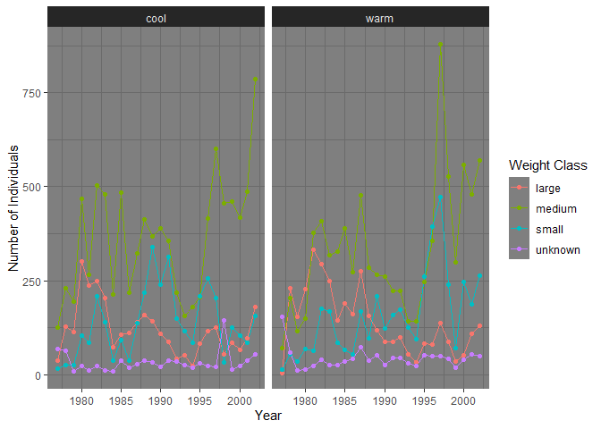

# Week 12 Assignment


# Assignment

### Purpose

The goal of this assignment is to practice writing and using conditional
statements, `if_else` and `case_when`, and `if`-`else` statements, and
to combine them wiith skills from earlier in the semester (joins,
strings, and plotting).

### Task

Write R code to successfully answer each question below.

### Criteria for Success

- Code is within the provided code chunks or new code chunks are created
  where necessary
- Code chunks run without errors
- Code chunks have brief comments indicating which code is answering
  which part of the question
- Code will be assessed as follows:
  - Produces the correct answer using the requested approach: 100%
  - Generally uses the right approach, but a minor mistake results in an
    incorrect answer: 90%
  - Attempts to solve the problem and makes some progress using the core
    concept, but returns the wrong answer and does not demonstrate
    comfort with the core concept: 50%
  - Answer demonstrates a lack of understanding of the core concept: 0%
- Any questions requiring written answers are answered with sufficient
  detail

### Due Date

November 17 before class

# Assignment Exercises

### 1. Choice Operators (10 pts)

Create the following variables by running the code chunk below.

``` r
w <- 10.2
x <- 1.3
y <- 2.8
z <- 17.5
colors <- c("red", "blue", "green")
masses <- c(45.2, 36.1, 27.8, 81.6, 42.4)
```

Using the variables above, write code that determines whether the
following statements are `TRUE` or `FALSE`.

1.  `"green"` is in `color`
2.  `"purple"` is not in `colors`
3.  Each value in `masses` is greater than 40.
4.  `w` is greater than `x`, or `y` is greater than `z`
5.  `x` times `w` is between 13.2 and 13.5

``` r
#1a
"green" %in% colors
```

    [1] TRUE

``` r
#1b
!"purple" %in% colors
```

    [1] TRUE

``` r
#1c-Each value in masses is greater than 40.
masses > 40
```

    [1]  TRUE FALSE FALSE  TRUE  TRUE

``` r
#1d-w is greater than x, or y is greater than z
w > x | y > z
```

    [1] TRUE

``` r
#1e-x times w is between 13.2 and 13.5
(x*w) >=13.2 & (x*w)<=13.5
```

    [1] TRUE

### 2. Using `dplyr` Choice Functions (20 points)

For this question, we will be using functions from `dplyr` (part of the
`tidyverse`) and data from the `lterdatasampler` package, so make sure
you load both of those packages with the `library()` function.

First, create an object called `crab_size` and assign the value 17 to
it.

``` r
library(tidyverse)
```

    Warning: package 'tidyverse' was built under R version 4.4.3

    Warning: package 'readr' was built under R version 4.4.3

    Warning: package 'stringr' was built under R version 4.4.3

    Warning: package 'forcats' was built under R version 4.4.3

    Warning: package 'lubridate' was built under R version 4.4.3

    ── Attaching core tidyverse packages ──────────────────────── tidyverse 2.0.0 ──
    ✔ dplyr     1.1.4     ✔ readr     2.2.0
    ✔ forcats   1.0.1     ✔ stringr   1.6.0
    ✔ ggplot2   3.5.1     ✔ tibble    3.2.1
    ✔ lubridate 1.9.5     ✔ tidyr     1.3.1
    ✔ purrr     1.0.2     
    ── Conflicts ────────────────────────────────────────── tidyverse_conflicts() ──
    ✖ dplyr::filter() masks stats::filter()
    ✖ dplyr::lag()    masks stats::lag()
    ℹ Use the conflicted package (<http://conflicted.r-lib.org/>) to force all conflicts to become errors

``` r
library(lterdatasampler)
```

    Warning: package 'lterdatasampler' was built under R version 4.4.3

``` r
crab_size <-  17
```

1.  Use the `if_else` function from `dplyr` to say that a crab that is
    larger than or equal to 20 is “large” and a crab that is smaller
    than 20 is “small.”

    ``` r
    #2a
    if_else(condition = crab_size >= 20 ,
            true = "large",
            false = "small")
    ```

        [1] "small"

2.  Use the `case_when` function to say that if a crab is greater than
    or equal to 20, it is “large;” if greater than or equal to 10 but
    less than 20, it is “medium;” and if it is smaller than 10, it is
    “small.” Make sure that your `crab_size` object is still set to 17.

    ``` r
    #2b
    case_when(
      crab_size >= 20 ~ "large",
      crab_size >=10 & (crab_size) <20 ~"medium",
      crab_size <10 ~ "small")
    ```

        [1] "medium"

3.  Take a look at the `pie_crab` dataset from the `lterdatasampler`
    package by running `head(pie_crab)`. We want to create a new column
    based on the `size` column. Using the `if_else` function inside of a
    `mutate` function, create a new column called `size_category` based
    on the same conditions as (a).

    I’ve placed my new column next to the size column for the sake of
    the answer key; you don’t need to do this.

    ``` r
    head(pie_crab)
    ```

        # A tibble: 6 × 9
          date       latitude site   size air_temp air_temp_sd water_temp water_temp_sd
          <date>        <dbl> <chr> <dbl>    <dbl>       <dbl>      <dbl>         <dbl>
        1 2016-07-24       30 GTM    12.4     21.8        6.39       24.5          6.12
        2 2016-07-24       30 GTM    14.2     21.8        6.39       24.5          6.12
        3 2016-07-24       30 GTM    14.5     21.8        6.39       24.5          6.12
        4 2016-07-24       30 GTM    12.9     21.8        6.39       24.5          6.12
        5 2016-07-24       30 GTM    12.4     21.8        6.39       24.5          6.12
        6 2016-07-24       30 GTM    13.0     21.8        6.39       24.5          6.12
        # ℹ 1 more variable: name <chr>

    ``` r
    #2c
    pies <- pie_crab |> 
      mutate( size_category = if_else(condition = crab_size >= 20 ,
                                      true = "large",
                                      false = "small"),
        .after = size)
    pies
    ```

        # A tibble: 392 × 10
           date       latitude site   size size_category air_temp air_temp_sd water_temp
           <date>        <dbl> <chr> <dbl> <chr>            <dbl>       <dbl>      <dbl>
         1 2016-07-24       30 GTM    12.4 small             21.8        6.39       24.5
         2 2016-07-24       30 GTM    14.2 small             21.8        6.39       24.5
         3 2016-07-24       30 GTM    14.5 small             21.8        6.39       24.5
         4 2016-07-24       30 GTM    12.9 small             21.8        6.39       24.5
         5 2016-07-24       30 GTM    12.4 small             21.8        6.39       24.5
         6 2016-07-24       30 GTM    13.0 small             21.8        6.39       24.5
         7 2016-07-24       30 GTM    10.3 small             21.8        6.39       24.5
         8 2016-07-24       30 GTM    11.2 small             21.8        6.39       24.5
         9 2016-07-24       30 GTM    12.7 small             21.8        6.39       24.5
        10 2016-07-24       30 GTM    14.6 small             21.8        6.39       24.5
        # ℹ 382 more rows
        # ℹ 2 more variables: water_temp_sd <dbl>, name <chr>

4.  Now use the `case_when` function inside a `mutate` function to
    create a new column called `size_category3` in the `pie_crab` data
    frame that meets the same conditions as (b).

    I’ve placed my new column next to the size column for the sake of
    the answer key; you don’t need to do this.

    ``` r
    #2d
    pies2 <- pie_crab |> 
      mutate( size_category = if_else(
        size >= 20, "large",
        if_else(size >= 10, "medium", "small")),
        .after = size)
    pies2
    ```

        # A tibble: 392 × 10
           date       latitude site   size size_category air_temp air_temp_sd water_temp
           <date>        <dbl> <chr> <dbl> <chr>            <dbl>       <dbl>      <dbl>
         1 2016-07-24       30 GTM    12.4 medium            21.8        6.39       24.5
         2 2016-07-24       30 GTM    14.2 medium            21.8        6.39       24.5
         3 2016-07-24       30 GTM    14.5 medium            21.8        6.39       24.5
         4 2016-07-24       30 GTM    12.9 medium            21.8        6.39       24.5
         5 2016-07-24       30 GTM    12.4 medium            21.8        6.39       24.5
         6 2016-07-24       30 GTM    13.0 medium            21.8        6.39       24.5
         7 2016-07-24       30 GTM    10.3 medium            21.8        6.39       24.5
         8 2016-07-24       30 GTM    11.2 medium            21.8        6.39       24.5
         9 2016-07-24       30 GTM    12.7 medium            21.8        6.39       24.5
        10 2016-07-24       30 GTM    14.6 medium            21.8        6.39       24.5
        # ℹ 382 more rows
        # ℹ 2 more variables: water_temp_sd <dbl>, name <chr>

### 3. If/Else Statements (20 points)

1.  Complete the following `if` statement so that if `age_class` is
    equal to “sapling” it sets `y` to 10, if `age_class` is equal to
    “seedling” it sets `y` to 5, and if `age_class` is something else it
    sets `y` to 0.

``` r
#3a
age_class <- "adult"
if (age_class == "sampling"){
  y <- 10
  } else if (age_class == "seedling"){
    y <-  5
  } else {
    y <- 0
  }
y
```

    [1] 0

2.  Convert your conditional statement from (a) into a function that
    takes `age_class` as an argument and returns `y`. Call this function
    5 times, once with each of the following values for `age_class`:
    “sapling”, “seedling”, “adult”, “mature”, “established”.

    ``` r
    #3b
    age_function <-  function (age_class){
      if(age_class == "sampling") {
        y <-  10
      } else if (age_class  == "seedling") {
        y <-  5
      } else {
        y <- 0
      }
      return(y)
    }
    ```

    ``` r
    #sampling instead of sapling
    age_function("sampling")
    ```

        [1] 10

    ``` r
    age_function("seedling")
    ```

        [1] 5

    ``` r
    age_function("adut")
    ```

        [1] 0

    ``` r
    age_function("mature")
    ```

        [1] 0

    ``` r
    age_function("established")
    ```

        [1] 0

3.  Write a function called `predict_value` that takes a single argument
    `x`. If `x` is greater than 0 and less than 15, return
    `y = 6 + 0.8 * x`. If `x` is greater than or equal to 15 and less
    than 30, return `y = 5 + 0.75 * x`. In all other cases, return
    `y = NA`. Call the function three times, with `5`, `26`, and `-2` as
    the input.

    ``` r
    #3c
    predict_value <-  function(x) {
      if ( x> 0 & x <15){
        y <-  6 + 0.8 * x
      } else if (x >= 15 & x <30){
        y <-  5 + 0.75 * x
      } else {
        y <-NA
      }
      return(y)
    }
    ```

``` r
predict_value(5)
```

    [1] 10

``` r
predict_value(26)
```

    [1] 24.5

``` r
predict_value(-2)
```

    [1] NA

### 4.Size Estimates by Name (20 points)

This is a follow up to “Use and Modify” from Assignment 11.

To make it even easier to work with your dinosaur size estimation
functions you decide to create a function that lets you specify which
dinosaur group you need to estimate the size of by name and then have
the function automatically choose the right parameters.

Remember the general form of the equation is:

mass \<- a \* length ^ b

Create a new function `get_mass_from_length_by_name()` that takes two
arguments: the `length` and the name of the dinosaur group.

Inside this function use `if`/`else if`/`else` statements to check to
see if the name is one of the following values and if so use the
associated `a` and `b` values to estimate the species mass using these
equations:

- *Stegosauria*: `mass = 10.95 * length ^ 2.64`
- *Theropoda*: `mass = 0.73 * length ^ 3.63`
- *Sauropoda*: `mass = 214.44 * length ^ 1.46`

If the name is not any of these values the function should return `NA`.

``` r
#4function
get_mass_from_length_by_name <-  function(length, dinosaur_group) {
  if (dinosaur_group == "Stegosauria") {
    mass <-  10.95 * length ^ 2.64
  } else if (dinosaur_group == "Theropoda"){
    mass <-  0.73 * length ^ 3.63
  } else if (dinosaur_group == "Sauropoda"){
    mass <-  214.44  * length ^ 1.46
  } else {
    mass <- NA
  }
  return(mass)
  } 
```

Run the function for the following:

1.  A *Stegosauria* that is 10 meters long.
2.  A *Theropoda* that is 8 meters long.
3.  A *Sauropoda* that is 12 meters long.
4.  An *Ankylosauria* that is 13 meters long.

``` r
#4a-Stegosauria that is 10 meters long.
get_mass_from_length_by_name(10, "Stegosauria")
```

    [1] 4779.848

``` r
#4b-Theropoda that is 8 meters long.
get_mass_from_length_by_name(8, "Theropoda")
```

    [1] 1385.286

``` r
#4c-Sauropoda that is 12 meters long.
get_mass_from_length_by_name(12, "Sauropoda")
```

    [1] 8070.685

``` r
#4d-Ankylosauria that is 13 meters long.
get_mass_from_length_by_name(13, "Ankylosauria")
```

    [1] NA

*Challenge 1 (optional)*: If the name is not one of values that have a
and b values print warning that it doesn’t know how to convert that
group that includes that groups name in a message like “No known
estimation for Ankylosauria.” You can use the function
`warning("your warning text")` to print a warning and the function
`paste()` to combine text with a value from a variable such as
`paste("My name is", name)`. Doing this successfully will modify your
answer to (d), which is fine.

*Challenge 2 (optional)*: Change your function so that it uses two
different values of `a` and `b` for *Stegosauria*. When *Stegosauria* is
greater than 8 meters long use the equation above. When it is 8 meters
long or less, use `a = 8.5` and `b = 2.8`. Run the function for a
*Stegosauria* that is 6 meters long.

Hint: you can put an `if`-`else` statement inside another `if`
statement, like this:

``` r
if (name == "Stegosauria") {
  if (length > 8) {
    # one set of a and b values
  } else {
    # another set of a and b values
  }
} else if ...
```

### 5. Putting It All Together: Portal Rodents (30 points)

In this question, you will combine choice functions with joins, strings,
and plotting. Load the `tidyverse` if you haven’t already.

Download the following Portal data tables using code below (modify the
`destfile` arguments to point to the correct sub-directory) to get
started.

``` r
download.file(url = "https://ndownloader.figshare.com/files/2292172",
              destfile = "raw_data/surveys.csv")
download.file(url = "https://ndownloader.figshare.com/files/3299483",
              destfile = "raw_data/species.csv")
surveys <- read.csv("raw_data/surveys.csv")
species <- read.csv("raw_data/species.csv")
```

1.  Join `surveys` and `species` together so that each survey record has
    the genus, species, and taxa information. Keep only rodents (`taxa`
    is “Rodent”). Then, use a `stringr` function to add a column called
    `scientific_name` that combines `genus` and `species` with a space
    between them (e.g., “Dipodomys merriami”). Save the result as an
    object called `rodents`.}

    ``` r
    #5a
    rodents <- surveys |> 
      left_join(species, by = "species_id") |> 
      filter(taxa == "Rodent") |> 
      mutate(
        scientific_name = str_c(genus, species, sep = " ")
      )

    head(rodents)
    ```

          record_id month day year plot_id species_id sex hindfoot_length weight
        1         1     7  16 1977       2         NL   M              32     NA
        2         2     7  16 1977       3         NL   M              33     NA
        3         3     7  16 1977       2         DM   F              37     NA
        4         4     7  16 1977       7         DM   M              36     NA
        5         5     7  16 1977       3         DM   M              35     NA
        6         6     7  16 1977       1         PF   M              14     NA
                genus  species   taxa    scientific_name
        1     Neotoma albigula Rodent   Neotoma albigula
        2     Neotoma albigula Rodent   Neotoma albigula
        3   Dipodomys merriami Rodent Dipodomys merriami
        4   Dipodomys merriami Rodent Dipodomys merriami
        5   Dipodomys merriami Rodent Dipodomys merriami
        6 Perognathus   flavus Rodent Perognathus flavus

2.  Some individuals could only be identified to genus, so their
    `species` is “sp.” (e.g., “Dipodomys sp.”). Use `if_else` and
    `str_detect` inside a `mutate` to add a column called `id_level`
    that is “genus only” if `scientific_name` contains “sp.” and
    “species” otherwise. Then use `count()` to show how many records
    fall into each `id_level`.

    Hint: Remember that `.` is a special character in regular
    expressions! If you don’t account for this, some species names (like
    *Dipodomys spectabilis*) will be counted incorrectly.

    ``` r
    #5b
    rodents <- rodents |> 
      mutate(
        id_level = if_else(
          str_detect(scientific_name, "sp\\."),
          "genus only",
          "species"
        )
      )
    rodents |> 
      count(id_level)
    ```

            id_level     n
        1 genus only    70
        2    species 34177

3.  Use `if_else` and the `%in%` operator inside a `mutate` to add a
    column called `season` that is “warm” if the `month` is April
    through September (months 4-9) and “cool” otherwise.

    ``` r
    #5c
    rodents <-  rodents |> 
      mutate(
        season = if_else(
          month %in% 4:9,
          "warm",
          "cool"
        )
      )
    rodents
    ```

             record_id month day year plot_id species_id sex hindfoot_length weight
        1            1     7  16 1977       2         NL   M              32     NA
        2            2     7  16 1977       3         NL   M              33     NA
        3            3     7  16 1977       2         DM   F              37     NA
        4            4     7  16 1977       7         DM   M              36     NA
        5            5     7  16 1977       3         DM   M              35     NA
        6            6     7  16 1977       1         PF   M              14     NA
        7            7     7  16 1977       2         PE   F              NA     NA
        8            8     7  16 1977       1         DM   M              37     NA
        9            9     7  16 1977       1         DM   F              34     NA
        10          10     7  16 1977       6         PF   F              20     NA
        11          11     7  16 1977       5         DS   F              53     NA
        12          12     7  16 1977       7         DM   M              38     NA
        13          13     7  16 1977       3         DM   M              35     NA
        14          14     7  16 1977       8         DM                  NA     NA
        15          15     7  16 1977       6         DM   F              36     NA
        16          16     7  16 1977       4         DM   F              36     NA
        17          17     7  16 1977       3         DS   F              48     NA
        18          18     7  16 1977       2         PP   M              22     NA
        19          19     7  16 1977       4         PF                  NA     NA
        20          20     7  17 1977      11         DS   F              48     NA
        21          21     7  17 1977      14         DM   F              34     NA
        22          22     7  17 1977      15         NL   F              31     NA
        23          23     7  17 1977      13         DM   M              36     NA
        24          24     7  17 1977      13         SH   M              21     NA
        25          25     7  17 1977       9         DM   M              35     NA
        26          26     7  17 1977      15         DM   M              31     NA
        27          27     7  17 1977      15         DM   M              36     NA
        28          28     7  17 1977      11         DM   M              38     NA
        29          29     7  17 1977      11         PP   M              NA     NA
        30          30     7  17 1977      10         DS   F              52     NA
        31          31     7  17 1977      15         DM   F              37     NA
        32          32     7  17 1977      10         DM   F              35     NA
        33          33     7  17 1977      11         DM   F              36     NA
        34          34     7  17 1977      17         DM                  NA     NA
        35          35     7  17 1977      13         DM   F              38     NA
        36          36     7  17 1977      16         OT   F              22     NA
        37          37     7  17 1977      11         DM   F              35     NA
        38          38     7  17 1977      17         NL   M              33     NA
        39          39     7  17 1977      11         DM   F              36     NA
        40          40     7  18 1977      20         DM   M              36     NA
        41          41     7  18 1977      23         DM   F              34     NA
        42          42     7  18 1977      18         DS   F              46     NA
        43          43     7  18 1977      21         DM   M              36     NA
        44          44     7  18 1977      18         DM   F              35     NA
        45          45     7  18 1977      22         DM   M              36     NA
        46          46     7  18 1977      19         DM   M              35     NA
        47          47     7  18 1977      18         DM   M              32     NA
        48          48     7  18 1977      20         DM   F              36     NA
        49          49     7  18 1977      12         PP   F              17     NA
        50          50     7  18 1977      18         DM   F              32     NA
        51          51     7  18 1977      21         DM   F              36     NA
        52          52     7  18 1977      12         DM   F              26     NA
        53          53     7  18 1977      22         DM   M              36     NA
        54          54     7  18 1977      18         DM   M              37     NA
        55          55     7  18 1977      23         DM   M              36     NA
        56          56     7  18 1977      20         DM   M              34     NA
        57          57     7  18 1977      22         DM                  NA     NA
        58          58     7  18 1977      12         DS   M              45     NA
        59          59     7  18 1977      19         DM   M              33     NA
        60          60     7  18 1977      19         PE   M              20     NA
        61          61     7  18 1977      23         DM   M              35     NA
        62          62     7  18 1977      19         DM   M              35     NA
        63          63     8  19 1977       3         DM   M              35     40
        64          64     8  19 1977       7         DM   M              37     48
        65          65     8  19 1977       4         DM   F              34     29
        66          66     8  19 1977       4         DM   F              35     46
        67          67     8  19 1977       7         DM   M              35     36
        68          68     8  19 1977       8         DO   F              32     52
        69          69     8  19 1977       2         PF   M              15      8
        70          70     8  19 1977       3         OX   F              21     22
        71          71     8  19 1977       7         DM   F              36     35
        72          72     8  19 1977       2         NL   M              31     NA
        73          73     8  19 1977       3         DS   F              44     NA
        74          74     8  19 1977       8         PF   M              12      7
        75          75     8  19 1977       8         DM   F              32     22
        76          76     8  19 1977       9         DS   F              47     NA
        77          77     8  19 1977       4         SS                  NA     NA
        78          78     8  19 1977       1         PF   M              16      9
        79          79     8  19 1977       7         DM   F              34     42
        80          80     8  19 1977       1         DS   M              48     NA
        81          81     8  19 1977       4         PF   F              14      8
        82          82     8  19 1977       4         DM   F              35     41
        83          83     8  20 1977       6         DM   F              37     37
        84          84     8  20 1977      19         DM   F              35     43
        85          85     8  20 1977      23         DM   F              35     41
        86          86     8  20 1977      18         DM   F              33     40
        87          87     8  20 1977       5         PF   F              11      9
        88          88     8  20 1977      18         DM   F              35     45
        89          89     8  20 1977      12         PP   F              20     15
        90          90     8  20 1977      18         DM   M              35     29
        91          91     8  20 1977      11         DS   F              50     NA
        92          92     8  20 1977       6         DM   M              35     39
        93          93     8  20 1977      18         DM                  NA     42
        94          94     8  20 1977      18         DM   F              36     43
        95          95     8  20 1977      23         DM   M              38     46
        96          96     8  20 1977      12         DM   M              36     41
        97          97     8  20 1977      18         DM   M              36     41
        98          98     8  20 1977       5         DM   M              38     40
        99          99     8  20 1977      11         DM   M              37     45
        100        100     8  20 1977       5         DS   F              54     NA
        101        101     8  20 1977       5         DM   F              35     46
        102        102     8  20 1977      23         DM   F              35     40
        103        103     8  20 1977      18         DM   F              35     30
        104        104     8  20 1977      11         DS   M              43     NA
        105        105     8  20 1977      19         DM   M              35     39
        106        106     8  20 1977      12         NL                  NA     NA
        107        107     8  20 1977      18         NL                  NA     NA
        108        108     8  20 1977      11         PP   M              21     NA
        109        109     8  20 1977       6         DM   M              35     34
        110        110     8  20 1977      10         DS                  NA     NA
        111        111     8  20 1977      11         DM   F              37     42
        112        112     8  20 1977      23         DM   M              37     42
        113        113     8  20 1977       5         PF   F              13      8
        114        114     8  21 1977      15         DM   F              32     NA
        115        115     8  21 1977      21         DM   M              34     NA
        116        116     8  21 1977      13         DM   F              37     31
        117        117     8  21 1977      21         OX   F              19     NA
        118        118     8  21 1977      17         DM   M              33     NA
        119        119     8  21 1977      20         DM   M              35     NA
        120        120     8  21 1977      20         DM   M              35     NA
        121        121     8  21 1977      15         NL                  NA     NA
        122        122     8  21 1977      22         DM   F              33     NA
        123        123     8  21 1977      17         DM   M              37     NA
        124        124     8  21 1977      14         DM   M              36     NA
        125        125     8  21 1977      22         DM   M              35     NA
        126        126     8  21 1977      20         DM   F              30     NA
        127        127     8  21 1977      14         DM   M              33     NA
        128        128     8  21 1977      15         DM   M              34     NA
        129        129     8  21 1977      14         DM   F              34     NA
        130        130     8  21 1977      16         DM   F              34     NA
        131        131     8  21 1977      22         DM   M              37     NA
        132        132     8  21 1977      22         DM   F              33     NA
        133        133     8  21 1977      15         DM   M              37     NA
        134        134     8  21 1977      17         DS   F              45     NA
        135        135     8  21 1977      15         DM   F              35     NA
        136        136     8  21 1977      13         PF   F              16     NA
        137        137     8  21 1977      20         DM   F              35     NA
        138        138     8  21 1977      22         DM   M              37     NA
        139        139     8  21 1977      14         PF   M              15     NA
        140        140     8  21 1977      20         DM   M              33     NA
        141        141     8  21 1977      16         DM   M              36     NA
        142        142     8  21 1977      17         DM   F              34     NA
        143        143     8  21 1977      15         DM   M              35     NA
        144        144     8  21 1977      15         DS   M              40     NA
        145        145     8  21 1977      13         DM   F              37     NA
        146        146     8  21 1977      13         DM   F              36     40
        147        147     8  21 1977      13         DM   M              37     NA
        148        148     8  21 1977      14         DM   M              37     NA
        149        149     8  21 1977      20         DS   M              50     NA
        150        150     8  21 1977      21         DM   M              35     NA
        151        151     8  21 1977      13         DM   M              35     NA
        152        152     8  21 1977      14         DM   M              38     NA
        153        153     8  21 1977      16         DS   F              50     NA
        154        154     8  21 1977      20         DS   F              47     NA
        155        155     8  21 1977      20         DS                  NA     NA
        156        156     8  21 1977      21         DM   M              35     NA
        157        157     9  11 1977      20         DM   M              36     37
        158        158     9  11 1977      22         DM   M              36     48
        159        159     9  11 1977       5         DS   M              53     NA
        160        160     9  11 1977      21         DM   M              37     NA
        161        161     9  11 1977       5         DM   M              37     42
        162        162     9  11 1977       6         DM   F              39     45
        163        163     9  11 1977      12         PP   F              21     16
        164        164     9  11 1977      22         DM   F              36     36
        165        165     9  11 1977      19         DS   F              50     NA
        166        166     9  11 1977      21         OX   M              13     NA
        167        167     9  11 1977       6         DM   M              36     42
        168        168     9  11 1977      12         DM   M              36     44
        169        169     9  11 1977       5         DM   M              37     NA
        170        170     9  11 1977      20         DM   F              36     41
        171        171     9  11 1977      12         NL                  NA     NA
        172        172     9  11 1977      22         PF   F              NA      8
        173        173     9  11 1977      12         DM   F              36     40
        174        174     9  11 1977      12         DM   M              37     34
        175        175     9  11 1977      19         DM   M              33     40
        176        176     9  11 1977      12         DS   M              45     NA
        177        177     9  11 1977       5         OX   F              NA     20
        178        178     9  11 1977      18         DM   M              33     44
        179        179     9  11 1977      12         DM   M              37     44
        180        180     9  11 1977       6         DM   M              34     36
        181        181     9  11 1977      20         DM   M              35     33
        182        182     9  11 1977      21         DS   M              49     NA
        183        183     9  11 1977       5         DM   F              37     46
        184        184     9  11 1977      20         DS   M              52     NA
        185        185     9  11 1977      12         OX   F              19     NA
        186        186     9  11 1977      19         DM   F              34     35
        187        187     9  12 1977      17         DM   M              36     46
        188        188     9  12 1977      14         DS   F              48     NA
        189        189     9  12 1977      17         DM   F              33     37
        190        190     9  12 1977       7         DM   M              36     34
        191        191     9  12 1977      17         DS   M              47     NA
        192        192     9  12 1977       4         DM   F              36     45
        193        193     9  12 1977       7         PE                  NA     NA
        194        194     9  12 1977      11         NL                  NA     NA
        195        195     9  12 1977       4         DS   M              50     NA
        196        196     9  12 1977       7         PF   F              15      7
        197        197     9  12 1977      14         DM   M              37     51
        198        198     9  12 1977       4         DM   M              35     39
        199        199     9  12 1977      11         DM   M              36     29
        200        200     9  12 1977      17         DS   F              52     NA
        201        201     9  12 1977      10         DS   M              47     NA
        202        202     9  12 1977      17         DM   F              32     48
        203        203     9  12 1977      11         DM   M              38     46
        204        204     9  12 1977      16         DM   F              37     41
        205        205     9  12 1977      16         DS   M              50     NA
        206        206     9  12 1977      23         DS   F              52     NA
        207        207     9  12 1977      16         DS   F              53     NA
        208        208     9  12 1977      14         DM   M              37     45
        209        209     9  12 1977      17         DM   F              35     42
        210        210     9  12 1977      11         DM   F              36     53
        211        211     9  12 1977       4         DS   F              48     NA
        212        212     9  12 1977      16         PF                  NA     NA
        213        213     9  12 1977      14         DM   F              35     49
        214        214     9  12 1977      17         NL                  NA     NA
        215        215     9  12 1977      14         DM   F              36     46
        216        216     9  12 1977       4         PF   F              13      9
        217        217     9  13 1977       3         PP   F              19     15
        218        218     9  13 1977       1         PF   M              13      4
        219        219     9  13 1977      13         DM   M              36     48
        220        220     9  13 1977       2         DS   M              52     NA
        221        221     9  13 1977       3         DM                  NA     NA
        222        222     9  13 1977       1         DS   M              52     NA
        223        223     9  13 1977       8         DS   F              50     NA
        224        224     9  13 1977       2         NL                  NA     NA
        225        225     9  13 1977      15         DM                  NA     NA
        226        226     9  13 1977       2         DM   M              37     51
        227        227     9  13 1977      15         DM                  NA     NA
        228        228     9  13 1977       9         DM   M              38     50
        229        229     9  13 1977      13         DM   M              35     44
        230        230     9  13 1977      15         DM                  NA     NA
        231        231     9  13 1977      15         DS                  NA     NA
        232        232     9  13 1977       9         DS   M              48     NA
        233        233     9  13 1977       2         DM   M              25     44
        234        234     9  13 1977       9         DM   M              35     45
        235        235     9  13 1977      13         DM   F              37     45
        236        236     9  13 1977       9         DS   F              47     NA
        237        237     9  13 1977       9         DS   F              50     NA
        238        238     9  13 1977       2         PE   M              20     19
        239        239     9  13 1977       1         DS   M              48     NA
        240        240     9  13 1977       9         DS   F              53     NA
        241        241     9  13 1977       3         DS                  NA     NA
        242        242     9  13 1977       2         OX   M              19     22
        243        243    10  16 1977       6         DM   F              38     44
        244        244    10  16 1977      22         DM   F              36     42
        245        245    10  16 1977       2         DM   M              37     39
        246        246    10  16 1977      13         DM   M              37     47
        247        247    10  16 1977       2         DS   M              54     NA
        248        248    10  16 1977      22         OT   M              NA     21
        249        249    10  16 1977      13         DM   M              36     42
        250        250    10  16 1977      18         DS   F              51     NA
        251        251    10  16 1977       2         DM   M              36     49
        252        252    10  16 1977       6         DS   F              53     NA
        253        253    10  16 1977      20         DM   M              38     39
        254        254    10  16 1977      20         DM   F              36     43
        255        255    10  16 1977      18         DM   M              35     50
        256        256    10  16 1977       6         DM   M              36     41
        257        257    10  16 1977       2         DM   M              37     47
        258        258    10  16 1977      18         DM   F              36     37
        259        259    10  16 1977       2         DM   M              36     41
        260        260    10  16 1977      22         DM   F              36     36
        261        261    10  16 1977       6         DM   M              36     45
        262        262    10  16 1977      20         PE   M              19     20
        263        263    10  16 1977       1         DM   M              37     40
        264        264    10  16 1977       9         DS   F              49     NA
        265        265    10  16 1977       9         DM   M              38     49
        266        266    10  16 1977       2         NL                  NA     NA
        267        267    10  16 1977      22         DS   F              46     NA
        268        268    10  16 1977       2         DM   F              36     55
        269        269    10  16 1977       6         DM   M              37     46
        270        270    10  16 1977       1         DM   F              36     38
        271        271    10  16 1977       9         DS   F              50     NA
        272        272    10  16 1977      18         NL                  NA     NA
        273        273    10  16 1977       9         DM   M              37     44
        274        274    10  16 1977       2         OL   F              20     21
        275        275    10  16 1977      20         DM   M              37     41
        276        276    10  16 1977       1         DS   F              50     NA
        277        277    10  16 1977       6         OL                  20     21
        278        278    10  16 1977       9         DS   M              50     NA
        279        279    10  16 1977       2         PE   F              19     NA
        280        280    10  16 1977      18         DM   M              37     46
        281        281    10  16 1977      20         NL                  NA     NA
        282        282    10  16 1977      22         NL                  NA     NA
        283        283    10  16 1977       6         DM   M              34     36
        284        284    10  16 1977      13         DM   M              37     44
        285        285    10  16 1977       1         DM   M              36     53
        286        286    10  16 1977      20         DS   M              50     NA
        287        287    10  17 1977      17         DM   M              38     41
        288        288    10  17 1977      17         DM   M              37     48
        289        289    10  17 1977      14         DM   M              38     47
        290        290    10  17 1977      17         DM   F              33     NA
        291        291    10  17 1977      11         DS   F              47     NA
        292        292    10  17 1977       3         DO   F              36     33
        293        293    10  17 1977       4         DM   F              36     42
        294        294    10  17 1977       3         DO   F              37     50
        295        295    10  17 1977      11         DM   M              36     41
        296        296    10  17 1977      17         OT                  18     21
        297        297    10  17 1977      11         NL                  NA     NA
        298        298    10  17 1977      19         DM   M              36     49
        299        299    10  17 1977      17         OT   M              19     NA
        300        300    10  17 1977      14         DS   F              NA     NA
        301        301    10  17 1977      17         DS   F              48     NA
        302        302    10  17 1977      19         DM   F              36     44
        303        303    10  17 1977       3         DM   M              36     31
        304        304    10  17 1977      21         DM   M              37     40
        305        305    10  17 1977      14         DM   F              35     40
        306        306    10  17 1977      16         DM   M              33     23
        307        307    10  17 1977      19         DM   M              36     42
        308        308    10  17 1977       4         DS   F              48     NA
        309        309    10  17 1977      17         DS   M              49     NA
        310        310    10  17 1977      11         DS                  NA     NA
        311        311    10  17 1977      19         RM   M              18     13
        312        312    10  17 1977      11         DM   F              36     42
        313        313    10  17 1977      19         DM   M              35     31
        314        314    10  17 1977      14         NL                  NA     NA
        315        315    10  17 1977       3         DM   M              36     39
        316        316    10  17 1977      15         DM   M              37     48
        317        317    10  17 1977      17         DO   F              32     48
        318        318    10  17 1977      17         DM   M              33     29
        319        319    10  17 1977      14         DM   M              36     45
        320        320    10  17 1977      17         DM   F              35     39
        321        321    10  17 1977      17         OL   F              NA     23
        322        322    10  17 1977       4         DS   F              47     NA
        323        323    10  17 1977      17         DO   F              33     31
        324        327    10  18 1977       8         DS   F              50     NA
        325        328    10  18 1977      16         DM   F              NA     43
        326        329    10  18 1977       5         DS   F              47     NA
        327        330    10  18 1977       5         DM   M              37     43
        328        331    10  18 1977      12         DS   F              50     NA
        329        332    10  18 1977      12         PF   M              16      8
        330        333    10  18 1977      19         OX                  NA     NA
        331        334    10  18 1977       5         DM   F              37     45
        332        335    10  18 1977       5         DS   M              52     NA
        333        336    10  18 1977      12         DM   M              36     40
        334        337    10  18 1977       8         DO   F              35     41
        335        338    10  18 1977      12         DM   M              37     41
        336        339    10  18 1977       8         DS   F              49     NA
        337        340    10  18 1977      12         DM   F              36     39
        338        341    10  18 1977       5         DS   M              50     NA
        339        342    10  18 1977      16         DM   M              34     25
        340        343    10  18 1977      21         PF                  NA     NA
        341        344    10  18 1977       3         NL                  NA     NA
        342        345    11  12 1977      22         DM   F              34     45
        343        346    11  12 1977       2         DM   F              37     36
        344        347    11  12 1977       6         DM   F              38     40
        345        348    11  12 1977      13         DM   M              36     44
        346        349    11  12 1977       2         NL                  NA     NA
        347        350    11  12 1977       2         DM   M              37     47
        348        351    11  12 1977      22         OL                  NA     NA
        349        352    11  12 1977       1         DM   M              36     40
        350        353    11  12 1977      18         NL                  NA     NA
        351        354    11  12 1977       2         DM   M              38     44
        352        355    11  12 1977       2         OT                  NA     NA
        353        356    11  12 1977       1         DO   F              32     44
        354        357    11  12 1977       9         DS   F              50    117
        355        358    11  12 1977      13         PF   F              16      7
        356        359    11  12 1977      18         DM   M              36     40
        357        360    11  12 1977      20         DM   F              35     39
        358        361    11  12 1977       2         DM   F              36     40
        359        362    11  12 1977       1         DS   F              51    121
        360        363    11  12 1977       2         NL                  NA     NA
        361        364    11  12 1977       9         DM   M              37     46
        362        365    11  12 1977       1         DM   F              38     35
        363        366    11  12 1977       2         OL                  NA     NA
        364        367    11  12 1977      20         DS   M              51    115
        365        368    11  12 1977       9         PF   F              16      7
        366        369    11  12 1977      20         DM   F              36     39
        367        370    11  12 1977       9         DM   M              35     40
        368        371    11  12 1977      13         DM   M              36     40
        369        372    11  12 1977      22         DM   F              36     35
        370        373    11  12 1977       6         DM   M              34     36
        371        374    11  12 1977      18         DM   M              37     44
        372        375    11  12 1977       9         PF   F              15      6
        373        376    11  12 1977       1         PF   F              15      7
        374        377    11  12 1977       9         DS   F              48    120
        375        378    11  12 1977       1         DO   M              33     48
        376        379    11  13 1977      14         DM   M              36     44
        377        380    11  13 1977      17         DM   F              33     38
        378        381    11  13 1977      17         DS   F              48    118
        379        382    11  13 1977      17         DM   M              37     40
        380        383    11  13 1977      11         DS   F              52    126
        381        384    11  13 1977      11         DM   M              36     37
        382        385    11  13 1977      17         DS   M              50    132
        383        386    11  13 1977      21         OL                  NA     NA
        384        387    11  13 1977      21         OL                  NA     NA
        385        388    11  13 1977      11         DM   F              36     39
        386        389    11  13 1977      14         DS   F              NA    113
        387        390    11  13 1977      11         NL                  NA     NA
        388        391    11  13 1977      11         PF   M              15      7
        389        392    11  13 1977      11         DS   F              53    122
        390        393    11  13 1977      14         NL                  NA     NA
        391        394    11  13 1977       4         DS   F              48    107
        392        395    11  13 1977      14         DM   M              36     43
        393        396    11  13 1977      14         DM   F              36     40
        394        397    11  13 1977      17         RM   F              16      7
        395        398    11  13 1977       4         DS   F              50    115
        396        399    11  13 1977      17         DM   F              36     39
        397        400    11  13 1977      21         OL                  NA     NA
        398        404    11  14 1977      12         DM   M              37     40
        399        405    11  14 1977      12         DS                  NA     NA
        400        406    11  14 1977      12         NL                  NA     NA
        401        407    11  14 1977       5         DS   F              50    116
        402        408    11  14 1977       8         PF   F               9      6
        403        409    11  14 1977      12         DM   F              36     38
        404        410    11  14 1977       5         DS   M              53    137
        405        411    11  14 1977       5         DM   M              36     42
        406        412    11  14 1977       5         DS   M              52    126
        407        413    11  14 1977       8         DS   F              49    112
        408        414    11  14 1977       8         DO   F              34     39
        409        415    11  14 1977       5         DM   F              36     41
        410        420    12  10 1977      13         DM   F              38     48
        411        421    12  10 1977       9         DS   F              51    121
        412        422    12  10 1977       2         DM   F              37     42
        413        423    12  10 1977      13         DM   M              36     42
        414        424    12  10 1977       2         DM   M              37     52
        415        425    12  10 1977      20         DM   F              36     38
        416        426    12  10 1977      22         DM   M              36     45
        417        427    12  10 1977       2         DM   F              37     37
        418        428    12  10 1977       9         DO   F              33     40
        419        429    12  10 1977       1         DM   M              NA     38
        420        430    12  10 1977       9         PF   F              15      7
        421        431    12  10 1977       2         OT                  NA     NA
        422        432    12  10 1977       2         PF                  NA     NA
        423        433    12  10 1977       9         DM   M              38     44
        424        434    12  10 1977      13         PF   F              16      7
        425        435    12  10 1977       2         NL                  NA     NA
        426        436    12  10 1977      18         DM   F              37     33
        427        437    12  10 1977      18         DM   F              37     38
        428        438    12  10 1977       2         DM   M              36     47
        429        439    12  10 1977      20         DM   F              36     39
        430        440    12  10 1977       1         PF   F              16      7
        431        441    12  10 1977       2         OL                  NA     NA
        432        442    12  10 1977       9         OT                  NA     NA
        433        443    12  10 1977      13         DM   M              35     42
        434        444    12  10 1977       6         DM   M              38     36
        435        445    12  10 1977       9         OL                  NA     NA
        436        446    12  10 1977       2         OT                  NA     NA
        437        447    12  10 1977      18         DM   M              37     44
        438        448    12  10 1977      20         DS   M              51    116
        439        449    12  10 1977       2         DM   M              35     43
        440        450    12  10 1977       1         DO   M              33     45
        441        451    12  10 1977       9         DS   F              51    116
        442        452    12  10 1977       2         OT                  NA     NA
        443        453    12  10 1977       9         DM   M              36     42
        444        454    12  10 1977       1         DM   F              36     38
        445        460    12  11 1977      12         DS   F              NA    114
        446        461    12  11 1977      14         DM   M              36     41
        447        462    12  11 1977      17         DM   M              36     40
        448        463    12  11 1977       4         DS   M              49    134
        449        464    12  11 1977       5         DS   M              49    139
        450        465    12  11 1977       5         NL                  NA     NA
        451        466    12  11 1977       4         DS   F              51    118
        452        467    12  11 1977       8         DO   F              32     41
        453        468    12  11 1977      11         DM   M              35     37
        454        469    12  11 1977      12         NL                  NA     NA
        455        470    12  11 1977       4         PF   M              15      6
        456        471    12  11 1977       5         OT                  NA     NA
        457        472    12  11 1977      11         DS   F              49    127
        458        473    12  11 1977      21         OT                  NA     NA
        459        474    12  11 1977       8         PF   F              15      6
        460        475    12  11 1977      11         NL                  NA     NA
        461        476    12  11 1977       8         DS   F              NA    120
        462        477    12  11 1977      17         DS   F              47    115
        463        478    12  11 1977       3         OT                  NA     NA
        464        479    12  11 1977      14         DM   F              36     40
        465        480    12  11 1977      14         DS   F              47    114
        466        481    12  11 1977      17         DM   F              35     37
        467        482    12  11 1977      17         DM   M              37     46
        468        483    12  11 1977       8         DS   M              49    149
        469        484    12  11 1977      11         DM   F              37     38
        470        485    12  11 1977      11         DS   M              52    127
        471        486    12  11 1977      14         NL                  NA     NA
        472        487    12  11 1977      12         DM   F              38     36
        473        488    12  11 1977      12         DM   M              37     41
        474        489    12  11 1977      11         OT                  NA     NA
        475        490    12  11 1977      14         DM   M              37     44
        476        491    12  11 1977      11         DS   M              48    138
        477        492    12  11 1977      12         DS   M              49    110
        478        493    12  11 1977       4         DS   F              49    110
        479        494    12  11 1977       4         OT                  NA     NA
        480        495    12  11 1977      17         NL                  NA     NA
        481        496    12  11 1977      17         DM   F              36     37
        482        497    12  11 1977       5         OT                  NA     NA
        483        498    12  11 1977       3         PF   M              16      7
        484        499    12  11 1977      11         DS   F              51    121
        485        500    12  11 1977      21         OT                  NA     NA
        486        501    12  11 1977      21         OT                  NA     NA
        487        502    12  11 1977       5         DM   F              36     43
        488        504     1   8 1978       3         OL                  NA     NA
        489        505     1   8 1978      13         DM   M              36     43
        490        506     1   8 1978       2         NL                  NA     NA
        491        507     1   8 1978       2         DM   M              35     44
        492        508     1   8 1978      20         DM   F              36     36
        493        509     1   8 1978       3         NL                  NA     NA
        494        510     1   8 1978      13         PF   F              16      8
        495        511     1   8 1978       2         DM   M              36     38
        496        512     1   8 1978       9         DS   F              48    122
        497        513     1   8 1978       2         OL                  NA     NA
        498        514     1   8 1978       9         PF   M              16      7
        499        515     1   8 1978       9         DO   F              NA     42
        500        516     1   8 1978       9         DM   M              38     46
        501        517     1   8 1978       2         PE   M              26     22
        502        518     1   8 1978       2         DM   M              36     38
        503        519     1   8 1978       2         DM   M              38     48
        504        520     1   8 1978       3         PF   M              15      7
        505        521     1   8 1978       2         DM   M              36     43
        506        522     1   8 1978       2         DM   F              37     35
        507        523     1   8 1978       2         DM   M              36     43
        508        524     1   8 1978      20         DM                  NA     NA
        509        525     1   8 1978       6         DM   M              34     36
        510        526     1   8 1978       9         DS   F              51    117
        511        527     1   8 1978       2         DM   F              37     37
        512        528     1   8 1978      20         DS   M              51    122
        513        529     1   8 1978       9         DM   M              36     43
        514        530     1   8 1978      13         DM   M              37     42
        515        531     1   8 1978      20         NL                  NA     NA
        516        532     1   8 1978       2         PF   F              NA      7
        517        533     1   8 1978       2         DM   M              NA     45
        518        534     1   8 1978       2         OT                  NA     NA
        519        537     1   9 1978      14         OT                  NA     NA
        520        538     1   9 1978      17         DM   M              36     40
        521        539     1   9 1978      17         DM   F              34     37
        522        540     1   9 1978      17         DS   F              47    117
        523        541     1   9 1978      11         DM   M              36     40
        524        542     1   9 1978       1         DM   M              36     40
        525        543     1   9 1978       4         DS   M              49    132
        526        544     1   9 1978      14         OL                  NA     NA
        527        545     1   9 1978       1         DM   F              38     36
        528        546     1   9 1978      11         NL                  NA     NA
        529        547     1   9 1978       8         OT                  NA     NA
        530        548     1   9 1978       8         DS   M              53    150
        531        549     1   9 1978      11         DM   M              38     44
        532        550     1   9 1978      14         DM   F              36     40
        533        551     1   9 1978       4         DS   F              50    126
        534        552     1   9 1978      11         DS   F              51    122
        535        553     1   9 1978       8         DS   F              50    136
        536        554     1   9 1978      14         NL                  NA     NA
        537        555     1   9 1978      14         DS   F              48    116
        538        556     1   9 1978      17         DM   F              36     38
        539        557     1   9 1978      11         DM   F              37     39
        540        558     1   9 1978       1         DS   F              49    135
        541        559     1   9 1978      14         DM   M              36     46
        542        560     1   9 1978      17         DS   M              50    133
        543        561     1   9 1978      11         DS   M              53    136
        544        564     1  10 1978      18         DS   F              51    141
        545        565     1  10 1978      12         NL                  NA     NA
        546        566     1  10 1978      18         DM   F              36     38
        547        567     1  10 1978      12         DM   F              36     35
        548        568     1  10 1978      21         OT                  NA     NA
        549        569     1  10 1978       5         DS   M              NA    135
        550        570     1  10 1978       5         OT                  NA     NA
        551        571     1  10 1978      18         DM   F              NA     33
        552        572     1  10 1978      18         DM   M              38     51
        553        573     1  10 1978       5         DS   F              NA    122
        554        574     1  10 1978      18         DM   F              34     33
        555        575     1  10 1978      18         DM   M              38     47
        556        576     1  10 1978      18         DM   M              36     49
        557        577     1  10 1978      21         OT                  NA     NA
        558        578     1  10 1978      18         DM   M              NA     46
        559        579     1  10 1978       5         DM   F              NA     45
        560        580     1  10 1978      12         DM   M              NA     41
        561        584     2  18 1978       3         OT   M              NA     24
        562        585     2  18 1978       2         DS   M              53    157
        563        586     2  18 1978      13         DM   M              35     51
        564        587     2  18 1978       2         OX                  NA     NA
        565        588     2  18 1978       2         NL   M              NA    218
        566        589     2  18 1978      20         DM   F              39     38
        567        590     2  18 1978       2         PF   F              16      7
        568        591     2  18 1978       6         DM   F              38     NA
        569        592     2  18 1978      22         DM   M              39     45
        570        593     2  18 1978       2         DM   M              38     52
        571        594     2  18 1978       9         DM   M              38     50
        572        595     2  18 1978       2         DM   M              37     51
        573        596     2  18 1978       9         DS   F              NA    126
        574        597     2  18 1978      20         DM   F              33     39
        575        598     2  18 1978       2         OT   F              NA     24
        576        599     2  18 1978       3         OT   F              15     23
        577        600     2  18 1978       2         DM   F              37     40
        578        601     2  18 1978       2         DM   M              36     41
        579        602     2  18 1978      13         DM   M              37     46
        580        603     2  18 1978       2         OT   M              NA     25
        581        604     2  18 1978       2         PE   M              22     25
        582        607     2  19 1978       5         DM   F              36     39
        583        608     2  19 1978      17         DM   F              34     42
        584        609     2  19 1978       4         DS   F              49     NA
        585        610     2  19 1978      17         DM   M              37     39
        586        611     2  19 1978      21         OT   F              20     23
        587        612     2  19 1978       4         DS                  NA     NA
        588        613     2  19 1978       5         DS   M              49     NA
        589        614     2  19 1978       4         DS   F              49    124
        590        615     2  19 1978       5         DS   F              49    114
        591        616     2  19 1978      11         DM   M              36     44
        592        617     2  19 1978      11         DM   M              38     48
        593        618     2  19 1978      14         DS   F              47     NA
        594        619     2  19 1978      14         DM   F              39     44
        595        620     2  19 1978       8         DS   F              49    132
        596        621     2  19 1978       4         PF                  NA     NA
        597        622     2  19 1978      17         DS   F              46    137
        598        623     2  19 1978      21         OT                  NA     NA
        599        624     2  19 1978       4         DM   M              35     39
        600        625     2  19 1978       5         DM   F              35     56
        601        626     2  19 1978      17         OL   F              20     35
        602        627     2  19 1978      17         DM                  NA     NA
        603        628     2  19 1978      11         DM                  NA     NA
        604        629     2  19 1978      14         NL                  NA    197
        605        630     2  19 1978       5         OT   F              18     22
        606        631     2  19 1978       5         OT   M              20     25
        607        633     2  19 1978       8         DS   M              55    154
        608        635     2  20 1978      15         DM   M              38     49
        609        636     2  20 1978      18         DM   F              36     44
        610        637     2  20 1978      18         DM   F              38     35
        611        638     2  20 1978      12         DM   F              37     36
        612        639     2  20 1978       1         DM   F              35     39
        613        640     2  20 1978      12         DS   F              50    133
        614        641     2  20 1978      15         DM   M              38     50
        615        642     2  20 1978       1         DM   M              36     43
        616        643     2  20 1978      15         DM   F              35     40
        617        644     2  20 1978      18         DM   M              38     45
        618        645     2  20 1978      12         DM   M              38     44
        619        646     2  20 1978      18         NL   M              32    228
        620        647     2  20 1978       1         DS   F              52    144
        621        648     2  20 1978      16         DM   F              37     46
        622        649     2  20 1978      16         DM   M              35     48
        623        650     3  11 1978       2         PF   F              15      7
        624        651     3  11 1978      20         DM   M              38     45
        625        652     3  11 1978       2         PF   M              14      8
        626        653     3  11 1978      22         DS   F              47    133
        627        654     3  11 1978      22         DM   F              37     40
        628        655     3  11 1978       3         NL   M              32    232
        629        656     3  11 1978       9         DS   F              49    128
        630        657     3  11 1978       2         DS   M              54    153
        631        658     3  11 1978       3         OT   F              21     22
        632        659     3  11 1978      20         OT   F              20     21
        633        660     3  11 1978       2         DM   M              37     53
        634        661     3  11 1978       2         NL                  NA     NA
        635        662     3  11 1978      13         PF   F              15      8
        636        663     3  11 1978       2         OT   M              18     25
        637        664     3  11 1978       2         DM   M              35     43
        638        665     3  11 1978      20         DM   F              35     43
        639        666     3  11 1978      13         OL   M              21     38
        640        667     3  11 1978      20         DM   F              35     42
        641        668     3  11 1978       3         OT   M              21     26
        642        669     3  11 1978       9         DS   F              50    146
        643        670     3  11 1978       2         OT   F              20     25
        644        671     3  11 1978       2         PE   M              20     28
        645        672     3  11 1978       3         PF   M              15      8
        646        673     3  11 1978       2         PE   F              NA     29
        647        674     3  11 1978      20         DS   M              49    122
        648        677     3  12 1978       5         DS   M              52    137
        649        678     3  12 1978       4         DS   M              49    131
        650        679     3  12 1978       5         DS   F              49    125
        651        680     3  12 1978      17         DM   M              NA     NA
        652        681     3  12 1978      14         DS   F              NA     NA
        653        682     3  12 1978      21         OT                  NA     NA
        654        683     3  12 1978      21         PF   F              NA     NA
        655        684     3  12 1978       4         DM   M              35     43
        656        685     3  12 1978      17         DS   F              NA     NA
        657        686     3  12 1978       4         PF                  NA     NA
        658        687     3  12 1978       5         DS   F              NA     69
        659        688     3  12 1978       4         DS   F              48    141
        660        689     3  12 1978      11         DS   M              53    138
        661        690     3  12 1978      11         DM   M              36     43
        662        691     3  12 1978       4         DS   F              50    124
        663        692     3  12 1978      14         DM                  NA     NA
        664        693     3  12 1978      21         OT   M              NA     NA
        665        694     3  12 1978      11         DM   F              37     43
        666        695     3  12 1978      17         RM                  NA     NA
        667        696     3  12 1978       5         DM   F              37     45
        668        697     3  12 1978      11         DM   M              36     46
        669        698     3  12 1978      14         DM   F              NA     NA
        670        699     3  12 1978       5         DM   F              36     43
        671        700     3  12 1978       5         DM   M              37     49
        672        701     3  12 1978      17         OL                  NA     NA
        673        702     3  12 1978       5         DM   M              35     47
        674        703     3  12 1978      17         DS   M              NA     NA
        675        704     3  12 1978       5         DM   M              35     NA
        676        705     3  12 1978      11         DS   F              NA     NA
        677        706     3  12 1978      17         OT   F              NA     NA
        678        707     3  12 1978      17         DM   F              NA     NA
        679        708     3  12 1978       5         OT   M              20     26
        680        710     3  13 1978       8         DS   M              49    152
        681        711     3  13 1978      18         DM   F              37     44
        682        712     3  13 1978      15         DM   M              36     48
        683        713     3  13 1978       8         OT   M              15     29
        684        714     3  13 1978      15         DM   F              NA     44
        685        715     3  13 1978      18         DM   M              36     49
        686        716     3  13 1978      15         DM   M              35     45
        687        717     3  13 1978       1         DM   F              NA     51
        688        718     3  13 1978       8         DO   M              35     57
        689        719     3  13 1978      18         DM   M              37     NA
        690        720     3  13 1978       8         DS   F              47    134
        691        721     3  13 1978       1         DM   F              37     44
        692        722     3  13 1978      16         OL   F              NA     30
        693        723     3  13 1978       8         OT   F              16     35
        694        724     3  13 1978      15         DM   M              37     48
        695        725     3  13 1978       1         DS   F              NA    146
        696        726     3  13 1978      18         DM   F              NA     37
        697        729     3  13 1978      15         DM   M              36     46
        698        731     4   8 1978       2         DS   F              47    110
        699        732     4   8 1978       2         OT                  19     NA
        700        733     4   8 1978       2         DM   M              33     NA
        701        734     4   8 1978       6         DM   M              36     NA
        702        735     4   8 1978       6         OT   F              18     NA
        703        736     4   8 1978       6         NL   M              NA     NA
        704        737     4   8 1978       9         DM   F              36     NA
        705        738     4   8 1978      13         PF   M              NA     NA
        706        739     4   8 1978      13         PE   M              19     NA
        707        740     4   8 1978      13         OL   M              NA     NA
        708        741     4   8 1978      13         DS   M              48     NA
        709        742     4   8 1978      13         PE   M              18     NA
        710        743     4   8 1978      20         DM   M              36     NA
        711        744     4   8 1978      20         PE   F              21     NA
        712        745     4   8 1978      22         DM   F              37     NA
        713        746     4   8 1978      22         OT   M              20     NA
        714        747     4   8 1978       9         DM   F              35     NA
        715        748     4   8 1978       2         NL                  NA     NA
        716        749     4   8 1978       2         DS   M              NA     NA
        717        750     4   8 1978       9         PF   F              NA     NA
        718        751     4   8 1978      13         DM   M              35     NA
        719        752     4   8 1978       9         DS   F              49     NA
        720        753     4   8 1978      20         DM   F              36     NA
        721        754     4   8 1978       2         DM   M              37     NA
        722        755     4   8 1978       3         NL   F              32     NA
        723        756     4   8 1978      21         OT   F              20     NA
        724        757     4   8 1978       2         DM   F              NA     NA
        725        758     4   8 1978       9         DM   M              34     NA
        726        759     4   8 1978      22         DS   F              49     NA
        727        760     4   8 1978       9         DS   M              48     NA
        728        761     4   8 1978       9         DS   F              NA     NA
        729        762     4   8 1978      13         SS                  NA     NA
        730        763     4   8 1978      20         DS   M              50     NA
        731        764     4   8 1978       2         DM   M              35     NA
        732        765     4   8 1978       9         DM   F              36     NA
        733        766     4   8 1978      22         DM   F              35     NA
        734        767     4   8 1978      13         DM   M              NA     NA
        735        768     4   8 1978      13         OL                  NA     NA
        736        770     4   9 1978       4         DM   M              37     26
        737        771     4   9 1978       4         DM   M              35     44
        738        772     4   9 1978       5         DM                  NA     NA
        739        773     4   9 1978       5         DM   M              37     48
        740        774     4   9 1978       5         DM   M              36     39
        741        775     4   9 1978       5         DM   M              37     44
        742        776     4   9 1978       5         DM   M              37     45
        743        777     4   9 1978       8         OT   M              20     27
        744        778     4   9 1978       8         DM   M              36     36
        745        780     4   9 1978      11         DM   M              NA     51
        746        781     4   9 1978      11         DM   F              37     45
        747        782     4   9 1978      11         DM   M              37     47
        748        783     4   9 1978      14         DS   F              47     90
        749        784     4   9 1978      17         OT   M              NA     23
        750        785     4   9 1978      17         DM   M              39     49
        751        786     4   9 1978      11         DS   M              52    131
        752        787     4   9 1978       5         DS   F              50    114
        753        788     4   9 1978      17         DM   M              36     42
        754        789     4   9 1978       8         DS   M              52    148
        755        790     4   9 1978       5         DS   F              50     76
        756        791     4   9 1978       5         DS   M              53    141
        757        792     4   9 1978      17         DM   F              34     42
        758        793     4   9 1978       4         DS   F              49    121
        759        794     4   9 1978      11         DM   M              35     44
        760        795     4   9 1978      17         DO   F              33     55
        761        796     4   9 1978       4         DS   M              50    133
        762        797     4   9 1978      17         DS   M              50    142
        763        798     4   9 1978       8         DS   F              48    142
        764        799     4   9 1978      11         DM   F              36     46
        765        800     4   9 1978       5         DM   F              35     50
        766        801     4   9 1978      14         DS   F              46    142
        767        802     4   9 1978       8         DM                  NA     NA
        768        803     4   9 1978       4         DS   F              48     84
        769        804     4   9 1978       4         DM   M              34     42
        770        805     4   9 1978      17         DS   F              47    142
        771        806     4   9 1978       4         DS   F              47    118
        772        807     4   9 1978      17         DM   F              35     43
        773        808     4   9 1978      11         DS   F              51    132
        774        809     4   9 1978      11         DS   F              47     75
        775        810     4   9 1978      14         DM   F              NA     49
        776        814     4  10 1978       1         DS   M              55    168
        777        815     4  10 1978       1         DM   F              38     43
        778        816     4  10 1978      18         DS   F              46     84
        779        817     4  10 1978      12         DM   F              37     NA
        780        818     4  10 1978       1         DS   F              49     87
        781        819     4  10 1978      12         DS   F              NA    117
        782        820     4  10 1978      18         DM   F              35     42
        783        821     4  10 1978      16         DM   F              34     41
        784        822     4  10 1978       1         DS   F              48    140
        785        823     4  10 1978      18         DM   F              33     40
        786        824     4  10 1978      12         DM   M              38     45
        787        825     4  10 1978      18         NL   M              NA    225
        788        826     4  10 1978      16         OT   M              20     18
        789        827     4  10 1978      15         DM   M              36     47
        790        828     4  10 1978      18         DM                  NA     48
        791        829     4  10 1978       1         DS   M              48     89
        792        830     4  10 1978      18         DM   M              38     51
        793        833     5   6 1978       2         PF   M              14      8
        794        834     5   6 1978      22         DM   M              38     47
        795        835     5   6 1978       2         DS   M              53    149
        796        836     5   6 1978       9         DS   F              49    124
        797        837     5   6 1978       6         DS   F              48     73
        798        838     5   6 1978       2         DM   M              37     48
        799        839     5   6 1978       9         DS   M              51    139
        800        840     5   6 1978       6         DM   M              37     41
        801        841     5   6 1978      20         DS   M              NA    123
        802        842     5   6 1978       2         DM   F              38     41
        803        843     5   6 1978      22         DS   F              50    114
        804        844     5   6 1978       9         DS   F              46     59
        805        845     5   6 1978       2         NL   M              32    204
        806        846     5   6 1978       9         DS   F              NA     90
        807        847     5   6 1978      20         DM   M              35     45
        808        848     5   6 1978      22         NL   M              32    212
        809        849     5   6 1978       2         DM   M              36     43
        810        850     5   6 1978      22         DS   F              48     91
        811        851     5   6 1978       9         DS   M              46     50
        812        852     5   6 1978      13         DM   M              36     44
        813        853     5   6 1978       9         DS   F              49    113
        814        854     5   6 1978       9         DM   M              36     36
        815        855     5   6 1978       9         DS   F              NA     90
        816        856     5   6 1978       9         DM   F              37     50
        817        857     5   6 1978      13         SS                  NA     NA
        818        859     5   6 1978      21         OT   F              13      9
        819        860     5  17 1978      14         OL   M              NA     NA
        820        861     5  17 1978      21         OL   F              19     29
        821        862     5  17 1978       5         DS   M              52    137
        822        863     5  17 1978       5         DS   M              48     57
        823        864     5  17 1978      12         DS   F              NA    121
        824        865     5  17 1978      20         DM   F              37     31
        825        866     5  17 1978      12         DM   F              37     41
        826        867     5  17 1978       6         DM   M              37     37
        827        868     5  17 1978       6         DS   F              50     83
        828        869     5  17 1978      20         NL   F              33    174
        829        870     5  17 1978      22         DS   F              49    116
        830        871     5  17 1978       6         DS   F              NA     74
        831        872     5  17 1978      20         DS   M              52    130
        832        873     5  17 1978      22         DS   F              50     NA
        833        874     5  17 1978      20         DM   M              37     40
        834        875     5  17 1978       5         NL   F              33    212
        835        876     5  17 1978       6         DM   M              36     41
        836        877     5  17 1978      12         DS   F              50     83
        837        880     5  18 1978      16         DM   M              NA     48
        838        881     5  18 1978      18         DM   F              35     41
        839        882     5  18 1978      11         DS   M              52    118
        840        883     5  18 1978      17         PM   F              20     22
        841        884     5  18 1978      18         DS   M              49    102
        842        885     5  18 1978      11         DM   M              36     42
        843        886     5  18 1978       3         NL   F              NA    182
        844        887     5  18 1978      11         DM   F              34     29
        845        888     5  18 1978      17         DM   M              34     23
        846        889     5  18 1978      18         DS   F              50    138
        847        890     5  18 1978      17         DS   M              49    131
        848        891     5  18 1978      17         DM   M              35     41
        849        892     5  18 1978      17         DS   F              50    115
        850        893     5  18 1978      14         DS   F              48    121
        851        894     5  18 1978      17         DM   F              35     38
        852        895     5  18 1978       4         DS   M              50    126
        853        896     5  18 1978       4         DS   F              50    120
        854        897     5  18 1978      11         PP   M              21     15
        855        898     5  18 1978      11         DM   F              35     29
        856        899     5  18 1978      18         DM   F              33     43
        857        900     5  18 1978      15         DM   M              37     41
        858        901     5  18 1978       4         DS   F              48     68
        859        902     5  18 1978       4         DS   M              NA     83
        860        903     5  18 1978      14         DM   M              35     NA
        861        904     5  18 1978      11         DS   F              52     97
        862        905     5  18 1978      17         DM   M              33     21
        863        906     5  18 1978      11         DM   M              34     21
        864        907     5  18 1978      14         DM   F              36     44
        865        908     5  18 1978      17         DO   M              33     18
        866        909     5  18 1978       4         DM   M              36     40
        867        910     5  18 1978      17         DM   F              37     41
        868        911     5  19 1978       9         DS   F              48    129
        869        912     5  19 1978       2         DS   M              NA    148
        870        913     5  19 1978       1         DM   M              37     42
        871        914     5  19 1978       2         DM   F              NA     41
        872        915     5  19 1978      13         OT   F              18     24
        873        916     5  19 1978       8         DS   F              50    108
        874        917     5  19 1978       1         DS   M              52    160
        875        918     5  19 1978       2         OT   F              21     30
        876        919     5  19 1978       8         DO   M              35     54
        877        920     5  19 1978       8         PF   F              15      7
        878        921     5  19 1978       8         DS   F              48    125
        879        922     5  19 1978       1         DS   M              50    100
        880        923     5  19 1978       1         DM   M              34     21
        881        924     5  19 1978       2         DM   M              37     49
        882        925     5  19 1978       9         DM   M              36     35
        883        926     5  19 1978       1         DO   M              35     37
        884        927     5  19 1978       9         DS   F              48     64
        885        928     5  19 1978       1         DS   F              NA    131
        886        929     5  19 1978       1         DS   M              48     54
        887        930     5  19 1978       2         DM   M              36     44
        888        931     5  19 1978       9         DS   F              46     90
        889        932     5  19 1978       1         DM   F              37     39
        890        933     5  19 1978       2         PP   F              20     13
        891        934     5  19 1978       2         DS   F              47    114
        892        937     6   8 1978      12         DS   M              NA     90
        893        938     6   8 1978      20         DM   M              38     46
        894        939     6   8 1978       8         DS   F              51    110
        895        940     6   8 1978      11         DS   M              51    119
        896        941     6   8 1978      17         DM   M              36     29
        897        942     6   8 1978      20         DM   M              32     48
        898        943     6   8 1978       8         SS                  NA     NA
        899        944     6   8 1978       9         DS   F              50    124
        900        945     6   8 1978      12         DS   F              49     84
        901        946     6   8 1978      11         DM   F              36     43
        902        947     6   8 1978      17         DM   F              33     43
        903        948     6   8 1978       9         DM   M              37     40
        904        949     6   8 1978      22         DS   F              49    120
        905        950     6   8 1978       8         DO   F              34     55
        906        951     6   8 1978      17         OL   F              21     29
        907        952     6   8 1978      20         DM   F              34     26
        908        953     6   8 1978      12         DS   F              52    115
        909        954     6   8 1978      22         DM   M              36     45
        910        955     6   8 1978       9         DS   M              47     70
        911        956     6   8 1978      17         DS   F              49    123
        912        957     6   8 1978      12         DM   F              33     16
        913        958     6   8 1978      20         DM   F              36     42
        914        959     6   8 1978       8         DS   F              47    125
        915        960     6   8 1978      12         DM   M              NA     19
        916        961     6   8 1978       8         DO   M              36     55
        917        962     6   8 1978      22         DS   F              47    117
        918        963     6   8 1978      17         DS   M              50    133
        919        964     6   8 1978       9         DM   M              36     36
        920        965     6   8 1978       9         DS   F              NA     71
        921        966     6   8 1978      17         DM   M              35     29
        922        967     6   8 1978      22         DS   F              49     99
        923        968     6   8 1978      22         PF   M              13      7
        924        969     6   8 1978      21         PF   M              15      8
        925        970     6   8 1978      12         DM   F              NA     39
        926        971     6   8 1978      17         NL   F              32    135
        927        972     6   8 1978       9         DS   F              NA     94
        928        973     6   8 1978       9         DS   F              47    100
        929        974     6   8 1978      11         DS   F              49     98
        930        975     6   8 1978      17         DM   F              35     43
        931        976     6   8 1978       8         PF   F              15      8
        932        977     6   8 1978      17         DO   M              34     23
        933        978     6   8 1978      21         OT   M              18     12
        934        979     6   8 1978      11         DM   M              NA     26
        935        980     6   8 1978      20         DS   M              51    124
        936        981     6   8 1978      11         PP   M              21     15
        937        982     6   8 1978      12         DS   F              51     84
        938        987     6   9 1978       6         DM   M              36     24
        939        988     6   9 1978      18         DS                  NA     NA
        940        989     6   9 1978       4         DS   M              50    122
        941        990     6   9 1978       2         NL   M              NA    200
        942        991     6   9 1978      13         PP   M              23     17
        943        992     6   9 1978      14         DM   M              38     46
        944        993     6   9 1978       2         DS   M              54    149
        945        994     6   9 1978      18         DM   F              33     23
        946        995     6   9 1978       2         PF   M              16      8
        947        996     6   9 1978      18         DS   F              48    136
        948        997     6   9 1978      18         DS   M              49    102
        949        998     6   9 1978      14         DS   F              51    122
        950        999     6   9 1978      18         DM   F              34     40
        951       1000     6   9 1978       5         DS   F              46     71
        952       1001     6   9 1978      18         DM   F              34     42
        953       1002     6   9 1978      14         SS   M              NA    130
        954       1003     6   9 1978       1         DS   M              53    160
        955       1004     6   9 1978       6         DS   F              50     82
        956       1005     6   9 1978       5         DS   M              54    134
        957       1006     6   9 1978       6         DM   M              37     38
        958       1007     6   9 1978       1         DM   F              37     40
        959       1008     6   9 1978      18         DM   F              32     37
        960       1009     6   9 1978       3         OT   F              20     29
        961       1010     6   9 1978      13         DS   F              47    107
        962       1011     6   9 1978       1         DS   M              52    100
        963       1012     6   9 1978       6         DS   M              46     32
        964       1013     6   9 1978       1         DO   M              35     38
        965       1014     6   9 1978       6         DS   F              50     73
        966       1015     6   9 1978       1         DS   F              NA    134
        967       1016     6   9 1978       4         DS   F              49    119
        968       1017     6   9 1978       5         DM   F              36     50
        969       1018     6   9 1978       2         DM   M              36     43
        970       1019     6   9 1978       1         DS   F              49     59
        971       1020     6   9 1978      16         DM   M              38     48
        972       1021     6   9 1978       1         DS   M              49     58
        973       1022     6   9 1978       6         DM   M              37     41
        974       1023     6   9 1978       4         DS   F              49     81
        975       1024     6   9 1978       4         DS   M              50     93
        976       1025     6   9 1978      14         DM   M              35     28
        977       1026     6   9 1978      13         OL   M              22     44
        978       1027     6   9 1978      13         OT   F              19     28
        979       1028     6   9 1978      13         DM   F              36     24
        980       1029     6   9 1978      18         NL   M              32    232
        981       1031     7   7 1978       9         DS   F              51    127
        982       1032     7   7 1978      11         PP   M              22     16
        983       1033     7   7 1978      12         DM   F              38     44
        984       1034     7   7 1978      17         DM   M              35     35
        985       1035     7   7 1978      12         DM   M              31     17
        986       1036     7   7 1978      12         DS   F              51    122
        987       1037     7   7 1978      11         DS   M              52    122
        988       1038     7   7 1978      20         DM   F              33     32
        989       1039     7   7 1978      11         DM   F              37     48
        990       1040     7   7 1978      12         DS   M              53     95
        991       1041     7   7 1978      17         DM   M              37     45
        992       1042     7   7 1978       8         DO   M              35     51
        993       1043     7   7 1978      17         DM   M              36     47
        994       1044     7   7 1978      22         DS   F              50    119
        995       1045     7   7 1978       8         DS   F              49    124
        996       1046     7   7 1978      12         DS   F              51     87
        997       1047     7   7 1978       6         DS   F              50     85
        998       1048     7   7 1978       8         DM   F              35     NA
        999       1049     7   7 1978       9         DM   M              37     36
        1000      1050     7   7 1978      22         DS   F              49    123
        1001      1051     7   7 1978       8         DS   F              50    111
        1002      1052     7   7 1978      17         DM   F              33     39
        1003      1053     7   7 1978      12         DM   M              35     27
        1004      1054     7   7 1978      22         DS   F              52    105
        1005      1055     7   7 1978      17         DS   M              51    132
        1006      1056     7   7 1978      17         DM   F              36     45
        1007      1057     7   7 1978      11         DS   F              51     96
        1008      1058     7   7 1978      12         DM   F              35     40
        1009      1059     7   7 1978      17         DS   F              48    120
        1010      1060     7   7 1978      12         DM   M              37     43
        1011      1061     7   7 1978       2         DM   F              38     46
        1012      1062     7   7 1978       2         DM   F              37     43
        1013      1063     7   7 1978       9         DS   F              49     86
        1014      1064     7   7 1978      21         PF   M              16      8
        1015      1065     7   7 1978       9         DM   M              37     34
        1016      1066     7   7 1978      12         DS   M              52    106
        1017      1067     7   7 1978      12         OT   F              19     22
        1018      1068     7   7 1978      17         OL   F              20     29
        1019      1069     7   7 1978       9         DS   F              50     98
        1020      1070     7   7 1978      17         DO   M              35     33
        1021      1075     7   8 1978      13         DM   M              38     46
        1022      1076     7   8 1978      15         PP   F              21     12
        1023      1077     7   8 1978       4         DS   M              50    130
        1024      1078     7   8 1978      15         PP   F              23     10
        1025      1079     7   8 1978      18         DS   M              50    106
        1026      1080     7   8 1978      14         DM   F              36     39
        1027      1081     7   8 1978      14         NL   M              33    113
        1028      1082     7   8 1978       1         DM   F              38     45
        1029      1083     7   8 1978       3         NL   F              34    115
        1030      1084     7   8 1978       4         DM   F              36     36
        1031      1085     7   8 1978      18         DM   M              36     24
        1032      1086     7   8 1978      14         DS   F              51    120
        1033      1087     7   8 1978       3         NL   M              34    190
        1034      1088     7   8 1978      14         PP   M              23     10
        1035      1089     7   8 1978      16         DM   M              38     48
        1036      1090     7   8 1978      18         DM   F              35     29
        1037      1091     7   8 1978      18         DS   F              51    131
        1038      1092     7   8 1978      13         DM   F              36     34
        1039      1093     7   8 1978       1         DS   M              51    101
        1040      1094     7   8 1978      18         DM   F              34     37
        1041      1095     7   8 1978       5         DM   F              36     47
        1042      1096     7   8 1978       5         DS   M              52    133
        1043      1097     7   8 1978       1         DS   M              51     63
        1044      1098     7   8 1978      16         DM   M              36     46
        1045      1099     7   8 1978       4         DS   F              49     81
        1046      1100     7   8 1978       5         DS   M              50     71
        1047      1101     7   8 1978       1         DS   F              NA     65
        1048      1102     7   8 1978       4         DS   F              49     80
        1049      1103     7   8 1978       1         DS   F              NA    130
        1050      1104     7   8 1978      14         DM   F              38     47
        1051      1105     7   8 1978       4         DS   F              51    118
        1052      1106     7   8 1978       4         DS   M              51     91
        1053      1107     8   4 1978      12         DS   F              49    120
        1054      1108     8   4 1978      17         PE   M              20     19
        1055      1109     8   4 1978      22         DM   M              37     45
        1056      1110     8   4 1978      17         PE   F              19     14
        1057      1111     8   4 1978       8         DS   F              51    122
        1058      1112     8   4 1978      17         DM   M              35     37
        1059      1113     8   4 1978      20         DM   F              35     36
        1060      1114     8   4 1978      21         OT                  NA     19
        1061      1115     8   4 1978      12         DS   F              49     95
        1062      1116     8   4 1978      12         PP   M              22     18
        1063      1117     8   4 1978      20         OL   M              20     17
        1064      1118     8   4 1978      17         DS   F              48    123
        1065      1119     8   4 1978      12         NL   M              33    189
        1066      1120     8   4 1978      11         DM   F              30     17
        1067      1121     8   4 1978      17         DM   M              38     50
        1068      1122     8   4 1978      11         DS   M              53    126
        1069      1123     8   4 1978      17         DM   F              33     44
        1070      1124     8   4 1978      21         PF   M              15      8
        1071      1125     8   4 1978      12         DM   M              38     44
        1072      1126     8   4 1978      20         PP   F              22     13
        1073      1127     8   4 1978       9         DM   M              37     39
        1074      1128     8   4 1978      22         DS   F              52    115
        1075      1129     8   4 1978      17         DO   M              35     38
        1076      1130     8   4 1978      17         DS   M              51    138
        1077      1131     8   4 1978      20         NL   F              33    179
        1078      1132     8   4 1978      19         PM   F              NA     21
        1079      1133     8   4 1978      12         DS   M              52    105
        1080      1134     8   4 1978      11         DM   F              35     43
        1081      1135     8   4 1978      21         PP   M              19     14
        1082      1136     8   4 1978      12         DM   M              35     32
        1083      1137     8   4 1978       8         DM   F              36     36
        1084      1138     8   4 1978       9         DM   M              38     40
        1085      1139     8   4 1978      11         DM   M              37     36
        1086      1140     8   4 1978      19         PM   M              20     19
        1087      1141     8   4 1978       9         DS   F              47    139
        1088      1142     8   4 1978      21         OL   M              20     20
        1089      1143     8   4 1978      11         DS   F              52    108
        1090      1144     8   4 1978      19         OT   M              19     12
        1091      1145     8   4 1978      12         DM   F              37     39
        1092      1146     8   4 1978      17         NL   F              32    149
        1093      1148     8   5 1978       6         DM   F              38     43
        1094      1149     8   5 1978      16         DM   M              38     48
        1095      1150     8   5 1978      18         DM   F              36     33
        1096      1151     8   5 1978       2         DS   M              52    165
        1097      1152     8   5 1978      13         DM   F              37     41
        1098      1153     8   5 1978      18         DS   M              49    112
        1099      1154     8   5 1978       4         DM   F              36     35
        1100      1155     8   5 1978       6         DS   F              50    100
        1101      1156     8   5 1978      18         DS   M              48     NA
        1102      1157     8   5 1978       4         DM   F              34     34
        1103      1158     8   5 1978       5         DS   F              48     88
        1104      1159     8   5 1978       2         DM   F              36     31
        1105      1160     8   5 1978      14         DS   F              49    123
        1106      1161     8   5 1978       6         PF   F              16      6
        1107      1162     8   5 1978       5         DS   M              53    137
        1108      1163     8   5 1978      18         DS   F              NA     NA
        1109      1164     8   5 1978       2         NL   M              34    199
        1110      1165     8   5 1978      13         DS   F              47     NA
        1111      1166     8   5 1978       4         DS   M              48     96
        1112      1167     8   5 1978      18         DM   F              34     41
        1113      1168     8   5 1978      15         NL   F              31    196
        1114      1169     8   5 1978       1         DS   M              51    100
        1115      1170     8   5 1978       6         DM   M              37     40
        1116      1171     8   5 1978       1         DS                  NA    130
        1117      1172     8   5 1978       6         DS   F              49     98
        1118      1173     8   5 1978      13         DM   F              37     34
        1119      1174     8   5 1978      13         OL   F              21     29
        1120      1175     8   5 1978      16         OL   M              22     NA
        1121      1176     8   5 1978      18         DM   F              33     36
        1122      1177     8   5 1978      14         DM   M              35     36
        1123      1178     8   5 1978      16         DM   M              38     49
        1124      1179     8   5 1978      18         DM   M              35     30
        1125      1180     8   5 1978       4         DS   F              48     83
        1126      1181     8   5 1978      15         PP   F              21     14
        1127      1182     8   5 1978       1         DS   F              50     88
        1128      1183     8   5 1978       2         DM   F              37     47
        1129      1184     8   5 1978      14         DM   F              36     43
        1130      1185     8   5 1978       1         DS   F              51    136
        1131      1186     8   5 1978       4         DS   F              47     82
        1132      1187     8   5 1978      16         OL   F              NA     33
        1133      1188     8   5 1978       1         DS   M              51     70
        1134      1189     8   5 1978       4         DS   F              50    119
        1135      1190     8   5 1978      13         OL   M              22     NA
        1136      1191     8   5 1978       5         DS   F              51    115
        1137      1195     9   3 1978      11         DM   M              34     NA
        1138      1196     9   3 1978      17         OL   F              21     33
        1139      1197     9   3 1978      12         NL   F              NA    158
        1140      1198     9   3 1978      17         DM   M              37     46
        1141      1199     9   3 1978      12         DS   M              51    107
        1142      1200     9   3 1978      11         DS   M              51    126
        1143      1201     9   3 1978      12         PP   M              23     19
        1144      1202     9   3 1978       7         PE   F              30     24
        1145      1203     9   3 1978      11         DM   F              35     45
        1146      1204     9   3 1978      12         NL   M              NA    189
        1147      1205     9   3 1978       8         DS   F              52    122
        1148      1206     9   3 1978      20         DM   F              37     39
        1149      1207     9   3 1978      12         DM   F              35     31
        1150      1208     9   3 1978      11         DM   M              36     30
        1151      1209     9   3 1978      12         DS   F              51    124
        1152      1210     9   3 1978       8         DO   M              35     54
        1153      1211     9   3 1978       9         DS   F              51    133
        1154      1212     9   3 1978      17         DS   F              51    122
        1155      1213     9   3 1978      22         DS   F              NA    110
        1156      1214     9   3 1978      21         PF   M              16      7
        1157      1215     9   3 1978      17         DM   M              39     52
        1158      1216     9   3 1978      17         DM   M              39     49
        1159      1217     9   3 1978      20         PF   M              16      8
        1160      1218     9   3 1978       7         PE   M              21     19
        1161      1219     9   3 1978       9         DM   M              38     43
        1162      1220     9   3 1978      20         NL   F              31    181
        1163      1221     9   3 1978      11         PP   F              22     14
        1164      1222     9   3 1978      11         OT   M              20     24
        1165      1223     9   3 1978      22         DS   F              50    128
        1166      1224     9   3 1978      17         DS   M              51    136
        1167      1225     9   3 1978       9         DS   F              50    100
        1168      1226     9   3 1978      17         DM   F              34     44
        1169      1227     9   3 1978      11         PP   M              22     13
        1170      1228     9   3 1978       8         DM   F              36     40
        1171      1229     9   3 1978       9         DM   M              38     41
        1172      1230     9   3 1978      19         PF   M              16      6
        1173      1231     9   3 1978      20         DS   M              51    127
        1174      1232     9   3 1978       9         PF   M              15      7
        1175      1233     9   3 1978      21         OL   M              21     24
        1176      1234     9   3 1978       8         DS   F              49    134
        1177      1235     9   3 1978      11         OT   F              20     20
        1178      1236     9   3 1978      21         PP   M              22     15
        1179      1237     9   3 1978      17         OT   M              NA     NA
        1180      1238     9   3 1978      22         DS   F              50    125
        1181      1239     9   3 1978      12         DS   F              50    100
        1182      1240     9   3 1978      19         PE   F              20     13
        1183      1241     9   3 1978      12         DM   M              34     37
        1184      1242     9   3 1978       8         DM   F              35     40
        1185      1243     9   3 1978       9         DS   F              47    114
        1186      1244     9   3 1978      11         DS   F              52    110
        1187      1245     9   3 1978      11         DM   M              38     41
        1188      1246     9   3 1978       8         PF   M              15      8
        1189      1247     9   3 1978      12         DM   M              38     47
        1190      1250     9   4 1978       3         NL   F              34    141
        1191      1251     9   4 1978       6         DM   F              38     46
        1192      1252     9   4 1978      14         DM   F              36     40
        1193      1253     9   4 1978      13         OL   M              21     36
        1194      1254     9   4 1978      18         DS   M              52    107
        1195      1255     9   4 1978       4         DM   F              37     39
        1196      1256     9   4 1978       3         OT   M              21     27
        1197      1257     9   4 1978       3         PP   F              21     13
        1198      1258     9   4 1978      13         DM                  NA     NA
        1199      1259     9   4 1978      14         DM   M              36     47
        1200      1260     9   4 1978      18         DS   F              48    134
        1201      1261     9   4 1978       2         NL   M              32    197
        1202      1262     9   4 1978       5         DM   F              36     39
        1203      1263     9   4 1978      13         DS   F              48     86
        1204      1264     9   4 1978      15         PP   F              20     15
        1205      1265     9   4 1978      15         PF   F              16      6
        1206      1266     9   4 1978       2         DS   M              53    158
        1207      1267     9   4 1978       4         DS   M              51    118
        1208      1268     9   4 1978       1         DS   F              48    123
        1209      1269     9   4 1978       2         DM   F              38     41
        1210      1270     9   4 1978       5         DM   F              35     49
        1211      1271     9   4 1978       1         DS   M              51    124
        1212      1272     9   4 1978       2         DM   F              36     42
        1213      1273     9   4 1978      14         DS   F              50     NA
        1214      1274     9   4 1978       6         DS   F              51    106
        1215      1275     9   4 1978       3         PF   F              17      7
        1216      1276     9   4 1978      18         DM   M              35     38
        1217      1277     9   4 1978       2         DM   F              38     47
        1218      1278     9   4 1978       6         DS   F              49    114
        1219      1279     9   4 1978       3         DM   M              NA     NA
        1220      1280     9   4 1978       5         DS   M              52    140
        1221      1281     9   4 1978       3         SS                  NA     NA
        1222      1282     9   4 1978       4         PF   F              16      6
        1223      1283     9   4 1978       2         PE   F              20     20
        1224      1284     9   4 1978       6         DO   M              33     45
        1225      1285     9   4 1978      14         NL   M              32    118
        1226      1286     9   4 1978       3         OT   F              20     28
        1227      1287     9   4 1978      13         DS   F              48    112
        1228      1288     9   4 1978       1         OT   M              19     20
        1229      1289     9   4 1978      14         DM   F              36     47
        1230      1290     9   4 1978      18         DM   F              32     NA
        1231      1291     9   4 1978       5         DM   F              37     38
        1232      1292     9   4 1978       4         DS   F              47     77
        1233      1293     9   4 1978       5         DS   F              51    126
        1234      1294     9   4 1978       2         PP   M              21     19
        1235      1295     9   4 1978      18         PE   F              18     16
        1236      1296     9   4 1978       1         DS   F              52    138
        1237      1297     9   4 1978       4         DS   F              52    125
        1238      1298     9   4 1978       5         DS   F              51    106
        1239      1299     9   4 1978       6         DM   M              34     43
        1240      1300     9   4 1978      13         DM   F              37     38
        1241      1301     9   4 1978       2         PE   M              20     17
        1242      1302     9   4 1978       4         DM   F              36     37
        1243      1304    10   6 1978       1         DM   F              37     NA
        1244      1305    10   6 1978       1         DS   F              47    120
        1245      1306    10   6 1978       1         DM   F              34     38
        1246      1307    10   6 1978       1         DS   M              50    125
        1247      1308    10   6 1978       1         DS   F              49     NA
        1248      1309    10   6 1978       1         DM   F              36     51
        1249      1310    10   7 1978      20         DM   F              36     41
        1250      1311    10   7 1978       9         OT   M              20     18
        1251      1312    10   7 1978      11         DM   F              34     45
        1252      1313    10   7 1978      17         OL   M              20     30
        1253      1314    10   7 1978       8         DS   F              50    118
        1254      1315    10   7 1978      11         DS   M              50    108
        1255      1316    10   7 1978      21         OL   M              20     30
        1256      1317    10   7 1978      11         DM   M              37     45
        1257      1318    10   7 1978      11         PP   F              21     15
        1258      1319    10   7 1978      12         NL                  NA     NA
        1259      1320    10   7 1978      20         DM   F              35     35
        1260      1321    10   7 1978       8         DO   M              36     50
        1261      1322    10   7 1978      12         DM   F              37     41
        1262      1323    10   7 1978      22         DS   F              51    112
        1263      1324    10   7 1978       9         DM   F              37     41
        1264      1325    10   7 1978       9         DS   F              50    129
        1265      1326    10   7 1978      20         DS   M              52    131
        1266      1327    10   7 1978      11         DO   M              34     45
        1267      1328    10   7 1978      17         DM   F              35     41
        1268      1329    10   7 1978      12         DM   M              36     40
        1269      1330    10   7 1978      17         DS   M              52    134
        1270      1331    10   7 1978       9         DS   M              50    132
        1271      1332    10   7 1978      17         DM   F              37     42
        1272      1333    10   7 1978      17         DS   F              50    121
        1273      1334    10   7 1978      12         DS   F              51    120
        1274      1335    10   7 1978       9         DS   F              50     98
        1275      1336    10   7 1978      22         DS   F              50    124
        1276      1337    10   7 1978      12         NL                  NA     NA
        1277      1338    10   7 1978       8         DS   F              NA    129
        1278      1339    10   7 1978      17         DM   M              38     48
        1279      1340    10   7 1978      11         DS   F              49    118
        1280      1341    10   7 1978       9         DM   M              37     37
        1281      1342    10   7 1978       9         DS   F              50     99
        1282      1343    10   7 1978      11         PF   F              15      6
        1283      1344    10   7 1978      11         DM   M              38     38
        1284      1345    10   7 1978      20         NL                  NA     NA
        1285      1346    10   7 1978      11         DM   F              35     41
        1286      1348    10   7 1978       8         DM   F              36     35
        1287      1351    10   8 1978       2         PF   M              15      6
        1288      1352    10   8 1978       3         PP   F              22     NA
        1289      1353    10   8 1978       4         DM   F              35     36
        1290      1354    10   8 1978       5         OT   F              21     20
        1291      1355    10   8 1978       5         OT   M              20     19
        1292      1356    10   8 1978      14         DM   F              36     37
        1293      1357    10   8 1978      18         PF   F              15      7
        1294      1358    10   8 1978       5         DS   M              52    131
        1295      1359    10   8 1978      13         DM   F              37     37
        1296      1360    10   8 1978      18         DS   M              48    113
        1297      1361    10   8 1978       3         NL                  NA     NA
        1298      1362    10   8 1978      18         SS                  NA     NA
        1299      1363    10   8 1978      18         DS   M              49    112
        1300      1364    10   8 1978      14         DS   F              50    121
        1301      1365    10   8 1978       2         DS   M              53    149
        1302      1366    10   8 1978       3         PF   F              15     NA
        1303      1367    10   8 1978       6         DS   F              52    110
        1304      1368    10   8 1978      15         PP   F              21     16
        1305      1369    10   8 1978       6         DM   M              37     38
        1306      1370    10   8 1978       2         DM   F              36     39
        1307      1371    10   8 1978       4         DS   M              53    115
        1308      1372    10   8 1978      13         PF   F              15      7
        1309      1373    10   8 1978      18         DS   F              51    135
        1310      1374    10   8 1978       2         NL                  NA     NA
        1311      1375    10   8 1978      13         PP   M              23     20
        1312      1376    10   8 1978       6         DS   F              48    102
        1313      1377    10   8 1978      14         NL                  NA     NA
        1314      1378    10   8 1978      18         PP   M              21     16
        1315      1379    10   8 1978      14         DM   M              38     45
        1316      1380    10   8 1978       3         PF   F              16      6
        1317      1381    10   8 1978       5         OT   F              20     25
        1318      1382    10   8 1978       2         DM   F              38     42
        1319      1383    10   8 1978       5         DM   F              36     46
        1320      1384    10   8 1978      13         DS   F              48    106
        1321      1385    10   8 1978      13         OL   F              20     24
        1322      1386    10   8 1978      15         PF   F              15      7
        1323      1387    10   8 1978       4         DS   F              51    120
        1324      1388    10   8 1978       4         SS                  NA     NA
        1325      1389    10   8 1978      13         DM   F              37     37
        1326      1390    10   8 1978       5         OT   M              20     25
        1327      1391    10   8 1978      13         OL   M              20     34
        1328      1392    10   8 1978       6         DM   M              36     45
        1329      1394    10   8 1978      18         DM   M              36     39
        1330      1395    10   8 1978      19         PE                  NA     18
        1331      1396    11   4 1978       9         DM   M              35     42
        1332      1397    11   4 1978      11         DM   F              36     37
        1333      1398    11   4 1978      17         DS   F              50    120
        1334      1399    11   4 1978      12         DS   F              50    116
        1335      1400    11   4 1978      19         PF   M              15      6
        1336      1401    11   4 1978       8         DS   F              49    124
        1337      1402    11   4 1978       1         DM   F              36     39
        1338      1403    11   4 1978       1         DS   M              NA    133
        1339      1404    11   4 1978       1         DS   F              47    125
        1340      1405    11   4 1978      11         OT   F              20     23
        1341      1406    11   4 1978       9         DM   F              37     38
        1342      1407    11   4 1978      12         DM   M              36     32
        1343      1408    11   4 1978      17         DM   F              33     40
        1344      1409    11   4 1978       8         DO   M              35     54
        1345      1410    11   4 1978      11         OL   M              20     33
        1346      1411    11   4 1978       9         DS   F              50    126
        1347      1412    11   4 1978       9         DS   M              48    136
        1348      1413    11   4 1978       8         OL   F              20     28
        1349      1414    11   4 1978      17         DS   M              NA    137
        1350      1415    11   4 1978       8         DM   F              35     37
        1351      1416    11   4 1978       1         DM   F              35     39
        1352      1417    11   4 1978      12         DM   F              35     42
        1353      1418    11   4 1978       8         DO   F              32     45
        1354      1419    11   4 1978       9         DM   F              33     39
        1355      1420    11   4 1978      19         OT   M              20     21
        1356      1421    11   4 1978      12         OT   F              21     22
        1357      1422    11   4 1978       1         DS   M              52    130
        1358      1423    11   4 1978       9         DS   F              50    101
        1359      1424    11   4 1978      17         DO   F              31     45
        1360      1425    11   4 1978      22         DS   F              49    129
        1361      1426    11   4 1978      11         DM   M              37     45
        1362      1427    11   4 1978      21         PF   F              15      6
        1363      1428    11   4 1978      12         DM   M              37     45
        1364      1429    11   4 1978      20         DS   M              50    130
        1365      1430    11   4 1978       9         DM   M              37     39
        1366      1431    11   4 1978       9         DS   F              46    108
        1367      1432    11   4 1978      11         OL   F              20     28
        1368      1433    11   4 1978      17         DM   M              39     49
        1369      1434    11   4 1978      11         DM   M              38     39
        1370      1435    11   4 1978      17         SH   M              29     89
        1371      1436    11   4 1978       8         OT   F              20     24
        1372      1439    11   5 1978       6         DM   M              35     43
        1373      1440    11   5 1978       4         DM   F              36     36
        1374      1441    11   5 1978       6         DM   F              36     41
        1375      1442    11   5 1978      13         DM   F              39     40
        1376      1443    11   5 1978       5         OT   M              20     21
        1377      1444    11   5 1978      18         DM   F              34     37
        1378      1445    11   5 1978       6         DM   F              35     36
        1379      1446    11   5 1978      15         AH                  NA     NA
        1380      1447    11   5 1978       6         DS   F              50    111
        1381      1448    11   5 1978      14         DM   M              37     45
        1382      1449    11   5 1978       5         DS   M              52    132
        1383      1450    11   5 1978      13         DS   F              48    107
        1384      1451    11   5 1978      18         DS   M              50    119
        1385      1452    11   5 1978      18         DS   F              51    121
        1386      1453    11   5 1978       2         NL   M              NA    218
        1387      1454    11   5 1978       4         DS   M              49    111
        1388      1455    11   5 1978      18         OL   M              20     37
        1389      1456    11   5 1978       6         DM   M              37     37
        1390      1457    11   5 1978      18         OL   M              20     26
        1391      1458    11   5 1978       4         DM   M              35     38
        1392      1459    11   5 1978       6         DS   F              47    105
        1393      1460    11   5 1978      18         DM   M              36     41
        1394      1461    11   5 1978       2         DM   F              36     38
        1395      1462    11   5 1978       4         OT   F              20     22
        1396      1463    11   5 1978      14         DS   F              46    121
        1397      1464    11   5 1978      18         DM   F              36     38
        1398      1465    11   5 1978      14         NL   M              32    153
        1399      1466    11   5 1978      14         DM   F              36     43
        1400      1467    11   5 1978       2         PE   M              20     22
        1401      1468    11   5 1978      13         DM   F              37     40
        1402      1469    11   5 1978       2         DM   F              38     41
        1403      1470    11   5 1978      13         SS                  NA     NA
        1404      1471    11   5 1978      13         DM   F              37     37
        1405      1472    11   5 1978       2         OT   F              20     23
        1406      1473    11   5 1978       4         OT   M              20     28
        1407      1477    12   2 1978      17         OL   F              21     28
        1408      1478    12   2 1978      19         RM   M              17      8
        1409      1479    12   2 1978       9         OL   M              21     34
        1410      1480    12   2 1978      22         DM   F              36     NA
        1411      1481    12   2 1978       9         OL   F              21     29
        1412      1482    12   2 1978      22         OL   M              20     28
        1413      1483    12   2 1978      11         DM   F              36     37
        1414      1484    12   2 1978       9         DS   F              51    128
        1415      1485    12   2 1978      17         DM   F              34     40
        1416      1486    12   2 1978      11         DM   M              38     44
        1417      1487    12   2 1978       1         DM   F              36     37
        1418      1488    12   2 1978      17         DS   F              47    119
        1419      1489    12   2 1978      12         DM   M              35     39
        1420      1490    12   2 1978      12         NL   M              32    223
        1421      1491    12   2 1978      22         OL   M              21     33
        1422      1492    12   2 1978       1         DM   F              34     38
        1423      1493    12   2 1978      11         OT   F              20     25
        1424      1494    12   2 1978      21         RM   F              17      7
        1425      1495    12   2 1978      22         OL   F              21     32
        1426      1496    12   2 1978       9         DM   F              36     41
        1427      1497    12   2 1978      20         DS   M              51    136
        1428      1498    12   2 1978      11         DM   M              38     46
        1429      1499    12   2 1978       9         DS   F              49    101
        1430      1500    12   2 1978       8         DO   M              33     52
        1431      1501    12   2 1978       8         DS   F              49    122
        1432      1502    12   2 1978       9         DS   F              48     NA
        1433      1503    12   2 1978      22         DS   F              50    118
        1434      1504    12   2 1978      12         DS   F              51    116
        1435      1505    12   2 1978       8         OL   F              21     30
        1436      1506    12   2 1978      17         DO   F              33     44
        1437      1507    12   2 1978       9         OL   M              21     44
        1438      1508    12   2 1978      22         OL   M              20     27
        1439      1509    12   2 1978      22         DS   F              51    132
        1440      1510    12   2 1978      17         OL   M              21     NA
        1441      1511    12   2 1978       1         DM   M              37     42
        1442      1512    12   2 1978      20         NL   F              31    181
        1443      1513    12   2 1978       9         DM   M              38     40
        1444      1514    12   2 1978      11         DM   M              38     38
        1445      1515    12   2 1978      22         DM   M              37     42
        1446      1516    12   2 1978      17         OL   M              21     32
        1447      1519    12   3 1978       2         DM   M              38     46
        1448      1520    12   3 1978      14         DS   F              47    120
        1449      1521    12   3 1978       6         DS   F              52    113
        1450      1522    12   3 1978      13         DM   F              38     42
        1451      1523    12   3 1978      18         DM   F              36     44
        1452      1524    12   3 1978       5         DM   F              36     37
        1453      1525    12   3 1978      18         DS   M              47    126
        1454      1526    12   3 1978      18         DS   F              51    124
        1455      1527    12   3 1978       6         DS   F              50    111
        1456      1528    12   3 1978       6         DM   M              36     42
        1457      1529    12   3 1978       2         DM   M              38     38
        1458      1530    12   3 1978      14         NL   M              NA    169
        1459      1531    12   3 1978       4         DS   M              51    118
        1460      1532    12   3 1978      13         OL   F              21     29
        1461      1533    12   3 1978       3         OT   F              20     23
        1462      1534    12   3 1978       2         DM   F              37     40
        1463      1535    12   3 1978       2         DM   F              38     43
        1464      1536    12   3 1978      18         DM   F              35     38
        1465      1537    12   3 1978       5         DS   M              51    142
        1466      1538    12   3 1978      14         DM   M              38     45
        1467      1539    12   3 1978       2         DM   M              36     49
        1468      1540    12   3 1978      13         DS   F              47    111
        1469      1541    12   3 1978       2         OT   M              21     NA
        1470      1542    12   3 1978       3         OT   M              20     28
        1471      1543    12   3 1978       2         OL   F              22     38
        1472      1544    12   3 1978       2         OL   M              21     32
        1473      1545    12   3 1978      13         DM   F              36     NA
        1474      1546    12   3 1978       6         OL   M              22     36
        1475      1547    12   3 1978       5         OT   F              22     26
        1476      1548    12   3 1978       5         OT   M              20     21
        1477      1551    12   3 1978      16         DM   M              38     45
        1478      1552     1  28 1979      22         DM   F              37     37
        1479      1553     1  28 1979       8         DS   F              48    128
        1480      1554     1  28 1979       9         DM   F              37     42
        1481      1555     1  28 1979      11         DM   M              36     37
        1482      1556     1  28 1979      22         DM   M              NA     NA
        1483      1557     1  28 1979      17         DM   F              36     48
        1484      1558     1  28 1979      12         DM   M              36     45
        1485      1559     1  28 1979      17         DM   F              34     42
        1486      1560     1  28 1979      11         DO   M              34     52
        1487      1561     1  28 1979      22         OL   M              19     35
        1488      1562     1  28 1979      11         DM   M              39     50
        1489      1563     1  28 1979       1         OL   M              19     46
        1490      1564     1  28 1979       9         DM   F              36     43
        1491      1565     1  28 1979      22         DM   M              38     47
        1492      1566     1  28 1979      11         OL   M              21     35
        1493      1567     1  28 1979      11         DM   M              37     43
        1494      1573     1  29 1979       2         OL   F              19     31
        1495      1574     1  29 1979      13         OL   M              NA     39
        1496      1575     1  29 1979      18         DM   F              NA     45
        1497      1576     1  29 1979       6         DM   M              NA     43
        1498      1577     1  29 1979      18         DM   M              NA     42
        1499      1578     1  29 1979       6         DM   M              NA     49
        1500      1579     1  29 1979       4         DM   F              NA     44
        1501      1580     1  29 1979      18         DM   M              NA     47
        1502      1581     1  29 1979       2         DM   F              38     42
        1503      1582     1  29 1979       6         DS   F              NA    125
        1504      1583     1  29 1979      18         DM   F              NA     38
        1505      1584     1  29 1979       2         OT   M              NA     30
        1506      1585     1  29 1979       3         OT   F              NA     27
        1507      1586     1  29 1979      16         DM   M              38     45
        1508      1587     1  29 1979      18         DM   M              NA     49
        1509      1588     1  29 1979      18         DS   M              NA    137
        1510      1589     1  29 1979       4         DS   M              NA    126
        1511      1590     1  29 1979       6         DM   M              NA     50
        1512      1591     1  29 1979       6         DM   F              NA     41
        1513      1592     1  29 1979      18         DS   F              NA    153
        1514      1593     1  29 1979      16         DM   F              34     42
        1515      1594     1  29 1979       2         OT   M              NA     26
        1516      1595     1  29 1979       4         DM   F              NA     42
        1517      1596     1  29 1979       6         DM   F              NA     41
        1518      1597     1  29 1979       2         OL   F              NA     39
        1519      1598     1  29 1979       6         OL   F              NA     32
        1520      1599     1  29 1979      18         DM   M              NA     44
        1521      1600     1  29 1979       4         DM   M              NA     44
        1522      1601     1  29 1979      14         DS   F              NA    142
        1523      1602     1  29 1979      18         DM   F              NA     41
        1524      1603     1  29 1979       2         PE   M              NA     26
        1525      1604     1  29 1979      14         DM   F              NA     48
        1526      1605     1  29 1979      16         OT                  NA     NA
        1527      1606     1  29 1979       6         DM   F              NA     37
        1528      1607     1  29 1979      16         OT                  NA     NA
        1529      1608     1  29 1979       6         DM   F              NA     45
        1530      1609     1  29 1979      18         DM   M              NA     NA
        1531      1610     1  29 1979       6         DM   M              NA     52
        1532      1611     1  29 1979       2         DM   F              NA     43
        1533      1612     1  29 1979      13         DM   F              NA     40
        1534      1613     1  29 1979      18         DM   M              NA     48
        1535      1617     2  24 1979      22         OL   F              20     40
        1536      1618     2  24 1979       9         OL   M              21     37
        1537      1619     2  24 1979      22         DM   M              36     50
        1538      1620     2  24 1979      22         DM   M              36     47
        1539      1621     2  24 1979      22         DM   F              36     44
        1540      1622     2  24 1979       8         OL   F              21     32
        1541      1623     2  24 1979       9         DO   F              NA     61
        1542      1624     2  24 1979      11         DM   M              37     48
        1543      1625     2  24 1979      12         DS   F              52    123
        1544      1626     2  24 1979      11         OL   M              21     36
        1545      1627     2  24 1979       8         DS   M              52    109
        1546      1628     2  24 1979      22         DM   M              35     46
        1547      1629     2  24 1979      11         DM   M              36     44
        1548      1630     2  24 1979       8         DS   F              50     NA
        1549      1631     2  24 1979      22         DS   F              52    127
        1550      1632     2  24 1979      17         DO   F              34     48
        1551      1633     2  24 1979      17         DS   F              50    125
        1552      1634     2  24 1979       8         DM   M              36     42
        1553      1635     2  24 1979      22         DM   M              37     45
        1554      1636     2  24 1979      12         DM   M              36     47
        1555      1637     2  24 1979       9         DS   F              50    124
        1556      1638     2  24 1979      20         DS   F              50    131
        1557      1644     2  25 1979       2         DM   F              37     44
        1558      1645     2  25 1979       3         OT   M              21     26
        1559      1646     2  25 1979       2         OL   F              20     30
        1560      1647     2  25 1979       5         DS   M              52    142
        1561      1648     2  25 1979      14         DM   F              36     43
        1562      1649     2  25 1979      18         DS   M              52    139
        1563      1650     2  25 1979       3         OT   F              20     30
        1564      1651     2  25 1979       1         DM   M              38     43
        1565      1652     2  25 1979      18         DS   F              52    132
        1566      1653     2  25 1979       2         PM   F              19     26
        1567      1654     2  25 1979       1         DM   M              37     48
        1568      1655     2  25 1979       6         DS   F              50    119
        1569      1656     2  25 1979       1         DS   M              51    137
        1570      1657     2  25 1979      15         PM   F              19     24
        1571      1658     2  25 1979       4         DS   M              49    130
        1572      1659     2  25 1979      13         DS   M              51     60
        1573      1660     2  25 1979      14         DS   F              51    127
        1574      1661     2  25 1979       2         DM   F              35     44
        1575      1662     2  25 1979      16         OL   F              22     35
        1576      1663     2  25 1979       4         DM   M              35     46
        1577      1664     2  25 1979      16         OL   M              21     34
        1578      1665     2  25 1979       4         DM   F              35     39
        1579      1666     2  25 1979      14         DM   M              36     40
        1580      1667     2  25 1979      16         DM   M              38     44
        1581      1668     2  25 1979      13         DM   F              37     43
        1582      1669     2  25 1979      13         OL   F              22     39
        1583      1670     2  25 1979       2         PM   M              21     26
        1584      1671     3  31 1979      12         DS   M              51     86
        1585      1672     3  31 1979       4         DM   F              34     23
        1586      1673     3  31 1979       2         DS   F              48     82
        1587      1674     3  31 1979      13         DM   F              36     37
        1588      1675     3  31 1979      17         PE   M              20     23
        1589      1676     3  31 1979       2         DM   M              36     54
        1590      1677     3  31 1979      12         DM   M              36     53
        1591      1678     3  31 1979      14         DS   F              NA    132
        1592      1679     3  31 1979      22         DM   M              37     50
        1593      1680     3  31 1979      14         DS   F              47     71
        1594      1681     3  31 1979       5         DS   M              54    142
        1595      1682     3  31 1979      17         DM   F              35     46
        1596      1683     3  31 1979      17         DS   M              51     71
        1597      1684     3  31 1979      12         DS   F              52    125
        1598      1685     3  31 1979      14         DS   F              47     73
        1599      1686     3  31 1979      13         PF   F              16      7
        1600      1687     3  31 1979      18         DO   F              32     29
        1601      1688     3  31 1979      22         PF   F              20      7
        1602      1689     3  31 1979      18         DS   M              51    141
        1603      1690     3  31 1979      18         DS   M              50     78
        1604      1691     3  31 1979       4         DM   F              37     49
        1605      1692     3  31 1979       2         DM   M              37     45
        1606      1693     3  31 1979      22         DS   F              52    144
        1607      1694     3  31 1979       8         DS   F              58    123
        1608      1695     3  31 1979       1         DS   M              50    141
        1609      1696     3  31 1979       9         DS   F              50    115
        1610      1697     3  31 1979       1         DS   M              52    140
        1611      1698     3  31 1979      18         DS   M              51    127
        1612      1699     3  31 1979       5         DM   M              37     54
        1613      1700     3  31 1979      17         DO   F              35     49
        1614      1701     3  31 1979       2         DM   F              36     46
        1615      1702     3  31 1979       6         DM   M              37     53
        1616      1703     3  31 1979      17         DS   F              48    129
        1617      1704     3  31 1979       9         DS   F              48    112
        1618      1705     3  31 1979       9         DS   F              48     71
        1619      1706     3  31 1979      17         DO   F              34     50
        1620      1707     3  31 1979      18         DO   M              35     54
        1621      1708     3  31 1979      13         DS   F              47     58
        1622      1709     3  31 1979       9         DM   M              37     55
        1623      1710     3  31 1979      11         DS   M              NA     NA
        1624      1711     3  31 1979       9         DM   M              37     31
        1625      1712     3  31 1979      11         DM   M              38     46
        1626      1713     3  31 1979      13         DS   F              49    112
        1627      1714     3  31 1979       4         DS   M              51    129
        1628      1715     3  31 1979       8         DM   M              37     45
        1629      1725     4  28 1979      11         DM   M              39     47
        1630      1726     4  28 1979      12         DS   M              48     73
        1631      1727     4  28 1979      12         DS   F              48     75
        1632      1728     4  28 1979      12         DS   F              50    140
        1633      1729     4  28 1979      12         NL   F              31     86
        1634      1730     4  28 1979       1         DM   F              36     50
        1635      1731     4  28 1979      12         NL   F              32    239
        1636      1732     4  28 1979      22         DS   F              52    127
        1637      1733     4  28 1979       1         DS   M              51    144
        1638      1734     4  28 1979      11         DM   F              36     46
        1639      1735     4  28 1979       1         DS   F              50     71
        1640      1736     4  28 1979      22         DS   M              50     76
        1641      1737     4  28 1979       9         DS   F              44     51
        1642      1738     4  28 1979       8         DS   F              50    130
        1643      1739     4  28 1979      17         DS   M              50    143
        1644      1740     4  28 1979       9         DS   M              46     49
        1645      1741     4  28 1979       9         DS   F              49    124
        1646      1742     4  28 1979       9         DS   F              43     46
        1647      1743     4  28 1979      12         DM   M              37     34
        1648      1744     4  28 1979      20         DS   M              46     71
        1649      1745     4  28 1979      17         DS   F              48    119
        1650      1746     4  28 1979      20         PE   M              19     19
        1651      1747     4  28 1979      20         DS   F              52    143
        1652      1748     4  28 1979       9         DS   M              47     85
        1653      1749     4  28 1979       9         DS   F              47     63
        1654      1750     4  28 1979      17         DO   F              34     51
        1655      1755     4  29 1979       4         OT   M              18     28
        1656      1756     4  29 1979       2         NL   M              33    166
        1657      1757     4  29 1979      15         PP   F              21     15
        1658      1758     4  29 1979      18         DO   F              36     48
        1659      1759     4  29 1979      14         DS   M              46     67
        1660      1760     4  29 1979      13         PE   M              18     13
        1661      1761     4  29 1979       5         DS   M              52    143
        1662      1762     4  29 1979      15         OT   M              20     23
        1663      1763     4  29 1979      18         NL   F              30    126
        1664      1764     4  29 1979      13         DS   M              52     97
        1665      1765     4  29 1979      15         PM   M              22     18
        1666      1766     4  29 1979      14         DS   M              47     61
        1667      1767     4  29 1979      18         DO   F              35     NA
        1668      1768     4  29 1979       2         DM   M              39     43
        1669      1769     4  29 1979      14         DM   F              37     65
        1670      1770     4  29 1979      18         DS   M              50     99
        1671      1771     4  29 1979       4         DM   F              38     45
        1672      1772     4  29 1979      13         DS   F              47    135
        1673      1773     4  29 1979       4         DS   F              51     92
        1674      1774     4  29 1979       5         DS   M              49     95
        1675      1775     4  29 1979      14         DM   M              34     27
        1676      1776     4  29 1979       4         NL   M              32    101
        1677      1781     5  29 1979       9         DS   F              51    136
        1678      1782     5  29 1979      12         NL   M              27     66
        1679      1783     5  29 1979      12         DS   M              51     91
        1680      1784     5  29 1979      12         NL   M              30     72
        1681      1785     5  29 1979      17         DM   F              34     43
        1682      1786     5  29 1979      22         DS   M              49     96
        1683      1787     5  29 1979      17         DS   F              49     73
        1684      1788     5  29 1979      22         DM   F              37     47
        1685      1789     5  29 1979      20         PP   M              21     20
        1686      1790     5  29 1979      12         DM   M              37     43
        1687      1791     5  29 1979      17         DS   M              49     75
        1688      1792     5  29 1979       9         DS   F              48     76
        1689      1793     5  29 1979      22         DS   M              43     62
        1690      1794     5  29 1979       9         DS   F              49    114
        1691      1795     5  29 1979      17         DS   F              47    119
        1692      1796     5  29 1979      21         PF   F              15     NA
        1693      1797     5  29 1979       9         DS   F              44     63
        1694      1798     5  29 1979      12         NL   M              29     70
        1695      1799     5  29 1979      17         DS   M              49    147
        1696      1800     5  29 1979       9         DS   F              49    136
        1697      1801     5  29 1979      17         DS                  NA     NA
        1698      1802     5  29 1979      22         DS   F              47     60
        1699      1803     5  29 1979       9         DS   M              48     71
        1700      1804     5  29 1979      20         DS   M              50     63
        1701      1805     5  29 1979       9         DM   F              37     47
        1702      1806     5  29 1979       8         DS   F              50    135
        1703      1807     5  29 1979      20         NL   M              27     40
        1704      1808     5  29 1979       8         DM   M              37     46
        1705      1809     5  29 1979      12         DO   M              34     41
        1706      1810     5  29 1979      22         DS   F              45     47
        1707      1811     5  29 1979      17         DO   M              33     29
        1708      1812     5  29 1979      20         DS   M              47     66
        1709      1813     5  29 1979      11         DM   M              38     46
        1710      1814     5  29 1979      20         DS   F              52    147
        1711      1817     5  30 1979       5         DM   F              35     53
        1712      1818     5  30 1979       2         NL   M              32    184
        1713      1819     5  30 1979      15         OT   M              20     24
        1714      1820     5  30 1979       1         DM   M              32     19
        1715      1821     5  30 1979      18         DS   F              49    128
        1716      1822     5  30 1979      15         OT   F              18     15
        1717      1823     5  30 1979      15         PP   F              22     NA
        1718      1824     5  30 1979       5         DS   F              52    113
        1719      1825     5  30 1979      14         DM   F              33     20
        1720      1826     5  30 1979      18         DO   F              32     44
        1721      1827     5  30 1979      14         DS                  NA     88
        1722      1828     5  30 1979      18         DS   M              50    114
        1723      1829     5  30 1979       1         DS   F              50    101
        1724      1830     5  30 1979      18         DO   M              35     40
        1725      1831     5  30 1979      14         DM   M              35     40
        1726      1832     5  30 1979      13         DS   F              47    112
        1727      1833     5  30 1979       1         DM   F              35     45
        1728      1834     5  30 1979       5         DM   M              32     21
        1729      1835     5  30 1979       5         DS   M              51    105
        1730      1836     5  30 1979       1         DS   M              51    140
        1731      1837     5  30 1979       4         DS   F              50    107
        1732      1838     5  30 1979      14         DS   F              51    123
        1733      1839     5  30 1979       2         DM   M              37     50
        1734      1840     5  30 1979       1         DS   M              51    132
        1735      1841     5  30 1979      14         DS   M              49     93
        1736      1842     5  30 1979      15         PP   M              22     20
        1737      1843     5  30 1979       4         DM   F              37     44
        1738      1844     5  30 1979      13         DM   M              36     36
        1739      1845     5  30 1979       2         DM   F              36     53
        1740      1846     5  30 1979       2         DM   M              37     45
        1741      1847     5  30 1979      14         DM   F              35     57
        1742      1853     7   3 1979      12         DS   M              51    105
        1743      1854     7   3 1979      21         OT   F              21     18
        1744      1855     7   3 1979      21         OT   M              20     27
        1745      1856     7   3 1979      22         PF   F              16      8
        1746      1857     7   3 1979       9         DS   F              48    116
        1747      1858     7   3 1979      17         DM   F              35     41
        1748      1859     7   3 1979      22         DS   M              50    120
        1749      1860     7   3 1979      20         PF   F              15      9
        1750      1861     7   3 1979       9         DS   F              46     96
        1751      1862     7   3 1979      17         DS   M              52    143
        1752      1863     7   3 1979      20         NL   F              30     94
        1753      1864     7   3 1979       8         DS   F              49    128
        1754      1865     7   3 1979      11         DS   M              50     91
        1755      1866     7   3 1979      20         DS   F              NA    156
        1756      1867     7   3 1979       9         DS   M              46     NA
        1757      1868     7   3 1979      12         DM   M              36     44
        1758      1869     7   3 1979      17         DO   M              33     38
        1759      1870     7   3 1979       9         DS   M              46     86
        1760      1871     7   3 1979      21         PF   F              15      7
        1761      1872     7   3 1979      21         PF   M              15      8
        1762      1873     7   3 1979      23         PE   F              20     27
        1763      1874     7   3 1979       9         DM   F              36     NA
        1764      1875     7   3 1979      20         DS   M              46     43
        1765      1876     7   3 1979      11         DM   F              33     32
        1766      1877     7   3 1979      17         DM   M              36     48
        1767      1878     7   3 1979       9         DS   M              NA     99
        1768      1880     7   4 1979       3         OL   F              19     21
        1769      1881     7   4 1979       5         DM   M              35     34
        1770      1882     7   4 1979       2         NL   M              32    206
        1771      1883     7   4 1979      18         DS   M              46     60
        1772      1884     7   4 1979      15         PP   F              22     14
        1773      1885     7   4 1979      13         DM   F              34     27
        1774      1886     7   4 1979       5         DM   F              35     50
        1775      1887     7   4 1979      14         DS   F              49    120
        1776      1888     7   4 1979      18         DS   M              46     59
        1777      1889     7   4 1979       5         DS   F              NA    112
        1778      1890     7   4 1979      14         DS   F              NA     NA
        1779      1891     7   4 1979      18         DS   F              51    138
        1780      1892     7   4 1979       1         DS   M              52     NA
        1781      1893     7   4 1979       6         DS   F              50     95
        1782      1894     7   4 1979      14         DM   F              38     53
        1783      1895     7   4 1979      15         PP   F              20     16
        1784      1896     7   4 1979      14         DS   M              49     70
        1785      1897     7   4 1979       5         DS   M              NA    110
        1786      1898     7   4 1979       2         PP   M              20     10
        1787      1899     7   4 1979      18         DO   F              34     53
        1788      1900     7   4 1979      13         DS   M              50     79
        1789      1901     7   4 1979      14         DM   M              38     44
        1790      1902     7   4 1979      14         DM   M              35     41
        1791      1907     7  24 1979      19         PE   F              19     24
        1792      1908     7  24 1979      13         OT   F              20     27
        1793      1909     7  24 1979      13         DM   F              34     32
        1794      1910     7  24 1979      20         PF   M              17     10
        1795      1911     7  24 1979      22         DM   F              35     40
        1796      1912     7  24 1979       1         DS   M              51    141
        1797      1913     7  24 1979      20         DS   F              51    165
        1798      1914     7  24 1979      20         NL   F              30    116
        1799      1915     7  24 1979      13         DS   M              NA     93
        1800      1916     7  24 1979      20         PF   F              20      9
        1801      1917     7  24 1979      21         PF   M              21     NA
        1802      1918     7  24 1979      22         DS   F              47     78
        1803      1921     7  25 1979      17         PE   M              18      8
        1804      1922     7  25 1979       2         DS   F              50     80
        1805      1923     7  25 1979      18         PF   F              NA      6
        1806      1924     7  25 1979       2         OT   F              19     25
        1807      1925     7  25 1979      12         DM   M              37     45
        1808      1926     7  25 1979      14         DM   F              36     44
        1809      1927     7  25 1979      17         DS   M              51     99
        1810      1928     7  25 1979      14         NL   M              36    151
        1811      1929     7  25 1979      18         DS   F              50    133
        1812      1930     7  25 1979      14         OT   M              22     19
        1813      1931     7  25 1979      11         DM   M              35     31
        1814      1932     7  25 1979      18         DO   M              36     46
        1815      1933     7  25 1979      12         DS   M              51    108
        1816      1934     7  25 1979       8         DS   F              51    126
        1817      1935     7  25 1979      17         DS   M              51    145
        1818      1936     7  25 1979      14         DS   F              49     93
        1819      1937     7  25 1979      11         DS   M              51     98
        1820      1938     7  25 1979      18         DO   F              34     42
        1821      1939     7  25 1979      14         DS   F              49    125
        1822      1940     7  25 1979      11         PP   M              22     16
        1823      1941     7  25 1979      17         DO   M              35     NA
        1824      1942     7  25 1979       8         OL   F              21     36
        1825      1943     7  25 1979      17         OT   F              20     25
        1826      1945     7  26 1979       4         DS   M              49    108
        1827      1946     7  26 1979      15         PP   F              22     16
        1828      1947     7  26 1979       9         DM   F              34     44
        1829      1948     7  26 1979      15         PP   F              20     17
        1830      1949     7  26 1979       4         DM   F              36     44
        1831      1950     7  26 1979       3         OL   F              20     31
        1832      1951     7  26 1979       5         DM   M              35     40
        1833      1952     7  26 1979       3         OL   M              20     35
        1834      1953     7  26 1979      15         PP   F              21     11
        1835      1954     7  26 1979      15         PP   F              20     11
        1836      1955     7  26 1979       6         DS   F              48     59
        1837      1956     7  26 1979       9         DS   M              48     94
        1838      1957     7  26 1979       9         DS   M              50     68
        1839      1958     7  26 1979       4         DS   F              51    111
        1840      1959     7  26 1979       4         DM   F              34     23
        1841      1961     8  21 1979      13         OT   M              20     20
        1842      1962     8  21 1979      13         OL   F              20     45
        1843      1963     8  21 1979      24         DS   F              50    124
        1844      1964     8  21 1979      21         OT   F              21     17
        1845      1965     8  21 1979      14         DS   M              49     94
        1846      1966     8  21 1979      20         NL   F              30    136
        1847      1967     8  21 1979      20         DS   F              51    148
        1848      1968     8  21 1979      14         OL   F              20     24
        1849      1969     8  21 1979      14         OL   M              20     35
        1850      1970     8  21 1979      24         DM   F              36     41
        1851      1971     8  21 1979      14         DM   F              36     53
        1852      1972     8  21 1979      22         DS   M              52    132
        1853      1973     8  21 1979      13         DS   M              NA    106
        1854      1974     8  21 1979      14         DS   F              49    128
        1855      1975     8  21 1979      14         DM   M              35     46
        1856      1978     8  22 1979      12         DS   M              50    119
        1857      1979     8  22 1979       8         DS   F              48    125
        1858      1980     8  22 1979      11         OL   M              20     27
        1859      1981     8  22 1979      17         OT   M              18     27
        1860      1982     8  22 1979      12         NL   F              29     72
        1861      1983     8  22 1979      11         DM   M              34     35
        1862      1984     8  22 1979      18         DS   M              52     94
        1863      1985     8  22 1979      17         DM   M              37     45
        1864      1986     8  22 1979      12         OT   F              20     17
        1865      1987     8  22 1979      17         DS   M              51    106
        1866      1988     8  22 1979      15         PP   F              20     15
        1867      1989     8  22 1979      17         DO   M              34     45
        1868      1990     8  22 1979      17         DS   M              52    144
        1869      1991     8  22 1979      12         DM   M              35     47
        1870      1992     8  22 1979      11         DM   F              36     40
        1871      1993     8  22 1979      17         NL   F              30    105
        1872      1996     8  22 1979      18         DO   F              33     45
        1873      1997     8  23 1979       3         OT   M              20     28
        1874      1998     8  23 1979       9         OT   F              20     30
        1875      1999     8  23 1979       9         DS   M              48     93
        1876      2000     8  23 1979       5         DS   F              51     93
        1877      2001     8  23 1979       4         DS   M              49    124
        1878      2002     8  23 1979       9         DS   M              49    103
        1879      2003     8  23 1979       2         OT   F              21     27
        1880      2004     8  23 1979       6         DS   F              49     81
        1881      2005     8  23 1979       9         DM   F              35     48
        1882      2006     8  23 1979       1         DS   M              50    142
        1883      2007     8  23 1979       1         DM   M              35     53
        1884      2008     8  23 1979       5         DS   M              48     87
        1885      2009     8  23 1979       1         DS   M              50    144
        1886      2010     8  23 1979       4         DS   F              52    117
        1887      2011     8  23 1979       2         OT   M              21     20
        1888      2012     8  23 1979       5         OT   F              31     19
        1889      2013     8  23 1979       1         PP   F              20     14
        1890      2014     8  23 1979       2         DM   M              38     49
        1891      2015     8  23 1979       5         OT   F              19     18
        1892      2016     9  22 1979      10         OL   F              20     29
        1893      2017     9  22 1979      17         DM   M              37     47
        1894      2018     9  22 1979      23         PE   M              20     23
        1895      2019     9  22 1979       9         DS   F              51     NA
        1896      2020     9  22 1979      12         DS   M              53    131
        1897      2021     9  22 1979      22         OT   M              20     31
        1898      2022     9  22 1979       9         DM   M              37     35
        1899      2023     9  22 1979      17         DS   M              52    118
        1900      2024     9  22 1979      12         OT   M              19     20
        1901      2025     9  22 1979      20         NL   F              31    152
        1902      2026     9  22 1979      22         DS   M              50    138
        1903      2027     9  22 1979      12         DM   F              35     37
        1904      2028     9  22 1979      20         OT   F              20     21
        1905      2029     9  22 1979      12         DM   F              37     41
        1906      2030     9  22 1979      20         DM   M              36     50
        1907      2031     9  22 1979      11         OT   M              19     27
        1908      2032     9  22 1979      20         DS   F              52    153
        1909      2033     9  22 1979       8         DS   F              47    122
        1910      2034     9  22 1979       9         DS   F              47    106
        1911      2035     9  22 1979      11         DM   M              39     49
        1912      2036     9  22 1979      21         PE   F              19     24
        1913      2037     9  22 1979       9         SS                  NA     NA
        1914      2038     9  22 1979      22         OT   M              19     19
        1915      2039     9  22 1979       8         PP   F              22     14
        1916      2040     9  22 1979      11         DM   F              37     40
        1917      2041     9  22 1979       9         OL   F              19     34
        1918      2044     9  23 1979       3         OL   M              22     34
        1919      2045     9  23 1979       3         OL   F              20     46
        1920      2046     9  23 1979      14         DM   M              37     45
        1921      2047     9  23 1979      15         PP   F              20     16
        1922      2048     9  23 1979      13         OT   M              20     21
        1923      2049     9  23 1979      24         DM   F              36     49
        1924      2050     9  23 1979       2         OT   F              20     23
        1925      2051     9  23 1979       2         PF   F              16      7
        1926      2052     9  23 1979      13         OL   F              20     40
        1927      2053     9  23 1979       4         DM   F              36     46
        1928      2054     9  23 1979       2         OT   F              20     29
        1929      2055     9  23 1979      24         DS   F              50    119
        1930      2056     9  23 1979       4         DS   M              47    129
        1931      2057     9  23 1979       5         OT   M              20     22
        1932      2058     9  23 1979       1         OT   M              19     24
        1933      2059     9  23 1979      24         DM   F              36     35
        1934      2060     9  23 1979       2         DM   F              35     46
        1935      2061     9  23 1979       3         PF   F              15      7
        1936      2062     9  23 1979       4         DS   F              50    124
        1937      2063     9  23 1979      24         DM   M              36     53
        1938      2064     9  23 1979      14         DM   F              37     46
        1939      2065     9  23 1979      24         DM   F              36     43
        1940      2066     9  23 1979       5         OT   F              21     25
        1941      2067     9  23 1979      14         OL   F              19     31
        1942      2068     9  23 1979      13         DS   M              53    120
        1943      2069     9  23 1979      18         OT   F              20     26
        1944      2070     9  23 1979       2         DM   M              37     51
        1945      2071     9  23 1979       1         PP   F              22     14
        1946      2074    10  24 1979       9         DO   M              33     26
        1947      2075    10  24 1979      12         DO   M              35     52
        1948      2076    10  24 1979      11         DS   M              49    137
        1949      2077    10  24 1979      12         SS                  NA     NA
        1950      2078    10  24 1979      12         NL   F              32     92
        1951      2079    10  24 1979       8         DO   M              36     50
        1952      2080    10  24 1979      20         DS   F              51    151
        1953      2081    10  24 1979      12         NL   F              32    211
        1954      2082    10  24 1979       8         DO   F              33     47
        1955      2083    10  24 1979       9         DM   F              32     45
        1956      2084    10  24 1979      11         PP   M              21     16
        1957      2085    10  24 1979      17         DM   M              38     46
        1958      2086    10  24 1979      12         DM   F              33     40
        1959      2087    10  24 1979       9         DS   F              50    145
        1960      2088    10  24 1979       9         DM   M              37     43
        1961      2089    10  24 1979      10         OL   F              21     25
        1962      2090    10  24 1979      11         DM   F              34     28
        1963      2091    10  24 1979      11         DM   M              35     29
        1964      2092    10  24 1979      19         PE   M              19     19
        1965      2093    10  24 1979      22         DS   M              50    143
        1966      2094    10  24 1979      17         DS   M              51    156
        1967      2095    10  24 1979      17         DS   M              51    123
        1968      2096    10  24 1979      11         OT   F              20     27
        1969      2097    10  24 1979       8         DS   F              51    120
        1970      2098    10  24 1979       9         DS   F              50    123
        1971      2099    10  24 1979      23         PE   M              21     24
        1972      2100    10  24 1979       9         OT   F              21     21
        1973      2101    10  24 1979      12         DM   M              37     45
        1974      2102    10  24 1979      17         NL   M              32    133
        1975      2103    10  24 1979      19         OL   M              21     27
        1976      2104    10  24 1979       9         OT   M              22     22
        1977      2105    10  24 1979      17         DO   M              34     49
        1978      2106    10  24 1979       9         DS   F              47    102
        1979      2107    10  24 1979      20         NL   M              32    171
        1980      2108    10  24 1979      11         OT   M              19     18
        1981      2109    10  24 1979      11         OT   M              21     19
        1982      2112    10  25 1979       3         OL   F              21     32
        1983      2113    10  25 1979      24         DS   F              52    122
        1984      2114    10  25 1979       3         OL   M              22     36
        1985      2115    10  25 1979      14         DS   F              52    133
        1986      2116    10  25 1979      24         PE   M              18     19
        1987      2117    10  25 1979       3         PF   M              20      7
        1988      2118    10  25 1979       4         DS   M              48    130
        1989      2119    10  25 1979       6         OT   F              21     23
        1990      2120    10  25 1979      14         DM   M              35     NA
        1991      2121    10  25 1979      15         OT   F              20     19
        1992      2122    10  25 1979       2         DM   F              35     35
        1993      2123    10  25 1979       5         DM   F              37     49
        1994      2124    10  25 1979      24         DM   M              38     50
        1995      2125    10  25 1979      13         DS   M              52    135
        1996      2126    10  25 1979       4         DS   F              50    126
        1997      2127    10  25 1979      15         PP   F              21     16
        1998      2128    10  25 1979      14         DM   F              35     49
        1999      2129    10  25 1979       5         OT   F              21     26
        2000      2130    10  25 1979      13         DM   M              36     47
        2001      2131    10  25 1979       2         DM   F              37     47
        2002      2132    10  25 1979       5         OT   M              20     23
        2003      2133    10  25 1979       2         NL   F              33    274
        2004      2134    10  25 1979      18         DS   M              49    127
        2005      2135    10  25 1979       3         RM   M              14      7
        2006      2136    10  25 1979       5         OT   F              19     21
        2007      2137    10  25 1979       4         DM   M              35     49
        2008      2140    11  17 1979       3         PE   F              19     24
        2009      2141    11  17 1979       5         DM   F              33     30
        2010      2142    11  17 1979      17         OT   M              18     20
        2011      2143    11  17 1979       4         DM   M              36     40
        2012      2144    11  17 1979      17         OT   M              21     22
        2013      2145    11  17 1979       5         DM   F              36     49
        2014      2146    11  17 1979      15         OT   F              20     22
        2015      2147    11  17 1979      15         PF   M              14      6
        2016      2148    11  17 1979       3         PE   M              19     17
        2017      2149    11  17 1979      17         DM   M              36     48
        2018      2150    11  17 1979       3         RM   M              13      7
        2019      2151    11  17 1979      18         OT   F              20     22
        2020      2152    11  17 1979       5         DM   M              34     26
        2021      2153    11  17 1979       6         OT   F              20     23
        2022      2154    11  17 1979      14         RM   F              14      9
        2023      2155    11  17 1979      18         OL   M              21     31
        2024      2156    11  17 1979       5         OT   M              20     23
        2025      2157    11  17 1979      24         OT   F              20     21
        2026      2158    11  17 1979       1         OT   F              21     24
        2027      2159    11  17 1979      24         DS   F              50    124
        2028      2160    11  17 1979       4         DM   M              36     50
        2029      2161    11  17 1979      17         DS   M              51    130
        2030      2162    11  17 1979      18         DS   M              48    136
        2031      2163    11  17 1979       2         OL   F              21     34
        2032      2164    11  17 1979       3         PF   M              14      7
        2033      2165    11  17 1979       1         DM   F              35     30
        2034      2166    11  17 1979      15         OT   M              21     21
        2035      2167    11  17 1979       2         PF   F              14      7
        2036      2168    11  17 1979       4         DS   F              49    128
        2037      2169    11  17 1979      18         OL   F              21     33
        2038      2170    11  17 1979      14         DM   F              35     51
        2039      2171    11  17 1979       1         PM   M              22     25
        2040      2172    11  17 1979      17         OT   F              20     28
        2041      2173    11  17 1979      18         OL   M              21     34
        2042      2174    11  17 1979      14         NL   F              31    109
        2043      2175    11  17 1979       5         DM   M              36     48
        2044      2176    11  17 1979       2         DM   M              37     50
        2045      2177    11  17 1979      14         DS   F              49    141
        2046      2178    11  17 1979       2         OL   F              19     35
        2047      2179    11  17 1979       3         PF   F              14      8
        2048      2180    11  17 1979      24         DM   M              38     52
        2049      2181    11  17 1979       2         DM   F              36     49
        2050      2182    11  17 1979       5         DM   M              36     25
        2051      2183    11  17 1979       2         OL   M              21     36
        2052      2184    11  17 1979       2         NL   F              30    186
        2053      2185    11  17 1979      24         RM   M              14      7
        2054      2186    11  17 1979      17         DO   M              34     51
        2055      2187    11  17 1979       1         OL   M              20     41
        2056      2188    11  17 1979      13         DM   F              33     27
        2057      2189    11  17 1979      14         DM   M              34     21
        2058      2190    11  17 1979       6         PE   M              19     20
        2059      2191    11  17 1979      17         NL   M              31    153
        2060      2193    11  18 1979       7         PM   M              21     23
        2061      2194    11  18 1979       7         DM   M              36     53
        2062      2195    11  18 1979       7         DM   F              35     43
        2063      2196    11  18 1979       7         OT   M              19     22
        2064      2197    11  18 1979       8         DM   M              35     44
        2065      2198    11  18 1979       8         DM   F              34     45
        2066      2199    11  18 1979       8         DM   F              35     50
        2067      2200    11  18 1979       8         DO   F              33     54
        2068      2201    11  18 1979       8         DM   M              36     43
        2069      2202    11  18 1979       9         DS   M              48    110
        2070      2203    11  18 1979       9         DS   F              52    118
        2071      2204    11  18 1979       9         DM   F              36     41
        2072      2205    11  18 1979       9         DM   M              36     49
        2073      2206    11  18 1979      10         OT   F              20     22
        2074      2207    11  18 1979      10         DM   F              34     36
        2075      2208    11  18 1979      11         DO   F              31     42
        2076      2209    11  18 1979      11         OL   M              19     19
        2077      2210    11  18 1979      11         OT   M              19     22
        2078      2211    11  18 1979      11         NL   F              33    122
        2079      2212    11  18 1979      12         OL   M              21     29
        2080      2213    11  18 1979      12         DM   M              36     44
        2081      2214    11  18 1979      12         DM   M              35     51
        2082      2215    11  18 1979      12         DS   F              47    118
        2083      2216    11  18 1979      13         NL   F              31    168
        2084      2217    11  18 1979      13         DM   M              36     36
        2085      2218    11  18 1979      14         DM   M              36     46
        2086      2219    11  18 1979      14         DM   F              36     43
        2087      2220    11  18 1979      15         DM   M              34     46
        2088      2221    11  18 1979      15         DM   F              35     45
        2089      2222    11  18 1979      15         DM   F              35     42
        2090      2223    11  18 1979      16         OT   M              19     19
        2091      2224    11  18 1979      16         DM   M              36     43
        2092      2225    11  18 1979      16         DM   M              35     46
        2093      2226    11  18 1979      17         OL   F              19     29
        2094      2227    11  18 1979      17         DS   F              53    134
        2095      2228    11  18 1979      18         OL   F              21     31
        2096      2229    11  18 1979      18         DM   F              34     40
        2097      2230    11  18 1979      19         DM   M              38     53
        2098      2231    11  18 1979      19         NL   F              33    122
        2099      2232    11  18 1979      19         DM   M              36     48
        2100      2233    11  18 1979      19         DM   M              38     54
        2101      2234    11  18 1979      20         DM   F              35     45
        2102      2235    11  18 1979      20         OT   M              20     20
        2103      2236    11  18 1979      20         OT   M              20     24
        2104      2237    11  18 1979      21         DM   F              36     48
        2105      2238    11  18 1979      22         OT   M              18     23
        2106      2239    11  18 1979      23         OT   M              20     22
        2107      2240    11  18 1979      23         OT   F              20     23
        2108      2241    11  18 1979      24         DM   M              35     42
        2109      2242    11  18 1979      20         DM   F              33     41
        2110      2243    11  18 1979      11         DS   M              49    134
        2111      2244    11  18 1979      11         DM   M              39     48
        2112      2245    11  18 1979       8         OL   M              21     36
        2113      2246    11  18 1979       9         DO   M              34     44
        2114      2247    11  18 1979      12         NL   F              33    217
        2115      2248    11  18 1979       8         DO   M              37     50
        2116      2249    11  18 1979      21         PF   M              15      8
        2117      2250    11  18 1979      20         DS   F              52    154
        2118      2251    11  18 1979      22         DS   M              49    141
        2119      2252    11  18 1979      11         DM   F              34     42
        2120      2253    11  18 1979       8         OL   F              20     35
        2121      2254    11  18 1979      22         DS   F              50    143
        2122      2255    11  18 1979      11         RM   F              15      9
        2123      2256    11  18 1979      11         DM   F              34     39
        2124      2257    11  18 1979      12         DS                  NA    133
        2125      2258    11  18 1979      19         RM   F              12     11
        2126      2259    11  18 1979       8         DM   M              34     39
        2127      2260    11  18 1979      11         PP   M              22     16
        2128      2261    11  18 1979       9         DM   M              37     46
        2129      2262    11  18 1979      12         DM   F              35     50
        2130      2263    11  18 1979      23         PE   F              18     18
        2131      2264    11  18 1979       9         DS   F              50    103
        2132      2265    11  18 1979      12         DM   M              36     46
        2133      2266    11  18 1979      20         DM   M              38     49
        2134      2267    11  18 1979      19         PE   M              19     21
        2135      2268    11  18 1979      11         DM   M              37     36
        2136      2271     1  15 1980       8         DO   M              35     53
        2137      2272     1  15 1980      11         PF   F              16     10
        2138      2273     1  15 1980      18         DM   F              34     33
        2139      2274     1  15 1980      11         DM   M              38     37
        2140      2275     1  15 1980       8         DO   F              33     29
        2141      2276     1  15 1980      11         DS   M              47    132
        2142      2277     1  15 1980       8         PF   M              15      8
        2143      2278     1  15 1980       9         OT   M              21     23
        2144      2279     1  15 1980      11         DM   F              36     36
        2145      2280     1  15 1980      21         OT   F              20     21
        2146      2281     1  15 1980      11         OL   M              20     29
        2147      2282     1  15 1980      17         DM   F              36     49
        2148      2283     1  15 1980      11         OL   M              21     23
        2149      2284     1  15 1980       9         OL   M              20     32
        2150      2285     1  15 1980      10         OL   F              20     24
        2151      2286     1  15 1980      11         DM   M              38     47
        2152      2287     1  15 1980      21         OT   M              19     22
        2153      2288     1  15 1980      19         RM   F              17     12
        2154      2289     1  15 1980      20         DS   F              52    150
        2155      2290     1  15 1980      11         DM   M              37     49
        2156      2291     1  15 1980       9         OL   F              21     34
        2157      2292     1  15 1980      12         DM   F              35     40
        2158      2293     1  15 1980      18         DS   F              51    132
        2159      2294     1  15 1980      22         DM   F              34     25
        2160      2295     1  15 1980       9         OL   M              21     36
        2161      2296     1  15 1980       8         DO   F              34     50
        2162      2297     1  15 1980      11         DM   M              37     45
        2163      2298     1  15 1980      17         DM   M              35     47
        2164      2299     1  15 1980       9         DM   M              38     46
        2165      2300     1  15 1980      18         DM   F              32     29
        2166      2301     1  15 1980       9         DS   F              50    136
        2167      2302     1  15 1980      12         DM   M              37     45
        2168      2303     1  15 1980      19         RM   F              18      9
        2169      2304     1  15 1980      20         OL   F              21     27
        2170      2305     1  15 1980      12         NL   F              32    214
        2171      2306     1  15 1980      17         OT   M              20     20
        2172      2307     1  15 1980      17         OT   F              21     25
        2173      2308     1  15 1980       8         DM   M              35     40
        2174      2309     1  15 1980      10         OL   F              21     30
        2175      2310     1  15 1980      11         DM   M              36     48
        2176      2311     1  15 1980      12         NL   F              32    114
        2177      2312     1  15 1980      12         DS   M              52    131
        2178      2313     1  15 1980      21         PF   M              16      8
        2179      2314     1  15 1980      17         OL   F              NA     32
        2180      2315     1  15 1980      17         RM   F              17      9
        2181      2316     1  15 1980      19         RM   M              16      9
        2182      2317     1  15 1980      18         DO   F              36     51
        2183      2318     1  15 1980      19         PE   F              20     17
        2184      2319     1  15 1980      11         DM   M              37     26
        2185      2320     1  15 1980      18         DO   M              31     32
        2186      2321     1  15 1980      20         OT   M              20     25
        2187      2322     1  15 1980       9         DS   F              46    114
        2188      2323     1  15 1980      17         OL   M              22     31
        2189      2324     1  15 1980      11         DM   M              35     49
        2190      2325     1  15 1980      17         DO   M              33     50
        2191      2326     1  15 1980      22         DS   M              50    142
        2192      2327     1  15 1980      10         RM   M              16     10
        2193      2328     1  15 1980      21         PF   F              16      9
        2194      2329     1  15 1980      17         NL   M              35    187
        2195      2332     1  16 1980       1         DO   M              34     50
        2196      2333     1  16 1980       1         DM   F              37     52
        2197      2334     1  16 1980       1         DM   M              38     44
        2198      2335     1  16 1980       1         DM   F              36     43
        2199      2336     1  16 1980       1         DM   M              35     42
        2200      2337     1  16 1980       1         OT   M              20     23
        2201      2338     1  16 1980       2         DM   F              36     46
        2202      2339     1  16 1980       2         DM   F              35     37
        2203      2340     1  16 1980       2         DM   F              34     42
        2204      2341     1  16 1980       3         DM   F              36     44
        2205      2342     1  16 1980       4         DS   F              48    113
        2206      2343     1  16 1980       5         DM   M              36     48
        2207      2344     1  16 1980       5         DM   F              35     39
        2208      2345     1  16 1980       5         OT   M              21     21
        2209      2346     1  16 1980       5         NL   M              35    239
        2210      2347     1  16 1980       6         DM   M              34     42
        2211      2348     1  16 1980       6         OT   F              21     20
        2212      2349     1  16 1980       6         DM   F              37     46
        2213      2350     1  16 1980       6         NL   M              35    241
        2214      2351     1  16 1980      13         OT   F              20     21
        2215      2352     1  16 1980      13         DM   M              35     43
        2216      2353     1  16 1980      14         DM   M              36     48
        2217      2354     1  16 1980      14         DM   M              37     47
        2218      2355     1  16 1980      14         DM   M              38     NA
        2219      2356     1  16 1980      15         DM   F              34     39
        2220      2357     1  16 1980      15         DM   M              37     36
        2221      2358     1  16 1980      15         DM   F              36     39
        2222      2359     1  16 1980      16         DM   M              37     49
        2223      2360     1  16 1980      16         DM   M              35     45
        2224      2361     1  16 1980      16         DM   F              35     40
        2225      2362     1  16 1980      17         NL   M              32    168
        2226      2363     1  16 1980      17         DO   M              34     32
        2227      2364     1  16 1980      18         DM   F              35     NA
        2228      2365     1  16 1980      18         DO   M              34     29
        2229      2366     1  16 1980      23         DM   F              36     44
        2230      2367     1  16 1980      23         DM   M              37     51
        2231      2368     1  16 1980      24         DM   F              35     46
        2232      2369     1  16 1980      24         OT   M              20     22
        2233      2370     1  16 1980      24         DO   F              36     43
        2234      2371     1  16 1980      24         OL   F              21     26
        2235      2372     1  16 1980       2         DM   F              36     37
        2236      2373     1  16 1980       3         OL   M              22     36
        2237      2374     1  16 1980      16         OT   M              20     20
        2238      2375     1  16 1980       2         OL   M              21     36
        2239      2376     1  16 1980       5         DM   M              37     45
        2240      2377     1  16 1980      24         DM   M              35     40
        2241      2378     1  16 1980      13         DM   F              36     37
        2242      2379     1  16 1980      15         RM   F              15     10
        2243      2380     1  16 1980      15         PF   M              14      7
        2244      2381     1  16 1980      24         DS   F              50    120
        2245      2382     1  16 1980       4         DS   M              48    131
        2246      2383     1  16 1980       2         OL   F              21     38
        2247      2384     1  16 1980       2         DO   F              35     53
        2248      2385     1  16 1980      14         DM   F              36     49
        2249      2386     1  16 1980      14         DS   F              47     68
        2250      2387     1  16 1980      14         OL                  NA     NA
        2251      2388     1  16 1980       4         DM   M              36     51
        2252      2389     1  16 1980       1         DM   F              36     43
        2253      2390     1  16 1980       1         DM   F              36     38
        2254      2391     1  16 1980       2         OL   F              21     34
        2255      2392     1  16 1980       2         OT   F              19     20
        2256      2393     1  16 1980       3         PF   F              15      7
        2257      2394     1  16 1980       4         DM   F              37     40
        2258      2395     1  16 1980      14         NL   F              33    120
        2259      2396     1  16 1980       4         DS   F              50    141
        2260      2397     1  16 1980       5         DM   F              36     40
        2261      2398     1  16 1980       6         DM   M              38     40
        2262      2399     1  16 1980       5         DM   M              37     44
        2263      2400     1  16 1980       2         DM   F              36     42
        2264      2401     1  16 1980      14         DM   M              36     37
        2265      2402     1  16 1980       4         DM   F              36     36
        2266      2403     1  16 1980      24         DM   M              38     54
        2267      2404     1  16 1980       4         PF   F              15      7
        2268      2405     1  16 1980      15         PF   F              16      7
        2269      2406     1  16 1980       2         NL   F              33    184
        2270      2407     1  16 1980      15         OT   F              20     22
        2271      2408     1  16 1980       4         DM   F              36     48
        2272      2409     1  16 1980       5         DM   F              37     61
        2273      2410     2  24 1980      17         DO   F              35     54
        2274      2411     2  24 1980      18         DM   F              34     41
        2275      2412     2  24 1980      18         OT   M              19     25
        2276      2413     2  24 1980      18         OT   F              21     27
        2277      2414     2  24 1980      11         PF   F              15      7
        2278      2415     2  24 1980      12         DM   M              35     50
        2279      2416     2  24 1980      22         DS   M              51    142
        2280      2417     2  24 1980      17         DM   M              35     47
        2281      2418     2  24 1980       8         OL   F              22     35
        2282      2419     2  24 1980      19         RM   M              15     10
        2283      2420     2  24 1980      20         RM   F              16     12
        2284      2421     2  24 1980       8         OL   M              21     39
        2285      2422     2  24 1980       9         DO   F              35     50
        2286      2423     2  24 1980      12         DS   M              48     NA
        2287      2424     2  24 1980      17         DS   M              52    128
        2288      2425     2  24 1980      11         RM   F              17     16
        2289      2426     2  24 1980      21         OT   F              20     25
        2290      2427     2  24 1980      11         OL   F              21     32
        2291      2428     2  24 1980       8         DO   F              33     47
        2292      2429     2  24 1980       8         DM   M              35     43
        2293      2430     2  24 1980      18         DO   M              34     44
        2294      2431     2  24 1980       8         DS   M              53    133
        2295      2432     2  24 1980      21         RM   F              14      8
        2296      2433     2  24 1980      12         DM   F              35     40
        2297      2434     2  24 1980      12         DM   M              35     47
        2298      2435     2  24 1980      19         PE   M              20     21
        2299      2436     2  24 1980      12         DM   F              36     42
        2300      2437     2  24 1980      17         DO   M              34     NA
        2301      2438     2  24 1980      21         PF   M              15      9
        2302      2439     2  24 1980      23         PE   F              22     19
        2303      2440     2  24 1980       9         DS   F              50    103
        2304      2441     2  24 1980      17         OL   F              19     37
        2305      2442     2  24 1980      10         RM   M              16     10
        2306      2443     2  24 1980      17         OL   M              NA     35
        2307      2444     2  24 1980       9         DM   M              37     NA
        2308      2445     2  24 1980      11         DM   F              34     36
        2309      2446     2  24 1980      17         DO   F              35     52
        2310      2447     2  24 1980       9         DO   F              33     46
        2311      2448     2  24 1980       9         OL   M              21     35
        2312      2449     2  24 1980      12         DM   F              34     23
        2313      2450     2  24 1980      12         DM   F              35     24
        2314      2452     2  25 1980       1         DM   F              37     40
        2315      2453     2  25 1980       1         DM   M              37     51
        2316      2454     2  25 1980       1         DS   M              54    147
        2317      2455     2  25 1980       1         DM   F              35     43
        2318      2456     2  25 1980       2         DM   F              36     48
        2319      2457     2  25 1980       2         PE   M              21     23
        2320      2458     2  25 1980       2         DO   F              37     55
        2321      2459     2  25 1980       2         DO   M              36     52
        2322      2460     2  25 1980       2         DM   F              37     46
        2323      2461     2  25 1980       3         DS   M              52    147
        2324      2462     2  25 1980       3         DM   M              35     48
        2325      2463     2  25 1980       3         DS   M              52    155
        2326      2464     2  25 1980       3         DS   M              50    129
        2327      2465     2  25 1980       4         DM   F              32     38
        2328      2466     2  25 1980       4         DM   M              36     50
        2329      2467     2  25 1980       4         DM   F              33     40
        2330      2468     2  25 1980       5         OT   F              19     29
        2331      2469     2  25 1980       6         DS   M              52    126
        2332      2470     2  25 1980       6         DM   F              34     37
        2333      2471     2  25 1980       7         DO   M              34     52
        2334      2472     2  25 1980       7         DM   F              36     37
        2335      2473     2  25 1980       8         DS   M              45     81
        2336      2474     2  25 1980       8         DS   M              46     79
        2337      2475     2  25 1980       9         DM   F              35     46
        2338      2476     2  25 1980       9         DM   M              36     47
        2339      2477     2  25 1980      10         DM   F              34     40
        2340      2478     2  25 1980      10         DM   M              36     49
        2341      2479     2  25 1980      11         DS   M              51    143
        2342      2480     2  25 1980      11         DM   F              35     36
        2343      2481     2  25 1980      11         DM   M              36     41
        2344      2482     2  25 1980      12         DM   F              35     38
        2345      2483     2  25 1980      12         DM   M              37     51
        2346      2484     2  25 1980      12         DM   F              36     39
        2347      2485     2  25 1980      13         DM   M              35     45
        2348      2486     2  25 1980      13         DM   M              36     48
        2349      2487     2  25 1980      13         DM   M              36     47
        2350      2488     2  25 1980      14         DM   M              38     56
        2351      2489     2  25 1980      14         DM   M              35     39
        2352      2490     2  25 1980      14         DM   F              36     41
        2353      2491     2  25 1980      15         DM   M              36     46
        2354      2492     2  25 1980      15         DM   F              37     42
        2355      2493     2  25 1980      15         DM   M              34     44
        2356      2494     2  25 1980      16         DM   F              32     49
        2357      2495     2  25 1980      16         DM   M              37     46
        2358      2496     2  25 1980      24         DM   M              36     51
        2359      2497     2  25 1980      24         DM   F              36     46
        2360      2498     2  25 1980      24         NL   F              34    170
        2361      2499     2  25 1980      24         DS   M              50    134
        2362      2500     2  25 1980      24         DS   F              52    136
        2363      2501     2  25 1980      24         DS   M              51     87
        2364      2502     2  25 1980      24         DM   M              36     46
        2365      2503     2  25 1980       3         PF   M              15      7
        2366      2504     2  25 1980      24         OL   F              20     33
        2367      2505     2  25 1980       5         DM   M              37     47
        2368      2506     2  25 1980       3         PF   F              15      5
        2369      2507     2  25 1980      15         OT   M              21     26
        2370      2508     2  25 1980      15         OT   F              20     26
        2371      2509     2  25 1980      13         RM   M              14      8
        2372      2510     2  25 1980      13         DM   M              34     42
        2373      2511     2  25 1980      24         DM   M              37     51
        2374      2512     2  25 1980       3         RM   M              16     11
        2375      2513     2  25 1980       3         RM   M              17     11
        2376      2514     2  25 1980       4         PF   F              15      7
        2377      2515     2  25 1980       1         DS   M              51    105
        2378      2516     2  25 1980      15         PF   M              14      7
        2379      2517     2  25 1980      14         DM   F              36     46
        2380      2518     2  25 1980       2         RM   F              17      9
        2381      2519     2  25 1980      13         DS   M              47     71
        2382      2520     2  25 1980       6         DS   M              53    143
        2383      2521     2  25 1980      14         DM   M              37     42
        2384      2522     2  25 1980      14         NL   F              32    147
        2385      2523     2  25 1980      15         RM   F              16      9
        2386      2524     2  25 1980       4         DS   F              50    142
        2387      2525     2  25 1980       2         DM   F              36     45
        2388      2526     2  25 1980      24         OL   M              21     37
        2389      2527     2  25 1980       6         DM   M              35     43
        2390      2528     2  25 1980       1         OT   F              20     24
        2391      2529     2  25 1980      15         RM   M              15      8
        2392      2530     2  25 1980       2         PE   F              21     21
        2393      2531     2  25 1980       2         OL   F              23     41
        2394      2532     2  25 1980       2         OL   M              21     40
        2395      2533     2  25 1980       3         PF   M              14      8
        2396      2534     2  25 1980       5         DM   F              36     42
        2397      2536     3   9 1980       2         PF   F              NA      7
        2398      2537     3   9 1980       3         RM   M              NA     10
        2399      2538     3   9 1980       9         DO   F              NA     49
        2400      2539     3   9 1980      11         DO   F              NA     54
        2401      2540     3   9 1980      21         PF   M              NA      7
        2402      2541     3   9 1980      24         OT   F              NA     24
        2403      2542     3   9 1980       1         OT   F              NA     26
        2404      2543     3   9 1980       4         DM   M              NA     50
        2405      2544     3   9 1980       6         DM   M              NA     41
        2406      2545     3   9 1980      12         DS   F              NA     70
        2407      2546     3   9 1980      17         DS   M              NA    126
        2408      2547     3   9 1980      20         DM   F              NA     44
        2409      2548     3   9 1980       3         PF   F              NA      6
        2410      2549     3   9 1980       4         DM   F              NA     41
        2411      2550     3   9 1980      17         DM   M              NA     49
        2412      2551     3   9 1980      18         DM   F              NA     40
        2413      2552     3   9 1980      22         DM   F              NA     55
        2414      2553     3   9 1980      13         OL   M              NA     38
        2415      2554     3   9 1980      18         DS   F              NA    114
        2416      2555     3   9 1980       2         DM   M              NA     42
        2417      2556     3   9 1980       6         DM   F              NA     39
        2418      2557     3   9 1980       9         DM   F              NA     48
        2419      2558     3   9 1980      12         NL   M              NA     74
        2420      2559     3   9 1980      13         DM   M              NA     40
        2421      2560     3   9 1980      22         DM   M              NA     49
        2422      2561     3   9 1980       1         DS   M              NA    145
        2423      2562     3   9 1980       2         DO   M              NA     55
        2424      2563     3   9 1980       8         DO   F              NA     47
        2425      2564     3   9 1980       9         PP   M              NA     15
        2426      2565     3   9 1980      20         OL   F              NA     36
        2427      2566     3   9 1980       4         DS                  NA     NA
        2428      2567     3   9 1980       6         DM   F              NA     39
        2429      2568     3   9 1980       9         OL   F              NA     34
        2430      2569     3   9 1980      12         DM   M              NA     50
        2431      2570     3   9 1980      13         DM   F              NA     40
        2432      2571     3   9 1980      24         DM   M              NA     48
        2433      2572     3   9 1980       1         PE   F              NA     24
        2434      2573     3   9 1980       3         RM   F              NA     14
        2435      2574     3   9 1980       6         DO   F              NA     49
        2436      2575     3   9 1980      11         DM   F              NA     29
        2437      2576     3   9 1980      15         PF   F              NA      7
        2438      2577     3   9 1980      18         DS   M              NA    108
        2439      2578     3   9 1980      20         DM   M              NA     49
        2440      2579     3   9 1980      22         DM   F              NA     49
        2441      2580     3   9 1980      20         OT   M              NA     25
        2442      2581     3   9 1980      21         RM   F              NA     11
        2443      2582     3   9 1980      22         DM   M              NA     47
        2444      2583     3   9 1980       3         PF   M              NA      8
        2445      2584     3   9 1980      12         DM   F              NA     43
        2446      2585     3   9 1980      13         DO   M              NA     54
        2447      2586     3   9 1980      14         DM   F              NA     50
        2448      2587     3   9 1980      24         DM   F              NA     53
        2449      2588     3   9 1980       1         DM   M              NA     50
        2450      2589     3   9 1980       2         DM   F              NA     46
        2451      2590     3   9 1980       9         DS   M              NA    146
        2452      2591     3   9 1980       4         PF   M              NA      5
        2453      2592     3   9 1980       9         DM   M              NA     50
        2454      2593     3   9 1980      13         OT   M              NA     28
        2455      2594     3   9 1980      18         DO   M              NA     44
        2456      2595     3   9 1980       3         PF   M              NA      8
        2457      2596     3   9 1980       6         DM   M              NA     43
        2458      2597     3   9 1980      13         DM   M              NA     46
        2459      2598     3   9 1980      15         OT   F              NA     27
        2460      2599     3   9 1980      20         DM   F              NA     51
        2461      2600     3   9 1980       2         DM   F              NA     38
        2462      2601     3   9 1980       4         DS   F              NA    111
        2463      2602     3   9 1980       6         OT   F              NA     27
        2464      2603     3   9 1980      12         DO   M              NA     53
        2465      2604     3   9 1980      14         DM   F              NA     43
        2466      2605     3   9 1980      22         DM   F              NA     52
        2467      2606     3   9 1980       2         DO   M              NA     55
        2468      2607     3   9 1980       4         DS   M              NA    121
        2469      2608     3   9 1980      13         DM   M              NA     43
        2470      2609     3   9 1980      14         DM   F              NA     52
        2471      2610     3   9 1980      22         OL   M              NA     36
        2472      2611     3   9 1980      12         DS   M              NA    136
        2473      2612     3   9 1980      13         DO   F              NA     51
        2474      2613     3   9 1980      14         DM   M              NA     58
        2475      2614     3   9 1980      24         DS   M              NA     86
        2476      2615     3   9 1980       2         DO   M              NA     NA
        2477      2616     3   9 1980       6         DM   M              NA     38
        2478      2617     3   9 1980      11         PF   F              NA      7
        2479      2618     3   9 1980      13         OT   F              NA     21
        2480      2619     3   9 1980      20         DM   M              NA     52
        2481      2620     3   9 1980      24         DS   F              NA    126
        2482      2621     3   9 1980       6         DO   M              NA     42
        2483      2622     3   9 1980       2         DM   M              NA     43
        2484      2623     3   9 1980      12         RM   M              NA     10
        2485      2624     3   9 1980       6         DS   F              NA     67
        2486      2625     3   9 1980      20         RM   F              NA     16
        2487      2626     3   9 1980       1         DM   M              NA     42
        2488      2627     3   9 1980       2         OL   M              NA     39
        2489      2628     3   9 1980       4         DS   M              NA    124
        2490      2629     3   9 1980       9         DM   M              NA     49
        2491      2630     3   9 1980      11         DO   F              NA     50
        2492      2631     3   9 1980       2         DM   M              NA     44
        2493      2632     3   9 1980       8         DO   F              NA     57
        2494      2633     3   9 1980      13         DM   M              NA     44
        2495      2634     3   9 1980      20         DM   M              NA     49
        2496      2635     3   9 1980       2         DM   F              NA     52
        2497      2636     3   9 1980       3         PF   M              NA      7
        2498      2637     3   9 1980      12         OL   F              NA     38
        2499      2638     3   9 1980      20         DM   F              NA     43
        2500      2639     3   9 1980      21         RM   M              NA      8
        2501      2640     3   9 1980       1         DO   M              NA     44
        2502      2641     3   9 1980      11         DS   M              NA    147
        2503      2642     3   9 1980      15         DM   M              NA     37
        2504      2643     3   9 1980       2         DM   M              NA     43
        2505      2644     3   9 1980      17         DS   M              NA    132
        2506      2645     3   9 1980      19         RM   M              NA      9
        2507      2646     3   9 1980       2         RM   M              NA     10
        2508      2647     3   9 1980       5         DM   M              NA     48
        2509      2648     3   9 1980      11         DM   M              NA     42
        2510      2649     3   9 1980       2         OL   F              NA     38
        2511      2650     3   9 1980       6         OL   M              NA     40
        2512      2651     3   9 1980      13         DM   F              NA     42
        2513      2652     3   9 1980      19         RM   M              NA     10
        2514      2653     3   9 1980       2         DM   M              NA     51
        2515      2654     3   9 1980       4         DS   F              NA    135
        2516      2655     3   9 1980       5         DM   F              NA     46
        2517      2656     3   9 1980       9         DS   F              NA    114
        2518      2657     3   9 1980      13         DS   M              NA    118
        2519      2658     3   9 1980      20         DM   M              NA     42
        2520      2659     3   9 1980      21         PF   M              NA      9
        2521      2660     3   9 1980      22         DS   M              NA    147
        2522      2661     3   9 1980       1         DM   F              NA     46
        2523      2662     3   9 1980       2         DM   M              NA     47
        2524      2663     3   9 1980       4         DS   M              NA    147
        2525      2664     3   9 1980       9         OL   F              NA     37
        2526      2665     3   9 1980      12         DM   M              NA     52
        2527      2666     3   9 1980      20         DM   M              NA     46
        2528      2667     3   9 1980       2         DM   F              NA     46
        2529      2668     3   9 1980      24         DM   M              NA     47
        2530      2669     3   9 1980      24         DM   M              NA     53
        2531      2670     3   9 1980       1         OT   F              NA     22
        2532      2671     3   9 1980       8         DM   M              NA     45
        2533      2672     3   9 1980       9         DM   M              NA     48
        2534      2673     3   9 1980      19         RM   F              NA     12
        2535      2674     3   9 1980      17         DO   M              NA     NA
        2536      2675     3   9 1980      19         OT   M              NA     24
        2537      2676     3   9 1980      20         DM   F              NA     43
        2538      2677     3   9 1980       4         DM   M              NA     52
        2539      2678     3   9 1980       6         DM   M              NA     51
        2540      2679     3   9 1980      14         DM   M              NA     42
        2541      2680     3   9 1980      19         OT   F              NA     24
        2542      2681     3   9 1980      20         DM   M              NA     42
        2543      2682     3   9 1980      22         DS   M              NA    131
        2544      2683     3   9 1980       6         DO   M              NA     56
        2545      2684     3   9 1980       8         DS   M              NA     85
        2546      2685     3   9 1980      11         RM   F              NA     14
        2547      2686     3   9 1980      12         DM   F              NA     41
        2548      2687     3   9 1980      13         DS   M              NA     89
        2549      2688     3   9 1980      17         OL   M              NA     35
        2550      2689     3   9 1980       1         DS   M              NA    160
        2551      2690     3   9 1980       8         DS   M              NA    131
        2552      2691     3   9 1980      20         DS   M              NA    134
        2553      2692     3   9 1980       2         DM   M              NA     45
        2554      2693     3   9 1980      13         DM   M              NA     50
        2555      2694     3   9 1980      20         NL   M              NA    177
        2556      2695     3   9 1980       2         DM   M              NA     45
        2557      2696     3   9 1980      18         DO   F              NA     NA
        2558      2697     3   9 1980      22         RM   F              NA     NA
        2559      2698     3   9 1980      13         DS   M              NA    104
        2560      2699     3   9 1980      20         OT   M              NA     24
        2561      2700     3   9 1980       1         DS   M              NA    110
        2562      2701     3   9 1980       2         DM   F              NA     49
        2563      2702     3   9 1980      12         DM   M              NA     56
        2564      2703     3   9 1980      13         DM   M              NA     50
        2565      2704     3   9 1980      14         DM   M              NA     43
        2566      2705     3   9 1980       1         DM   F              NA     46
        2567      2706     3   9 1980       4         DX                  NA     NA
        2568      2707     3   9 1980      12         DM   F              NA     27
        2569      2708     3   9 1980      13         DM   M              NA     47
        2570      2709     3   9 1980      13         DO   F              NA     55
        2571      2710     3   9 1980      15         OT   F              NA     26
        2572      2711     3   9 1980      19         PE   F              NA     23
        2573      2712     3   9 1980       8         DS   M              NA     82
        2574      2713     3   9 1980      13         DM                  NA     NA
        2575      2714     3   9 1980      22         DS   F              NA    114
        2576      2715     3   9 1980       2         DM   F              NA     50
        2577      2716     3   9 1980       6         OT   M              NA     24
        2578      2717     3   9 1980      11         OL   M              NA     33
        2579      2718     3   9 1980      20         DM   M              NA     43
        2580      2719     3   9 1980       1         DM   F              NA     44
        2581      2720     3   9 1980       5         PF   M              NA      6
        2582      2721     3   9 1980       6         DO   F              NA     51
        2583      2722     3   9 1980       9         OL   M              NA     36
        2584      2723     3   9 1980      11         DM   F              NA     43
        2585      2724     3   9 1980      13         DO   F              NA     39
        2586      2725     3   9 1980      20         DM   F              NA     42
        2587      2726     3   9 1980      22         DS   M              NA    141
        2588      2727     3   9 1980      24         DM   F              NA     43
        2589      2728     3   9 1980       2         NL   F              NA     NA
        2590      2729     3   9 1980       4         PF   F              NA      7
        2591      2730     3   9 1980       6         PF   M              NA      7
        2592      2731     3   9 1980      13         DM   F              NA     40
        2593      2732     3   9 1980      20         NL   M              NA    212
        2594      2733     3   9 1980      24         DM   F              NA     44
        2595      2734     3   9 1980      19         PE   M              NA     21
        2596      2735     3   9 1980      20         DS   M              NA    104
        2597      2736     3   9 1980       1         DM   F              NA     42
        2598      2737     3   9 1980      12         DM   F              NA     29
        2599      2738     3   9 1980      18         OT   M              NA     25
        2600      2739     3   9 1980       1         DM   F              NA     45
        2601      2740     3   9 1980       2         DM   F              NA     45
        2602      2741     3   9 1980       5         DM   F              NA     44
        2603      2742     3   9 1980       6         NL                  NA    243
        2604      2743     3   9 1980       9         DM   F              NA     44
        2605      2744     3   9 1980      18         DO   M              NA     45
        2606      2745     3   9 1980      24         DM   F              NA     39
        2607      2746     3  21 1980      12         DS   M              NA    134
        2608      2747     3  21 1980      10         OL   F              NA     42
        2609      2748     3  21 1980      17         OL   M              NA     35
        2610      2749     3  21 1980      17         DM   M              NA     48
        2611      2750     3  21 1980       9         DM   M              NA     47
        2612      2751     3  21 1980      12         NL   M              NA     97
        2613      2752     3  21 1980      17         OL   F              NA     40
        2614      2753     3  21 1980       1         PF   F              14      7
        2615      2754     3  21 1980      21         RM   F              NA      5
        2616      2755     3  21 1980      19         RM   F              NA     13
        2617      2756     3  21 1980      12         DM   F              NA     51
        2618      2757     3  21 1980       8         DM   M              NA     44
        2619      2758     3  21 1980      12         RM   F              NA     NA
        2620      2759     3  21 1980      19         RM   F              NA     12
        2621      2760     3  21 1980      21         PF   M              NA     NA
        2622      2761     3  21 1980      11         DM   F              34     45
        2623      2762     3  21 1980      17         DS   M              NA    160
        2624      2763     3  21 1980       9         DS   F              45     61
        2625      2764     3  21 1980      12         RM   M              NA      9
        2626      2765     3  21 1980       9         DS   M              47     91
        2627      2766     3  21 1980      20         DS   F              NA    165
        2628      2767     3  21 1980      21         RM   F              NA      5
        2629      2768     3  21 1980       9         DS   F              46     92
        2630      2769     3  21 1980       8         DS   M              NA    134
        2631      2770     3  21 1980      12         DM   F              NA     45
        2632      2771     3  21 1980      17         DO   M              NA     51
        2633      2772     3  21 1980      23         PE   M              NA     21
        2634      2773     3  21 1980       9         DS   F              NA    113
        2635      2774     3  21 1980      19         RM   M              NA      9
        2636      2775     3  21 1980      20         DS   M              47    113
        2637      2776     3  21 1980      19         PE   F              NA     21
        2638      2777     3  21 1980       8         PF                  NA     NA
        2639      2778     3  21 1980      12         DM   M              NA     53
        2640      2779     3  21 1980       9         OL   M              NA     36
        2641      2780     3  21 1980      20         DS   F              NA     65
        2642      2781     3  21 1980       1         DS   M              NA    117
        2643      2782     3  21 1980      22         DS   M              NA    144
        2644      2783     3  21 1980      12         DM   M              NA     50
        2645      2785     3  22 1980       4         DM   M              NA     51
        2646      2786     3  22 1980      14         DM   F              NA     54
        2647      2787     3  22 1980      15         OT   F              NA     33
        2648      2788     3  22 1980       4         DM   F              NA     44
        2649      2789     3  22 1980      15         PF                  NA     NA
        2650      2790     3  22 1980       2         DM   F              NA     59
        2651      2791     3  22 1980      18         DM   M              NA     47
        2652      2792     3  22 1980      24         DM   M              NA     49
        2653      2793     3  22 1980       3         RM   M              NA     10
        2654      2794     3  22 1980      16         OT   F              NA     31
        2655      2795     3  22 1980      14         DS   F              47     97
        2656      2796     3  22 1980      18         DS   F              NA    184
        2657      2797     3  22 1980       3         RM   M              NA     10
        2658      2798     3  22 1980       4         DM   M              NA     49
        2659      2799     3  22 1980      24         DS   M              NA     80
        2660      2800     3  22 1980       3         PF   M              NA      8
        2661      2801     3  22 1980       4         DS   M              NA    131
        2662      2802     3  22 1980      13         DM   M              NA     42
        2663      2803     3  22 1980       4         PF   M              NA      5
        2664      2804     3  22 1980      24         DS   F              NA    127
        2665      2805     3  22 1980       4         DS   F              NA    133
        2666      2806     3  22 1980       6         DS   M              NA    138
        2667      2807     3  22 1980      15         PF   F              NA     11
        2668      2808     3  22 1980       5         DM   M              NA     49
        2669      2809     3  22 1980      18         OT   F              NA     28
        2670      2810     3  22 1980       3         PF   M              NA      8
        2671      2811     3  22 1980       4         DS   M              48     81
        2672      2812     3  22 1980      13         DS   M              47     90
        2673      2813     3  22 1980      15         DM   M              NA     45
        2674      2814     3  22 1980       2         DM   F              NA     44
        2675      2815     3  22 1980       4         DS   M              NA     82
        2676      2816     3  22 1980       4         DS   F              NA     78
        2677      2817     3  22 1980      15         OT   M              NA     30
        2678      2818     3  22 1980       2         OL   M              NA     37
        2679      2819     3  22 1980      24         DM   M              NA     50
        2680      2820     3  22 1980      13         OL   M              NA     37
        2681      2821     3  22 1980      13         PF   F              NA      7
        2682      2822     3  22 1980      14         DM   M              NA     44
        2683      2823     3  22 1980      18         OT   M              NA     25
        2684      2824     3  22 1980       6         PF                  NA     NA
        2685      2825     3  22 1980      15         RM   M              NA      7
        2686      2826     3  22 1980      13         DM   M              NA     45
        2687      2827     3  22 1980       5         DM   F              NA     51
        2688      2828     4  17 1980      17         DM   M              NA     23
        2689      2829     4  17 1980       8         DS   M              NA    135
        2690      2830     4  17 1980      20         OL   F              NA     36
        2691      2831     4  17 1980      17         OT   M              NA     15
        2692      2832     4  17 1980      20         DS   F              NA    155
        2693      2833     4  17 1980       1         DM   M              33     19
        2694      2834     4  17 1980      19         RM   M              NA     10
        2695      2835     4  17 1980       1         PF   F              NA      7
        2696      2836     4  17 1980      10         OT   F              17     10
        2697      2837     4  17 1980      12         DS   M              NA    132
        2698      2838     4  17 1980       1         DS   M              52    145
        2699      2839     4  17 1980      12         DM   F              NA     43
        2700      2840     4  17 1980       9         DS   F              NA    114
        2701      2841     4  17 1980      22         DS   M              NA     95
        2702      2842     4  17 1980      11         DS   F              NA    130
        2703      2843     4  17 1980      12         DM   M              NA     49
        2704      2844     4  17 1980      19         RM   M              NA      9
        2705      2845     4  17 1980       8         DO   F              NA     30
        2706      2846     4  17 1980       9         DS   M              NA    143
        2707      2847     4  17 1980      12         DM   F              NA     43
        2708      2848     4  17 1980      10         RM   F              NA     12
        2709      2849     4  17 1980      12         DM   M              NA     55
        2710      2850     4  17 1980      22         DS   M              NA    140
        2711      2851     4  17 1980      17         DO   M              NA     49
        2712      2852     4  17 1980      17         OL   F              NA     33
        2713      2853     4  17 1980       1         PP   F              NA     12
        2714      2854     4  17 1980       1         DS   M              52    122
        2715      2855     4  17 1980      10         OT   M              19     10
        2716      2856     4  17 1980       9         DS   F              49    108
        2717      2857     4  17 1980      11         DS   F              NA     92
        2718      2858     4  17 1980       8         PF   M              15      8
        2719      2859     4  17 1980       9         DM   M              NA     48
        2720      2860     4  17 1980      20         DS   M              NA    125
        2721      2861     4  17 1980      10         OL   F              NA     32
        2722      2862     4  17 1980       9         DS   M              NA    104
        2723      2863     4  17 1980       1         DM   M              NA     51
        2724      2864     4  17 1980      12         DM   F              NA     43
        2725      2868     4  18 1980       4         DM   M              NA     49
        2726      2869     4  18 1980       6         DS   M              NA    141
        2727      2870     4  18 1980      15         PF   F              NA      8
        2728      2871     4  18 1980       4         PF   M              NA      7
        2729      2872     4  18 1980       3         RM   M              NA     10
        2730      2873     4  18 1980      16         DM   M              NA     48
        2731      2874     4  18 1980       4         DS   M              NA    131
        2732      2875     4  18 1980       6         PF   M              NA      8
        2733      2876     4  18 1980      18         DS   M              NA     74
        2734      2877     4  18 1980       2         SS                  NA     NA
        2735      2878     4  18 1980      24         PE   M              NA     21
        2736      2879     4  18 1980       4         OL   F              NA     35
        2737      2880     4  18 1980       5         PF   M              NA      8
        2738      2881     4  18 1980       3         PF   M              NA      8
        2739      2882     4  18 1980      24         DM   M              NA     50
        2740      2883     4  18 1980       2         PF   M              NA      8
        2741      2884     4  18 1980      15         OT   F              NA     36
        2742      2885     4  18 1980      13         DM   M              NA     44
        2743      2886     4  18 1980      14         DM   F              NA     51
        2744      2887     4  18 1980      16         OT   F              NA     22
        2745      2888     4  18 1980      18         DS   F              NA    146
        2746      2889     4  18 1980      24         DM   F              NA     43
        2747      2890     4  18 1980       3         RM   F              NA     12
        2748      2891     4  18 1980      24         DS   F              NA    160
        2749      2892     4  18 1980       4         OL   M              NA     42
        2750      2893     4  18 1980      18         DS   M              NA    135
        2751      2894     4  18 1980      24         RM   F              NA      9
        2752      2895     4  18 1980       5         DM   F              NA     20
        2753      2896     4  18 1980      13         DS   M              NA     88
        2754      2897     4  18 1980       4         DS   M              NA    102
        2755      2898     4  18 1980      14         DS   F              NA    115
        2756      2899     4  18 1980      15         PF   M              NA      7
        2757      2900     4  18 1980       2         PF   M              NA      6
        2758      2901     4  18 1980       2         DM   F              NA     53
        2759      2902     4  18 1980       2         DM   M              NA     48
        2760      2903     4  18 1980      13         OL   F              NA     38
        2761      2904     4  18 1980      18         NL   F              NA    110
        2762      2905     4  18 1980      15         PF   M              NA      8
        2763      2906     4  18 1980       2         DM   M              NA     43
        2764      2907     4  18 1980      14         DM   M              NA     45
        2765      2908     4  18 1980       4         DS   M              NA     92
        2766      2909     4  18 1980       4         DS   F              NA    160
        2767      2910     4  18 1980      13         DS   M              NA    104
        2768      2911     4  18 1980      13         DM   M              NA     46
        2769      2912     4  18 1980       5         DM   F              NA     43
        2770      2913     5  17 1980       1         DM   F              34     44
        2771      2914     5  17 1980      10         OL   M              19     36
        2772      2915     5  17 1980      17         DM   M              34     34
        2773      2916     5  17 1980      22         SS                  NA     NA
        2774      2917     5  17 1980      24         DS   F              50    130
        2775      2918     5  17 1980      12         DM   F              37     43
        2776      2919     5  17 1980      11         DS   F              47    105
        2777      2920     5  17 1980       9         OL   M              21     38
        2778      2921     5  17 1980      24         PE   F              20     33
        2779      2922     5  17 1980      24         DM   M              36     49
        2780      2923     5  17 1980      17         DO   M              34     51
        2781      2924     5  17 1980      17         DS                  NA    108
        2782      2925     5  17 1980      11         DS   M              43     45
        2783      2926     5  17 1980      20         DS   F              51    154
        2784      2927     5  17 1980      24         NL   M              NA    109
        2785      2928     5  17 1980      11         PF   F              15      8
        2786      2929     5  17 1980      12         DS   M              49    133
        2787      2930     5  17 1980      24         DM   F              35     41
        2788      2931     5  17 1980       1         DS   M              52    148
        2789      2932     5  17 1980       1         NL   M              30    119
        2790      2933     5  17 1980       9         DS   F              49    127
        2791      2934     5  17 1980       9         DS   M              52    144
        2792      2935     5  17 1980      22         DS   M              50    140
        2793      2936     5  17 1980      12         DM   F              36     40
        2794      2937     5  17 1980      22         DS   F              48     78
        2795      2938     5  17 1980      22         DS   M              46    104
        2796      2939     5  17 1980       9         DS   F              47     72
        2797      2940     5  17 1980      17         DS   M              50    142
        2798      2941     5  17 1980      12         DM   M              36     53
        2799      2942     5  17 1980       1         PP   M              20     17
        2800      2943     5  17 1980       9         DS   M              49    113
        2801      2944     5  17 1980       9         DS   F              46     73
        2802      2945     5  17 1980      17         OT   F              22     28
        2803      2946     5  17 1980      20         DS   M              48    120
        2804      2947     5  17 1980       1         DS   M              48    102
        2805      2948     5  17 1980      12         DM   M              36     29
        2806      2949     5  17 1980       9         DS   F              49    138
        2807      2950     5  17 1980      17         DO   F              34     53
        2808      2951     5  17 1980      24         DM   F              34     27
        2809      2952     5  17 1980      20         NL   M              32    207
        2810      2953     5  17 1980       1         PP   F              20     19
        2811      2954     5  17 1980      20         DS   M              50     78
        2812      2955     5  17 1980      24         DM   M              35     30
        2813      2956     5  17 1980      12         DM   M              35     31
        2814      2961     5  18 1980      13         DS   M              47     97
        2815      2962     5  18 1980      18         DS   M              45     84
        2816      2963     5  18 1980       5         DM   M              37     45
        2817      2964     5  18 1980      18         DS   F              49     68
        2818      2965     5  18 1980       4         DM   M              36     49
        2819      2966     5  18 1980      15         PF   M              14      7
        2820      2967     5  18 1980      15         PF   M              14      7
        2821      2968     5  18 1980       8         OL   F              20     24
        2822      2969     5  18 1980      18         DS   F              52    154
        2823      2970     5  18 1980      18         DM   M              36     48
        2824      2971     5  18 1980       4         DS   M              49    104
        2825      2972     5  18 1980      13         DM   M              33     43
        2826      2973     5  18 1980      15         OL   F              20     39
        2827      2974     5  18 1980      13         PF   M              14      6
        2828      2975     5  18 1980       2         DM   M              35     43
        2829      2976     5  18 1980      18         DS   F              47     72
        2830      2977     5  18 1980       5         DM   F              35     30
        2831      2978     5  18 1980       2         OL   M              21     39
        2832      2979     5  18 1980       5         DS   F              49     79
        2833      2980     5  18 1980       4         DS   M              49    133
        2834      2981     5  18 1980       2         DM   F              36     56
        2835      2982     5  18 1980       6         DS   M              52    138
        2836      2983     5  18 1980      13         DS   M              48     99
        2837      2984     5  18 1980       8         DS   M              53    134
        2838      2985     5  18 1980      14         DS   F              46    102
        2839      2986     5  18 1980      18         DS   M              48    134
        2840      2987     5  18 1980      14         DM   M              36     43
        2841      2988     5  18 1980      14         DM   F              36     48
        2842      2989     5  18 1980      15         PF   F              14      8
        2843      2990     5  18 1980       3         PF   F              15      7
        2844      2991     5  18 1980      13         DM   M              36     47
        2845      2992     5  18 1980      14         NL   F              33    189
        2846      2993     5  18 1980       8         DO   F              35     43
        2847      2994     5  18 1980      18         NL   M              32     73
        2848      2995     5  18 1980       4         DS   M              49     86
        2849      2996     5  18 1980       4         DS   M              49    105
        2850      2997     5  18 1980      16         DM   M              36     45
        2851      2998     5  18 1980       4         DS   F              48    123
        2852      2999     5  18 1980      14         NL   M              32     98
        2853      3000     5  18 1980       2         NL   F              31     87
        2854      3001     5  18 1980      18         NL   F              30     75
        2855      3002     5  18 1980       2         NL   F              33    174
        2856      3003     5  18 1980       5         DM   F              35     50
        2857      3004     5  24 1980       1         DS                  NA    135
        2858      3005     5  24 1980       1         DS   M              55    142
        2859      3006     5  24 1980       1         DM   M              36     54
        2860      3007     5  24 1980       1         DO   M              35     54
        2861      3008     5  24 1980       2         DS   F              50    153
        2862      3009     5  24 1980       2         DS   F              52    105
        2863      3010     5  24 1980       2         DS   M              52    149
        2864      3011     5  25 1980       3         DS   F              46    115
        2865      3012     5  25 1980       3         DS   F              46     78
        2866      3013     5  25 1980       3         DM   F              35     43
        2867      3014     5  25 1980       3         DS   F              48     NA
        2868      3015     5  25 1980       3         DS   M              50    123
        2869      3016     5  25 1980       3         DS   F              52    125
        2870      3017     5  25 1980       3         DS   M              51     91
        2871      3018     5  25 1980       4         DS   M              49     95
        2872      3019     5  25 1980       4         DS   M              50     88
        2873      3020     5  25 1980       4         DS   M              47     53
        2874      3021     5  25 1980       4         DS   F              48    103
        2875      3022     5  25 1980       4         DS   F              47     54
        2876      3023     5  25 1980       4         DM   F              34     41
        2877      3024     5  25 1980       4         DM   M              37     49
        2878      3025     5  25 1980       5         DS   M              50    122
        2879      3026     5  25 1980       5         DM   F              36     43
        2880      3027     5  25 1980       5         DS   M              49    105
        2881      3028     5  25 1980       5         OT   F              NA     33
        2882      3029     5  25 1980       5         DS   F              49    112
        2883      3030     5  25 1980       5         DS   F              51    130
        2884      3031     5  25 1980       5         DM   M              37     44
        2885      3032     5  25 1980       5         NL   F              NA    135
        2886      3033     6   2 1980       2         DM   F              NA     45
        2887      3034     6   2 1980       2         DS   M              50    102
        2888      3035     6   2 1980       2         DM   M              38     46
        2889      3036     6   2 1980       7         DM   M              NA     46
        2890      3037     6   2 1980       7         DM   F              36     53
        2891      3038     6   2 1980       7         DS                  49    126
        2892      3039     6   2 1980       9         DS   M              48    122
        2893      3040     6   2 1980       9         OL   F              19     28
        2894      3041     6   2 1980       9         DM   F              36     51
        2895      3042     6   2 1980       9         DS   F              50     69
        2896      3043     6  22 1980      10         OL   M              20     35
        2897      3044     6  22 1980      17         DM   M              34     41
        2898      3045     6  22 1980      20         DS   F              52    151
        2899      3046     6  22 1980      11         DS   M              52    109
        2900      3047     6  22 1980      18         DS   F              49     93
        2901      3048     6  22 1980      18         DS   M              47     82
        2902      3049     6  22 1980      24         PE   M              20     22
        2903      3050     6  22 1980      11         DO   F              36     56
        2904      3051     6  22 1980      24         DM   F              34     45
        2905      3052     6  22 1980      17         DM   M              35     46
        2906      3053     6  22 1980      11         DO   M              33     26
        2907      3054     6  22 1980      20         DM   M              37     48
        2908      3055     6  22 1980      17         DS   F              NA    109
        2909      3056     6  22 1980      22         DS   M              48    103
        2910      3057     6  22 1980      18         DS   M              50    136
        2911      3058     6  22 1980      24         NL   F              34    187
        2912      3059     6  22 1980      11         PF   M              15      7
        2913      3060     6  22 1980       8         DO   F              35     51
        2914      3061     6  22 1980      18         SS                  NA     NA
        2915      3062     6  22 1980      21         PP   F              21     11
        2916      3063     6  22 1980       9         DS   M              47    101
        2917      3064     6  22 1980      11         DS   M              46     54
        2918      3065     6  22 1980       8         DS   M              54    133
        2919      3066     6  22 1980      17         DO   F              35     58
        2920      3067     6  22 1980      22         DS   M              50    141
        2921      3068     6  22 1980      17         DS   M              50    144
        2922      3069     6  22 1980      20         DS   M              47    123
        2923      3070     6  22 1980       9         DS   M              50    118
        2924      3071     6  22 1980      19         PE   M              19     18
        2925      3072     6  22 1980       9         DS   F              51     80
        2926      3073     6  22 1980      17         DO   M              34     49
        2927      3074     6  22 1980      20         NL   M              32    209
        2928      3075     6  22 1980      18         DM   M              35     37
        2929      3076     6  22 1980       9         DS   F              47     97
        2930      3077     6  22 1980      22         DS   F              50    102
        2931      3078     6  22 1980      20         DS   M              51    105
        2932      3079     6  22 1980      18         DO   M              36     44
        2933      3080     6  22 1980       8         DS   F              NA     NA
        2934      3082     6  23 1980      14         DM   M              35     40
        2935      3083     6  23 1980       2         DS   F              51     90
        2936      3084     6  23 1980       5         DM   F              34     52
        2937      3085     6  23 1980       4         OL   F              20     32
        2938      3086     6  23 1980      12         DM   F              35     31
        2939      3087     6  23 1980      13         NL   M              35    241
        2940      3088     6  23 1980      12         DS   M              51    132
        2941      3089     6  23 1980       3         NL   F              32    150
        2942      3090     6  23 1980      14         DM   F              35     48
        2943      3091     6  23 1980      14         DS   M              50     77
        2944      3092     6  23 1980       1         PP   F              21      7
        2945      3093     6  23 1980       4         DM   F              34     38
        2946      3094     6  23 1980       6         DS   M              52    135
        2947      3095     6  23 1980      15         OT   M              NA     26
        2948      3096     6  23 1980       4         DS   M              50    124
        2949      3097     6  23 1980       1         PP   M              21     17
        2950      3098     6  23 1980      12         DM   F              35     39
        2951      3099     6  23 1980       2         DM   M              35     42
        2952      3100     6  23 1980       6         PF   M              15      7
        2953      3101     6  23 1980       4         DS   M              51     96
        2954      3102     6  23 1980      13         DM   M              35     43
        2955      3103     6  23 1980       4         DS   F              49    124
        2956      3104     6  23 1980       4         DS   M              49    106
        2957      3105     6  23 1980      12         DM   F              35     29
        2958      3106     6  23 1980      13         DS   M              47    111
        2959      3107     6  23 1980       2         DM   F              35     53
        2960      3108     6  23 1980      13         DM   M              35     28
        2961      3109     6  23 1980      14         DM   F              36     25
        2962      3110     6  23 1980       5         DM   M              34     20
        2963      3111     6  23 1980      14         DS   F              46    106
        2964      3112     6  23 1980       4         DS   M              51    111
        2965      3113     6  23 1980       4         OT   F              20     33
        2966      3114     6  23 1980      14         DM   M              36     NA
        2967      3115     6  23 1980      13         PF   M              16      7
        2968      3116     6  23 1980      16         OT   F              NA     26
        2969      3117     6  23 1980      14         DM   F              37     42
        2970      3118     6  23 1980       1         DS   M              52    131
        2971      3119     6  23 1980      12         DM   M              36     40
        2972      3120     6  23 1980       4         OT   M              NA     30
        2973      3122     6  27 1980       1         DS   M              NA     NA
        2974      3123     7  21 1980      24         NL   F              29     75
        2975      3124     7  21 1980      17         DM   M              36     45
        2976      3125     7  21 1980      18         DS   M              47     90
        2977      3127     7  21 1980      24         PE   M              20     24
        2978      3128     7  21 1980      24         PE   F              20     35
        2979      3129     7  21 1980      11         PF   M              16      7
        2980      3130     7  21 1980      11         DS   M              52    113
        2981      3131     7  21 1980      17         DO   M              34     24
        2982      3132     7  21 1980      17         OT   F              20     32
        2983      3133     7  21 1980      24         NL   F              34    191
        2984      3134     7  21 1980      17         DS   F              50    104
        2985      3135     7  21 1980      18         DM   M              37     47
        2986      3136     7  21 1980       8         DS   M              53    135
        2987      3137     7  21 1980      17         DS   M              51    143
        2988      3138     7  21 1980      22         DS   M              50    143
        2989      3139     7  21 1980      18         DS   F              50     93
        2990      3140     7  21 1980      22         DS   F              50    108
        2991      3141     7  21 1980      24         DM   F              35     41
        2992      3142     7  21 1980      11         DO   M              34     34
        2993      3143     7  21 1980      17         DO   M              36     49
        2994      3144     7  21 1980      10         SS                  NA     NA
        2995      3145     7  21 1980      20         NL   M              32    207
        2996      3147     7  21 1980       8         DO   F              36     47
        2997      3148     7  21 1980      11         DS   M              53    122
        2998      3149     7  21 1980      17         DO   F              35     47
        2999      3150     7  21 1980      11         DS   M              45     71
        3000      3151     7  21 1980      18         DO   M              36     44
        3001      3158     7  22 1980      14         DM   M              38     42
        3002      3159     7  22 1980      12         DM   M              37     54
        3003      3160     7  22 1980       1         SS                  NA     NA
        3004      3161     7  22 1980       5         DM   F              36     43
        3005      3162     7  22 1980      14         NL   F              33     80
        3006      3163     7  22 1980      15         PF   M              16      7
        3007      3164     7  22 1980       4         DM   M              36     48
        3008      3165     7  22 1980      12         DS   M              52    134
        3009      3166     7  22 1980      14         DS   M              50     95
        3010      3167     7  22 1980      13         DM   F              34     32
        3011      3168     7  22 1980      12         DM   F              35     46
        3012      3169     7  22 1980      14         DM   F              35     50
        3013      3170     7  22 1980       1         PP   F              21     14
        3014      3171     7  22 1980       4         DS   M              49    136
        3015      3172     7  22 1980      13         PF   F              15      7
        3016      3173     7  22 1980       4         DM   M              35     29
        3017      3174     7  22 1980       4         DS   F              50    128
        3018      3175     7  22 1980      15         PF   F              14      8
        3019      3176     7  22 1980      16         OT   M              19     18
        3020      3177     7  22 1980       4         DS   M              49    114
        3021      3178     7  22 1980       4         DS   M              50     92
        3022      3179     7  22 1980      14         DM   M              35     45
        3023      3180     7  22 1980      14         DM   F              34     19
        3024      3181     7  22 1980      13         OL   F              21     33
        3025      3182     7  22 1980       2         DM   M              36     43
        3026      3183     7  22 1980       5         DM   F              35     43
        3027      3187     8  13 1980      11         DO   M              34     39
        3028      3188     8  13 1980      17         DM   M              36     46
        3029      3191     8  13 1980      11         DS   M              51    121
        3030      3192     8  13 1980      19         PF   M              15      8
        3031      3193     8  13 1980      17         DO   M              34     32
        3032      3194     8  13 1980      18         DS   M              51    140
        3033      3195     8  13 1980      24         NL   F              31    108
        3034      3196     8  13 1980      18         DS   M              46     99
        3035      3197     8  13 1980      20         DS   M              49    134
        3036      3198     8  13 1980      22         DS   M              49    115
        3037      3199     8  13 1980       8         OL   F              21     34
        3038      3201     8  13 1980      17         DS   F              NA    118
        3039      3202     8  13 1980      18         DO   M              36     46
        3040      3203     8  13 1980       8         DS   M              53    134
        3041      3204     8  13 1980      11         DS   M              47    102
        3042      3205     8  13 1980      17         DO   M              35     51
        3043      3206     8  13 1980      24         DM   M              37     43
        3044      3207     8  13 1980      17         DS   M              50    149
        3045      3209     8  13 1980      22         DS   F              49    113
        3046      3210     8  13 1980       8         OL   M              21     35
        3047      3211     8  13 1980      11         DM   M              36     29
        3048      3212     8  13 1980      11         NL   M              31     83
        3049      3213     8  13 1980      17         SS                  NA     NA
        3050      3216     8  14 1980       3         NL   F              33    154
        3051      3217     8  14 1980      12         NL   F              33    173
        3052      3218     8  14 1980      12         PP   F              20     13
        3053      3219     8  14 1980      12         DM   M              37     55
        3054      3220     8  14 1980      14         DM   F              37     50
        3055      3221     8  14 1980      15         PF   F              16      9
        3056      3222     8  14 1980       3         PF   M              16     10
        3057      3223     8  14 1980       4         DS   M              49    137
        3058      3224     8  14 1980      12         DM   F              35     44
        3059      3225     8  14 1980       1         DS   M              51    131
        3060      3226     8  14 1980       1         DM   F              36     53
        3061      3227     8  14 1980      12         DS   M              53    138
        3062      3228     8  14 1980       3         PF   F              16     10
        3063      3229     8  14 1980      12         DM   M              34     35
        3064      3230     8  14 1980      13         PF   M              14      6
        3065      3231     8  14 1980      14         DM   M              35     41
        3066      3232     8  14 1980       2         OT   M              21     30
        3067      3233     8  14 1980       1         PP   F              21     18
        3068      3234     8  14 1980       4         DM   F              34     42
        3069      3235     8  14 1980      12         OT   F              19     25
        3070      3236     8  14 1980       2         DM   M              35     42
        3071      3237     8  14 1980       1         DS   M              51    143
        3072      3238     8  14 1980       5         DM   F              37     42
        3073      3239     8  14 1980      13         PF   F              14     10
        3074      3240     8  14 1980       4         DS   F              51    136
        3075      3241     8  14 1980      14         DM   F              36     28
        3076      3242     8  14 1980       4         DS   M              47    120
        3077      3243     8  14 1980      14         DS   F              50    111
        3078      3244     8  14 1980      14         DM   M              36     45
        3079      3248     9   7 1980       7         DM   M              NA     48
        3080      3249     9   7 1980      20         DM                  NA     NA
        3081      3251     9   7 1980      24         NL   F              33    139
        3082      3252     9   7 1980      18         DM   M              NA     54
        3083      3253     9   7 1980      18         DS   M              45    115
        3084      3254     9   7 1980      22         DM   M              34     34
        3085      3255     9   7 1980      17         DM                  37     35
        3086      3256     9   7 1980      20         PP   F              21      9
        3087      3257     9   7 1980      18         OT   F              19     18
        3088      3258     9   7 1980      17         DM   M              37     51
        3089      3259     9   7 1980      11         DS   M              51    131
        3090      3260     9   7 1980      13         DS   M              53    108
        3091      3261     9   7 1980      11         PP   F              23     16
        3092      3262     9   7 1980      18         SS                  NA     NA
        3093      3264     9   7 1980      17         DS   M              53    124
        3094      3265     9   7 1980      22         DS   M              52    111
        3095      3266     9   7 1980       9         DS   M              49    114
        3096      3267     9   7 1980      22         DS   M              52    120
        3097      3268     9   7 1980       8         OL   F              20     35
        3098      3269     9   7 1980      20         DS   F              54    150
        3099      3270     9   7 1980      17         DS   M              51    145
        3100      3271     9   7 1980       9         DS   F              50    124
        3101      3272     9   7 1980      11         NL   M              31    143
        3102      3273     9   7 1980      13         PF   F              15      9
        3103      3274     9   7 1980      22         DS   F              51    122
        3104      3275     9   7 1980      19         PF   M              16      8
        3105      3276     9   7 1980      18         DM   F              35     33
        3106      3278     9   7 1980       8         DS   M              54    134
        3107      3279     9   7 1980      13         DM   M              38     49
        3108      3280     9   7 1980      17         DO   M              35     52
        3109      3281     9   7 1980       8         OT   M              21     21
        3110      3282     9   7 1980      17         SS                  NA     NA
        3111      3283     9   7 1980      13         SS                  NA     NA
        3112      3284     9   7 1980      17         DS   F              NA    118
        3113      3286     9   7 1980      19         PE   F              21     27
        3114      3287     9   7 1980       8         PF   M              14      8
        3115      3288     9   7 1980       9         DS   F              48    110
        3116      3289     9   7 1980      22         PF   F              16      8
        3117      3290     9   7 1980      20         NL   M              NA    205
        3118      3292     9   7 1980      11         OT   M              20     16
        3119      3293     9   8 1980       6         DM   M              36     41
        3120      3294     9   8 1980      15         PF   M              15      8
        3121      3295     9   8 1980       4         PP   F              22     16
        3122      3296     9   8 1980       4         OT   M              19     16
        3123      3297     9   8 1980      12         DS   M              53    141
        3124      3298     9   8 1980       3         PF   M              16     10
        3125      3299     9   8 1980       5         DM   F              35     52
        3126      3300     9   8 1980      12         NL   F              32    172
        3127      3301     9   8 1980      12         PP   F              21     13
        3128      3302     9   8 1980       2         DM   M              35     45
        3129      3303     9   8 1980       4         DS   M              49    139
        3130      3304     9   8 1980      12         DM   F              35     55
        3131      3305     9   8 1980       1         DM   F              NA     47
        3132      3307     9   8 1980      12         DM   M              37     55
        3133      3308     9   8 1980      15         PF   F              15      6
        3134      3309     9   8 1980       1         DS   M              52    138
        3135      3310     9   8 1980      14         DS   F              47    109
        3136      3311     9   8 1980       2         OT   F              20     21
        3137      3312     9   8 1980       6         DM   M              37     44
        3138      3313     9   8 1980      15         PF   F              14      8
        3139      3314     9   8 1980      14         DM   F              37     51
        3140      3315     9   8 1980       4         DM   F              36     39
        3141      3316     9   8 1980       1         PP   F              21     14
        3142      3318     9   8 1980       4         DS   F              51    130
        3143      3321     9   8 1980       4         DS   M              49    129
        3144      3322     9   8 1980      14         DM   M              36     47
        3145      3323     9   8 1980       3         PF   F              15      6
        3146      3324     9   8 1980       4         OT   F              21     29
        3147      3325     9   8 1980       1         DS   M              52    144
        3148      3328    10  11 1980       8         OL   F              23     38
        3149      3329    10  11 1980      11         PP   F              21     16
        3150      3330    10  11 1980      13         DS   F              50    119
        3151      3331    10  11 1980       8         OL   M              20     15
        3152      3332    10  11 1980      24         RM   F              17     13
        3153      3333    10  11 1980      17         OT   F              20     35
        3154      3334    10  11 1980      22         DS   M              47    128
        3155      3335    10  11 1980      24         OT   M              21     20
        3156      3337    10  11 1980      20         DS   F              50    151
        3157      3338    10  11 1980      20         DM   M              37     38
        3158      3339    10  11 1980      24         OT   M              20     24
        3159      3340    10  11 1980      17         DS   F              49    128
        3160      3341    10  11 1980      24         DM   F              36     43
        3161      3342    10  11 1980      21         OT   F              20     22
        3162      3343    10  11 1980       1         NL   M              31    171
        3163      3344    10  11 1980      10         OT   F              20     24
        3164      3345    10  11 1980      11         DM   M              37     39
        3165      3346    10  11 1980      17         DS   M              51    149
        3166      3347    10  11 1980      24         DM   M              38     52
        3167      3348    10  11 1980      22         DS   F              51    124
        3168      3349    10  11 1980      20         DM   M              34     39
        3169      3350    10  11 1980      13         DM   M              37     46
        3170      3351    10  11 1980      20         NL   M              31    212
        3171      3353    10  11 1980      13         PF   F              14      7
        3172      3354    10  11 1980       8         OL   M              19     18
        3173      3355    10  11 1980       1         PF   F              15     NA
        3174      3356    10  11 1980       8         OL   M              20     18
        3175      3357    10  11 1980       1         DS   M              52    150
        3176      3358    10  11 1980      11         DS   M              51    130
        3177      3359    10  11 1980       8         DS   M              53    142
        3178      3360    10  11 1980      24         OT   F              20     26
        3179      3361    10  11 1980      17         DO   F              34     49
        3180      3362    10  11 1980      22         PF   F              16      8
        3181      3363    10  11 1980      20         PE   M              20     18
        3182      3367    10  12 1980      12         DM   F              37     41
        3183      3368    10  12 1980       6         DM   M              37     39
        3184      3369    10  12 1980      12         DS   M              51    140
        3185      3370    10  12 1980      15         OT   F              20     26
        3186      3371    10  12 1980       4         OL   F              20     32
        3187      3372    10  12 1980       6         OT   M              19     22
        3188      3373    10  12 1980      12         DM   F              36     45
        3189      3374    10  12 1980      12         NL   F              33    200
        3190      3375    10  12 1980       6         DM   M              37     47
        3191      3376    10  12 1980      12         OT   M              19     26
        3192      3377    10  12 1980      15         OT   M              20     11
        3193      3378    10  12 1980      18         DS   M              51    140
        3194      3379    10  12 1980       9         DS   M              48    121
        3195      3380    10  12 1980       2         DS   F              53    137
        3196      3381    10  12 1980       4         DS   F              52    126
        3197      3382    10  12 1980       3         PF   M              16      7
        3198      3383    10  12 1980      18         DS   M              47    116
        3199      3384    10  12 1980       5         DM   M              38     48
        3200      3385    10  12 1980      14         DS   F              47    110
        3201      3386    10  12 1980      18         PF   M              15      8
        3202      3387    10  12 1980       4         DS   M              50    137
        3203      3388    10  12 1980       2         DM   M              34     45
        3204      3389    10  12 1980      18         DM   M              36     49
        3205      3390    10  12 1980       9         DS   F              49    120
        3206      3391    10  12 1980       9         DM   M              37     44
        3207      3392    10  12 1980      12         DM   M              36     61
        3208      3393    10  12 1980       4         OL   M              20     36
        3209      3394    10  12 1980      18         OT   M              20     25
        3210      3395    10  12 1980       5         DM   F              36     42
        3211      3396    10  12 1980      15         OT   F              19     13
        3212      3397    10  12 1980       9         OL   F              20     16
        3213      3398    10  12 1980      15         OT   M              21     23
        3214      3399    10  12 1980      14         DM   F              35     62
        3215      3400    10  12 1980      12         OT   F              19     25
        3216      3401    10  12 1980      14         DM   M              36     47
        3217      3402    10  12 1980       5         PP   F              21     14
        3218      3403    10  12 1980      12         DM   M              37     40
        3219      3405    11   8 1980      13         OT   M              20     22
        3220      3406    11   8 1980      17         DM   F              37     40
        3221      3407    11   8 1980      20         DM   M              35     40
        3222      3408    11   8 1980       8         DS   M              51    131
        3223      3409    11   8 1980      24         PE   F              20     21
        3224      3410    11   8 1980      17         DS   M              50    149
        3225      3411    11   8 1980      21         OT   M              20     25
        3226      3412    11   8 1980      24         NL   F              34    193
        3227      3413    11   8 1980       8         DS   M              51    136
        3228      3414    11   8 1980      21         OT   M              22     24
        3229      3415    11   8 1980      21         OT   F              19     22
        3230      3416    11   8 1980      19         PF   M              15      7
        3231      3417    11   8 1980       8         DO   F              34     52
        3232      3418    11   8 1980       1         DS   M              52    154
        3233      3419    11   8 1980      24         DM   F              36     43
        3234      3420    11   8 1980      21         OT   F              19     33
        3235      3421    11   8 1980       1         DS   M              51    155
        3236      3422    11   8 1980      10         DM   M              35     40
        3237      3423    11   8 1980       8         DS   F              48    115
        3238      3424    11   8 1980      17         DS   F              49    121
        3239      3425    11   8 1980       1         DM                  NA     NA
        3240      3426    11   8 1980      13         NL   F              31    124
        3241      3427    11   8 1980      17         DO   F              36     47
        3242      3428    11   8 1980      24         DM   M              37     52
        3243      3429    11   8 1980       1         NL   M              33    153
        3244      3430    11   8 1980      17         OL   M              21     34
        3245      3431    11   8 1980      20         DM   M              37     35
        3246      3432    11   8 1980      13         DS   F              48    122
        3247      3433    11   8 1980      20         DS   F              52    144
        3248      3434    11   8 1980      22         DS   F              50    121
        3249      3435    11   8 1980      22         PF   F              16      7
        3250      3436    11   8 1980       8         PF   F              14      7
        3251      3437    11   8 1980       1         DO   F              36     50
        3252      3438    11   8 1980       8         DO   M              35     48
        3253      3439    11   8 1980      17         OL   F              20     27
        3254      3440    11   8 1980      20         NL   M              33    191
        3255      3441    11   8 1980      13         DM   M              39     48
        3256      3442    11   8 1980      11         DM   F              36     42
        3257      3443    11   8 1980      13         DS   F              50    133
        3258      3444    11   8 1980      13         OL   F              19     37
        3259      3445    11   8 1980      11         DS   M              51    127
        3260      3446    11   8 1980      24         DM   M              37     38
        3261      3451    11   9 1980       1         DM   F              35     39
        3262      3452    11   9 1980       1         DS   M              52    145
        3263      3453    11   9 1980       2         DO   M              35     50
        3264      3454    11   9 1980       2         DM   F              35     38
        3265      3455    11   9 1980       2         DO   F              36     53
        3266      3456    11   9 1980       2         DM   F              36     45
        3267      3457    11   9 1980       2         DS   M              51    146
        3268      3458    11   9 1980       3         DM   M              37     45
        3269      3459    11   9 1980       3         OT   F              19     20
        3270      3460    11   9 1980       3         DM   M              36     48
        3271      3461    11   9 1980       3         OT   F              20     28
        3272      3462    11   9 1980       4         DS   M              NA    121
        3273      3463    11   9 1980       4         DM   F              35     39
        3274      3464    11   9 1980       4         DM   M              36     43
        3275      3465    11   9 1980       4         DM   M              37     46
        3276      3466    11   9 1980       5         DS   F              51    129
        3277      3467    11   9 1980       5         DS   F              48    106
        3278      3468    11   9 1980       6         DM   F              34     40
        3279      3469    11   9 1980       6         DS   F              50    124
        3280      3470    11   9 1980       6         DM   F              36     46
        3281      3471    11   9 1980       6         DS   F              50    111
        3282      3472    11   9 1980       6         DS   F              47    104
        3283      3473    11   9 1980       9         DS   M              49    121
        3284      3474    11   9 1980       9         DO   M              35     47
        3285      3475    11   9 1980       9         DM   F              34     40
        3286      3476    11   9 1980       9         DM   F              37     43
        3287      3477    11   9 1980       9         DM   F              35     40
        3288      3478    11   9 1980      12         DM   M              36     40
        3289      3479    11   9 1980      12         DS   F              50    127
        3290      3480    11   9 1980      13         DM   M              36     46
        3291      3481    11   9 1980      13         DM   M              36     49
        3292      3482    11   9 1980      14         OT   F              19     20
        3293      3483    11   9 1980      14         DM   M              36     47
        3294      3484    11   9 1980      14         DM   F              35     38
        3295      3485    11   9 1980      14         DM   F              36     32
        3296      3486    11   9 1980      14         DM   M              35     46
        3297      3487    11   9 1980      14         OT   M              20     22
        3298      3488    11   9 1980      14         DS   M              48    125
        3299      3489    11   9 1980      15         DM   M              35     47
        3300      3490    11   9 1980      15         DM   F              35     39
        3301      3491    11   9 1980      15         DM   F              36     40
        3302      3492    11   9 1980      17         DS   M              50    146
        3303      3493    11   9 1980      17         DM   F              36     49
        3304      3494    11   9 1980      17         DM   M              38     47
        3305      3495    11   9 1980      18         DM   M              37     48
        3306      3496    11   9 1980      18         DO   F              35     41
        3307      3497    11   9 1980      18         DM   M              38     40
        3308      3498    11   9 1980      18         DM   F              36     45
        3309      3499    11   9 1980      18         DM   M              36     46
        3310      3500    11   9 1980      18         DO   M              33     50
        3311      3501    11   9 1980      19         DM   F              35     43
        3312      3502    11   9 1980      19         DM   M              37     NA
        3313      3503    11   9 1980      19         OT   F              21     22
        3314      3504    11   9 1980      19         DM   M              36     44
        3315      3505    11   9 1980       2         DS   F              50    131
        3316      3506    11   9 1980       3         PF   M              15      6
        3317      3507    11   9 1980       4         OL   F              19     15
        3318      3508    11   9 1980       5         DM   M              37     48
        3319      3509    11   9 1980      18         DS   M              49    133
        3320      3510    11   9 1980       4         OL   F              21     17
        3321      3511    11   9 1980      12         NL   F              31    193
        3322      3512    11   9 1980      18         DS   M              47    134
        3323      3513    11   9 1980       4         DS   M              50    127
        3324      3514    11   9 1980      12         DM   F              36     39
        3325      3515    11   9 1980      14         DM   F              34     51
        3326      3516    11   9 1980      12         OT   M              20     23
        3327      3517    11   9 1980       9         OL   F              20     38
        3328      3518    11   9 1980      14         DM   M              35     47
        3329      3519    11   9 1980      12         DS   M              52    138
        3330      3520    11   9 1980       9         DS   F              49    122
        3331      3521    11   9 1980      12         DM   F              36     44
        3332      3522    11   9 1980       6         DS   F              50    111
        3333      3523    11   9 1980       6         DM   M              36     45
        3334      3524    11   9 1980       4         PF   F              15      7
        3335      3525    11   9 1980       2         DM   M              34     42
        3336      3526    11   9 1980       4         DS   F              50    126
        3337      3527    11   9 1980       9         DS   M              48    135
        3338      3528    11   9 1980       2         OT   F              20     21
        3339      3529    11   9 1980       4         OL   M              20     33
        3340      3530    11   9 1980       4         DM   M              37     46
        3341      3531    11   9 1980      12         DM   M              38     51
        3342      3532    11   9 1980       5         DM   F              36     47
        3343      3533    11   9 1980       9         DS   F              50    117
        3344      3534    11   9 1980      12         DM   M              36     56
        3345      3535    11   9 1980       9         OL   F              20     21
        3346      3536    11   9 1980      18         DM   M              36     47
        3347      3537    11   9 1980       9         DM   M              36     41
        3348      3538    11   9 1980       3         PF   F              15      7
        3349      3539    11   9 1980       4         OL   F              20     31
        3350      3540    11   9 1980       6         PF   M              14      7
        3351      3541    11   9 1980      12         DM   M              37     40
        3352      3542    12  15 1980       9         DM   F              36     35
        3353      3543    12  15 1980      10         OT   F              20     30
        3354      3544    12  15 1980       9         DO   M              35     56
        3355      3545    12  15 1980       9         DO   M              34     51
        3356      3546    12  15 1980       2         DS   F              51    147
        3357      3547    12  15 1980       2         DM   M              34     48
        3358      3548    12  15 1980       9         DM   F              35     43
        3359      3549    12  15 1980      24         DM   F              37     46
        3360      3550    12  15 1980       2         DM   F              37     46
        3361      3551    12  15 1980       5         DM   F              33     35
        3362      3552    12  15 1980      24         NL   F              33    198
        3363      3553    12  15 1980      14         OT   F              21     35
        3364      3554    12  15 1980      10         OL   M              21     33
        3365      3555    12  15 1980       9         DS   M              52    148
        3366      3556    12  15 1980       5         OL   F              19     26
        3367      3557    12  15 1980       1         NL   M              33    174
        3368      3558    12  15 1980       3         PF   M              15      7
        3369      3559    12  15 1980       9         DO   M              36     50
        3370      3560    12  15 1980       9         OL   F              21     39
        3371      3561    12  15 1980      14         OT   M              21     23
        3372      3562    12  15 1980       5         OL   F              19     25
        3373      3563    12  15 1980       4         DS   F              48     NA
        3374      3564    12  15 1980       2         DM   M              35     49
        3375      3565    12  15 1980       1         DS   M              53    154
        3376      3566    12  15 1980       2         DM   M              34     47
        3377      3567    12  15 1980       5         DM   M              38     51
        3378      3568    12  15 1980       9         OT   F              20     26
        3379      3569    12  15 1980       2         DM   M              34     33
        3380      3570    12  15 1980       6         DS   M              53    149
        3381      3571    12  15 1980      10         OL   M              21     40
        3382      3572    12  15 1980      14         DM   F              35     47
        3383      3573    12  15 1980       1         DS   M              52    152
        3384      3574    12  15 1980       5         OT   M              20     22
        3385      3575    12  15 1980       9         DS   F              47    139
        3386      3576    12  15 1980       4         DM   F              37     44
        3387      3577    12  15 1980       6         DS   F              48    120
        3388      3578    12  15 1980       4         PF   F              16      7
        3389      3579    12  15 1980       9         DS   M              48    139
        3390      3580    12  15 1980       2         DM   M              35     42
        3391      3581    12  15 1980      10         DM   M              36     41
        3392      3582    12  15 1980       1         DO   F              36     66
        3393      3583    12  15 1980       4         DM   M              36     46
        3394      3584    12  15 1980       1         DO   M              34     49
        3395      3585    12  15 1980      14         DM   F              35     35
        3396      3587    12  15 1980       2         OT   F              19     21
        3397      3588    12  15 1980       4         DM   F              35     46
        3398      3589    12  15 1980       6         PF   F              15      7
        3399      3590    12  15 1980       9         DS   F              51    123
        3400      3591    12  15 1980       9         DM   M              36     45
        3401      3592    12  15 1980       4         DS   M              49    127
        3402      3593    12  15 1980       4         DM   M              35     48
        3403      3597    12  16 1980       8         DO   F              36     49
        3404      3598    12  16 1980       8         DO   F              34     52
        3405      3599    12  16 1980       8         DM   M              35     51
        3406      3600    12  16 1980      11         DM   M              36     44
        3407      3601    12  16 1980      11         DS   M              52    126
        3408      3602    12  16 1980      12         DM   M              37     43
        3409      3603    12  16 1980      12         DM   M              36     32
        3410      3604    12  16 1980      12         DM   M              36     47
        3411      3605    12  16 1980      12         DS   F              NA    129
        3412      3606    12  16 1980      12         DM   M              39     54
        3413      3607    12  16 1980      13         DM   F              36     40
        3414      3608    12  16 1980      13         DM   M              35     49
        3415      3609    12  16 1980      13         DS   M              50    135
        3416      3610    12  16 1980      13         DS   F              47    145
        3417      3611    12  16 1980      13         DM   M              36     51
        3418      3612    12  16 1980      13         DO   M              36     56
        3419      3613    12  16 1980      13         DM   M              36     43
        3420      3614    12  16 1980      14         DM   M              35     46
        3421      3615    12  16 1980      15         DM   F              36     41
        3422      3616    12  16 1980      15         DM   F              34     48
        3423      3617    12  16 1980      16         DM   F              36     41
        3424      3618    12  16 1980      16         DM   M              37     49
        3425      3619    12  16 1980      17         DS   F              47    118
        3426      3620    12  16 1980      17         DS   M              49    119
        3427      3621    12  16 1980      18         DO   M              35     50
        3428      3622    12  16 1980      18         DS   F              49    131
        3429      3623    12  16 1980      18         DS   M              50    134
        3430      3624    12  16 1980      19         DM   F              36     43
        3431      3625    12  16 1980      19         DM   M              35     52
        3432      3626    12  16 1980      19         DO   M              34     52
        3433      3627    12  16 1980      19         DM   F              35     43
        3434      3628    12  16 1980      19         DM   F              36     41
        3435      3629    12  16 1980      20         DM   M              36     48
        3436      3630    12  16 1980      20         DM   M              35     45
        3437      3631    12  16 1980      20         DM   F              35     44
        3438      3632    12  16 1980      20         DS   M              48    133
        3439      3633    12  16 1980      20         DS   M              51    151
        3440      3634    12  16 1980      21         DM   M              34     37
        3441      3635    12  16 1980      22         DM   M              35     45
        3442      3636    12  16 1980      22         DS   M              NA    142
        3443      3637    12  16 1980      23         DM   M              37     49
        3444      3638    12  16 1980      23         DM   F              35     56
        3445      3639    12  16 1980      23         DM   M              33     29
        3446      3640    12  16 1980      23         PM   M              21     21
        3447      3641    12  16 1980      23         DM   M              37     52
        3448      3642    12  16 1980      23         DM   F              37     44
        3449      3643    12  16 1980      23         DS   M              49    130
        3450      3644    12  16 1980      23         DS   M              50    131
        3451      3645    12  16 1980      23         DM   M              36     48
        3452      3646    12  16 1980      23         DM   F              36     47
        3453      3647    12  16 1980      13         OT   M              20     22
        3454      3648    12  16 1980      22         PF   F              16      7
        3455      3649    12  16 1980      13         NL   F              31    120
        3456      3650    12  16 1980      12         NL   F              33    189
        3457      3651    12  16 1980      12         DM   F              37     40
        3458      3652    12  16 1980       8         DO   F              35     54
        3459      3653    12  16 1980      12         DS   M              52    137
        3460      3654    12  16 1980      17         OL   M              21     36
        3461      3655    12  16 1980      12         DM   F              37     52
        3462      3656    12  16 1980      17         DM   M              38     48
        3463      3657    12  16 1980      18         DM   M              36     51
        3464      3658    12  16 1980      20         DM   M              37     40
        3465      3659    12  16 1980      17         DM   F              37     43
        3466      3660    12  16 1980      18         DS   M              46    120
        3467      3661    12  16 1980      19         PF   M              15      8
        3468      3662    12  16 1980      17         DS   F              51    127
        3469      3663    12  16 1980       8         DS   F              49    120
        3470      3664    12  16 1980      12         DM   M              37     60
        3471      3665    12  16 1980      13         DS   F              47    150
        3472      3666    12  16 1980      20         DS   F              49    147
        3473      3667    12  16 1980      11         OT   M              20     23
        3474      3668    12  16 1980       8         DS   M              51    140
        3475      3669    12  16 1980      18         NL   F              35    189
        3476      3670    12  16 1980       8         DS   M              50     NA
        3477      3671    12  16 1980      17         DS   F              45    129
        3478      3672    12  16 1980      22         DS   F              49    130
        3479      3673    12  16 1980      17         DO   F              35     59
        3480      3674    12  16 1980      11         OT   F              20     30
        3481      3675    12  16 1980      18         DM   F              31     31
        3482      3676    12  16 1980       8         PF   F              15      7
        3483      3677    12  16 1980      17         DM   M              37     52
        3484      3678    12  16 1980      17         OL   F              21     33
        3485      3679    12  16 1980      11         NL   M              31    116
        3486      3680    12  16 1980      17         DM   F              35     46
        3487      3681    12  16 1980      11         DM   F              35     59
        3488      3682    12  16 1980      17         PE   F              20     19
        3489      3683    12  16 1980      12         DM   M              36     44
        3490      3684    12  16 1980      13         DM   M              40     52
        3491      3686     1  11 1981      11         DM   M              36     34
        3492      3687     1  11 1981      20         PE   F              19     19
        3493      3688     1  11 1981      13         DM   M              36     49
        3494      3689     1  11 1981       8         DS   M              50    140
        3495      3690     1  11 1981      11         DM   F              35     46
        3496      3691     1  11 1981      13         NL   F              29    118
        3497      3692     1  11 1981      20         DM   M              37     38
        3498      3693     1  11 1981      24         NL   F              32    192
        3499      3694     1  11 1981      24         DO   F              34     49
        3500      3695     1  11 1981      11         DS   M              50    130
        3501      3696     1  11 1981       8         DO   F              35     57
        3502      3697     1  11 1981      10         DM   M              36     49
        3503      3698     1  11 1981      19         RM   M              16     11
        3504      3699     1  11 1981      20         OL   M              19     37
        3505      3701     1  11 1981      13         OT   M              22     24
        3506      3703     1  11 1981      19         PF   M              15      9
        3507      3704     1  11 1981      17         OL   F              19     34
        3508      3707     1  11 1981      11         PP   F              20     14
        3509      3708     1  11 1981      18         DS   M              48    130
        3510      3709     1  11 1981      19         RM   F              16     12
        3511      3710     1  11 1981      20         DS   F              51    158
        3512      3711     1  11 1981       8         DO   F              34     57
        3513      3712     1  11 1981      17         DS   F              47    116
        3514      3713     1  11 1981      18         DM   F              33     34
        3515      3714     1  11 1981      20         OT   F              17     24
        3516      3715     1  11 1981      22         DS   F              49    131
        3517      3716     1  11 1981      22         DS   F              48    136
        3518      3718     1  11 1981      10         OL   M              20     37
        3519      3719     1  11 1981      17         OT   M              19     24
        3520      3720     1  11 1981      17         DS   M              50    148
        3521      3721     1  11 1981      17         DM   F              37     48
        3522      3723     1  11 1981      17         DO   F              36     46
        3523      3724     1  11 1981      20         OT   M              19     28
        3524      3725     1  11 1981      24         DM   F              36     46
        3525      3726     1  11 1981      13         OL   F              17     36
        3526      3727     1  11 1981       8         DS   M              49    139
        3527      3728     1  11 1981      13         DS   F              47    120
        3528      3729     1  11 1981      17         OT   F              19     28
        3529      3730     1  11 1981      10         DM   M              36     43
        3530      3734     1  12 1981       1         OL   F              20     33
        3531      3735     1  12 1981       1         DO   M              32     39
        3532      3736     1  12 1981       1         DM   M              36     51
        3533      3737     1  12 1981       1         DM   F              35     45
        3534      3738     1  12 1981       2         DM   M              35     47
        3535      3739     1  12 1981       2         DO   M              34     45
        3536      3740     1  12 1981       2         OT   M              20     27
        3537      3741     1  12 1981       2         DM   M              37     50
        3538      3742     1  12 1981       3         DS   F              51    136
        3539      3743     1  12 1981       3         DS   M              48    121
        3540      3744     1  12 1981       3         DM   F              36     46
        3541      3745     1  12 1981       3         DM   F              37     40
        3542      3746     1  12 1981       4         DM   F              36     37
        3543      3747     1  12 1981       4         NL   F              33    200
        3544      3748     1  12 1981       5         DM   M              37     55
        3545      3749     1  12 1981       5         DM   M              36     48
        3546      3750     1  12 1981       6         DM   F              36     41
        3547      3751     1  12 1981       6         DM   F              36     47
        3548      3752     1  12 1981       6         DS   M              50    127
        3549      3753     1  12 1981       6         OT   M              20     24
        3550      3754     1  12 1981       6         DS   M              48    132
        3551      3755     1  12 1981       6         DS   M              53    123
        3552      3756     1  12 1981       8         DM   M              35     49
        3553      3757     1  12 1981       8         DS   M              50    148
        3554      3758     1  12 1981       8         DO   M              35     57
        3555      3759     1  12 1981       9         DS   M              46    124
        3556      3760     1  12 1981       9         DO   F              36     59
        3557      3761     1  12 1981       9         DM   F              35     47
        3558      3762     1  12 1981       9         DM   F              35     40
        3559      3763     1  12 1981       9         DM   M              37     48
        3560      3764     1  12 1981      10         PE   M              21     25
        3561      3765     1  12 1981      10         PM   F              19     26
        3562      3766     1  12 1981      10         DS   F              45    130
        3563      3767     1  12 1981      11         DS   M              49    128
        3564      3768     1  12 1981      12         DM   M              35     49
        3565      3769     1  12 1981      12         DM   F              34     32
        3566      3770     1  12 1981      12         DM   M              37     50
        3567      3771     1  12 1981      12         DM   F              37     47
        3568      3772     1  12 1981      14         DS   F              47    138
        3569      3773     1  12 1981      14         DM   F              36     55
        3570      3774     1  12 1981      14         DM   M              36     53
        3571      3776     1  12 1981       9         DO   M              37     37
        3572      3777     1  12 1981       1         NL   M              35    173
        3573      3778     1  12 1981       2         DS   F              51    150
        3574      3779     1  12 1981       5         OL   F              20     37
        3575      3780     1  12 1981      12         RM   M              16     11
        3576      3781     1  12 1981       2         DM   M              35     54
        3577      3782     1  12 1981       5         DM   F              34     47
        3578      3783     1  12 1981      15         PF   F              15      7
        3579      3784     1  12 1981       1         DS   M              57    156
        3580      3785     1  12 1981      12         NL   F              33    199
        3581      3786     1  12 1981      14         DM   F              35     53
        3582      3787     1  12 1981      15         OL   F              20     32
        3583      3788     1  12 1981       6         DS   F              48    135
        3584      3789     1  12 1981       9         DO   M              36     NA
        3585      3790     1  12 1981       2         DM   M              35     41
        3586      3791     1  12 1981       6         PF   M              15      8
        3587      3792     1  12 1981      12         DM   M              37     50
        3588      3793     1  12 1981      12         DS   M              52    144
        3589      3794     1  12 1981       1         DO   M              36     49
        3590      3795     1  12 1981       9         DM   F              36     33
        3591      3796     1  12 1981      12         DM   M              36     61
        3592      3797     1  12 1981       2         DO   F              37     43
        3593      3798     1  12 1981       4         DM   M              38     53
        3594      3799     1  12 1981       2         OL   M              20     39
        3595      3800     1  12 1981       5         DM   M              37     56
        3596      3801     1  12 1981       9         DS   F              51    142
        3597      3802     1  12 1981       1         DS   M              52    153
        3598      3803     1  12 1981      14         DM   M              36     52
        3599      3804     1  12 1981       2         OL   F              20     34
        3600      3805     1  12 1981      14         DM   F              36     44
        3601      3806     1  12 1981      12         DM                  NA     NA
        3602      3807     1  12 1981       5         DM   M              36     33
        3603      3808     1  12 1981      12         DM   F              37     46
        3604      3809     1  31 1981      11         DM   M              38     47
        3605      3810     1  31 1981      13         OL   F              21     42
        3606      3811     1  31 1981      24         DO   F              37     41
        3607      3812     1  31 1981      20         DM   M              36     42
        3608      3813     1  31 1981      24         PE   F              19     25
        3609      3814     1  31 1981      12         NL   F              32    195
        3610      3815     1  31 1981      13         OL   F              21     35
        3611      3816     1  31 1981      13         NL   F              30    135
        3612      3817     1  31 1981      20         PE   F              20     25
        3613      3818     1  31 1981      18         DS   F              50    137
        3614      3819     1  31 1981      20         PE   M              21     24
        3615      3820     1  31 1981      12         DS   M              51    132
        3616      3821     1  31 1981      17         DS   F              50    143
        3617      3822     1  31 1981      11         OL   F              21     37
        3618      3823     1  31 1981      18         DS   M              46    139
        3619      3824     1  31 1981      11         DM   M              36     38
        3620      3825     1  31 1981      11         DS   M              48    130
        3621      3826     1  31 1981      18         DS   M              48    122
        3622      3827     1  31 1981      19         PF   M              15      9
        3623      3828     1  31 1981      12         OL   M              21     42
        3624      3829     1  31 1981      18         DM   F              35     35
        3625      3830     1  31 1981      22         PF   F              15      7
        3626      3831     1  31 1981      12         RM   M              16     12
        3627      3832     1  31 1981      11         PP   F              21     15
        3628      3833     1  31 1981      13         DO   F              36     59
        3629      3834     1  31 1981      20         DS   F              48    158
        3630      3835     1  31 1981      22         DS   F              48    142
        3631      3836     1  31 1981      17         DS   M              49    147
        3632      3837     1  31 1981      17         DS   F              50    137
        3633      3838     1  31 1981      19         RM   F              16     NA
        3634      3839     1  31 1981      20         NL   M              32    218
        3635      3840     1  31 1981      12         DM   M              37     55
        3636      3841     1  31 1981      19         RM   M              16      9
        3637      3842     1  31 1981      18         DM   M              35     53
        3638      3843     1  31 1981      22         DS   F              51    126
        3639      3844     1  31 1981      20         DM   F              34     37
        3640      3845     1  31 1981      12         DM   M              36     60
        3641      3846     1  31 1981      10         OL   M              21     41
        3642      3847     1  31 1981      19         OT   M              20     28
        3643      3848     1  31 1981      17         OL   F              21     40
        3644      3849     1  31 1981      12         DM   M              36     49
        3645      3850     1  31 1981      13         DS   F              48    133
        3646      3851     1  31 1981      13         DM   M              38     55
        3647      3852     1  31 1981      17         DO   F              34     33
        3648      3853     1  31 1981      24         DM   F              36     47
        3649      3854     1  31 1981      12         DM   M              37     46
        3650      3855     1  31 1981      12         DM   F              37     48
        3651      3856     1  31 1981      13         DS   F              45     47
        3652      3857     1  31 1981      11         DM   F              36     46
        3653      3858     1  31 1981      22         PF   M              15      8
        3654      3863     2   1 1981       5         DM   F              36     43
        3655      3864     2   1 1981       8         DS   M              50    135
        3656      3865     2   1 1981       9         DS   M              52    147
        3657      3866     2   1 1981      15         PF   F              15      8
        3658      3867     2   1 1981       2         DM   M              37     48
        3659      3868     2   1 1981       9         DO   M              35     52
        3660      3869     2   1 1981       2         DS   F              51    136
        3661      3870     2   1 1981       9         DM   F              37     41
        3662      3871     2   1 1981       5         DM   F              35     39
        3663      3872     2   1 1981       8         DS   M              50    140
        3664      3873     2   1 1981       9         DO   M              34     51
        3665      3874     2   1 1981       9         DO   M              37     44
        3666      3875     2   1 1981       2         DS   M              48    130
        3667      3876     2   1 1981       9         DO   F              35     55
        3668      3877     2   1 1981       2         DM   M              37     50
        3669      3878     2   1 1981       5         DM   M              36     53
        3670      3879     2   1 1981       1         DO   M              36     52
        3671      3880     2   1 1981      14         DM   F              35     51
        3672      3881     2   1 1981       8         DO   F              36     57
        3673      3882     2   1 1981       6         DS   F              51    133
        3674      3883     2   1 1981       5         DM   M              36     47
        3675      3884     2   1 1981       1         DS   M              53    153
        3676      3885     2   1 1981       2         DO   M              35     47
        3677      3886     2   1 1981      14         DM   M              36     50
        3678      3887     2   1 1981       1         NL   M              34    174
        3679      3888     2   1 1981       9         DO   F              36     41
        3680      3889     2   1 1981       2         DM   M              36     48
        3681      3890     2   1 1981       1         DO   F              37     59
        3682      3891     2   1 1981       9         DS   M              50    136
        3683      3892     2   1 1981       9         DS   M              48    120
        3684      3893     2   1 1981       2         OL   F              20     34
        3685      3894     2   1 1981       5         DM   M              38     36
        3686      3895     2   1 1981       8         DO   F              35     57
        3687      3896     2   1 1981       1         DS   M              52    153
        3688      3897     2   1 1981       2         DM   M              37     49
        3689      3898     2   1 1981       4         DM   M              36     49
        3690      3899     2   1 1981       2         DM   M              36     44
        3691      3900     2   1 1981      14         DM   F              37     39
        3692      3901     2   1 1981       2         DM   M              37     39
        3693      3902     2   1 1981       2         DO   F              37     49
        3694      3903     2   1 1981       6         PF   M              15      7
        3695      3904     2   1 1981       9         DS   F              50    130
        3696      3905     2   1 1981       5         DM   M              36     49
        3697      3907     3   8 1981      13         OT   M              22     29
        3698      3908     3   8 1981      19         RM   M              17     10
        3699      3909     3   8 1981      10         OL   F              22     36
        3700      3910     3   8 1981      13         DM   M              NA     47
        3701      3911     3   8 1981      17         DS   M              51    142
        3702      3912     3   8 1981      23         RM   F              17     13
        3703      3913     3   8 1981      17         OT   F              21     11
        3704      3914     3   8 1981      17         DS   F              53    138
        3705      3915     3   8 1981      11         DM   M              37     39
        3706      3916     3   8 1981      17         OT   M              21     10
        3707      3917     3   8 1981       8         DS   M              53    141
        3708      3918     3   8 1981      20         DM   M              36     44
        3709      3919     3   8 1981       8         DO   F              34     28
        3710      3920     3   8 1981      24         DM   F              35     54
        3711      3921     3   8 1981       8         PF   M              NA      6
        3712      3922     3   8 1981      20         DM   F              36     39
        3713      3923     3   8 1981       8         DO   F              37     NA
        3714      3924     3   8 1981      20         DS   F              51    150
        3715      3925     3   8 1981      19         PF   M              16      9
        3716      3926     3   8 1981      20         OT   F              18     31
        3717      3927     3   8 1981      22         DS   F              51    126
        3718      3928     3   8 1981      13         DM   M              39     56
        3719      3929     3   8 1981      13         DS   F              48    120
        3720      3930     3   8 1981      11         DS   M              52    135
        3721      3931     3   8 1981      18         DM   F              36     38
        3722      3932     3   8 1981      18         DM   M              36     42
        3723      3933     3   8 1981      13         DS   F              47     66
        3724      3934     3   8 1981      17         DS   F              51    141
        3725      3935     3   8 1981      20         NL   M              36    223
        3726      3936     3   8 1981      17         DO   F              37     44
        3727      3937     3   8 1981      11         DM   M              37     52
        3728      3938     3   8 1981      17         OT   M              21     11
        3729      3939     3   8 1981       8         DS   M              53    136
        3730      3940     3   8 1981      13         DS   M              47     72
        3731      3941     3   8 1981      17         OT   M              21     11
        3732      3942     3   8 1981      11         DM   F              34     51
        3733      3943     3   8 1981      17         OT   F              22     31
        3734      3944     3   8 1981      21         PM   M              21     16
        3735      3947     3   9 1981       2         DM   M              35     51
        3736      3948     3   9 1981       5         OL   F              21     51
        3737      3949     3   9 1981       6         DM   M              35     43
        3738      3950     3   9 1981       1         DM   M              38     49
        3739      3951     3   9 1981       1         DO   F              36     50
        3740      3952     3   9 1981       3         DS   M              51    151
        3741      3953     3   9 1981       5         DS   M              50     82
        3742      3954     3   9 1981       6         DM   F              36     50
        3743      3955     3   9 1981       1         DM   F              36     47
        3744      3956     3   9 1981       1         OT   M              NA     25
        3745      3957     3   9 1981       1         DM   F              36     45
        3746      3958     3   9 1981       2         DS   M              55    148
        3747      3959     3   9 1981       6         DS   M              49    131
        3748      3960     3   9 1981       2         DM   M              37     49
        3749      3961     3   9 1981       3         DM   F              39     58
        3750      3962     3   9 1981       4         DM   M              37     51
        3751      3963     3   9 1981       1         DO   M              38     37
        3752      3964     3   9 1981       3         DS   F              50    124
        3753      3965     3   9 1981       4         DM   F              34     29
        3754      3966     3   9 1981       6         DM   F              36     43
        3755      3967     3   9 1981       3         DM   M              35     45
        3756      3968     3   9 1981       5         DM   M              37     48
        3757      3969     3   9 1981       6         DS   F              50    129
        3758      3970     3   9 1981       3         DS   F              54    128
        3759      3971     3   9 1981       4         DM   M              36     50
        3760      3972     3   9 1981       6         DM   M              38     56
        3761      3973     3   9 1981       2         DS   F              53    159
        3762      3974     3   9 1981       3         OT   F              20     28
        3763      3975     3   9 1981       3         OT   M              20     27
        3764      3976     3   9 1981       2         DS   M              51     89
        3765      3977     3   9 1981       2         DS   M              48     75
        3766      3978     3   9 1981      12         DM   F              35     22
        3767      3979     3   9 1981       2         DM   F              34     51
        3768      3980     3   9 1981       2         DS   M              48     77
        3769      3981     3   9 1981       9         DS   F              51    114
        3770      3982     3   9 1981       3         PF   F              16      6
        3771      3983     3   9 1981      12         DM   F              36     45
        3772      3984     3   9 1981       6         DS   M              52    136
        3773      3985     3   9 1981      12         DM   F              37     42
        3774      3986     3   9 1981       3         PE   M              19     18
        3775      3987     3   9 1981       4         PF   F              16      9
        3776      3988     3   9 1981       9         OL   F              19     33
        3777      3989     3   9 1981      14         DM   F              36     50
        3778      3990     3   9 1981      12         DM   M              37     60
        3779      3991     3   9 1981      14         DS   M              49     81
        3780      3992     3   9 1981      12         OL   M              23     39
        3781      3993     3   9 1981       1         DS   M              53    151
        3782      3994     3   9 1981      12         DS   M              52    136
        3783      3995     3   9 1981      14         OT   M              19     12
        3784      3996     3   9 1981       9         DS   F              NA     79
        3785      3997     3   9 1981       1         NL   M              34    177
        3786      3998     3   9 1981       2         DM   F              36     30
        3787      3999     3   9 1981       9         DS   F              48    137
        3788      4000     3   9 1981      15         PF   F              16      6
        3789      4001     3   9 1981       1         DS   M              53    150
        3790      4002     3   9 1981       3         PF   F              16      7
        3791      4003     3   9 1981       4         DS   F              NA    139
        3792      4004     3   9 1981       2         DM   M              36     40
        3793      4005     3   9 1981       4         DM   F              35     39
        3794      4006     3   9 1981       4         DM   M              38     49
        3795      4007     3   9 1981      14         DM   F              35     39
        3796      4008     3   9 1981       5         DM   M              37     44
        3797      4009     3   9 1981       9         DS   M              53    137
        3798      4010     3   9 1981      14         DM   M              36     50
        3799      4011     3   9 1981       5         DM   F              38     43
        3800      4012     3   9 1981       6         DS   F              48    126
        3801      4013     4   5 1981       1         DM   M              NA     52
        3802      4014     4   5 1981       9         DM   F              NA     44
        3803      4015     4   5 1981      12         DS   F              NA    153
        3804      4016     4   5 1981      19         PF   M              NA      9
        3805      4017     4   5 1981      20         DM   F              NA     43
        3806      4018     4   5 1981      22         DM   F              NA     49
        3807      4019     4   5 1981       1         DM   M              NA     50
        3808      4020     4   5 1981      12         DO   F              NA     60
        3809      4021     4   5 1981      17         OL   F              NA     34
        3810      4022     4   5 1981      22         DM   M              NA     43
        3811      4023     4   5 1981       1         DO   F              39     47
        3812      4024     4   5 1981       3         PF   M              NA      7
        3813      4025     4   5 1981       9         DS   F              NA    115
        3814      4026     4   5 1981      14         DM   M              NA     47
        3815      4027     4   5 1981      17         DM   F              NA     46
        3816      4028     4   5 1981      20         DS   F              53    120
        3817      4029     4   5 1981      22         DM   F              NA     40
        3818      4030     4   5 1981       1         DM   M              NA     52
        3819      4031     4   5 1981       5         DM   M              NA     49
        3820      4032     4   5 1981      12         DO   M              NA     54
        3821      4033     4   5 1981      14         OL   F              NA     39
        3822      4034     4   5 1981      17         DS   F              NA    147
        3823      4035     4   5 1981      20         DM   F              NA     47
        3824      4036     4   5 1981      22         DM   M              NA     38
        3825      4037     4   5 1981       1         DM   F              NA     45
        3826      4038     4   5 1981       5         DM   M              NA     52
        3827      4039     4   5 1981       1         DM   F              NA     46
        3828      4040     4   5 1981       5         DM   M              NA     43
        3829      4041     4   5 1981       9         OT   M              NA     17
        3830      4042     4   5 1981      17         PE   F              NA     30
        3831      4043     4   5 1981      22         DM   M              NA     49
        3832      4044     4   5 1981       1         DO   F              NA     55
        3833      4045     4   5 1981       5         DM   F              NA     47
        3834      4046     4   5 1981      14         DO   F              NA     58
        3835      4047     4   5 1981      17         DM   M              NA     44
        3836      4048     4   5 1981      22         DM   M              NA     40
        3837      4049     4   5 1981       5         DM   M              NA     NA
        3838      4050     4   5 1981      14         DM   F              NA     47
        3839      4051     4   5 1981       1         OL   F              NA     44
        3840      4052     4   5 1981       3         PF   F              15      4
        3841      4053     4   5 1981       9         SS                  NA     NA
        3842      4054     4   5 1981      12         NL   F              NA    231
        3843      4055     4   5 1981      17         DM   M              NA     43
        3844      4056     4   5 1981      20         DM   F              NA     45
        3845      4057     4   5 1981       1         PP   F              NA     14
        3846      4058     4   5 1981      17         SS                  NA     NA
        3847      4059     4   5 1981       9         OT   M              NA     23
        3848      4060     4   5 1981      12         PE   M              NA     22
        3849      4061     4   5 1981      20         DM   M              NA     48
        3850      4062     4   5 1981      12         DM   F              NA     54
        3851      4063     4   5 1981      14         DO   M              NA     50
        3852      4064     4   5 1981      20         DS   M              NA    132
        3853      4065     4   5 1981      22         DS   M              NA    125
        3854      4066     4   5 1981       9         DO   F              NA     48
        3855      4067     4   5 1981      22         DM   F              NA     43
        3856      4068     4   5 1981       5         DM   M              NA     47
        3857      4069     4   5 1981       9         DM   M              NA     48
        3858      4070     4   5 1981      12         DM   M              NA     44
        3859      4071     4   5 1981      17         DM                  34     24
        3860      4072     4   5 1981      20         DM   M              NA     44
        3861      4073     4   5 1981      22         DS   M              48    100
        3862      4074     4   5 1981       1         DS   F              NA    131
        3863      4075     4   5 1981       5         DM   M              NA     52
        3864      4076     4   5 1981       9         DS   M              NA    138
        3865      4077     4   5 1981      12         DS   M              NA    135
        3866      4078     4   5 1981      22         DS   F              50    140
        3867      4079     4   5 1981       9         DS   F              47    104
        3868      4080     4   5 1981      14         OT   M              NA     29
        3869      4081     4   5 1981       1         DM   M              NA     50
        3870      4082     4   5 1981       9         DO   F              NA     58
        3871      4083     4   5 1981      14         DS   M              NA     93
        3872      4084     4   5 1981      17         DS   M              NA    129
        3873      4085     4   5 1981      20         DM   M              NA     43
        3874      4086     4   5 1981       1         DS   M              NA    155
        3875      4087     4   5 1981       9         DO   M              NA     49
        3876      4088     4   5 1981       1         DS   M              NA    141
        3877      4089     4   5 1981      14         OL   M              NA     36
        3878      4090     4   5 1981      17         DS   M              NA    120
        3879      4091     4   5 1981      20         DM   M              NA     43
        3880      4092     4   5 1981      22         OL   M              NA     NA
        3881      4093     4   5 1981       5         DM   M              NA     50
        3882      4094     4   5 1981       9         DS   F              NA     98
        3883      4095     4   5 1981       1         DS   M              NA     82
        3884      4096     4   5 1981       5         DM   F              NA     42
        3885      4097     4   5 1981       9         DM   F              NA     44
        3886      4098     4   5 1981      14         DM   F              NA     54
        3887      4099     4   5 1981      19         PM   F              20     23
        3888      4100     4   5 1981      22         DM   F              37     53
        3889      4101     4   5 1981       9         DO   F              NA     47
        3890      4102     4   5 1981      12         DM   F              NA     47
        3891      4103     4   5 1981      20         PM   M              22     20
        3892      4104     4   5 1981       9         DO   M              NA     49
        3893      4105     4   5 1981      12         DM   M              NA     43
        3894      4106     4   5 1981      14         DM   F              NA     51
        3895      4107     4   5 1981      17         DS   F              NA    128
        3896      4108     4   5 1981       9         OL   F              NA     43
        3897      4109     4   5 1981       1         DO   M              NA     49
        3898      4110     4   5 1981      12         DS   M              NA    129
        3899      4111     4   5 1981      22         DS   M              47    101
        3900      4112     4   5 1981       1         DS   M              NA    147
        3901      4113     4   5 1981       5         PF   F              15      5
        3902      4114     4   5 1981       9         DS   M              NA    122
        3903      4115     4   5 1981      12         DO   M              NA     47
        3904      4116     4   5 1981      14         DM   F              NA     38
        3905      4117     4   5 1981       9         DS   M              46     69
        3906      4118     4   5 1981      23         RM   F              NA     17
        3907      4119     4   5 1981       9         DS   M              NA     89
        3908      4120     4   5 1981      14         DM   M              NA     47
        3909      4121     4   5 1981      20         DM   M              NA     41
        3910      4122     4   5 1981       5         OL   F              NA     37
        3911      4123     4   5 1981       9         DS   M              NA    137
        3912      4124     4   5 1981      12         DM   M              NA     59
        3913      4125     4   5 1981      14         DS   M              NA    136
        3914      4126     4   5 1981      20         DS   M              NA    141
        3915      4127     4   5 1981      22         DS   M              49    100
        3916      4128     4   5 1981      22         DS   F              NA    134
        3917      4129     4   5 1981      14         NL   M              29     55
        3918      4130     4   5 1981      22         DM   F              NA     48
        3919      4131     4   5 1981       1         DS   M              NA    101
        3920      4132     4   5 1981      17         PE   M              NA     26
        3921      4133     4   5 1981      20         DM   F              NA     39
        3922      4134     4   5 1981       9         DS   M              NA    128
        3923      4135     4   5 1981      20         DS   M              49    121
        3924      4136     4   5 1981      22         DM   F              NA     46
        3925      4137     4   5 1981       5         DM   F              NA     36
        3926      4138     4   5 1981      12         DM   F              NA     49
        3927      4139     4   5 1981      14         SS                  NA     NA
        3928      4140     4   5 1981      20         DM   F              NA     47
        3929      4141     4   5 1981       1         DS   M              NA    127
        3930      4142     4   5 1981       9         DS   F              NA    125
        3931      4143     4   5 1981      14         DM   F              NA     36
        3932      4144     4   5 1981      12         DM   F              NA     42
        3933      4145     4   5 1981      12         DM   F              NA     45
        3934      4146     4   5 1981      14         DM   M              NA     49
        3935      4147     4   5 1981      20         DM   M              NA     41
        3936      4148     4   5 1981       5         DM   F              NA     51
        3937      4149     4   5 1981      14         DM   M              NA     48
        3938      4150     4   5 1981      17         DS   F              NA    122
        3939      4151     4   5 1981      22         DM                  NA     NA
        3940      4152     4   5 1981       1         DS   F              NA    135
        3941      4153     4   5 1981       5         DM   M              NA     45
        3942      4154     4   5 1981      12         DM   M              36     50
        3943      4155     4   5 1981      17         DS   M              NA    136
        3944      4156     4   5 1981      20         NL   M              NA    192
        3945      4157     4   5 1981      12         DM   M              NA     49
        3946      4158     4   5 1981      16         SS                  NA     NA
        3947      4159     4   5 1981      22         DS   F              NA    142
        3948      4160     4   5 1981       1         DM   M              NA     42
        3949      4161     4   5 1981       5         DM   M              NA     48
        3950      4162     4   5 1981       9         DS   M              50     98
        3951      4163     4   5 1981      17         DO   F              NA     51
        3952      4164     4   5 1981      20         DS   M              NA    149
        3953      4165     4   5 1981      22         DS   F              47     90
        3954      4166     4   5 1981       1         DM   F              NA     43
        3955      4167     4   5 1981       5         DM   F              NA     38
        3956      4168     4   5 1981      14         DM   F              NA     40
        3957      4169     4   5 1981      17         DM   F              NA     40
        3958      4170     4   5 1981      22         DM   M              NA     45
        3959      4171     4   5 1981       1         DM   M              NA     45
        3960      4172     4   5 1981       5         DM   M              NA     46
        3961      4173     4   5 1981      14         DM   M              NA     43
        3962      4174     4   5 1981      17         DM   M              NA     49
        3963      4175     4   5 1981       3         PF   F              NA      8
        3964      4176     4   5 1981       9         DM   M              NA     46
        3965      4177     4   5 1981      14         DM   M              35     40
        3966      4178     4   5 1981       9         DM   F              NA     41
        3967      4179     4   5 1981      22         DM   M              36     42
        3968      4180     4   5 1981      17         OT   F              NA     37
        3969      4181     4   5 1981      22         PF   F              NA      8
        3970      4182     4   5 1981       5         DM   M              NA     45
        3971      4183     4   5 1981      17         OT   M              NA     32
        3972      4184     4   5 1981      20         DS   M              NA    109
        3973      4185     4   5 1981      22         DS   M              NA    139
        3974      4186     4   5 1981       1         DO   M              NA     42
        3975      4187     4   5 1981       9         DS   M              NA    135
        3976      4188     4   5 1981      12         DM   M              NA     45
        3977      4189     4   5 1981      14         DM   M              NA     48
        3978      4190     4   6 1981       2         DS   F              NA    131
        3979      4191     4   6 1981      18         DS   M              NA    138
        3980      4192     4   6 1981      24         DO   F              NA     45
        3981      4193     4   6 1981       2         DO   F              NA     46
        3982      4194     4   6 1981       4         DM   M              NA     46
        3983      4195     4   6 1981       6         DM   M              NA     48
        3984      4196     4   6 1981      13         DM   M              NA     43
        3985      4197     4   6 1981      18         DS   F              NA    143
        3986      4198     4   6 1981       2         DM   M              NA     50
        3987      4199     4   6 1981       4         DM   F              NA     34
        3988      4200     4   6 1981       6         DS   M              NA    125
        3989      4201     4   6 1981       8         DS   F              NA    119
        3990      4202     4   6 1981      15         PF   M              NA      8
        3991      4203     4   6 1981       2         DS   M              NA    147
        3992      4204     4   6 1981       6         DS   M              NA    126
        3993      4205     4   6 1981      11         DS   F              NA     77
        3994      4206     4   6 1981      13         DM   F              NA     43
        3995      4207     4   6 1981      18         DS   M              NA    118
        3996      4208     4   6 1981       4         DM   M              NA     44
        3997      4209     4   6 1981       6         DM   M              NA     41
        3998      4210     4   6 1981       8         DO   F              NA     52
        3999      4211     4   6 1981      13         DS   F              NA    138
        4000      4212     4   6 1981       6         DM   M              NA     27
        4001      4213     4   6 1981       8         DO   M              NA     54
        4002      4214     4   6 1981      11         DM   F              NA     NA
        4003      4215     4   6 1981      24         DO   F              NA     36
        4004      4216     4   6 1981       2         DS   M              NA     86
        4005      4217     4   6 1981       6         DM   F              NA     40
        4006      4218     4   6 1981       8         DS   M              NA    129
        4007      4219     4   6 1981      18         OL   M              NA     38
        4008      4220     4   6 1981      24         DO   M              NA     50
        4009      4221     4   6 1981       2         DS   M              NA     95
        4010      4222     4   6 1981       6         DS   M              NA    133
        4011      4223     4   6 1981      13         DM   M              NA     45
        4012      4224     4   6 1981      24         DO   F              NA     53
        4013      4225     4   6 1981       2         DS   M              NA    145
        4014      4226     4   6 1981      13         DM   M              NA     44
        4015      4227     4   6 1981      24         DM   M              NA     42
        4016      4228     4   6 1981       4         DM   M              NA     48
        4017      4229     4   6 1981      11         DM   M              NA     60
        4018      4230     4   6 1981       2         DS   F              NA    130
        4019      4231     4   6 1981       8         OT   M              NA     24
        4020      4232     4   6 1981      24         DO   M              NA     45
        4021      4233     4   6 1981       2         DS   M              NA     81
        4022      4234     4   6 1981       6         DM   F              NA     39
        4023      4235     4   6 1981       8         SS                  NA     NA
        4024      4236     4   6 1981      13         DM   M              NA     51
        4025      4237     4   6 1981      18         DM   F              NA     50
        4026      4238     4   6 1981       2         DM   M              NA     46
        4027      4239     4   6 1981       8         DO   M              NA     32
        4028      4240     4   6 1981      11         OL   F              NA     35
        4029      4241     4   6 1981      13         DM   M              NA     54
        4030      4242     4   6 1981      18         DM   F              NA     44
        4031      4243     4   6 1981       2         DM   F              NA     44
        4032      4244     4   6 1981       4         DS   F              NA    138
        4033      4245     4   6 1981      13         DM   F              NA     35
        4034      4246     4   6 1981      18         OT   M              NA     31
        4035      4247     4   6 1981      24         DM   F              NA     43
        4036      4248     4   6 1981       2         DS   M              NA    137
        4037      4249     4   6 1981       6         DS   F              NA    133
        4038      4250     4   6 1981      18         DO   F              NA     49
        4039      4251     4   6 1981       2         DM   F              NA     47
        4040      4252     4   6 1981       6         DM   M              NA     46
        4041      4253     4   6 1981      11         DM   F              NA     39
        4042      4254     4   6 1981      24         PM   M              NA     19
        4043      4255     4   6 1981       6         DM   M              NA     47
        4044      4256     4   6 1981      13         DM   M              NA     46
        4045      4257     4   6 1981       2         DO   M              NA     51
        4046      4258     4   6 1981       6         DS   M              NA    126
        4047      4259     4   6 1981      13         DM   M              NA     48
        4048      4260     4   6 1981      18         DS   F              NA    122
        4049      4261     4   6 1981      24         DO   M              NA     49
        4050      4262     4   6 1981      13         DS   M              NA    123
        4051      4263     4   6 1981       6         DS   F              NA    109
        4052      4264     4   6 1981       8         DO   F              NA     58
        4053      4265     4   6 1981      11         OL   F              NA     34
        4054      4266     4   6 1981      13         DM   F              NA     44
        4055      4267     4   6 1981      18         DM   M              NA     52
        4056      4268     4   6 1981       2         DM   F              NA     50
        4057      4269     4   6 1981      13         DM   M              NA     44
        4058      4270     4   6 1981      18         DM   F              NA     42
        4059      4271     4   6 1981       2         DM   F              NA     45
        4060      4272     4   6 1981       6         DS   M              NA     94
        4061      4273     4   6 1981       8         DS   F              NA     88
        4062      4274     4   6 1981      11         DM   M              NA     42
        4063      4275     4   6 1981      13         DM   F              NA     34
        4064      4276     4   6 1981       2         DM   M              NA     46
        4065      4277     4   6 1981      13         DO   M              NA     46
        4066      4278     4   6 1981       6         DS   M              NA    122
        4067      4279     4   6 1981       8         DO   M              NA     48
        4068      4280     4   6 1981      11         DS   M              NA    123
        4069      4281     4   6 1981       6         DS   F              NA    133
        4070      4282     4   6 1981      11         DM   F              NA     46
        4071      4283     4   6 1981       2         PF   M              NA      5
        4072      4284     4   6 1981       6         DM   M              NA     45
        4073      4285     4   6 1981      11         PE   M              NA     25
        4074      4286     4   6 1981      18         DM   F              NA     46
        4075      4287     4   6 1981       2         DO   F              NA     54
        4076      4288     4   6 1981       8         DO   M              NA     NA
        4077      4289     4   6 1981      13         DO   F              NA     50
        4078      4290     4   6 1981       4         PF                  NA      4
        4079      4291     4   6 1981       6         DM   M              NA     44
        4080      4292     4   6 1981      13         DS   F              NA    131
        4081      4293     4   6 1981      18         DM   M              NA     42
        4082      4294     4   6 1981      11         PP   F              NA     15
        4083      4295     4   6 1981      13         DS   M              NA    130
        4084      4296     4   6 1981      18         DM   F              NA     48
        4085      4297     4   6 1981       8         DO   F              NA     55
        4086      4298     4   6 1981      13         DM   F              NA     47
        4087      4299     4   6 1981       2         DS                  NA    140
        4088      4300     4   6 1981       6         DM   F              NA     NA
        4089      4301     4   6 1981      13         DS   F              NA    133
        4090      4302     4   6 1981      18         NL   M              NA    220
        4091      4303     4   6 1981      21         PM   M              NA     NA
        4092      4304     4   6 1981       4         DM   M              NA     46
        4093      4305     4   6 1981      13         DS   M              NA    131
        4094      4306     4   6 1981       2         DM   M              NA     41
        4095      4307     4   6 1981       4         DS   F              NA    115
        4096      4308     4   6 1981       8         DS   M              NA    124
        4097      4309     4   6 1981      18         DM   M              NA     46
        4098      4310     4   6 1981      24         DM   F              NA     44
        4099      4311     4   6 1981       2         OL   F              NA     38
        4100      4312     4   6 1981       4         DM   M              NA     46
        4101      4313     4   6 1981       6         PP   F              NA     14
        4102      4314     4   6 1981      18         DM   F              NA     46
        4103      4315     4   6 1981       2         OT   F              NA     25
        4104      4316     4   6 1981      24         DM   M              NA     49
        4105      4317     4   6 1981       2         DM   M              NA     51
        4106      4318     4   6 1981       2         DO   M              NA     46
        4107      4319     4   6 1981       8         DO   F              NA     50
        4108      4320     4   6 1981       2         DM   F              NA     46
        4109      4321     4   6 1981       6         OT   M              NA     25
        4110      4322     4   6 1981       8         DO   F              NA     49
        4111      4323     4   6 1981      13         DS   M              NA     81
        4112      4324     4   6 1981      24         PE   M              NA     22
        4113      4325     4   6 1981       4         DM   F              NA     42
        4114      4326     4   6 1981       6         DM   F              NA     44
        4115      4327     4   6 1981      11         DM   M              NA     46
        4116      4328     4   6 1981      13         DM   F              NA     41
        4117      4329     4   6 1981      18         DM   F              NA     49
        4118      4330     4   6 1981       8         DO   F              NA     48
        4119      4331     4   6 1981      13         DS   F              NA    136
        4120      4332     4   6 1981      18         DM   M              NA     37
        4121      4333     4   6 1981      24         DM   F              NA     46
        4122      4334     4   6 1981       2         DS   M              NA    125
        4123      4335     4   6 1981      11         DM   M              NA     48
        4124      4336     4   6 1981      13         DS   M              NA    119
        4125      4337     4   6 1981      18         DM   M              NA     42
        4126      4338     4   6 1981      24         DM   M              NA     42
        4127      4339     4   6 1981      13         DS   M              NA     78
        4128      4340     4   6 1981      24         DM   M              NA     49
        4129      4341     4   6 1981       2         DM   M              NA     43
        4130      4342     4   6 1981       4         DS   M              NA    125
        4131      4343     4   6 1981       6         DO   F              NA     52
        4132      4344     4   6 1981      11         DM   M              NA     48
        4133      4345     4   6 1981      13         DS   M              NA    137
        4134      4346     4   6 1981      24         DM   M              NA     49
        4135      4347     4   6 1981       2         DM   F              NA     34
        4136      4348     4   6 1981      11         DS   M              NA    117
        4137      4349     4   6 1981      13         DM   M              NA     46
        4138      4350     4   6 1981       8         DS   M              NA     84
        4139      4351     4   6 1981      11         DM   M              NA     21
        4140      4352     4   6 1981      13         DS   F              NA    110
        4141      4356     5   3 1981      12         DO   M              36     40
        4142      4357     5   3 1981      21         PF   M              14      7
        4143      4358     5   3 1981      10         OL   M              21     41
        4144      4359     5   3 1981      12         DM   M              35     60
        4145      4360     5   3 1981      24         PE   M              20     21
        4146      4362     5   3 1981      13         DM   M              37     53
        4147      4363     5   3 1981      24         PE   F              20     18
        4148      4365     5   3 1981      18         DS   F              NA    147
        4149      4366     5   3 1981      20         DM   F              35     44
        4150      4368     5   3 1981      20         PE   M              19     18
        4151      4369     5   3 1981      12         PP   F              21     12
        4152      4371     5   3 1981      18         DS   M              47    120
        4153      4372     5   3 1981      17         DM   F              37     45
        4154      4373     5   3 1981      24         NL   F              33    251
        4155      4374     5   3 1981      17         DS   M              51     94
        4156      4375     5   3 1981      19         PM   F              20     25
        4157      4376     5   3 1981      20         DM   F              34     42
        4158      4377     5   3 1981      11         DS   M              49    129
        4159      4378     5   3 1981      20         DS   F              NA    145
        4160      4379     5   3 1981      23         RM   F              17     15
        4161      4380     5   3 1981      24         DM   F              36     31
        4162      4381     5   3 1981      12         DM   M              35     29
        4163      4382     5   3 1981      20         DM   M              37     43
        4164      4384     5   3 1981      22         DM   M              37     46
        4165      4385     5   3 1981      20         DS   M              52    122
        4166      4386     5   3 1981      12         DS   M              51    136
        4167      4387     5   3 1981      22         DS   M              NA    114
        4168      4388     5   3 1981      24         DM   M              36     41
        4169      4389     5   3 1981      12         DM   F              37     56
        4170      4390     5   3 1981      18         DM   F              36     42
        4171      4391     5   3 1981      13         DS   F              50    151
        4172      4392     5   3 1981      22         DS   F              52    134
        4173      4393     5   3 1981      22         DS   F              52    161
        4174      4394     5   3 1981      12         DM   F              NA     NA
        4175      4395     5   3 1981      18         NL   F              32     56
        4176      4396     5   3 1981      13         DM   F              35     NA
        4177      4397     5   3 1981      17         DS   M              48    142
        4178      4398     5   3 1981      11         DM   M              33     31
        4179      4399     5   3 1981      17         DS   F              50    120
        4180      4400     5   3 1981      10         SS                  NA     NA
        4181      4401     5   3 1981      12         DM   F              37     46
        4182      4402     5   3 1981      17         DO   F              34     47
        4183      4403     5   3 1981      19         PF   M              NA      9
        4184      4404     5   3 1981      11         DM   F              36     44
        4185      4405     5   3 1981      22         DS   M              48     95
        4186      4407     5   3 1981      17         OT   F              21     38
        4187      4408     5   3 1981      13         DM   F              35     45
        4188      4409     5   3 1981      17         OT   M              NA     29
        4189      4410     5   3 1981      24         DM   M              36     43
        4190      4411     5   3 1981      24         NL   F              33    208
        4191      4414     5   4 1981      13         DM   M              35     46
        4192      4415     5   4 1981      13         DS   M              48    135
        4193      4416     5   4 1981       8         DO   F              35     58
        4194      4417     5   4 1981      13         DM   M              37     50
        4195      4418     5   4 1981       8         DM   M              36     46
        4196      4419     5   4 1981      13         DM   M              36     45
        4197      4420     5   4 1981      14         DM   M              35     46
        4198      4421     5   4 1981      15         DM   F              35     38
        4199      4422     5   4 1981      13         DM   F              35     41
        4200      4423     5   4 1981      13         OT   F              21     26
        4201      4424     5   4 1981      14         DO   M              36     48
        4202      4425     5   4 1981      15         DM   F              34     47
        4203      4426     5   4 1981      13         DM   M              36     48
        4204      4427     5   4 1981      15         DM   M              36     45
        4205      4428     5   4 1981      13         DO   F              36     60
        4206      4429     5   4 1981       8         DS   F              50    120
        4207      4430     5   4 1981      13         DM   F              34     42
        4208      4431     5   4 1981       8         DO   F              34     56
        4209      4432     5   4 1981      13         DS   M              48    119
        4210      4433     5   4 1981      15         DS   F              49    108
        4211      4434     5   4 1981       9         DM   F              36     44
        4212      4435     5   4 1981      14         DM   M              35     41
        4213      4436     5   4 1981      15         DM   M              35     46
        4214      4437     5   4 1981       8         DS   M              49    101
        4215      4438     5   4 1981      13         DM   M              37     48
        4216      4439     5   4 1981      15         DS   F              51     96
        4217      4440     5   4 1981       8         OL   M              21     30
        4218      4441     5   4 1981      13         DM   F              36     39
        4219      4442     5   4 1981      14         DS   M              48    133
        4220      4443     5   4 1981      15         DM   M              37     47
        4221      4444     5   4 1981       9         DS   M              49    144
        4222      4445     5   4 1981      14         DM   F              36     41
        4223      4446     5   4 1981       6         DS   M              54    146
        4224      4447     5   4 1981       2         DS   M              51     74
        4225      4448     5   4 1981       5         PF   M              15      7
        4226      4449     5   4 1981       2         DS   F              57    136
        4227      4450     5   4 1981       5         DM   M              32     17
        4228      4451     5   4 1981       5         DM   F              33     17
        4229      4452     5   4 1981       2         DM   M              36     48
        4230      4453     5   4 1981       5         DM   F              34     41
        4231      4454     5   4 1981       1         DO   M              37     52
        4232      4455     5   4 1981       3         PF   M              15      7
        4233      4456     5   4 1981      14         DM   F              36     47
        4234      4457     5   4 1981      14         DO   F              35     52
        4235      4458     5   4 1981       4         DS   F              54    133
        4236      4459     5   4 1981       8         DS   M              49    135
        4237      4460     5   4 1981       9         PF   M              14      6
        4238      4461     5   4 1981       9         DO   M              34     48
        4239      4462     5   4 1981      14         DS   M              47     96
        4240      4463     5   4 1981       5         DS   F              50     82
        4241      4464     5   4 1981       8         DO   F              33     21
        4242      4465     5   4 1981       6         DS   F              50    123
        4243      4466     5   4 1981       4         PF   F              14      8
        4244      4467     5   4 1981       1         DS   M              52    148
        4245      4468     5   4 1981       4         DM   F              35     35
        4246      4469     5   4 1981       8         DO   F              38     63
        4247      4470     5   4 1981       1         DO   F              36     55
        4248      4471     5   4 1981       9         DS   F              50    119
        4249      4472     5   4 1981       8         DS   M              50    132
        4250      4473     5   4 1981       4         DM   F              37     41
        4251      4474     5   4 1981      15         PF   M              14      7
        4252      4475     5   4 1981       9         DS   M              51    137
        4253      4476     5   4 1981      14         DM   M              36     46
        4254      4478     5   4 1981       1         DS   M              53    152
        4255      4479     5   4 1981       4         DS   F              49     95
        4256      4480     5   4 1981       9         DS   F              48     71
        4257      4481     5   4 1981       9         DS   F              48    130
        4258      4482     5   4 1981       2         DM   M              37     44
        4259      4483     5   4 1981       5         DM   M              37     45
        4260      4484     5   4 1981       5         PF   F              14      9
        4261      4485     5   4 1981       4         DM   M              37     48
        4262      4486     5   4 1981       5         DM   F              35     50
        4263      4487     5   4 1981       9         DM   M              37     46
        4264      4488     5   4 1981       5         DS   M              49    103
        4265      4489     6   4 1981      15         PM   M              21     20
        4266      4490     6   4 1981       5         DM   M              38     48
        4267      4491     6   4 1981       4         DM   F              34     41
        4268      4492     6   4 1981       4         DM   M              36     53
        4269      4493     6   4 1981       4         PF   M              11      6
        4270      4494     6   4 1981       5         DM                  35     28
        4271      4495     6   4 1981       8         DS   M              54    133
        4272      4496     6   4 1981       4         DM   F              36     46
        4273      4497     6   4 1981       5         DM   F              35     38
        4274      4498     6   4 1981      14         DO   F              36     52
        4275      4500     6   4 1981      14         NL   M              32     87
        4276      4501     6   4 1981       1         DO   F              37     51
        4277      4502     6   4 1981       4         DS   F              NA    123
        4278      4503     6   4 1981       5         DS   M              49    103
        4279      4504     6   4 1981       4         DS   F              53    128
        4280      4505     6   4 1981       4         DS   F              47     62
        4281      4506     6   4 1981       6         DS   F              46     64
        4282      4507     6   4 1981       9         DO   M              36     47
        4283      4508     6   4 1981      14         DM   F              36     49
        4284      4510     6   4 1981      14         NL   M              34     91
        4285      4511     6   4 1981       6         DS   M              53    143
        4286      4512     6   4 1981      15         OL   M              21     30
        4287      4513     6   4 1981       1         PP   F              21     10
        4288      4514     6   4 1981       2         DS   F              55    140
        4289      4515     6   4 1981       8         DO   F              37     33
        4290      4516     6   4 1981       1         DS   M              53    148
        4291      4517     6   4 1981       2         DS   M              52     78
        4292      4518     6   4 1981       6         DM   M              35     24
        4293      4519     6   4 1981       1         DO   M              37     52
        4294      4520     6   4 1981       2         DM   M              34     38
        4295      4521     6   4 1981       1         DO   M              35     25
        4296      4522     6   4 1981       6         DS   F              50    121
        4297      4523     6   4 1981       8         DS   M              55    128
        4298      4524     6   4 1981       9         DS   F              50     90
        4299      4525     6   4 1981       1         PP   M              21     11
        4300      4526     6   4 1981       4         PF   M              15      6
        4301      4527     6   4 1981      15         PF   M              15      7
        4302      4528     6   4 1981       1         PP   F              22     15
        4303      4529     6   4 1981       1         DS   M              53    159
        4304      4530     6   4 1981       9         DS   F              49     NA
        4305      4531     6   4 1981      23         RM   F              18     12
        4306      4532     6   4 1981      14         OT   M              19     15
        4307      4533     6   4 1981      14         OL   F              22     36
        4308      4534     6   4 1981       4         DS   F              48     97
        4309      4535     6   4 1981       9         DS   M              51    138
        4310      4536     6   4 1981      14         NL   F              31     85
        4311      4537     6   4 1981      14         DM   M              37     48
        4312      4538     6   4 1981       4         DS   M              54    101
        4313      4539     6   4 1981      14         DM   F              36     43
        4314      4540     6   4 1981      15         PM   F              22     20
        4315      4541     6   4 1981       4         DS   F              52    100
        4316      4542     6   4 1981       5         DM   M              38     46
        4317      4544     6   4 1981       5         DM   F              35     39
        4318      4545     6   4 1981       9         DS   F              52    128
        4319      4546     6   4 1981       4         DM   F              37     42
        4320      4547     6   4 1981       6         DM   M              35     36
        4321      4548     6   4 1981       2         DM   M              36     44
        4322      4549     6   4 1981       5         DM   F              37     44
        4323      4550     6   4 1981       1         DO   M              34     NA
        4324      4556     6   5 1981      17         DM   F              34     26
        4325      4557     6   5 1981      24         PE   F              20     23
        4326      4558     6   5 1981      18         DS   M              47    119
        4327      4559     6   5 1981      20         DM   F              37     42
        4328      4560     6   5 1981      12         DM   M              37     36
        4329      4561     6   5 1981      18         NL   F              32    105
        4330      4562     6   5 1981      24         DM   F              36     40
        4331      4563     6   5 1981      11         DM   M              39     45
        4332      4564     6   5 1981      13         DM   M              37     53
        4333      4565     6   5 1981      11         DS   M              NA    133
        4334      4566     6   5 1981      11         PP   F              22     18
        4335      4567     6   5 1981      12         PE   M              21     21
        4336      4568     6   5 1981      24         NL   M              33    136
        4337      4569     6   5 1981      22         PF   F              16      7
        4338      4570     6   5 1981      24         DM   F              34     33
        4339      4571     6   5 1981      12         DM   F              36     22
        4340      4572     6   5 1981      11         DM   F              36     45
        4341      4573     6   5 1981      12         DS   M              53    138
        4342      4574     6   5 1981      17         DS   F              49     67
        4343      4575     6   5 1981      18         DS   F              52    141
        4344      4576     6   5 1981      20         DS   F              52    157
        4345      4577     6   5 1981      20         OT   F              20     27
        4346      4578     6   5 1981      17         DS   M              53    144
        4347      4579     6   5 1981      22         DS   F              52    133
        4348      4580     6   5 1981      20         DS   M              47     74
        4349      4581     6   5 1981      17         DS   F              47     NA
        4350      4582     6   5 1981      18         DM   F              37     46
        4351      4583     6   5 1981      11         OT   F              21     27
        4352      4584     6   5 1981      18         NL   M              32    123
        4353      4585     6   5 1981      19         RM   M              16     12
        4354      4586     6   5 1981      20         DS   M              53    136
        4355      4587     6   5 1981      22         DS   M              51    123
        4356      4588     6   5 1981      13         DS   F              52    132
        4357      4589     6   5 1981      17         DO   F              35     38
        4358      4590     6   5 1981      22         DS   M              52    114
        4359      4591     6   5 1981      12         DM   M              35     22
        4360      4592     6   5 1981      12         DM   M              36     61
        4361      4593     6   5 1981      13         DM   F              37     47
        4362      4594     6   5 1981      11         DM   M              35     37
        4363      4595     6   5 1981      12         DM   F              37     43
        4364      4597     6   5 1981      17         DO   F              37     50
        4365      4598     6   5 1981      24         DM   M              37     45
        4366      4599     6   8 1981      21         DS                  NA     NA
        4367      4600     6  28 1981      13         DS   M              NA     NA
        4368      4601     7   7 1981       1         DM   M              37     46
        4369      4602     7   7 1981      11         PP   M              20     11
        4370      4603     7   7 1981      17         DM   M              37     48
        4371      4604     7   7 1981      17         NL   F              31    126
        4372      4605     7   7 1981      12         DM   M              38     39
        4373      4607     7   7 1981      13         DM   M              37     52
        4374      4608     7   7 1981      11         DM   F              36     50
        4375      4609     7   7 1981      20         DM   M              36     44
        4376      4610     7   7 1981      24         DO   F              34     41
        4377      4611     7   7 1981      24         DM   M              37     44
        4378      4612     7   7 1981      12         DM   F              37     48
        4379      4613     7   7 1981      17         DM   F              34     47
        4380      4614     7   7 1981      22         DS   M              48    120
        4381      4615     7   7 1981      24         DM   F              36     44
        4382      4616     7   7 1981      17         DM   F              34     31
        4383      4617     7   7 1981      12         DM   F              37     47
        4384      4618     7   7 1981      24         NL   M              34    137
        4385      4619     7   7 1981       1         DS   M              52    144
        4386      4620     7   7 1981      11         DM   M              35     46
        4387      4621     7   7 1981      11         PP   F              21     18
        4388      4622     7   7 1981      17         DS   M              51    141
        4389      4623     7   7 1981       1         DS   M              52    146
        4390      4624     7   7 1981       1         NL   M              32    125
        4391      4625     7   7 1981      19         OT   M              20     25
        4392      4626     7   7 1981      12         DS   M              53    141
        4393      4627     7   7 1981      17         DS   F              48     89
        4394      4628     7   7 1981      20         DS   M              49     96
        4395      4629     7   7 1981       1         DO   F              36     53
        4396      4630     7   7 1981      12         DM   M              35     34
        4397      4631     7   7 1981      20         DM   F              34     46
        4398      4632     7   7 1981       1         DO   M              36     35
        4399      4633     7   7 1981      11         PF   M              16      6
        4400      4634     7   7 1981      12         DM   F              35     26
        4401      4635     7   7 1981      13         DS   M              47    109
        4402      4636     7   7 1981      12         DM   M              37     58
        4403      4637     7   7 1981      17         DO   F              36     49
        4404      4638     7   7 1981      11         DM   M              37     38
        4405      4639     7   7 1981      13         DM   F              35     40
        4406      4640     7   7 1981      24         DO   F              37     NA
        4407      4641     7   7 1981      19         PM   M              22     23
        4408      4642     7   7 1981      12         DM   M              37     48
        4409      4643     7   7 1981      20         DS   M              46     85
        4410      4644     7   7 1981      24         DM   M              36     45
        4411      4648     7   8 1981       2         DS   F              53    144
        4412      4649     7   8 1981      15         NL   M              NA    158
        4413      4650     7   8 1981      14         DO   F              34     33
        4414      4651     7   8 1981      15         SS                  NA     NA
        4415      4652     7   8 1981       5         DM   M              36     31
        4416      4653     7   8 1981       5         DM   M              37     50
        4417      4654     7   8 1981      14         DM   M              35     49
        4418      4655     7   8 1981       8         DS   M              52    135
        4419      4656     7   8 1981       9         DS   M              NA     65
        4420      4657     7   8 1981       5         PF   F              15      6
        4421      4658     7   8 1981       6         PF   F              13      5
        4422      4659     7   8 1981      18         DS   M              51     84
        4423      4660     7   8 1981      15         PF   M              15      8
        4424      4661     7   8 1981       8         PF   M              15      7
        4425      4662     7   8 1981       9         PF   F              15      8
        4426      4663     7   8 1981      18         DM   F              34     27
        4427      4664     7   8 1981       4         DS   F              51    130
        4428      4665     7   8 1981       6         DS   F              47    123
        4429      4666     7   8 1981       8         DO   M              36     48
        4430      4667     7   8 1981       2         NL   F              30    130
        4431      4668     7   8 1981       6         DS   M              49     95
        4432      4669     7   8 1981       9         DS   F              52    131
        4433      4670     7   8 1981       6         DS   F              50     90
        4434      4671     7   8 1981       8         DS   M              52    133
        4435      4672     7   8 1981      18         DM   F              35     47
        4436      4673     7   8 1981       4         DS   F              51     86
        4437      4674     7   8 1981       6         DM   M              34     44
        4438      4675     7   8 1981       9         DS   F              49    122
        4439      4676     7   8 1981      18         NL   F              31     76
        4440      4677     7   8 1981      14         DM   F              35     43
        4441      4678     7   8 1981       8         DO   F              36     51
        4442      4679     7   8 1981       5         DM   F              36     28
        4443      4680     7   8 1981       9         DS   M              50     85
        4444      4681     7   8 1981      14         DM   F              36     48
        4445      4682     7   8 1981       5         DM   M              37     45
        4446      4683     7   8 1981       9         DS   F              47     93
        4447      4684     7   8 1981       9         DM   M              37     47
        4448      4685     7   8 1981       2         DM   M              37     45
        4449      4686     7   8 1981       3         PF   M              16      6
        4450      4687     7   8 1981       5         DM   F              37     54
        4451      4688     7   8 1981       4         DS   M              54     99
        4452      4691     7  30 1981       5         DM   F              33     41
        4453      4692     7  30 1981      15         NL   M              33    174
        4454      4693     7  30 1981       2         DM   M              37     45
        4455      4694     7  30 1981      14         DS   M              49    114
        4456      4695     7  30 1981      18         OT   F              21     18
        4457      4696     7  30 1981       5         PF   M              17      8
        4458      4697     7  30 1981      15         OL   M              21     39
        4459      4698     7  30 1981       9         DS   M              51     73
        4460      4699     7  30 1981       4         DS   F              50    135
        4461      4700     7  30 1981      18         DS   M              52     92
        4462      4701     7  30 1981      14         DM   M              34     47
        4463      4702     7  30 1981       6         DS   F              48    128
        4464      4703     7  30 1981       6         DS   M              52    101
        4465      4704     7  30 1981       4         DM   F              37     37
        4466      4705     7  30 1981       5         DM   M              37     46
        4467      4706     7  30 1981       6         DS   F              NA     NA
        4468      4708     7  30 1981       4         DS   M              54    100
        4469      4709     7  30 1981       8         OL   F              19     31
        4470      4710     7  30 1981       8         DO   F              38     57
        4471      4711     7  30 1981       9         DS   F              48    100
        4472      4712     7  30 1981      14         DM   F              35     42
        4473      4713     7  30 1981       4         NL   M              34    175
        4474      4714     7  30 1981       2         DM   M              37     45
        4475      4718     7  31 1981      11         PP   F              21     18
        4476      4719     7  31 1981      12         PP   F              19     15
        4477      4720     7  31 1981      22         OT   M              20     29
        4478      4721     7  31 1981      13         DM   M              39     53
        4479      4722     7  31 1981      12         DM   M              37     39
        4480      4723     7  31 1981      24         DM   F              36     46
        4481      4724     7  31 1981      22         OT   F              19     15
        4482      4725     7  31 1981      17         DM   F              35     32
        4483      4726     7  31 1981      20         DM   M              37     41
        4484      4727     7  31 1981      22         DS   M              48    125
        4485      4728     7  31 1981      12         DS   M              52    144
        4486      4729     7  31 1981      17         OT   F              21     36
        4487      4730     7  31 1981       1         DO   F              36     61
        4488      4731     7  31 1981      11         DM   M              35     44
        4489      4732     7  31 1981      22         DM   M              38     45
        4490      4733     7  31 1981      12         DM   M              36     56
        4491      4734     7  31 1981      12         DM   F              35     43
        4492      4735     7  31 1981      11         DM   F              34     44
        4493      4736     7  31 1981      20         DM   F              34     42
        4494      4737     7  31 1981      22         DS   M              49    129
        4495      4738     7  31 1981       1         PP   F              22     10
        4496      4739     7  31 1981       1         PP   F              22     11
        4497      4740     7  31 1981      24         DM   M              36     44
        4498      4741     7  31 1981      13         DM   F              36     54
        4499      4742     7  31 1981      17         DS   M              49    148
        4500      4744     7  31 1981       1         PP   M              22     11
        4501      4745     7  31 1981      12         DM   M              36     36
        4502      4746     7  31 1981      12         DM   F              36     46
        4503      4747     7  31 1981      17         DO   M              35     29
        4504      4748     7  31 1981      24         OL   F              20     22
        4505      4749     7  31 1981       1         PF   F              15      6
        4506      4750     7  31 1981      24         DO   F              36     51
        4507      4751     7  31 1981      11         DM   M              37     41
        4508      4756     8  30 1981      24         NL   M              NA    193
        4509      4757     8  30 1981      12         DM   M              36     58
        4510      4758     8  30 1981      18         DM   F              36     44
        4511      4759     8  30 1981      24         NL   F              33    162
        4512      4760     8  30 1981      11         DM   F              36     45
        4513      4761     8  30 1981      12         DM   M              37     44
        4514      4762     8  30 1981      17         DS   F              49    117
        4515      4763     8  30 1981       1         DO   F              37     59
        4516      4764     8  30 1981      18         DS   F              52    112
        4517      4765     8  30 1981      17         DM   F              37     47
        4518      4766     8  30 1981      20         DM   M              38     46
        4519      4767     8  30 1981      22         DS   M              49    131
        4520      4768     8  30 1981      22         DS   F              52    137
        4521      4769     8  30 1981      24         DM   M              33     19
        4522      4770     8  30 1981      20         DS   F              52    158
        4523      4771     8  30 1981      12         DM   M              36     27
        4524      4772     8  30 1981      12         DM   M              NA     35
        4525      4773     8  30 1981      12         DS   M              54    145
        4526      4774     8  30 1981      24         DO   F              37     54
        4527      4775     8  30 1981      17         DS                  NA     NA
        4528      4776     8  30 1981      11         DM   F              36     33
        4529      4777     8  30 1981      13         DM   M              35     21
        4530      4778     8  30 1981      17         DO   F              37     53
        4531      4779     8  30 1981      24         DM   M              37     47
        4532      4780     8  30 1981       1         PP   M              23     16
        4533      4781     8  30 1981      13         DS   M              51    141
        4534      4782     8  30 1981      11         NL   F              32    172
        4535      4783     8  30 1981      17         DO   M              35     53
        4536      4784     8  30 1981      11         DM   M              36     42
        4537      4786     8  30 1981      18         DM   F              35     46
        4538      4790     8  31 1981       5         DM   F              34     46
        4539      4791     8  31 1981       8         DO   M              37     51
        4540      4792     8  31 1981      14         DM   F              36     42
        4541      4793     8  31 1981       4         DM   M              35     37
        4542      4794     8  31 1981      14         DS   M              50    126
        4543      4795     8  31 1981       4         DM   F              36     47
        4544      4796     8  31 1981       6         DS   M              52    119
        4545      4797     8  31 1981       4         DM   M              38     53
        4546      4798     8  31 1981       8         NL   M              31    173
        4547      4799     8  31 1981      15         PF   M              16      9
        4548      4800     8  31 1981      14         DM   M              36     49
        4549      4801     8  31 1981       5         DM   M              38     49
        4550      4802     8  31 1981       6         DS   M              49    123
        4551      4803     8  31 1981       9         NL   M              31    156
        4552      4809     9  29 1981      24         OT   M              21     23
        4553      4810     9  29 1981      24         DO   M              34     56
        4554      4811     9  29 1981      12         DM   M              37     42
        4555      4812     9  29 1981      24         DM   F              38     44
        4556      4813     9  29 1981      12         DS   M              52    146
        4557      4814     9  29 1981      24         DM   M              38     47
        4558      4815     9  29 1981      24         DO   F              37     57
        4559      4816     9  29 1981      12         PE   M              21     14
        4560      4817     9  29 1981      12         DM   F              37     50
        4561      4818     9  29 1981      12         DM   M              37     45
        4562      4819     9  29 1981      12         DM   M              38     43
        4563      4820     9  29 1981      24         DM   M              37     46
        4564      4822     9  29 1981      20         DS   F              52    156
        4565      4823     9  29 1981      18         OT   F              21     37
        4566      4824     9  29 1981      22         DS   F              52    145
        4567      4825     9  29 1981      20         DM   M              38     47
        4568      4826     9  29 1981      18         DM   F              36     57
        4569      4827     9  29 1981      18         DM   M              34     32
        4570      4828     9  29 1981      18         DM   M              36     27
        4571      4829     9  29 1981      21         OL   F              22     23
        4572      4830     9  29 1981      21         OT   M              21     20
        4573      4831     9  29 1981      21         NL   F              32    165
        4574      4832     9  29 1981      20         OL   F              19     21
        4575      4834     9  30 1981       5         DM   M              38     51
        4576      4835     9  30 1981       6         DM   F              37     48
        4577      4836     9  30 1981      11         OT   F              22     24
        4578      4837     9  30 1981       5         NL   F              32    185
        4579      4838     9  30 1981      11         NL   M              31    155
        4580      4839     9  30 1981       6         DS   F              49    145
        4581      4840     9  30 1981      11         DM   F              36     42
        4582      4841     9  30 1981      13         DM   M              39     58
        4583      4842     9  30 1981      11         DM   M              37     47
        4584      4843     9  30 1981      13         DS   M              49    140
        4585      4844     9  30 1981      11         DM   F              37     44
        4586      4845     9  30 1981       5         DM   M              37     52
        4587      4846     9  30 1981      11         NL   F              32    160
        4588      4847     9  30 1981      14         PE   M              19     16
        4589      4848     9  30 1981      15         PE   M              20     16
        4590      4849     9  30 1981      17         OT   M              23     30
        4591      4850     9  30 1981      14         DM   M              36     48
        4592      4851     9  30 1981      14         DS   M              52    144
        4593      4852     9  30 1981      14         DM   F              36     42
        4594      4853     9  30 1981      13         DM   M              36     38
        4595      4854     9  30 1981      17         OT   F              22     22
        4596      4856    10   1 1981       8         PE   M              22     20
        4597      4857    10   1 1981       4         DS   F              52    146
        4598      4858    10   1 1981       2         DS   F              52    151
        4599      4859    10   1 1981       2         NL   M              34    208
        4600      4860    10   1 1981       4         RM   M              19     14
        4601      4861    10   1 1981       9         DS   F              52    125
        4602      4862    10   1 1981       1         DO   F              37     62
        4603      4863    10   1 1981       4         DS   M              52    153
        4604      4864    10   1 1981       8         DS   M              54    152
        4605      4865    10   1 1981       9         DS   F              50    137
        4606      4869    10  24 1981      12         DS   M              53    155
        4607      4870    10  24 1981      18         OL   M              21     21
        4608      4871    10  24 1981      18         DM   M              37     49
        4609      4872    10  24 1981      21         PE   M              20     19
        4610      4873    10  24 1981      20         DM   M              37     46
        4611      4874    10  24 1981      22         OL   M              20     24
        4612      4875    10  24 1981      20         SS   F              NA     57
        4613      4876    10  24 1981      12         NL   M              34    235
        4614      4877    10  24 1981      24         DM   F              36     47
        4615      4878    10  24 1981      19         PE   M              21     20
        4616      4879    10  24 1981      22         DM   M              37     48
        4617      4880    10  24 1981      24         DM   F              36     41
        4618      4881    10  24 1981      22         OL   F              21     24
        4619      4882    10  24 1981      18         DM   M              39     39
        4620      4883    10  24 1981      20         DM   F              36     43
        4621      4884    10  24 1981      12         DM   M              39     43
        4622      4885    10  24 1981      18         DM   F              36     42
        4623      4886    10  24 1981      18         DM   M              36     27
        4624      4887    10  24 1981      20         DM   F              36     25
        4625      4888    10  24 1981      22         DS   F              51    137
        4626      4889    10  24 1981      20         OL   M              21     26
        4627      4890    10  24 1981      20         DM   F              36     26
        4628      4891    10  24 1981      18         OT   M              21     19
        4629      4892    10  24 1981      12         DM   M              36     44
        4630      4893    10  24 1981      19         PM   M              19     18
        4631      4894    10  24 1981      20         PE   F              21     24
        4632      4895    10  24 1981      12         DM   F              37     44
        4633      4896    10  24 1981      12         OT   M              21     15
        4634      4897    10  24 1981      24         PE   M              21     17
        4635      4898    10  24 1981      18         OL   F              19     18
        4636      4899    10  24 1981      12         OT   F              21     19
        4637      4900    10  24 1981      18         OL   F              19     19
        4638      4901    10  24 1981      12         DM   F              37     43
        4639      4902    10  24 1981      21         NL   F              34    165
        4640      4903    10  24 1981      12         OT   F              21     25
        4641      4904    10  24 1981      18         DM   F              34     22
        4642      4905    10  24 1981      22         OT   M              19     24
        4643      4906    10  24 1981      12         DM   M              39     51
        4644      4911    10  25 1981      11         DS   F              49    112
        4645      4912    10  25 1981      14         DM   M              36     46
        4646      4913    10  25 1981      14         OL   M              21     25
        4647      4914    10  25 1981      11         NL   M              34    162
        4648      4915    10  25 1981       5         OT   M              20     19
        4649      4916    10  25 1981       5         OT   F              20     24
        4650      4917    10  25 1981      13         PE   M              20     19
        4651      4918    10  25 1981      11         DM   F              36     49
        4652      4919    10  25 1981      14         DM   F              36     45
        4653      4920    10  25 1981      16         PE                  21     18
        4654      4921    10  25 1981      14         DS   M              49    135
        4655      4922    10  25 1981      13         DM   F              39     54
        4656      4923    10  25 1981      11         NL   F              33    157
        4657      4924    10  25 1981      14         PF   F              16      6
        4658      4925    10  25 1981      14         PF   F              16      8
        4659      4926    10  25 1981      11         DM   F              38     40
        4660      4927    10  25 1981      13         DM   M              38     39
        4661      4928    10  25 1981      16         DS   F              51    158
        4662      4929    10  25 1981      11         OL   F              22     28
        4663      4930    10  25 1981       5         DM   F              36     42
        4664      4931    10  25 1981      11         DM   M              37     40
        4665      4932    10  25 1981       5         DM   M              38     45
        4666      4933    10  25 1981       5         DM   M              39     49
        4667      4934    10  25 1981      13         DS   M              51    138
        4668      4935    10  25 1981      13         NL   M              35    177
        4669      4936    10  25 1981      14         DM   F              35     43
        4670      4937    10  25 1981       6         PP   M              23     17
        4671      4938    10  25 1981      17         DO   F              37     54
        4672      4939    10  25 1981       5         OT   F              20     21
        4673      4940    10  26 1981       3         NL   M              34    195
        4674      4941    10  26 1981       4         DM   M              34     42
        4675      4942    10  26 1981       8         PF   F              15      9
        4676      4943    10  26 1981       1         DO   F              38     59
        4677      4944    10  26 1981       4         DS   M              49     78
        4678      4945    10  26 1981       1         PP   M              24     14
        4679      4946    10  26 1981       9         DS   F              52    125
        4680      4947    10  26 1981       9         DO   F              38     43
        4681      4948    10  26 1981       2         DS   F              54    172
        4682      4949    10  26 1981       1         NL   M              34    187
        4683      4950    10  26 1981       4         DS   M              54    145
        4684      4951    10  26 1981       9         DM   M              37     47
        4685      4952    10  26 1981       2         DM   F              37     38
        4686      4953    10  26 1981       4         DM   M              38     51
        4687      4954    10  26 1981       9         DM   M              38     49
        4688      4955    10  26 1981       1         DS   M              53    165
        4689      4956    10  26 1981       2         OT   M              22     22
        4690      4957    10  26 1981       9         DS   F              51    136
        4691      4958    10  26 1981       2         OT   F              21     22
        4692      4959    11  22 1981      24         PE   M              22     20
        4693      4960    11  22 1981      21         OT   F              22     35
        4694      4961    11  22 1981      22         DM   F              37     38
        4695      4962    11  22 1981      12         NL   F              NA    264
        4696      4963    11  22 1981      24         DM   F              35     23
        4697      4964    11  22 1981      18         DM   F              36     50
        4698      4965    11  22 1981      22         DS   M              48    139
        4699      4966    11  22 1981      17         RM   M              18     10
        4700      4967    11  22 1981      20         PE   F              21     21
        4701      4968    11  22 1981      21         PF   M              16      8
        4702      4969    11  22 1981      17         DM   M              41     NA
        4703      4970    11  22 1981      20         DM   M              38     45
        4704      4971    11  22 1981      15         PE   M              19     10
        4705      4972    11  22 1981      21         OT   M              21     24
        4706      4973    11  22 1981      24         DM   F              36     46
        4707      4974    11  22 1981      11         NL   M              NA    186
        4708      4975    11  22 1981      12         DS   M              52    161
        4709      4976    11  22 1981      11         DM   F              37     44
        4710      4977    11  22 1981      11         DM   F              36     50
        4711      4978    11  22 1981      18         DM   M              37     44
        4712      4979    11  22 1981      21         OT   M              21     27
        4713      4980    11  22 1981      22         DS   F              52    146
        4714      4981    11  22 1981      12         DM   M              38     49
        4715      4982    11  22 1981      18         DS   F              51    154
        4716      4983    11  22 1981      24         DO   F              37     NA
        4717      4984    11  22 1981      11         OT   M              22     31
        4718      4985    11  22 1981      15         PE   M              22     19
        4719      4986    11  22 1981      11         NL   F              33    169
        4720      4987    11  22 1981      21         OL   F              22     26
        4721      4988    11  22 1981      11         DM   M              NA     NA
        4722      4989    11  22 1981      12         DM   M              39     56
        4723      4990    11  22 1981      20         NL   M              33    220
        4724      4991    11  22 1981      11         DM   M              37     54
        4725      4992    11  22 1981      19         PM   M              21     24
        4726      4993    11  22 1981      18         OL   M              21     24
        4727      4994    11  22 1981      20         DM   F              37     35
        4728      4995    11  22 1981      18         OL   F              22     24
        4729      4996    11  22 1981      22         DS   F              47    151
        4730      4997    11  22 1981      12         DM   F              38     54
        4731      4998    11  22 1981      17         DS   M              52    170
        4732      4999    11  22 1981      11         OT   F              21     26
        4733      5000    11  22 1981      12         DM   M              38     49
        4734      5001    11  22 1981      20         DS   F              52    166
        4735      5002    11  22 1981      21         OT   F              22     22
        4736      5003    11  22 1981      11         DM   M              37     48
        4737      5004    11  22 1981      24         DM   M              36     48
        4738      5005    11  22 1981      18         PM   F              21     24
        4739      5006    11  22 1981      19         RM   M              17     10
        4740      5007    11  22 1981      20         DM   M              37     44
        4741      5008    11  22 1981      24         RM   F              17     11
        4742      5013    11  23 1981       2         DS   M              49    144
        4743      5014    11  23 1981       4         DM   M              38     51
        4744      5015    11  23 1981       4         OL   M              22     41
        4745      5016    11  23 1981      13         DM   M              39     55
        4746      5017    11  23 1981       6         DM   M              37     51
        4747      5018    11  23 1981       2         OT   M              21     23
        4748      5019    11  23 1981       5         DM   M              38     52
        4749      5020    11  23 1981       2         OT   F              20     22
        4750      5021    11  23 1981       3         PF   F              16      6
        4751      5022    11  23 1981       4         DM   M              37     43
        4752      5023    11  23 1981      14         DM   M              36     44
        4753      5024    11  23 1981       5         NL   F              33    186
        4754      5025    11  23 1981       6         DM   M              NA     NA
        4755      5026    11  23 1981      14         DM                  NA     NA
        4756      5027    11  23 1981       2         DS   F              51    142
        4757      5028    11  23 1981       4         DS   M              52    104
        4758      5029    11  23 1981       6         DS   F              49    141
        4759      5030    11  23 1981      14         DM   M              36     34
        4760      5031    11  23 1981       3         RM   F              17      9
        4761      5032    11  23 1981       5         DM   M              37     32
        4762      5033    11  23 1981       6         DO   F              36     49
        4763      5034    11  23 1981       8         DO   M              36     52
        4764      5035    11  23 1981      14         DM   M              36     47
        4765      5036    11  23 1981       3         NL   F              NA    157
        4766      5037    11  23 1981       6         DM   M              36     54
        4767      5038    11  23 1981       5         DM   F              35     22
        4768      5039    11  23 1981       5         DM   F              36     21
        4769      5040    11  23 1981       6         DO   F              37     59
        4770      5041    11  23 1981       1         NL   M              33    194
        4771      5042    11  23 1981       9         DS   F              53    139
        4772      5043    11  23 1981       6         DO   M              38     58
        4773      5044    11  23 1981       2         DM   F              36     36
        4774      5045    11  23 1981       9         DM   F              36     47
        4775      5046    11  23 1981       1         DS   M              52    161
        4776      5047    11  23 1981       6         DM   F              36     47
        4777      5048    11  23 1981       2         NL   M              34    192
        4778      5049    11  23 1981      14         OL   M              21     34
        4779      5050    11  23 1981       6         DM   F              37     36
        4780      5051    11  23 1981       5         DM   M              36     49
        4781      5052    11  23 1981       8         DS   M              53    142
        4782      5053    11  23 1981      13         PF   F              17      8
        4783      5054    11  23 1981      14         DM   M              39     NA
        4784      5055    11  23 1981       5         DM   F              37     38
        4785      5056    11  23 1981       6         DS   M              50    129
        4786      5057    11  23 1981       4         DM   F              37     39
        4787      5058    11  23 1981       8         PF   M              16      7
        4788      5059    11  23 1981      14         OL   F              20     26
        4789      5060    11  23 1981       1         DO   F              37     70
        4790      5061    11  23 1981       3         RM   F              16      9
        4791      5062    11  23 1981       6         DS   M              51     NA
        4792      5063    11  23 1981       2         DM   M              37     44
        4793      5064    11  23 1981       4         DS   M              55    144
        4794      5065    11  23 1981       4         DM   F              36     45
        4795      5066    11  23 1981       6         PF   M              17      7
        4796      5067    11  23 1981      13         DM   M              39     51
        4797      5068    11  23 1981      14         DM   M              37     43
        4798      5069    11  23 1981      13         NL   M              NA     NA
        4799      5070    11  23 1981      14         DM   M              37     44
        4800      5071    11  23 1981       2         PE   M              19     19
        4801      5072    11  23 1981      13         DM   M              37     42
        4802      5073    11  23 1981      14         DM   F              37     50
        4803      5074    11  23 1981       2         PE   M              21     19
        4804      5075    11  23 1981      13         DS   M              47    139
        4805      5076    11  23 1981       2         PE   F              21     19
        4806      5077    11  23 1981       5         DM   M              36     43
        4807      5078    11  23 1981       8         DS   M              52    137
        4808      5079    12  30 1981      17         DS   M              51    147
        4809      5080    12  30 1981      15         PE   F              23     23
        4810      5081    12  30 1981      19         PF   M              18      8
        4811      5082    12  30 1981      21         RM   F              17     10
        4812      5083    12  30 1981      19         PM   F              21     10
        4813      5084    12  30 1981      18         DS   F              51    124
        4814      5085    12  30 1981      15         PE   F              22     16
        4815      5086    12  30 1981      18         DM   M              37     44
        4816      5087    12  30 1981      21         PF   F              15      7
        4817      5088    12  30 1981      17         RM   F              17     10
        4818      5089    12  30 1981      19         RM   M              18      9
        4819      5090    12  30 1981      15         PE   F              23     18
        4820      5091    12  30 1981      18         DM   F              37     40
        4821      5092    12  30 1981      20         RM   M              17     10
        4822      5093    12  30 1981      22         DS   M              49    137
        4823      5094    12  30 1981      21         RM   F              17     11
        4824      5095    12  30 1981      19         RM   F              19     14
        4825      5096    12  30 1981      19         PE   F              22     20
        4826      5097    12  30 1981      20         DS   F              49    162
        4827      5098    12  30 1981      18         DM   F              34     24
        4828      5099    12  30 1981      21         PF   M              16      8
        4829      5100    12  30 1981      22         DS   M              52    150
        4830      5101    12  30 1981      15         RM   M              16      9
        4831      5102    12  30 1981      20         DM   F              36     37
        4832      5103    12  30 1981      15         RM   F              18     12
        4833      5104    12  30 1981      18         NL   F              35    212
        4834      5105    12  30 1981      19         PE   M              22     23
        4835      5106    12  30 1981      19         PM   F              22      9
        4836      5107    12  30 1981      22         DM   M              36     39
        4837      5108    12  30 1981      22         DS   F              49    117
        4838      5109    12  30 1981      18         DM   F              36     22
        4839      5110    12  30 1981      21         PF   F              17      7
        4840      5111    12  30 1981      19         PM   M              23     22
        4841      5114    12  31 1981      12         RM   F              16      9
        4842      5115    12  31 1981       7         PE   F              22     24
        4843      5116    12  31 1981      12         NL   M              31     83
        4844      5117    12  31 1981      24         NL   F              33    134
        4845      5118    12  31 1981      14         DM   M              36     37
        4846      5119    12  31 1981      11         DM   F              36     39
        4847      5120    12  31 1981      14         DS                  49    112
        4848      5121    12  31 1981      11         DS   F              49    110
        4849      5122    12  31 1981      24         DM   F              36     40
        4850      5123    12  31 1981      12         RM   M              17      8
        4851      5124    12  31 1981      13         DM   M              38     54
        4852      5125    12  31 1981      14         DM   M              33     34
        4853      5126    12  31 1981      14         DS   M              49    110
        4854      5127    12  31 1981      24         NL   M              34    157
        4855      5128    12  31 1981      12         DM   M              35     26
        4856      5129    12  31 1981      24         DO   M              36     38
        4857      5130    12  31 1981      24         PE   F              22     23
        4858      5131    12  31 1981      12         DM   M              38     49
        4859      5132    12  31 1981      13         PF   F              15      7
        4860      5133    12  31 1981      24         PE   F              21     23
        4861      5134    12  31 1981      11         NL   M              33    180
        4862      5135    12  31 1981      24         DM   M              37     45
        4863      5136    12  31 1981      14         PF   M              17      7
        4864      5137    12  31 1981      14         OL   M              23     38
        4865      5138    12  31 1981      24         DM   M              33     25
        4866      5139    12  31 1981      10         PE   M              21     21
        4867      5140    12  31 1981       8         DS   M              49    135
        4868      5141    12  31 1981       9         DM   F              33     34
        4869      5142    12  31 1981      11         RM   F              17     14
        4870      5143    12  31 1981       9         DS   F              50    140
        4871      5144    12  31 1981       8         DS   M              53    140
        4872      5145    12  31 1981      12         DM   M              36     46
        4873      5146    12  31 1981      12         DM   F              37     43
        4874      5147    12  31 1981      11         OT   M              22     27
        4875      5148    12  31 1981      13         PE   M              19     21
        4876      5149    12  31 1981      11         DM   M              36     45
        4877      5150    12  31 1981      12         DM   M              38     50
        4878      5151    12  31 1981       8         DO   M              34     49
        4879      5152    12  31 1981      11         OT   M              21     23
        4880      5153    12  31 1981      12         DO   F              36     38
        4881      5154    12  31 1981      13         DS   F              51    153
        4882      5155    12  31 1981      14         DM   F              34     44
        4883      5156    12  31 1981      11         DM   F              37     47
        4884      5157    12  31 1981      13         DM   M              36     45
        4885      5158     1   1 1982       1         DO   F              37     49
        4886      5159     1   1 1982       5         DM   F              34     42
        4887      5160     1   1 1982       3         RM   F              16     11
        4888      5161     1   1 1982       5         NL   F              33    193
        4889      5162     1   1 1982       3         RM   F              17     10
        4890      5163     1   1 1982       3         NL   F              34    163
        4891      5164     1   1 1982       2         DS   F              49     78
        4892      5165     1   1 1982       3         PF   M              15      6
        4893      5166     1   1 1982       4         DM   M              36     49
        4894      5167     1   1 1982       2         DM   M              35     45
        4895      5168     1   1 1982       4         DS   M              52    117
        4896      5169     1   1 1982       5         DM   F              35     49
        4897      5170     1   1 1982       6         DS   F              49    124
        4898      5171     1   1 1982       1         DS   M              52    168
        4899      5172     1   1 1982       1         DS   M              53    160
        4900      5173     1   1 1982       2         DS   M              50     83
        4901      5174     1   1 1982       3         PM   M              20     24
        4902      5175     1   1 1982       5         DM   M              36     40
        4903      5176     1   1 1982       5         RM   M              16      9
        4904      5177     1   1 1982       2         DO   F              37     61
        4905      5178     1   1 1982       2         PE   F              20     25
        4906      5179     1   1 1982       1         DO   F              37     38
        4907      5180     1   1 1982       2         NL   M              NA    206
        4908      5181     1   1 1982       1         DM   M              37     51
        4909      5182     1   1 1982       3         RM   F              16     15
        4910      5183     1   1 1982       4         DM   F              36     51
        4911      5184     1   1 1982       2         PE   F              19     21
        4912      5185     1   1 1982       5         DM   M              38     56
        4913      5186     1   1 1982       1         DM   M              35     42
        4914      5187     1   1 1982       2         OL   F              21     27
        4915      5188     1   1 1982       3         RM   F              16     16
        4916      5189     1   1 1982       1         DO   F              36     55
        4917      5190     1   1 1982       2         RM   F              17     11
        4918      5191     1   1 1982       4         DM   M              36     34
        4919      5192     1   1 1982       2         PE   M              18     24
        4920      5193     1   1 1982       4         DM   F              37     38
        4921      5194     1   1 1982       5         DM   M              36     53
        4922      5195     1   1 1982       6         NL   M              35    152
        4923      5196     1   1 1982       2         PE   M              19     25
        4924      5197     1   1 1982       4         DS   M              52    155
        4925      5198     1   1 1982       5         DM   M              37     47
        4926      5199     1  24 1982      11         DM   M              36     48
        4927      5200     1  24 1982      24         PE   M              20     22
        4928      5201     1  24 1982      12         NL   F              32    220
        4929      5202     1  24 1982      19         PF   M              15      7
        4930      5205     1  24 1982      24         DM   M              35     33
        4931      5206     1  24 1982      20         DO   M              37     38
        4932      5207     1  24 1982      24         DO   M              34     42
        4933      5208     1  24 1982       1         DO   F              37     48
        4934      5209     1  24 1982      11         DM   F              35     44
        4935      5210     1  24 1982      12         DM   M              38     48
        4936      5211     1  24 1982      23         RM   M              16      9
        4937      5212     1  24 1982      21         RM   F              16      8
        4938      5213     1  24 1982       7         PE   F              19     22
        4939      5214     1  24 1982      11         DS   F              49    149
        4940      5215     1  24 1982      19         PM   M              21     24
        4941      5216     1  24 1982      18         DS   F              51    120
        4942      5217     1  24 1982      12         RM   F              18     13
        4943      5218     1  24 1982      11         NL   M              34    168
        4944      5219     1  24 1982      12         DM   M              38     48
        4945      5221     1  24 1982      12         DM   F              38     44
        4946      5223     1  24 1982      11         DM   F              37     46
        4947      5224     1  24 1982      12         RM   M              15      7
        4948      5225     1  24 1982      24         PE   F              20     21
        4949      5226     1  24 1982      11         DM   M              36     51
        4950      5227     1  24 1982      24         DM   F              33     30
        4951      5228     1  24 1982      20         RM   M              16     11
        4952      5230     1  24 1982      19         RM   M              17     12
        4953      5231     1  24 1982      22         DS   M              51    133
        4954      5232     1  24 1982       9         DO   F              35     44
        4955      5233     1  24 1982       9         DS   F              51    151
        4956      5234     1  24 1982      10         PM   M              19     20
        4957      5235     1  24 1982      11         DM   M              38     44
        4958      5236     1  24 1982      10         PM   F              20     19
        4959      5237     1  24 1982      12         DM   M              37     48
        4960      5238     1  24 1982       1         DM   M              36     39
        4961      5239     1  24 1982       1         DO   M              37     45
        4962      5240     1  24 1982      10         RM   M              17     10
        4963      5241     1  24 1982      11         NL   F              33     NA
        4964      5242     1  24 1982      11         RM   F              17     14
        4965      5243     1  24 1982      20         DS   F              51    190
        4966      5245     1  24 1982      21         RM   M              14     11
        4967      5246     1  24 1982      24         RM   M              16     10
        4968      5247     1  24 1982      18         DM   F              35     27
        4969      5248     1  24 1982      21         PF                  NA     NA
        4970      5249     1  24 1982      12         DM   M              34     33
        4971      5250     1  24 1982       9         DM   F              36     39
        4972      5251     1  24 1982      21         PF   M              16      6
        4973      5252     1  24 1982      20         DM   F              37     38
        4974      5253     1  24 1982      24         DO   F              35     58
        4975      5254     1  24 1982      11         OT   M              19     25
        4976      5255     1  24 1982      24         DM   M              36     46
        4977      5257     1  24 1982      11         PE   M              20     23
        4978      5258     1  24 1982      24         DO   M              34     42
        4979      5259     1  24 1982      22         DM   M              34     41
        4980      5260     1  24 1982      11         DM   F              36     56
        4981      5261     1  24 1982      11         OT   F              21     25
        4982      5262     1  24 1982      19         OT   F              20     24
        4983      5263     1  24 1982      18         DM   F              35     38
        4984      5264     1  24 1982      21         RM   F              16     10
        4985      5265     1  24 1982      11         DM   M              34     45
        4986      5266     1  24 1982      18         NL   F              32    195
        4987      5268     1  24 1982      12         DM   M              37     50
        4988      5269     1  25 1982       3         PE   F              19     30
        4989      5270     1  25 1982       2         DS   F              48     89
        4990      5271     1  25 1982      13         OT   M              21     23
        4991      5272     1  25 1982       4         DM                  NA     NA
        4992      5273     1  25 1982      15         PE   F              21     18
        4993      5274     1  25 1982       4         DM   F              35     35
        4994      5275     1  25 1982       3         OL   M              21     42
        4995      5276     1  25 1982       5         NL   F              32    194
        4996      5277     1  25 1982      13         DM   M              36     56
        4997      5278     1  25 1982      14         DM   M              36     44
        4998      5279     1  25 1982      16         PE   M              19     23
        4999      5280     1  25 1982       3         PF   M              14      7
        5000      5281     1  25 1982      13         PE   M              18     24
        5001      5282     1  25 1982       2         DS   M              52     82
        5002      5283     1  25 1982       5         DM   F              36     54
        5003      5284     1  25 1982      14         DM   M              36     38
        5004      5285     1  25 1982       5         DM   M              37     40
        5005      5286     1  25 1982      14         DM   F              34     38
        5006      5287     1  25 1982       5         DM   F              35     42
        5007      5288     1  25 1982       2         DM   M              35     44
        5008      5289     1  25 1982       4         DM   M              37     41
        5009      5290     1  25 1982      15         PF   F              15      7
        5010      5291     1  25 1982      13         PF   M              15      8
        5011      5292     1  25 1982       2         OL   M              21     42
        5012      5293     1  25 1982      13         DM   M              37     49
        5013      5294     1  25 1982      15         PE   M              20     22
        5014      5295     1  25 1982       3         RM   F              16     13
        5015      5296     1  25 1982       6         DS   F              50    126
        5016      5297     1  25 1982      14         OL   F              20     43
        5017      5298     1  25 1982      13         PF   F              15     11
        5018      5299     1  25 1982       2         NL   F              32    165
        5019      5300     1  25 1982       3         PF   F              15      7
        5020      5301     1  25 1982       2         PE   M              20     23
        5021      5303     1  25 1982       5         DM   M              37     56
        5022      5304     1  25 1982      17         DS   M              50    134
        5023      5305     1  25 1982       2         OT   M              19     24
        5024      5306     1  25 1982      14         OL   M              21     44
        5025      5307     1  25 1982       3         RM   F              16     12
        5026      5308     1  25 1982       5         DM   F              35     41
        5027      5309     1  25 1982      14         OL   M              22     40
        5028      5311     1  25 1982       5         DM   F              36     46
        5029      5312     1  25 1982      14         OL   M              19     30
        5030      5314     1  25 1982      17         RM   M              17     10
        5031      5315     1  25 1982      16         RM   M              16     11
        5032      5316     1  25 1982       4         DM   M              36     36
        5033      5317     1  25 1982      14         DM   F              36     52
        5034      5318     1  25 1982       4         DM   F              37     37
        5035      5319     1  25 1982       5         DM   M              37     51
        5036      5320     1  25 1982      13         DM   M              36     54
        5037      5321     1  25 1982       2         PE                  NA     NA
        5038      5322     1  25 1982       2         PE   M              20     22
        5039      5323     1  25 1982      16         PE   F              21     29
        5040      5324     1  25 1982       5         DM   M              37     46
        5041      5325     1  25 1982       6         PE   M              20     22
        5042      5327     2  22 1982      17         DS   M              49    150
        5043      5328     2  22 1982      17         RM   F              15      9
        5044      5329     2  22 1982      19         RM   M              16      9
        5045      5330     2  22 1982      19         PM   M              21     23
        5046      5331     2  22 1982      21         PF   F              14      6
        5047      5332     2  22 1982      17         DM   F              37     43
        5048      5333     2  22 1982      24         DM   M              37     38
        5049      5334     2  22 1982      12         DM                  NA     NA
        5050      5335     2  22 1982      20         DO   M              37     46
        5051      5336     2  22 1982      18         DM   F              36     38
        5052      5337     2  22 1982      12         DS   F              49    122
        5053      5338     2  22 1982      12         NL   F              32    226
        5054      5339     2  22 1982      18         PE   M              18     22
        5055      5340     2  22 1982      24         DM   F              36     32
        5056      5341     2  22 1982      22         DS   M              48    130
        5057      5342     2  22 1982      12         RM   F              16     13
        5058      5343     2  22 1982      24         PE   F              20     21
        5059      5344     2  22 1982      18         NL   M              32    100
        5060      5345     2  22 1982      24         PE   M              20     22
        5061      5346     2  22 1982      21         PF   F              14      4
        5062      5347     2  22 1982      18         DS   M              52    135
        5063      5348     2  22 1982      12         DM   F              37     48
        5064      5349     2  22 1982      24         NL   M              33    226
        5065      5350     2  22 1982      21         PM   M              21     22
        5066      5351     2  22 1982      19         PE   F              21     24
        5067      5352     2  22 1982      21         PM   F              NA     NA
        5068      5353     2  22 1982      17         RM   M              17      9
        5069      5354     2  22 1982      20         DS   F              51    158
        5070      5355     2  22 1982      20         DM   M              36     46
        5071      5356     2  22 1982      24         RM   M              16      9
        5072      5357     2  22 1982      20         RM   F              15     10
        5073      5358     2  22 1982      18         DM   M              36     NA
        5074      5359     2  22 1982      20         RM   M              17     10
        5075      5360     2  22 1982      21         PF   M              16      8
        5076      5361     2  22 1982      22         DM   M              34     38
        5077      5362     2  22 1982      21         PF   F              16      8
        5078      5363     2  22 1982      17         DM   M              37     49
        5079      5364     2  22 1982      24         DO   M              36     48
        5080      5365     2  22 1982      22         DS   M              51    154
        5081      5366     2  22 1982      24         DO   M              37     45
        5082      5367     2  22 1982      12         DM   M              37     47
        5083      5368     2  22 1982      12         DM   M              38     51
        5084      5369     2  22 1982      22         DS   M              51     80
        5085      5370     2  22 1982      12         DM   M              37     39
        5086      5371     2  22 1982      20         PE   F              19     26
        5087      5372     2  22 1982      20         DM   F              37     43
        5088      5373     2  22 1982      18         NL   F              31     88
        5089      5374     2  22 1982      17         RM   M              17     11
        5090      5375     2  22 1982      21         PF   F              16      7
        5091      5376     2  22 1982      19         RM   F              17     10
        5092      5377     2  22 1982      19         RM   F              16      8
        5093      5378     2  22 1982      18         RM   M              15     11
        5094      5379     2  22 1982      19         RM   M              17     12
        5095      5380     2  22 1982      17         RM   M              16     11
        5096      5381     2  22 1982      22         DM   M              33     41
        5097      5382     2  22 1982      19         RM   M              16     10
        5098      5383     2  22 1982      12         DM   F              33     46
        5099      5384     2  22 1982      24         RM   F              16     11
        5100      5385     2  23 1982       5         DM   F              34     42
        5101      5386     2  23 1982       3         PE   F              20     19
        5102      5388     2  23 1982      11         DM   M              37     46
        5103      5389     2  23 1982       3         NL   F              33    145
        5104      5390     2  23 1982      13         PF   M              17      8
        5105      5391     2  23 1982       4         DM   M              35     41
        5106      5392     2  23 1982      14         DM   M              36     42
        5107      5393     2  23 1982       4         DM   F              36     41
        5108      5394     2  23 1982      11         DS   F              49    108
        5109      5395     2  23 1982      11         RM   F              17     13
        5110      5396     2  23 1982      14         DM   F              37     43
        5111      5397     2  23 1982       3         PF   M              16      8
        5112      5398     2  23 1982      15         PF   M              16      7
        5113      5399     2  23 1982      14         OL   M              21     38
        5114      5400     2  23 1982       5         NL   F              32    248
        5115      5401     2  23 1982      11         NL   M              34    198
        5116      5402     2  23 1982       6         RM   M              16     11
        5117      5403     2  23 1982       3         NL   M              35    211
        5118      5404     2  23 1982      15         PE   M              19     21
        5119      5405     2  23 1982       4         DM   M              36     47
        5120      5406     2  23 1982      15         PE   F              20     23
        5121      5407     2  23 1982      14         DM   M              36     46
        5122      5408     2  23 1982       5         OL   M              21     45
        5123      5409     2  23 1982       3         RM   M              16      9
        5124      5410     2  23 1982       4         RM   M              16      9
        5125      5411     2  23 1982      13         DO   M              36     35
        5126      5412     2  23 1982       5         DM   F              36     36
        5127      5413     2  23 1982       6         DS   F              49    133
        5128      5414     2  23 1982      14         DM   M              36     49
        5129      5415     2  23 1982       6         DO   M              36     56
        5130      5416     2  23 1982      11         DM   M              38     43
        5131      5417     2  23 1982       3         RM   F              17     10
        5132      5418     2  23 1982       4         DM   M              37     49
        5133      5419     2  23 1982      13         DM   M              38     48
        5134      5420     2  23 1982      14         DM   M              38     56
        5135      5421     2  23 1982      13         DM   F              35     NA
        5136      5422     2  23 1982       4         DM   M              39     44
        5137      5423     2  23 1982      11         RM   F              17     11
        5138      5424     2  23 1982       3         RM   M              16      7
        5139      5425     2  23 1982       5         DM   F              34     39
        5140      5426     2  23 1982       4         DS   M              51    128
        5141      5427     2  23 1982      14         DM   F              37     46
        5142      5428     2  23 1982       6         DS   M              51    107
        5143      5429     2  23 1982      14         PE   M              19     21
        5144      5430     2  23 1982      13         PF   F              16      6
        5145      5431     2  23 1982      11         RM   M              16     10
        5146      5432     2  23 1982       6         DS   M              47     76
        5147      5433     2  23 1982       3         RM   M              18     10
        5148      5434     2  23 1982      14         OL   M              18     36
        5149      5435     2  23 1982       3         PF   F              16      8
        5150      5436     2  23 1982       4         OL   F              20     26
        5151      5437     2  23 1982      15         RM   M              17     11
        5152      5438     2  23 1982       5         DM   F              36     41
        5153      5439     2  23 1982       3         RM   F              17     15
        5154      5440     2  23 1982      15         RM   M              16      9
        5155      5441     2  23 1982       4         DM   M              NA     NA
        5156      5442     2  23 1982      13         DS   M              49    138
        5157      5443     2  23 1982      14         DM   M              36     54
        5158      5444     2  23 1982       5         DM   M              35     51
        5159      5445     2  23 1982       4         DM   M              37     44
        5160      5446     2  23 1982      11         DM   F              36     44
        5161      5447     2  23 1982       3         RM   F              17     13
        5162      5448     2  23 1982       3         RM   F              17      7
        5163      5449     2  23 1982      11         DM   M              36     51
        5164      5450     2  23 1982       5         DM   M              37     54
        5165      5451     2  23 1982       4         DM   M              37     41
        5166      5452     2  23 1982      14         DS   M              50     76
        5167      5453     2  23 1982       5         DM   F              37     49
        5168      5454     2  23 1982       3         RM   M              18     11
        5169      5455     2  23 1982      11         OT   F              21     24
        5170      5456     2  23 1982      14         OL   F              21     36
        5171      5457     2  23 1982       4         DM   F              37     41
        5172      5458     2  23 1982       5         NL   M              34    235
        5173      5459     2  23 1982       4         DM   M              37     52
        5174      5460     2  23 1982      11         DM   M              37     45
        5175      5461     2  23 1982      11         DM   M              36     45
        5176      5462     2  23 1982       5         DM   M              37     46
        5177      5463     2  23 1982       4         DS   F              NA     NA
        5178      5464     2  23 1982      11         OT   M              21     27
        5179      5465     2  23 1982       6         PE   M              21     22
        5180      5466     2  24 1982       1         RM   M              16      8
        5181      5467     2  24 1982       2         DS   F              49     93
        5182      5468     2  24 1982       7         PE   F              20     19
        5183      5469     2  24 1982       1         RM   M              15      9
        5184      5470     2  24 1982       8         DS   M              49    133
        5185      5471     2  24 1982       2         DS   M              51    102
        5186      5472     2  24 1982       2         DS   F              52    160
        5187      5473     2  24 1982      16         PE   M              19     20
        5188      5474     2  24 1982       2         DS   M              48     54
        5189      5475     2  24 1982       2         DO   F              38     59
        5190      5476     2  24 1982       1         DS   M              52    160
        5191      5477     2  24 1982       2         RM   F              17      8
        5192      5478     2  24 1982       1         DO   M              35     NA
        5193      5479     2  24 1982       9         DS   F              51    132
        5194      5480     2  24 1982      16         PE   M              18     21
        5195      5481     2  24 1982       9         DM   M              36     44
        5196      5482     2  24 1982       8         DO   M              36     51
        5197      5483     2  24 1982       2         DM   M              34     44
        5198      5484     2  24 1982       2         PE   F              21     17
        5199      5485     2  24 1982       2         NL   M              34    202
        5200      5486     2  24 1982       8         DS   M              52    137
        5201      5487     2  24 1982       2         PE   M              19     23
        5202      5489     2  24 1982       2         RM   M              16      9
        5203      5490     2  24 1982       2         PE   F              19     20
        5204      5491     2  24 1982       9         DS   F              45     59
        5205      5492     2  24 1982       8         DO   F              36     52
        5206      5493     2  24 1982       2         PE   M              20     23
        5207      5494     2  24 1982       1         DS   M              51    155
        5208      5495     2  24 1982       1         OL   M              22     46
        5209      5497     2  24 1982       1         DM   M              36     47
        5210      5498     2  24 1982       9         RM   M              17     10
        5211      5499     2  24 1982       1         DM   M              36     49
        5212      5500     2  24 1982       9         DS   F              50    130
        5213      5501     2  24 1982       1         OT   F              21     34
        5214      5502     2  24 1982       2         RM   M              16      9
        5215      5503     2  24 1982       1         OL   F              19     36
        5216      5504     2  24 1982       1         DM   M              35     41
        5217      5507     3  29 1982      11         OL   M              20     32
        5218      5508     3  29 1982      22         PE   M              20     22
        5219      5509     3  29 1982      21         RM   M              17     11
        5220      5510     3  29 1982       2         OL   F              21     43
        5221      5511     3  29 1982      24         DO   F              36     37
        5222      5512     3  29 1982      11         DS   F              51    106
        5223      5513     3  29 1982      21         PF   M              16      7
        5224      5514     3  29 1982       2         DS   F              51    142
        5225      5515     3  29 1982      24         DM   M              36     39
        5226      5516     3  29 1982      18         DM   M              37     40
        5227      5517     3  29 1982      20         NL   F              32    164
        5228      5518     3  29 1982      12         DS   F              49    116
        5229      5519     3  29 1982       8         OT   F              21     24
        5230      5520     3  29 1982      21         RM   F              16     10
        5231      5521     3  29 1982      20         DM   M              38     46
        5232      5522     3  29 1982      24         RM   F              17     12
        5233      5523     3  29 1982       2         DS   M              49     94
        5234      5524     3  29 1982      23         RM   F              16      9
        5235      5525     3  29 1982      21         RM   M              18     11
        5236      5526     3  29 1982      20         RM   F              17     10
        5237      5527     3  29 1982      12         RM   M              16      9
        5238      5528     3  29 1982      24         PM   M              18     18
        5239      5530     3  29 1982      21         RM   F              17     12
        5240      5531     3  29 1982      12         DM   F              36     44
        5241      5532     3  29 1982       2         DS   M              52    151
        5242      5533     3  29 1982      12         DM   M              37     48
        5243      5534     3  29 1982      24         PE   F              18     22
        5244      5536     3  29 1982      21         RM   M              17     10
        5245      5537     3  29 1982      22         PE   F              20     24
        5246      5538     3  29 1982      19         PM   M              21     22
        5247      5539     3  29 1982      18         DS   F              50    143
        5248      5540     3  29 1982      21         PF   F              15      6
        5249      5541     3  29 1982      21         SS                  NA     NA
        5250      5542     3  29 1982      19         RM   M              18      9
        5251      5543     3  29 1982      19         RM   M              17      9
        5252      5544     3  29 1982       2         PE   F              19     23
        5253      5545     3  29 1982      18         RM   M              17     11
        5254      5546     3  29 1982      21         PF   F              16      9
        5255      5547     3  29 1982      24         PE   M              20     22
        5256      5548     3  29 1982      24         DO   M              34     49
        5257      5549     3  29 1982      11         DM   M              36     46
        5258      5551     3  29 1982      12         RM   F              17     11
        5259      5552     3  29 1982      11         NL   M              34    212
        5260      5553     3  29 1982      18         OL   M              21     39
        5261      5554     3  29 1982      12         DM   M              36     45
        5262      5555     3  29 1982      24         DM   M              35     47
        5263      5556     3  29 1982      21         PF   M              15      7
        5264      5557     3  29 1982      12         DM   M              37     49
        5265      5558     3  29 1982       2         NL   M              33    211
        5266      5559     3  29 1982       8         DS   M              51    136
        5267      5560     3  29 1982      23         PE   F              20     24
        5268      5561     3  29 1982      24         RM   M              16     10
        5269      5562     3  29 1982       2         PE   M              20     23
        5270      5563     3  29 1982      11         DM   F              35     45
        5271      5564     3  29 1982       2         RM   M              16     10
        5272      5565     3  29 1982      10         RM   F              16     14
        5273      5566     3  29 1982       2         RM   F              15     10
        5274      5567     3  29 1982      10         PM   M              20     10
        5275      5569     3  29 1982      21         PF   F              16      8
        5276      5570     3  29 1982      12         DM   F              37     46
        5277      5571     3  29 1982       8         DO   M              35     52
        5278      5572     3  29 1982      22         DM   M              37     48
        5279      5573     3  29 1982      19         PM   M              21     12
        5280      5574     3  29 1982       8         DO   F              35     53
        5281      5575     3  29 1982      20         DM   F              36     42
        5282      5576     3  29 1982      19         PM   M              20     18
        5283      5577     3  29 1982      10         PM   F              21     12
        5284      5578     3  29 1982      19         RM   M              17      8
        5285      5579     3  29 1982      18         PM   M              19     17
        5286      5580     3  29 1982      23         RM   F              17     12
        5287      5581     3  29 1982      19         PM   M              20     11
        5288      5582     3  29 1982      10         RM   M              17     11
        5289      5583     3  29 1982       2         NL   M              31    120
        5290      5584     3  29 1982      11         DM   M              34     21
        5291      5585     3  29 1982       2         DO   F              35     63
        5292      5586     3  29 1982      21         PF   M              15      6
        5293      5587     3  29 1982      20         DS   M              46     73
        5294      5588     3  29 1982      21         PF   M              16      8
        5295      5589     3  29 1982      18         DM   F              36     46
        5296      5590     3  29 1982      11         DM   M              36     43
        5297      5591     3  29 1982      18         RM   F              16     12
        5298      5592     3  29 1982      12         DM   F              33     38
        5299      5593     3  29 1982      23         RM   M              17     11
        5300      5594     3  29 1982      20         DS   F              51    154
        5301      5595     3  30 1982      16         RM   M              16     10
        5302      5596     3  30 1982       7         PM   F              21     27
        5303      5597     3  30 1982       1         PP   M              22     18
        5304      5598     3  30 1982       5         DM   F              35     44
        5305      5599     3  30 1982       6         DM   F              34     40
        5306      5600     3  30 1982      16         PE                  NA     NA
        5307      5601     3  30 1982       7         PE   F              19     21
        5308      5602     3  30 1982       5         DM   M              37     53
        5309      5603     3  30 1982       7         RM   M              16     11
        5310      5604     3  30 1982       5         DM   F              35     40
        5311      5605     3  30 1982       6         DS   F              49    160
        5312      5606     3  30 1982       4         DM   M              35     42
        5313      5607     3  30 1982       5         NL   F              32    190
        5314      5608     3  30 1982      13         DO   M              37     37
        5315      5609     3  30 1982       6         DO   F              34     48
        5316      5610     3  30 1982      17         DM   F              36     54
        5317      5611     3  30 1982       1         DO   F              35     54
        5318      5612     3  30 1982       3         NL   F              31    103
        5319      5613     3  30 1982       1         DM   M              35     44
        5320      5614     3  30 1982       4         PF   F              16      6
        5321      5615     3  30 1982       4         DM   M              38     46
        5322      5616     3  30 1982       5         DM   M              32     26
        5323      5617     3  30 1982       6         DM   M              37     45
        5324      5618     3  30 1982      15         PF   F              16      9
        5325      5619     3  30 1982      14         DM   M              35     41
        5326      5620     3  30 1982       6         DM   M              36     57
        5327      5621     3  30 1982       9         DS   M              NA     88
        5328      5622     3  30 1982       5         DM   F              35     38
        5329      5623     3  30 1982       9         DS   F              51    123
        5330      5624     3  30 1982       1         DS   F              46     90
        5331      5625     3  30 1982       4         DM   M              37     50
        5332      5626     3  30 1982       6         OT   M              21     26
        5333      5627     3  30 1982      17         OT   F              21     31
        5334      5628     3  30 1982      14         DM   F              36     48
        5335      5629     3  30 1982       6         DS   M              51    129
        5336      5630     3  30 1982      14         PE   M              21     22
        5337      5631     3  30 1982       6         DM   F              37     48
        5338      5632     3  30 1982       1         NL   F              31    109
        5339      5633     3  30 1982       4         DM   M              37     44
        5340      5634     3  30 1982       5         DS   F              45     76
        5341      5635     3  30 1982       6         DS   M              51    101
        5342      5636     3  30 1982       6         OL   F              21     39
        5343      5637     3  30 1982      15         PM   F              19     34
        5344      5638     3  30 1982       3         OL   F              21     32
        5345      5639     3  30 1982      14         DS   M              47    106
        5346      5640     3  30 1982       1         DS   M              52    159
        5347      5641     3  30 1982       3         RM   F              17     14
        5348      5642     3  30 1982      13         DM   M              36     48
        5349      5644     3  30 1982       3         RM   M              17     10
        5350      5645     3  30 1982      17         RM   M              17     10
        5351      5646     3  30 1982      16         RM   M              16      9
        5352      5647     3  30 1982       1         DO   M              36     55
        5353      5648     3  30 1982       5         DM   M              34     26
        5354      5649     3  30 1982       9         DS   M              47     91
        5355      5650     3  30 1982       3         PF   F              16      8
        5356      5651     3  30 1982       6         PP   M              24     20
        5357      5652     3  30 1982      14         DM   M              37     54
        5358      5653     3  30 1982       1         RM   M              18     12
        5359      5654     3  30 1982      17         OT   M              19     28
        5360      5656     3  30 1982      16         RM   F              16     12
        5361      5657     3  30 1982      17         PM   F              21     28
        5362      5658     3  30 1982       4         DM   F              36     42
        5363      5659     3  30 1982      17         DS   M              51    140
        5364      5660     3  30 1982      15         RM   M              16      9
        5365      5661     3  30 1982       9         DS   M              45     85
        5366      5662     3  30 1982       5         DM   M              36     45
        5367      5663     3  30 1982      13         DS   M              49    138
        5368      5664     3  30 1982       5         DM   M              38     48
        5369      5665     3  30 1982      16         RM   F              16     11
        5370      5666     3  30 1982      17         RM   M              16     10
        5371      5667     3  30 1982       5         DM   F              36     53
        5372      5668     3  30 1982       6         DM   M              38     51
        5373      5669     3  30 1982       1         DM   M              36     46
        5374      5670     3  30 1982       5         DM   F              34     26
        5375      5671     3  30 1982       9         DS   M              45     76
        5376      5672     3  30 1982       1         OT   M              21     23
        5377      5673     3  30 1982       5         DM   M              35     44
        5378      5674     3  30 1982      14         DM   M              37     51
        5379      5675     3  30 1982       9         DS   F              51    140
        5380      5676     3  30 1982       3         RM   M              15      6
        5381      5677     3  30 1982       4         DS   F              50     90
        5382      5678     3  30 1982       6         DM   F              36     52
        5383      5679     3  30 1982       6         PE   F              21     21
        5384      5680     3  30 1982      17         DO   F              37     59
        5385      5681     3  30 1982      14         DM   F              36     45
        5386      5682     4  28 1982      10         PM   M              20     17
        5387      5683     4  28 1982      11         OL   M              19     38
        5388      5684     4  28 1982      24         OT   M              19     29
        5389      5685     4  28 1982      23         RM   M              16      9
        5390      5686     4  28 1982      11         DS   M              48     56
        5391      5688     4  28 1982      10         PM   F              19     13
        5392      5690     4  28 1982      20         DM   F              37     51
        5393      5691     4  28 1982      11         PP   F              22     16
        5394      5692     4  28 1982      22         PE   M              21     21
        5395      5693     4  28 1982      19         RM   M              16      9
        5396      5694     4  28 1982      18         DS   M              48    128
        5397      5695     4  28 1982      11         SS                  NA     NA
        5398      5696     4  28 1982      24         PE   M              19     20
        5399      5697     4  28 1982      17         PM   M              21     17
        5400      5698     4  28 1982      22         DM   M              34     41
        5401      5699     4  28 1982      20         DM   M              37     44
        5402      5700     4  28 1982      13         DO   F              35     41
        5403      5701     4  28 1982      12         DS   M              52    114
        5404      5702     4  28 1982      12         NL   F              33    217
        5405      5703     4  28 1982      24         DO   M              36     51
        5406      5704     4  28 1982      18         DS   M              52     94
        5407      5705     4  28 1982      11         DS   F              50    102
        5408      5706     4  28 1982      12         PP   F              21     13
        5409      5707     4  28 1982      18         DS   F              51     NA
        5410      5708     4  28 1982      22         DS   M              48    130
        5411      5709     4  28 1982      21         PF   F              16      9
        5412      5710     4  28 1982      20         DM   F              37     41
        5413      5711     4  28 1982      12         DM   F              37     41
        5414      5712     4  28 1982      24         PE   F              20     11
        5415      5713     4  28 1982      23         RM   F              17     10
        5416      5714     4  28 1982      24         DM   M              36     41
        5417      5715     4  28 1982      10         PM   F              21     32
        5418      5716     4  28 1982      11         DM   M              36     45
        5419      5717     4  28 1982      24         PE   F              19     11
        5420      5718     4  28 1982      21         PF   M              17      8
        5421      5719     4  28 1982      12         DM   M              37     46
        5422      5720     4  28 1982      22         DS   F              51    116
        5423      5721     4  28 1982      24         PE   M              22     26
        5424      5722     4  28 1982      17         DO   F              37     59
        5425      5723     4  28 1982      12         RM   M              17     11
        5426      5724     4  28 1982      24         PE   F              20     21
        5427      5725     4  28 1982      22         DS   M              51     87
        5428      5726     4  28 1982      18         DM   F              34     46
        5429      5727     4  28 1982      18         DM   M              37     42
        5430      5728     4  28 1982      17         DO   F              34     36
        5431      5729     4  28 1982      11         DM   F              36     42
        5432      5730     4  28 1982      20         DS   M              47     NA
        5433      5731     4  28 1982      19         PM   M              20     19
        5434      5733     4  28 1982      12         DM   M              36     47
        5435      5734     4  28 1982      18         RM   M              17     11
        5436      5735     4  28 1982      17         OT   M              20     27
        5437      5736     4  28 1982      22         DS   F              48     NA
        5438      5737     4  28 1982      17         DM   M              37     50
        5439      5738     4  28 1982      13         DS   M              49    110
        5440      5739     4  28 1982      19         PE   F              20     24
        5441      5740     4  28 1982      17         NL   F              32    146
        5442      5742     4  28 1982      12         PM   F              19     19
        5443      5743     4  28 1982      20         DS   M              44     54
        5444      5744     4  28 1982      10         RM   F              17     10
        5445      5745     4  28 1982      12         DM   M              37     48
        5446      5746     4  28 1982      12         DM   F              37     44
        5447      5747     4  28 1982      17         PE   F              20     26
        5448      5748     4  28 1982      24         DO   F              36     44
        5449      5749     4  28 1982      13         DM   F              36     43
        5450      5750     4  28 1982      23         RM   F              16      9
        5451      5751     4  28 1982      20         DO   M              34     49
        5452      5752     4  28 1982      12         DM   M              37     51
        5453      5753     4  28 1982      20         DM   M              36     46
        5454      5755     4  28 1982      20         DS                  NA     NA
        5455      5756     4  28 1982      11         DM   M              37     44
        5456      5757     4  28 1982      12         DM   F              36     42
        5457      5758     4  28 1982      19         RM   M              16      5
        5458      5760     4  28 1982      22         DS   F              49    129
        5459      5761     4  28 1982      20         PP   F              22     19
        5460      5762     4  28 1982      13         DM   M              36     47
        5461      5763     4  29 1982       7         PM                  19     19
        5462      5764     4  29 1982       3         RF   M              17     12
        5463      5765     4  29 1982       4         DS   F              50    102
        5464      5766     4  29 1982      14         DM   F              35     49
        5465      5767     4  29 1982       2         DS   F              52    149
        5466      5768     4  29 1982       5         NL   F              29    106
        5467      5769     4  29 1982       8         DS   M              51    134
        5468      5770     4  29 1982      16         RM                  17      9
        5469      5771     4  29 1982       5         NL   F              32    203
        5470      5772     4  29 1982       9         DS   M              49    146
        5471      5773     4  29 1982      14         DM   M              38     53
        5472      5774     4  29 1982      15         PM   F              19     18
        5473      5775     4  29 1982       2         DS   M              49     74
        5474      5776     4  29 1982       6         DS   M              51     90
        5475      5777     4  29 1982       2         DS   F              49     78
        5476      5778     4  29 1982       5         DM   M              35     32
        5477      5780     4  29 1982       7         PM                  19     17
        5478      5781     4  29 1982      15         PF   M              17      7
        5479      5782     4  29 1982      16         RM                  15      8
        5480      5783     4  29 1982       3         NL   M              33    114
        5481      5785     4  29 1982       4         DM   M              38     44
        5482      5786     4  29 1982       9         DS   F              49     72
        5483      5787     4  29 1982      14         RM   M              16      9
        5484      5788     4  29 1982       6         DS   M              50     90
        5485      5789     4  29 1982       9         DS   F              51    120
        5486      5790     4  29 1982       1         DO   F              37     58
        5487      5791     4  29 1982       1         DS   M              52    153
        5488      5792     4  29 1982       7         PM                  26     20
        5489      5793     4  29 1982      15         PE   M              21     12
        5490      5794     4  29 1982       8         DO   F              37     43
        5491      5795     4  29 1982       1         DO   M              36     54
        5492      5797     4  29 1982      15         NL   M              31    129
        5493      5798     4  29 1982       4         DS   M              51    125
        5494      5799     4  29 1982       5         DS   F              48     72
        5495      5800     4  29 1982       6         DS   M              48     82
        5496      5801     4  29 1982       7         RM                   8     16
        5497      5802     4  29 1982       5         OL   M              22     42
        5498      5803     4  29 1982       9         DS   M              48     94
        5499      5804     4  29 1982       8         DS   F              49     84
        5500      5805     4  29 1982       5         DM   F              35     43
        5501      5806     4  29 1982       5         DM   M              35     33
        5502      5807     4  29 1982      15         RM   F              17     15
        5503      5808     4  29 1982      16         RM                  16     10
        5504      5809     4  29 1982       6         DS   F              49    125
        5505      5810     4  29 1982       9         DS   M              49     87
        5506      5811     4  29 1982       1         DM   F              33     39
        5507      5812     4  29 1982       4         DM   F              37     43
        5508      5813     4  29 1982      15         PF   F              16      6
        5509      5814     4  29 1982       2         DO   M              36     40
        5510      5815     4  29 1982      14         DM   F              35     44
        5511      5816     4  29 1982       5         DM   M              36     44
        5512      5817     4  29 1982       1         DS   M              52    153
        5513      5818     4  29 1982       9         DS   M              50    130
        5514      5819     4  29 1982      16         PE   F              21     23
        5515      5820     4  29 1982       4         DS   F              51     98
        5516      5822     4  29 1982       4         DM   M              36     46
        5517      5823     4  29 1982       8         PF   M              16      7
        5518      5824     4  29 1982       5         DM   F              34     35
        5519      5825     4  29 1982       9         DS   F              51    131
        5520      5826     4  29 1982       9         DS   M              46     51
        5521      5827     4  29 1982       1         DM   M              36     42
        5522      5828     4  29 1982       5         PF   F              16      7
        5523      5829     4  29 1982       7         PE   M              19     23
        5524      5830     4  29 1982      15         PM   M              21     23
        5525      5831     4  29 1982      15         OT   F              19     26
        5526      5832     5  21 1982      12         DS   M              51    113
        5527      5833     5  21 1982      11         DS   F              NA     NA
        5528      5834     5  21 1982      11         DS   F              39    103
        5529      5835     5  21 1982      22         PF   M              16      7
        5530      5836     5  21 1982      24         NL   F              33    183
        5531      5837     5  21 1982      12         NL   M              32    102
        5532      5838     5  21 1982      24         NL   M              32    127
        5533      5839     5  21 1982      17         DM   F              37     44
        5534      5840     5  21 1982      20         DM   M              36     32
        5535      5841     5  21 1982      20         RM   F              15     11
        5536      5842     5  21 1982      13         DM   M              36     37
        5537      5843     5  21 1982      12         PE   M              21     26
        5538      5844     5  21 1982      24         DM   M              36     42
        5539      5845     5  21 1982      22         DS   F              48    110
        5540      5846     5  21 1982      12         NL   M              34    252
        5541      5847     5  21 1982      12         SH   M              28    106
        5542      5848     5  21 1982      18         DS   F              52    115
        5543      5849     5  21 1982      20         PF   M              16      7
        5544      5850     5  21 1982      20         RM   M              17     10
        5545      5851     5  21 1982      12         DM   F              37     42
        5546      5852     5  21 1982      18         DS   M              49    123
        5547      5853     5  21 1982      20         DO   F              35     45
        5548      5854     5  21 1982      22         DS   M              49    128
        5549      5855     5  21 1982      11         DM   F              34     21
        5550      5856     5  21 1982      18         DS   M              48     62
        5551      5857     5  21 1982      22         DS   M              51     98
        5552      5858     5  21 1982      13         DS   M              49    133
        5553      5859     5  21 1982      18         DS   M              49     59
        5554      5860     5  21 1982      22         DS   F              53    121
        5555      5861     5  21 1982      24         PM   M              18     23
        5556      5862     5  21 1982      20         PF   M              17      8
        5557      5863     5  21 1982      20         SS                  NA     NA
        5558      5864     5  21 1982      23         DM   F              36     43
        5559      5865     5  21 1982      17         DO   F              37     40
        5560      5866     5  21 1982      18         DS   F              48     63
        5561      5867     5  21 1982      22         DS   F              48     NA
        5562      5868     5  21 1982      18         DM   F              36     41
        5563      5869     5  21 1982      20         DM   F              36     41
        5564      5870     5  21 1982      11         DM   M              34     25
        5565      5871     5  21 1982      17         NL   F              32    152
        5566      5872     5  21 1982      12         DM   M              36     46
        5567      5873     5  21 1982      12         PP   F              22     19
        5568      5874     5  21 1982      24         RM                  NA     NA
        5569      5875     5  21 1982      22         DS   M              48     67
        5570      5876     5  21 1982      12         PE   F              20     15
        5571      5877     5  21 1982      18         DM   M              36     42
        5572      5878     5  21 1982      22         DS   M              50     72
        5573      5879     5  21 1982      23         DM   M              34     39
        5574      5880     5  21 1982      11         DM   M              36     44
        5575      5881     5  21 1982      24         RM   M              13     10
        5576      5882     5  21 1982      13         DM   F              36     40
        5577      5883     5  21 1982      22         DS   F              51    135
        5578      5884     5  21 1982      19         PM   M              21     20
        5579      5885     5  21 1982      18         NL   M              33    164
        5580      5886     5  21 1982      23         RM                  16     10
        5581      5887     5  21 1982      12         DM   F              36     49
        5582      5888     5  21 1982      18         PM   F              22     24
        5583      5889     5  21 1982      20         DS   M              49     84
        5584      5890     5  21 1982      18         RM   M              16     10
        5585      5891     5  21 1982      22         DS   M              48     65
        5586      5892     5  21 1982      24         DM   F              35     42
        5587      5893     5  21 1982      13         PE   M              19     22
        5588      5894     5  21 1982      20         DM   M              37     34
        5589      5895     5  21 1982      13         PE   M              20     21
        5590      5896     5  21 1982      12         DM   F              34     24
        5591      5897     5  21 1982      23         DS                  NA     NA
        5592      5898     5  21 1982      13         DM   M              37     44
        5593      5900     5  21 1982      13         NL   F              32    140
        5594      5901     5  21 1982      20         DS   M              52    110
        5595      5902     5  21 1982      23         OT   M              20     28
        5596      5903     5  21 1982      12         DM   F              36     45
        5597      5904     5  21 1982      17         OT   M              19     28
        5598      5905     5  21 1982      20         PP   F              23     18
        5599      5906     5  21 1982      23         OT   F              21     23
        5600      5907     5  21 1982      11         DM   M              36     43
        5601      5908     5  21 1982      23         RM   M              15      9
        5602      5912     5  22 1982       4         OL   F              20     32
        5603      5913     5  22 1982       5         DM   F              35     40
        5604      5914     5  22 1982       9         DS   M              50    141
        5605      5915     5  22 1982       3         PF   F              15      7
        5606      5916     5  22 1982      15         PE   M              21     21
        5607      5917     5  22 1982       1         DM   M              35     45
        5608      5918     5  22 1982       3         PE   M              18     23
        5609      5919     5  22 1982       9         DM   F              34     30
        5610      5920     5  22 1982      15         NL   M              33    164
        5611      5921     5  22 1982       2         DS   M              52     98
        5612      5922     5  22 1982       5         NL   F              33    210
        5613      5923     5  22 1982      16         RM                  NA     NA
        5614      5924     5  22 1982      15         PF   F              16      9
        5615      5925     5  22 1982      16         RM   M              16     10
        5616      5926     5  22 1982       8         DO   M              36     51
        5617      5927     5  22 1982       1         OT   M              20     14
        5618      5928     5  22 1982      14         DS   M              47    103
        5619      5929     5  22 1982      16         RM                  NA     NA
        5620      5930     5  22 1982       5         NL   F              33    205
        5621      5931     5  22 1982       6         DS   F              49    127
        5622      5932     5  22 1982       5         DM   M              36     36
        5623      5933     5  22 1982       9         DS   F              51    127
        5624      5934     5  22 1982       2         DS   F              52    138
        5625      5935     5  22 1982       5         DM   F              36     25
        5626      5936     5  22 1982       9         DS   F              48     67
        5627      5937     5  22 1982       8         DS   M              50    132
        5628      5938     5  22 1982       3         NL   M              35    136
        5629      5939     5  22 1982       1         DO   M              36     NA
        5630      5940     5  22 1982       1         OL   M              21     33
        5631      5941     5  22 1982       1         DO   F              36     53
        5632      5942     5  22 1982       5         DM   F              36     29
        5633      5943     5  22 1982      15         PE   M              19     11
        5634      5944     5  22 1982      15         PF   M              16      8
        5635      5945     5  22 1982       8         DO   F              37     46
        5636      5946     5  22 1982      14         OL   M              19     26
        5637      5947     5  22 1982       5         DM   M              34     32
        5638      5948     5  22 1982       6         DS   F              50     75
        5639      5949     5  22 1982       4         DM   M              37     43
        5640      5950     5  22 1982       6         DS   M              49     84
        5641      5951     5  22 1982       9         DS   M              49     98
        5642      5952     5  22 1982       8         DS   F              49     87
        5643      5953     5  22 1982      14         DM   M              38     52
        5644      5954     5  22 1982       2         DO   M              35     41
        5645      5955     5  22 1982      14         DM   M              36     45
        5646      5956     5  22 1982      15         PE   M              18     10
        5647      5957     5  22 1982       1         DS   M              53    145
        5648      5958     5  22 1982       5         DM   M              35     36
        5649      5959     5  22 1982       1         DS   M              52    150
        5650      5960     5  22 1982       1         DM   M              37     44
        5651      5961     5  22 1982       9         DS   M              48     56
        5652      5962     5  22 1982      15         PE   F              19     24
        5653      5963     5  22 1982      15         PE   M              19     22
        5654      5964     5  22 1982      16         PF   F              16      8
        5655      5965     5  22 1982      14         RM   F              14      5
        5656      5966     5  22 1982       2         NL   F              32     40
        5657      5967     5  22 1982       6         PP   F              22     17
        5658      5968     5  22 1982       9         DS   F              51    132
        5659      5969     5  22 1982       3         OT   F              19     24
        5660      5970     5  22 1982       6         DM   F              35     42
        5661      5971     5  22 1982      14         DM   F              35     40
        5662      5972     5  22 1982       9         DM   F              37     40
        5663      5973     5  22 1982       8         OL   F              21     45
        5664      5974     5  22 1982       5         DM   M              36     43
        5665      5975     5  22 1982       9         DS   M              49    135
        5666      5976     5  22 1982      14         DM   M              37     52
        5667      5977     5  22 1982       4         DS   F              52     99
        5668      5978     5  22 1982       5         DM   F              35     35
        5669      5979     5  22 1982      14         DM   F              36     49
        5670      5980     6  28 1982       4         OL   F              20     48
        5671      5981     6  28 1982       3         NL   M              35    173
        5672      5982     6  28 1982       4         OL   M              21     44
        5673      5983     6  28 1982      14         DM   M              NA     42
        5674      5984     6  28 1982       7         RM   M              NA     12
        5675      5985     6  28 1982       3         RM   M              18     13
        5676      5986     6  28 1982       5         DM   M              33     36
        5677      5987     6  28 1982       7         PE   F              NA     23
        5678      5988     6  28 1982       3         PF   M              16      7
        5679      5989     6  28 1982       6         PF   M              NA      6
        5680      5990     6  28 1982      15         PF   F              NA      7
        5681      5991     6  28 1982       9         DM   F              NA     33
        5682      5992     6  28 1982       8         PF                  NA     NA
        5683      5993     6  28 1982       7         RM   F              NA     12
        5684      5994     6  28 1982      15         OT   M              NA     30
        5685      5995     6  28 1982      10         NL   M              NA    237
        5686      5996     6  28 1982       9         DS   M              NA    125
        5687      5997     6  28 1982       8         DO   F              NA     47
        5688      5998     6  28 1982      15         SS                  NA     NA
        5689      5999     6  28 1982      15         NL   M              NA    183
        5690      6000     6  28 1982       6         DS   F              NA    125
        5691      6001     6  28 1982       8         DS   M              NA    127
        5692      6002     6  28 1982      15         PM   F              NA     29
        5693      6003     6  28 1982      14         DS   M              NA    102
        5694      6004     6  28 1982       9         DS   M              NA    120
        5695      6005     6  28 1982       9         DS   F              NA     97
        5696      6006     6  28 1982       2         DM   F              35     32
        5697      6007     6  28 1982      14         DM   M              NA     53
        5698      6008     6  28 1982       8         DS   M              NA     85
        5699      6009     6  28 1982      14         NL                  NA     83
        5700      6010     6  28 1982       4         PF   F              16      9
        5701      6011     6  28 1982       1         DM   F              34     29
        5702      6012     6  28 1982       3         RM   F              17     10
        5703      6013     6  28 1982       6         PF   M              NA      7
        5704      6014     6  28 1982       9         PF                  NA     NA
        5705      6015     6  28 1982       4         DM   M              37     50
        5706      6016     6  28 1982       1         DO   M              35     NA
        5707      6017     6  28 1982       1         DS   M              53    143
        5708      6018     6  28 1982      15         SS                  NA     NA
        5709      6019     6  28 1982      15         PE   M              NA     16
        5710      6020     6  28 1982       2         NL   M              33    222
        5711      6021     6  28 1982       5         DM   M              36     37
        5712      6022     6  28 1982       1         NL   F              33    143
        5713      6023     6  28 1982       2         NL   F              30    100
        5714      6024     6  28 1982       5         DS   F              NA    114
        5715      6025     6  28 1982      15         PF                  NA      8
        5716      6026     6  28 1982      14         DM   F              NA     49
        5717      6027     6  28 1982       6         DS   M              NA     95
        5718      6028     6  28 1982      15         PF   M              NA      8
        5719      6029     6  28 1982       1         DM   M              37     42
        5720      6030     6  28 1982       3         PF   M              17      8
        5721      6031     6  28 1982      15         PM   M              NA     23
        5722      6032     6  28 1982       6         DM   M              NA     49
        5723      6033     6  28 1982       4         DS   M              51    118
        5724      6034     6  28 1982       4         DM   M              37     46
        5725      6035     6  28 1982      15         PE   M              NA     22
        5726      6036     6  28 1982       2         NL   F              33    120
        5727      6037     6  28 1982       9         DS   M              NA    110
        5728      6038     6  28 1982      14         PE   F              NA     30
        5729      6039     6  28 1982       9         DS   M              NA     80
        5730      6040     6  28 1982       1         DS   M              53    149
        5731      6041     6  28 1982      14         DM   M              NA     26
        5732      6042     6  28 1982       7         PE   M              NA     24
        5733      6043     6  28 1982       4         DS   F              NA    104
        5734      6044     6  28 1982      15         NL   F              NA    112
        5735      6045     6  28 1982       1         DM   M              36     44
        5736      6046     6  28 1982      15         PF   M              NA      6
        5737      6047     6  28 1982       2         DO   M              35     42
        5738      6048     6  28 1982       5         DM   F              34     34
        5739      6049     6  28 1982       9         DS   F              NA    130
        5740      6050     6  28 1982       5         DM   M              36     45
        5741      6052     6  28 1982      10         RM   M              NA     11
        5742      6053     6  28 1982       9         DS   M              NA    126
        5743      6054     6  28 1982       5         DM   M              36     38
        5744      6055     6  28 1982       1         DM   M              37     46
        5745      6056     6  28 1982      15         OT   F              NA     17
        5746      6057     6  29 1982      24         NL   F              NA    181
        5747      6058     6  29 1982      20         DM   F              NA     36
        5748      6059     6  29 1982      13         NL   F              31    124
        5749      6060     6  29 1982      11         DS   F              NA     91
        5750      6061     6  29 1982      12         DM   M              NA     49
        5751      6062     6  29 1982      24         DO   M              NA     52
        5752      6063     6  29 1982      19         RM   M              NA      9
        5753      6064     6  29 1982      18         DS   M              NA     NA
        5754      6065     6  29 1982      17         OT   F              NA     16
        5755      6066     6  29 1982      11         PP   F              NA     18
        5756      6067     6  29 1982      17         OT   F              NA     30
        5757      6068     6  29 1982      11         DS   F              NA    105
        5758      6069     6  29 1982      21         PF   M              NA      8
        5759      6070     6  29 1982      22         DM   M              NA     41
        5760      6071     6  29 1982      23         PE   M              NA     21
        5761      6072     6  29 1982      20         DO   F              NA     43
        5762      6073     6  29 1982      23         PE   F              NA     25
        5763      6074     6  29 1982      13         DM   M              36     39
        5764      6075     6  29 1982      24         RM   M              NA     10
        5765      6076     6  29 1982      12         DS   M              NA    115
        5766      6077     6  29 1982      18         DS   F              NA    120
        5767      6078     6  29 1982      16         PE   M              NA     14
        5768      6079     6  29 1982      12         PP   M              NA     20
        5769      6080     6  29 1982      12         SH   F              NA     52
        5770      6081     6  29 1982      16         RM   M              NA     11
        5771      6082     6  29 1982      22         DS   M              NA    136
        5772      6083     6  29 1982      11         DM   F              36     29
        5773      6084     6  29 1982      11         DS   M              50     92
        5774      6085     6  29 1982      18         DS   M              NA     86
        5775      6086     6  29 1982      12         DM   F              NA     55
        5776      6087     6  29 1982      24         PM   F              NA     18
        5777      6088     6  29 1982      12         DM   F              NA     39
        5778      6089     6  29 1982      19         PM   M              NA     21
        5779      6090     6  29 1982      16         PE   F              NA     14
        5780      6091     6  29 1982      23         RM   F              NA      8
        5781      6092     6  29 1982      11         DM   M              36     46
        5782      6093     6  29 1982      22         DS   M              NA     91
        5783      6094     6  29 1982      11         DM   M              35     32
        5784      6095     6  29 1982      21         SS                  NA     NA
        5785      6096     6  29 1982      11         DM   F              37     39
        5786      6097     6  29 1982      18         DM   F              NA     42
        5787      6098     6  29 1982      22         DS   M              NA     90
        5788      6100     6  29 1982      13         DO   F              34     38
        5789      6101     6  29 1982      24         PM   M              NA     24
        5790      6102     6  29 1982      19         RM   M              NA      9
        5791      6103     6  29 1982      24         DO   F              NA     40
        5792      6104     6  29 1982      22         DS   M              NA     91
        5793      6105     6  29 1982      20         NL   F              NA     95
        5794      6106     6  29 1982      22         DS   F              NA     94
        5795      6107     6  29 1982      12         DM   M              NA     48
        5796      6108     6  29 1982      20         DM   F              NA     51
        5797      6109     6  29 1982      18         OT   F              NA     21
        5798      6110     6  29 1982      16         NL   F              NA     99
        5799      6111     6  29 1982      22         DS   F              NA    135
        5800      6112     6  29 1982      13         DM   M              37     46
        5801      6113     6  29 1982      18         NL   M              NA    182
        5802      6114     6  29 1982      22         DS   M              NA     85
        5803      6115     6  29 1982      13         DS   F              NA    116
        5804      6116     6  29 1982      13         DM   F              35     39
        5805      6117     6  29 1982      12         DM   F              NA     33
        5806      6118     6  29 1982      17         NL   F              NA    146
        5807      6119     6  29 1982      17         OL   M              NA     39
        5808      6120     6  29 1982      21         PF   F              NA      7
        5809      6121     6  29 1982      22         DS   M              NA    106
        5810      6122     6  29 1982      20         PP   F              NA     13
        5811      6123     6  29 1982      12         DM   F              NA     42
        5812      6124     6  29 1982      20         DM   M              NA     33
        5813      6125     6  29 1982      12         DS   M              NA    111
        5814      6126     6  29 1982      18         DM   F              NA     31
        5815      6127     6  29 1982      21         PF   M              NA      7
        5816      6128     6  29 1982      21         PF   M              NA      7
        5817      6129     6  29 1982      23         DM   M              NA     41
        5818      6130     6  29 1982      17         DM   M              NA     47
        5819      6131     6  29 1982      11         DS   M              49     96
        5820      6132     6  29 1982      12         DM   F              NA     44
        5821      6133     6  29 1982      16         PE   M              NA     17
        5822      6134     6  29 1982      19         PM   F              NA     34
        5823      6135     6  29 1982      20         PP   F              NA     18
        5824      6136     6  29 1982      11         DS   M              49     90
        5825      6137     6  29 1982      18         DS   M              NA    121
        5826      6138     6  29 1982      20         DS   M              NA    113
        5827      6139     6  29 1982      18         DM   M              NA     44
        5828      6140     6  29 1982      18         DM   M              NA     30
        5829      6141     6  29 1982      17         DO   F              NA     52
        5830      6142     6  29 1982      20         OT   M              NA     20
        5831      6143     6  29 1982      11         DM   M              37     42
        5832      6144     7  25 1982       3         OL   M              NA     36
        5833      6145     7  25 1982       6         DM   F              NA     41
        5834      6146     7  25 1982       4         OL   M              NA     43
        5835      6147     7  25 1982       3         DO   F              NA     45
        5836      6148     7  25 1982       2         PP   F              NA     19
        5837      6149     7  25 1982       6         DS   F              NA     83
        5838      6150     7  25 1982       3         DS   M              NA    164
        5839      6151     7  25 1982       4         OL   F              NA     56
        5840      6152     7  25 1982       2         OL   F              NA     33
        5841      6153     7  25 1982       6         DM   F              NA     43
        5842      6154     7  25 1982       9         DS   M              NA    123
        5843      6155     7  25 1982       3         PP   F              NA     15
        5844      6156     7  25 1982       1         OT   M              NA     21
        5845      6157     7  25 1982       3         PE   F              NA     16
        5846      6158     7  25 1982       4         DS                  NA     NA
        5847      6159     7  25 1982       8         DO   F              NA     49
        5848      6160     7  25 1982       8         OL   F              NA     34
        5849      6161     7  25 1982       1         DM   F              NA     34
        5850      6162     7  25 1982       2         OT   F              NA     27
        5851      6163     7  25 1982       8         DS   M              NA    133
        5852      6164     7  25 1982       1         OT   F              NA     26
        5853      6165     7  25 1982       4         DM   M              NA     44
        5854      6166     7  25 1982       9         DS   F              NA     94
        5855      6167     7  25 1982       2         NL   M              NA    219
        5856      6168     7  25 1982       4         PF   M              NA      6
        5857      6169     7  25 1982       8         PP                  NA     15
        5858      6170     7  25 1982       5         DM   M              NA     38
        5859      6171     7  25 1982       5         NL   F              NA    195
        5860      6172     7  25 1982       9         OT   F              NA     28
        5861      6173     7  25 1982       6         OT   F              NA     25
        5862      6174     7  25 1982       1         DS   M              NA    147
        5863      6175     7  25 1982       4         DM   M              NA     51
        5864      6176     7  25 1982       2         DS   M              NA     84
        5865      6177     7  25 1982       3         PF   F              NA      8
        5866      6178     7  25 1982       6         OT   M              NA     13
        5867      6179     7  25 1982       8         PF   M              NA      8
        5868      6180     7  25 1982       4         DS   F              NA    109
        5869      6181     7  25 1982       8         DM   F              NA     32
        5870      6182     7  25 1982       1         DO   M              NA     57
        5871      6183     7  25 1982       3         PF   F              NA      6
        5872      6184     7  25 1982       2         DM   M              NA     38
        5873      6186     7  25 1982       7         PE   F              NA     18
        5874      6187     7  25 1982       1         NL   F              NA    145
        5875      6188     7  25 1982       4         DM   F              NA     46
        5876      6189     7  25 1982       6         DS   F              NA    103
        5877      6190     7  25 1982       8         OL   M              NA     35
        5878      6191     7  25 1982       1         DM   M              NA     43
        5879      6192     7  25 1982       9         DS   F              NA    132
        5880      6193     7  25 1982       5         DM   F              NA     36
        5881      6194     7  25 1982       8         DS   M              NA     98
        5882      6195     7  25 1982       3         PF   M              NA      8
        5883      6196     7  25 1982       4         DM   M              NA     49
        5884      6197     7  25 1982       5         DM   F              NA     39
        5885      6198     7  25 1982       5         DS                  NA     NA
        5886      6199     7  25 1982       7         PM                  NA     NA
        5887      6200     7  25 1982       4         DS   M              NA    123
        5888      6201     7  25 1982       2         DO   M              NA     46
        5889      6202     7  25 1982       9         NL   M              NA     NA
        5890      6203     7  25 1982       9         DS   M              NA    119
        5891      6204     7  25 1982       5         OL   M              NA     45
        5892      6205     7  25 1982       3         PF   M              NA      8
        5893      6206     7  25 1982       6         PF   F              NA     15
        5894      6207     7  25 1982       1         DS   M              NA     NA
        5895      6208     7  25 1982       6         DS   F              NA     NA
        5896      6209     7  25 1982       8         DO   M              NA     50
        5897      6210     7  25 1982       5         DM   M              NA     39
        5898      6211     7  25 1982       9         DS   F              NA    129
        5899      6212     7  25 1982       4         DM   F              NA     41
        5900      6214     7  25 1982       6         PE   M              NA     24
        5901      6215     7  25 1982       2         PE   M              NA     24
        5902      6216     7  25 1982       5         DM   M              NA     45
        5903      6217     7  25 1982       5         DS   F              NA     86
        5904      6218     7  26 1982      15         RM   M              NA      9
        5905      6219     7  26 1982      14         DM   F              NA     44
        5906      6220     7  26 1982      13         NL   F              NA    139
        5907      6222     7  26 1982      11         DS                  NA    104
        5908      6223     7  26 1982      13         DM   M              NA     39
        5909      6224     7  26 1982      24         DO   M              NA     50
        5910      6225     7  26 1982      13         NL   M              NA     60
        5911      6226     7  26 1982      12         DM   M              NA     49
        5912      6227     7  26 1982      24         PM   M              NA     24
        5913      6228     7  26 1982      18         DM   M              NA     43
        5914      6229     7  26 1982      15         OT   F              NA     25
        5915      6230     7  26 1982      12         PP   F              NA     14
        5916      6231     7  26 1982      24         DM   M              NA     43
        5917      6232     7  26 1982      14         DS   M              NA     90
        5918      6233     7  26 1982      12         DS   M              NA    116
        5919      6234     7  26 1982      18         DS   M              NA     92
        5920      6235     7  26 1982      14         DM   M              NA     55
        5921      6236     7  26 1982      15         PM   F              NA     22
        5922      6237     7  26 1982      24         NL   M              NA    204
        5923      6238     7  26 1982      17         DM   F              NA     28
        5924      6239     7  26 1982      11         DM   F              NA     34
        5925      6240     7  26 1982      24         NL   M              NA    223
        5926      6241     7  26 1982      24         NL   F              NA    184
        5927      6242     7  26 1982      18         DS   F              NA    117
        5928      6243     7  26 1982      14         DS   M              NA    106
        5929      6244     7  26 1982      10         PP   F              NA     24
        5930      6245     7  26 1982      15         PF   F              NA      7
        5931      6246     7  26 1982      12         DM   F              NA     40
        5932      6247     7  26 1982      14         PF   M              NA      5
        5933      6248     7  26 1982      13         DO   F              NA     41
        5934      6249     7  26 1982      18         DM   F              NA     41
        5935      6250     7  26 1982      11         PP   F              NA     18
        5936      6251     7  26 1982      11         DM   M              NA     34
        5937      6252     7  26 1982      15         PF   M              NA      8
        5938      6253     7  26 1982      24         PM   F              NA     21
        5939      6254     7  26 1982      17         RM   M              NA     12
        5940      6255     7  26 1982      11         DM   M              NA     46
        5941      6256     7  26 1982      12         DM   F              NA     21
        5942      6257     7  26 1982      15         PF   F              NA      6
        5943      6258     7  26 1982      17         DM   M              NA     49
        5944      6259     7  26 1982      14         SS                  NA     NA
        5945      6260     7  26 1982      13         DM   F              NA     40
        5946      6261     7  26 1982      12         DM   M              NA     48
        5947      6262     7  26 1982      24         DM   F              NA     40
        5948      6263     7  26 1982      11         DM   F              NA     22
        5949      6264     7  26 1982      18         NL   M              NA    181
        5950      6265     7  26 1982      14         DM   M              NA     21
        5951      6266     7  26 1982      12         OT   M              NA     23
        5952      6267     7  26 1982      18         PF   F              NA      7
        5953      6268     7  26 1982      13         PF   M              NA      9
        5954      6269     7  26 1982      12         DM   F              NA     42
        5955      6270     7  26 1982      17         NL   F              NA    139
        5956      6271     7  26 1982      12         DM   M              NA     33
        5957      6272     7  26 1982      14         DM   M              NA     21
        5958      6273     7  26 1982      12         DS   M              NA    115
        5959      6274     7  26 1982      17         DO   F              NA     24
        5960      6275     7  26 1982      14         DM   F              NA     40
        5961      6276     7  26 1982      12         DM   F              NA     42
        5962      6277     7  26 1982      12         DS                  NA     78
        5963      6278     7  26 1982      18         PM   F              NA     16
        5964      6279     7  26 1982      11         DS   M              NA    105
        5965      6280     7  26 1982      24         NL   F              NA    150
        5966      6281     7  26 1982      17         NL   F              NA    114
        5967      6282     7  26 1982      15         PF   M              NA      6
        5968      6283     7  26 1982      11         NL   F              NA    123
        5969      6284     7  26 1982      12         OT   M              NA     23
        5970      6285     7  26 1982      11         DS   M              NA     98
        5971      6286     7  26 1982      15         PM   F              NA     22
        5972      6287     7  26 1982      11         DM   M              NA     45
        5973      6288     7  26 1982      18         DM   F              NA     34
        5974      6289     7  26 1982      13         DM   M              NA     46
        5975      6290     7  27 1982      20         DM   F              NA     38
        5976      6291     7  27 1982      16         NL   F              NA    109
        5977      6292     7  27 1982      19         PM   M              NA     24
        5978      6293     7  27 1982      23         PP   F              NA     17
        5979      6295     7  27 1982      20         DO   F              NA     45
        5980      6296     7  27 1982      20         NL   F              NA     99
        5981      6297     7  27 1982      21         RM   F              NA     11
        5982      6298     7  27 1982      22         DS   M              NA     97
        5983      6299     7  27 1982      16         RM                  NA     NA
        5984      6300     7  27 1982      22         DS   F              NA    136
        5985      6301     7  27 1982      22         DS   M              NA    134
        5986      6302     7  27 1982      22         DS   F              NA    122
        5987      6303     7  27 1982      19         PM   F              NA     25
        5988      6304     7  27 1982      19         PF   F              NA      6
        5989      6305     7  27 1982      22         DS   M              NA     99
        5990      6306     7  27 1982      21         PF   M              NA      8
        5991      6307     7  27 1982      23         PF                  NA     NA
        5992      6308     7  27 1982      19         PF   M              NA      7
        5993      6309     7  27 1982      22         DS   F              NA     98
        5994      6310     7  27 1982      20         DM   F              NA     41
        5995      6311     7  27 1982      16         NL   F              NA    108
        5996      6312     7  27 1982      19         PE   M              NA     NA
        5997      6313     7  27 1982      23         PE   F              NA     23
        5998      6314     7  27 1982      20         NL   F              NA    120
        5999      6315     7  27 1982      20         NL   F              NA    184
        6000      6316     7  27 1982      21         PF   M              NA      8
        6001      6317     7  27 1982      20         OT   M              NA     31
        6002      6318     7  27 1982      16         PE   M              NA     21
        6003      6319     7  27 1982      19         PE   M              NA     22
        6004      6320     7  27 1982      22         DS   M              NA    112
        6005      6321     7  27 1982      23         DM   M              NA     43
        6006      6322     7  27 1982      20         OT   F              NA     20
        6007      6324     7  27 1982      19         PM   M              NA     22
        6008      6325     7  27 1982      20         DS   M              NA    122
        6009      6326     7  27 1982      16         PE   M              NA     20
        6010      6327     8  15 1982      12         DS   M              52    121
        6011      6328     8  15 1982      11         DM   F              36     33
        6012      6329     8  15 1982      19         PM   F              20     18
        6013      6330     8  15 1982      20         OT   M              20     28
        6014      6331     8  15 1982      24         PM   F              18     23
        6015      6332     8  15 1982      11         DS   F              49    105
        6016      6333     8  15 1982      16         RM                  NA     NA
        6017      6334     8  15 1982      18         DM   F              36     40
        6018      6335     8  15 1982      22         DM   M              34     43
        6019      6336     8  15 1982      20         DO   F              35     47
        6020      6337     8  15 1982      18         DS   M              48    126
        6021      6338     8  15 1982      24         DM   M              35     45
        6022      6339     8  15 1982      23         PE   M              20     22
        6023      6340     8  15 1982      12         PP   F              22     15
        6024      6341     8  15 1982      18         DS   M              48     95
        6025      6342     8  15 1982      20         DM   F              38     NA
        6026      6343     8  15 1982      24         DO   M              35     51
        6027      6344     8  15 1982      11         PP   F              21     19
        6028      6345     8  15 1982      12         DM   M              36     51
        6029      6346     8  15 1982      17         PF   F              16      6
        6030      6347     8  15 1982      22         PF   F              15      7
        6031      6348     8  15 1982      24         PM   M              20     22
        6032      6349     8  15 1982      17         OT   F              20     33
        6033      6350     8  15 1982      12         DM   F              36     34
        6034      6351     8  15 1982      11         DS   M              51     98
        6035      6352     8  15 1982      18         DS   F              52    120
        6036      6353     8  15 1982      20         SS                  NA     NA
        6037      6354     8  15 1982      21         PF   M              15      8
        6038      6355     8  15 1982      24         NL                  NA    136
        6039      6356     8  15 1982      17         DM   F              37     49
        6040      6357     8  15 1982      21         OL   M              20     37
        6041      6358     8  15 1982      24         DM   F              36     36
        6042      6359     8  15 1982      12         PP   F              23     16
        6043      6361     8  15 1982      12         DM   F              38     41
        6044      6362     8  15 1982      17         DM   F              35     35
        6045      6363     8  15 1982      18         PM   M              20     23
        6046      6364     8  15 1982      11         DM   F              34     28
        6047      6365     8  15 1982      22         DS   M              51    105
        6048      6367     8  15 1982      20         DM   F              36     43
        6049      6369     8  15 1982      12         DM   M              34     29
        6050      6371     8  15 1982      12         OL   M              22     34
        6051      6372     8  15 1982      11         RM   M              16     11
        6052      6373     8  15 1982      11         DM   M              34     38
        6053      6374     8  15 1982      18         DM   M              37     44
        6054      6375     8  15 1982       6         DS   F              52    112
        6055      6376     8  15 1982      12         DM   M              35     47
        6056      6378     8  15 1982      21         PP   M              21     14
        6057      6379     8  15 1982       6         OT   F              20     26
        6058      6380     8  15 1982      21         PF   F              15      7
        6059      6381     8  15 1982      17         DM   M              37     51
        6060      6383     8  15 1982      20         NL   F              31    116
        6061      6384     8  15 1982      22         DS   M              49    105
        6062      6385     8  15 1982       6         DS   F              47    125
        6063      6386     8  15 1982      21         OT   F              20     26
        6064      6387     8  15 1982      20         NL   M              32    146
        6065      6388     8  15 1982      11         DM   M              35     46
        6066      6389     8  15 1982      17         DO   F              34     30
        6067      6390     8  15 1982      18         PM   M              20     18
        6068      6391     8  15 1982      19         PF   M              16      6
        6069      6392     8  15 1982      23         RM   M              NA     10
        6070      6393     8  15 1982      20         DM   M              35     37
        6071      6394     8  15 1982      20         OT   F              21     21
        6072      6395     8  15 1982       6         DS   M              54    110
        6073      6396     8  15 1982      12         DM   F              34     27
        6074      6397     8  15 1982      17         NL   F              31    142
        6075      6399     8  15 1982      21         PF   M              15      7
        6076      6400     8  15 1982      22         DS   M              50    112
        6077      6401     8  15 1982       6         DM   M              37     51
        6078      6402     8  15 1982      24         PM   M              20     25
        6079      6403     8  15 1982      12         DM   F              33     42
        6080      6405     8  15 1982       6         DM   F              36     40
        6081      6406     8  15 1982      11         DM   M              34     47
        6082      6408     8  15 1982      22         DS   F              51    139
        6083      6410     8  15 1982      11         DM   M              37     48
        6084      6411     8  15 1982      23         PE   F              20     22
        6085      6412     8  15 1982      11         DS   M              49     94
        6086      6413     8  15 1982      17         DO   F              34     48
        6087      6414     8  15 1982      19         PM   F              21     27
        6088      6416     8  15 1982      20         DS   M              NA    125
        6089      6417     8  15 1982      24         DM   F              35     41
        6090      6418     8  15 1982      12         DS   M              54    112
        6091      6419     8  15 1982      23         RM   F              NA     16
        6092      6420     8  15 1982      20         OT   M              20     30
        6093      6421     8  15 1982      12         DM   M              36     37
        6094      6422     8  15 1982      16         PE   M              20     21
        6095      6423     8  15 1982      22         PF   M              15      6
        6096      6424     8  15 1982      20         NL   F              31    172
        6097      6425     8  16 1982      14         DM   F              34     44
        6098      6426     8  16 1982       7         PM                  NA     NA
        6099      6427     8  16 1982       1         DM   F              36     39
        6100      6428     8  16 1982       4         PF   M              15      6
        6101      6430     8  16 1982       8         DO   F              38     49
        6102      6431     8  16 1982      15         PF   F              15      7
        6103      6432     8  16 1982       3         PE   F              19     16
        6104      6433     8  16 1982       5         DM   M              34     40
        6105      6434     8  16 1982       3         PP   M              21     12
        6106      6435     8  16 1982       2         DS   M              52     94
        6107      6436     8  16 1982       5         NL                  NA    202
        6108      6438     8  16 1982       8         DS   M              49    129
        6109      6439     8  16 1982       4         DM   M              35     46
        6110      6440     8  16 1982       8         PM   F              20     23
        6111      6441     8  16 1982      13         DM   M              36     41
        6112      6442     8  16 1982      13         DS   F              50    124
        6113      6443     8  16 1982       3         PP   F              21     14
        6114      6444     8  16 1982       4         DM   M              37     50
        6115      6445     8  16 1982       9         DS   M              50    127
        6116      6446     8  16 1982       3         RM   M              18     14
        6117      6447     8  16 1982       4         DM   F              34     29
        6118      6448     8  16 1982      14         DM   M              36     55
        6119      6449     8  16 1982       9         DS   F              52    119
        6120      6450     8  16 1982      14         DM   M              35     40
        6121      6451     8  16 1982       4         PF   F              15      7
        6122      6452     8  16 1982       8         PE   F              19     21
        6123      6453     8  16 1982       5         DM   F              35     45
        6124      6454     8  16 1982       8         PE   M              20     21
        6125      6455     8  16 1982      15         PF   M              16      5
        6126      6456     8  16 1982      14         DS   M              49    101
        6127      6457     8  16 1982       2         PF   F              15      5
        6128      6458     8  16 1982       3         PF   M              16      8
        6129      6459     8  16 1982       1         DM   F              35     36
        6130      6460     8  16 1982       5         DM   M              36     40
        6131      6461     8  16 1982      14         PF   M              14      5
        6132      6462     8  16 1982       3         PF   M              16      9
        6133      6463     8  16 1982       8         PP   F              20     13
        6134      6464     8  16 1982      13         DO   F              34     42
        6135      6465     8  16 1982       1         DO   M              36     56
        6136      6467     8  16 1982       5         DM   F              35     35
        6137      6468     8  16 1982      15         SS                  NA     NA
        6138      6469     8  16 1982       1         DM   M              36     47
        6139      6470     8  16 1982       2         DM   M              35     39
        6140      6471     8  16 1982       8         DM   F              35     32
        6141      6472     8  16 1982      14         DM   M              34     28
        6142      6473     8  16 1982       1         DS   M              52    145
        6143      6474     8  16 1982       2         DM   M              36     40
        6144      6475     8  16 1982      14         DM   F              33     34
        6145      6476     8  16 1982      15         NL   M              33    178
        6146      6477     8  16 1982       9         DS   F              49    127
        6147      6478     8  16 1982       8         DO   M              37     50
        6148      6479     8  16 1982       2         NL   F              31    112
        6149      6480     8  16 1982       3         RM   F              16     14
        6150      6481     8  16 1982       4         DM   M              37     47
        6151      6482     8  16 1982      14         DM   M              34     31
        6152      6483     8  16 1982      15         PM   M              20     21
        6153      6484     8  16 1982       1         DM   F              35     34
        6154      6485     8  16 1982       3         PF   M              16      7
        6155      6486     8  16 1982       4         DS   M              50    121
        6156      6487     8  16 1982       1         DS   M              52    152
        6157      6488     8  16 1982      15         NL   F              30    137
        6158      6489     8  16 1982       1         PF   M              16      7
        6159      6490     8  16 1982       9         NL   M              32    117
        6160      6491     8  16 1982       2         DM                  NA     NA
        6161      6493     8  16 1982       8         DS   M              50    103
        6162      6494     8  16 1982      13         DM   F              35     43
        6163      6495     8  16 1982       5         DM   M              36     41
        6164      6496     8  16 1982       2         PE   M              20     20
        6165      6497     8  16 1982       4         DS   F              48    111
        6166      6498     8  16 1982       4         DM   F              35     44
        6167      6499     8  16 1982      13         DM   M              34     49
        6168      6500     8  16 1982       2         NL   F              33    152
        6169      6501     8  16 1982       4         DM   F              36     41
        6170      6502     8  16 1982      10         RM   F              NA     13
        6171      6503     8  16 1982       9         DS   F              NA    130
        6172      6504     8  16 1982       9         DS   M              49    118
        6173      6505     8  16 1982       8         PP   F              21     16
        6174      6506     8  16 1982      14         OL   F              20     46
        6175      6507     8  16 1982      15         PF   M              15      8
        6176      6508     8  16 1982       2         DO   M              35     NA
        6177      6509     8  16 1982      13         NL   F              31     NA
        6178      6510     8  16 1982      14         OL   M              20     40
        6179      6511     8  16 1982      10         RM   M              NA     11
        6180      6512     8  16 1982       1         DM   M              37     47
        6181      6513     8  16 1982       5         OT   M              20     17
        6182      6514     8  16 1982      15         OT   F              20     23
        6183      6515     9  18 1982       9         NL   M              33    159
        6184      6516     9  18 1982       5         DM   M              36     39
        6185      6517     9  18 1982       9         DM   F              36     34
        6186      6518     9  18 1982       2         PF   F              17      6
        6187      6519     9  18 1982       2         OL   F              21     27
        6188      6520     9  18 1982       2         DM   M              37     40
        6189      6521     9  18 1982      11         DM   F              35     34
        6190      6522     9  18 1982       8         PF   M              15      7
        6191      6523     9  18 1982       2         DM   F              36     38
        6192      6524     9  18 1982       3         PP   M              21     14
        6193      6525     9  18 1982      14         DM   M              35     37
        6194      6526     9  18 1982      11         DS   F              48    106
        6195      6527     9  18 1982       1         OT   F              21     24
        6196      6528     9  18 1982       2         DM   M              34     45
        6197      6529     9  18 1982       6         DS   F              50    131
        6198      6530     9  18 1982      12         DM   F              37     42
        6199      6532     9  18 1982       2         DS   M              51    110
        6200      6533     9  18 1982       4         DM   F              36     34
        6201      6534     9  18 1982      14         DM   M              34     43
        6202      6535     9  18 1982      13         DS   M              49    102
        6203      6536     9  18 1982       1         OT   F              22     23
        6204      6537     9  18 1982       3         PE   M              20     19
        6205      6538     9  18 1982      11         DS   M              51    105
        6206      6539     9  18 1982       5         DM   F              34     42
        6207      6541     9  18 1982      14         DS   M              48    112
        6208      6542     9  18 1982       4         DM   M              46     47
        6209      6543     9  18 1982       5         NL   F              32    213
        6210      6544     9  18 1982      14         OL   M              17     11
        6211      6546     9  18 1982       4         OT   F              21     28
        6212      6547     9  18 1982      11         DM   M              34     36
        6213      6548     9  18 1982       8         DM   F              35     33
        6214      6549     9  18 1982       2         DM   F              34     33
        6215      6550     9  18 1982      12         DS   M              53    127
        6216      6551     9  18 1982       8         DO   F              39     54
        6217      6552     9  18 1982      11         DM   M              36     44
        6218      6553     9  18 1982       2         DM   M              36     40
        6219      6554     9  18 1982       5         DM   M              36     39
        6220      6555     9  18 1982      11         NL   F              32    189
        6221      6556     9  18 1982      14         OL   M              21     34
        6222      6557     9  18 1982       4         DM   M              37     48
        6223      6558     9  18 1982      11         DS   F              48    109
        6224      6559     9  18 1982       4         DM   F              35     45
        6225      6560     9  18 1982       1         DS   F              50    125
        6226      6561     9  18 1982       6         DS   M              52    117
        6227      6562     9  18 1982       2         OT   M              20     28
        6228      6563     9  18 1982      14         PM   M              21     23
        6229      6564     9  18 1982      11         SS                  NA     NA
        6230      6565     9  18 1982      14         OL   F              20     39
        6231      6566     9  18 1982       1         DM   F              35     34
        6232      6568     9  18 1982       1         DM   M              37     52
        6233      6569     9  18 1982       6         DM   M              37     49
        6234      6570     9  18 1982       9         DS   F              48    123
        6235      6571     9  18 1982       6         SS                  NA     NA
        6236      6572     9  18 1982       8         DS   M              49    116
        6237      6573     9  18 1982       4         DS   F              47    123
        6238      6574     9  18 1982       9         DS   M              52    125
        6239      6575     9  18 1982       4         DS   F              49    114
        6240      6576     9  18 1982       1         OT   M              20     27
        6241      6577     9  18 1982       3         PF   M              16      8
        6242      6578     9  18 1982      12         DM   M              37     48
        6243      6579     9  18 1982       1         PP   F              20     12
        6244      6581     9  18 1982      12         DM   F              34     43
        6245      6582     9  18 1982      11         OT   M              21     29
        6246      6583     9  18 1982       8         DO   M              37     51
        6247      6585     9  18 1982       4         OT   M              21     23
        6248      6586     9  18 1982      14         DM   F              36     44
        6249      6587     9  18 1982      13         DS   F              NA    126
        6250      6588     9  18 1982      12         DM   M              35     36
        6251      6589     9  18 1982      13         DM   M              36     42
        6252      6590     9  18 1982       5         DM   F              34     35
        6253      6591     9  18 1982       9         DS   F              51    139
        6254      6592     9  18 1982       2         DO   M              34     47
        6255      6593     9  18 1982      13         DM   F              37     42
        6256      6594     9  18 1982       6         PF   M              16      6
        6257      6595     9  18 1982      14         DM   F              36     47
        6258      6596     9  18 1982       1         OT   M              19     28
        6259      6597     9  18 1982      14         OL   M              19     15
        6260      6598     9  18 1982       5         DM   M              35     40
        6261      6599     9  18 1982      12         DM   M              37     40
        6262      6600     9  18 1982      13         DM   M              36     48
        6263      6603     9  19 1982      19         PM   M              21     21
        6264      6604     9  19 1982      24         DO   M              35     54
        6265      6605     9  19 1982      17         OT   F              19     25
        6266      6606     9  19 1982      17         DM   F              36     28
        6267      6607     9  19 1982      24         PE   M              20     18
        6268      6608     9  19 1982      18         DM   M              36     45
        6269      6609     9  19 1982      19         OX   M              21     24
        6270      6610     9  19 1982      22         DM   M              37     47
        6271      6611     9  19 1982      17         DM   F              36     39
        6272      6612     9  19 1982      20         OT   F              22     25
        6273      6613     9  19 1982      15         OT   M              20     29
        6274      6614     9  19 1982      18         PP   F              21     11
        6275      6615     9  19 1982      22         DM   M              36     34
        6276      6616     9  19 1982      22         OL   M              20     26
        6277      6617     9  19 1982      24         PM   M              21     23
        6278      6618     9  19 1982      22         PF   F              15      6
        6279      6619     9  19 1982      22         DS   F              NA    149
        6280      6620     9  19 1982      22         PF   M              15      8
        6281      6621     9  19 1982      20         DO   F              35     46
        6282      6622     9  19 1982      18         DM   M              37     43
        6283      6623     9  19 1982      22         DO   F              36     52
        6284      6624     9  19 1982      18         DM   M              36     49
        6285      6625     9  19 1982      24         PE   F              19     20
        6286      6626     9  19 1982      20         DM   F              37     41
        6287      6627     9  19 1982      21         PF   F              16      6
        6288      6628     9  19 1982      19         PF   M              16      6
        6289      6629     9  19 1982      20         DM   M              36     37
        6290      6630     9  19 1982      17         DM   M              37     49
        6291      6631     9  19 1982      18         OT   F              19     28
        6292      6632     9  19 1982      22         PF   F              15      7
        6293      6633     9  19 1982      17         NL   F              32    150
        6294      6634     9  19 1982      18         PP   F              22     14
        6295      6635     9  19 1982      18         DM   F              36     38
        6296      6636     9  19 1982      19         PM   M              21     23
        6297      6637     9  19 1982      18         DM   M              35     43
        6298      6638     9  19 1982      17         DO   F              36     48
        6299      6639     9  19 1982      19         PF   M              16      7
        6300      6640     9  19 1982      20         NL   F              33    184
        6301      6641     9  19 1982      18         OT   F              21     25
        6302      6642     9  19 1982      20         DS   M              50    137
        6303      6643     9  19 1982      24         DM   F              36     42
        6304      6644     9  19 1982      22         DS   M              51    120
        6305      6647     9  19 1982      24         DM   M              36     41
        6306      6648    10  23 1982      12         DS   M              52     NA
        6307      6649    10  23 1982      17         OT   F              20     23
        6308      6650    10  23 1982       1         DS   F              47    118
        6309      6651    10  23 1982       8         PF   M              16      6
        6310      6652    10  23 1982      23         PM   F              21     19
        6311      6653    10  23 1982      19         OL   M              22     36
        6312      6654    10  23 1982       5         DM   M              37     53
        6313      6655    10  23 1982      12         PP   F              23     15
        6314      6656    10  23 1982      23         OT   M              20     29
        6315      6657    10  23 1982      17         DM   M              38     47
        6316      6658    10  23 1982      13         OL   F              22     29
        6317      6659    10  23 1982      19         OL   F              21     31
        6318      6660    10  23 1982       5         DM   M              34     40
        6319      6661    10  23 1982      13         DM   M              37     42
        6320      6662    10  23 1982      17         DM   M              36     38
        6321      6663    10  23 1982       1         OT   M              20     27
        6322      6664    10  23 1982       5         NL   F              32    205
        6323      6665    10  23 1982      13         DM   M              38     47
        6324      6666    10  23 1982       1         DS   M              51    142
        6325      6667    10  23 1982       3         DM   M              37     43
        6326      6668    10  23 1982       5         DM   M              36     44
        6327      6669    10  23 1982      10         DM   M              36     41
        6328      6670    10  23 1982      19         DM   M              36     43
        6329      6671    10  23 1982      15         OL   M              20     36
        6330      6672    10  23 1982      13         DM   F              36     45
        6331      6673    10  23 1982      23         DS   F              50    116
        6332      6674    10  23 1982      21         DM   M              36     47
        6333      6675    10  23 1982      23         PF   M              16      6
        6334      6676    10  23 1982      17         DM   M              36     46
        6335      6677    10  23 1982       8         PF   M              16      7
        6336      6678    10  23 1982      23         OT   F              21     22
        6337      6679    10  23 1982      21         PF   M              15      6
        6338      6680    10  23 1982      13         OL   F              22     43
        6339      6681    10  23 1982      17         DM   M              38     51
        6340      6682    10  23 1982      17         DS   F              49    148
        6341      6683    10  23 1982       1         DO   F              35     59
        6342      6684    10  23 1982      19         PM   M              20     23
        6343      6685    10  23 1982      12         NL   F              33    219
        6344      6686    10  23 1982      21         OL   M              18     20
        6345      6687    10  23 1982      13         OT   M              20     27
        6346      6688    10  23 1982       1         DO   F              35     49
        6347      6689    10  23 1982       5         OT   M              21     23
        6348      6690    10  23 1982      13         DM   M              37     42
        6349      6691    10  23 1982       5         DM   F              34     42
        6350      6692    10  23 1982      13         DS   F              49    126
        6351      6693    10  23 1982      12         DO   M              35     50
        6352      6694    10  23 1982       8         OL   M              20     31
        6353      6695    10  23 1982      12         DM   F              37     39
        6354      6696    10  23 1982      21         OL   M              22     44
        6355      6697    10  23 1982       5         DM   M              34     40
        6356      6698    10  23 1982      12         DM   F              37     43
        6357      6699    10  23 1982      19         PF   M              16      7
        6358      6700    10  23 1982       3         PF   F              16      7
        6359      6701    10  23 1982      17         DM   F              36     41
        6360      6702    10  23 1982      15         OL   M              22     42
        6361      6703    10  23 1982       8         OT   M              20     25
        6362      6704    10  23 1982      19         RM   F              16     12
        6363      6705    10  23 1982      13         DM   F              36     42
        6364      6706    10  23 1982      17         DM   F              35     48
        6365      6707    10  23 1982      12         DM   M              38     45
        6366      6708    10  23 1982      12         DM   M              36     36
        6367      6709    10  23 1982      17         DS   M              47    108
        6368      6710    10  23 1982      19         PF   M              17      7
        6369      6711    10  23 1982      13         DM   M              36     46
        6370      6712    10  23 1982      15         PF   M              16      6
        6371      6713    10  23 1982      17         DM   M              35     46
        6372      6714    10  23 1982      12         DM   M              37     45
        6373      6715    10  23 1982       8         DM   M              37     47
        6374      6716    10  23 1982       1         DO   F              34     49
        6375      6717    10  23 1982       3         OL   M              21     48
        6376      6718    10  23 1982       5         DM   M              37     46
        6377      6719    10  23 1982      12         DM   F              36     39
        6378      6720    10  23 1982      19         DM   F              35     38
        6379      6721    10  23 1982      13         DM   M              37     44
        6380      6722    10  23 1982      15         DM   M              36     43
        6381      6723    10  23 1982      23         DM   M              36     47
        6382      6725    10  23 1982      17         DM   F              33     36
        6383      6726    10  23 1982       1         DS   M              47    118
        6384      6727    10  23 1982      13         DS   F              51    127
        6385      6728    10  23 1982      15         PM   M              19     19
        6386      6729    10  23 1982       1         PF   M              17      7
        6387      6730    10  23 1982       8         DM   F              36     36
        6388      6731    10  23 1982       1         DO   M              36     55
        6389      6732    10  23 1982      12         DS   F              52     NA
        6390      6733    10  23 1982       5         OL   F              21     26
        6391      6734    10  23 1982       1         DM   M              36     49
        6392      6735    10  23 1982      23         PF   M              16      5
        6393      6736    10  23 1982       8         PF   M              16      7
        6394      6737    10  23 1982       1         DO   F              38     53
        6395      6738    10  23 1982      12         NL   M              31     97
        6396      6739    10  23 1982       8         DS   F              47    108
        6397      6740    10  23 1982      23         PE   F              19     24
        6398      6741    10  23 1982      19         PF   F              15      6
        6399      6742    10  23 1982       5         DM   F              36     42
        6400      6743    10  23 1982       8         DM   M              34     38
        6401      6744    10  23 1982       5         DM   M              37     49
        6402      6745    10  23 1982       1         DM   F              34     36
        6403      6746    10  23 1982      15         OL   M              21     29
        6404      6747    10  23 1982      17         DM   F              35     33
        6405      6748    10  23 1982      12         DM   F              34     47
        6406      6749    10  23 1982      13         DS   M              49    123
        6407      6750    10  23 1982      19         PF   M              16      8
        6408      6751    10  23 1982      10         SS                  NA     NA
        6409      6752    10  23 1982       8         DS   F              51    113
        6410      6753    10  23 1982       1         DM   F              34     34
        6411      6754    10  23 1982       3         PF   F              16      5
        6412      6755    10  23 1982       8         DS   M              49    121
        6413      6756    10  23 1982      15         NL   M              34    185
        6414      6757    10  23 1982      13         OL   M              22     39
        6415      6758    10  23 1982      17         OT   F              20     18
        6416      6759    10  23 1982       5         DM   F              36     46
        6417      6760    10  23 1982      23         PF   M              16      7
        6418      6761    10  23 1982       8         DO   F              36     44
        6419      6762    10  23 1982      13         OL   M              21     37
        6420      6763    10  23 1982       8         DS   M              51    123
        6421      6764    10  23 1982      13         DS   F              51    113
        6422      6765    10  23 1982      17         DO   F              35     52
        6423      6766    10  23 1982      12         DS   M              51    120
        6424      6767    10  23 1982       8         DS   F              49    130
        6425      6768    10  23 1982      13         PF   M              16      6
        6426      6769    10  23 1982      15         OT   M              20     23
        6427      6770    10  23 1982       5         OT   M              21     24
        6428      6771    10  23 1982      19         PM   M              21     21
        6429      6772    10  23 1982       3         PF   F              16      6
        6430      6773    10  23 1982       1         OL   F              19     33
        6431      6774    10  23 1982      13         OL   M              21     30
        6432      6775    10  23 1982       5         DM   M              37     41
        6433      6776    10  23 1982       1         DM   F              35     36
        6434      6777    10  23 1982      12         DM   M              38     39
        6435      6778    10  23 1982      13         DS   F              47    119
        6436      6779    10  23 1982       3         DM   F              37     40
        6437      6780    10  23 1982      12         DM   F              35     37
        6438      6781    10  23 1982       8         DO   M              36     49
        6439      6782    10  23 1982      19         PF   M              16      7
        6440      6783    10  23 1982      15         DS   F              52    127
        6441      6784    10  23 1982      13         DM   F              38     43
        6442      6785    10  23 1982       5         DM   F              37     45
        6443      6786    10  23 1982      23         DM   F              36     37
        6444      6787    10  23 1982      21         DM   F              36     38
        6445      6788    10  24 1982       2         DS   F              50    150
        6446      6789    10  24 1982       6         DM   F              36     41
        6447      6790    10  24 1982      24         OT   F              20     20
        6448      6791    10  24 1982      14         DM   F              35     43
        6449      6792    10  24 1982      18         OL   M              22     42
        6450      6793    10  24 1982      20         OL   F              21     33
        6451      6794    10  24 1982       4         OT   M              21     24
        6452      6795    10  24 1982       6         PM   F              19     26
        6453      6796    10  24 1982       6         DS   F              51    111
        6454      6797    10  24 1982      16         PM   F              20     19
        6455      6798    10  24 1982      18         DS                  NA     NA
        6456      6799    10  24 1982       9         DO   M              34     52
        6457      6800    10  24 1982      22         DM   M              36     40
        6458      6801    10  24 1982       7         PE   M              20     23
        6459      6802    10  24 1982       6         OL   F              21     27
        6460      6803    10  24 1982       4         DM   M              35     41
        6461      6804    10  24 1982      24         PE   F              20     27
        6462      6805    10  24 1982      20         DO   M              36     49
        6463      6806    10  24 1982       6         OT   M              21     24
        6464      6807    10  24 1982      24         PE   M              21     22
        6465      6808    10  24 1982       9         DO   M              33     45
        6466      6809    10  24 1982       2         OT   M              21     27
        6467      6810    10  24 1982      22         DM   M              37     41
        6468      6811    10  24 1982       9         DM   F              35     32
        6469      6812    10  24 1982      14         DS   M              48    125
        6470      6813    10  24 1982       7         DS   M              49    120
        6471      6814    10  24 1982       6         DO   F              36     47
        6472      6815    10  24 1982      14         DM   M              35     47
        6473      6816    10  24 1982      18         OL   F              19     28
        6474      6817    10  24 1982       9         DS   M              47    139
        6475      6818    10  24 1982      22         DM   M              36     36
        6476      6819    10  24 1982      20         DM   F              37     41
        6477      6820    10  24 1982      24         DO   M              35     53
        6478      6821    10  24 1982      11         DM   F              36     34
        6479      6822    10  24 1982       4         DM   M              37     52
        6480      6823    10  24 1982      11         DS   F              NA    126
        6481      6824    10  24 1982       2         DM   M              37     43
        6482      6825    10  24 1982       6         DM   M              37     44
        6483      6826    10  24 1982      18         DM   F              35     44
        6484      6827    10  24 1982       2         DS                  NA    129
        6485      6828    10  24 1982      22         DM   F              36     42
        6486      6829    10  24 1982       4         DM   F              37     38
        6487      6830    10  24 1982       6         DM   F              37     48
        6488      6831    10  24 1982      14         OL   F              20     41
        6489      6832    10  24 1982       2         DM   M              37     40
        6490      6833    10  24 1982      24         PM   M              21     23
        6491      6834    10  24 1982      14         DM   M              35     42
        6492      6835    10  24 1982      18         DM   M              36     43
        6493      6836    10  24 1982       2         DS   M              51    133
        6494      6837    10  24 1982       2         DM   F              35     36
        6495      6838    10  24 1982       4         DS   M              50    122
        6496      6839    10  24 1982      16         RM   M              16      8
        6497      6840    10  24 1982      22         OT   M              18     19
        6498      6841    10  24 1982      14         OT   M              21     28
        6499      6842    10  24 1982       2         DM   M              34     42
        6500      6843    10  24 1982      24         PE   M              21     19
        6501      6844    10  24 1982      22         DS   F              53    116
        6502      6845    10  24 1982      14         DS   M              47    110
        6503      6846    10  24 1982      18         DM   F              36     42
        6504      6847    10  24 1982      22         DS   M              51    122
        6505      6848    10  24 1982       9         DS   F              49    118
        6506      6849    10  24 1982      14         DS   M              49    112
        6507      6850    10  24 1982      24         OT   M              21     26
        6508      6851    10  24 1982      11         DO   F              35     43
        6509      6852    10  24 1982       9         DM   M              37     51
        6510      6853    10  24 1982      18         DM   M              34     40
        6511      6854    10  24 1982      22         DS   F              51    135
        6512      6855    10  24 1982      20         DS   M              52    130
        6513      6856    10  24 1982      24         DM   M              36     41
        6514      6857    10  24 1982      24         DM   M              35     46
        6515      6858    10  24 1982       9         PF   F              16      8
        6516      6859    10  24 1982      20         DM   F              36     41
        6517      6860    10  24 1982      22         DS   F              50    117
        6518      6861    10  24 1982      18         DS   F              52    124
        6519      6862    10  24 1982      11         DM   M              35     40
        6520      6863    10  24 1982       4         PF   M              16      7
        6521      6864    10  24 1982       6         PF   F              16      9
        6522      6865    10  24 1982       2         DS   F              49    127
        6523      6866    10  24 1982      16         RM   M              17     10
        6524      6867    10  24 1982       2         DO   M              39     NA
        6525      6868    10  24 1982       2         DS   M              52    130
        6526      6869    10  24 1982      11         DM   M              36     42
        6527      6870    10  24 1982       4         DM   F              37     38
        6528      6871    10  24 1982      16         DM   F              35     35
        6529      6872    10  24 1982       9         DS   M              50    123
        6530      6873    10  24 1982      18         OT   F              19     20
        6531      6874    10  24 1982      22         DS   F              52    132
        6532      6875    10  24 1982      20         DM   M              34     40
        6533      6876    10  24 1982       4         DS   M              51    158
        6534      6877    10  24 1982       9         OT   M              20     24
        6535      6878    10  24 1982      14         DM   M              36     38
        6536      6879    10  24 1982      11         DM   M              36     43
        6537      6880    10  24 1982      22         DS   M              52    151
        6538      6881    10  24 1982      20         NL   F              33    147
        6539      6882    10  24 1982       7         RM                  17     10
        6540      6883    10  24 1982      20         DS   M              51    122
        6541      6884    10  24 1982       9         DM   F              34     35
        6542      6885    10  24 1982      24         DM   F              37     39
        6543      6886    10  24 1982       6         DS   M              54    129
        6544      6887    10  24 1982       4         PF   M              16      6
        6545      6888    10  24 1982       9         DM   F              33     36
        6546      6889    10  24 1982       2         DM   F              36     37
        6547      6890    10  24 1982      11         OT   M              20     25
        6548      6891    10  24 1982       2         DS   M              52    146
        6549      6892    10  24 1982      20         PF   M              17      6
        6550      6893    10  24 1982      11         OT   F              19     22
        6551      6894    10  24 1982       6         DM   M              38     49
        6552      6895    10  24 1982       9         DM   M              37     43
        6553      6896    10  24 1982      24         OT   F              20     30
        6554      6897    10  24 1982      18         NL                  NA     NA
        6555      6898    10  24 1982      22         DM   F              36     42
        6556      6899    10  24 1982      20         DS   F              51    135
        6557      6900    10  24 1982      14         OL   M              21     36
        6558      6901    10  24 1982       9         DS   M              50    126
        6559      6902    10  24 1982      22         DM   F              35     37
        6560      6903    10  24 1982      20         OT   F              22     24
        6561      6904    10  24 1982      11         OT   M              21     27
        6562      6905    10  24 1982       2         DO   F              37     46
        6563      6906    10  24 1982       9         DS   F              49    107
        6564      6907    10  24 1982      14         DM   F              36     44
        6565      6908    10  24 1982      11         OL   M              21     37
        6566      6909    10  24 1982       7         PE   M              20     17
        6567      6910    10  24 1982      22         DM   M              37     52
        6568      6911    10  24 1982      20         OT   M              21     23
        6569      6912    10  24 1982       2         DO   F              34     44
        6570      6913    10  24 1982       4         DS   M              NA    128
        6571      6914    10  24 1982      20         DM   M              36     38
        6572      6915    10  24 1982      24         DM   F              35     40
        6573      6916    10  24 1982       2         DS   F              49    115
        6574      6917    10  24 1982       4         DS   F              48    111
        6575      6918    10  24 1982       6         DM   F              37     40
        6576      6919    10  24 1982      14         DM   F              37     40
        6577      6920    10  24 1982      18         DM   M              36     45
        6578      6921    10  24 1982       9         DS   F              53    128
        6579      6922    10  24 1982      14         OL   M              21     35
        6580      6923    10  24 1982       4         DM   F              37     41
        6581      6924    10  24 1982       6         DM   M              36     40
        6582      6925    10  24 1982       9         DM   F              36     42
        6583      6926    10  24 1982      14         DM   M              37     52
        6584      6927    10  24 1982      11         DM   M              37     47
        6585      6928    10  24 1982       2         OT   M              21     28
        6586      6929    10  24 1982       6         OT   F              19     27
        6587      6930    10  24 1982      18         PF   M              16      7
        6588      6931    10  24 1982       7         PE   F              21     19
        6589      6932    10  24 1982       9         DM   F              35     48
        6590      6933    10  24 1982      20         DS   M              49    142
        6591      6934    10  24 1982      24         DM   F              34     41
        6592      6935    10  24 1982       4         DS   F              49    109
        6593      6936    10  24 1982      14         OL   M              22     28
        6594      6937    10  24 1982      22         DM   M              36     44
        6595      6938    10  24 1982      11         DM   M              34     46
        6596      6939    10  24 1982       2         DM   M              37     44
        6597      6940    10  24 1982       6         OT   F              20     22
        6598      6942    10  24 1982       9         DM   M              38     43
        6599      6943    10  24 1982      14         DM   F              36     44
        6600      6944    10  24 1982       2         DM   M              38     43
        6601      6945    10  24 1982       2         DM   F              36     39
        6602      6946    10  24 1982      11         DO   M              36     48
        6603      6947    10  24 1982       4         DM   F              35     43
        6604      6948    10  24 1982      16         DS   F              48    112
        6605      6949    10  24 1982      18         DO   F              36     50
        6606      6950    10  24 1982       7         DS   M              50    131
        6607      6951    10  24 1982       9         DM   M              38     41
        6608      6952    10  24 1982      14         DM   M              36     NA
        6609      6953    10  24 1982      22         DS   M              49    126
        6610      6954    11  21 1982      13         DO   F              33     45
        6611      6955    11  21 1982      14         OL   M              NA     34
        6612      6956    11  21 1982      19         OT   M              21     24
        6613      6957    11  21 1982      18         DM   F              33     41
        6614      6958    11  21 1982      19         RM   M              16      9
        6615      6959    11  21 1982      13         DS   M              52    125
        6616      6960    11  21 1982      14         OL   M              22     29
        6617      6961    11  21 1982      22         DM   M              34     44
        6618      6962    11  21 1982      13         NL   M              34    160
        6619      6963    11  21 1982      20         DM   F              38     41
        6620      6964    11  21 1982      14         DM   M              37     44
        6621      6965    11  21 1982      17         OL   M              21     39
        6622      6966    11  21 1982      21         PF   F              16      5
        6623      6967    11  21 1982      24         DM   M              35     41
        6624      6968    11  21 1982      22         OL   M              21     31
        6625      6969    11  21 1982      21         RM   F              15     10
        6626      6970    11  21 1982      20         DO   F              34     47
        6627      6971    11  21 1982      24         DS   M              46     94
        6628      6972    11  21 1982      13         DM   M              36     48
        6629      6973    11  21 1982      14         DM   M              34     39
        6630      6974    11  21 1982      15         PE   F              21     24
        6631      6975    11  21 1982      14         RM   M              16     10
        6632      6976    11  21 1982      20         DO   M              37     51
        6633      6977    11  21 1982      14         DM   M              33     41
        6634      6978    11  21 1982      17         OT   M              19     26
        6635      6979    11  21 1982      18         DM   M              36     43
        6636      6980    11  21 1982      17         DS   M              49    116
        6637      6981    11  21 1982      18         DS   F              52    126
        6638      6982    11  21 1982      19         PM   M              20     22
        6639      6983    11  21 1982      22         PF   M              16      6
        6640      6984    11  21 1982      24         DM   M              36     47
        6641      6985    11  21 1982      22         DM   M              34     36
        6642      6986    11  21 1982      14         DS   M              48    109
        6643      6987    11  21 1982      17         OT   F              19     24
        6644      6988    11  21 1982      14         OT   M              21     31
        6645      6989    11  21 1982      17         DM   F              36     41
        6646      6990    11  21 1982      17         OL   F              18     25
        6647      6991    11  21 1982      22         DM   F              36     38
        6648      6992    11  21 1982      24         PE   M              17     16
        6649      6993    11  21 1982      13         DM   F              35     42
        6650      6994    11  21 1982      14         DM   M              36     43
        6651      6995    11  21 1982      14         DM   F              36     45
        6652      6996    11  21 1982      14         DM   F              35     44
        6653      6997    11  21 1982      21         PF   M              17      6
        6654      6998    11  21 1982      15         RM   M              17     11
        6655      6999    11  21 1982      15         PF   M              16      6
        6656      7000    11  21 1982      21         PF   M              16      6
        6657      7001    11  21 1982      18         PM   M              21     28
        6658      7002    11  21 1982      24         DM   F              36     39
        6659      7003    11  21 1982      21         PF   F              16      6
        6660      7004    11  21 1982      13         DM   M              34     47
        6661      7005    11  21 1982      19         PF   M              16      7
        6662      7006    11  21 1982      13         DM   M              37     47
        6663      7007    11  21 1982      22         DS   F              52    140
        6664      7008    11  21 1982      14         DM   F              35     40
        6665      7009    11  21 1982      22         DM   F              37     36
        6666      7010    11  21 1982      24         RM   M              17     11
                        genus      species   taxa            scientific_name   id_level
        1             Neotoma     albigula Rodent           Neotoma albigula    species
        2             Neotoma     albigula Rodent           Neotoma albigula    species
        3           Dipodomys     merriami Rodent         Dipodomys merriami    species
        4           Dipodomys     merriami Rodent         Dipodomys merriami    species
        5           Dipodomys     merriami Rodent         Dipodomys merriami    species
        6         Perognathus       flavus Rodent         Perognathus flavus    species
        7          Peromyscus     eremicus Rodent        Peromyscus eremicus    species
        8           Dipodomys     merriami Rodent         Dipodomys merriami    species
        9           Dipodomys     merriami Rodent         Dipodomys merriami    species
        10        Perognathus       flavus Rodent         Perognathus flavus    species
        11          Dipodomys  spectabilis Rodent      Dipodomys spectabilis    species
        12          Dipodomys     merriami Rodent         Dipodomys merriami    species
        13          Dipodomys     merriami Rodent         Dipodomys merriami    species
        14          Dipodomys     merriami Rodent         Dipodomys merriami    species
        15          Dipodomys     merriami Rodent         Dipodomys merriami    species
        16          Dipodomys     merriami Rodent         Dipodomys merriami    species
        17          Dipodomys  spectabilis Rodent      Dipodomys spectabilis    species
        18        Chaetodipus penicillatus Rodent   Chaetodipus penicillatus    species
        19        Perognathus       flavus Rodent         Perognathus flavus    species
        20          Dipodomys  spectabilis Rodent      Dipodomys spectabilis    species
        21          Dipodomys     merriami Rodent         Dipodomys merriami    species
        22            Neotoma     albigula Rodent           Neotoma albigula    species
        23          Dipodomys     merriami Rodent         Dipodomys merriami    species
        24           Sigmodon     hispidus Rodent          Sigmodon hispidus    species
        25          Dipodomys     merriami Rodent         Dipodomys merriami    species
        26          Dipodomys     merriami Rodent         Dipodomys merriami    species
        27          Dipodomys     merriami Rodent         Dipodomys merriami    species
        28          Dipodomys     merriami Rodent         Dipodomys merriami    species
        29        Chaetodipus penicillatus Rodent   Chaetodipus penicillatus    species
        30          Dipodomys  spectabilis Rodent      Dipodomys spectabilis    species
        31          Dipodomys     merriami Rodent         Dipodomys merriami    species
        32          Dipodomys     merriami Rodent         Dipodomys merriami    species
        33          Dipodomys     merriami Rodent         Dipodomys merriami    species
        34          Dipodomys     merriami Rodent         Dipodomys merriami    species
        35          Dipodomys     merriami Rodent         Dipodomys merriami    species
        36          Onychomys     torridus Rodent         Onychomys torridus    species
        37          Dipodomys     merriami Rodent         Dipodomys merriami    species
        38            Neotoma     albigula Rodent           Neotoma albigula    species
        39          Dipodomys     merriami Rodent         Dipodomys merriami    species
        40          Dipodomys     merriami Rodent         Dipodomys merriami    species
        41          Dipodomys     merriami Rodent         Dipodomys merriami    species
        42          Dipodomys  spectabilis Rodent      Dipodomys spectabilis    species
        43          Dipodomys     merriami Rodent         Dipodomys merriami    species
        44          Dipodomys     merriami Rodent         Dipodomys merriami    species
        45          Dipodomys     merriami Rodent         Dipodomys merriami    species
        46          Dipodomys     merriami Rodent         Dipodomys merriami    species
        47          Dipodomys     merriami Rodent         Dipodomys merriami    species
        48          Dipodomys     merriami Rodent         Dipodomys merriami    species
        49        Chaetodipus penicillatus Rodent   Chaetodipus penicillatus    species
        50          Dipodomys     merriami Rodent         Dipodomys merriami    species
        51          Dipodomys     merriami Rodent         Dipodomys merriami    species
        52          Dipodomys     merriami Rodent         Dipodomys merriami    species
        53          Dipodomys     merriami Rodent         Dipodomys merriami    species
        54          Dipodomys     merriami Rodent         Dipodomys merriami    species
        55          Dipodomys     merriami Rodent         Dipodomys merriami    species
        56          Dipodomys     merriami Rodent         Dipodomys merriami    species
        57          Dipodomys     merriami Rodent         Dipodomys merriami    species
        58          Dipodomys  spectabilis Rodent      Dipodomys spectabilis    species
        59          Dipodomys     merriami Rodent         Dipodomys merriami    species
        60         Peromyscus     eremicus Rodent        Peromyscus eremicus    species
        61          Dipodomys     merriami Rodent         Dipodomys merriami    species
        62          Dipodomys     merriami Rodent         Dipodomys merriami    species
        63          Dipodomys     merriami Rodent         Dipodomys merriami    species
        64          Dipodomys     merriami Rodent         Dipodomys merriami    species
        65          Dipodomys     merriami Rodent         Dipodomys merriami    species
        66          Dipodomys     merriami Rodent         Dipodomys merriami    species
        67          Dipodomys     merriami Rodent         Dipodomys merriami    species
        68          Dipodomys        ordii Rodent            Dipodomys ordii    species
        69        Perognathus       flavus Rodent         Perognathus flavus    species
        70          Onychomys          sp. Rodent              Onychomys sp. genus only
        71          Dipodomys     merriami Rodent         Dipodomys merriami    species
        72            Neotoma     albigula Rodent           Neotoma albigula    species
        73          Dipodomys  spectabilis Rodent      Dipodomys spectabilis    species
        74        Perognathus       flavus Rodent         Perognathus flavus    species
        75          Dipodomys     merriami Rodent         Dipodomys merriami    species
        76          Dipodomys  spectabilis Rodent      Dipodomys spectabilis    species
        77       Spermophilus    spilosoma Rodent     Spermophilus spilosoma    species
        78        Perognathus       flavus Rodent         Perognathus flavus    species
        79          Dipodomys     merriami Rodent         Dipodomys merriami    species
        80          Dipodomys  spectabilis Rodent      Dipodomys spectabilis    species
        81        Perognathus       flavus Rodent         Perognathus flavus    species
        82          Dipodomys     merriami Rodent         Dipodomys merriami    species
        83          Dipodomys     merriami Rodent         Dipodomys merriami    species
        84          Dipodomys     merriami Rodent         Dipodomys merriami    species
        85          Dipodomys     merriami Rodent         Dipodomys merriami    species
        86          Dipodomys     merriami Rodent         Dipodomys merriami    species
        87        Perognathus       flavus Rodent         Perognathus flavus    species
        88          Dipodomys     merriami Rodent         Dipodomys merriami    species
        89        Chaetodipus penicillatus Rodent   Chaetodipus penicillatus    species
        90          Dipodomys     merriami Rodent         Dipodomys merriami    species
        91          Dipodomys  spectabilis Rodent      Dipodomys spectabilis    species
        92          Dipodomys     merriami Rodent         Dipodomys merriami    species
        93          Dipodomys     merriami Rodent         Dipodomys merriami    species
        94          Dipodomys     merriami Rodent         Dipodomys merriami    species
        95          Dipodomys     merriami Rodent         Dipodomys merriami    species
        96          Dipodomys     merriami Rodent         Dipodomys merriami    species
        97          Dipodomys     merriami Rodent         Dipodomys merriami    species
        98          Dipodomys     merriami Rodent         Dipodomys merriami    species
        99          Dipodomys     merriami Rodent         Dipodomys merriami    species
        100         Dipodomys  spectabilis Rodent      Dipodomys spectabilis    species
        101         Dipodomys     merriami Rodent         Dipodomys merriami    species
        102         Dipodomys     merriami Rodent         Dipodomys merriami    species
        103         Dipodomys     merriami Rodent         Dipodomys merriami    species
        104         Dipodomys  spectabilis Rodent      Dipodomys spectabilis    species
        105         Dipodomys     merriami Rodent         Dipodomys merriami    species
        106           Neotoma     albigula Rodent           Neotoma albigula    species
        107           Neotoma     albigula Rodent           Neotoma albigula    species
        108       Chaetodipus penicillatus Rodent   Chaetodipus penicillatus    species
        109         Dipodomys     merriami Rodent         Dipodomys merriami    species
        110         Dipodomys  spectabilis Rodent      Dipodomys spectabilis    species
        111         Dipodomys     merriami Rodent         Dipodomys merriami    species
        112         Dipodomys     merriami Rodent         Dipodomys merriami    species
        113       Perognathus       flavus Rodent         Perognathus flavus    species
        114         Dipodomys     merriami Rodent         Dipodomys merriami    species
        115         Dipodomys     merriami Rodent         Dipodomys merriami    species
        116         Dipodomys     merriami Rodent         Dipodomys merriami    species
        117         Onychomys          sp. Rodent              Onychomys sp. genus only
        118         Dipodomys     merriami Rodent         Dipodomys merriami    species
        119         Dipodomys     merriami Rodent         Dipodomys merriami    species
        120         Dipodomys     merriami Rodent         Dipodomys merriami    species
        121           Neotoma     albigula Rodent           Neotoma albigula    species
        122         Dipodomys     merriami Rodent         Dipodomys merriami    species
        123         Dipodomys     merriami Rodent         Dipodomys merriami    species
        124         Dipodomys     merriami Rodent         Dipodomys merriami    species
        125         Dipodomys     merriami Rodent         Dipodomys merriami    species
        126         Dipodomys     merriami Rodent         Dipodomys merriami    species
        127         Dipodomys     merriami Rodent         Dipodomys merriami    species
        128         Dipodomys     merriami Rodent         Dipodomys merriami    species
        129         Dipodomys     merriami Rodent         Dipodomys merriami    species
        130         Dipodomys     merriami Rodent         Dipodomys merriami    species
        131         Dipodomys     merriami Rodent         Dipodomys merriami    species
        132         Dipodomys     merriami Rodent         Dipodomys merriami    species
        133         Dipodomys     merriami Rodent         Dipodomys merriami    species
        134         Dipodomys  spectabilis Rodent      Dipodomys spectabilis    species
        135         Dipodomys     merriami Rodent         Dipodomys merriami    species
        136       Perognathus       flavus Rodent         Perognathus flavus    species
        137         Dipodomys     merriami Rodent         Dipodomys merriami    species
        138         Dipodomys     merriami Rodent         Dipodomys merriami    species
        139       Perognathus       flavus Rodent         Perognathus flavus    species
        140         Dipodomys     merriami Rodent         Dipodomys merriami    species
        141         Dipodomys     merriami Rodent         Dipodomys merriami    species
        142         Dipodomys     merriami Rodent         Dipodomys merriami    species
        143         Dipodomys     merriami Rodent         Dipodomys merriami    species
        144         Dipodomys  spectabilis Rodent      Dipodomys spectabilis    species
        145         Dipodomys     merriami Rodent         Dipodomys merriami    species
        146         Dipodomys     merriami Rodent         Dipodomys merriami    species
        147         Dipodomys     merriami Rodent         Dipodomys merriami    species
        148         Dipodomys     merriami Rodent         Dipodomys merriami    species
        149         Dipodomys  spectabilis Rodent      Dipodomys spectabilis    species
        150         Dipodomys     merriami Rodent         Dipodomys merriami    species
        151         Dipodomys     merriami Rodent         Dipodomys merriami    species
        152         Dipodomys     merriami Rodent         Dipodomys merriami    species
        153         Dipodomys  spectabilis Rodent      Dipodomys spectabilis    species
        154         Dipodomys  spectabilis Rodent      Dipodomys spectabilis    species
        155         Dipodomys  spectabilis Rodent      Dipodomys spectabilis    species
        156         Dipodomys     merriami Rodent         Dipodomys merriami    species
        157         Dipodomys     merriami Rodent         Dipodomys merriami    species
        158         Dipodomys     merriami Rodent         Dipodomys merriami    species
        159         Dipodomys  spectabilis Rodent      Dipodomys spectabilis    species
        160         Dipodomys     merriami Rodent         Dipodomys merriami    species
        161         Dipodomys     merriami Rodent         Dipodomys merriami    species
        162         Dipodomys     merriami Rodent         Dipodomys merriami    species
        163       Chaetodipus penicillatus Rodent   Chaetodipus penicillatus    species
        164         Dipodomys     merriami Rodent         Dipodomys merriami    species
        165         Dipodomys  spectabilis Rodent      Dipodomys spectabilis    species
        166         Onychomys          sp. Rodent              Onychomys sp. genus only
        167         Dipodomys     merriami Rodent         Dipodomys merriami    species
        168         Dipodomys     merriami Rodent         Dipodomys merriami    species
        169         Dipodomys     merriami Rodent         Dipodomys merriami    species
        170         Dipodomys     merriami Rodent         Dipodomys merriami    species
        171           Neotoma     albigula Rodent           Neotoma albigula    species
        172       Perognathus       flavus Rodent         Perognathus flavus    species
        173         Dipodomys     merriami Rodent         Dipodomys merriami    species
        174         Dipodomys     merriami Rodent         Dipodomys merriami    species
        175         Dipodomys     merriami Rodent         Dipodomys merriami    species
        176         Dipodomys  spectabilis Rodent      Dipodomys spectabilis    species
        177         Onychomys          sp. Rodent              Onychomys sp. genus only
        178         Dipodomys     merriami Rodent         Dipodomys merriami    species
        179         Dipodomys     merriami Rodent         Dipodomys merriami    species
        180         Dipodomys     merriami Rodent         Dipodomys merriami    species
        181         Dipodomys     merriami Rodent         Dipodomys merriami    species
        182         Dipodomys  spectabilis Rodent      Dipodomys spectabilis    species
        183         Dipodomys     merriami Rodent         Dipodomys merriami    species
        184         Dipodomys  spectabilis Rodent      Dipodomys spectabilis    species
        185         Onychomys          sp. Rodent              Onychomys sp. genus only
        186         Dipodomys     merriami Rodent         Dipodomys merriami    species
        187         Dipodomys     merriami Rodent         Dipodomys merriami    species
        188         Dipodomys  spectabilis Rodent      Dipodomys spectabilis    species
        189         Dipodomys     merriami Rodent         Dipodomys merriami    species
        190         Dipodomys     merriami Rodent         Dipodomys merriami    species
        191         Dipodomys  spectabilis Rodent      Dipodomys spectabilis    species
        192         Dipodomys     merriami Rodent         Dipodomys merriami    species
        193        Peromyscus     eremicus Rodent        Peromyscus eremicus    species
        194           Neotoma     albigula Rodent           Neotoma albigula    species
        195         Dipodomys  spectabilis Rodent      Dipodomys spectabilis    species
        196       Perognathus       flavus Rodent         Perognathus flavus    species
        197         Dipodomys     merriami Rodent         Dipodomys merriami    species
        198         Dipodomys     merriami Rodent         Dipodomys merriami    species
        199         Dipodomys     merriami Rodent         Dipodomys merriami    species
        200         Dipodomys  spectabilis Rodent      Dipodomys spectabilis    species
        201         Dipodomys  spectabilis Rodent      Dipodomys spectabilis    species
        202         Dipodomys     merriami Rodent         Dipodomys merriami    species
        203         Dipodomys     merriami Rodent         Dipodomys merriami    species
        204         Dipodomys     merriami Rodent         Dipodomys merriami    species
        205         Dipodomys  spectabilis Rodent      Dipodomys spectabilis    species
        206         Dipodomys  spectabilis Rodent      Dipodomys spectabilis    species
        207         Dipodomys  spectabilis Rodent      Dipodomys spectabilis    species
        208         Dipodomys     merriami Rodent         Dipodomys merriami    species
        209         Dipodomys     merriami Rodent         Dipodomys merriami    species
        210         Dipodomys     merriami Rodent         Dipodomys merriami    species
        211         Dipodomys  spectabilis Rodent      Dipodomys spectabilis    species
        212       Perognathus       flavus Rodent         Perognathus flavus    species
        213         Dipodomys     merriami Rodent         Dipodomys merriami    species
        214           Neotoma     albigula Rodent           Neotoma albigula    species
        215         Dipodomys     merriami Rodent         Dipodomys merriami    species
        216       Perognathus       flavus Rodent         Perognathus flavus    species
        217       Chaetodipus penicillatus Rodent   Chaetodipus penicillatus    species
        218       Perognathus       flavus Rodent         Perognathus flavus    species
        219         Dipodomys     merriami Rodent         Dipodomys merriami    species
        220         Dipodomys  spectabilis Rodent      Dipodomys spectabilis    species
        221         Dipodomys     merriami Rodent         Dipodomys merriami    species
        222         Dipodomys  spectabilis Rodent      Dipodomys spectabilis    species
        223         Dipodomys  spectabilis Rodent      Dipodomys spectabilis    species
        224           Neotoma     albigula Rodent           Neotoma albigula    species
        225         Dipodomys     merriami Rodent         Dipodomys merriami    species
        226         Dipodomys     merriami Rodent         Dipodomys merriami    species
        227         Dipodomys     merriami Rodent         Dipodomys merriami    species
        228         Dipodomys     merriami Rodent         Dipodomys merriami    species
        229         Dipodomys     merriami Rodent         Dipodomys merriami    species
        230         Dipodomys     merriami Rodent         Dipodomys merriami    species
        231         Dipodomys  spectabilis Rodent      Dipodomys spectabilis    species
        232         Dipodomys  spectabilis Rodent      Dipodomys spectabilis    species
        233         Dipodomys     merriami Rodent         Dipodomys merriami    species
        234         Dipodomys     merriami Rodent         Dipodomys merriami    species
        235         Dipodomys     merriami Rodent         Dipodomys merriami    species
        236         Dipodomys  spectabilis Rodent      Dipodomys spectabilis    species
        237         Dipodomys  spectabilis Rodent      Dipodomys spectabilis    species
        238        Peromyscus     eremicus Rodent        Peromyscus eremicus    species
        239         Dipodomys  spectabilis Rodent      Dipodomys spectabilis    species
        240         Dipodomys  spectabilis Rodent      Dipodomys spectabilis    species
        241         Dipodomys  spectabilis Rodent      Dipodomys spectabilis    species
        242         Onychomys          sp. Rodent              Onychomys sp. genus only
        243         Dipodomys     merriami Rodent         Dipodomys merriami    species
        244         Dipodomys     merriami Rodent         Dipodomys merriami    species
        245         Dipodomys     merriami Rodent         Dipodomys merriami    species
        246         Dipodomys     merriami Rodent         Dipodomys merriami    species
        247         Dipodomys  spectabilis Rodent      Dipodomys spectabilis    species
        248         Onychomys     torridus Rodent         Onychomys torridus    species
        249         Dipodomys     merriami Rodent         Dipodomys merriami    species
        250         Dipodomys  spectabilis Rodent      Dipodomys spectabilis    species
        251         Dipodomys     merriami Rodent         Dipodomys merriami    species
        252         Dipodomys  spectabilis Rodent      Dipodomys spectabilis    species
        253         Dipodomys     merriami Rodent         Dipodomys merriami    species
        254         Dipodomys     merriami Rodent         Dipodomys merriami    species
        255         Dipodomys     merriami Rodent         Dipodomys merriami    species
        256         Dipodomys     merriami Rodent         Dipodomys merriami    species
        257         Dipodomys     merriami Rodent         Dipodomys merriami    species
        258         Dipodomys     merriami Rodent         Dipodomys merriami    species
        259         Dipodomys     merriami Rodent         Dipodomys merriami    species
        260         Dipodomys     merriami Rodent         Dipodomys merriami    species
        261         Dipodomys     merriami Rodent         Dipodomys merriami    species
        262        Peromyscus     eremicus Rodent        Peromyscus eremicus    species
        263         Dipodomys     merriami Rodent         Dipodomys merriami    species
        264         Dipodomys  spectabilis Rodent      Dipodomys spectabilis    species
        265         Dipodomys     merriami Rodent         Dipodomys merriami    species
        266           Neotoma     albigula Rodent           Neotoma albigula    species
        267         Dipodomys  spectabilis Rodent      Dipodomys spectabilis    species
        268         Dipodomys     merriami Rodent         Dipodomys merriami    species
        269         Dipodomys     merriami Rodent         Dipodomys merriami    species
        270         Dipodomys     merriami Rodent         Dipodomys merriami    species
        271         Dipodomys  spectabilis Rodent      Dipodomys spectabilis    species
        272           Neotoma     albigula Rodent           Neotoma albigula    species
        273         Dipodomys     merriami Rodent         Dipodomys merriami    species
        274         Onychomys  leucogaster Rodent      Onychomys leucogaster    species
        275         Dipodomys     merriami Rodent         Dipodomys merriami    species
        276         Dipodomys  spectabilis Rodent      Dipodomys spectabilis    species
        277         Onychomys  leucogaster Rodent      Onychomys leucogaster    species
        278         Dipodomys  spectabilis Rodent      Dipodomys spectabilis    species
        279        Peromyscus     eremicus Rodent        Peromyscus eremicus    species
        280         Dipodomys     merriami Rodent         Dipodomys merriami    species
        281           Neotoma     albigula Rodent           Neotoma albigula    species
        282           Neotoma     albigula Rodent           Neotoma albigula    species
        283         Dipodomys     merriami Rodent         Dipodomys merriami    species
        284         Dipodomys     merriami Rodent         Dipodomys merriami    species
        285         Dipodomys     merriami Rodent         Dipodomys merriami    species
        286         Dipodomys  spectabilis Rodent      Dipodomys spectabilis    species
        287         Dipodomys     merriami Rodent         Dipodomys merriami    species
        288         Dipodomys     merriami Rodent         Dipodomys merriami    species
        289         Dipodomys     merriami Rodent         Dipodomys merriami    species
        290         Dipodomys     merriami Rodent         Dipodomys merriami    species
        291         Dipodomys  spectabilis Rodent      Dipodomys spectabilis    species
        292         Dipodomys        ordii Rodent            Dipodomys ordii    species
        293         Dipodomys     merriami Rodent         Dipodomys merriami    species
        294         Dipodomys        ordii Rodent            Dipodomys ordii    species
        295         Dipodomys     merriami Rodent         Dipodomys merriami    species
        296         Onychomys     torridus Rodent         Onychomys torridus    species
        297           Neotoma     albigula Rodent           Neotoma albigula    species
        298         Dipodomys     merriami Rodent         Dipodomys merriami    species
        299         Onychomys     torridus Rodent         Onychomys torridus    species
        300         Dipodomys  spectabilis Rodent      Dipodomys spectabilis    species
        301         Dipodomys  spectabilis Rodent      Dipodomys spectabilis    species
        302         Dipodomys     merriami Rodent         Dipodomys merriami    species
        303         Dipodomys     merriami Rodent         Dipodomys merriami    species
        304         Dipodomys     merriami Rodent         Dipodomys merriami    species
        305         Dipodomys     merriami Rodent         Dipodomys merriami    species
        306         Dipodomys     merriami Rodent         Dipodomys merriami    species
        307         Dipodomys     merriami Rodent         Dipodomys merriami    species
        308         Dipodomys  spectabilis Rodent      Dipodomys spectabilis    species
        309         Dipodomys  spectabilis Rodent      Dipodomys spectabilis    species
        310         Dipodomys  spectabilis Rodent      Dipodomys spectabilis    species
        311   Reithrodontomys    megalotis Rodent  Reithrodontomys megalotis    species
        312         Dipodomys     merriami Rodent         Dipodomys merriami    species
        313         Dipodomys     merriami Rodent         Dipodomys merriami    species
        314           Neotoma     albigula Rodent           Neotoma albigula    species
        315         Dipodomys     merriami Rodent         Dipodomys merriami    species
        316         Dipodomys     merriami Rodent         Dipodomys merriami    species
        317         Dipodomys        ordii Rodent            Dipodomys ordii    species
        318         Dipodomys     merriami Rodent         Dipodomys merriami    species
        319         Dipodomys     merriami Rodent         Dipodomys merriami    species
        320         Dipodomys     merriami Rodent         Dipodomys merriami    species
        321         Onychomys  leucogaster Rodent      Onychomys leucogaster    species
        322         Dipodomys  spectabilis Rodent      Dipodomys spectabilis    species
        323         Dipodomys        ordii Rodent            Dipodomys ordii    species
        324         Dipodomys  spectabilis Rodent      Dipodomys spectabilis    species
        325         Dipodomys     merriami Rodent         Dipodomys merriami    species
        326         Dipodomys  spectabilis Rodent      Dipodomys spectabilis    species
        327         Dipodomys     merriami Rodent         Dipodomys merriami    species
        328         Dipodomys  spectabilis Rodent      Dipodomys spectabilis    species
        329       Perognathus       flavus Rodent         Perognathus flavus    species
        330         Onychomys          sp. Rodent              Onychomys sp. genus only
        331         Dipodomys     merriami Rodent         Dipodomys merriami    species
        332         Dipodomys  spectabilis Rodent      Dipodomys spectabilis    species
        333         Dipodomys     merriami Rodent         Dipodomys merriami    species
        334         Dipodomys        ordii Rodent            Dipodomys ordii    species
        335         Dipodomys     merriami Rodent         Dipodomys merriami    species
        336         Dipodomys  spectabilis Rodent      Dipodomys spectabilis    species
        337         Dipodomys     merriami Rodent         Dipodomys merriami    species
        338         Dipodomys  spectabilis Rodent      Dipodomys spectabilis    species
        339         Dipodomys     merriami Rodent         Dipodomys merriami    species
        340       Perognathus       flavus Rodent         Perognathus flavus    species
        341           Neotoma     albigula Rodent           Neotoma albigula    species
        342         Dipodomys     merriami Rodent         Dipodomys merriami    species
        343         Dipodomys     merriami Rodent         Dipodomys merriami    species
        344         Dipodomys     merriami Rodent         Dipodomys merriami    species
        345         Dipodomys     merriami Rodent         Dipodomys merriami    species
        346           Neotoma     albigula Rodent           Neotoma albigula    species
        347         Dipodomys     merriami Rodent         Dipodomys merriami    species
        348         Onychomys  leucogaster Rodent      Onychomys leucogaster    species
        349         Dipodomys     merriami Rodent         Dipodomys merriami    species
        350           Neotoma     albigula Rodent           Neotoma albigula    species
        351         Dipodomys     merriami Rodent         Dipodomys merriami    species
        352         Onychomys     torridus Rodent         Onychomys torridus    species
        353         Dipodomys        ordii Rodent            Dipodomys ordii    species
        354         Dipodomys  spectabilis Rodent      Dipodomys spectabilis    species
        355       Perognathus       flavus Rodent         Perognathus flavus    species
        356         Dipodomys     merriami Rodent         Dipodomys merriami    species
        357         Dipodomys     merriami Rodent         Dipodomys merriami    species
        358         Dipodomys     merriami Rodent         Dipodomys merriami    species
        359         Dipodomys  spectabilis Rodent      Dipodomys spectabilis    species
        360           Neotoma     albigula Rodent           Neotoma albigula    species
        361         Dipodomys     merriami Rodent         Dipodomys merriami    species
        362         Dipodomys     merriami Rodent         Dipodomys merriami    species
        363         Onychomys  leucogaster Rodent      Onychomys leucogaster    species
        364         Dipodomys  spectabilis Rodent      Dipodomys spectabilis    species
        365       Perognathus       flavus Rodent         Perognathus flavus    species
        366         Dipodomys     merriami Rodent         Dipodomys merriami    species
        367         Dipodomys     merriami Rodent         Dipodomys merriami    species
        368         Dipodomys     merriami Rodent         Dipodomys merriami    species
        369         Dipodomys     merriami Rodent         Dipodomys merriami    species
        370         Dipodomys     merriami Rodent         Dipodomys merriami    species
        371         Dipodomys     merriami Rodent         Dipodomys merriami    species
        372       Perognathus       flavus Rodent         Perognathus flavus    species
        373       Perognathus       flavus Rodent         Perognathus flavus    species
        374         Dipodomys  spectabilis Rodent      Dipodomys spectabilis    species
        375         Dipodomys        ordii Rodent            Dipodomys ordii    species
        376         Dipodomys     merriami Rodent         Dipodomys merriami    species
        377         Dipodomys     merriami Rodent         Dipodomys merriami    species
        378         Dipodomys  spectabilis Rodent      Dipodomys spectabilis    species
        379         Dipodomys     merriami Rodent         Dipodomys merriami    species
        380         Dipodomys  spectabilis Rodent      Dipodomys spectabilis    species
        381         Dipodomys     merriami Rodent         Dipodomys merriami    species
        382         Dipodomys  spectabilis Rodent      Dipodomys spectabilis    species
        383         Onychomys  leucogaster Rodent      Onychomys leucogaster    species
        384         Onychomys  leucogaster Rodent      Onychomys leucogaster    species
        385         Dipodomys     merriami Rodent         Dipodomys merriami    species
        386         Dipodomys  spectabilis Rodent      Dipodomys spectabilis    species
        387           Neotoma     albigula Rodent           Neotoma albigula    species
        388       Perognathus       flavus Rodent         Perognathus flavus    species
        389         Dipodomys  spectabilis Rodent      Dipodomys spectabilis    species
        390           Neotoma     albigula Rodent           Neotoma albigula    species
        391         Dipodomys  spectabilis Rodent      Dipodomys spectabilis    species
        392         Dipodomys     merriami Rodent         Dipodomys merriami    species
        393         Dipodomys     merriami Rodent         Dipodomys merriami    species
        394   Reithrodontomys    megalotis Rodent  Reithrodontomys megalotis    species
        395         Dipodomys  spectabilis Rodent      Dipodomys spectabilis    species
        396         Dipodomys     merriami Rodent         Dipodomys merriami    species
        397         Onychomys  leucogaster Rodent      Onychomys leucogaster    species
        398         Dipodomys     merriami Rodent         Dipodomys merriami    species
        399         Dipodomys  spectabilis Rodent      Dipodomys spectabilis    species
        400           Neotoma     albigula Rodent           Neotoma albigula    species
        401         Dipodomys  spectabilis Rodent      Dipodomys spectabilis    species
        402       Perognathus       flavus Rodent         Perognathus flavus    species
        403         Dipodomys     merriami Rodent         Dipodomys merriami    species
        404         Dipodomys  spectabilis Rodent      Dipodomys spectabilis    species
        405         Dipodomys     merriami Rodent         Dipodomys merriami    species
        406         Dipodomys  spectabilis Rodent      Dipodomys spectabilis    species
        407         Dipodomys  spectabilis Rodent      Dipodomys spectabilis    species
        408         Dipodomys        ordii Rodent            Dipodomys ordii    species
        409         Dipodomys     merriami Rodent         Dipodomys merriami    species
        410         Dipodomys     merriami Rodent         Dipodomys merriami    species
        411         Dipodomys  spectabilis Rodent      Dipodomys spectabilis    species
        412         Dipodomys     merriami Rodent         Dipodomys merriami    species
        413         Dipodomys     merriami Rodent         Dipodomys merriami    species
        414         Dipodomys     merriami Rodent         Dipodomys merriami    species
        415         Dipodomys     merriami Rodent         Dipodomys merriami    species
        416         Dipodomys     merriami Rodent         Dipodomys merriami    species
        417         Dipodomys     merriami Rodent         Dipodomys merriami    species
        418         Dipodomys        ordii Rodent            Dipodomys ordii    species
        419         Dipodomys     merriami Rodent         Dipodomys merriami    species
        420       Perognathus       flavus Rodent         Perognathus flavus    species
        421         Onychomys     torridus Rodent         Onychomys torridus    species
        422       Perognathus       flavus Rodent         Perognathus flavus    species
        423         Dipodomys     merriami Rodent         Dipodomys merriami    species
        424       Perognathus       flavus Rodent         Perognathus flavus    species
        425           Neotoma     albigula Rodent           Neotoma albigula    species
        426         Dipodomys     merriami Rodent         Dipodomys merriami    species
        427         Dipodomys     merriami Rodent         Dipodomys merriami    species
        428         Dipodomys     merriami Rodent         Dipodomys merriami    species
        429         Dipodomys     merriami Rodent         Dipodomys merriami    species
        430       Perognathus       flavus Rodent         Perognathus flavus    species
        431         Onychomys  leucogaster Rodent      Onychomys leucogaster    species
        432         Onychomys     torridus Rodent         Onychomys torridus    species
        433         Dipodomys     merriami Rodent         Dipodomys merriami    species
        434         Dipodomys     merriami Rodent         Dipodomys merriami    species
        435         Onychomys  leucogaster Rodent      Onychomys leucogaster    species
        436         Onychomys     torridus Rodent         Onychomys torridus    species
        437         Dipodomys     merriami Rodent         Dipodomys merriami    species
        438         Dipodomys  spectabilis Rodent      Dipodomys spectabilis    species
        439         Dipodomys     merriami Rodent         Dipodomys merriami    species
        440         Dipodomys        ordii Rodent            Dipodomys ordii    species
        441         Dipodomys  spectabilis Rodent      Dipodomys spectabilis    species
        442         Onychomys     torridus Rodent         Onychomys torridus    species
        443         Dipodomys     merriami Rodent         Dipodomys merriami    species
        444         Dipodomys     merriami Rodent         Dipodomys merriami    species
        445         Dipodomys  spectabilis Rodent      Dipodomys spectabilis    species
        446         Dipodomys     merriami Rodent         Dipodomys merriami    species
        447         Dipodomys     merriami Rodent         Dipodomys merriami    species
        448         Dipodomys  spectabilis Rodent      Dipodomys spectabilis    species
        449         Dipodomys  spectabilis Rodent      Dipodomys spectabilis    species
        450           Neotoma     albigula Rodent           Neotoma albigula    species
        451         Dipodomys  spectabilis Rodent      Dipodomys spectabilis    species
        452         Dipodomys        ordii Rodent            Dipodomys ordii    species
        453         Dipodomys     merriami Rodent         Dipodomys merriami    species
        454           Neotoma     albigula Rodent           Neotoma albigula    species
        455       Perognathus       flavus Rodent         Perognathus flavus    species
        456         Onychomys     torridus Rodent         Onychomys torridus    species
        457         Dipodomys  spectabilis Rodent      Dipodomys spectabilis    species
        458         Onychomys     torridus Rodent         Onychomys torridus    species
        459       Perognathus       flavus Rodent         Perognathus flavus    species
        460           Neotoma     albigula Rodent           Neotoma albigula    species
        461         Dipodomys  spectabilis Rodent      Dipodomys spectabilis    species
        462         Dipodomys  spectabilis Rodent      Dipodomys spectabilis    species
        463         Onychomys     torridus Rodent         Onychomys torridus    species
        464         Dipodomys     merriami Rodent         Dipodomys merriami    species
        465         Dipodomys  spectabilis Rodent      Dipodomys spectabilis    species
        466         Dipodomys     merriami Rodent         Dipodomys merriami    species
        467         Dipodomys     merriami Rodent         Dipodomys merriami    species
        468         Dipodomys  spectabilis Rodent      Dipodomys spectabilis    species
        469         Dipodomys     merriami Rodent         Dipodomys merriami    species
        470         Dipodomys  spectabilis Rodent      Dipodomys spectabilis    species
        471           Neotoma     albigula Rodent           Neotoma albigula    species
        472         Dipodomys     merriami Rodent         Dipodomys merriami    species
        473         Dipodomys     merriami Rodent         Dipodomys merriami    species
        474         Onychomys     torridus Rodent         Onychomys torridus    species
        475         Dipodomys     merriami Rodent         Dipodomys merriami    species
        476         Dipodomys  spectabilis Rodent      Dipodomys spectabilis    species
        477         Dipodomys  spectabilis Rodent      Dipodomys spectabilis    species
        478         Dipodomys  spectabilis Rodent      Dipodomys spectabilis    species
        479         Onychomys     torridus Rodent         Onychomys torridus    species
        480           Neotoma     albigula Rodent           Neotoma albigula    species
        481         Dipodomys     merriami Rodent         Dipodomys merriami    species
        482         Onychomys     torridus Rodent         Onychomys torridus    species
        483       Perognathus       flavus Rodent         Perognathus flavus    species
        484         Dipodomys  spectabilis Rodent      Dipodomys spectabilis    species
        485         Onychomys     torridus Rodent         Onychomys torridus    species
        486         Onychomys     torridus Rodent         Onychomys torridus    species
        487         Dipodomys     merriami Rodent         Dipodomys merriami    species
        488         Onychomys  leucogaster Rodent      Onychomys leucogaster    species
        489         Dipodomys     merriami Rodent         Dipodomys merriami    species
        490           Neotoma     albigula Rodent           Neotoma albigula    species
        491         Dipodomys     merriami Rodent         Dipodomys merriami    species
        492         Dipodomys     merriami Rodent         Dipodomys merriami    species
        493           Neotoma     albigula Rodent           Neotoma albigula    species
        494       Perognathus       flavus Rodent         Perognathus flavus    species
        495         Dipodomys     merriami Rodent         Dipodomys merriami    species
        496         Dipodomys  spectabilis Rodent      Dipodomys spectabilis    species
        497         Onychomys  leucogaster Rodent      Onychomys leucogaster    species
        498       Perognathus       flavus Rodent         Perognathus flavus    species
        499         Dipodomys        ordii Rodent            Dipodomys ordii    species
        500         Dipodomys     merriami Rodent         Dipodomys merriami    species
        501        Peromyscus     eremicus Rodent        Peromyscus eremicus    species
        502         Dipodomys     merriami Rodent         Dipodomys merriami    species
        503         Dipodomys     merriami Rodent         Dipodomys merriami    species
        504       Perognathus       flavus Rodent         Perognathus flavus    species
        505         Dipodomys     merriami Rodent         Dipodomys merriami    species
        506         Dipodomys     merriami Rodent         Dipodomys merriami    species
        507         Dipodomys     merriami Rodent         Dipodomys merriami    species
        508         Dipodomys     merriami Rodent         Dipodomys merriami    species
        509         Dipodomys     merriami Rodent         Dipodomys merriami    species
        510         Dipodomys  spectabilis Rodent      Dipodomys spectabilis    species
        511         Dipodomys     merriami Rodent         Dipodomys merriami    species
        512         Dipodomys  spectabilis Rodent      Dipodomys spectabilis    species
        513         Dipodomys     merriami Rodent         Dipodomys merriami    species
        514         Dipodomys     merriami Rodent         Dipodomys merriami    species
        515           Neotoma     albigula Rodent           Neotoma albigula    species
        516       Perognathus       flavus Rodent         Perognathus flavus    species
        517         Dipodomys     merriami Rodent         Dipodomys merriami    species
        518         Onychomys     torridus Rodent         Onychomys torridus    species
        519         Onychomys     torridus Rodent         Onychomys torridus    species
        520         Dipodomys     merriami Rodent         Dipodomys merriami    species
        521         Dipodomys     merriami Rodent         Dipodomys merriami    species
        522         Dipodomys  spectabilis Rodent      Dipodomys spectabilis    species
        523         Dipodomys     merriami Rodent         Dipodomys merriami    species
        524         Dipodomys     merriami Rodent         Dipodomys merriami    species
        525         Dipodomys  spectabilis Rodent      Dipodomys spectabilis    species
        526         Onychomys  leucogaster Rodent      Onychomys leucogaster    species
        527         Dipodomys     merriami Rodent         Dipodomys merriami    species
        528           Neotoma     albigula Rodent           Neotoma albigula    species
        529         Onychomys     torridus Rodent         Onychomys torridus    species
        530         Dipodomys  spectabilis Rodent      Dipodomys spectabilis    species
        531         Dipodomys     merriami Rodent         Dipodomys merriami    species
        532         Dipodomys     merriami Rodent         Dipodomys merriami    species
        533         Dipodomys  spectabilis Rodent      Dipodomys spectabilis    species
        534         Dipodomys  spectabilis Rodent      Dipodomys spectabilis    species
        535         Dipodomys  spectabilis Rodent      Dipodomys spectabilis    species
        536           Neotoma     albigula Rodent           Neotoma albigula    species
        537         Dipodomys  spectabilis Rodent      Dipodomys spectabilis    species
        538         Dipodomys     merriami Rodent         Dipodomys merriami    species
        539         Dipodomys     merriami Rodent         Dipodomys merriami    species
        540         Dipodomys  spectabilis Rodent      Dipodomys spectabilis    species
        541         Dipodomys     merriami Rodent         Dipodomys merriami    species
        542         Dipodomys  spectabilis Rodent      Dipodomys spectabilis    species
        543         Dipodomys  spectabilis Rodent      Dipodomys spectabilis    species
        544         Dipodomys  spectabilis Rodent      Dipodomys spectabilis    species
        545           Neotoma     albigula Rodent           Neotoma albigula    species
        546         Dipodomys     merriami Rodent         Dipodomys merriami    species
        547         Dipodomys     merriami Rodent         Dipodomys merriami    species
        548         Onychomys     torridus Rodent         Onychomys torridus    species
        549         Dipodomys  spectabilis Rodent      Dipodomys spectabilis    species
        550         Onychomys     torridus Rodent         Onychomys torridus    species
        551         Dipodomys     merriami Rodent         Dipodomys merriami    species
        552         Dipodomys     merriami Rodent         Dipodomys merriami    species
        553         Dipodomys  spectabilis Rodent      Dipodomys spectabilis    species
        554         Dipodomys     merriami Rodent         Dipodomys merriami    species
        555         Dipodomys     merriami Rodent         Dipodomys merriami    species
        556         Dipodomys     merriami Rodent         Dipodomys merriami    species
        557         Onychomys     torridus Rodent         Onychomys torridus    species
        558         Dipodomys     merriami Rodent         Dipodomys merriami    species
        559         Dipodomys     merriami Rodent         Dipodomys merriami    species
        560         Dipodomys     merriami Rodent         Dipodomys merriami    species
        561         Onychomys     torridus Rodent         Onychomys torridus    species
        562         Dipodomys  spectabilis Rodent      Dipodomys spectabilis    species
        563         Dipodomys     merriami Rodent         Dipodomys merriami    species
        564         Onychomys          sp. Rodent              Onychomys sp. genus only
        565           Neotoma     albigula Rodent           Neotoma albigula    species
        566         Dipodomys     merriami Rodent         Dipodomys merriami    species
        567       Perognathus       flavus Rodent         Perognathus flavus    species
        568         Dipodomys     merriami Rodent         Dipodomys merriami    species
        569         Dipodomys     merriami Rodent         Dipodomys merriami    species
        570         Dipodomys     merriami Rodent         Dipodomys merriami    species
        571         Dipodomys     merriami Rodent         Dipodomys merriami    species
        572         Dipodomys     merriami Rodent         Dipodomys merriami    species
        573         Dipodomys  spectabilis Rodent      Dipodomys spectabilis    species
        574         Dipodomys     merriami Rodent         Dipodomys merriami    species
        575         Onychomys     torridus Rodent         Onychomys torridus    species
        576         Onychomys     torridus Rodent         Onychomys torridus    species
        577         Dipodomys     merriami Rodent         Dipodomys merriami    species
        578         Dipodomys     merriami Rodent         Dipodomys merriami    species
        579         Dipodomys     merriami Rodent         Dipodomys merriami    species
        580         Onychomys     torridus Rodent         Onychomys torridus    species
        581        Peromyscus     eremicus Rodent        Peromyscus eremicus    species
        582         Dipodomys     merriami Rodent         Dipodomys merriami    species
        583         Dipodomys     merriami Rodent         Dipodomys merriami    species
        584         Dipodomys  spectabilis Rodent      Dipodomys spectabilis    species
        585         Dipodomys     merriami Rodent         Dipodomys merriami    species
        586         Onychomys     torridus Rodent         Onychomys torridus    species
        587         Dipodomys  spectabilis Rodent      Dipodomys spectabilis    species
        588         Dipodomys  spectabilis Rodent      Dipodomys spectabilis    species
        589         Dipodomys  spectabilis Rodent      Dipodomys spectabilis    species
        590         Dipodomys  spectabilis Rodent      Dipodomys spectabilis    species
        591         Dipodomys     merriami Rodent         Dipodomys merriami    species
        592         Dipodomys     merriami Rodent         Dipodomys merriami    species
        593         Dipodomys  spectabilis Rodent      Dipodomys spectabilis    species
        594         Dipodomys     merriami Rodent         Dipodomys merriami    species
        595         Dipodomys  spectabilis Rodent      Dipodomys spectabilis    species
        596       Perognathus       flavus Rodent         Perognathus flavus    species
        597         Dipodomys  spectabilis Rodent      Dipodomys spectabilis    species
        598         Onychomys     torridus Rodent         Onychomys torridus    species
        599         Dipodomys     merriami Rodent         Dipodomys merriami    species
        600         Dipodomys     merriami Rodent         Dipodomys merriami    species
        601         Onychomys  leucogaster Rodent      Onychomys leucogaster    species
        602         Dipodomys     merriami Rodent         Dipodomys merriami    species
        603         Dipodomys     merriami Rodent         Dipodomys merriami    species
        604           Neotoma     albigula Rodent           Neotoma albigula    species
        605         Onychomys     torridus Rodent         Onychomys torridus    species
        606         Onychomys     torridus Rodent         Onychomys torridus    species
        607         Dipodomys  spectabilis Rodent      Dipodomys spectabilis    species
        608         Dipodomys     merriami Rodent         Dipodomys merriami    species
        609         Dipodomys     merriami Rodent         Dipodomys merriami    species
        610         Dipodomys     merriami Rodent         Dipodomys merriami    species
        611         Dipodomys     merriami Rodent         Dipodomys merriami    species
        612         Dipodomys     merriami Rodent         Dipodomys merriami    species
        613         Dipodomys  spectabilis Rodent      Dipodomys spectabilis    species
        614         Dipodomys     merriami Rodent         Dipodomys merriami    species
        615         Dipodomys     merriami Rodent         Dipodomys merriami    species
        616         Dipodomys     merriami Rodent         Dipodomys merriami    species
        617         Dipodomys     merriami Rodent         Dipodomys merriami    species
        618         Dipodomys     merriami Rodent         Dipodomys merriami    species
        619           Neotoma     albigula Rodent           Neotoma albigula    species
        620         Dipodomys  spectabilis Rodent      Dipodomys spectabilis    species
        621         Dipodomys     merriami Rodent         Dipodomys merriami    species
        622         Dipodomys     merriami Rodent         Dipodomys merriami    species
        623       Perognathus       flavus Rodent         Perognathus flavus    species
        624         Dipodomys     merriami Rodent         Dipodomys merriami    species
        625       Perognathus       flavus Rodent         Perognathus flavus    species
        626         Dipodomys  spectabilis Rodent      Dipodomys spectabilis    species
        627         Dipodomys     merriami Rodent         Dipodomys merriami    species
        628           Neotoma     albigula Rodent           Neotoma albigula    species
        629         Dipodomys  spectabilis Rodent      Dipodomys spectabilis    species
        630         Dipodomys  spectabilis Rodent      Dipodomys spectabilis    species
        631         Onychomys     torridus Rodent         Onychomys torridus    species
        632         Onychomys     torridus Rodent         Onychomys torridus    species
        633         Dipodomys     merriami Rodent         Dipodomys merriami    species
        634           Neotoma     albigula Rodent           Neotoma albigula    species
        635       Perognathus       flavus Rodent         Perognathus flavus    species
        636         Onychomys     torridus Rodent         Onychomys torridus    species
        637         Dipodomys     merriami Rodent         Dipodomys merriami    species
        638         Dipodomys     merriami Rodent         Dipodomys merriami    species
        639         Onychomys  leucogaster Rodent      Onychomys leucogaster    species
        640         Dipodomys     merriami Rodent         Dipodomys merriami    species
        641         Onychomys     torridus Rodent         Onychomys torridus    species
        642         Dipodomys  spectabilis Rodent      Dipodomys spectabilis    species
        643         Onychomys     torridus Rodent         Onychomys torridus    species
        644        Peromyscus     eremicus Rodent        Peromyscus eremicus    species
        645       Perognathus       flavus Rodent         Perognathus flavus    species
        646        Peromyscus     eremicus Rodent        Peromyscus eremicus    species
        647         Dipodomys  spectabilis Rodent      Dipodomys spectabilis    species
        648         Dipodomys  spectabilis Rodent      Dipodomys spectabilis    species
        649         Dipodomys  spectabilis Rodent      Dipodomys spectabilis    species
        650         Dipodomys  spectabilis Rodent      Dipodomys spectabilis    species
        651         Dipodomys     merriami Rodent         Dipodomys merriami    species
        652         Dipodomys  spectabilis Rodent      Dipodomys spectabilis    species
        653         Onychomys     torridus Rodent         Onychomys torridus    species
        654       Perognathus       flavus Rodent         Perognathus flavus    species
        655         Dipodomys     merriami Rodent         Dipodomys merriami    species
        656         Dipodomys  spectabilis Rodent      Dipodomys spectabilis    species
        657       Perognathus       flavus Rodent         Perognathus flavus    species
        658         Dipodomys  spectabilis Rodent      Dipodomys spectabilis    species
        659         Dipodomys  spectabilis Rodent      Dipodomys spectabilis    species
        660         Dipodomys  spectabilis Rodent      Dipodomys spectabilis    species
        661         Dipodomys     merriami Rodent         Dipodomys merriami    species
        662         Dipodomys  spectabilis Rodent      Dipodomys spectabilis    species
        663         Dipodomys     merriami Rodent         Dipodomys merriami    species
        664         Onychomys     torridus Rodent         Onychomys torridus    species
        665         Dipodomys     merriami Rodent         Dipodomys merriami    species
        666   Reithrodontomys    megalotis Rodent  Reithrodontomys megalotis    species
        667         Dipodomys     merriami Rodent         Dipodomys merriami    species
        668         Dipodomys     merriami Rodent         Dipodomys merriami    species
        669         Dipodomys     merriami Rodent         Dipodomys merriami    species
        670         Dipodomys     merriami Rodent         Dipodomys merriami    species
        671         Dipodomys     merriami Rodent         Dipodomys merriami    species
        672         Onychomys  leucogaster Rodent      Onychomys leucogaster    species
        673         Dipodomys     merriami Rodent         Dipodomys merriami    species
        674         Dipodomys  spectabilis Rodent      Dipodomys spectabilis    species
        675         Dipodomys     merriami Rodent         Dipodomys merriami    species
        676         Dipodomys  spectabilis Rodent      Dipodomys spectabilis    species
        677         Onychomys     torridus Rodent         Onychomys torridus    species
        678         Dipodomys     merriami Rodent         Dipodomys merriami    species
        679         Onychomys     torridus Rodent         Onychomys torridus    species
        680         Dipodomys  spectabilis Rodent      Dipodomys spectabilis    species
        681         Dipodomys     merriami Rodent         Dipodomys merriami    species
        682         Dipodomys     merriami Rodent         Dipodomys merriami    species
        683         Onychomys     torridus Rodent         Onychomys torridus    species
        684         Dipodomys     merriami Rodent         Dipodomys merriami    species
        685         Dipodomys     merriami Rodent         Dipodomys merriami    species
        686         Dipodomys     merriami Rodent         Dipodomys merriami    species
        687         Dipodomys     merriami Rodent         Dipodomys merriami    species
        688         Dipodomys        ordii Rodent            Dipodomys ordii    species
        689         Dipodomys     merriami Rodent         Dipodomys merriami    species
        690         Dipodomys  spectabilis Rodent      Dipodomys spectabilis    species
        691         Dipodomys     merriami Rodent         Dipodomys merriami    species
        692         Onychomys  leucogaster Rodent      Onychomys leucogaster    species
        693         Onychomys     torridus Rodent         Onychomys torridus    species
        694         Dipodomys     merriami Rodent         Dipodomys merriami    species
        695         Dipodomys  spectabilis Rodent      Dipodomys spectabilis    species
        696         Dipodomys     merriami Rodent         Dipodomys merriami    species
        697         Dipodomys     merriami Rodent         Dipodomys merriami    species
        698         Dipodomys  spectabilis Rodent      Dipodomys spectabilis    species
        699         Onychomys     torridus Rodent         Onychomys torridus    species
        700         Dipodomys     merriami Rodent         Dipodomys merriami    species
        701         Dipodomys     merriami Rodent         Dipodomys merriami    species
        702         Onychomys     torridus Rodent         Onychomys torridus    species
        703           Neotoma     albigula Rodent           Neotoma albigula    species
        704         Dipodomys     merriami Rodent         Dipodomys merriami    species
        705       Perognathus       flavus Rodent         Perognathus flavus    species
        706        Peromyscus     eremicus Rodent        Peromyscus eremicus    species
        707         Onychomys  leucogaster Rodent      Onychomys leucogaster    species
        708         Dipodomys  spectabilis Rodent      Dipodomys spectabilis    species
        709        Peromyscus     eremicus Rodent        Peromyscus eremicus    species
        710         Dipodomys     merriami Rodent         Dipodomys merriami    species
        711        Peromyscus     eremicus Rodent        Peromyscus eremicus    species
        712         Dipodomys     merriami Rodent         Dipodomys merriami    species
        713         Onychomys     torridus Rodent         Onychomys torridus    species
        714         Dipodomys     merriami Rodent         Dipodomys merriami    species
        715           Neotoma     albigula Rodent           Neotoma albigula    species
        716         Dipodomys  spectabilis Rodent      Dipodomys spectabilis    species
        717       Perognathus       flavus Rodent         Perognathus flavus    species
        718         Dipodomys     merriami Rodent         Dipodomys merriami    species
        719         Dipodomys  spectabilis Rodent      Dipodomys spectabilis    species
        720         Dipodomys     merriami Rodent         Dipodomys merriami    species
        721         Dipodomys     merriami Rodent         Dipodomys merriami    species
        722           Neotoma     albigula Rodent           Neotoma albigula    species
        723         Onychomys     torridus Rodent         Onychomys torridus    species
        724         Dipodomys     merriami Rodent         Dipodomys merriami    species
        725         Dipodomys     merriami Rodent         Dipodomys merriami    species
        726         Dipodomys  spectabilis Rodent      Dipodomys spectabilis    species
        727         Dipodomys  spectabilis Rodent      Dipodomys spectabilis    species
        728         Dipodomys  spectabilis Rodent      Dipodomys spectabilis    species
        729      Spermophilus    spilosoma Rodent     Spermophilus spilosoma    species
        730         Dipodomys  spectabilis Rodent      Dipodomys spectabilis    species
        731         Dipodomys     merriami Rodent         Dipodomys merriami    species
        732         Dipodomys     merriami Rodent         Dipodomys merriami    species
        733         Dipodomys     merriami Rodent         Dipodomys merriami    species
        734         Dipodomys     merriami Rodent         Dipodomys merriami    species
        735         Onychomys  leucogaster Rodent      Onychomys leucogaster    species
        736         Dipodomys     merriami Rodent         Dipodomys merriami    species
        737         Dipodomys     merriami Rodent         Dipodomys merriami    species
        738         Dipodomys     merriami Rodent         Dipodomys merriami    species
        739         Dipodomys     merriami Rodent         Dipodomys merriami    species
        740         Dipodomys     merriami Rodent         Dipodomys merriami    species
        741         Dipodomys     merriami Rodent         Dipodomys merriami    species
        742         Dipodomys     merriami Rodent         Dipodomys merriami    species
        743         Onychomys     torridus Rodent         Onychomys torridus    species
        744         Dipodomys     merriami Rodent         Dipodomys merriami    species
        745         Dipodomys     merriami Rodent         Dipodomys merriami    species
        746         Dipodomys     merriami Rodent         Dipodomys merriami    species
        747         Dipodomys     merriami Rodent         Dipodomys merriami    species
        748         Dipodomys  spectabilis Rodent      Dipodomys spectabilis    species
        749         Onychomys     torridus Rodent         Onychomys torridus    species
        750         Dipodomys     merriami Rodent         Dipodomys merriami    species
        751         Dipodomys  spectabilis Rodent      Dipodomys spectabilis    species
        752         Dipodomys  spectabilis Rodent      Dipodomys spectabilis    species
        753         Dipodomys     merriami Rodent         Dipodomys merriami    species
        754         Dipodomys  spectabilis Rodent      Dipodomys spectabilis    species
        755         Dipodomys  spectabilis Rodent      Dipodomys spectabilis    species
        756         Dipodomys  spectabilis Rodent      Dipodomys spectabilis    species
        757         Dipodomys     merriami Rodent         Dipodomys merriami    species
        758         Dipodomys  spectabilis Rodent      Dipodomys spectabilis    species
        759         Dipodomys     merriami Rodent         Dipodomys merriami    species
        760         Dipodomys        ordii Rodent            Dipodomys ordii    species
        761         Dipodomys  spectabilis Rodent      Dipodomys spectabilis    species
        762         Dipodomys  spectabilis Rodent      Dipodomys spectabilis    species
        763         Dipodomys  spectabilis Rodent      Dipodomys spectabilis    species
        764         Dipodomys     merriami Rodent         Dipodomys merriami    species
        765         Dipodomys     merriami Rodent         Dipodomys merriami    species
        766         Dipodomys  spectabilis Rodent      Dipodomys spectabilis    species
        767         Dipodomys     merriami Rodent         Dipodomys merriami    species
        768         Dipodomys  spectabilis Rodent      Dipodomys spectabilis    species
        769         Dipodomys     merriami Rodent         Dipodomys merriami    species
        770         Dipodomys  spectabilis Rodent      Dipodomys spectabilis    species
        771         Dipodomys  spectabilis Rodent      Dipodomys spectabilis    species
        772         Dipodomys     merriami Rodent         Dipodomys merriami    species
        773         Dipodomys  spectabilis Rodent      Dipodomys spectabilis    species
        774         Dipodomys  spectabilis Rodent      Dipodomys spectabilis    species
        775         Dipodomys     merriami Rodent         Dipodomys merriami    species
        776         Dipodomys  spectabilis Rodent      Dipodomys spectabilis    species
        777         Dipodomys     merriami Rodent         Dipodomys merriami    species
        778         Dipodomys  spectabilis Rodent      Dipodomys spectabilis    species
        779         Dipodomys     merriami Rodent         Dipodomys merriami    species
        780         Dipodomys  spectabilis Rodent      Dipodomys spectabilis    species
        781         Dipodomys  spectabilis Rodent      Dipodomys spectabilis    species
        782         Dipodomys     merriami Rodent         Dipodomys merriami    species
        783         Dipodomys     merriami Rodent         Dipodomys merriami    species
        784         Dipodomys  spectabilis Rodent      Dipodomys spectabilis    species
        785         Dipodomys     merriami Rodent         Dipodomys merriami    species
        786         Dipodomys     merriami Rodent         Dipodomys merriami    species
        787           Neotoma     albigula Rodent           Neotoma albigula    species
        788         Onychomys     torridus Rodent         Onychomys torridus    species
        789         Dipodomys     merriami Rodent         Dipodomys merriami    species
        790         Dipodomys     merriami Rodent         Dipodomys merriami    species
        791         Dipodomys  spectabilis Rodent      Dipodomys spectabilis    species
        792         Dipodomys     merriami Rodent         Dipodomys merriami    species
        793       Perognathus       flavus Rodent         Perognathus flavus    species
        794         Dipodomys     merriami Rodent         Dipodomys merriami    species
        795         Dipodomys  spectabilis Rodent      Dipodomys spectabilis    species
        796         Dipodomys  spectabilis Rodent      Dipodomys spectabilis    species
        797         Dipodomys  spectabilis Rodent      Dipodomys spectabilis    species
        798         Dipodomys     merriami Rodent         Dipodomys merriami    species
        799         Dipodomys  spectabilis Rodent      Dipodomys spectabilis    species
        800         Dipodomys     merriami Rodent         Dipodomys merriami    species
        801         Dipodomys  spectabilis Rodent      Dipodomys spectabilis    species
        802         Dipodomys     merriami Rodent         Dipodomys merriami    species
        803         Dipodomys  spectabilis Rodent      Dipodomys spectabilis    species
        804         Dipodomys  spectabilis Rodent      Dipodomys spectabilis    species
        805           Neotoma     albigula Rodent           Neotoma albigula    species
        806         Dipodomys  spectabilis Rodent      Dipodomys spectabilis    species
        807         Dipodomys     merriami Rodent         Dipodomys merriami    species
        808           Neotoma     albigula Rodent           Neotoma albigula    species
        809         Dipodomys     merriami Rodent         Dipodomys merriami    species
        810         Dipodomys  spectabilis Rodent      Dipodomys spectabilis    species
        811         Dipodomys  spectabilis Rodent      Dipodomys spectabilis    species
        812         Dipodomys     merriami Rodent         Dipodomys merriami    species
        813         Dipodomys  spectabilis Rodent      Dipodomys spectabilis    species
        814         Dipodomys     merriami Rodent         Dipodomys merriami    species
        815         Dipodomys  spectabilis Rodent      Dipodomys spectabilis    species
        816         Dipodomys     merriami Rodent         Dipodomys merriami    species
        817      Spermophilus    spilosoma Rodent     Spermophilus spilosoma    species
        818         Onychomys     torridus Rodent         Onychomys torridus    species
        819         Onychomys  leucogaster Rodent      Onychomys leucogaster    species
        820         Onychomys  leucogaster Rodent      Onychomys leucogaster    species
        821         Dipodomys  spectabilis Rodent      Dipodomys spectabilis    species
        822         Dipodomys  spectabilis Rodent      Dipodomys spectabilis    species
        823         Dipodomys  spectabilis Rodent      Dipodomys spectabilis    species
        824         Dipodomys     merriami Rodent         Dipodomys merriami    species
        825         Dipodomys     merriami Rodent         Dipodomys merriami    species
        826         Dipodomys     merriami Rodent         Dipodomys merriami    species
        827         Dipodomys  spectabilis Rodent      Dipodomys spectabilis    species
        828           Neotoma     albigula Rodent           Neotoma albigula    species
        829         Dipodomys  spectabilis Rodent      Dipodomys spectabilis    species
        830         Dipodomys  spectabilis Rodent      Dipodomys spectabilis    species
        831         Dipodomys  spectabilis Rodent      Dipodomys spectabilis    species
        832         Dipodomys  spectabilis Rodent      Dipodomys spectabilis    species
        833         Dipodomys     merriami Rodent         Dipodomys merriami    species
        834           Neotoma     albigula Rodent           Neotoma albigula    species
        835         Dipodomys     merriami Rodent         Dipodomys merriami    species
        836         Dipodomys  spectabilis Rodent      Dipodomys spectabilis    species
        837         Dipodomys     merriami Rodent         Dipodomys merriami    species
        838         Dipodomys     merriami Rodent         Dipodomys merriami    species
        839         Dipodomys  spectabilis Rodent      Dipodomys spectabilis    species
        840        Peromyscus  maniculatus Rodent     Peromyscus maniculatus    species
        841         Dipodomys  spectabilis Rodent      Dipodomys spectabilis    species
        842         Dipodomys     merriami Rodent         Dipodomys merriami    species
        843           Neotoma     albigula Rodent           Neotoma albigula    species
        844         Dipodomys     merriami Rodent         Dipodomys merriami    species
        845         Dipodomys     merriami Rodent         Dipodomys merriami    species
        846         Dipodomys  spectabilis Rodent      Dipodomys spectabilis    species
        847         Dipodomys  spectabilis Rodent      Dipodomys spectabilis    species
        848         Dipodomys     merriami Rodent         Dipodomys merriami    species
        849         Dipodomys  spectabilis Rodent      Dipodomys spectabilis    species
        850         Dipodomys  spectabilis Rodent      Dipodomys spectabilis    species
        851         Dipodomys     merriami Rodent         Dipodomys merriami    species
        852         Dipodomys  spectabilis Rodent      Dipodomys spectabilis    species
        853         Dipodomys  spectabilis Rodent      Dipodomys spectabilis    species
        854       Chaetodipus penicillatus Rodent   Chaetodipus penicillatus    species
        855         Dipodomys     merriami Rodent         Dipodomys merriami    species
        856         Dipodomys     merriami Rodent         Dipodomys merriami    species
        857         Dipodomys     merriami Rodent         Dipodomys merriami    species
        858         Dipodomys  spectabilis Rodent      Dipodomys spectabilis    species
        859         Dipodomys  spectabilis Rodent      Dipodomys spectabilis    species
        860         Dipodomys     merriami Rodent         Dipodomys merriami    species
        861         Dipodomys  spectabilis Rodent      Dipodomys spectabilis    species
        862         Dipodomys     merriami Rodent         Dipodomys merriami    species
        863         Dipodomys     merriami Rodent         Dipodomys merriami    species
        864         Dipodomys     merriami Rodent         Dipodomys merriami    species
        865         Dipodomys        ordii Rodent            Dipodomys ordii    species
        866         Dipodomys     merriami Rodent         Dipodomys merriami    species
        867         Dipodomys     merriami Rodent         Dipodomys merriami    species
        868         Dipodomys  spectabilis Rodent      Dipodomys spectabilis    species
        869         Dipodomys  spectabilis Rodent      Dipodomys spectabilis    species
        870         Dipodomys     merriami Rodent         Dipodomys merriami    species
        871         Dipodomys     merriami Rodent         Dipodomys merriami    species
        872         Onychomys     torridus Rodent         Onychomys torridus    species
        873         Dipodomys  spectabilis Rodent      Dipodomys spectabilis    species
        874         Dipodomys  spectabilis Rodent      Dipodomys spectabilis    species
        875         Onychomys     torridus Rodent         Onychomys torridus    species
        876         Dipodomys        ordii Rodent            Dipodomys ordii    species
        877       Perognathus       flavus Rodent         Perognathus flavus    species
        878         Dipodomys  spectabilis Rodent      Dipodomys spectabilis    species
        879         Dipodomys  spectabilis Rodent      Dipodomys spectabilis    species
        880         Dipodomys     merriami Rodent         Dipodomys merriami    species
        881         Dipodomys     merriami Rodent         Dipodomys merriami    species
        882         Dipodomys     merriami Rodent         Dipodomys merriami    species
        883         Dipodomys        ordii Rodent            Dipodomys ordii    species
        884         Dipodomys  spectabilis Rodent      Dipodomys spectabilis    species
        885         Dipodomys  spectabilis Rodent      Dipodomys spectabilis    species
        886         Dipodomys  spectabilis Rodent      Dipodomys spectabilis    species
        887         Dipodomys     merriami Rodent         Dipodomys merriami    species
        888         Dipodomys  spectabilis Rodent      Dipodomys spectabilis    species
        889         Dipodomys     merriami Rodent         Dipodomys merriami    species
        890       Chaetodipus penicillatus Rodent   Chaetodipus penicillatus    species
        891         Dipodomys  spectabilis Rodent      Dipodomys spectabilis    species
        892         Dipodomys  spectabilis Rodent      Dipodomys spectabilis    species
        893         Dipodomys     merriami Rodent         Dipodomys merriami    species
        894         Dipodomys  spectabilis Rodent      Dipodomys spectabilis    species
        895         Dipodomys  spectabilis Rodent      Dipodomys spectabilis    species
        896         Dipodomys     merriami Rodent         Dipodomys merriami    species
        897         Dipodomys     merriami Rodent         Dipodomys merriami    species
        898      Spermophilus    spilosoma Rodent     Spermophilus spilosoma    species
        899         Dipodomys  spectabilis Rodent      Dipodomys spectabilis    species
        900         Dipodomys  spectabilis Rodent      Dipodomys spectabilis    species
        901         Dipodomys     merriami Rodent         Dipodomys merriami    species
        902         Dipodomys     merriami Rodent         Dipodomys merriami    species
        903         Dipodomys     merriami Rodent         Dipodomys merriami    species
        904         Dipodomys  spectabilis Rodent      Dipodomys spectabilis    species
        905         Dipodomys        ordii Rodent            Dipodomys ordii    species
        906         Onychomys  leucogaster Rodent      Onychomys leucogaster    species
        907         Dipodomys     merriami Rodent         Dipodomys merriami    species
        908         Dipodomys  spectabilis Rodent      Dipodomys spectabilis    species
        909         Dipodomys     merriami Rodent         Dipodomys merriami    species
        910         Dipodomys  spectabilis Rodent      Dipodomys spectabilis    species
        911         Dipodomys  spectabilis Rodent      Dipodomys spectabilis    species
        912         Dipodomys     merriami Rodent         Dipodomys merriami    species
        913         Dipodomys     merriami Rodent         Dipodomys merriami    species
        914         Dipodomys  spectabilis Rodent      Dipodomys spectabilis    species
        915         Dipodomys     merriami Rodent         Dipodomys merriami    species
        916         Dipodomys        ordii Rodent            Dipodomys ordii    species
        917         Dipodomys  spectabilis Rodent      Dipodomys spectabilis    species
        918         Dipodomys  spectabilis Rodent      Dipodomys spectabilis    species
        919         Dipodomys     merriami Rodent         Dipodomys merriami    species
        920         Dipodomys  spectabilis Rodent      Dipodomys spectabilis    species
        921         Dipodomys     merriami Rodent         Dipodomys merriami    species
        922         Dipodomys  spectabilis Rodent      Dipodomys spectabilis    species
        923       Perognathus       flavus Rodent         Perognathus flavus    species
        924       Perognathus       flavus Rodent         Perognathus flavus    species
        925         Dipodomys     merriami Rodent         Dipodomys merriami    species
        926           Neotoma     albigula Rodent           Neotoma albigula    species
        927         Dipodomys  spectabilis Rodent      Dipodomys spectabilis    species
        928         Dipodomys  spectabilis Rodent      Dipodomys spectabilis    species
        929         Dipodomys  spectabilis Rodent      Dipodomys spectabilis    species
        930         Dipodomys     merriami Rodent         Dipodomys merriami    species
        931       Perognathus       flavus Rodent         Perognathus flavus    species
        932         Dipodomys        ordii Rodent            Dipodomys ordii    species
        933         Onychomys     torridus Rodent         Onychomys torridus    species
        934         Dipodomys     merriami Rodent         Dipodomys merriami    species
        935         Dipodomys  spectabilis Rodent      Dipodomys spectabilis    species
        936       Chaetodipus penicillatus Rodent   Chaetodipus penicillatus    species
        937         Dipodomys  spectabilis Rodent      Dipodomys spectabilis    species
        938         Dipodomys     merriami Rodent         Dipodomys merriami    species
        939         Dipodomys  spectabilis Rodent      Dipodomys spectabilis    species
        940         Dipodomys  spectabilis Rodent      Dipodomys spectabilis    species
        941           Neotoma     albigula Rodent           Neotoma albigula    species
        942       Chaetodipus penicillatus Rodent   Chaetodipus penicillatus    species
        943         Dipodomys     merriami Rodent         Dipodomys merriami    species
        944         Dipodomys  spectabilis Rodent      Dipodomys spectabilis    species
        945         Dipodomys     merriami Rodent         Dipodomys merriami    species
        946       Perognathus       flavus Rodent         Perognathus flavus    species
        947         Dipodomys  spectabilis Rodent      Dipodomys spectabilis    species
        948         Dipodomys  spectabilis Rodent      Dipodomys spectabilis    species
        949         Dipodomys  spectabilis Rodent      Dipodomys spectabilis    species
        950         Dipodomys     merriami Rodent         Dipodomys merriami    species
        951         Dipodomys  spectabilis Rodent      Dipodomys spectabilis    species
        952         Dipodomys     merriami Rodent         Dipodomys merriami    species
        953      Spermophilus    spilosoma Rodent     Spermophilus spilosoma    species
        954         Dipodomys  spectabilis Rodent      Dipodomys spectabilis    species
        955         Dipodomys  spectabilis Rodent      Dipodomys spectabilis    species
        956         Dipodomys  spectabilis Rodent      Dipodomys spectabilis    species
        957         Dipodomys     merriami Rodent         Dipodomys merriami    species
        958         Dipodomys     merriami Rodent         Dipodomys merriami    species
        959         Dipodomys     merriami Rodent         Dipodomys merriami    species
        960         Onychomys     torridus Rodent         Onychomys torridus    species
        961         Dipodomys  spectabilis Rodent      Dipodomys spectabilis    species
        962         Dipodomys  spectabilis Rodent      Dipodomys spectabilis    species
        963         Dipodomys  spectabilis Rodent      Dipodomys spectabilis    species
        964         Dipodomys        ordii Rodent            Dipodomys ordii    species
        965         Dipodomys  spectabilis Rodent      Dipodomys spectabilis    species
        966         Dipodomys  spectabilis Rodent      Dipodomys spectabilis    species
        967         Dipodomys  spectabilis Rodent      Dipodomys spectabilis    species
        968         Dipodomys     merriami Rodent         Dipodomys merriami    species
        969         Dipodomys     merriami Rodent         Dipodomys merriami    species
        970         Dipodomys  spectabilis Rodent      Dipodomys spectabilis    species
        971         Dipodomys     merriami Rodent         Dipodomys merriami    species
        972         Dipodomys  spectabilis Rodent      Dipodomys spectabilis    species
        973         Dipodomys     merriami Rodent         Dipodomys merriami    species
        974         Dipodomys  spectabilis Rodent      Dipodomys spectabilis    species
        975         Dipodomys  spectabilis Rodent      Dipodomys spectabilis    species
        976         Dipodomys     merriami Rodent         Dipodomys merriami    species
        977         Onychomys  leucogaster Rodent      Onychomys leucogaster    species
        978         Onychomys     torridus Rodent         Onychomys torridus    species
        979         Dipodomys     merriami Rodent         Dipodomys merriami    species
        980           Neotoma     albigula Rodent           Neotoma albigula    species
        981         Dipodomys  spectabilis Rodent      Dipodomys spectabilis    species
        982       Chaetodipus penicillatus Rodent   Chaetodipus penicillatus    species
        983         Dipodomys     merriami Rodent         Dipodomys merriami    species
        984         Dipodomys     merriami Rodent         Dipodomys merriami    species
        985         Dipodomys     merriami Rodent         Dipodomys merriami    species
        986         Dipodomys  spectabilis Rodent      Dipodomys spectabilis    species
        987         Dipodomys  spectabilis Rodent      Dipodomys spectabilis    species
        988         Dipodomys     merriami Rodent         Dipodomys merriami    species
        989         Dipodomys     merriami Rodent         Dipodomys merriami    species
        990         Dipodomys  spectabilis Rodent      Dipodomys spectabilis    species
        991         Dipodomys     merriami Rodent         Dipodomys merriami    species
        992         Dipodomys        ordii Rodent            Dipodomys ordii    species
        993         Dipodomys     merriami Rodent         Dipodomys merriami    species
        994         Dipodomys  spectabilis Rodent      Dipodomys spectabilis    species
        995         Dipodomys  spectabilis Rodent      Dipodomys spectabilis    species
        996         Dipodomys  spectabilis Rodent      Dipodomys spectabilis    species
        997         Dipodomys  spectabilis Rodent      Dipodomys spectabilis    species
        998         Dipodomys     merriami Rodent         Dipodomys merriami    species
        999         Dipodomys     merriami Rodent         Dipodomys merriami    species
        1000        Dipodomys  spectabilis Rodent      Dipodomys spectabilis    species
        1001        Dipodomys  spectabilis Rodent      Dipodomys spectabilis    species
        1002        Dipodomys     merriami Rodent         Dipodomys merriami    species
        1003        Dipodomys     merriami Rodent         Dipodomys merriami    species
        1004        Dipodomys  spectabilis Rodent      Dipodomys spectabilis    species
        1005        Dipodomys  spectabilis Rodent      Dipodomys spectabilis    species
        1006        Dipodomys     merriami Rodent         Dipodomys merriami    species
        1007        Dipodomys  spectabilis Rodent      Dipodomys spectabilis    species
        1008        Dipodomys     merriami Rodent         Dipodomys merriami    species
        1009        Dipodomys  spectabilis Rodent      Dipodomys spectabilis    species
        1010        Dipodomys     merriami Rodent         Dipodomys merriami    species
        1011        Dipodomys     merriami Rodent         Dipodomys merriami    species
        1012        Dipodomys     merriami Rodent         Dipodomys merriami    species
        1013        Dipodomys  spectabilis Rodent      Dipodomys spectabilis    species
        1014      Perognathus       flavus Rodent         Perognathus flavus    species
        1015        Dipodomys     merriami Rodent         Dipodomys merriami    species
        1016        Dipodomys  spectabilis Rodent      Dipodomys spectabilis    species
        1017        Onychomys     torridus Rodent         Onychomys torridus    species
        1018        Onychomys  leucogaster Rodent      Onychomys leucogaster    species
        1019        Dipodomys  spectabilis Rodent      Dipodomys spectabilis    species
        1020        Dipodomys        ordii Rodent            Dipodomys ordii    species
        1021        Dipodomys     merriami Rodent         Dipodomys merriami    species
        1022      Chaetodipus penicillatus Rodent   Chaetodipus penicillatus    species
        1023        Dipodomys  spectabilis Rodent      Dipodomys spectabilis    species
        1024      Chaetodipus penicillatus Rodent   Chaetodipus penicillatus    species
        1025        Dipodomys  spectabilis Rodent      Dipodomys spectabilis    species
        1026        Dipodomys     merriami Rodent         Dipodomys merriami    species
        1027          Neotoma     albigula Rodent           Neotoma albigula    species
        1028        Dipodomys     merriami Rodent         Dipodomys merriami    species
        1029          Neotoma     albigula Rodent           Neotoma albigula    species
        1030        Dipodomys     merriami Rodent         Dipodomys merriami    species
        1031        Dipodomys     merriami Rodent         Dipodomys merriami    species
        1032        Dipodomys  spectabilis Rodent      Dipodomys spectabilis    species
        1033          Neotoma     albigula Rodent           Neotoma albigula    species
        1034      Chaetodipus penicillatus Rodent   Chaetodipus penicillatus    species
        1035        Dipodomys     merriami Rodent         Dipodomys merriami    species
        1036        Dipodomys     merriami Rodent         Dipodomys merriami    species
        1037        Dipodomys  spectabilis Rodent      Dipodomys spectabilis    species
        1038        Dipodomys     merriami Rodent         Dipodomys merriami    species
        1039        Dipodomys  spectabilis Rodent      Dipodomys spectabilis    species
        1040        Dipodomys     merriami Rodent         Dipodomys merriami    species
        1041        Dipodomys     merriami Rodent         Dipodomys merriami    species
        1042        Dipodomys  spectabilis Rodent      Dipodomys spectabilis    species
        1043        Dipodomys  spectabilis Rodent      Dipodomys spectabilis    species
        1044        Dipodomys     merriami Rodent         Dipodomys merriami    species
        1045        Dipodomys  spectabilis Rodent      Dipodomys spectabilis    species
        1046        Dipodomys  spectabilis Rodent      Dipodomys spectabilis    species
        1047        Dipodomys  spectabilis Rodent      Dipodomys spectabilis    species
        1048        Dipodomys  spectabilis Rodent      Dipodomys spectabilis    species
        1049        Dipodomys  spectabilis Rodent      Dipodomys spectabilis    species
        1050        Dipodomys     merriami Rodent         Dipodomys merriami    species
        1051        Dipodomys  spectabilis Rodent      Dipodomys spectabilis    species
        1052        Dipodomys  spectabilis Rodent      Dipodomys spectabilis    species
        1053        Dipodomys  spectabilis Rodent      Dipodomys spectabilis    species
        1054       Peromyscus     eremicus Rodent        Peromyscus eremicus    species
        1055        Dipodomys     merriami Rodent         Dipodomys merriami    species
        1056       Peromyscus     eremicus Rodent        Peromyscus eremicus    species
        1057        Dipodomys  spectabilis Rodent      Dipodomys spectabilis    species
        1058        Dipodomys     merriami Rodent         Dipodomys merriami    species
        1059        Dipodomys     merriami Rodent         Dipodomys merriami    species
        1060        Onychomys     torridus Rodent         Onychomys torridus    species
        1061        Dipodomys  spectabilis Rodent      Dipodomys spectabilis    species
        1062      Chaetodipus penicillatus Rodent   Chaetodipus penicillatus    species
        1063        Onychomys  leucogaster Rodent      Onychomys leucogaster    species
        1064        Dipodomys  spectabilis Rodent      Dipodomys spectabilis    species
        1065          Neotoma     albigula Rodent           Neotoma albigula    species
        1066        Dipodomys     merriami Rodent         Dipodomys merriami    species
        1067        Dipodomys     merriami Rodent         Dipodomys merriami    species
        1068        Dipodomys  spectabilis Rodent      Dipodomys spectabilis    species
        1069        Dipodomys     merriami Rodent         Dipodomys merriami    species
        1070      Perognathus       flavus Rodent         Perognathus flavus    species
        1071        Dipodomys     merriami Rodent         Dipodomys merriami    species
        1072      Chaetodipus penicillatus Rodent   Chaetodipus penicillatus    species
        1073        Dipodomys     merriami Rodent         Dipodomys merriami    species
        1074        Dipodomys  spectabilis Rodent      Dipodomys spectabilis    species
        1075        Dipodomys        ordii Rodent            Dipodomys ordii    species
        1076        Dipodomys  spectabilis Rodent      Dipodomys spectabilis    species
        1077          Neotoma     albigula Rodent           Neotoma albigula    species
        1078       Peromyscus  maniculatus Rodent     Peromyscus maniculatus    species
        1079        Dipodomys  spectabilis Rodent      Dipodomys spectabilis    species
        1080        Dipodomys     merriami Rodent         Dipodomys merriami    species
        1081      Chaetodipus penicillatus Rodent   Chaetodipus penicillatus    species
        1082        Dipodomys     merriami Rodent         Dipodomys merriami    species
        1083        Dipodomys     merriami Rodent         Dipodomys merriami    species
        1084        Dipodomys     merriami Rodent         Dipodomys merriami    species
        1085        Dipodomys     merriami Rodent         Dipodomys merriami    species
        1086       Peromyscus  maniculatus Rodent     Peromyscus maniculatus    species
        1087        Dipodomys  spectabilis Rodent      Dipodomys spectabilis    species
        1088        Onychomys  leucogaster Rodent      Onychomys leucogaster    species
        1089        Dipodomys  spectabilis Rodent      Dipodomys spectabilis    species
        1090        Onychomys     torridus Rodent         Onychomys torridus    species
        1091        Dipodomys     merriami Rodent         Dipodomys merriami    species
        1092          Neotoma     albigula Rodent           Neotoma albigula    species
        1093        Dipodomys     merriami Rodent         Dipodomys merriami    species
        1094        Dipodomys     merriami Rodent         Dipodomys merriami    species
        1095        Dipodomys     merriami Rodent         Dipodomys merriami    species
        1096        Dipodomys  spectabilis Rodent      Dipodomys spectabilis    species
        1097        Dipodomys     merriami Rodent         Dipodomys merriami    species
        1098        Dipodomys  spectabilis Rodent      Dipodomys spectabilis    species
        1099        Dipodomys     merriami Rodent         Dipodomys merriami    species
        1100        Dipodomys  spectabilis Rodent      Dipodomys spectabilis    species
        1101        Dipodomys  spectabilis Rodent      Dipodomys spectabilis    species
        1102        Dipodomys     merriami Rodent         Dipodomys merriami    species
        1103        Dipodomys  spectabilis Rodent      Dipodomys spectabilis    species
        1104        Dipodomys     merriami Rodent         Dipodomys merriami    species
        1105        Dipodomys  spectabilis Rodent      Dipodomys spectabilis    species
        1106      Perognathus       flavus Rodent         Perognathus flavus    species
        1107        Dipodomys  spectabilis Rodent      Dipodomys spectabilis    species
        1108        Dipodomys  spectabilis Rodent      Dipodomys spectabilis    species
        1109          Neotoma     albigula Rodent           Neotoma albigula    species
        1110        Dipodomys  spectabilis Rodent      Dipodomys spectabilis    species
        1111        Dipodomys  spectabilis Rodent      Dipodomys spectabilis    species
        1112        Dipodomys     merriami Rodent         Dipodomys merriami    species
        1113          Neotoma     albigula Rodent           Neotoma albigula    species
        1114        Dipodomys  spectabilis Rodent      Dipodomys spectabilis    species
        1115        Dipodomys     merriami Rodent         Dipodomys merriami    species
        1116        Dipodomys  spectabilis Rodent      Dipodomys spectabilis    species
        1117        Dipodomys  spectabilis Rodent      Dipodomys spectabilis    species
        1118        Dipodomys     merriami Rodent         Dipodomys merriami    species
        1119        Onychomys  leucogaster Rodent      Onychomys leucogaster    species
        1120        Onychomys  leucogaster Rodent      Onychomys leucogaster    species
        1121        Dipodomys     merriami Rodent         Dipodomys merriami    species
        1122        Dipodomys     merriami Rodent         Dipodomys merriami    species
        1123        Dipodomys     merriami Rodent         Dipodomys merriami    species
        1124        Dipodomys     merriami Rodent         Dipodomys merriami    species
        1125        Dipodomys  spectabilis Rodent      Dipodomys spectabilis    species
        1126      Chaetodipus penicillatus Rodent   Chaetodipus penicillatus    species
        1127        Dipodomys  spectabilis Rodent      Dipodomys spectabilis    species
        1128        Dipodomys     merriami Rodent         Dipodomys merriami    species
        1129        Dipodomys     merriami Rodent         Dipodomys merriami    species
        1130        Dipodomys  spectabilis Rodent      Dipodomys spectabilis    species
        1131        Dipodomys  spectabilis Rodent      Dipodomys spectabilis    species
        1132        Onychomys  leucogaster Rodent      Onychomys leucogaster    species
        1133        Dipodomys  spectabilis Rodent      Dipodomys spectabilis    species
        1134        Dipodomys  spectabilis Rodent      Dipodomys spectabilis    species
        1135        Onychomys  leucogaster Rodent      Onychomys leucogaster    species
        1136        Dipodomys  spectabilis Rodent      Dipodomys spectabilis    species
        1137        Dipodomys     merriami Rodent         Dipodomys merriami    species
        1138        Onychomys  leucogaster Rodent      Onychomys leucogaster    species
        1139          Neotoma     albigula Rodent           Neotoma albigula    species
        1140        Dipodomys     merriami Rodent         Dipodomys merriami    species
        1141        Dipodomys  spectabilis Rodent      Dipodomys spectabilis    species
        1142        Dipodomys  spectabilis Rodent      Dipodomys spectabilis    species
        1143      Chaetodipus penicillatus Rodent   Chaetodipus penicillatus    species
        1144       Peromyscus     eremicus Rodent        Peromyscus eremicus    species
        1145        Dipodomys     merriami Rodent         Dipodomys merriami    species
        1146          Neotoma     albigula Rodent           Neotoma albigula    species
        1147        Dipodomys  spectabilis Rodent      Dipodomys spectabilis    species
        1148        Dipodomys     merriami Rodent         Dipodomys merriami    species
        1149        Dipodomys     merriami Rodent         Dipodomys merriami    species
        1150        Dipodomys     merriami Rodent         Dipodomys merriami    species
        1151        Dipodomys  spectabilis Rodent      Dipodomys spectabilis    species
        1152        Dipodomys        ordii Rodent            Dipodomys ordii    species
        1153        Dipodomys  spectabilis Rodent      Dipodomys spectabilis    species
        1154        Dipodomys  spectabilis Rodent      Dipodomys spectabilis    species
        1155        Dipodomys  spectabilis Rodent      Dipodomys spectabilis    species
        1156      Perognathus       flavus Rodent         Perognathus flavus    species
        1157        Dipodomys     merriami Rodent         Dipodomys merriami    species
        1158        Dipodomys     merriami Rodent         Dipodomys merriami    species
        1159      Perognathus       flavus Rodent         Perognathus flavus    species
        1160       Peromyscus     eremicus Rodent        Peromyscus eremicus    species
        1161        Dipodomys     merriami Rodent         Dipodomys merriami    species
        1162          Neotoma     albigula Rodent           Neotoma albigula    species
        1163      Chaetodipus penicillatus Rodent   Chaetodipus penicillatus    species
        1164        Onychomys     torridus Rodent         Onychomys torridus    species
        1165        Dipodomys  spectabilis Rodent      Dipodomys spectabilis    species
        1166        Dipodomys  spectabilis Rodent      Dipodomys spectabilis    species
        1167        Dipodomys  spectabilis Rodent      Dipodomys spectabilis    species
        1168        Dipodomys     merriami Rodent         Dipodomys merriami    species
        1169      Chaetodipus penicillatus Rodent   Chaetodipus penicillatus    species
        1170        Dipodomys     merriami Rodent         Dipodomys merriami    species
        1171        Dipodomys     merriami Rodent         Dipodomys merriami    species
        1172      Perognathus       flavus Rodent         Perognathus flavus    species
        1173        Dipodomys  spectabilis Rodent      Dipodomys spectabilis    species
        1174      Perognathus       flavus Rodent         Perognathus flavus    species
        1175        Onychomys  leucogaster Rodent      Onychomys leucogaster    species
        1176        Dipodomys  spectabilis Rodent      Dipodomys spectabilis    species
        1177        Onychomys     torridus Rodent         Onychomys torridus    species
        1178      Chaetodipus penicillatus Rodent   Chaetodipus penicillatus    species
        1179        Onychomys     torridus Rodent         Onychomys torridus    species
        1180        Dipodomys  spectabilis Rodent      Dipodomys spectabilis    species
        1181        Dipodomys  spectabilis Rodent      Dipodomys spectabilis    species
        1182       Peromyscus     eremicus Rodent        Peromyscus eremicus    species
        1183        Dipodomys     merriami Rodent         Dipodomys merriami    species
        1184        Dipodomys     merriami Rodent         Dipodomys merriami    species
        1185        Dipodomys  spectabilis Rodent      Dipodomys spectabilis    species
        1186        Dipodomys  spectabilis Rodent      Dipodomys spectabilis    species
        1187        Dipodomys     merriami Rodent         Dipodomys merriami    species
        1188      Perognathus       flavus Rodent         Perognathus flavus    species
        1189        Dipodomys     merriami Rodent         Dipodomys merriami    species
        1190          Neotoma     albigula Rodent           Neotoma albigula    species
        1191        Dipodomys     merriami Rodent         Dipodomys merriami    species
        1192        Dipodomys     merriami Rodent         Dipodomys merriami    species
        1193        Onychomys  leucogaster Rodent      Onychomys leucogaster    species
        1194        Dipodomys  spectabilis Rodent      Dipodomys spectabilis    species
        1195        Dipodomys     merriami Rodent         Dipodomys merriami    species
        1196        Onychomys     torridus Rodent         Onychomys torridus    species
        1197      Chaetodipus penicillatus Rodent   Chaetodipus penicillatus    species
        1198        Dipodomys     merriami Rodent         Dipodomys merriami    species
        1199        Dipodomys     merriami Rodent         Dipodomys merriami    species
        1200        Dipodomys  spectabilis Rodent      Dipodomys spectabilis    species
        1201          Neotoma     albigula Rodent           Neotoma albigula    species
        1202        Dipodomys     merriami Rodent         Dipodomys merriami    species
        1203        Dipodomys  spectabilis Rodent      Dipodomys spectabilis    species
        1204      Chaetodipus penicillatus Rodent   Chaetodipus penicillatus    species
        1205      Perognathus       flavus Rodent         Perognathus flavus    species
        1206        Dipodomys  spectabilis Rodent      Dipodomys spectabilis    species
        1207        Dipodomys  spectabilis Rodent      Dipodomys spectabilis    species
        1208        Dipodomys  spectabilis Rodent      Dipodomys spectabilis    species
        1209        Dipodomys     merriami Rodent         Dipodomys merriami    species
        1210        Dipodomys     merriami Rodent         Dipodomys merriami    species
        1211        Dipodomys  spectabilis Rodent      Dipodomys spectabilis    species
        1212        Dipodomys     merriami Rodent         Dipodomys merriami    species
        1213        Dipodomys  spectabilis Rodent      Dipodomys spectabilis    species
        1214        Dipodomys  spectabilis Rodent      Dipodomys spectabilis    species
        1215      Perognathus       flavus Rodent         Perognathus flavus    species
        1216        Dipodomys     merriami Rodent         Dipodomys merriami    species
        1217        Dipodomys     merriami Rodent         Dipodomys merriami    species
        1218        Dipodomys  spectabilis Rodent      Dipodomys spectabilis    species
        1219        Dipodomys     merriami Rodent         Dipodomys merriami    species
        1220        Dipodomys  spectabilis Rodent      Dipodomys spectabilis    species
        1221     Spermophilus    spilosoma Rodent     Spermophilus spilosoma    species
        1222      Perognathus       flavus Rodent         Perognathus flavus    species
        1223       Peromyscus     eremicus Rodent        Peromyscus eremicus    species
        1224        Dipodomys        ordii Rodent            Dipodomys ordii    species
        1225          Neotoma     albigula Rodent           Neotoma albigula    species
        1226        Onychomys     torridus Rodent         Onychomys torridus    species
        1227        Dipodomys  spectabilis Rodent      Dipodomys spectabilis    species
        1228        Onychomys     torridus Rodent         Onychomys torridus    species
        1229        Dipodomys     merriami Rodent         Dipodomys merriami    species
        1230        Dipodomys     merriami Rodent         Dipodomys merriami    species
        1231        Dipodomys     merriami Rodent         Dipodomys merriami    species
        1232        Dipodomys  spectabilis Rodent      Dipodomys spectabilis    species
        1233        Dipodomys  spectabilis Rodent      Dipodomys spectabilis    species
        1234      Chaetodipus penicillatus Rodent   Chaetodipus penicillatus    species
        1235       Peromyscus     eremicus Rodent        Peromyscus eremicus    species
        1236        Dipodomys  spectabilis Rodent      Dipodomys spectabilis    species
        1237        Dipodomys  spectabilis Rodent      Dipodomys spectabilis    species
        1238        Dipodomys  spectabilis Rodent      Dipodomys spectabilis    species
        1239        Dipodomys     merriami Rodent         Dipodomys merriami    species
        1240        Dipodomys     merriami Rodent         Dipodomys merriami    species
        1241       Peromyscus     eremicus Rodent        Peromyscus eremicus    species
        1242        Dipodomys     merriami Rodent         Dipodomys merriami    species
        1243        Dipodomys     merriami Rodent         Dipodomys merriami    species
        1244        Dipodomys  spectabilis Rodent      Dipodomys spectabilis    species
        1245        Dipodomys     merriami Rodent         Dipodomys merriami    species
        1246        Dipodomys  spectabilis Rodent      Dipodomys spectabilis    species
        1247        Dipodomys  spectabilis Rodent      Dipodomys spectabilis    species
        1248        Dipodomys     merriami Rodent         Dipodomys merriami    species
        1249        Dipodomys     merriami Rodent         Dipodomys merriami    species
        1250        Onychomys     torridus Rodent         Onychomys torridus    species
        1251        Dipodomys     merriami Rodent         Dipodomys merriami    species
        1252        Onychomys  leucogaster Rodent      Onychomys leucogaster    species
        1253        Dipodomys  spectabilis Rodent      Dipodomys spectabilis    species
        1254        Dipodomys  spectabilis Rodent      Dipodomys spectabilis    species
        1255        Onychomys  leucogaster Rodent      Onychomys leucogaster    species
        1256        Dipodomys     merriami Rodent         Dipodomys merriami    species
        1257      Chaetodipus penicillatus Rodent   Chaetodipus penicillatus    species
        1258          Neotoma     albigula Rodent           Neotoma albigula    species
        1259        Dipodomys     merriami Rodent         Dipodomys merriami    species
        1260        Dipodomys        ordii Rodent            Dipodomys ordii    species
        1261        Dipodomys     merriami Rodent         Dipodomys merriami    species
        1262        Dipodomys  spectabilis Rodent      Dipodomys spectabilis    species
        1263        Dipodomys     merriami Rodent         Dipodomys merriami    species
        1264        Dipodomys  spectabilis Rodent      Dipodomys spectabilis    species
        1265        Dipodomys  spectabilis Rodent      Dipodomys spectabilis    species
        1266        Dipodomys        ordii Rodent            Dipodomys ordii    species
        1267        Dipodomys     merriami Rodent         Dipodomys merriami    species
        1268        Dipodomys     merriami Rodent         Dipodomys merriami    species
        1269        Dipodomys  spectabilis Rodent      Dipodomys spectabilis    species
        1270        Dipodomys  spectabilis Rodent      Dipodomys spectabilis    species
        1271        Dipodomys     merriami Rodent         Dipodomys merriami    species
        1272        Dipodomys  spectabilis Rodent      Dipodomys spectabilis    species
        1273        Dipodomys  spectabilis Rodent      Dipodomys spectabilis    species
        1274        Dipodomys  spectabilis Rodent      Dipodomys spectabilis    species
        1275        Dipodomys  spectabilis Rodent      Dipodomys spectabilis    species
        1276          Neotoma     albigula Rodent           Neotoma albigula    species
        1277        Dipodomys  spectabilis Rodent      Dipodomys spectabilis    species
        1278        Dipodomys     merriami Rodent         Dipodomys merriami    species
        1279        Dipodomys  spectabilis Rodent      Dipodomys spectabilis    species
        1280        Dipodomys     merriami Rodent         Dipodomys merriami    species
        1281        Dipodomys  spectabilis Rodent      Dipodomys spectabilis    species
        1282      Perognathus       flavus Rodent         Perognathus flavus    species
        1283        Dipodomys     merriami Rodent         Dipodomys merriami    species
        1284          Neotoma     albigula Rodent           Neotoma albigula    species
        1285        Dipodomys     merriami Rodent         Dipodomys merriami    species
        1286        Dipodomys     merriami Rodent         Dipodomys merriami    species
        1287      Perognathus       flavus Rodent         Perognathus flavus    species
        1288      Chaetodipus penicillatus Rodent   Chaetodipus penicillatus    species
        1289        Dipodomys     merriami Rodent         Dipodomys merriami    species
        1290        Onychomys     torridus Rodent         Onychomys torridus    species
        1291        Onychomys     torridus Rodent         Onychomys torridus    species
        1292        Dipodomys     merriami Rodent         Dipodomys merriami    species
        1293      Perognathus       flavus Rodent         Perognathus flavus    species
        1294        Dipodomys  spectabilis Rodent      Dipodomys spectabilis    species
        1295        Dipodomys     merriami Rodent         Dipodomys merriami    species
        1296        Dipodomys  spectabilis Rodent      Dipodomys spectabilis    species
        1297          Neotoma     albigula Rodent           Neotoma albigula    species
        1298     Spermophilus    spilosoma Rodent     Spermophilus spilosoma    species
        1299        Dipodomys  spectabilis Rodent      Dipodomys spectabilis    species
        1300        Dipodomys  spectabilis Rodent      Dipodomys spectabilis    species
        1301        Dipodomys  spectabilis Rodent      Dipodomys spectabilis    species
        1302      Perognathus       flavus Rodent         Perognathus flavus    species
        1303        Dipodomys  spectabilis Rodent      Dipodomys spectabilis    species
        1304      Chaetodipus penicillatus Rodent   Chaetodipus penicillatus    species
        1305        Dipodomys     merriami Rodent         Dipodomys merriami    species
        1306        Dipodomys     merriami Rodent         Dipodomys merriami    species
        1307        Dipodomys  spectabilis Rodent      Dipodomys spectabilis    species
        1308      Perognathus       flavus Rodent         Perognathus flavus    species
        1309        Dipodomys  spectabilis Rodent      Dipodomys spectabilis    species
        1310          Neotoma     albigula Rodent           Neotoma albigula    species
        1311      Chaetodipus penicillatus Rodent   Chaetodipus penicillatus    species
        1312        Dipodomys  spectabilis Rodent      Dipodomys spectabilis    species
        1313          Neotoma     albigula Rodent           Neotoma albigula    species
        1314      Chaetodipus penicillatus Rodent   Chaetodipus penicillatus    species
        1315        Dipodomys     merriami Rodent         Dipodomys merriami    species
        1316      Perognathus       flavus Rodent         Perognathus flavus    species
        1317        Onychomys     torridus Rodent         Onychomys torridus    species
        1318        Dipodomys     merriami Rodent         Dipodomys merriami    species
        1319        Dipodomys     merriami Rodent         Dipodomys merriami    species
        1320        Dipodomys  spectabilis Rodent      Dipodomys spectabilis    species
        1321        Onychomys  leucogaster Rodent      Onychomys leucogaster    species
        1322      Perognathus       flavus Rodent         Perognathus flavus    species
        1323        Dipodomys  spectabilis Rodent      Dipodomys spectabilis    species
        1324     Spermophilus    spilosoma Rodent     Spermophilus spilosoma    species
        1325        Dipodomys     merriami Rodent         Dipodomys merriami    species
        1326        Onychomys     torridus Rodent         Onychomys torridus    species
        1327        Onychomys  leucogaster Rodent      Onychomys leucogaster    species
        1328        Dipodomys     merriami Rodent         Dipodomys merriami    species
        1329        Dipodomys     merriami Rodent         Dipodomys merriami    species
        1330       Peromyscus     eremicus Rodent        Peromyscus eremicus    species
        1331        Dipodomys     merriami Rodent         Dipodomys merriami    species
        1332        Dipodomys     merriami Rodent         Dipodomys merriami    species
        1333        Dipodomys  spectabilis Rodent      Dipodomys spectabilis    species
        1334        Dipodomys  spectabilis Rodent      Dipodomys spectabilis    species
        1335      Perognathus       flavus Rodent         Perognathus flavus    species
        1336        Dipodomys  spectabilis Rodent      Dipodomys spectabilis    species
        1337        Dipodomys     merriami Rodent         Dipodomys merriami    species
        1338        Dipodomys  spectabilis Rodent      Dipodomys spectabilis    species
        1339        Dipodomys  spectabilis Rodent      Dipodomys spectabilis    species
        1340        Onychomys     torridus Rodent         Onychomys torridus    species
        1341        Dipodomys     merriami Rodent         Dipodomys merriami    species
        1342        Dipodomys     merriami Rodent         Dipodomys merriami    species
        1343        Dipodomys     merriami Rodent         Dipodomys merriami    species
        1344        Dipodomys        ordii Rodent            Dipodomys ordii    species
        1345        Onychomys  leucogaster Rodent      Onychomys leucogaster    species
        1346        Dipodomys  spectabilis Rodent      Dipodomys spectabilis    species
        1347        Dipodomys  spectabilis Rodent      Dipodomys spectabilis    species
        1348        Onychomys  leucogaster Rodent      Onychomys leucogaster    species
        1349        Dipodomys  spectabilis Rodent      Dipodomys spectabilis    species
        1350        Dipodomys     merriami Rodent         Dipodomys merriami    species
        1351        Dipodomys     merriami Rodent         Dipodomys merriami    species
        1352        Dipodomys     merriami Rodent         Dipodomys merriami    species
        1353        Dipodomys        ordii Rodent            Dipodomys ordii    species
        1354        Dipodomys     merriami Rodent         Dipodomys merriami    species
        1355        Onychomys     torridus Rodent         Onychomys torridus    species
        1356        Onychomys     torridus Rodent         Onychomys torridus    species
        1357        Dipodomys  spectabilis Rodent      Dipodomys spectabilis    species
        1358        Dipodomys  spectabilis Rodent      Dipodomys spectabilis    species
        1359        Dipodomys        ordii Rodent            Dipodomys ordii    species
        1360        Dipodomys  spectabilis Rodent      Dipodomys spectabilis    species
        1361        Dipodomys     merriami Rodent         Dipodomys merriami    species
        1362      Perognathus       flavus Rodent         Perognathus flavus    species
        1363        Dipodomys     merriami Rodent         Dipodomys merriami    species
        1364        Dipodomys  spectabilis Rodent      Dipodomys spectabilis    species
        1365        Dipodomys     merriami Rodent         Dipodomys merriami    species
        1366        Dipodomys  spectabilis Rodent      Dipodomys spectabilis    species
        1367        Onychomys  leucogaster Rodent      Onychomys leucogaster    species
        1368        Dipodomys     merriami Rodent         Dipodomys merriami    species
        1369        Dipodomys     merriami Rodent         Dipodomys merriami    species
        1370         Sigmodon     hispidus Rodent          Sigmodon hispidus    species
        1371        Onychomys     torridus Rodent         Onychomys torridus    species
        1372        Dipodomys     merriami Rodent         Dipodomys merriami    species
        1373        Dipodomys     merriami Rodent         Dipodomys merriami    species
        1374        Dipodomys     merriami Rodent         Dipodomys merriami    species
        1375        Dipodomys     merriami Rodent         Dipodomys merriami    species
        1376        Onychomys     torridus Rodent         Onychomys torridus    species
        1377        Dipodomys     merriami Rodent         Dipodomys merriami    species
        1378        Dipodomys     merriami Rodent         Dipodomys merriami    species
        1379 Ammospermophilus      harrisi Rodent   Ammospermophilus harrisi    species
        1380        Dipodomys  spectabilis Rodent      Dipodomys spectabilis    species
        1381        Dipodomys     merriami Rodent         Dipodomys merriami    species
        1382        Dipodomys  spectabilis Rodent      Dipodomys spectabilis    species
        1383        Dipodomys  spectabilis Rodent      Dipodomys spectabilis    species
        1384        Dipodomys  spectabilis Rodent      Dipodomys spectabilis    species
        1385        Dipodomys  spectabilis Rodent      Dipodomys spectabilis    species
        1386          Neotoma     albigula Rodent           Neotoma albigula    species
        1387        Dipodomys  spectabilis Rodent      Dipodomys spectabilis    species
        1388        Onychomys  leucogaster Rodent      Onychomys leucogaster    species
        1389        Dipodomys     merriami Rodent         Dipodomys merriami    species
        1390        Onychomys  leucogaster Rodent      Onychomys leucogaster    species
        1391        Dipodomys     merriami Rodent         Dipodomys merriami    species
        1392        Dipodomys  spectabilis Rodent      Dipodomys spectabilis    species
        1393        Dipodomys     merriami Rodent         Dipodomys merriami    species
        1394        Dipodomys     merriami Rodent         Dipodomys merriami    species
        1395        Onychomys     torridus Rodent         Onychomys torridus    species
        1396        Dipodomys  spectabilis Rodent      Dipodomys spectabilis    species
        1397        Dipodomys     merriami Rodent         Dipodomys merriami    species
        1398          Neotoma     albigula Rodent           Neotoma albigula    species
        1399        Dipodomys     merriami Rodent         Dipodomys merriami    species
        1400       Peromyscus     eremicus Rodent        Peromyscus eremicus    species
        1401        Dipodomys     merriami Rodent         Dipodomys merriami    species
        1402        Dipodomys     merriami Rodent         Dipodomys merriami    species
        1403     Spermophilus    spilosoma Rodent     Spermophilus spilosoma    species
        1404        Dipodomys     merriami Rodent         Dipodomys merriami    species
        1405        Onychomys     torridus Rodent         Onychomys torridus    species
        1406        Onychomys     torridus Rodent         Onychomys torridus    species
        1407        Onychomys  leucogaster Rodent      Onychomys leucogaster    species
        1408  Reithrodontomys    megalotis Rodent  Reithrodontomys megalotis    species
        1409        Onychomys  leucogaster Rodent      Onychomys leucogaster    species
        1410        Dipodomys     merriami Rodent         Dipodomys merriami    species
        1411        Onychomys  leucogaster Rodent      Onychomys leucogaster    species
        1412        Onychomys  leucogaster Rodent      Onychomys leucogaster    species
        1413        Dipodomys     merriami Rodent         Dipodomys merriami    species
        1414        Dipodomys  spectabilis Rodent      Dipodomys spectabilis    species
        1415        Dipodomys     merriami Rodent         Dipodomys merriami    species
        1416        Dipodomys     merriami Rodent         Dipodomys merriami    species
        1417        Dipodomys     merriami Rodent         Dipodomys merriami    species
        1418        Dipodomys  spectabilis Rodent      Dipodomys spectabilis    species
        1419        Dipodomys     merriami Rodent         Dipodomys merriami    species
        1420          Neotoma     albigula Rodent           Neotoma albigula    species
        1421        Onychomys  leucogaster Rodent      Onychomys leucogaster    species
        1422        Dipodomys     merriami Rodent         Dipodomys merriami    species
        1423        Onychomys     torridus Rodent         Onychomys torridus    species
        1424  Reithrodontomys    megalotis Rodent  Reithrodontomys megalotis    species
        1425        Onychomys  leucogaster Rodent      Onychomys leucogaster    species
        1426        Dipodomys     merriami Rodent         Dipodomys merriami    species
        1427        Dipodomys  spectabilis Rodent      Dipodomys spectabilis    species
        1428        Dipodomys     merriami Rodent         Dipodomys merriami    species
        1429        Dipodomys  spectabilis Rodent      Dipodomys spectabilis    species
        1430        Dipodomys        ordii Rodent            Dipodomys ordii    species
        1431        Dipodomys  spectabilis Rodent      Dipodomys spectabilis    species
        1432        Dipodomys  spectabilis Rodent      Dipodomys spectabilis    species
        1433        Dipodomys  spectabilis Rodent      Dipodomys spectabilis    species
        1434        Dipodomys  spectabilis Rodent      Dipodomys spectabilis    species
        1435        Onychomys  leucogaster Rodent      Onychomys leucogaster    species
        1436        Dipodomys        ordii Rodent            Dipodomys ordii    species
        1437        Onychomys  leucogaster Rodent      Onychomys leucogaster    species
        1438        Onychomys  leucogaster Rodent      Onychomys leucogaster    species
        1439        Dipodomys  spectabilis Rodent      Dipodomys spectabilis    species
        1440        Onychomys  leucogaster Rodent      Onychomys leucogaster    species
        1441        Dipodomys     merriami Rodent         Dipodomys merriami    species
        1442          Neotoma     albigula Rodent           Neotoma albigula    species
        1443        Dipodomys     merriami Rodent         Dipodomys merriami    species
        1444        Dipodomys     merriami Rodent         Dipodomys merriami    species
        1445        Dipodomys     merriami Rodent         Dipodomys merriami    species
        1446        Onychomys  leucogaster Rodent      Onychomys leucogaster    species
        1447        Dipodomys     merriami Rodent         Dipodomys merriami    species
        1448        Dipodomys  spectabilis Rodent      Dipodomys spectabilis    species
        1449        Dipodomys  spectabilis Rodent      Dipodomys spectabilis    species
        1450        Dipodomys     merriami Rodent         Dipodomys merriami    species
        1451        Dipodomys     merriami Rodent         Dipodomys merriami    species
        1452        Dipodomys     merriami Rodent         Dipodomys merriami    species
        1453        Dipodomys  spectabilis Rodent      Dipodomys spectabilis    species
        1454        Dipodomys  spectabilis Rodent      Dipodomys spectabilis    species
        1455        Dipodomys  spectabilis Rodent      Dipodomys spectabilis    species
        1456        Dipodomys     merriami Rodent         Dipodomys merriami    species
        1457        Dipodomys     merriami Rodent         Dipodomys merriami    species
        1458          Neotoma     albigula Rodent           Neotoma albigula    species
        1459        Dipodomys  spectabilis Rodent      Dipodomys spectabilis    species
        1460        Onychomys  leucogaster Rodent      Onychomys leucogaster    species
        1461        Onychomys     torridus Rodent         Onychomys torridus    species
        1462        Dipodomys     merriami Rodent         Dipodomys merriami    species
        1463        Dipodomys     merriami Rodent         Dipodomys merriami    species
        1464        Dipodomys     merriami Rodent         Dipodomys merriami    species
        1465        Dipodomys  spectabilis Rodent      Dipodomys spectabilis    species
        1466        Dipodomys     merriami Rodent         Dipodomys merriami    species
        1467        Dipodomys     merriami Rodent         Dipodomys merriami    species
        1468        Dipodomys  spectabilis Rodent      Dipodomys spectabilis    species
        1469        Onychomys     torridus Rodent         Onychomys torridus    species
        1470        Onychomys     torridus Rodent         Onychomys torridus    species
        1471        Onychomys  leucogaster Rodent      Onychomys leucogaster    species
        1472        Onychomys  leucogaster Rodent      Onychomys leucogaster    species
        1473        Dipodomys     merriami Rodent         Dipodomys merriami    species
        1474        Onychomys  leucogaster Rodent      Onychomys leucogaster    species
        1475        Onychomys     torridus Rodent         Onychomys torridus    species
        1476        Onychomys     torridus Rodent         Onychomys torridus    species
        1477        Dipodomys     merriami Rodent         Dipodomys merriami    species
        1478        Dipodomys     merriami Rodent         Dipodomys merriami    species
        1479        Dipodomys  spectabilis Rodent      Dipodomys spectabilis    species
        1480        Dipodomys     merriami Rodent         Dipodomys merriami    species
        1481        Dipodomys     merriami Rodent         Dipodomys merriami    species
        1482        Dipodomys     merriami Rodent         Dipodomys merriami    species
        1483        Dipodomys     merriami Rodent         Dipodomys merriami    species
        1484        Dipodomys     merriami Rodent         Dipodomys merriami    species
        1485        Dipodomys     merriami Rodent         Dipodomys merriami    species
        1486        Dipodomys        ordii Rodent            Dipodomys ordii    species
        1487        Onychomys  leucogaster Rodent      Onychomys leucogaster    species
        1488        Dipodomys     merriami Rodent         Dipodomys merriami    species
        1489        Onychomys  leucogaster Rodent      Onychomys leucogaster    species
        1490        Dipodomys     merriami Rodent         Dipodomys merriami    species
        1491        Dipodomys     merriami Rodent         Dipodomys merriami    species
        1492        Onychomys  leucogaster Rodent      Onychomys leucogaster    species
        1493        Dipodomys     merriami Rodent         Dipodomys merriami    species
        1494        Onychomys  leucogaster Rodent      Onychomys leucogaster    species
        1495        Onychomys  leucogaster Rodent      Onychomys leucogaster    species
        1496        Dipodomys     merriami Rodent         Dipodomys merriami    species
        1497        Dipodomys     merriami Rodent         Dipodomys merriami    species
        1498        Dipodomys     merriami Rodent         Dipodomys merriami    species
        1499        Dipodomys     merriami Rodent         Dipodomys merriami    species
        1500        Dipodomys     merriami Rodent         Dipodomys merriami    species
        1501        Dipodomys     merriami Rodent         Dipodomys merriami    species
        1502        Dipodomys     merriami Rodent         Dipodomys merriami    species
        1503        Dipodomys  spectabilis Rodent      Dipodomys spectabilis    species
        1504        Dipodomys     merriami Rodent         Dipodomys merriami    species
        1505        Onychomys     torridus Rodent         Onychomys torridus    species
        1506        Onychomys     torridus Rodent         Onychomys torridus    species
        1507        Dipodomys     merriami Rodent         Dipodomys merriami    species
        1508        Dipodomys     merriami Rodent         Dipodomys merriami    species
        1509        Dipodomys  spectabilis Rodent      Dipodomys spectabilis    species
        1510        Dipodomys  spectabilis Rodent      Dipodomys spectabilis    species
        1511        Dipodomys     merriami Rodent         Dipodomys merriami    species
        1512        Dipodomys     merriami Rodent         Dipodomys merriami    species
        1513        Dipodomys  spectabilis Rodent      Dipodomys spectabilis    species
        1514        Dipodomys     merriami Rodent         Dipodomys merriami    species
        1515        Onychomys     torridus Rodent         Onychomys torridus    species
        1516        Dipodomys     merriami Rodent         Dipodomys merriami    species
        1517        Dipodomys     merriami Rodent         Dipodomys merriami    species
        1518        Onychomys  leucogaster Rodent      Onychomys leucogaster    species
        1519        Onychomys  leucogaster Rodent      Onychomys leucogaster    species
        1520        Dipodomys     merriami Rodent         Dipodomys merriami    species
        1521        Dipodomys     merriami Rodent         Dipodomys merriami    species
        1522        Dipodomys  spectabilis Rodent      Dipodomys spectabilis    species
        1523        Dipodomys     merriami Rodent         Dipodomys merriami    species
        1524       Peromyscus     eremicus Rodent        Peromyscus eremicus    species
        1525        Dipodomys     merriami Rodent         Dipodomys merriami    species
        1526        Onychomys     torridus Rodent         Onychomys torridus    species
        1527        Dipodomys     merriami Rodent         Dipodomys merriami    species
        1528        Onychomys     torridus Rodent         Onychomys torridus    species
        1529        Dipodomys     merriami Rodent         Dipodomys merriami    species
        1530        Dipodomys     merriami Rodent         Dipodomys merriami    species
        1531        Dipodomys     merriami Rodent         Dipodomys merriami    species
        1532        Dipodomys     merriami Rodent         Dipodomys merriami    species
        1533        Dipodomys     merriami Rodent         Dipodomys merriami    species
        1534        Dipodomys     merriami Rodent         Dipodomys merriami    species
        1535        Onychomys  leucogaster Rodent      Onychomys leucogaster    species
        1536        Onychomys  leucogaster Rodent      Onychomys leucogaster    species
        1537        Dipodomys     merriami Rodent         Dipodomys merriami    species
        1538        Dipodomys     merriami Rodent         Dipodomys merriami    species
        1539        Dipodomys     merriami Rodent         Dipodomys merriami    species
        1540        Onychomys  leucogaster Rodent      Onychomys leucogaster    species
        1541        Dipodomys        ordii Rodent            Dipodomys ordii    species
        1542        Dipodomys     merriami Rodent         Dipodomys merriami    species
        1543        Dipodomys  spectabilis Rodent      Dipodomys spectabilis    species
        1544        Onychomys  leucogaster Rodent      Onychomys leucogaster    species
        1545        Dipodomys  spectabilis Rodent      Dipodomys spectabilis    species
        1546        Dipodomys     merriami Rodent         Dipodomys merriami    species
        1547        Dipodomys     merriami Rodent         Dipodomys merriami    species
        1548        Dipodomys  spectabilis Rodent      Dipodomys spectabilis    species
        1549        Dipodomys  spectabilis Rodent      Dipodomys spectabilis    species
        1550        Dipodomys        ordii Rodent            Dipodomys ordii    species
        1551        Dipodomys  spectabilis Rodent      Dipodomys spectabilis    species
        1552        Dipodomys     merriami Rodent         Dipodomys merriami    species
        1553        Dipodomys     merriami Rodent         Dipodomys merriami    species
        1554        Dipodomys     merriami Rodent         Dipodomys merriami    species
        1555        Dipodomys  spectabilis Rodent      Dipodomys spectabilis    species
        1556        Dipodomys  spectabilis Rodent      Dipodomys spectabilis    species
        1557        Dipodomys     merriami Rodent         Dipodomys merriami    species
        1558        Onychomys     torridus Rodent         Onychomys torridus    species
        1559        Onychomys  leucogaster Rodent      Onychomys leucogaster    species
        1560        Dipodomys  spectabilis Rodent      Dipodomys spectabilis    species
        1561        Dipodomys     merriami Rodent         Dipodomys merriami    species
        1562        Dipodomys  spectabilis Rodent      Dipodomys spectabilis    species
        1563        Onychomys     torridus Rodent         Onychomys torridus    species
        1564        Dipodomys     merriami Rodent         Dipodomys merriami    species
        1565        Dipodomys  spectabilis Rodent      Dipodomys spectabilis    species
        1566       Peromyscus  maniculatus Rodent     Peromyscus maniculatus    species
        1567        Dipodomys     merriami Rodent         Dipodomys merriami    species
        1568        Dipodomys  spectabilis Rodent      Dipodomys spectabilis    species
        1569        Dipodomys  spectabilis Rodent      Dipodomys spectabilis    species
        1570       Peromyscus  maniculatus Rodent     Peromyscus maniculatus    species
        1571        Dipodomys  spectabilis Rodent      Dipodomys spectabilis    species
        1572        Dipodomys  spectabilis Rodent      Dipodomys spectabilis    species
        1573        Dipodomys  spectabilis Rodent      Dipodomys spectabilis    species
        1574        Dipodomys     merriami Rodent         Dipodomys merriami    species
        1575        Onychomys  leucogaster Rodent      Onychomys leucogaster    species
        1576        Dipodomys     merriami Rodent         Dipodomys merriami    species
        1577        Onychomys  leucogaster Rodent      Onychomys leucogaster    species
        1578        Dipodomys     merriami Rodent         Dipodomys merriami    species
        1579        Dipodomys     merriami Rodent         Dipodomys merriami    species
        1580        Dipodomys     merriami Rodent         Dipodomys merriami    species
        1581        Dipodomys     merriami Rodent         Dipodomys merriami    species
        1582        Onychomys  leucogaster Rodent      Onychomys leucogaster    species
        1583       Peromyscus  maniculatus Rodent     Peromyscus maniculatus    species
        1584        Dipodomys  spectabilis Rodent      Dipodomys spectabilis    species
        1585        Dipodomys     merriami Rodent         Dipodomys merriami    species
        1586        Dipodomys  spectabilis Rodent      Dipodomys spectabilis    species
        1587        Dipodomys     merriami Rodent         Dipodomys merriami    species
        1588       Peromyscus     eremicus Rodent        Peromyscus eremicus    species
        1589        Dipodomys     merriami Rodent         Dipodomys merriami    species
        1590        Dipodomys     merriami Rodent         Dipodomys merriami    species
        1591        Dipodomys  spectabilis Rodent      Dipodomys spectabilis    species
        1592        Dipodomys     merriami Rodent         Dipodomys merriami    species
        1593        Dipodomys  spectabilis Rodent      Dipodomys spectabilis    species
        1594        Dipodomys  spectabilis Rodent      Dipodomys spectabilis    species
        1595        Dipodomys     merriami Rodent         Dipodomys merriami    species
        1596        Dipodomys  spectabilis Rodent      Dipodomys spectabilis    species
        1597        Dipodomys  spectabilis Rodent      Dipodomys spectabilis    species
        1598        Dipodomys  spectabilis Rodent      Dipodomys spectabilis    species
        1599      Perognathus       flavus Rodent         Perognathus flavus    species
        1600        Dipodomys        ordii Rodent            Dipodomys ordii    species
        1601      Perognathus       flavus Rodent         Perognathus flavus    species
        1602        Dipodomys  spectabilis Rodent      Dipodomys spectabilis    species
        1603        Dipodomys  spectabilis Rodent      Dipodomys spectabilis    species
        1604        Dipodomys     merriami Rodent         Dipodomys merriami    species
        1605        Dipodomys     merriami Rodent         Dipodomys merriami    species
        1606        Dipodomys  spectabilis Rodent      Dipodomys spectabilis    species
        1607        Dipodomys  spectabilis Rodent      Dipodomys spectabilis    species
        1608        Dipodomys  spectabilis Rodent      Dipodomys spectabilis    species
        1609        Dipodomys  spectabilis Rodent      Dipodomys spectabilis    species
        1610        Dipodomys  spectabilis Rodent      Dipodomys spectabilis    species
        1611        Dipodomys  spectabilis Rodent      Dipodomys spectabilis    species
        1612        Dipodomys     merriami Rodent         Dipodomys merriami    species
        1613        Dipodomys        ordii Rodent            Dipodomys ordii    species
        1614        Dipodomys     merriami Rodent         Dipodomys merriami    species
        1615        Dipodomys     merriami Rodent         Dipodomys merriami    species
        1616        Dipodomys  spectabilis Rodent      Dipodomys spectabilis    species
        1617        Dipodomys  spectabilis Rodent      Dipodomys spectabilis    species
        1618        Dipodomys  spectabilis Rodent      Dipodomys spectabilis    species
        1619        Dipodomys        ordii Rodent            Dipodomys ordii    species
        1620        Dipodomys        ordii Rodent            Dipodomys ordii    species
        1621        Dipodomys  spectabilis Rodent      Dipodomys spectabilis    species
        1622        Dipodomys     merriami Rodent         Dipodomys merriami    species
        1623        Dipodomys  spectabilis Rodent      Dipodomys spectabilis    species
        1624        Dipodomys     merriami Rodent         Dipodomys merriami    species
        1625        Dipodomys     merriami Rodent         Dipodomys merriami    species
        1626        Dipodomys  spectabilis Rodent      Dipodomys spectabilis    species
        1627        Dipodomys  spectabilis Rodent      Dipodomys spectabilis    species
        1628        Dipodomys     merriami Rodent         Dipodomys merriami    species
        1629        Dipodomys     merriami Rodent         Dipodomys merriami    species
        1630        Dipodomys  spectabilis Rodent      Dipodomys spectabilis    species
        1631        Dipodomys  spectabilis Rodent      Dipodomys spectabilis    species
        1632        Dipodomys  spectabilis Rodent      Dipodomys spectabilis    species
        1633          Neotoma     albigula Rodent           Neotoma albigula    species
        1634        Dipodomys     merriami Rodent         Dipodomys merriami    species
        1635          Neotoma     albigula Rodent           Neotoma albigula    species
        1636        Dipodomys  spectabilis Rodent      Dipodomys spectabilis    species
        1637        Dipodomys  spectabilis Rodent      Dipodomys spectabilis    species
        1638        Dipodomys     merriami Rodent         Dipodomys merriami    species
        1639        Dipodomys  spectabilis Rodent      Dipodomys spectabilis    species
        1640        Dipodomys  spectabilis Rodent      Dipodomys spectabilis    species
        1641        Dipodomys  spectabilis Rodent      Dipodomys spectabilis    species
        1642        Dipodomys  spectabilis Rodent      Dipodomys spectabilis    species
        1643        Dipodomys  spectabilis Rodent      Dipodomys spectabilis    species
        1644        Dipodomys  spectabilis Rodent      Dipodomys spectabilis    species
        1645        Dipodomys  spectabilis Rodent      Dipodomys spectabilis    species
        1646        Dipodomys  spectabilis Rodent      Dipodomys spectabilis    species
        1647        Dipodomys     merriami Rodent         Dipodomys merriami    species
        1648        Dipodomys  spectabilis Rodent      Dipodomys spectabilis    species
        1649        Dipodomys  spectabilis Rodent      Dipodomys spectabilis    species
        1650       Peromyscus     eremicus Rodent        Peromyscus eremicus    species
        1651        Dipodomys  spectabilis Rodent      Dipodomys spectabilis    species
        1652        Dipodomys  spectabilis Rodent      Dipodomys spectabilis    species
        1653        Dipodomys  spectabilis Rodent      Dipodomys spectabilis    species
        1654        Dipodomys        ordii Rodent            Dipodomys ordii    species
        1655        Onychomys     torridus Rodent         Onychomys torridus    species
        1656          Neotoma     albigula Rodent           Neotoma albigula    species
        1657      Chaetodipus penicillatus Rodent   Chaetodipus penicillatus    species
        1658        Dipodomys        ordii Rodent            Dipodomys ordii    species
        1659        Dipodomys  spectabilis Rodent      Dipodomys spectabilis    species
        1660       Peromyscus     eremicus Rodent        Peromyscus eremicus    species
        1661        Dipodomys  spectabilis Rodent      Dipodomys spectabilis    species
        1662        Onychomys     torridus Rodent         Onychomys torridus    species
        1663          Neotoma     albigula Rodent           Neotoma albigula    species
        1664        Dipodomys  spectabilis Rodent      Dipodomys spectabilis    species
        1665       Peromyscus  maniculatus Rodent     Peromyscus maniculatus    species
        1666        Dipodomys  spectabilis Rodent      Dipodomys spectabilis    species
        1667        Dipodomys        ordii Rodent            Dipodomys ordii    species
        1668        Dipodomys     merriami Rodent         Dipodomys merriami    species
        1669        Dipodomys     merriami Rodent         Dipodomys merriami    species
        1670        Dipodomys  spectabilis Rodent      Dipodomys spectabilis    species
        1671        Dipodomys     merriami Rodent         Dipodomys merriami    species
        1672        Dipodomys  spectabilis Rodent      Dipodomys spectabilis    species
        1673        Dipodomys  spectabilis Rodent      Dipodomys spectabilis    species
        1674        Dipodomys  spectabilis Rodent      Dipodomys spectabilis    species
        1675        Dipodomys     merriami Rodent         Dipodomys merriami    species
        1676          Neotoma     albigula Rodent           Neotoma albigula    species
        1677        Dipodomys  spectabilis Rodent      Dipodomys spectabilis    species
        1678          Neotoma     albigula Rodent           Neotoma albigula    species
        1679        Dipodomys  spectabilis Rodent      Dipodomys spectabilis    species
        1680          Neotoma     albigula Rodent           Neotoma albigula    species
        1681        Dipodomys     merriami Rodent         Dipodomys merriami    species
        1682        Dipodomys  spectabilis Rodent      Dipodomys spectabilis    species
        1683        Dipodomys  spectabilis Rodent      Dipodomys spectabilis    species
        1684        Dipodomys     merriami Rodent         Dipodomys merriami    species
        1685      Chaetodipus penicillatus Rodent   Chaetodipus penicillatus    species
        1686        Dipodomys     merriami Rodent         Dipodomys merriami    species
        1687        Dipodomys  spectabilis Rodent      Dipodomys spectabilis    species
        1688        Dipodomys  spectabilis Rodent      Dipodomys spectabilis    species
        1689        Dipodomys  spectabilis Rodent      Dipodomys spectabilis    species
        1690        Dipodomys  spectabilis Rodent      Dipodomys spectabilis    species
        1691        Dipodomys  spectabilis Rodent      Dipodomys spectabilis    species
        1692      Perognathus       flavus Rodent         Perognathus flavus    species
        1693        Dipodomys  spectabilis Rodent      Dipodomys spectabilis    species
        1694          Neotoma     albigula Rodent           Neotoma albigula    species
        1695        Dipodomys  spectabilis Rodent      Dipodomys spectabilis    species
        1696        Dipodomys  spectabilis Rodent      Dipodomys spectabilis    species
        1697        Dipodomys  spectabilis Rodent      Dipodomys spectabilis    species
        1698        Dipodomys  spectabilis Rodent      Dipodomys spectabilis    species
        1699        Dipodomys  spectabilis Rodent      Dipodomys spectabilis    species
        1700        Dipodomys  spectabilis Rodent      Dipodomys spectabilis    species
        1701        Dipodomys     merriami Rodent         Dipodomys merriami    species
        1702        Dipodomys  spectabilis Rodent      Dipodomys spectabilis    species
        1703          Neotoma     albigula Rodent           Neotoma albigula    species
        1704        Dipodomys     merriami Rodent         Dipodomys merriami    species
        1705        Dipodomys        ordii Rodent            Dipodomys ordii    species
        1706        Dipodomys  spectabilis Rodent      Dipodomys spectabilis    species
        1707        Dipodomys        ordii Rodent            Dipodomys ordii    species
        1708        Dipodomys  spectabilis Rodent      Dipodomys spectabilis    species
        1709        Dipodomys     merriami Rodent         Dipodomys merriami    species
        1710        Dipodomys  spectabilis Rodent      Dipodomys spectabilis    species
        1711        Dipodomys     merriami Rodent         Dipodomys merriami    species
        1712          Neotoma     albigula Rodent           Neotoma albigula    species
        1713        Onychomys     torridus Rodent         Onychomys torridus    species
        1714        Dipodomys     merriami Rodent         Dipodomys merriami    species
        1715        Dipodomys  spectabilis Rodent      Dipodomys spectabilis    species
        1716        Onychomys     torridus Rodent         Onychomys torridus    species
        1717      Chaetodipus penicillatus Rodent   Chaetodipus penicillatus    species
        1718        Dipodomys  spectabilis Rodent      Dipodomys spectabilis    species
        1719        Dipodomys     merriami Rodent         Dipodomys merriami    species
        1720        Dipodomys        ordii Rodent            Dipodomys ordii    species
        1721        Dipodomys  spectabilis Rodent      Dipodomys spectabilis    species
        1722        Dipodomys  spectabilis Rodent      Dipodomys spectabilis    species
        1723        Dipodomys  spectabilis Rodent      Dipodomys spectabilis    species
        1724        Dipodomys        ordii Rodent            Dipodomys ordii    species
        1725        Dipodomys     merriami Rodent         Dipodomys merriami    species
        1726        Dipodomys  spectabilis Rodent      Dipodomys spectabilis    species
        1727        Dipodomys     merriami Rodent         Dipodomys merriami    species
        1728        Dipodomys     merriami Rodent         Dipodomys merriami    species
        1729        Dipodomys  spectabilis Rodent      Dipodomys spectabilis    species
        1730        Dipodomys  spectabilis Rodent      Dipodomys spectabilis    species
        1731        Dipodomys  spectabilis Rodent      Dipodomys spectabilis    species
        1732        Dipodomys  spectabilis Rodent      Dipodomys spectabilis    species
        1733        Dipodomys     merriami Rodent         Dipodomys merriami    species
        1734        Dipodomys  spectabilis Rodent      Dipodomys spectabilis    species
        1735        Dipodomys  spectabilis Rodent      Dipodomys spectabilis    species
        1736      Chaetodipus penicillatus Rodent   Chaetodipus penicillatus    species
        1737        Dipodomys     merriami Rodent         Dipodomys merriami    species
        1738        Dipodomys     merriami Rodent         Dipodomys merriami    species
        1739        Dipodomys     merriami Rodent         Dipodomys merriami    species
        1740        Dipodomys     merriami Rodent         Dipodomys merriami    species
        1741        Dipodomys     merriami Rodent         Dipodomys merriami    species
        1742        Dipodomys  spectabilis Rodent      Dipodomys spectabilis    species
        1743        Onychomys     torridus Rodent         Onychomys torridus    species
        1744        Onychomys     torridus Rodent         Onychomys torridus    species
        1745      Perognathus       flavus Rodent         Perognathus flavus    species
        1746        Dipodomys  spectabilis Rodent      Dipodomys spectabilis    species
        1747        Dipodomys     merriami Rodent         Dipodomys merriami    species
        1748        Dipodomys  spectabilis Rodent      Dipodomys spectabilis    species
        1749      Perognathus       flavus Rodent         Perognathus flavus    species
        1750        Dipodomys  spectabilis Rodent      Dipodomys spectabilis    species
        1751        Dipodomys  spectabilis Rodent      Dipodomys spectabilis    species
        1752          Neotoma     albigula Rodent           Neotoma albigula    species
        1753        Dipodomys  spectabilis Rodent      Dipodomys spectabilis    species
        1754        Dipodomys  spectabilis Rodent      Dipodomys spectabilis    species
        1755        Dipodomys  spectabilis Rodent      Dipodomys spectabilis    species
        1756        Dipodomys  spectabilis Rodent      Dipodomys spectabilis    species
        1757        Dipodomys     merriami Rodent         Dipodomys merriami    species
        1758        Dipodomys        ordii Rodent            Dipodomys ordii    species
        1759        Dipodomys  spectabilis Rodent      Dipodomys spectabilis    species
        1760      Perognathus       flavus Rodent         Perognathus flavus    species
        1761      Perognathus       flavus Rodent         Perognathus flavus    species
        1762       Peromyscus     eremicus Rodent        Peromyscus eremicus    species
        1763        Dipodomys     merriami Rodent         Dipodomys merriami    species
        1764        Dipodomys  spectabilis Rodent      Dipodomys spectabilis    species
        1765        Dipodomys     merriami Rodent         Dipodomys merriami    species
        1766        Dipodomys     merriami Rodent         Dipodomys merriami    species
        1767        Dipodomys  spectabilis Rodent      Dipodomys spectabilis    species
        1768        Onychomys  leucogaster Rodent      Onychomys leucogaster    species
        1769        Dipodomys     merriami Rodent         Dipodomys merriami    species
        1770          Neotoma     albigula Rodent           Neotoma albigula    species
        1771        Dipodomys  spectabilis Rodent      Dipodomys spectabilis    species
        1772      Chaetodipus penicillatus Rodent   Chaetodipus penicillatus    species
        1773        Dipodomys     merriami Rodent         Dipodomys merriami    species
        1774        Dipodomys     merriami Rodent         Dipodomys merriami    species
        1775        Dipodomys  spectabilis Rodent      Dipodomys spectabilis    species
        1776        Dipodomys  spectabilis Rodent      Dipodomys spectabilis    species
        1777        Dipodomys  spectabilis Rodent      Dipodomys spectabilis    species
        1778        Dipodomys  spectabilis Rodent      Dipodomys spectabilis    species
        1779        Dipodomys  spectabilis Rodent      Dipodomys spectabilis    species
        1780        Dipodomys  spectabilis Rodent      Dipodomys spectabilis    species
        1781        Dipodomys  spectabilis Rodent      Dipodomys spectabilis    species
        1782        Dipodomys     merriami Rodent         Dipodomys merriami    species
        1783      Chaetodipus penicillatus Rodent   Chaetodipus penicillatus    species
        1784        Dipodomys  spectabilis Rodent      Dipodomys spectabilis    species
        1785        Dipodomys  spectabilis Rodent      Dipodomys spectabilis    species
        1786      Chaetodipus penicillatus Rodent   Chaetodipus penicillatus    species
        1787        Dipodomys        ordii Rodent            Dipodomys ordii    species
        1788        Dipodomys  spectabilis Rodent      Dipodomys spectabilis    species
        1789        Dipodomys     merriami Rodent         Dipodomys merriami    species
        1790        Dipodomys     merriami Rodent         Dipodomys merriami    species
        1791       Peromyscus     eremicus Rodent        Peromyscus eremicus    species
        1792        Onychomys     torridus Rodent         Onychomys torridus    species
        1793        Dipodomys     merriami Rodent         Dipodomys merriami    species
        1794      Perognathus       flavus Rodent         Perognathus flavus    species
        1795        Dipodomys     merriami Rodent         Dipodomys merriami    species
        1796        Dipodomys  spectabilis Rodent      Dipodomys spectabilis    species
        1797        Dipodomys  spectabilis Rodent      Dipodomys spectabilis    species
        1798          Neotoma     albigula Rodent           Neotoma albigula    species
        1799        Dipodomys  spectabilis Rodent      Dipodomys spectabilis    species
        1800      Perognathus       flavus Rodent         Perognathus flavus    species
        1801      Perognathus       flavus Rodent         Perognathus flavus    species
        1802        Dipodomys  spectabilis Rodent      Dipodomys spectabilis    species
        1803       Peromyscus     eremicus Rodent        Peromyscus eremicus    species
        1804        Dipodomys  spectabilis Rodent      Dipodomys spectabilis    species
        1805      Perognathus       flavus Rodent         Perognathus flavus    species
        1806        Onychomys     torridus Rodent         Onychomys torridus    species
        1807        Dipodomys     merriami Rodent         Dipodomys merriami    species
        1808        Dipodomys     merriami Rodent         Dipodomys merriami    species
        1809        Dipodomys  spectabilis Rodent      Dipodomys spectabilis    species
        1810          Neotoma     albigula Rodent           Neotoma albigula    species
        1811        Dipodomys  spectabilis Rodent      Dipodomys spectabilis    species
        1812        Onychomys     torridus Rodent         Onychomys torridus    species
        1813        Dipodomys     merriami Rodent         Dipodomys merriami    species
        1814        Dipodomys        ordii Rodent            Dipodomys ordii    species
        1815        Dipodomys  spectabilis Rodent      Dipodomys spectabilis    species
        1816        Dipodomys  spectabilis Rodent      Dipodomys spectabilis    species
        1817        Dipodomys  spectabilis Rodent      Dipodomys spectabilis    species
        1818        Dipodomys  spectabilis Rodent      Dipodomys spectabilis    species
        1819        Dipodomys  spectabilis Rodent      Dipodomys spectabilis    species
        1820        Dipodomys        ordii Rodent            Dipodomys ordii    species
        1821        Dipodomys  spectabilis Rodent      Dipodomys spectabilis    species
        1822      Chaetodipus penicillatus Rodent   Chaetodipus penicillatus    species
        1823        Dipodomys        ordii Rodent            Dipodomys ordii    species
        1824        Onychomys  leucogaster Rodent      Onychomys leucogaster    species
        1825        Onychomys     torridus Rodent         Onychomys torridus    species
        1826        Dipodomys  spectabilis Rodent      Dipodomys spectabilis    species
        1827      Chaetodipus penicillatus Rodent   Chaetodipus penicillatus    species
        1828        Dipodomys     merriami Rodent         Dipodomys merriami    species
        1829      Chaetodipus penicillatus Rodent   Chaetodipus penicillatus    species
        1830        Dipodomys     merriami Rodent         Dipodomys merriami    species
        1831        Onychomys  leucogaster Rodent      Onychomys leucogaster    species
        1832        Dipodomys     merriami Rodent         Dipodomys merriami    species
        1833        Onychomys  leucogaster Rodent      Onychomys leucogaster    species
        1834      Chaetodipus penicillatus Rodent   Chaetodipus penicillatus    species
        1835      Chaetodipus penicillatus Rodent   Chaetodipus penicillatus    species
        1836        Dipodomys  spectabilis Rodent      Dipodomys spectabilis    species
        1837        Dipodomys  spectabilis Rodent      Dipodomys spectabilis    species
        1838        Dipodomys  spectabilis Rodent      Dipodomys spectabilis    species
        1839        Dipodomys  spectabilis Rodent      Dipodomys spectabilis    species
        1840        Dipodomys     merriami Rodent         Dipodomys merriami    species
        1841        Onychomys     torridus Rodent         Onychomys torridus    species
        1842        Onychomys  leucogaster Rodent      Onychomys leucogaster    species
        1843        Dipodomys  spectabilis Rodent      Dipodomys spectabilis    species
        1844        Onychomys     torridus Rodent         Onychomys torridus    species
        1845        Dipodomys  spectabilis Rodent      Dipodomys spectabilis    species
        1846          Neotoma     albigula Rodent           Neotoma albigula    species
        1847        Dipodomys  spectabilis Rodent      Dipodomys spectabilis    species
        1848        Onychomys  leucogaster Rodent      Onychomys leucogaster    species
        1849        Onychomys  leucogaster Rodent      Onychomys leucogaster    species
        1850        Dipodomys     merriami Rodent         Dipodomys merriami    species
        1851        Dipodomys     merriami Rodent         Dipodomys merriami    species
        1852        Dipodomys  spectabilis Rodent      Dipodomys spectabilis    species
        1853        Dipodomys  spectabilis Rodent      Dipodomys spectabilis    species
        1854        Dipodomys  spectabilis Rodent      Dipodomys spectabilis    species
        1855        Dipodomys     merriami Rodent         Dipodomys merriami    species
        1856        Dipodomys  spectabilis Rodent      Dipodomys spectabilis    species
        1857        Dipodomys  spectabilis Rodent      Dipodomys spectabilis    species
        1858        Onychomys  leucogaster Rodent      Onychomys leucogaster    species
        1859        Onychomys     torridus Rodent         Onychomys torridus    species
        1860          Neotoma     albigula Rodent           Neotoma albigula    species
        1861        Dipodomys     merriami Rodent         Dipodomys merriami    species
        1862        Dipodomys  spectabilis Rodent      Dipodomys spectabilis    species
        1863        Dipodomys     merriami Rodent         Dipodomys merriami    species
        1864        Onychomys     torridus Rodent         Onychomys torridus    species
        1865        Dipodomys  spectabilis Rodent      Dipodomys spectabilis    species
        1866      Chaetodipus penicillatus Rodent   Chaetodipus penicillatus    species
        1867        Dipodomys        ordii Rodent            Dipodomys ordii    species
        1868        Dipodomys  spectabilis Rodent      Dipodomys spectabilis    species
        1869        Dipodomys     merriami Rodent         Dipodomys merriami    species
        1870        Dipodomys     merriami Rodent         Dipodomys merriami    species
        1871          Neotoma     albigula Rodent           Neotoma albigula    species
        1872        Dipodomys        ordii Rodent            Dipodomys ordii    species
        1873        Onychomys     torridus Rodent         Onychomys torridus    species
        1874        Onychomys     torridus Rodent         Onychomys torridus    species
        1875        Dipodomys  spectabilis Rodent      Dipodomys spectabilis    species
        1876        Dipodomys  spectabilis Rodent      Dipodomys spectabilis    species
        1877        Dipodomys  spectabilis Rodent      Dipodomys spectabilis    species
        1878        Dipodomys  spectabilis Rodent      Dipodomys spectabilis    species
        1879        Onychomys     torridus Rodent         Onychomys torridus    species
        1880        Dipodomys  spectabilis Rodent      Dipodomys spectabilis    species
        1881        Dipodomys     merriami Rodent         Dipodomys merriami    species
        1882        Dipodomys  spectabilis Rodent      Dipodomys spectabilis    species
        1883        Dipodomys     merriami Rodent         Dipodomys merriami    species
        1884        Dipodomys  spectabilis Rodent      Dipodomys spectabilis    species
        1885        Dipodomys  spectabilis Rodent      Dipodomys spectabilis    species
        1886        Dipodomys  spectabilis Rodent      Dipodomys spectabilis    species
        1887        Onychomys     torridus Rodent         Onychomys torridus    species
        1888        Onychomys     torridus Rodent         Onychomys torridus    species
        1889      Chaetodipus penicillatus Rodent   Chaetodipus penicillatus    species
        1890        Dipodomys     merriami Rodent         Dipodomys merriami    species
        1891        Onychomys     torridus Rodent         Onychomys torridus    species
        1892        Onychomys  leucogaster Rodent      Onychomys leucogaster    species
        1893        Dipodomys     merriami Rodent         Dipodomys merriami    species
        1894       Peromyscus     eremicus Rodent        Peromyscus eremicus    species
        1895        Dipodomys  spectabilis Rodent      Dipodomys spectabilis    species
        1896        Dipodomys  spectabilis Rodent      Dipodomys spectabilis    species
        1897        Onychomys     torridus Rodent         Onychomys torridus    species
        1898        Dipodomys     merriami Rodent         Dipodomys merriami    species
        1899        Dipodomys  spectabilis Rodent      Dipodomys spectabilis    species
        1900        Onychomys     torridus Rodent         Onychomys torridus    species
        1901          Neotoma     albigula Rodent           Neotoma albigula    species
        1902        Dipodomys  spectabilis Rodent      Dipodomys spectabilis    species
        1903        Dipodomys     merriami Rodent         Dipodomys merriami    species
        1904        Onychomys     torridus Rodent         Onychomys torridus    species
        1905        Dipodomys     merriami Rodent         Dipodomys merriami    species
        1906        Dipodomys     merriami Rodent         Dipodomys merriami    species
        1907        Onychomys     torridus Rodent         Onychomys torridus    species
        1908        Dipodomys  spectabilis Rodent      Dipodomys spectabilis    species
        1909        Dipodomys  spectabilis Rodent      Dipodomys spectabilis    species
        1910        Dipodomys  spectabilis Rodent      Dipodomys spectabilis    species
        1911        Dipodomys     merriami Rodent         Dipodomys merriami    species
        1912       Peromyscus     eremicus Rodent        Peromyscus eremicus    species
        1913     Spermophilus    spilosoma Rodent     Spermophilus spilosoma    species
        1914        Onychomys     torridus Rodent         Onychomys torridus    species
        1915      Chaetodipus penicillatus Rodent   Chaetodipus penicillatus    species
        1916        Dipodomys     merriami Rodent         Dipodomys merriami    species
        1917        Onychomys  leucogaster Rodent      Onychomys leucogaster    species
        1918        Onychomys  leucogaster Rodent      Onychomys leucogaster    species
        1919        Onychomys  leucogaster Rodent      Onychomys leucogaster    species
        1920        Dipodomys     merriami Rodent         Dipodomys merriami    species
        1921      Chaetodipus penicillatus Rodent   Chaetodipus penicillatus    species
        1922        Onychomys     torridus Rodent         Onychomys torridus    species
        1923        Dipodomys     merriami Rodent         Dipodomys merriami    species
        1924        Onychomys     torridus Rodent         Onychomys torridus    species
        1925      Perognathus       flavus Rodent         Perognathus flavus    species
        1926        Onychomys  leucogaster Rodent      Onychomys leucogaster    species
        1927        Dipodomys     merriami Rodent         Dipodomys merriami    species
        1928        Onychomys     torridus Rodent         Onychomys torridus    species
        1929        Dipodomys  spectabilis Rodent      Dipodomys spectabilis    species
        1930        Dipodomys  spectabilis Rodent      Dipodomys spectabilis    species
        1931        Onychomys     torridus Rodent         Onychomys torridus    species
        1932        Onychomys     torridus Rodent         Onychomys torridus    species
        1933        Dipodomys     merriami Rodent         Dipodomys merriami    species
        1934        Dipodomys     merriami Rodent         Dipodomys merriami    species
        1935      Perognathus       flavus Rodent         Perognathus flavus    species
        1936        Dipodomys  spectabilis Rodent      Dipodomys spectabilis    species
        1937        Dipodomys     merriami Rodent         Dipodomys merriami    species
        1938        Dipodomys     merriami Rodent         Dipodomys merriami    species
        1939        Dipodomys     merriami Rodent         Dipodomys merriami    species
        1940        Onychomys     torridus Rodent         Onychomys torridus    species
        1941        Onychomys  leucogaster Rodent      Onychomys leucogaster    species
        1942        Dipodomys  spectabilis Rodent      Dipodomys spectabilis    species
        1943        Onychomys     torridus Rodent         Onychomys torridus    species
        1944        Dipodomys     merriami Rodent         Dipodomys merriami    species
        1945      Chaetodipus penicillatus Rodent   Chaetodipus penicillatus    species
        1946        Dipodomys        ordii Rodent            Dipodomys ordii    species
        1947        Dipodomys        ordii Rodent            Dipodomys ordii    species
        1948        Dipodomys  spectabilis Rodent      Dipodomys spectabilis    species
        1949     Spermophilus    spilosoma Rodent     Spermophilus spilosoma    species
        1950          Neotoma     albigula Rodent           Neotoma albigula    species
        1951        Dipodomys        ordii Rodent            Dipodomys ordii    species
        1952        Dipodomys  spectabilis Rodent      Dipodomys spectabilis    species
        1953          Neotoma     albigula Rodent           Neotoma albigula    species
        1954        Dipodomys        ordii Rodent            Dipodomys ordii    species
        1955        Dipodomys     merriami Rodent         Dipodomys merriami    species
        1956      Chaetodipus penicillatus Rodent   Chaetodipus penicillatus    species
        1957        Dipodomys     merriami Rodent         Dipodomys merriami    species
        1958        Dipodomys     merriami Rodent         Dipodomys merriami    species
        1959        Dipodomys  spectabilis Rodent      Dipodomys spectabilis    species
        1960        Dipodomys     merriami Rodent         Dipodomys merriami    species
        1961        Onychomys  leucogaster Rodent      Onychomys leucogaster    species
        1962        Dipodomys     merriami Rodent         Dipodomys merriami    species
        1963        Dipodomys     merriami Rodent         Dipodomys merriami    species
        1964       Peromyscus     eremicus Rodent        Peromyscus eremicus    species
        1965        Dipodomys  spectabilis Rodent      Dipodomys spectabilis    species
        1966        Dipodomys  spectabilis Rodent      Dipodomys spectabilis    species
        1967        Dipodomys  spectabilis Rodent      Dipodomys spectabilis    species
        1968        Onychomys     torridus Rodent         Onychomys torridus    species
        1969        Dipodomys  spectabilis Rodent      Dipodomys spectabilis    species
        1970        Dipodomys  spectabilis Rodent      Dipodomys spectabilis    species
        1971       Peromyscus     eremicus Rodent        Peromyscus eremicus    species
        1972        Onychomys     torridus Rodent         Onychomys torridus    species
        1973        Dipodomys     merriami Rodent         Dipodomys merriami    species
        1974          Neotoma     albigula Rodent           Neotoma albigula    species
        1975        Onychomys  leucogaster Rodent      Onychomys leucogaster    species
        1976        Onychomys     torridus Rodent         Onychomys torridus    species
        1977        Dipodomys        ordii Rodent            Dipodomys ordii    species
        1978        Dipodomys  spectabilis Rodent      Dipodomys spectabilis    species
        1979          Neotoma     albigula Rodent           Neotoma albigula    species
        1980        Onychomys     torridus Rodent         Onychomys torridus    species
        1981        Onychomys     torridus Rodent         Onychomys torridus    species
        1982        Onychomys  leucogaster Rodent      Onychomys leucogaster    species
        1983        Dipodomys  spectabilis Rodent      Dipodomys spectabilis    species
        1984        Onychomys  leucogaster Rodent      Onychomys leucogaster    species
        1985        Dipodomys  spectabilis Rodent      Dipodomys spectabilis    species
        1986       Peromyscus     eremicus Rodent        Peromyscus eremicus    species
        1987      Perognathus       flavus Rodent         Perognathus flavus    species
        1988        Dipodomys  spectabilis Rodent      Dipodomys spectabilis    species
        1989        Onychomys     torridus Rodent         Onychomys torridus    species
        1990        Dipodomys     merriami Rodent         Dipodomys merriami    species
        1991        Onychomys     torridus Rodent         Onychomys torridus    species
        1992        Dipodomys     merriami Rodent         Dipodomys merriami    species
        1993        Dipodomys     merriami Rodent         Dipodomys merriami    species
        1994        Dipodomys     merriami Rodent         Dipodomys merriami    species
        1995        Dipodomys  spectabilis Rodent      Dipodomys spectabilis    species
        1996        Dipodomys  spectabilis Rodent      Dipodomys spectabilis    species
        1997      Chaetodipus penicillatus Rodent   Chaetodipus penicillatus    species
        1998        Dipodomys     merriami Rodent         Dipodomys merriami    species
        1999        Onychomys     torridus Rodent         Onychomys torridus    species
        2000        Dipodomys     merriami Rodent         Dipodomys merriami    species
        2001        Dipodomys     merriami Rodent         Dipodomys merriami    species
        2002        Onychomys     torridus Rodent         Onychomys torridus    species
        2003          Neotoma     albigula Rodent           Neotoma albigula    species
        2004        Dipodomys  spectabilis Rodent      Dipodomys spectabilis    species
        2005  Reithrodontomys    megalotis Rodent  Reithrodontomys megalotis    species
        2006        Onychomys     torridus Rodent         Onychomys torridus    species
        2007        Dipodomys     merriami Rodent         Dipodomys merriami    species
        2008       Peromyscus     eremicus Rodent        Peromyscus eremicus    species
        2009        Dipodomys     merriami Rodent         Dipodomys merriami    species
        2010        Onychomys     torridus Rodent         Onychomys torridus    species
        2011        Dipodomys     merriami Rodent         Dipodomys merriami    species
        2012        Onychomys     torridus Rodent         Onychomys torridus    species
        2013        Dipodomys     merriami Rodent         Dipodomys merriami    species
        2014        Onychomys     torridus Rodent         Onychomys torridus    species
        2015      Perognathus       flavus Rodent         Perognathus flavus    species
        2016       Peromyscus     eremicus Rodent        Peromyscus eremicus    species
        2017        Dipodomys     merriami Rodent         Dipodomys merriami    species
        2018  Reithrodontomys    megalotis Rodent  Reithrodontomys megalotis    species
        2019        Onychomys     torridus Rodent         Onychomys torridus    species
        2020        Dipodomys     merriami Rodent         Dipodomys merriami    species
        2021        Onychomys     torridus Rodent         Onychomys torridus    species
        2022  Reithrodontomys    megalotis Rodent  Reithrodontomys megalotis    species
        2023        Onychomys  leucogaster Rodent      Onychomys leucogaster    species
        2024        Onychomys     torridus Rodent         Onychomys torridus    species
        2025        Onychomys     torridus Rodent         Onychomys torridus    species
        2026        Onychomys     torridus Rodent         Onychomys torridus    species
        2027        Dipodomys  spectabilis Rodent      Dipodomys spectabilis    species
        2028        Dipodomys     merriami Rodent         Dipodomys merriami    species
        2029        Dipodomys  spectabilis Rodent      Dipodomys spectabilis    species
        2030        Dipodomys  spectabilis Rodent      Dipodomys spectabilis    species
        2031        Onychomys  leucogaster Rodent      Onychomys leucogaster    species
        2032      Perognathus       flavus Rodent         Perognathus flavus    species
        2033        Dipodomys     merriami Rodent         Dipodomys merriami    species
        2034        Onychomys     torridus Rodent         Onychomys torridus    species
        2035      Perognathus       flavus Rodent         Perognathus flavus    species
        2036        Dipodomys  spectabilis Rodent      Dipodomys spectabilis    species
        2037        Onychomys  leucogaster Rodent      Onychomys leucogaster    species
        2038        Dipodomys     merriami Rodent         Dipodomys merriami    species
        2039       Peromyscus  maniculatus Rodent     Peromyscus maniculatus    species
        2040        Onychomys     torridus Rodent         Onychomys torridus    species
        2041        Onychomys  leucogaster Rodent      Onychomys leucogaster    species
        2042          Neotoma     albigula Rodent           Neotoma albigula    species
        2043        Dipodomys     merriami Rodent         Dipodomys merriami    species
        2044        Dipodomys     merriami Rodent         Dipodomys merriami    species
        2045        Dipodomys  spectabilis Rodent      Dipodomys spectabilis    species
        2046        Onychomys  leucogaster Rodent      Onychomys leucogaster    species
        2047      Perognathus       flavus Rodent         Perognathus flavus    species
        2048        Dipodomys     merriami Rodent         Dipodomys merriami    species
        2049        Dipodomys     merriami Rodent         Dipodomys merriami    species
        2050        Dipodomys     merriami Rodent         Dipodomys merriami    species
        2051        Onychomys  leucogaster Rodent      Onychomys leucogaster    species
        2052          Neotoma     albigula Rodent           Neotoma albigula    species
        2053  Reithrodontomys    megalotis Rodent  Reithrodontomys megalotis    species
        2054        Dipodomys        ordii Rodent            Dipodomys ordii    species
        2055        Onychomys  leucogaster Rodent      Onychomys leucogaster    species
        2056        Dipodomys     merriami Rodent         Dipodomys merriami    species
        2057        Dipodomys     merriami Rodent         Dipodomys merriami    species
        2058       Peromyscus     eremicus Rodent        Peromyscus eremicus    species
        2059          Neotoma     albigula Rodent           Neotoma albigula    species
        2060       Peromyscus  maniculatus Rodent     Peromyscus maniculatus    species
        2061        Dipodomys     merriami Rodent         Dipodomys merriami    species
        2062        Dipodomys     merriami Rodent         Dipodomys merriami    species
        2063        Onychomys     torridus Rodent         Onychomys torridus    species
        2064        Dipodomys     merriami Rodent         Dipodomys merriami    species
        2065        Dipodomys     merriami Rodent         Dipodomys merriami    species
        2066        Dipodomys     merriami Rodent         Dipodomys merriami    species
        2067        Dipodomys        ordii Rodent            Dipodomys ordii    species
        2068        Dipodomys     merriami Rodent         Dipodomys merriami    species
        2069        Dipodomys  spectabilis Rodent      Dipodomys spectabilis    species
        2070        Dipodomys  spectabilis Rodent      Dipodomys spectabilis    species
        2071        Dipodomys     merriami Rodent         Dipodomys merriami    species
        2072        Dipodomys     merriami Rodent         Dipodomys merriami    species
        2073        Onychomys     torridus Rodent         Onychomys torridus    species
        2074        Dipodomys     merriami Rodent         Dipodomys merriami    species
        2075        Dipodomys        ordii Rodent            Dipodomys ordii    species
        2076        Onychomys  leucogaster Rodent      Onychomys leucogaster    species
        2077        Onychomys     torridus Rodent         Onychomys torridus    species
        2078          Neotoma     albigula Rodent           Neotoma albigula    species
        2079        Onychomys  leucogaster Rodent      Onychomys leucogaster    species
        2080        Dipodomys     merriami Rodent         Dipodomys merriami    species
        2081        Dipodomys     merriami Rodent         Dipodomys merriami    species
        2082        Dipodomys  spectabilis Rodent      Dipodomys spectabilis    species
        2083          Neotoma     albigula Rodent           Neotoma albigula    species
        2084        Dipodomys     merriami Rodent         Dipodomys merriami    species
        2085        Dipodomys     merriami Rodent         Dipodomys merriami    species
        2086        Dipodomys     merriami Rodent         Dipodomys merriami    species
        2087        Dipodomys     merriami Rodent         Dipodomys merriami    species
        2088        Dipodomys     merriami Rodent         Dipodomys merriami    species
        2089        Dipodomys     merriami Rodent         Dipodomys merriami    species
        2090        Onychomys     torridus Rodent         Onychomys torridus    species
        2091        Dipodomys     merriami Rodent         Dipodomys merriami    species
        2092        Dipodomys     merriami Rodent         Dipodomys merriami    species
        2093        Onychomys  leucogaster Rodent      Onychomys leucogaster    species
        2094        Dipodomys  spectabilis Rodent      Dipodomys spectabilis    species
        2095        Onychomys  leucogaster Rodent      Onychomys leucogaster    species
        2096        Dipodomys     merriami Rodent         Dipodomys merriami    species
        2097        Dipodomys     merriami Rodent         Dipodomys merriami    species
        2098          Neotoma     albigula Rodent           Neotoma albigula    species
        2099        Dipodomys     merriami Rodent         Dipodomys merriami    species
        2100        Dipodomys     merriami Rodent         Dipodomys merriami    species
        2101        Dipodomys     merriami Rodent         Dipodomys merriami    species
        2102        Onychomys     torridus Rodent         Onychomys torridus    species
        2103        Onychomys     torridus Rodent         Onychomys torridus    species
        2104        Dipodomys     merriami Rodent         Dipodomys merriami    species
        2105        Onychomys     torridus Rodent         Onychomys torridus    species
        2106        Onychomys     torridus Rodent         Onychomys torridus    species
        2107        Onychomys     torridus Rodent         Onychomys torridus    species
        2108        Dipodomys     merriami Rodent         Dipodomys merriami    species
        2109        Dipodomys     merriami Rodent         Dipodomys merriami    species
        2110        Dipodomys  spectabilis Rodent      Dipodomys spectabilis    species
        2111        Dipodomys     merriami Rodent         Dipodomys merriami    species
        2112        Onychomys  leucogaster Rodent      Onychomys leucogaster    species
        2113        Dipodomys        ordii Rodent            Dipodomys ordii    species
        2114          Neotoma     albigula Rodent           Neotoma albigula    species
        2115        Dipodomys        ordii Rodent            Dipodomys ordii    species
        2116      Perognathus       flavus Rodent         Perognathus flavus    species
        2117        Dipodomys  spectabilis Rodent      Dipodomys spectabilis    species
        2118        Dipodomys  spectabilis Rodent      Dipodomys spectabilis    species
        2119        Dipodomys     merriami Rodent         Dipodomys merriami    species
        2120        Onychomys  leucogaster Rodent      Onychomys leucogaster    species
        2121        Dipodomys  spectabilis Rodent      Dipodomys spectabilis    species
        2122  Reithrodontomys    megalotis Rodent  Reithrodontomys megalotis    species
        2123        Dipodomys     merriami Rodent         Dipodomys merriami    species
        2124        Dipodomys  spectabilis Rodent      Dipodomys spectabilis    species
        2125  Reithrodontomys    megalotis Rodent  Reithrodontomys megalotis    species
        2126        Dipodomys     merriami Rodent         Dipodomys merriami    species
        2127      Chaetodipus penicillatus Rodent   Chaetodipus penicillatus    species
        2128        Dipodomys     merriami Rodent         Dipodomys merriami    species
        2129        Dipodomys     merriami Rodent         Dipodomys merriami    species
        2130       Peromyscus     eremicus Rodent        Peromyscus eremicus    species
        2131        Dipodomys  spectabilis Rodent      Dipodomys spectabilis    species
        2132        Dipodomys     merriami Rodent         Dipodomys merriami    species
        2133        Dipodomys     merriami Rodent         Dipodomys merriami    species
        2134       Peromyscus     eremicus Rodent        Peromyscus eremicus    species
        2135        Dipodomys     merriami Rodent         Dipodomys merriami    species
        2136        Dipodomys        ordii Rodent            Dipodomys ordii    species
        2137      Perognathus       flavus Rodent         Perognathus flavus    species
        2138        Dipodomys     merriami Rodent         Dipodomys merriami    species
        2139        Dipodomys     merriami Rodent         Dipodomys merriami    species
        2140        Dipodomys        ordii Rodent            Dipodomys ordii    species
        2141        Dipodomys  spectabilis Rodent      Dipodomys spectabilis    species
        2142      Perognathus       flavus Rodent         Perognathus flavus    species
        2143        Onychomys     torridus Rodent         Onychomys torridus    species
        2144        Dipodomys     merriami Rodent         Dipodomys merriami    species
        2145        Onychomys     torridus Rodent         Onychomys torridus    species
        2146        Onychomys  leucogaster Rodent      Onychomys leucogaster    species
        2147        Dipodomys     merriami Rodent         Dipodomys merriami    species
        2148        Onychomys  leucogaster Rodent      Onychomys leucogaster    species
        2149        Onychomys  leucogaster Rodent      Onychomys leucogaster    species
        2150        Onychomys  leucogaster Rodent      Onychomys leucogaster    species
        2151        Dipodomys     merriami Rodent         Dipodomys merriami    species
        2152        Onychomys     torridus Rodent         Onychomys torridus    species
        2153  Reithrodontomys    megalotis Rodent  Reithrodontomys megalotis    species
        2154        Dipodomys  spectabilis Rodent      Dipodomys spectabilis    species
        2155        Dipodomys     merriami Rodent         Dipodomys merriami    species
        2156        Onychomys  leucogaster Rodent      Onychomys leucogaster    species
        2157        Dipodomys     merriami Rodent         Dipodomys merriami    species
        2158        Dipodomys  spectabilis Rodent      Dipodomys spectabilis    species
        2159        Dipodomys     merriami Rodent         Dipodomys merriami    species
        2160        Onychomys  leucogaster Rodent      Onychomys leucogaster    species
        2161        Dipodomys        ordii Rodent            Dipodomys ordii    species
        2162        Dipodomys     merriami Rodent         Dipodomys merriami    species
        2163        Dipodomys     merriami Rodent         Dipodomys merriami    species
        2164        Dipodomys     merriami Rodent         Dipodomys merriami    species
        2165        Dipodomys     merriami Rodent         Dipodomys merriami    species
        2166        Dipodomys  spectabilis Rodent      Dipodomys spectabilis    species
        2167        Dipodomys     merriami Rodent         Dipodomys merriami    species
        2168  Reithrodontomys    megalotis Rodent  Reithrodontomys megalotis    species
        2169        Onychomys  leucogaster Rodent      Onychomys leucogaster    species
        2170          Neotoma     albigula Rodent           Neotoma albigula    species
        2171        Onychomys     torridus Rodent         Onychomys torridus    species
        2172        Onychomys     torridus Rodent         Onychomys torridus    species
        2173        Dipodomys     merriami Rodent         Dipodomys merriami    species
        2174        Onychomys  leucogaster Rodent      Onychomys leucogaster    species
        2175        Dipodomys     merriami Rodent         Dipodomys merriami    species
        2176          Neotoma     albigula Rodent           Neotoma albigula    species
        2177        Dipodomys  spectabilis Rodent      Dipodomys spectabilis    species
        2178      Perognathus       flavus Rodent         Perognathus flavus    species
        2179        Onychomys  leucogaster Rodent      Onychomys leucogaster    species
        2180  Reithrodontomys    megalotis Rodent  Reithrodontomys megalotis    species
        2181  Reithrodontomys    megalotis Rodent  Reithrodontomys megalotis    species
        2182        Dipodomys        ordii Rodent            Dipodomys ordii    species
        2183       Peromyscus     eremicus Rodent        Peromyscus eremicus    species
        2184        Dipodomys     merriami Rodent         Dipodomys merriami    species
        2185        Dipodomys        ordii Rodent            Dipodomys ordii    species
        2186        Onychomys     torridus Rodent         Onychomys torridus    species
        2187        Dipodomys  spectabilis Rodent      Dipodomys spectabilis    species
        2188        Onychomys  leucogaster Rodent      Onychomys leucogaster    species
        2189        Dipodomys     merriami Rodent         Dipodomys merriami    species
        2190        Dipodomys        ordii Rodent            Dipodomys ordii    species
        2191        Dipodomys  spectabilis Rodent      Dipodomys spectabilis    species
        2192  Reithrodontomys    megalotis Rodent  Reithrodontomys megalotis    species
        2193      Perognathus       flavus Rodent         Perognathus flavus    species
        2194          Neotoma     albigula Rodent           Neotoma albigula    species
        2195        Dipodomys        ordii Rodent            Dipodomys ordii    species
        2196        Dipodomys     merriami Rodent         Dipodomys merriami    species
        2197        Dipodomys     merriami Rodent         Dipodomys merriami    species
        2198        Dipodomys     merriami Rodent         Dipodomys merriami    species
        2199        Dipodomys     merriami Rodent         Dipodomys merriami    species
        2200        Onychomys     torridus Rodent         Onychomys torridus    species
        2201        Dipodomys     merriami Rodent         Dipodomys merriami    species
        2202        Dipodomys     merriami Rodent         Dipodomys merriami    species
        2203        Dipodomys     merriami Rodent         Dipodomys merriami    species
        2204        Dipodomys     merriami Rodent         Dipodomys merriami    species
        2205        Dipodomys  spectabilis Rodent      Dipodomys spectabilis    species
        2206        Dipodomys     merriami Rodent         Dipodomys merriami    species
        2207        Dipodomys     merriami Rodent         Dipodomys merriami    species
        2208        Onychomys     torridus Rodent         Onychomys torridus    species
        2209          Neotoma     albigula Rodent           Neotoma albigula    species
        2210        Dipodomys     merriami Rodent         Dipodomys merriami    species
        2211        Onychomys     torridus Rodent         Onychomys torridus    species
        2212        Dipodomys     merriami Rodent         Dipodomys merriami    species
        2213          Neotoma     albigula Rodent           Neotoma albigula    species
        2214        Onychomys     torridus Rodent         Onychomys torridus    species
        2215        Dipodomys     merriami Rodent         Dipodomys merriami    species
        2216        Dipodomys     merriami Rodent         Dipodomys merriami    species
        2217        Dipodomys     merriami Rodent         Dipodomys merriami    species
        2218        Dipodomys     merriami Rodent         Dipodomys merriami    species
        2219        Dipodomys     merriami Rodent         Dipodomys merriami    species
        2220        Dipodomys     merriami Rodent         Dipodomys merriami    species
        2221        Dipodomys     merriami Rodent         Dipodomys merriami    species
        2222        Dipodomys     merriami Rodent         Dipodomys merriami    species
        2223        Dipodomys     merriami Rodent         Dipodomys merriami    species
        2224        Dipodomys     merriami Rodent         Dipodomys merriami    species
        2225          Neotoma     albigula Rodent           Neotoma albigula    species
        2226        Dipodomys        ordii Rodent            Dipodomys ordii    species
        2227        Dipodomys     merriami Rodent         Dipodomys merriami    species
        2228        Dipodomys        ordii Rodent            Dipodomys ordii    species
        2229        Dipodomys     merriami Rodent         Dipodomys merriami    species
        2230        Dipodomys     merriami Rodent         Dipodomys merriami    species
        2231        Dipodomys     merriami Rodent         Dipodomys merriami    species
        2232        Onychomys     torridus Rodent         Onychomys torridus    species
        2233        Dipodomys        ordii Rodent            Dipodomys ordii    species
        2234        Onychomys  leucogaster Rodent      Onychomys leucogaster    species
        2235        Dipodomys     merriami Rodent         Dipodomys merriami    species
        2236        Onychomys  leucogaster Rodent      Onychomys leucogaster    species
        2237        Onychomys     torridus Rodent         Onychomys torridus    species
        2238        Onychomys  leucogaster Rodent      Onychomys leucogaster    species
        2239        Dipodomys     merriami Rodent         Dipodomys merriami    species
        2240        Dipodomys     merriami Rodent         Dipodomys merriami    species
        2241        Dipodomys     merriami Rodent         Dipodomys merriami    species
        2242  Reithrodontomys    megalotis Rodent  Reithrodontomys megalotis    species
        2243      Perognathus       flavus Rodent         Perognathus flavus    species
        2244        Dipodomys  spectabilis Rodent      Dipodomys spectabilis    species
        2245        Dipodomys  spectabilis Rodent      Dipodomys spectabilis    species
        2246        Onychomys  leucogaster Rodent      Onychomys leucogaster    species
        2247        Dipodomys        ordii Rodent            Dipodomys ordii    species
        2248        Dipodomys     merriami Rodent         Dipodomys merriami    species
        2249        Dipodomys  spectabilis Rodent      Dipodomys spectabilis    species
        2250        Onychomys  leucogaster Rodent      Onychomys leucogaster    species
        2251        Dipodomys     merriami Rodent         Dipodomys merriami    species
        2252        Dipodomys     merriami Rodent         Dipodomys merriami    species
        2253        Dipodomys     merriami Rodent         Dipodomys merriami    species
        2254        Onychomys  leucogaster Rodent      Onychomys leucogaster    species
        2255        Onychomys     torridus Rodent         Onychomys torridus    species
        2256      Perognathus       flavus Rodent         Perognathus flavus    species
        2257        Dipodomys     merriami Rodent         Dipodomys merriami    species
        2258          Neotoma     albigula Rodent           Neotoma albigula    species
        2259        Dipodomys  spectabilis Rodent      Dipodomys spectabilis    species
        2260        Dipodomys     merriami Rodent         Dipodomys merriami    species
        2261        Dipodomys     merriami Rodent         Dipodomys merriami    species
        2262        Dipodomys     merriami Rodent         Dipodomys merriami    species
        2263        Dipodomys     merriami Rodent         Dipodomys merriami    species
        2264        Dipodomys     merriami Rodent         Dipodomys merriami    species
        2265        Dipodomys     merriami Rodent         Dipodomys merriami    species
        2266        Dipodomys     merriami Rodent         Dipodomys merriami    species
        2267      Perognathus       flavus Rodent         Perognathus flavus    species
        2268      Perognathus       flavus Rodent         Perognathus flavus    species
        2269          Neotoma     albigula Rodent           Neotoma albigula    species
        2270        Onychomys     torridus Rodent         Onychomys torridus    species
        2271        Dipodomys     merriami Rodent         Dipodomys merriami    species
        2272        Dipodomys     merriami Rodent         Dipodomys merriami    species
        2273        Dipodomys        ordii Rodent            Dipodomys ordii    species
        2274        Dipodomys     merriami Rodent         Dipodomys merriami    species
        2275        Onychomys     torridus Rodent         Onychomys torridus    species
        2276        Onychomys     torridus Rodent         Onychomys torridus    species
        2277      Perognathus       flavus Rodent         Perognathus flavus    species
        2278        Dipodomys     merriami Rodent         Dipodomys merriami    species
        2279        Dipodomys  spectabilis Rodent      Dipodomys spectabilis    species
        2280        Dipodomys     merriami Rodent         Dipodomys merriami    species
        2281        Onychomys  leucogaster Rodent      Onychomys leucogaster    species
        2282  Reithrodontomys    megalotis Rodent  Reithrodontomys megalotis    species
        2283  Reithrodontomys    megalotis Rodent  Reithrodontomys megalotis    species
        2284        Onychomys  leucogaster Rodent      Onychomys leucogaster    species
        2285        Dipodomys        ordii Rodent            Dipodomys ordii    species
        2286        Dipodomys  spectabilis Rodent      Dipodomys spectabilis    species
        2287        Dipodomys  spectabilis Rodent      Dipodomys spectabilis    species
        2288  Reithrodontomys    megalotis Rodent  Reithrodontomys megalotis    species
        2289        Onychomys     torridus Rodent         Onychomys torridus    species
        2290        Onychomys  leucogaster Rodent      Onychomys leucogaster    species
        2291        Dipodomys        ordii Rodent            Dipodomys ordii    species
        2292        Dipodomys     merriami Rodent         Dipodomys merriami    species
        2293        Dipodomys        ordii Rodent            Dipodomys ordii    species
        2294        Dipodomys  spectabilis Rodent      Dipodomys spectabilis    species
        2295  Reithrodontomys    megalotis Rodent  Reithrodontomys megalotis    species
        2296        Dipodomys     merriami Rodent         Dipodomys merriami    species
        2297        Dipodomys     merriami Rodent         Dipodomys merriami    species
        2298       Peromyscus     eremicus Rodent        Peromyscus eremicus    species
        2299        Dipodomys     merriami Rodent         Dipodomys merriami    species
        2300        Dipodomys        ordii Rodent            Dipodomys ordii    species
        2301      Perognathus       flavus Rodent         Perognathus flavus    species
        2302       Peromyscus     eremicus Rodent        Peromyscus eremicus    species
        2303        Dipodomys  spectabilis Rodent      Dipodomys spectabilis    species
        2304        Onychomys  leucogaster Rodent      Onychomys leucogaster    species
        2305  Reithrodontomys    megalotis Rodent  Reithrodontomys megalotis    species
        2306        Onychomys  leucogaster Rodent      Onychomys leucogaster    species
        2307        Dipodomys     merriami Rodent         Dipodomys merriami    species
        2308        Dipodomys     merriami Rodent         Dipodomys merriami    species
        2309        Dipodomys        ordii Rodent            Dipodomys ordii    species
        2310        Dipodomys        ordii Rodent            Dipodomys ordii    species
        2311        Onychomys  leucogaster Rodent      Onychomys leucogaster    species
        2312        Dipodomys     merriami Rodent         Dipodomys merriami    species
        2313        Dipodomys     merriami Rodent         Dipodomys merriami    species
        2314        Dipodomys     merriami Rodent         Dipodomys merriami    species
        2315        Dipodomys     merriami Rodent         Dipodomys merriami    species
        2316        Dipodomys  spectabilis Rodent      Dipodomys spectabilis    species
        2317        Dipodomys     merriami Rodent         Dipodomys merriami    species
        2318        Dipodomys     merriami Rodent         Dipodomys merriami    species
        2319       Peromyscus     eremicus Rodent        Peromyscus eremicus    species
        2320        Dipodomys        ordii Rodent            Dipodomys ordii    species
        2321        Dipodomys        ordii Rodent            Dipodomys ordii    species
        2322        Dipodomys     merriami Rodent         Dipodomys merriami    species
        2323        Dipodomys  spectabilis Rodent      Dipodomys spectabilis    species
        2324        Dipodomys     merriami Rodent         Dipodomys merriami    species
        2325        Dipodomys  spectabilis Rodent      Dipodomys spectabilis    species
        2326        Dipodomys  spectabilis Rodent      Dipodomys spectabilis    species
        2327        Dipodomys     merriami Rodent         Dipodomys merriami    species
        2328        Dipodomys     merriami Rodent         Dipodomys merriami    species
        2329        Dipodomys     merriami Rodent         Dipodomys merriami    species
        2330        Onychomys     torridus Rodent         Onychomys torridus    species
        2331        Dipodomys  spectabilis Rodent      Dipodomys spectabilis    species
        2332        Dipodomys     merriami Rodent         Dipodomys merriami    species
        2333        Dipodomys        ordii Rodent            Dipodomys ordii    species
        2334        Dipodomys     merriami Rodent         Dipodomys merriami    species
        2335        Dipodomys  spectabilis Rodent      Dipodomys spectabilis    species
        2336        Dipodomys  spectabilis Rodent      Dipodomys spectabilis    species
        2337        Dipodomys     merriami Rodent         Dipodomys merriami    species
        2338        Dipodomys     merriami Rodent         Dipodomys merriami    species
        2339        Dipodomys     merriami Rodent         Dipodomys merriami    species
        2340        Dipodomys     merriami Rodent         Dipodomys merriami    species
        2341        Dipodomys  spectabilis Rodent      Dipodomys spectabilis    species
        2342        Dipodomys     merriami Rodent         Dipodomys merriami    species
        2343        Dipodomys     merriami Rodent         Dipodomys merriami    species
        2344        Dipodomys     merriami Rodent         Dipodomys merriami    species
        2345        Dipodomys     merriami Rodent         Dipodomys merriami    species
        2346        Dipodomys     merriami Rodent         Dipodomys merriami    species
        2347        Dipodomys     merriami Rodent         Dipodomys merriami    species
        2348        Dipodomys     merriami Rodent         Dipodomys merriami    species
        2349        Dipodomys     merriami Rodent         Dipodomys merriami    species
        2350        Dipodomys     merriami Rodent         Dipodomys merriami    species
        2351        Dipodomys     merriami Rodent         Dipodomys merriami    species
        2352        Dipodomys     merriami Rodent         Dipodomys merriami    species
        2353        Dipodomys     merriami Rodent         Dipodomys merriami    species
        2354        Dipodomys     merriami Rodent         Dipodomys merriami    species
        2355        Dipodomys     merriami Rodent         Dipodomys merriami    species
        2356        Dipodomys     merriami Rodent         Dipodomys merriami    species
        2357        Dipodomys     merriami Rodent         Dipodomys merriami    species
        2358        Dipodomys     merriami Rodent         Dipodomys merriami    species
        2359        Dipodomys     merriami Rodent         Dipodomys merriami    species
        2360          Neotoma     albigula Rodent           Neotoma albigula    species
        2361        Dipodomys  spectabilis Rodent      Dipodomys spectabilis    species
        2362        Dipodomys  spectabilis Rodent      Dipodomys spectabilis    species
        2363        Dipodomys  spectabilis Rodent      Dipodomys spectabilis    species
        2364        Dipodomys     merriami Rodent         Dipodomys merriami    species
        2365      Perognathus       flavus Rodent         Perognathus flavus    species
        2366        Onychomys  leucogaster Rodent      Onychomys leucogaster    species
        2367        Dipodomys     merriami Rodent         Dipodomys merriami    species
        2368      Perognathus       flavus Rodent         Perognathus flavus    species
        2369        Onychomys     torridus Rodent         Onychomys torridus    species
        2370        Onychomys     torridus Rodent         Onychomys torridus    species
        2371  Reithrodontomys    megalotis Rodent  Reithrodontomys megalotis    species
        2372        Dipodomys     merriami Rodent         Dipodomys merriami    species
        2373        Dipodomys     merriami Rodent         Dipodomys merriami    species
        2374  Reithrodontomys    megalotis Rodent  Reithrodontomys megalotis    species
        2375  Reithrodontomys    megalotis Rodent  Reithrodontomys megalotis    species
        2376      Perognathus       flavus Rodent         Perognathus flavus    species
        2377        Dipodomys  spectabilis Rodent      Dipodomys spectabilis    species
        2378      Perognathus       flavus Rodent         Perognathus flavus    species
        2379        Dipodomys     merriami Rodent         Dipodomys merriami    species
        2380  Reithrodontomys    megalotis Rodent  Reithrodontomys megalotis    species
        2381        Dipodomys  spectabilis Rodent      Dipodomys spectabilis    species
        2382        Dipodomys  spectabilis Rodent      Dipodomys spectabilis    species
        2383        Dipodomys     merriami Rodent         Dipodomys merriami    species
        2384          Neotoma     albigula Rodent           Neotoma albigula    species
        2385  Reithrodontomys    megalotis Rodent  Reithrodontomys megalotis    species
        2386        Dipodomys  spectabilis Rodent      Dipodomys spectabilis    species
        2387        Dipodomys     merriami Rodent         Dipodomys merriami    species
        2388        Onychomys  leucogaster Rodent      Onychomys leucogaster    species
        2389        Dipodomys     merriami Rodent         Dipodomys merriami    species
        2390        Onychomys     torridus Rodent         Onychomys torridus    species
        2391  Reithrodontomys    megalotis Rodent  Reithrodontomys megalotis    species
        2392       Peromyscus     eremicus Rodent        Peromyscus eremicus    species
        2393        Onychomys  leucogaster Rodent      Onychomys leucogaster    species
        2394        Onychomys  leucogaster Rodent      Onychomys leucogaster    species
        2395      Perognathus       flavus Rodent         Perognathus flavus    species
        2396        Dipodomys     merriami Rodent         Dipodomys merriami    species
        2397      Perognathus       flavus Rodent         Perognathus flavus    species
        2398  Reithrodontomys    megalotis Rodent  Reithrodontomys megalotis    species
        2399        Dipodomys        ordii Rodent            Dipodomys ordii    species
        2400        Dipodomys        ordii Rodent            Dipodomys ordii    species
        2401      Perognathus       flavus Rodent         Perognathus flavus    species
        2402        Onychomys     torridus Rodent         Onychomys torridus    species
        2403        Onychomys     torridus Rodent         Onychomys torridus    species
        2404        Dipodomys     merriami Rodent         Dipodomys merriami    species
        2405        Dipodomys     merriami Rodent         Dipodomys merriami    species
        2406        Dipodomys  spectabilis Rodent      Dipodomys spectabilis    species
        2407        Dipodomys  spectabilis Rodent      Dipodomys spectabilis    species
        2408        Dipodomys     merriami Rodent         Dipodomys merriami    species
        2409      Perognathus       flavus Rodent         Perognathus flavus    species
        2410        Dipodomys     merriami Rodent         Dipodomys merriami    species
        2411        Dipodomys     merriami Rodent         Dipodomys merriami    species
        2412        Dipodomys     merriami Rodent         Dipodomys merriami    species
        2413        Dipodomys     merriami Rodent         Dipodomys merriami    species
        2414        Onychomys  leucogaster Rodent      Onychomys leucogaster    species
        2415        Dipodomys  spectabilis Rodent      Dipodomys spectabilis    species
        2416        Dipodomys     merriami Rodent         Dipodomys merriami    species
        2417        Dipodomys     merriami Rodent         Dipodomys merriami    species
        2418        Dipodomys     merriami Rodent         Dipodomys merriami    species
        2419          Neotoma     albigula Rodent           Neotoma albigula    species
        2420        Dipodomys     merriami Rodent         Dipodomys merriami    species
        2421        Dipodomys     merriami Rodent         Dipodomys merriami    species
        2422        Dipodomys  spectabilis Rodent      Dipodomys spectabilis    species
        2423        Dipodomys        ordii Rodent            Dipodomys ordii    species
        2424        Dipodomys        ordii Rodent            Dipodomys ordii    species
        2425      Chaetodipus penicillatus Rodent   Chaetodipus penicillatus    species
        2426        Onychomys  leucogaster Rodent      Onychomys leucogaster    species
        2427        Dipodomys  spectabilis Rodent      Dipodomys spectabilis    species
        2428        Dipodomys     merriami Rodent         Dipodomys merriami    species
        2429        Onychomys  leucogaster Rodent      Onychomys leucogaster    species
        2430        Dipodomys     merriami Rodent         Dipodomys merriami    species
        2431        Dipodomys     merriami Rodent         Dipodomys merriami    species
        2432        Dipodomys     merriami Rodent         Dipodomys merriami    species
        2433       Peromyscus     eremicus Rodent        Peromyscus eremicus    species
        2434  Reithrodontomys    megalotis Rodent  Reithrodontomys megalotis    species
        2435        Dipodomys        ordii Rodent            Dipodomys ordii    species
        2436        Dipodomys     merriami Rodent         Dipodomys merriami    species
        2437      Perognathus       flavus Rodent         Perognathus flavus    species
        2438        Dipodomys  spectabilis Rodent      Dipodomys spectabilis    species
        2439        Dipodomys     merriami Rodent         Dipodomys merriami    species
        2440        Dipodomys     merriami Rodent         Dipodomys merriami    species
        2441        Onychomys     torridus Rodent         Onychomys torridus    species
        2442  Reithrodontomys    megalotis Rodent  Reithrodontomys megalotis    species
        2443        Dipodomys     merriami Rodent         Dipodomys merriami    species
        2444      Perognathus       flavus Rodent         Perognathus flavus    species
        2445        Dipodomys     merriami Rodent         Dipodomys merriami    species
        2446        Dipodomys        ordii Rodent            Dipodomys ordii    species
        2447        Dipodomys     merriami Rodent         Dipodomys merriami    species
        2448        Dipodomys     merriami Rodent         Dipodomys merriami    species
        2449        Dipodomys     merriami Rodent         Dipodomys merriami    species
        2450        Dipodomys     merriami Rodent         Dipodomys merriami    species
        2451        Dipodomys  spectabilis Rodent      Dipodomys spectabilis    species
        2452      Perognathus       flavus Rodent         Perognathus flavus    species
        2453        Dipodomys     merriami Rodent         Dipodomys merriami    species
        2454        Onychomys     torridus Rodent         Onychomys torridus    species
        2455        Dipodomys        ordii Rodent            Dipodomys ordii    species
        2456      Perognathus       flavus Rodent         Perognathus flavus    species
        2457        Dipodomys     merriami Rodent         Dipodomys merriami    species
        2458        Dipodomys     merriami Rodent         Dipodomys merriami    species
        2459        Onychomys     torridus Rodent         Onychomys torridus    species
        2460        Dipodomys     merriami Rodent         Dipodomys merriami    species
        2461        Dipodomys     merriami Rodent         Dipodomys merriami    species
        2462        Dipodomys  spectabilis Rodent      Dipodomys spectabilis    species
        2463        Onychomys     torridus Rodent         Onychomys torridus    species
        2464        Dipodomys        ordii Rodent            Dipodomys ordii    species
        2465        Dipodomys     merriami Rodent         Dipodomys merriami    species
        2466        Dipodomys     merriami Rodent         Dipodomys merriami    species
        2467        Dipodomys        ordii Rodent            Dipodomys ordii    species
        2468        Dipodomys  spectabilis Rodent      Dipodomys spectabilis    species
        2469        Dipodomys     merriami Rodent         Dipodomys merriami    species
        2470        Dipodomys     merriami Rodent         Dipodomys merriami    species
        2471        Onychomys  leucogaster Rodent      Onychomys leucogaster    species
        2472        Dipodomys  spectabilis Rodent      Dipodomys spectabilis    species
        2473        Dipodomys        ordii Rodent            Dipodomys ordii    species
        2474        Dipodomys     merriami Rodent         Dipodomys merriami    species
        2475        Dipodomys  spectabilis Rodent      Dipodomys spectabilis    species
        2476        Dipodomys        ordii Rodent            Dipodomys ordii    species
        2477        Dipodomys     merriami Rodent         Dipodomys merriami    species
        2478      Perognathus       flavus Rodent         Perognathus flavus    species
        2479        Onychomys     torridus Rodent         Onychomys torridus    species
        2480        Dipodomys     merriami Rodent         Dipodomys merriami    species
        2481        Dipodomys  spectabilis Rodent      Dipodomys spectabilis    species
        2482        Dipodomys        ordii Rodent            Dipodomys ordii    species
        2483        Dipodomys     merriami Rodent         Dipodomys merriami    species
        2484  Reithrodontomys    megalotis Rodent  Reithrodontomys megalotis    species
        2485        Dipodomys  spectabilis Rodent      Dipodomys spectabilis    species
        2486  Reithrodontomys    megalotis Rodent  Reithrodontomys megalotis    species
        2487        Dipodomys     merriami Rodent         Dipodomys merriami    species
        2488        Onychomys  leucogaster Rodent      Onychomys leucogaster    species
        2489        Dipodomys  spectabilis Rodent      Dipodomys spectabilis    species
        2490        Dipodomys     merriami Rodent         Dipodomys merriami    species
        2491        Dipodomys        ordii Rodent            Dipodomys ordii    species
        2492        Dipodomys     merriami Rodent         Dipodomys merriami    species
        2493        Dipodomys        ordii Rodent            Dipodomys ordii    species
        2494        Dipodomys     merriami Rodent         Dipodomys merriami    species
        2495        Dipodomys     merriami Rodent         Dipodomys merriami    species
        2496        Dipodomys     merriami Rodent         Dipodomys merriami    species
        2497      Perognathus       flavus Rodent         Perognathus flavus    species
        2498        Onychomys  leucogaster Rodent      Onychomys leucogaster    species
        2499        Dipodomys     merriami Rodent         Dipodomys merriami    species
        2500  Reithrodontomys    megalotis Rodent  Reithrodontomys megalotis    species
        2501        Dipodomys        ordii Rodent            Dipodomys ordii    species
        2502        Dipodomys  spectabilis Rodent      Dipodomys spectabilis    species
        2503        Dipodomys     merriami Rodent         Dipodomys merriami    species
        2504        Dipodomys     merriami Rodent         Dipodomys merriami    species
        2505        Dipodomys  spectabilis Rodent      Dipodomys spectabilis    species
        2506  Reithrodontomys    megalotis Rodent  Reithrodontomys megalotis    species
        2507  Reithrodontomys    megalotis Rodent  Reithrodontomys megalotis    species
        2508        Dipodomys     merriami Rodent         Dipodomys merriami    species
        2509        Dipodomys     merriami Rodent         Dipodomys merriami    species
        2510        Onychomys  leucogaster Rodent      Onychomys leucogaster    species
        2511        Onychomys  leucogaster Rodent      Onychomys leucogaster    species
        2512        Dipodomys     merriami Rodent         Dipodomys merriami    species
        2513  Reithrodontomys    megalotis Rodent  Reithrodontomys megalotis    species
        2514        Dipodomys     merriami Rodent         Dipodomys merriami    species
        2515        Dipodomys  spectabilis Rodent      Dipodomys spectabilis    species
        2516        Dipodomys     merriami Rodent         Dipodomys merriami    species
        2517        Dipodomys  spectabilis Rodent      Dipodomys spectabilis    species
        2518        Dipodomys  spectabilis Rodent      Dipodomys spectabilis    species
        2519        Dipodomys     merriami Rodent         Dipodomys merriami    species
        2520      Perognathus       flavus Rodent         Perognathus flavus    species
        2521        Dipodomys  spectabilis Rodent      Dipodomys spectabilis    species
        2522        Dipodomys     merriami Rodent         Dipodomys merriami    species
        2523        Dipodomys     merriami Rodent         Dipodomys merriami    species
        2524        Dipodomys  spectabilis Rodent      Dipodomys spectabilis    species
        2525        Onychomys  leucogaster Rodent      Onychomys leucogaster    species
        2526        Dipodomys     merriami Rodent         Dipodomys merriami    species
        2527        Dipodomys     merriami Rodent         Dipodomys merriami    species
        2528        Dipodomys     merriami Rodent         Dipodomys merriami    species
        2529        Dipodomys     merriami Rodent         Dipodomys merriami    species
        2530        Dipodomys     merriami Rodent         Dipodomys merriami    species
        2531        Onychomys     torridus Rodent         Onychomys torridus    species
        2532        Dipodomys     merriami Rodent         Dipodomys merriami    species
        2533        Dipodomys     merriami Rodent         Dipodomys merriami    species
        2534  Reithrodontomys    megalotis Rodent  Reithrodontomys megalotis    species
        2535        Dipodomys        ordii Rodent            Dipodomys ordii    species
        2536        Onychomys     torridus Rodent         Onychomys torridus    species
        2537        Dipodomys     merriami Rodent         Dipodomys merriami    species
        2538        Dipodomys     merriami Rodent         Dipodomys merriami    species
        2539        Dipodomys     merriami Rodent         Dipodomys merriami    species
        2540        Dipodomys     merriami Rodent         Dipodomys merriami    species
        2541        Onychomys     torridus Rodent         Onychomys torridus    species
        2542        Dipodomys     merriami Rodent         Dipodomys merriami    species
        2543        Dipodomys  spectabilis Rodent      Dipodomys spectabilis    species
        2544        Dipodomys        ordii Rodent            Dipodomys ordii    species
        2545        Dipodomys  spectabilis Rodent      Dipodomys spectabilis    species
        2546  Reithrodontomys    megalotis Rodent  Reithrodontomys megalotis    species
        2547        Dipodomys     merriami Rodent         Dipodomys merriami    species
        2548        Dipodomys  spectabilis Rodent      Dipodomys spectabilis    species
        2549        Onychomys  leucogaster Rodent      Onychomys leucogaster    species
        2550        Dipodomys  spectabilis Rodent      Dipodomys spectabilis    species
        2551        Dipodomys  spectabilis Rodent      Dipodomys spectabilis    species
        2552        Dipodomys  spectabilis Rodent      Dipodomys spectabilis    species
        2553        Dipodomys     merriami Rodent         Dipodomys merriami    species
        2554        Dipodomys     merriami Rodent         Dipodomys merriami    species
        2555          Neotoma     albigula Rodent           Neotoma albigula    species
        2556        Dipodomys     merriami Rodent         Dipodomys merriami    species
        2557        Dipodomys        ordii Rodent            Dipodomys ordii    species
        2558  Reithrodontomys    megalotis Rodent  Reithrodontomys megalotis    species
        2559        Dipodomys  spectabilis Rodent      Dipodomys spectabilis    species
        2560        Onychomys     torridus Rodent         Onychomys torridus    species
        2561        Dipodomys  spectabilis Rodent      Dipodomys spectabilis    species
        2562        Dipodomys     merriami Rodent         Dipodomys merriami    species
        2563        Dipodomys     merriami Rodent         Dipodomys merriami    species
        2564        Dipodomys     merriami Rodent         Dipodomys merriami    species
        2565        Dipodomys     merriami Rodent         Dipodomys merriami    species
        2566        Dipodomys     merriami Rodent         Dipodomys merriami    species
        2567        Dipodomys          sp. Rodent              Dipodomys sp. genus only
        2568        Dipodomys     merriami Rodent         Dipodomys merriami    species
        2569        Dipodomys     merriami Rodent         Dipodomys merriami    species
        2570        Dipodomys        ordii Rodent            Dipodomys ordii    species
        2571        Onychomys     torridus Rodent         Onychomys torridus    species
        2572       Peromyscus     eremicus Rodent        Peromyscus eremicus    species
        2573        Dipodomys  spectabilis Rodent      Dipodomys spectabilis    species
        2574        Dipodomys     merriami Rodent         Dipodomys merriami    species
        2575        Dipodomys  spectabilis Rodent      Dipodomys spectabilis    species
        2576        Dipodomys     merriami Rodent         Dipodomys merriami    species
        2577        Onychomys     torridus Rodent         Onychomys torridus    species
        2578        Onychomys  leucogaster Rodent      Onychomys leucogaster    species
        2579        Dipodomys     merriami Rodent         Dipodomys merriami    species
        2580        Dipodomys     merriami Rodent         Dipodomys merriami    species
        2581      Perognathus       flavus Rodent         Perognathus flavus    species
        2582        Dipodomys        ordii Rodent            Dipodomys ordii    species
        2583        Onychomys  leucogaster Rodent      Onychomys leucogaster    species
        2584        Dipodomys     merriami Rodent         Dipodomys merriami    species
        2585        Dipodomys        ordii Rodent            Dipodomys ordii    species
        2586        Dipodomys     merriami Rodent         Dipodomys merriami    species
        2587        Dipodomys  spectabilis Rodent      Dipodomys spectabilis    species
        2588        Dipodomys     merriami Rodent         Dipodomys merriami    species
        2589          Neotoma     albigula Rodent           Neotoma albigula    species
        2590      Perognathus       flavus Rodent         Perognathus flavus    species
        2591      Perognathus       flavus Rodent         Perognathus flavus    species
        2592        Dipodomys     merriami Rodent         Dipodomys merriami    species
        2593          Neotoma     albigula Rodent           Neotoma albigula    species
        2594        Dipodomys     merriami Rodent         Dipodomys merriami    species
        2595       Peromyscus     eremicus Rodent        Peromyscus eremicus    species
        2596        Dipodomys  spectabilis Rodent      Dipodomys spectabilis    species
        2597        Dipodomys     merriami Rodent         Dipodomys merriami    species
        2598        Dipodomys     merriami Rodent         Dipodomys merriami    species
        2599        Onychomys     torridus Rodent         Onychomys torridus    species
        2600        Dipodomys     merriami Rodent         Dipodomys merriami    species
        2601        Dipodomys     merriami Rodent         Dipodomys merriami    species
        2602        Dipodomys     merriami Rodent         Dipodomys merriami    species
        2603          Neotoma     albigula Rodent           Neotoma albigula    species
        2604        Dipodomys     merriami Rodent         Dipodomys merriami    species
        2605        Dipodomys        ordii Rodent            Dipodomys ordii    species
        2606        Dipodomys     merriami Rodent         Dipodomys merriami    species
        2607        Dipodomys  spectabilis Rodent      Dipodomys spectabilis    species
        2608        Onychomys  leucogaster Rodent      Onychomys leucogaster    species
        2609        Onychomys  leucogaster Rodent      Onychomys leucogaster    species
        2610        Dipodomys     merriami Rodent         Dipodomys merriami    species
        2611        Dipodomys     merriami Rodent         Dipodomys merriami    species
        2612          Neotoma     albigula Rodent           Neotoma albigula    species
        2613        Onychomys  leucogaster Rodent      Onychomys leucogaster    species
        2614      Perognathus       flavus Rodent         Perognathus flavus    species
        2615  Reithrodontomys    megalotis Rodent  Reithrodontomys megalotis    species
        2616  Reithrodontomys    megalotis Rodent  Reithrodontomys megalotis    species
        2617        Dipodomys     merriami Rodent         Dipodomys merriami    species
        2618        Dipodomys     merriami Rodent         Dipodomys merriami    species
        2619  Reithrodontomys    megalotis Rodent  Reithrodontomys megalotis    species
        2620  Reithrodontomys    megalotis Rodent  Reithrodontomys megalotis    species
        2621      Perognathus       flavus Rodent         Perognathus flavus    species
        2622        Dipodomys     merriami Rodent         Dipodomys merriami    species
        2623        Dipodomys  spectabilis Rodent      Dipodomys spectabilis    species
        2624        Dipodomys  spectabilis Rodent      Dipodomys spectabilis    species
        2625  Reithrodontomys    megalotis Rodent  Reithrodontomys megalotis    species
        2626        Dipodomys  spectabilis Rodent      Dipodomys spectabilis    species
        2627        Dipodomys  spectabilis Rodent      Dipodomys spectabilis    species
        2628  Reithrodontomys    megalotis Rodent  Reithrodontomys megalotis    species
        2629        Dipodomys  spectabilis Rodent      Dipodomys spectabilis    species
        2630        Dipodomys  spectabilis Rodent      Dipodomys spectabilis    species
        2631        Dipodomys     merriami Rodent         Dipodomys merriami    species
        2632        Dipodomys        ordii Rodent            Dipodomys ordii    species
        2633       Peromyscus     eremicus Rodent        Peromyscus eremicus    species
        2634        Dipodomys  spectabilis Rodent      Dipodomys spectabilis    species
        2635  Reithrodontomys    megalotis Rodent  Reithrodontomys megalotis    species
        2636        Dipodomys  spectabilis Rodent      Dipodomys spectabilis    species
        2637       Peromyscus     eremicus Rodent        Peromyscus eremicus    species
        2638      Perognathus       flavus Rodent         Perognathus flavus    species
        2639        Dipodomys     merriami Rodent         Dipodomys merriami    species
        2640        Onychomys  leucogaster Rodent      Onychomys leucogaster    species
        2641        Dipodomys  spectabilis Rodent      Dipodomys spectabilis    species
        2642        Dipodomys  spectabilis Rodent      Dipodomys spectabilis    species
        2643        Dipodomys  spectabilis Rodent      Dipodomys spectabilis    species
        2644        Dipodomys     merriami Rodent         Dipodomys merriami    species
        2645        Dipodomys     merriami Rodent         Dipodomys merriami    species
        2646        Dipodomys     merriami Rodent         Dipodomys merriami    species
        2647        Onychomys     torridus Rodent         Onychomys torridus    species
        2648        Dipodomys     merriami Rodent         Dipodomys merriami    species
        2649      Perognathus       flavus Rodent         Perognathus flavus    species
        2650        Dipodomys     merriami Rodent         Dipodomys merriami    species
        2651        Dipodomys     merriami Rodent         Dipodomys merriami    species
        2652        Dipodomys     merriami Rodent         Dipodomys merriami    species
        2653  Reithrodontomys    megalotis Rodent  Reithrodontomys megalotis    species
        2654        Onychomys     torridus Rodent         Onychomys torridus    species
        2655        Dipodomys  spectabilis Rodent      Dipodomys spectabilis    species
        2656        Dipodomys  spectabilis Rodent      Dipodomys spectabilis    species
        2657  Reithrodontomys    megalotis Rodent  Reithrodontomys megalotis    species
        2658        Dipodomys     merriami Rodent         Dipodomys merriami    species
        2659        Dipodomys  spectabilis Rodent      Dipodomys spectabilis    species
        2660      Perognathus       flavus Rodent         Perognathus flavus    species
        2661        Dipodomys  spectabilis Rodent      Dipodomys spectabilis    species
        2662        Dipodomys     merriami Rodent         Dipodomys merriami    species
        2663      Perognathus       flavus Rodent         Perognathus flavus    species
        2664        Dipodomys  spectabilis Rodent      Dipodomys spectabilis    species
        2665        Dipodomys  spectabilis Rodent      Dipodomys spectabilis    species
        2666        Dipodomys  spectabilis Rodent      Dipodomys spectabilis    species
        2667      Perognathus       flavus Rodent         Perognathus flavus    species
        2668        Dipodomys     merriami Rodent         Dipodomys merriami    species
        2669        Onychomys     torridus Rodent         Onychomys torridus    species
        2670      Perognathus       flavus Rodent         Perognathus flavus    species
        2671        Dipodomys  spectabilis Rodent      Dipodomys spectabilis    species
        2672        Dipodomys  spectabilis Rodent      Dipodomys spectabilis    species
        2673        Dipodomys     merriami Rodent         Dipodomys merriami    species
        2674        Dipodomys     merriami Rodent         Dipodomys merriami    species
        2675        Dipodomys  spectabilis Rodent      Dipodomys spectabilis    species
        2676        Dipodomys  spectabilis Rodent      Dipodomys spectabilis    species
        2677        Onychomys     torridus Rodent         Onychomys torridus    species
        2678        Onychomys  leucogaster Rodent      Onychomys leucogaster    species
        2679        Dipodomys     merriami Rodent         Dipodomys merriami    species
        2680        Onychomys  leucogaster Rodent      Onychomys leucogaster    species
        2681      Perognathus       flavus Rodent         Perognathus flavus    species
        2682        Dipodomys     merriami Rodent         Dipodomys merriami    species
        2683        Onychomys     torridus Rodent         Onychomys torridus    species
        2684      Perognathus       flavus Rodent         Perognathus flavus    species
        2685  Reithrodontomys    megalotis Rodent  Reithrodontomys megalotis    species
        2686        Dipodomys     merriami Rodent         Dipodomys merriami    species
        2687        Dipodomys     merriami Rodent         Dipodomys merriami    species
        2688        Dipodomys     merriami Rodent         Dipodomys merriami    species
        2689        Dipodomys  spectabilis Rodent      Dipodomys spectabilis    species
        2690        Onychomys  leucogaster Rodent      Onychomys leucogaster    species
        2691        Onychomys     torridus Rodent         Onychomys torridus    species
        2692        Dipodomys  spectabilis Rodent      Dipodomys spectabilis    species
        2693        Dipodomys     merriami Rodent         Dipodomys merriami    species
        2694  Reithrodontomys    megalotis Rodent  Reithrodontomys megalotis    species
        2695      Perognathus       flavus Rodent         Perognathus flavus    species
        2696        Onychomys     torridus Rodent         Onychomys torridus    species
        2697        Dipodomys  spectabilis Rodent      Dipodomys spectabilis    species
        2698        Dipodomys  spectabilis Rodent      Dipodomys spectabilis    species
        2699        Dipodomys     merriami Rodent         Dipodomys merriami    species
        2700        Dipodomys  spectabilis Rodent      Dipodomys spectabilis    species
        2701        Dipodomys  spectabilis Rodent      Dipodomys spectabilis    species
        2702        Dipodomys  spectabilis Rodent      Dipodomys spectabilis    species
        2703        Dipodomys     merriami Rodent         Dipodomys merriami    species
        2704  Reithrodontomys    megalotis Rodent  Reithrodontomys megalotis    species
        2705        Dipodomys        ordii Rodent            Dipodomys ordii    species
        2706        Dipodomys  spectabilis Rodent      Dipodomys spectabilis    species
        2707        Dipodomys     merriami Rodent         Dipodomys merriami    species
        2708  Reithrodontomys    megalotis Rodent  Reithrodontomys megalotis    species
        2709        Dipodomys     merriami Rodent         Dipodomys merriami    species
        2710        Dipodomys  spectabilis Rodent      Dipodomys spectabilis    species
        2711        Dipodomys        ordii Rodent            Dipodomys ordii    species
        2712        Onychomys  leucogaster Rodent      Onychomys leucogaster    species
        2713      Chaetodipus penicillatus Rodent   Chaetodipus penicillatus    species
        2714        Dipodomys  spectabilis Rodent      Dipodomys spectabilis    species
        2715        Onychomys     torridus Rodent         Onychomys torridus    species
        2716        Dipodomys  spectabilis Rodent      Dipodomys spectabilis    species
        2717        Dipodomys  spectabilis Rodent      Dipodomys spectabilis    species
        2718      Perognathus       flavus Rodent         Perognathus flavus    species
        2719        Dipodomys     merriami Rodent         Dipodomys merriami    species
        2720        Dipodomys  spectabilis Rodent      Dipodomys spectabilis    species
        2721        Onychomys  leucogaster Rodent      Onychomys leucogaster    species
        2722        Dipodomys  spectabilis Rodent      Dipodomys spectabilis    species
        2723        Dipodomys     merriami Rodent         Dipodomys merriami    species
        2724        Dipodomys     merriami Rodent         Dipodomys merriami    species
        2725        Dipodomys     merriami Rodent         Dipodomys merriami    species
        2726        Dipodomys  spectabilis Rodent      Dipodomys spectabilis    species
        2727      Perognathus       flavus Rodent         Perognathus flavus    species
        2728      Perognathus       flavus Rodent         Perognathus flavus    species
        2729  Reithrodontomys    megalotis Rodent  Reithrodontomys megalotis    species
        2730        Dipodomys     merriami Rodent         Dipodomys merriami    species
        2731        Dipodomys  spectabilis Rodent      Dipodomys spectabilis    species
        2732      Perognathus       flavus Rodent         Perognathus flavus    species
        2733        Dipodomys  spectabilis Rodent      Dipodomys spectabilis    species
        2734     Spermophilus    spilosoma Rodent     Spermophilus spilosoma    species
        2735       Peromyscus     eremicus Rodent        Peromyscus eremicus    species
        2736        Onychomys  leucogaster Rodent      Onychomys leucogaster    species
        2737      Perognathus       flavus Rodent         Perognathus flavus    species
        2738      Perognathus       flavus Rodent         Perognathus flavus    species
        2739        Dipodomys     merriami Rodent         Dipodomys merriami    species
        2740      Perognathus       flavus Rodent         Perognathus flavus    species
        2741        Onychomys     torridus Rodent         Onychomys torridus    species
        2742        Dipodomys     merriami Rodent         Dipodomys merriami    species
        2743        Dipodomys     merriami Rodent         Dipodomys merriami    species
        2744        Onychomys     torridus Rodent         Onychomys torridus    species
        2745        Dipodomys  spectabilis Rodent      Dipodomys spectabilis    species
        2746        Dipodomys     merriami Rodent         Dipodomys merriami    species
        2747  Reithrodontomys    megalotis Rodent  Reithrodontomys megalotis    species
        2748        Dipodomys  spectabilis Rodent      Dipodomys spectabilis    species
        2749        Onychomys  leucogaster Rodent      Onychomys leucogaster    species
        2750        Dipodomys  spectabilis Rodent      Dipodomys spectabilis    species
        2751  Reithrodontomys    megalotis Rodent  Reithrodontomys megalotis    species
        2752        Dipodomys     merriami Rodent         Dipodomys merriami    species
        2753        Dipodomys  spectabilis Rodent      Dipodomys spectabilis    species
        2754        Dipodomys  spectabilis Rodent      Dipodomys spectabilis    species
        2755        Dipodomys  spectabilis Rodent      Dipodomys spectabilis    species
        2756      Perognathus       flavus Rodent         Perognathus flavus    species
        2757      Perognathus       flavus Rodent         Perognathus flavus    species
        2758        Dipodomys     merriami Rodent         Dipodomys merriami    species
        2759        Dipodomys     merriami Rodent         Dipodomys merriami    species
        2760        Onychomys  leucogaster Rodent      Onychomys leucogaster    species
        2761          Neotoma     albigula Rodent           Neotoma albigula    species
        2762      Perognathus       flavus Rodent         Perognathus flavus    species
        2763        Dipodomys     merriami Rodent         Dipodomys merriami    species
        2764        Dipodomys     merriami Rodent         Dipodomys merriami    species
        2765        Dipodomys  spectabilis Rodent      Dipodomys spectabilis    species
        2766        Dipodomys  spectabilis Rodent      Dipodomys spectabilis    species
        2767        Dipodomys  spectabilis Rodent      Dipodomys spectabilis    species
        2768        Dipodomys     merriami Rodent         Dipodomys merriami    species
        2769        Dipodomys     merriami Rodent         Dipodomys merriami    species
        2770        Dipodomys     merriami Rodent         Dipodomys merriami    species
        2771        Onychomys  leucogaster Rodent      Onychomys leucogaster    species
        2772        Dipodomys     merriami Rodent         Dipodomys merriami    species
        2773     Spermophilus    spilosoma Rodent     Spermophilus spilosoma    species
        2774        Dipodomys  spectabilis Rodent      Dipodomys spectabilis    species
        2775        Dipodomys     merriami Rodent         Dipodomys merriami    species
        2776        Dipodomys  spectabilis Rodent      Dipodomys spectabilis    species
        2777        Onychomys  leucogaster Rodent      Onychomys leucogaster    species
        2778       Peromyscus     eremicus Rodent        Peromyscus eremicus    species
        2779        Dipodomys     merriami Rodent         Dipodomys merriami    species
        2780        Dipodomys        ordii Rodent            Dipodomys ordii    species
        2781        Dipodomys  spectabilis Rodent      Dipodomys spectabilis    species
        2782        Dipodomys  spectabilis Rodent      Dipodomys spectabilis    species
        2783        Dipodomys  spectabilis Rodent      Dipodomys spectabilis    species
        2784          Neotoma     albigula Rodent           Neotoma albigula    species
        2785      Perognathus       flavus Rodent         Perognathus flavus    species
        2786        Dipodomys  spectabilis Rodent      Dipodomys spectabilis    species
        2787        Dipodomys     merriami Rodent         Dipodomys merriami    species
        2788        Dipodomys  spectabilis Rodent      Dipodomys spectabilis    species
        2789          Neotoma     albigula Rodent           Neotoma albigula    species
        2790        Dipodomys  spectabilis Rodent      Dipodomys spectabilis    species
        2791        Dipodomys  spectabilis Rodent      Dipodomys spectabilis    species
        2792        Dipodomys  spectabilis Rodent      Dipodomys spectabilis    species
        2793        Dipodomys     merriami Rodent         Dipodomys merriami    species
        2794        Dipodomys  spectabilis Rodent      Dipodomys spectabilis    species
        2795        Dipodomys  spectabilis Rodent      Dipodomys spectabilis    species
        2796        Dipodomys  spectabilis Rodent      Dipodomys spectabilis    species
        2797        Dipodomys  spectabilis Rodent      Dipodomys spectabilis    species
        2798        Dipodomys     merriami Rodent         Dipodomys merriami    species
        2799      Chaetodipus penicillatus Rodent   Chaetodipus penicillatus    species
        2800        Dipodomys  spectabilis Rodent      Dipodomys spectabilis    species
        2801        Dipodomys  spectabilis Rodent      Dipodomys spectabilis    species
        2802        Onychomys     torridus Rodent         Onychomys torridus    species
        2803        Dipodomys  spectabilis Rodent      Dipodomys spectabilis    species
        2804        Dipodomys  spectabilis Rodent      Dipodomys spectabilis    species
        2805        Dipodomys     merriami Rodent         Dipodomys merriami    species
        2806        Dipodomys  spectabilis Rodent      Dipodomys spectabilis    species
        2807        Dipodomys        ordii Rodent            Dipodomys ordii    species
        2808        Dipodomys     merriami Rodent         Dipodomys merriami    species
        2809          Neotoma     albigula Rodent           Neotoma albigula    species
        2810      Chaetodipus penicillatus Rodent   Chaetodipus penicillatus    species
        2811        Dipodomys  spectabilis Rodent      Dipodomys spectabilis    species
        2812        Dipodomys     merriami Rodent         Dipodomys merriami    species
        2813        Dipodomys     merriami Rodent         Dipodomys merriami    species
        2814        Dipodomys  spectabilis Rodent      Dipodomys spectabilis    species
        2815        Dipodomys  spectabilis Rodent      Dipodomys spectabilis    species
        2816        Dipodomys     merriami Rodent         Dipodomys merriami    species
        2817        Dipodomys  spectabilis Rodent      Dipodomys spectabilis    species
        2818        Dipodomys     merriami Rodent         Dipodomys merriami    species
        2819      Perognathus       flavus Rodent         Perognathus flavus    species
        2820      Perognathus       flavus Rodent         Perognathus flavus    species
        2821        Onychomys  leucogaster Rodent      Onychomys leucogaster    species
        2822        Dipodomys  spectabilis Rodent      Dipodomys spectabilis    species
        2823        Dipodomys     merriami Rodent         Dipodomys merriami    species
        2824        Dipodomys  spectabilis Rodent      Dipodomys spectabilis    species
        2825        Dipodomys     merriami Rodent         Dipodomys merriami    species
        2826        Onychomys  leucogaster Rodent      Onychomys leucogaster    species
        2827      Perognathus       flavus Rodent         Perognathus flavus    species
        2828        Dipodomys     merriami Rodent         Dipodomys merriami    species
        2829        Dipodomys  spectabilis Rodent      Dipodomys spectabilis    species
        2830        Dipodomys     merriami Rodent         Dipodomys merriami    species
        2831        Onychomys  leucogaster Rodent      Onychomys leucogaster    species
        2832        Dipodomys  spectabilis Rodent      Dipodomys spectabilis    species
        2833        Dipodomys  spectabilis Rodent      Dipodomys spectabilis    species
        2834        Dipodomys     merriami Rodent         Dipodomys merriami    species
        2835        Dipodomys  spectabilis Rodent      Dipodomys spectabilis    species
        2836        Dipodomys  spectabilis Rodent      Dipodomys spectabilis    species
        2837        Dipodomys  spectabilis Rodent      Dipodomys spectabilis    species
        2838        Dipodomys  spectabilis Rodent      Dipodomys spectabilis    species
        2839        Dipodomys  spectabilis Rodent      Dipodomys spectabilis    species
        2840        Dipodomys     merriami Rodent         Dipodomys merriami    species
        2841        Dipodomys     merriami Rodent         Dipodomys merriami    species
        2842      Perognathus       flavus Rodent         Perognathus flavus    species
        2843      Perognathus       flavus Rodent         Perognathus flavus    species
        2844        Dipodomys     merriami Rodent         Dipodomys merriami    species
        2845          Neotoma     albigula Rodent           Neotoma albigula    species
        2846        Dipodomys        ordii Rodent            Dipodomys ordii    species
        2847          Neotoma     albigula Rodent           Neotoma albigula    species
        2848        Dipodomys  spectabilis Rodent      Dipodomys spectabilis    species
        2849        Dipodomys  spectabilis Rodent      Dipodomys spectabilis    species
        2850        Dipodomys     merriami Rodent         Dipodomys merriami    species
        2851        Dipodomys  spectabilis Rodent      Dipodomys spectabilis    species
        2852          Neotoma     albigula Rodent           Neotoma albigula    species
        2853          Neotoma     albigula Rodent           Neotoma albigula    species
        2854          Neotoma     albigula Rodent           Neotoma albigula    species
        2855          Neotoma     albigula Rodent           Neotoma albigula    species
        2856        Dipodomys     merriami Rodent         Dipodomys merriami    species
        2857        Dipodomys  spectabilis Rodent      Dipodomys spectabilis    species
        2858        Dipodomys  spectabilis Rodent      Dipodomys spectabilis    species
        2859        Dipodomys     merriami Rodent         Dipodomys merriami    species
        2860        Dipodomys        ordii Rodent            Dipodomys ordii    species
        2861        Dipodomys  spectabilis Rodent      Dipodomys spectabilis    species
        2862        Dipodomys  spectabilis Rodent      Dipodomys spectabilis    species
        2863        Dipodomys  spectabilis Rodent      Dipodomys spectabilis    species
        2864        Dipodomys  spectabilis Rodent      Dipodomys spectabilis    species
        2865        Dipodomys  spectabilis Rodent      Dipodomys spectabilis    species
        2866        Dipodomys     merriami Rodent         Dipodomys merriami    species
        2867        Dipodomys  spectabilis Rodent      Dipodomys spectabilis    species
        2868        Dipodomys  spectabilis Rodent      Dipodomys spectabilis    species
        2869        Dipodomys  spectabilis Rodent      Dipodomys spectabilis    species
        2870        Dipodomys  spectabilis Rodent      Dipodomys spectabilis    species
        2871        Dipodomys  spectabilis Rodent      Dipodomys spectabilis    species
        2872        Dipodomys  spectabilis Rodent      Dipodomys spectabilis    species
        2873        Dipodomys  spectabilis Rodent      Dipodomys spectabilis    species
        2874        Dipodomys  spectabilis Rodent      Dipodomys spectabilis    species
        2875        Dipodomys  spectabilis Rodent      Dipodomys spectabilis    species
        2876        Dipodomys     merriami Rodent         Dipodomys merriami    species
        2877        Dipodomys     merriami Rodent         Dipodomys merriami    species
        2878        Dipodomys  spectabilis Rodent      Dipodomys spectabilis    species
        2879        Dipodomys     merriami Rodent         Dipodomys merriami    species
        2880        Dipodomys  spectabilis Rodent      Dipodomys spectabilis    species
        2881        Onychomys     torridus Rodent         Onychomys torridus    species
        2882        Dipodomys  spectabilis Rodent      Dipodomys spectabilis    species
        2883        Dipodomys  spectabilis Rodent      Dipodomys spectabilis    species
        2884        Dipodomys     merriami Rodent         Dipodomys merriami    species
        2885          Neotoma     albigula Rodent           Neotoma albigula    species
        2886        Dipodomys     merriami Rodent         Dipodomys merriami    species
        2887        Dipodomys  spectabilis Rodent      Dipodomys spectabilis    species
        2888        Dipodomys     merriami Rodent         Dipodomys merriami    species
        2889        Dipodomys     merriami Rodent         Dipodomys merriami    species
        2890        Dipodomys     merriami Rodent         Dipodomys merriami    species
        2891        Dipodomys  spectabilis Rodent      Dipodomys spectabilis    species
        2892        Dipodomys  spectabilis Rodent      Dipodomys spectabilis    species
        2893        Onychomys  leucogaster Rodent      Onychomys leucogaster    species
        2894        Dipodomys     merriami Rodent         Dipodomys merriami    species
        2895        Dipodomys  spectabilis Rodent      Dipodomys spectabilis    species
        2896        Onychomys  leucogaster Rodent      Onychomys leucogaster    species
        2897        Dipodomys     merriami Rodent         Dipodomys merriami    species
        2898        Dipodomys  spectabilis Rodent      Dipodomys spectabilis    species
        2899        Dipodomys  spectabilis Rodent      Dipodomys spectabilis    species
        2900        Dipodomys  spectabilis Rodent      Dipodomys spectabilis    species
        2901        Dipodomys  spectabilis Rodent      Dipodomys spectabilis    species
        2902       Peromyscus     eremicus Rodent        Peromyscus eremicus    species
        2903        Dipodomys        ordii Rodent            Dipodomys ordii    species
        2904        Dipodomys     merriami Rodent         Dipodomys merriami    species
        2905        Dipodomys     merriami Rodent         Dipodomys merriami    species
        2906        Dipodomys        ordii Rodent            Dipodomys ordii    species
        2907        Dipodomys     merriami Rodent         Dipodomys merriami    species
        2908        Dipodomys  spectabilis Rodent      Dipodomys spectabilis    species
        2909        Dipodomys  spectabilis Rodent      Dipodomys spectabilis    species
        2910        Dipodomys  spectabilis Rodent      Dipodomys spectabilis    species
        2911          Neotoma     albigula Rodent           Neotoma albigula    species
        2912      Perognathus       flavus Rodent         Perognathus flavus    species
        2913        Dipodomys        ordii Rodent            Dipodomys ordii    species
        2914     Spermophilus    spilosoma Rodent     Spermophilus spilosoma    species
        2915      Chaetodipus penicillatus Rodent   Chaetodipus penicillatus    species
        2916        Dipodomys  spectabilis Rodent      Dipodomys spectabilis    species
        2917        Dipodomys  spectabilis Rodent      Dipodomys spectabilis    species
        2918        Dipodomys  spectabilis Rodent      Dipodomys spectabilis    species
        2919        Dipodomys        ordii Rodent            Dipodomys ordii    species
        2920        Dipodomys  spectabilis Rodent      Dipodomys spectabilis    species
        2921        Dipodomys  spectabilis Rodent      Dipodomys spectabilis    species
        2922        Dipodomys  spectabilis Rodent      Dipodomys spectabilis    species
        2923        Dipodomys  spectabilis Rodent      Dipodomys spectabilis    species
        2924       Peromyscus     eremicus Rodent        Peromyscus eremicus    species
        2925        Dipodomys  spectabilis Rodent      Dipodomys spectabilis    species
        2926        Dipodomys        ordii Rodent            Dipodomys ordii    species
        2927          Neotoma     albigula Rodent           Neotoma albigula    species
        2928        Dipodomys     merriami Rodent         Dipodomys merriami    species
        2929        Dipodomys  spectabilis Rodent      Dipodomys spectabilis    species
        2930        Dipodomys  spectabilis Rodent      Dipodomys spectabilis    species
        2931        Dipodomys  spectabilis Rodent      Dipodomys spectabilis    species
        2932        Dipodomys        ordii Rodent            Dipodomys ordii    species
        2933        Dipodomys  spectabilis Rodent      Dipodomys spectabilis    species
        2934        Dipodomys     merriami Rodent         Dipodomys merriami    species
        2935        Dipodomys  spectabilis Rodent      Dipodomys spectabilis    species
        2936        Dipodomys     merriami Rodent         Dipodomys merriami    species
        2937        Onychomys  leucogaster Rodent      Onychomys leucogaster    species
        2938        Dipodomys     merriami Rodent         Dipodomys merriami    species
        2939          Neotoma     albigula Rodent           Neotoma albigula    species
        2940        Dipodomys  spectabilis Rodent      Dipodomys spectabilis    species
        2941          Neotoma     albigula Rodent           Neotoma albigula    species
        2942        Dipodomys     merriami Rodent         Dipodomys merriami    species
        2943        Dipodomys  spectabilis Rodent      Dipodomys spectabilis    species
        2944      Chaetodipus penicillatus Rodent   Chaetodipus penicillatus    species
        2945        Dipodomys     merriami Rodent         Dipodomys merriami    species
        2946        Dipodomys  spectabilis Rodent      Dipodomys spectabilis    species
        2947        Onychomys     torridus Rodent         Onychomys torridus    species
        2948        Dipodomys  spectabilis Rodent      Dipodomys spectabilis    species
        2949      Chaetodipus penicillatus Rodent   Chaetodipus penicillatus    species
        2950        Dipodomys     merriami Rodent         Dipodomys merriami    species
        2951        Dipodomys     merriami Rodent         Dipodomys merriami    species
        2952      Perognathus       flavus Rodent         Perognathus flavus    species
        2953        Dipodomys  spectabilis Rodent      Dipodomys spectabilis    species
        2954        Dipodomys     merriami Rodent         Dipodomys merriami    species
        2955        Dipodomys  spectabilis Rodent      Dipodomys spectabilis    species
        2956        Dipodomys  spectabilis Rodent      Dipodomys spectabilis    species
        2957        Dipodomys     merriami Rodent         Dipodomys merriami    species
        2958        Dipodomys  spectabilis Rodent      Dipodomys spectabilis    species
        2959        Dipodomys     merriami Rodent         Dipodomys merriami    species
        2960        Dipodomys     merriami Rodent         Dipodomys merriami    species
        2961        Dipodomys     merriami Rodent         Dipodomys merriami    species
        2962        Dipodomys     merriami Rodent         Dipodomys merriami    species
        2963        Dipodomys  spectabilis Rodent      Dipodomys spectabilis    species
        2964        Dipodomys  spectabilis Rodent      Dipodomys spectabilis    species
        2965        Onychomys     torridus Rodent         Onychomys torridus    species
        2966        Dipodomys     merriami Rodent         Dipodomys merriami    species
        2967      Perognathus       flavus Rodent         Perognathus flavus    species
        2968        Onychomys     torridus Rodent         Onychomys torridus    species
        2969        Dipodomys     merriami Rodent         Dipodomys merriami    species
        2970        Dipodomys  spectabilis Rodent      Dipodomys spectabilis    species
        2971        Dipodomys     merriami Rodent         Dipodomys merriami    species
        2972        Onychomys     torridus Rodent         Onychomys torridus    species
        2973        Dipodomys  spectabilis Rodent      Dipodomys spectabilis    species
        2974          Neotoma     albigula Rodent           Neotoma albigula    species
        2975        Dipodomys     merriami Rodent         Dipodomys merriami    species
        2976        Dipodomys  spectabilis Rodent      Dipodomys spectabilis    species
        2977       Peromyscus     eremicus Rodent        Peromyscus eremicus    species
        2978       Peromyscus     eremicus Rodent        Peromyscus eremicus    species
        2979      Perognathus       flavus Rodent         Perognathus flavus    species
        2980        Dipodomys  spectabilis Rodent      Dipodomys spectabilis    species
        2981        Dipodomys        ordii Rodent            Dipodomys ordii    species
        2982        Onychomys     torridus Rodent         Onychomys torridus    species
        2983          Neotoma     albigula Rodent           Neotoma albigula    species
        2984        Dipodomys  spectabilis Rodent      Dipodomys spectabilis    species
        2985        Dipodomys     merriami Rodent         Dipodomys merriami    species
        2986        Dipodomys  spectabilis Rodent      Dipodomys spectabilis    species
        2987        Dipodomys  spectabilis Rodent      Dipodomys spectabilis    species
        2988        Dipodomys  spectabilis Rodent      Dipodomys spectabilis    species
        2989        Dipodomys  spectabilis Rodent      Dipodomys spectabilis    species
        2990        Dipodomys  spectabilis Rodent      Dipodomys spectabilis    species
        2991        Dipodomys     merriami Rodent         Dipodomys merriami    species
        2992        Dipodomys        ordii Rodent            Dipodomys ordii    species
        2993        Dipodomys        ordii Rodent            Dipodomys ordii    species
        2994     Spermophilus    spilosoma Rodent     Spermophilus spilosoma    species
        2995          Neotoma     albigula Rodent           Neotoma albigula    species
        2996        Dipodomys        ordii Rodent            Dipodomys ordii    species
        2997        Dipodomys  spectabilis Rodent      Dipodomys spectabilis    species
        2998        Dipodomys        ordii Rodent            Dipodomys ordii    species
        2999        Dipodomys  spectabilis Rodent      Dipodomys spectabilis    species
        3000        Dipodomys        ordii Rodent            Dipodomys ordii    species
        3001        Dipodomys     merriami Rodent         Dipodomys merriami    species
        3002        Dipodomys     merriami Rodent         Dipodomys merriami    species
        3003     Spermophilus    spilosoma Rodent     Spermophilus spilosoma    species
        3004        Dipodomys     merriami Rodent         Dipodomys merriami    species
        3005          Neotoma     albigula Rodent           Neotoma albigula    species
        3006      Perognathus       flavus Rodent         Perognathus flavus    species
        3007        Dipodomys     merriami Rodent         Dipodomys merriami    species
        3008        Dipodomys  spectabilis Rodent      Dipodomys spectabilis    species
        3009        Dipodomys  spectabilis Rodent      Dipodomys spectabilis    species
        3010        Dipodomys     merriami Rodent         Dipodomys merriami    species
        3011        Dipodomys     merriami Rodent         Dipodomys merriami    species
        3012        Dipodomys     merriami Rodent         Dipodomys merriami    species
        3013      Chaetodipus penicillatus Rodent   Chaetodipus penicillatus    species
        3014        Dipodomys  spectabilis Rodent      Dipodomys spectabilis    species
        3015      Perognathus       flavus Rodent         Perognathus flavus    species
        3016        Dipodomys     merriami Rodent         Dipodomys merriami    species
        3017        Dipodomys  spectabilis Rodent      Dipodomys spectabilis    species
        3018      Perognathus       flavus Rodent         Perognathus flavus    species
        3019        Onychomys     torridus Rodent         Onychomys torridus    species
        3020        Dipodomys  spectabilis Rodent      Dipodomys spectabilis    species
        3021        Dipodomys  spectabilis Rodent      Dipodomys spectabilis    species
        3022        Dipodomys     merriami Rodent         Dipodomys merriami    species
        3023        Dipodomys     merriami Rodent         Dipodomys merriami    species
        3024        Onychomys  leucogaster Rodent      Onychomys leucogaster    species
        3025        Dipodomys     merriami Rodent         Dipodomys merriami    species
        3026        Dipodomys     merriami Rodent         Dipodomys merriami    species
        3027        Dipodomys        ordii Rodent            Dipodomys ordii    species
        3028        Dipodomys     merriami Rodent         Dipodomys merriami    species
        3029        Dipodomys  spectabilis Rodent      Dipodomys spectabilis    species
        3030      Perognathus       flavus Rodent         Perognathus flavus    species
        3031        Dipodomys        ordii Rodent            Dipodomys ordii    species
        3032        Dipodomys  spectabilis Rodent      Dipodomys spectabilis    species
        3033          Neotoma     albigula Rodent           Neotoma albigula    species
        3034        Dipodomys  spectabilis Rodent      Dipodomys spectabilis    species
        3035        Dipodomys  spectabilis Rodent      Dipodomys spectabilis    species
        3036        Dipodomys  spectabilis Rodent      Dipodomys spectabilis    species
        3037        Onychomys  leucogaster Rodent      Onychomys leucogaster    species
        3038        Dipodomys  spectabilis Rodent      Dipodomys spectabilis    species
        3039        Dipodomys        ordii Rodent            Dipodomys ordii    species
        3040        Dipodomys  spectabilis Rodent      Dipodomys spectabilis    species
        3041        Dipodomys  spectabilis Rodent      Dipodomys spectabilis    species
        3042        Dipodomys        ordii Rodent            Dipodomys ordii    species
        3043        Dipodomys     merriami Rodent         Dipodomys merriami    species
        3044        Dipodomys  spectabilis Rodent      Dipodomys spectabilis    species
        3045        Dipodomys  spectabilis Rodent      Dipodomys spectabilis    species
        3046        Onychomys  leucogaster Rodent      Onychomys leucogaster    species
        3047        Dipodomys     merriami Rodent         Dipodomys merriami    species
        3048          Neotoma     albigula Rodent           Neotoma albigula    species
        3049     Spermophilus    spilosoma Rodent     Spermophilus spilosoma    species
        3050          Neotoma     albigula Rodent           Neotoma albigula    species
        3051          Neotoma     albigula Rodent           Neotoma albigula    species
        3052      Chaetodipus penicillatus Rodent   Chaetodipus penicillatus    species
        3053        Dipodomys     merriami Rodent         Dipodomys merriami    species
        3054        Dipodomys     merriami Rodent         Dipodomys merriami    species
        3055      Perognathus       flavus Rodent         Perognathus flavus    species
        3056      Perognathus       flavus Rodent         Perognathus flavus    species
        3057        Dipodomys  spectabilis Rodent      Dipodomys spectabilis    species
        3058        Dipodomys     merriami Rodent         Dipodomys merriami    species
        3059        Dipodomys  spectabilis Rodent      Dipodomys spectabilis    species
        3060        Dipodomys     merriami Rodent         Dipodomys merriami    species
        3061        Dipodomys  spectabilis Rodent      Dipodomys spectabilis    species
        3062      Perognathus       flavus Rodent         Perognathus flavus    species
        3063        Dipodomys     merriami Rodent         Dipodomys merriami    species
        3064      Perognathus       flavus Rodent         Perognathus flavus    species
        3065        Dipodomys     merriami Rodent         Dipodomys merriami    species
        3066        Onychomys     torridus Rodent         Onychomys torridus    species
        3067      Chaetodipus penicillatus Rodent   Chaetodipus penicillatus    species
        3068        Dipodomys     merriami Rodent         Dipodomys merriami    species
        3069        Onychomys     torridus Rodent         Onychomys torridus    species
        3070        Dipodomys     merriami Rodent         Dipodomys merriami    species
        3071        Dipodomys  spectabilis Rodent      Dipodomys spectabilis    species
        3072        Dipodomys     merriami Rodent         Dipodomys merriami    species
        3073      Perognathus       flavus Rodent         Perognathus flavus    species
        3074        Dipodomys  spectabilis Rodent      Dipodomys spectabilis    species
        3075        Dipodomys     merriami Rodent         Dipodomys merriami    species
        3076        Dipodomys  spectabilis Rodent      Dipodomys spectabilis    species
        3077        Dipodomys  spectabilis Rodent      Dipodomys spectabilis    species
        3078        Dipodomys     merriami Rodent         Dipodomys merriami    species
        3079        Dipodomys     merriami Rodent         Dipodomys merriami    species
        3080        Dipodomys     merriami Rodent         Dipodomys merriami    species
        3081          Neotoma     albigula Rodent           Neotoma albigula    species
        3082        Dipodomys     merriami Rodent         Dipodomys merriami    species
        3083        Dipodomys  spectabilis Rodent      Dipodomys spectabilis    species
        3084        Dipodomys     merriami Rodent         Dipodomys merriami    species
        3085        Dipodomys     merriami Rodent         Dipodomys merriami    species
        3086      Chaetodipus penicillatus Rodent   Chaetodipus penicillatus    species
        3087        Onychomys     torridus Rodent         Onychomys torridus    species
        3088        Dipodomys     merriami Rodent         Dipodomys merriami    species
        3089        Dipodomys  spectabilis Rodent      Dipodomys spectabilis    species
        3090        Dipodomys  spectabilis Rodent      Dipodomys spectabilis    species
        3091      Chaetodipus penicillatus Rodent   Chaetodipus penicillatus    species
        3092     Spermophilus    spilosoma Rodent     Spermophilus spilosoma    species
        3093        Dipodomys  spectabilis Rodent      Dipodomys spectabilis    species
        3094        Dipodomys  spectabilis Rodent      Dipodomys spectabilis    species
        3095        Dipodomys  spectabilis Rodent      Dipodomys spectabilis    species
        3096        Dipodomys  spectabilis Rodent      Dipodomys spectabilis    species
        3097        Onychomys  leucogaster Rodent      Onychomys leucogaster    species
        3098        Dipodomys  spectabilis Rodent      Dipodomys spectabilis    species
        3099        Dipodomys  spectabilis Rodent      Dipodomys spectabilis    species
        3100        Dipodomys  spectabilis Rodent      Dipodomys spectabilis    species
        3101          Neotoma     albigula Rodent           Neotoma albigula    species
        3102      Perognathus       flavus Rodent         Perognathus flavus    species
        3103        Dipodomys  spectabilis Rodent      Dipodomys spectabilis    species
        3104      Perognathus       flavus Rodent         Perognathus flavus    species
        3105        Dipodomys     merriami Rodent         Dipodomys merriami    species
        3106        Dipodomys  spectabilis Rodent      Dipodomys spectabilis    species
        3107        Dipodomys     merriami Rodent         Dipodomys merriami    species
        3108        Dipodomys        ordii Rodent            Dipodomys ordii    species
        3109        Onychomys     torridus Rodent         Onychomys torridus    species
        3110     Spermophilus    spilosoma Rodent     Spermophilus spilosoma    species
        3111     Spermophilus    spilosoma Rodent     Spermophilus spilosoma    species
        3112        Dipodomys  spectabilis Rodent      Dipodomys spectabilis    species
        3113       Peromyscus     eremicus Rodent        Peromyscus eremicus    species
        3114      Perognathus       flavus Rodent         Perognathus flavus    species
        3115        Dipodomys  spectabilis Rodent      Dipodomys spectabilis    species
        3116      Perognathus       flavus Rodent         Perognathus flavus    species
        3117          Neotoma     albigula Rodent           Neotoma albigula    species
        3118        Onychomys     torridus Rodent         Onychomys torridus    species
        3119        Dipodomys     merriami Rodent         Dipodomys merriami    species
        3120      Perognathus       flavus Rodent         Perognathus flavus    species
        3121      Chaetodipus penicillatus Rodent   Chaetodipus penicillatus    species
        3122        Onychomys     torridus Rodent         Onychomys torridus    species
        3123        Dipodomys  spectabilis Rodent      Dipodomys spectabilis    species
        3124      Perognathus       flavus Rodent         Perognathus flavus    species
        3125        Dipodomys     merriami Rodent         Dipodomys merriami    species
        3126          Neotoma     albigula Rodent           Neotoma albigula    species
        3127      Chaetodipus penicillatus Rodent   Chaetodipus penicillatus    species
        3128        Dipodomys     merriami Rodent         Dipodomys merriami    species
        3129        Dipodomys  spectabilis Rodent      Dipodomys spectabilis    species
        3130        Dipodomys     merriami Rodent         Dipodomys merriami    species
        3131        Dipodomys     merriami Rodent         Dipodomys merriami    species
        3132        Dipodomys     merriami Rodent         Dipodomys merriami    species
        3133      Perognathus       flavus Rodent         Perognathus flavus    species
        3134        Dipodomys  spectabilis Rodent      Dipodomys spectabilis    species
        3135        Dipodomys  spectabilis Rodent      Dipodomys spectabilis    species
        3136        Onychomys     torridus Rodent         Onychomys torridus    species
        3137        Dipodomys     merriami Rodent         Dipodomys merriami    species
        3138      Perognathus       flavus Rodent         Perognathus flavus    species
        3139        Dipodomys     merriami Rodent         Dipodomys merriami    species
        3140        Dipodomys     merriami Rodent         Dipodomys merriami    species
        3141      Chaetodipus penicillatus Rodent   Chaetodipus penicillatus    species
        3142        Dipodomys  spectabilis Rodent      Dipodomys spectabilis    species
        3143        Dipodomys  spectabilis Rodent      Dipodomys spectabilis    species
        3144        Dipodomys     merriami Rodent         Dipodomys merriami    species
        3145      Perognathus       flavus Rodent         Perognathus flavus    species
        3146        Onychomys     torridus Rodent         Onychomys torridus    species
        3147        Dipodomys  spectabilis Rodent      Dipodomys spectabilis    species
        3148        Onychomys  leucogaster Rodent      Onychomys leucogaster    species
        3149      Chaetodipus penicillatus Rodent   Chaetodipus penicillatus    species
        3150        Dipodomys  spectabilis Rodent      Dipodomys spectabilis    species
        3151        Onychomys  leucogaster Rodent      Onychomys leucogaster    species
        3152  Reithrodontomys    megalotis Rodent  Reithrodontomys megalotis    species
        3153        Onychomys     torridus Rodent         Onychomys torridus    species
        3154        Dipodomys  spectabilis Rodent      Dipodomys spectabilis    species
        3155        Onychomys     torridus Rodent         Onychomys torridus    species
        3156        Dipodomys  spectabilis Rodent      Dipodomys spectabilis    species
        3157        Dipodomys     merriami Rodent         Dipodomys merriami    species
        3158        Onychomys     torridus Rodent         Onychomys torridus    species
        3159        Dipodomys  spectabilis Rodent      Dipodomys spectabilis    species
        3160        Dipodomys     merriami Rodent         Dipodomys merriami    species
        3161        Onychomys     torridus Rodent         Onychomys torridus    species
        3162          Neotoma     albigula Rodent           Neotoma albigula    species
        3163        Onychomys     torridus Rodent         Onychomys torridus    species
        3164        Dipodomys     merriami Rodent         Dipodomys merriami    species
        3165        Dipodomys  spectabilis Rodent      Dipodomys spectabilis    species
        3166        Dipodomys     merriami Rodent         Dipodomys merriami    species
        3167        Dipodomys  spectabilis Rodent      Dipodomys spectabilis    species
        3168        Dipodomys     merriami Rodent         Dipodomys merriami    species
        3169        Dipodomys     merriami Rodent         Dipodomys merriami    species
        3170          Neotoma     albigula Rodent           Neotoma albigula    species
        3171      Perognathus       flavus Rodent         Perognathus flavus    species
        3172        Onychomys  leucogaster Rodent      Onychomys leucogaster    species
        3173      Perognathus       flavus Rodent         Perognathus flavus    species
        3174        Onychomys  leucogaster Rodent      Onychomys leucogaster    species
        3175        Dipodomys  spectabilis Rodent      Dipodomys spectabilis    species
        3176        Dipodomys  spectabilis Rodent      Dipodomys spectabilis    species
        3177        Dipodomys  spectabilis Rodent      Dipodomys spectabilis    species
        3178        Onychomys     torridus Rodent         Onychomys torridus    species
        3179        Dipodomys        ordii Rodent            Dipodomys ordii    species
        3180      Perognathus       flavus Rodent         Perognathus flavus    species
        3181       Peromyscus     eremicus Rodent        Peromyscus eremicus    species
        3182        Dipodomys     merriami Rodent         Dipodomys merriami    species
        3183        Dipodomys     merriami Rodent         Dipodomys merriami    species
        3184        Dipodomys  spectabilis Rodent      Dipodomys spectabilis    species
        3185        Onychomys     torridus Rodent         Onychomys torridus    species
        3186        Onychomys  leucogaster Rodent      Onychomys leucogaster    species
        3187        Onychomys     torridus Rodent         Onychomys torridus    species
        3188        Dipodomys     merriami Rodent         Dipodomys merriami    species
        3189          Neotoma     albigula Rodent           Neotoma albigula    species
        3190        Dipodomys     merriami Rodent         Dipodomys merriami    species
        3191        Onychomys     torridus Rodent         Onychomys torridus    species
        3192        Onychomys     torridus Rodent         Onychomys torridus    species
        3193        Dipodomys  spectabilis Rodent      Dipodomys spectabilis    species
        3194        Dipodomys  spectabilis Rodent      Dipodomys spectabilis    species
        3195        Dipodomys  spectabilis Rodent      Dipodomys spectabilis    species
        3196        Dipodomys  spectabilis Rodent      Dipodomys spectabilis    species
        3197      Perognathus       flavus Rodent         Perognathus flavus    species
        3198        Dipodomys  spectabilis Rodent      Dipodomys spectabilis    species
        3199        Dipodomys     merriami Rodent         Dipodomys merriami    species
        3200        Dipodomys  spectabilis Rodent      Dipodomys spectabilis    species
        3201      Perognathus       flavus Rodent         Perognathus flavus    species
        3202        Dipodomys  spectabilis Rodent      Dipodomys spectabilis    species
        3203        Dipodomys     merriami Rodent         Dipodomys merriami    species
        3204        Dipodomys     merriami Rodent         Dipodomys merriami    species
        3205        Dipodomys  spectabilis Rodent      Dipodomys spectabilis    species
        3206        Dipodomys     merriami Rodent         Dipodomys merriami    species
        3207        Dipodomys     merriami Rodent         Dipodomys merriami    species
        3208        Onychomys  leucogaster Rodent      Onychomys leucogaster    species
        3209        Onychomys     torridus Rodent         Onychomys torridus    species
        3210        Dipodomys     merriami Rodent         Dipodomys merriami    species
        3211        Onychomys     torridus Rodent         Onychomys torridus    species
        3212        Onychomys  leucogaster Rodent      Onychomys leucogaster    species
        3213        Onychomys     torridus Rodent         Onychomys torridus    species
        3214        Dipodomys     merriami Rodent         Dipodomys merriami    species
        3215        Onychomys     torridus Rodent         Onychomys torridus    species
        3216        Dipodomys     merriami Rodent         Dipodomys merriami    species
        3217      Chaetodipus penicillatus Rodent   Chaetodipus penicillatus    species
        3218        Dipodomys     merriami Rodent         Dipodomys merriami    species
        3219        Onychomys     torridus Rodent         Onychomys torridus    species
        3220        Dipodomys     merriami Rodent         Dipodomys merriami    species
        3221        Dipodomys     merriami Rodent         Dipodomys merriami    species
        3222        Dipodomys  spectabilis Rodent      Dipodomys spectabilis    species
        3223       Peromyscus     eremicus Rodent        Peromyscus eremicus    species
        3224        Dipodomys  spectabilis Rodent      Dipodomys spectabilis    species
        3225        Onychomys     torridus Rodent         Onychomys torridus    species
        3226          Neotoma     albigula Rodent           Neotoma albigula    species
        3227        Dipodomys  spectabilis Rodent      Dipodomys spectabilis    species
        3228        Onychomys     torridus Rodent         Onychomys torridus    species
        3229        Onychomys     torridus Rodent         Onychomys torridus    species
        3230      Perognathus       flavus Rodent         Perognathus flavus    species
        3231        Dipodomys        ordii Rodent            Dipodomys ordii    species
        3232        Dipodomys  spectabilis Rodent      Dipodomys spectabilis    species
        3233        Dipodomys     merriami Rodent         Dipodomys merriami    species
        3234        Onychomys     torridus Rodent         Onychomys torridus    species
        3235        Dipodomys  spectabilis Rodent      Dipodomys spectabilis    species
        3236        Dipodomys     merriami Rodent         Dipodomys merriami    species
        3237        Dipodomys  spectabilis Rodent      Dipodomys spectabilis    species
        3238        Dipodomys  spectabilis Rodent      Dipodomys spectabilis    species
        3239        Dipodomys     merriami Rodent         Dipodomys merriami    species
        3240          Neotoma     albigula Rodent           Neotoma albigula    species
        3241        Dipodomys        ordii Rodent            Dipodomys ordii    species
        3242        Dipodomys     merriami Rodent         Dipodomys merriami    species
        3243          Neotoma     albigula Rodent           Neotoma albigula    species
        3244        Onychomys  leucogaster Rodent      Onychomys leucogaster    species
        3245        Dipodomys     merriami Rodent         Dipodomys merriami    species
        3246        Dipodomys  spectabilis Rodent      Dipodomys spectabilis    species
        3247        Dipodomys  spectabilis Rodent      Dipodomys spectabilis    species
        3248        Dipodomys  spectabilis Rodent      Dipodomys spectabilis    species
        3249      Perognathus       flavus Rodent         Perognathus flavus    species
        3250      Perognathus       flavus Rodent         Perognathus flavus    species
        3251        Dipodomys        ordii Rodent            Dipodomys ordii    species
        3252        Dipodomys        ordii Rodent            Dipodomys ordii    species
        3253        Onychomys  leucogaster Rodent      Onychomys leucogaster    species
        3254          Neotoma     albigula Rodent           Neotoma albigula    species
        3255        Dipodomys     merriami Rodent         Dipodomys merriami    species
        3256        Dipodomys     merriami Rodent         Dipodomys merriami    species
        3257        Dipodomys  spectabilis Rodent      Dipodomys spectabilis    species
        3258        Onychomys  leucogaster Rodent      Onychomys leucogaster    species
        3259        Dipodomys  spectabilis Rodent      Dipodomys spectabilis    species
        3260        Dipodomys     merriami Rodent         Dipodomys merriami    species
        3261        Dipodomys     merriami Rodent         Dipodomys merriami    species
        3262        Dipodomys  spectabilis Rodent      Dipodomys spectabilis    species
        3263        Dipodomys        ordii Rodent            Dipodomys ordii    species
        3264        Dipodomys     merriami Rodent         Dipodomys merriami    species
        3265        Dipodomys        ordii Rodent            Dipodomys ordii    species
        3266        Dipodomys     merriami Rodent         Dipodomys merriami    species
        3267        Dipodomys  spectabilis Rodent      Dipodomys spectabilis    species
        3268        Dipodomys     merriami Rodent         Dipodomys merriami    species
        3269        Onychomys     torridus Rodent         Onychomys torridus    species
        3270        Dipodomys     merriami Rodent         Dipodomys merriami    species
        3271        Onychomys     torridus Rodent         Onychomys torridus    species
        3272        Dipodomys  spectabilis Rodent      Dipodomys spectabilis    species
        3273        Dipodomys     merriami Rodent         Dipodomys merriami    species
        3274        Dipodomys     merriami Rodent         Dipodomys merriami    species
        3275        Dipodomys     merriami Rodent         Dipodomys merriami    species
        3276        Dipodomys  spectabilis Rodent      Dipodomys spectabilis    species
        3277        Dipodomys  spectabilis Rodent      Dipodomys spectabilis    species
        3278        Dipodomys     merriami Rodent         Dipodomys merriami    species
        3279        Dipodomys  spectabilis Rodent      Dipodomys spectabilis    species
        3280        Dipodomys     merriami Rodent         Dipodomys merriami    species
        3281        Dipodomys  spectabilis Rodent      Dipodomys spectabilis    species
        3282        Dipodomys  spectabilis Rodent      Dipodomys spectabilis    species
        3283        Dipodomys  spectabilis Rodent      Dipodomys spectabilis    species
        3284        Dipodomys        ordii Rodent            Dipodomys ordii    species
        3285        Dipodomys     merriami Rodent         Dipodomys merriami    species
        3286        Dipodomys     merriami Rodent         Dipodomys merriami    species
        3287        Dipodomys     merriami Rodent         Dipodomys merriami    species
        3288        Dipodomys     merriami Rodent         Dipodomys merriami    species
        3289        Dipodomys  spectabilis Rodent      Dipodomys spectabilis    species
        3290        Dipodomys     merriami Rodent         Dipodomys merriami    species
        3291        Dipodomys     merriami Rodent         Dipodomys merriami    species
        3292        Onychomys     torridus Rodent         Onychomys torridus    species
        3293        Dipodomys     merriami Rodent         Dipodomys merriami    species
        3294        Dipodomys     merriami Rodent         Dipodomys merriami    species
        3295        Dipodomys     merriami Rodent         Dipodomys merriami    species
        3296        Dipodomys     merriami Rodent         Dipodomys merriami    species
        3297        Onychomys     torridus Rodent         Onychomys torridus    species
        3298        Dipodomys  spectabilis Rodent      Dipodomys spectabilis    species
        3299        Dipodomys     merriami Rodent         Dipodomys merriami    species
        3300        Dipodomys     merriami Rodent         Dipodomys merriami    species
        3301        Dipodomys     merriami Rodent         Dipodomys merriami    species
        3302        Dipodomys  spectabilis Rodent      Dipodomys spectabilis    species
        3303        Dipodomys     merriami Rodent         Dipodomys merriami    species
        3304        Dipodomys     merriami Rodent         Dipodomys merriami    species
        3305        Dipodomys     merriami Rodent         Dipodomys merriami    species
        3306        Dipodomys        ordii Rodent            Dipodomys ordii    species
        3307        Dipodomys     merriami Rodent         Dipodomys merriami    species
        3308        Dipodomys     merriami Rodent         Dipodomys merriami    species
        3309        Dipodomys     merriami Rodent         Dipodomys merriami    species
        3310        Dipodomys        ordii Rodent            Dipodomys ordii    species
        3311        Dipodomys     merriami Rodent         Dipodomys merriami    species
        3312        Dipodomys     merriami Rodent         Dipodomys merriami    species
        3313        Onychomys     torridus Rodent         Onychomys torridus    species
        3314        Dipodomys     merriami Rodent         Dipodomys merriami    species
        3315        Dipodomys  spectabilis Rodent      Dipodomys spectabilis    species
        3316      Perognathus       flavus Rodent         Perognathus flavus    species
        3317        Onychomys  leucogaster Rodent      Onychomys leucogaster    species
        3318        Dipodomys     merriami Rodent         Dipodomys merriami    species
        3319        Dipodomys  spectabilis Rodent      Dipodomys spectabilis    species
        3320        Onychomys  leucogaster Rodent      Onychomys leucogaster    species
        3321          Neotoma     albigula Rodent           Neotoma albigula    species
        3322        Dipodomys  spectabilis Rodent      Dipodomys spectabilis    species
        3323        Dipodomys  spectabilis Rodent      Dipodomys spectabilis    species
        3324        Dipodomys     merriami Rodent         Dipodomys merriami    species
        3325        Dipodomys     merriami Rodent         Dipodomys merriami    species
        3326        Onychomys     torridus Rodent         Onychomys torridus    species
        3327        Onychomys  leucogaster Rodent      Onychomys leucogaster    species
        3328        Dipodomys     merriami Rodent         Dipodomys merriami    species
        3329        Dipodomys  spectabilis Rodent      Dipodomys spectabilis    species
        3330        Dipodomys  spectabilis Rodent      Dipodomys spectabilis    species
        3331        Dipodomys     merriami Rodent         Dipodomys merriami    species
        3332        Dipodomys  spectabilis Rodent      Dipodomys spectabilis    species
        3333        Dipodomys     merriami Rodent         Dipodomys merriami    species
        3334      Perognathus       flavus Rodent         Perognathus flavus    species
        3335        Dipodomys     merriami Rodent         Dipodomys merriami    species
        3336        Dipodomys  spectabilis Rodent      Dipodomys spectabilis    species
        3337        Dipodomys  spectabilis Rodent      Dipodomys spectabilis    species
        3338        Onychomys     torridus Rodent         Onychomys torridus    species
        3339        Onychomys  leucogaster Rodent      Onychomys leucogaster    species
        3340        Dipodomys     merriami Rodent         Dipodomys merriami    species
        3341        Dipodomys     merriami Rodent         Dipodomys merriami    species
        3342        Dipodomys     merriami Rodent         Dipodomys merriami    species
        3343        Dipodomys  spectabilis Rodent      Dipodomys spectabilis    species
        3344        Dipodomys     merriami Rodent         Dipodomys merriami    species
        3345        Onychomys  leucogaster Rodent      Onychomys leucogaster    species
        3346        Dipodomys     merriami Rodent         Dipodomys merriami    species
        3347        Dipodomys     merriami Rodent         Dipodomys merriami    species
        3348      Perognathus       flavus Rodent         Perognathus flavus    species
        3349        Onychomys  leucogaster Rodent      Onychomys leucogaster    species
        3350      Perognathus       flavus Rodent         Perognathus flavus    species
        3351        Dipodomys     merriami Rodent         Dipodomys merriami    species
        3352        Dipodomys     merriami Rodent         Dipodomys merriami    species
        3353        Onychomys     torridus Rodent         Onychomys torridus    species
        3354        Dipodomys        ordii Rodent            Dipodomys ordii    species
        3355        Dipodomys        ordii Rodent            Dipodomys ordii    species
        3356        Dipodomys  spectabilis Rodent      Dipodomys spectabilis    species
        3357        Dipodomys     merriami Rodent         Dipodomys merriami    species
        3358        Dipodomys     merriami Rodent         Dipodomys merriami    species
        3359        Dipodomys     merriami Rodent         Dipodomys merriami    species
        3360        Dipodomys     merriami Rodent         Dipodomys merriami    species
        3361        Dipodomys     merriami Rodent         Dipodomys merriami    species
        3362          Neotoma     albigula Rodent           Neotoma albigula    species
        3363        Onychomys     torridus Rodent         Onychomys torridus    species
        3364        Onychomys  leucogaster Rodent      Onychomys leucogaster    species
        3365        Dipodomys  spectabilis Rodent      Dipodomys spectabilis    species
        3366        Onychomys  leucogaster Rodent      Onychomys leucogaster    species
        3367          Neotoma     albigula Rodent           Neotoma albigula    species
        3368      Perognathus       flavus Rodent         Perognathus flavus    species
        3369        Dipodomys        ordii Rodent            Dipodomys ordii    species
        3370        Onychomys  leucogaster Rodent      Onychomys leucogaster    species
        3371        Onychomys     torridus Rodent         Onychomys torridus    species
        3372        Onychomys  leucogaster Rodent      Onychomys leucogaster    species
        3373        Dipodomys  spectabilis Rodent      Dipodomys spectabilis    species
        3374        Dipodomys     merriami Rodent         Dipodomys merriami    species
        3375        Dipodomys  spectabilis Rodent      Dipodomys spectabilis    species
        3376        Dipodomys     merriami Rodent         Dipodomys merriami    species
        3377        Dipodomys     merriami Rodent         Dipodomys merriami    species
        3378        Onychomys     torridus Rodent         Onychomys torridus    species
        3379        Dipodomys     merriami Rodent         Dipodomys merriami    species
        3380        Dipodomys  spectabilis Rodent      Dipodomys spectabilis    species
        3381        Onychomys  leucogaster Rodent      Onychomys leucogaster    species
        3382        Dipodomys     merriami Rodent         Dipodomys merriami    species
        3383        Dipodomys  spectabilis Rodent      Dipodomys spectabilis    species
        3384        Onychomys     torridus Rodent         Onychomys torridus    species
        3385        Dipodomys  spectabilis Rodent      Dipodomys spectabilis    species
        3386        Dipodomys     merriami Rodent         Dipodomys merriami    species
        3387        Dipodomys  spectabilis Rodent      Dipodomys spectabilis    species
        3388      Perognathus       flavus Rodent         Perognathus flavus    species
        3389        Dipodomys  spectabilis Rodent      Dipodomys spectabilis    species
        3390        Dipodomys     merriami Rodent         Dipodomys merriami    species
        3391        Dipodomys     merriami Rodent         Dipodomys merriami    species
        3392        Dipodomys        ordii Rodent            Dipodomys ordii    species
        3393        Dipodomys     merriami Rodent         Dipodomys merriami    species
        3394        Dipodomys        ordii Rodent            Dipodomys ordii    species
        3395        Dipodomys     merriami Rodent         Dipodomys merriami    species
        3396        Onychomys     torridus Rodent         Onychomys torridus    species
        3397        Dipodomys     merriami Rodent         Dipodomys merriami    species
        3398      Perognathus       flavus Rodent         Perognathus flavus    species
        3399        Dipodomys  spectabilis Rodent      Dipodomys spectabilis    species
        3400        Dipodomys     merriami Rodent         Dipodomys merriami    species
        3401        Dipodomys  spectabilis Rodent      Dipodomys spectabilis    species
        3402        Dipodomys     merriami Rodent         Dipodomys merriami    species
        3403        Dipodomys        ordii Rodent            Dipodomys ordii    species
        3404        Dipodomys        ordii Rodent            Dipodomys ordii    species
        3405        Dipodomys     merriami Rodent         Dipodomys merriami    species
        3406        Dipodomys     merriami Rodent         Dipodomys merriami    species
        3407        Dipodomys  spectabilis Rodent      Dipodomys spectabilis    species
        3408        Dipodomys     merriami Rodent         Dipodomys merriami    species
        3409        Dipodomys     merriami Rodent         Dipodomys merriami    species
        3410        Dipodomys     merriami Rodent         Dipodomys merriami    species
        3411        Dipodomys  spectabilis Rodent      Dipodomys spectabilis    species
        3412        Dipodomys     merriami Rodent         Dipodomys merriami    species
        3413        Dipodomys     merriami Rodent         Dipodomys merriami    species
        3414        Dipodomys     merriami Rodent         Dipodomys merriami    species
        3415        Dipodomys  spectabilis Rodent      Dipodomys spectabilis    species
        3416        Dipodomys  spectabilis Rodent      Dipodomys spectabilis    species
        3417        Dipodomys     merriami Rodent         Dipodomys merriami    species
        3418        Dipodomys        ordii Rodent            Dipodomys ordii    species
        3419        Dipodomys     merriami Rodent         Dipodomys merriami    species
        3420        Dipodomys     merriami Rodent         Dipodomys merriami    species
        3421        Dipodomys     merriami Rodent         Dipodomys merriami    species
        3422        Dipodomys     merriami Rodent         Dipodomys merriami    species
        3423        Dipodomys     merriami Rodent         Dipodomys merriami    species
        3424        Dipodomys     merriami Rodent         Dipodomys merriami    species
        3425        Dipodomys  spectabilis Rodent      Dipodomys spectabilis    species
        3426        Dipodomys  spectabilis Rodent      Dipodomys spectabilis    species
        3427        Dipodomys        ordii Rodent            Dipodomys ordii    species
        3428        Dipodomys  spectabilis Rodent      Dipodomys spectabilis    species
        3429        Dipodomys  spectabilis Rodent      Dipodomys spectabilis    species
        3430        Dipodomys     merriami Rodent         Dipodomys merriami    species
        3431        Dipodomys     merriami Rodent         Dipodomys merriami    species
        3432        Dipodomys        ordii Rodent            Dipodomys ordii    species
        3433        Dipodomys     merriami Rodent         Dipodomys merriami    species
        3434        Dipodomys     merriami Rodent         Dipodomys merriami    species
        3435        Dipodomys     merriami Rodent         Dipodomys merriami    species
        3436        Dipodomys     merriami Rodent         Dipodomys merriami    species
        3437        Dipodomys     merriami Rodent         Dipodomys merriami    species
        3438        Dipodomys  spectabilis Rodent      Dipodomys spectabilis    species
        3439        Dipodomys  spectabilis Rodent      Dipodomys spectabilis    species
        3440        Dipodomys     merriami Rodent         Dipodomys merriami    species
        3441        Dipodomys     merriami Rodent         Dipodomys merriami    species
        3442        Dipodomys  spectabilis Rodent      Dipodomys spectabilis    species
        3443        Dipodomys     merriami Rodent         Dipodomys merriami    species
        3444        Dipodomys     merriami Rodent         Dipodomys merriami    species
        3445        Dipodomys     merriami Rodent         Dipodomys merriami    species
        3446       Peromyscus  maniculatus Rodent     Peromyscus maniculatus    species
        3447        Dipodomys     merriami Rodent         Dipodomys merriami    species
        3448        Dipodomys     merriami Rodent         Dipodomys merriami    species
        3449        Dipodomys  spectabilis Rodent      Dipodomys spectabilis    species
        3450        Dipodomys  spectabilis Rodent      Dipodomys spectabilis    species
        3451        Dipodomys     merriami Rodent         Dipodomys merriami    species
        3452        Dipodomys     merriami Rodent         Dipodomys merriami    species
        3453        Onychomys     torridus Rodent         Onychomys torridus    species
        3454      Perognathus       flavus Rodent         Perognathus flavus    species
        3455          Neotoma     albigula Rodent           Neotoma albigula    species
        3456          Neotoma     albigula Rodent           Neotoma albigula    species
        3457        Dipodomys     merriami Rodent         Dipodomys merriami    species
        3458        Dipodomys        ordii Rodent            Dipodomys ordii    species
        3459        Dipodomys  spectabilis Rodent      Dipodomys spectabilis    species
        3460        Onychomys  leucogaster Rodent      Onychomys leucogaster    species
        3461        Dipodomys     merriami Rodent         Dipodomys merriami    species
        3462        Dipodomys     merriami Rodent         Dipodomys merriami    species
        3463        Dipodomys     merriami Rodent         Dipodomys merriami    species
        3464        Dipodomys     merriami Rodent         Dipodomys merriami    species
        3465        Dipodomys     merriami Rodent         Dipodomys merriami    species
        3466        Dipodomys  spectabilis Rodent      Dipodomys spectabilis    species
        3467      Perognathus       flavus Rodent         Perognathus flavus    species
        3468        Dipodomys  spectabilis Rodent      Dipodomys spectabilis    species
        3469        Dipodomys  spectabilis Rodent      Dipodomys spectabilis    species
        3470        Dipodomys     merriami Rodent         Dipodomys merriami    species
        3471        Dipodomys  spectabilis Rodent      Dipodomys spectabilis    species
        3472        Dipodomys  spectabilis Rodent      Dipodomys spectabilis    species
        3473        Onychomys     torridus Rodent         Onychomys torridus    species
        3474        Dipodomys  spectabilis Rodent      Dipodomys spectabilis    species
        3475          Neotoma     albigula Rodent           Neotoma albigula    species
        3476        Dipodomys  spectabilis Rodent      Dipodomys spectabilis    species
        3477        Dipodomys  spectabilis Rodent      Dipodomys spectabilis    species
        3478        Dipodomys  spectabilis Rodent      Dipodomys spectabilis    species
        3479        Dipodomys        ordii Rodent            Dipodomys ordii    species
        3480        Onychomys     torridus Rodent         Onychomys torridus    species
        3481        Dipodomys     merriami Rodent         Dipodomys merriami    species
        3482      Perognathus       flavus Rodent         Perognathus flavus    species
        3483        Dipodomys     merriami Rodent         Dipodomys merriami    species
        3484        Onychomys  leucogaster Rodent      Onychomys leucogaster    species
        3485          Neotoma     albigula Rodent           Neotoma albigula    species
        3486        Dipodomys     merriami Rodent         Dipodomys merriami    species
        3487        Dipodomys     merriami Rodent         Dipodomys merriami    species
        3488       Peromyscus     eremicus Rodent        Peromyscus eremicus    species
        3489        Dipodomys     merriami Rodent         Dipodomys merriami    species
        3490        Dipodomys     merriami Rodent         Dipodomys merriami    species
        3491        Dipodomys     merriami Rodent         Dipodomys merriami    species
        3492       Peromyscus     eremicus Rodent        Peromyscus eremicus    species
        3493        Dipodomys     merriami Rodent         Dipodomys merriami    species
        3494        Dipodomys  spectabilis Rodent      Dipodomys spectabilis    species
        3495        Dipodomys     merriami Rodent         Dipodomys merriami    species
        3496          Neotoma     albigula Rodent           Neotoma albigula    species
        3497        Dipodomys     merriami Rodent         Dipodomys merriami    species
        3498          Neotoma     albigula Rodent           Neotoma albigula    species
        3499        Dipodomys        ordii Rodent            Dipodomys ordii    species
        3500        Dipodomys  spectabilis Rodent      Dipodomys spectabilis    species
        3501        Dipodomys        ordii Rodent            Dipodomys ordii    species
        3502        Dipodomys     merriami Rodent         Dipodomys merriami    species
        3503  Reithrodontomys    megalotis Rodent  Reithrodontomys megalotis    species
        3504        Onychomys  leucogaster Rodent      Onychomys leucogaster    species
        3505        Onychomys     torridus Rodent         Onychomys torridus    species
        3506      Perognathus       flavus Rodent         Perognathus flavus    species
        3507        Onychomys  leucogaster Rodent      Onychomys leucogaster    species
        3508      Chaetodipus penicillatus Rodent   Chaetodipus penicillatus    species
        3509        Dipodomys  spectabilis Rodent      Dipodomys spectabilis    species
        3510  Reithrodontomys    megalotis Rodent  Reithrodontomys megalotis    species
        3511        Dipodomys  spectabilis Rodent      Dipodomys spectabilis    species
        3512        Dipodomys        ordii Rodent            Dipodomys ordii    species
        3513        Dipodomys  spectabilis Rodent      Dipodomys spectabilis    species
        3514        Dipodomys     merriami Rodent         Dipodomys merriami    species
        3515        Onychomys     torridus Rodent         Onychomys torridus    species
        3516        Dipodomys  spectabilis Rodent      Dipodomys spectabilis    species
        3517        Dipodomys  spectabilis Rodent      Dipodomys spectabilis    species
        3518        Onychomys  leucogaster Rodent      Onychomys leucogaster    species
        3519        Onychomys     torridus Rodent         Onychomys torridus    species
        3520        Dipodomys  spectabilis Rodent      Dipodomys spectabilis    species
        3521        Dipodomys     merriami Rodent         Dipodomys merriami    species
        3522        Dipodomys        ordii Rodent            Dipodomys ordii    species
        3523        Onychomys     torridus Rodent         Onychomys torridus    species
        3524        Dipodomys     merriami Rodent         Dipodomys merriami    species
        3525        Onychomys  leucogaster Rodent      Onychomys leucogaster    species
        3526        Dipodomys  spectabilis Rodent      Dipodomys spectabilis    species
        3527        Dipodomys  spectabilis Rodent      Dipodomys spectabilis    species
        3528        Onychomys     torridus Rodent         Onychomys torridus    species
        3529        Dipodomys     merriami Rodent         Dipodomys merriami    species
        3530        Onychomys  leucogaster Rodent      Onychomys leucogaster    species
        3531        Dipodomys        ordii Rodent            Dipodomys ordii    species
        3532        Dipodomys     merriami Rodent         Dipodomys merriami    species
        3533        Dipodomys     merriami Rodent         Dipodomys merriami    species
        3534        Dipodomys     merriami Rodent         Dipodomys merriami    species
        3535        Dipodomys        ordii Rodent            Dipodomys ordii    species
        3536        Onychomys     torridus Rodent         Onychomys torridus    species
        3537        Dipodomys     merriami Rodent         Dipodomys merriami    species
        3538        Dipodomys  spectabilis Rodent      Dipodomys spectabilis    species
        3539        Dipodomys  spectabilis Rodent      Dipodomys spectabilis    species
        3540        Dipodomys     merriami Rodent         Dipodomys merriami    species
        3541        Dipodomys     merriami Rodent         Dipodomys merriami    species
        3542        Dipodomys     merriami Rodent         Dipodomys merriami    species
        3543          Neotoma     albigula Rodent           Neotoma albigula    species
        3544        Dipodomys     merriami Rodent         Dipodomys merriami    species
        3545        Dipodomys     merriami Rodent         Dipodomys merriami    species
        3546        Dipodomys     merriami Rodent         Dipodomys merriami    species
        3547        Dipodomys     merriami Rodent         Dipodomys merriami    species
        3548        Dipodomys  spectabilis Rodent      Dipodomys spectabilis    species
        3549        Onychomys     torridus Rodent         Onychomys torridus    species
        3550        Dipodomys  spectabilis Rodent      Dipodomys spectabilis    species
        3551        Dipodomys  spectabilis Rodent      Dipodomys spectabilis    species
        3552        Dipodomys     merriami Rodent         Dipodomys merriami    species
        3553        Dipodomys  spectabilis Rodent      Dipodomys spectabilis    species
        3554        Dipodomys        ordii Rodent            Dipodomys ordii    species
        3555        Dipodomys  spectabilis Rodent      Dipodomys spectabilis    species
        3556        Dipodomys        ordii Rodent            Dipodomys ordii    species
        3557        Dipodomys     merriami Rodent         Dipodomys merriami    species
        3558        Dipodomys     merriami Rodent         Dipodomys merriami    species
        3559        Dipodomys     merriami Rodent         Dipodomys merriami    species
        3560       Peromyscus     eremicus Rodent        Peromyscus eremicus    species
        3561       Peromyscus  maniculatus Rodent     Peromyscus maniculatus    species
        3562        Dipodomys  spectabilis Rodent      Dipodomys spectabilis    species
        3563        Dipodomys  spectabilis Rodent      Dipodomys spectabilis    species
        3564        Dipodomys     merriami Rodent         Dipodomys merriami    species
        3565        Dipodomys     merriami Rodent         Dipodomys merriami    species
        3566        Dipodomys     merriami Rodent         Dipodomys merriami    species
        3567        Dipodomys     merriami Rodent         Dipodomys merriami    species
        3568        Dipodomys  spectabilis Rodent      Dipodomys spectabilis    species
        3569        Dipodomys     merriami Rodent         Dipodomys merriami    species
        3570        Dipodomys     merriami Rodent         Dipodomys merriami    species
        3571        Dipodomys        ordii Rodent            Dipodomys ordii    species
        3572          Neotoma     albigula Rodent           Neotoma albigula    species
        3573        Dipodomys  spectabilis Rodent      Dipodomys spectabilis    species
        3574        Onychomys  leucogaster Rodent      Onychomys leucogaster    species
        3575  Reithrodontomys    megalotis Rodent  Reithrodontomys megalotis    species
        3576        Dipodomys     merriami Rodent         Dipodomys merriami    species
        3577        Dipodomys     merriami Rodent         Dipodomys merriami    species
        3578      Perognathus       flavus Rodent         Perognathus flavus    species
        3579        Dipodomys  spectabilis Rodent      Dipodomys spectabilis    species
        3580          Neotoma     albigula Rodent           Neotoma albigula    species
        3581        Dipodomys     merriami Rodent         Dipodomys merriami    species
        3582        Onychomys  leucogaster Rodent      Onychomys leucogaster    species
        3583        Dipodomys  spectabilis Rodent      Dipodomys spectabilis    species
        3584        Dipodomys        ordii Rodent            Dipodomys ordii    species
        3585        Dipodomys     merriami Rodent         Dipodomys merriami    species
        3586      Perognathus       flavus Rodent         Perognathus flavus    species
        3587        Dipodomys     merriami Rodent         Dipodomys merriami    species
        3588        Dipodomys  spectabilis Rodent      Dipodomys spectabilis    species
        3589        Dipodomys        ordii Rodent            Dipodomys ordii    species
        3590        Dipodomys     merriami Rodent         Dipodomys merriami    species
        3591        Dipodomys     merriami Rodent         Dipodomys merriami    species
        3592        Dipodomys        ordii Rodent            Dipodomys ordii    species
        3593        Dipodomys     merriami Rodent         Dipodomys merriami    species
        3594        Onychomys  leucogaster Rodent      Onychomys leucogaster    species
        3595        Dipodomys     merriami Rodent         Dipodomys merriami    species
        3596        Dipodomys  spectabilis Rodent      Dipodomys spectabilis    species
        3597        Dipodomys  spectabilis Rodent      Dipodomys spectabilis    species
        3598        Dipodomys     merriami Rodent         Dipodomys merriami    species
        3599        Onychomys  leucogaster Rodent      Onychomys leucogaster    species
        3600        Dipodomys     merriami Rodent         Dipodomys merriami    species
        3601        Dipodomys     merriami Rodent         Dipodomys merriami    species
        3602        Dipodomys     merriami Rodent         Dipodomys merriami    species
        3603        Dipodomys     merriami Rodent         Dipodomys merriami    species
        3604        Dipodomys     merriami Rodent         Dipodomys merriami    species
        3605        Onychomys  leucogaster Rodent      Onychomys leucogaster    species
        3606        Dipodomys        ordii Rodent            Dipodomys ordii    species
        3607        Dipodomys     merriami Rodent         Dipodomys merriami    species
        3608       Peromyscus     eremicus Rodent        Peromyscus eremicus    species
        3609          Neotoma     albigula Rodent           Neotoma albigula    species
        3610        Onychomys  leucogaster Rodent      Onychomys leucogaster    species
        3611          Neotoma     albigula Rodent           Neotoma albigula    species
        3612       Peromyscus     eremicus Rodent        Peromyscus eremicus    species
        3613        Dipodomys  spectabilis Rodent      Dipodomys spectabilis    species
        3614       Peromyscus     eremicus Rodent        Peromyscus eremicus    species
        3615        Dipodomys  spectabilis Rodent      Dipodomys spectabilis    species
        3616        Dipodomys  spectabilis Rodent      Dipodomys spectabilis    species
        3617        Onychomys  leucogaster Rodent      Onychomys leucogaster    species
        3618        Dipodomys  spectabilis Rodent      Dipodomys spectabilis    species
        3619        Dipodomys     merriami Rodent         Dipodomys merriami    species
        3620        Dipodomys  spectabilis Rodent      Dipodomys spectabilis    species
        3621        Dipodomys  spectabilis Rodent      Dipodomys spectabilis    species
        3622      Perognathus       flavus Rodent         Perognathus flavus    species
        3623        Onychomys  leucogaster Rodent      Onychomys leucogaster    species
        3624        Dipodomys     merriami Rodent         Dipodomys merriami    species
        3625      Perognathus       flavus Rodent         Perognathus flavus    species
        3626  Reithrodontomys    megalotis Rodent  Reithrodontomys megalotis    species
        3627      Chaetodipus penicillatus Rodent   Chaetodipus penicillatus    species
        3628        Dipodomys        ordii Rodent            Dipodomys ordii    species
        3629        Dipodomys  spectabilis Rodent      Dipodomys spectabilis    species
        3630        Dipodomys  spectabilis Rodent      Dipodomys spectabilis    species
        3631        Dipodomys  spectabilis Rodent      Dipodomys spectabilis    species
        3632        Dipodomys  spectabilis Rodent      Dipodomys spectabilis    species
        3633  Reithrodontomys    megalotis Rodent  Reithrodontomys megalotis    species
        3634          Neotoma     albigula Rodent           Neotoma albigula    species
        3635        Dipodomys     merriami Rodent         Dipodomys merriami    species
        3636  Reithrodontomys    megalotis Rodent  Reithrodontomys megalotis    species
        3637        Dipodomys     merriami Rodent         Dipodomys merriami    species
        3638        Dipodomys  spectabilis Rodent      Dipodomys spectabilis    species
        3639        Dipodomys     merriami Rodent         Dipodomys merriami    species
        3640        Dipodomys     merriami Rodent         Dipodomys merriami    species
        3641        Onychomys  leucogaster Rodent      Onychomys leucogaster    species
        3642        Onychomys     torridus Rodent         Onychomys torridus    species
        3643        Onychomys  leucogaster Rodent      Onychomys leucogaster    species
        3644        Dipodomys     merriami Rodent         Dipodomys merriami    species
        3645        Dipodomys  spectabilis Rodent      Dipodomys spectabilis    species
        3646        Dipodomys     merriami Rodent         Dipodomys merriami    species
        3647        Dipodomys        ordii Rodent            Dipodomys ordii    species
        3648        Dipodomys     merriami Rodent         Dipodomys merriami    species
        3649        Dipodomys     merriami Rodent         Dipodomys merriami    species
        3650        Dipodomys     merriami Rodent         Dipodomys merriami    species
        3651        Dipodomys  spectabilis Rodent      Dipodomys spectabilis    species
        3652        Dipodomys     merriami Rodent         Dipodomys merriami    species
        3653      Perognathus       flavus Rodent         Perognathus flavus    species
        3654        Dipodomys     merriami Rodent         Dipodomys merriami    species
        3655        Dipodomys  spectabilis Rodent      Dipodomys spectabilis    species
        3656        Dipodomys  spectabilis Rodent      Dipodomys spectabilis    species
        3657      Perognathus       flavus Rodent         Perognathus flavus    species
        3658        Dipodomys     merriami Rodent         Dipodomys merriami    species
        3659        Dipodomys        ordii Rodent            Dipodomys ordii    species
        3660        Dipodomys  spectabilis Rodent      Dipodomys spectabilis    species
        3661        Dipodomys     merriami Rodent         Dipodomys merriami    species
        3662        Dipodomys     merriami Rodent         Dipodomys merriami    species
        3663        Dipodomys  spectabilis Rodent      Dipodomys spectabilis    species
        3664        Dipodomys        ordii Rodent            Dipodomys ordii    species
        3665        Dipodomys        ordii Rodent            Dipodomys ordii    species
        3666        Dipodomys  spectabilis Rodent      Dipodomys spectabilis    species
        3667        Dipodomys        ordii Rodent            Dipodomys ordii    species
        3668        Dipodomys     merriami Rodent         Dipodomys merriami    species
        3669        Dipodomys     merriami Rodent         Dipodomys merriami    species
        3670        Dipodomys        ordii Rodent            Dipodomys ordii    species
        3671        Dipodomys     merriami Rodent         Dipodomys merriami    species
        3672        Dipodomys        ordii Rodent            Dipodomys ordii    species
        3673        Dipodomys  spectabilis Rodent      Dipodomys spectabilis    species
        3674        Dipodomys     merriami Rodent         Dipodomys merriami    species
        3675        Dipodomys  spectabilis Rodent      Dipodomys spectabilis    species
        3676        Dipodomys        ordii Rodent            Dipodomys ordii    species
        3677        Dipodomys     merriami Rodent         Dipodomys merriami    species
        3678          Neotoma     albigula Rodent           Neotoma albigula    species
        3679        Dipodomys        ordii Rodent            Dipodomys ordii    species
        3680        Dipodomys     merriami Rodent         Dipodomys merriami    species
        3681        Dipodomys        ordii Rodent            Dipodomys ordii    species
        3682        Dipodomys  spectabilis Rodent      Dipodomys spectabilis    species
        3683        Dipodomys  spectabilis Rodent      Dipodomys spectabilis    species
        3684        Onychomys  leucogaster Rodent      Onychomys leucogaster    species
        3685        Dipodomys     merriami Rodent         Dipodomys merriami    species
        3686        Dipodomys        ordii Rodent            Dipodomys ordii    species
        3687        Dipodomys  spectabilis Rodent      Dipodomys spectabilis    species
        3688        Dipodomys     merriami Rodent         Dipodomys merriami    species
        3689        Dipodomys     merriami Rodent         Dipodomys merriami    species
        3690        Dipodomys     merriami Rodent         Dipodomys merriami    species
        3691        Dipodomys     merriami Rodent         Dipodomys merriami    species
        3692        Dipodomys     merriami Rodent         Dipodomys merriami    species
        3693        Dipodomys        ordii Rodent            Dipodomys ordii    species
        3694      Perognathus       flavus Rodent         Perognathus flavus    species
        3695        Dipodomys  spectabilis Rodent      Dipodomys spectabilis    species
        3696        Dipodomys     merriami Rodent         Dipodomys merriami    species
        3697        Onychomys     torridus Rodent         Onychomys torridus    species
        3698  Reithrodontomys    megalotis Rodent  Reithrodontomys megalotis    species
        3699        Onychomys  leucogaster Rodent      Onychomys leucogaster    species
        3700        Dipodomys     merriami Rodent         Dipodomys merriami    species
        3701        Dipodomys  spectabilis Rodent      Dipodomys spectabilis    species
        3702  Reithrodontomys    megalotis Rodent  Reithrodontomys megalotis    species
        3703        Onychomys     torridus Rodent         Onychomys torridus    species
        3704        Dipodomys  spectabilis Rodent      Dipodomys spectabilis    species
        3705        Dipodomys     merriami Rodent         Dipodomys merriami    species
        3706        Onychomys     torridus Rodent         Onychomys torridus    species
        3707        Dipodomys  spectabilis Rodent      Dipodomys spectabilis    species
        3708        Dipodomys     merriami Rodent         Dipodomys merriami    species
        3709        Dipodomys        ordii Rodent            Dipodomys ordii    species
        3710        Dipodomys     merriami Rodent         Dipodomys merriami    species
        3711      Perognathus       flavus Rodent         Perognathus flavus    species
        3712        Dipodomys     merriami Rodent         Dipodomys merriami    species
        3713        Dipodomys        ordii Rodent            Dipodomys ordii    species
        3714        Dipodomys  spectabilis Rodent      Dipodomys spectabilis    species
        3715      Perognathus       flavus Rodent         Perognathus flavus    species
        3716        Onychomys     torridus Rodent         Onychomys torridus    species
        3717        Dipodomys  spectabilis Rodent      Dipodomys spectabilis    species
        3718        Dipodomys     merriami Rodent         Dipodomys merriami    species
        3719        Dipodomys  spectabilis Rodent      Dipodomys spectabilis    species
        3720        Dipodomys  spectabilis Rodent      Dipodomys spectabilis    species
        3721        Dipodomys     merriami Rodent         Dipodomys merriami    species
        3722        Dipodomys     merriami Rodent         Dipodomys merriami    species
        3723        Dipodomys  spectabilis Rodent      Dipodomys spectabilis    species
        3724        Dipodomys  spectabilis Rodent      Dipodomys spectabilis    species
        3725          Neotoma     albigula Rodent           Neotoma albigula    species
        3726        Dipodomys        ordii Rodent            Dipodomys ordii    species
        3727        Dipodomys     merriami Rodent         Dipodomys merriami    species
        3728        Onychomys     torridus Rodent         Onychomys torridus    species
        3729        Dipodomys  spectabilis Rodent      Dipodomys spectabilis    species
        3730        Dipodomys  spectabilis Rodent      Dipodomys spectabilis    species
        3731        Onychomys     torridus Rodent         Onychomys torridus    species
        3732        Dipodomys     merriami Rodent         Dipodomys merriami    species
        3733        Onychomys     torridus Rodent         Onychomys torridus    species
        3734       Peromyscus  maniculatus Rodent     Peromyscus maniculatus    species
        3735        Dipodomys     merriami Rodent         Dipodomys merriami    species
        3736        Onychomys  leucogaster Rodent      Onychomys leucogaster    species
        3737        Dipodomys     merriami Rodent         Dipodomys merriami    species
        3738        Dipodomys     merriami Rodent         Dipodomys merriami    species
        3739        Dipodomys        ordii Rodent            Dipodomys ordii    species
        3740        Dipodomys  spectabilis Rodent      Dipodomys spectabilis    species
        3741        Dipodomys  spectabilis Rodent      Dipodomys spectabilis    species
        3742        Dipodomys     merriami Rodent         Dipodomys merriami    species
        3743        Dipodomys     merriami Rodent         Dipodomys merriami    species
        3744        Onychomys     torridus Rodent         Onychomys torridus    species
        3745        Dipodomys     merriami Rodent         Dipodomys merriami    species
        3746        Dipodomys  spectabilis Rodent      Dipodomys spectabilis    species
        3747        Dipodomys  spectabilis Rodent      Dipodomys spectabilis    species
        3748        Dipodomys     merriami Rodent         Dipodomys merriami    species
        3749        Dipodomys     merriami Rodent         Dipodomys merriami    species
        3750        Dipodomys     merriami Rodent         Dipodomys merriami    species
        3751        Dipodomys        ordii Rodent            Dipodomys ordii    species
        3752        Dipodomys  spectabilis Rodent      Dipodomys spectabilis    species
        3753        Dipodomys     merriami Rodent         Dipodomys merriami    species
        3754        Dipodomys     merriami Rodent         Dipodomys merriami    species
        3755        Dipodomys     merriami Rodent         Dipodomys merriami    species
        3756        Dipodomys     merriami Rodent         Dipodomys merriami    species
        3757        Dipodomys  spectabilis Rodent      Dipodomys spectabilis    species
        3758        Dipodomys  spectabilis Rodent      Dipodomys spectabilis    species
        3759        Dipodomys     merriami Rodent         Dipodomys merriami    species
        3760        Dipodomys     merriami Rodent         Dipodomys merriami    species
        3761        Dipodomys  spectabilis Rodent      Dipodomys spectabilis    species
        3762        Onychomys     torridus Rodent         Onychomys torridus    species
        3763        Onychomys     torridus Rodent         Onychomys torridus    species
        3764        Dipodomys  spectabilis Rodent      Dipodomys spectabilis    species
        3765        Dipodomys  spectabilis Rodent      Dipodomys spectabilis    species
        3766        Dipodomys     merriami Rodent         Dipodomys merriami    species
        3767        Dipodomys     merriami Rodent         Dipodomys merriami    species
        3768        Dipodomys  spectabilis Rodent      Dipodomys spectabilis    species
        3769        Dipodomys  spectabilis Rodent      Dipodomys spectabilis    species
        3770      Perognathus       flavus Rodent         Perognathus flavus    species
        3771        Dipodomys     merriami Rodent         Dipodomys merriami    species
        3772        Dipodomys  spectabilis Rodent      Dipodomys spectabilis    species
        3773        Dipodomys     merriami Rodent         Dipodomys merriami    species
        3774       Peromyscus     eremicus Rodent        Peromyscus eremicus    species
        3775      Perognathus       flavus Rodent         Perognathus flavus    species
        3776        Onychomys  leucogaster Rodent      Onychomys leucogaster    species
        3777        Dipodomys     merriami Rodent         Dipodomys merriami    species
        3778        Dipodomys     merriami Rodent         Dipodomys merriami    species
        3779        Dipodomys  spectabilis Rodent      Dipodomys spectabilis    species
        3780        Onychomys  leucogaster Rodent      Onychomys leucogaster    species
        3781        Dipodomys  spectabilis Rodent      Dipodomys spectabilis    species
        3782        Dipodomys  spectabilis Rodent      Dipodomys spectabilis    species
        3783        Onychomys     torridus Rodent         Onychomys torridus    species
        3784        Dipodomys  spectabilis Rodent      Dipodomys spectabilis    species
        3785          Neotoma     albigula Rodent           Neotoma albigula    species
        3786        Dipodomys     merriami Rodent         Dipodomys merriami    species
        3787        Dipodomys  spectabilis Rodent      Dipodomys spectabilis    species
        3788      Perognathus       flavus Rodent         Perognathus flavus    species
        3789        Dipodomys  spectabilis Rodent      Dipodomys spectabilis    species
        3790      Perognathus       flavus Rodent         Perognathus flavus    species
        3791        Dipodomys  spectabilis Rodent      Dipodomys spectabilis    species
        3792        Dipodomys     merriami Rodent         Dipodomys merriami    species
        3793        Dipodomys     merriami Rodent         Dipodomys merriami    species
        3794        Dipodomys     merriami Rodent         Dipodomys merriami    species
        3795        Dipodomys     merriami Rodent         Dipodomys merriami    species
        3796        Dipodomys     merriami Rodent         Dipodomys merriami    species
        3797        Dipodomys  spectabilis Rodent      Dipodomys spectabilis    species
        3798        Dipodomys     merriami Rodent         Dipodomys merriami    species
        3799        Dipodomys     merriami Rodent         Dipodomys merriami    species
        3800        Dipodomys  spectabilis Rodent      Dipodomys spectabilis    species
        3801        Dipodomys     merriami Rodent         Dipodomys merriami    species
        3802        Dipodomys     merriami Rodent         Dipodomys merriami    species
        3803        Dipodomys  spectabilis Rodent      Dipodomys spectabilis    species
        3804      Perognathus       flavus Rodent         Perognathus flavus    species
        3805        Dipodomys     merriami Rodent         Dipodomys merriami    species
        3806        Dipodomys     merriami Rodent         Dipodomys merriami    species
        3807        Dipodomys     merriami Rodent         Dipodomys merriami    species
        3808        Dipodomys        ordii Rodent            Dipodomys ordii    species
        3809        Onychomys  leucogaster Rodent      Onychomys leucogaster    species
        3810        Dipodomys     merriami Rodent         Dipodomys merriami    species
        3811        Dipodomys        ordii Rodent            Dipodomys ordii    species
        3812      Perognathus       flavus Rodent         Perognathus flavus    species
        3813        Dipodomys  spectabilis Rodent      Dipodomys spectabilis    species
        3814        Dipodomys     merriami Rodent         Dipodomys merriami    species
        3815        Dipodomys     merriami Rodent         Dipodomys merriami    species
        3816        Dipodomys  spectabilis Rodent      Dipodomys spectabilis    species
        3817        Dipodomys     merriami Rodent         Dipodomys merriami    species
        3818        Dipodomys     merriami Rodent         Dipodomys merriami    species
        3819        Dipodomys     merriami Rodent         Dipodomys merriami    species
        3820        Dipodomys        ordii Rodent            Dipodomys ordii    species
        3821        Onychomys  leucogaster Rodent      Onychomys leucogaster    species
        3822        Dipodomys  spectabilis Rodent      Dipodomys spectabilis    species
        3823        Dipodomys     merriami Rodent         Dipodomys merriami    species
        3824        Dipodomys     merriami Rodent         Dipodomys merriami    species
        3825        Dipodomys     merriami Rodent         Dipodomys merriami    species
        3826        Dipodomys     merriami Rodent         Dipodomys merriami    species
        3827        Dipodomys     merriami Rodent         Dipodomys merriami    species
        3828        Dipodomys     merriami Rodent         Dipodomys merriami    species
        3829        Onychomys     torridus Rodent         Onychomys torridus    species
        3830       Peromyscus     eremicus Rodent        Peromyscus eremicus    species
        3831        Dipodomys     merriami Rodent         Dipodomys merriami    species
        3832        Dipodomys        ordii Rodent            Dipodomys ordii    species
        3833        Dipodomys     merriami Rodent         Dipodomys merriami    species
        3834        Dipodomys        ordii Rodent            Dipodomys ordii    species
        3835        Dipodomys     merriami Rodent         Dipodomys merriami    species
        3836        Dipodomys     merriami Rodent         Dipodomys merriami    species
        3837        Dipodomys     merriami Rodent         Dipodomys merriami    species
        3838        Dipodomys     merriami Rodent         Dipodomys merriami    species
        3839        Onychomys  leucogaster Rodent      Onychomys leucogaster    species
        3840      Perognathus       flavus Rodent         Perognathus flavus    species
        3841     Spermophilus    spilosoma Rodent     Spermophilus spilosoma    species
        3842          Neotoma     albigula Rodent           Neotoma albigula    species
        3843        Dipodomys     merriami Rodent         Dipodomys merriami    species
        3844        Dipodomys     merriami Rodent         Dipodomys merriami    species
        3845      Chaetodipus penicillatus Rodent   Chaetodipus penicillatus    species
        3846     Spermophilus    spilosoma Rodent     Spermophilus spilosoma    species
        3847        Onychomys     torridus Rodent         Onychomys torridus    species
        3848       Peromyscus     eremicus Rodent        Peromyscus eremicus    species
        3849        Dipodomys     merriami Rodent         Dipodomys merriami    species
        3850        Dipodomys     merriami Rodent         Dipodomys merriami    species
        3851        Dipodomys        ordii Rodent            Dipodomys ordii    species
        3852        Dipodomys  spectabilis Rodent      Dipodomys spectabilis    species
        3853        Dipodomys  spectabilis Rodent      Dipodomys spectabilis    species
        3854        Dipodomys        ordii Rodent            Dipodomys ordii    species
        3855        Dipodomys     merriami Rodent         Dipodomys merriami    species
        3856        Dipodomys     merriami Rodent         Dipodomys merriami    species
        3857        Dipodomys     merriami Rodent         Dipodomys merriami    species
        3858        Dipodomys     merriami Rodent         Dipodomys merriami    species
        3859        Dipodomys     merriami Rodent         Dipodomys merriami    species
        3860        Dipodomys     merriami Rodent         Dipodomys merriami    species
        3861        Dipodomys  spectabilis Rodent      Dipodomys spectabilis    species
        3862        Dipodomys  spectabilis Rodent      Dipodomys spectabilis    species
        3863        Dipodomys     merriami Rodent         Dipodomys merriami    species
        3864        Dipodomys  spectabilis Rodent      Dipodomys spectabilis    species
        3865        Dipodomys  spectabilis Rodent      Dipodomys spectabilis    species
        3866        Dipodomys  spectabilis Rodent      Dipodomys spectabilis    species
        3867        Dipodomys  spectabilis Rodent      Dipodomys spectabilis    species
        3868        Onychomys     torridus Rodent         Onychomys torridus    species
        3869        Dipodomys     merriami Rodent         Dipodomys merriami    species
        3870        Dipodomys        ordii Rodent            Dipodomys ordii    species
        3871        Dipodomys  spectabilis Rodent      Dipodomys spectabilis    species
        3872        Dipodomys  spectabilis Rodent      Dipodomys spectabilis    species
        3873        Dipodomys     merriami Rodent         Dipodomys merriami    species
        3874        Dipodomys  spectabilis Rodent      Dipodomys spectabilis    species
        3875        Dipodomys        ordii Rodent            Dipodomys ordii    species
        3876        Dipodomys  spectabilis Rodent      Dipodomys spectabilis    species
        3877        Onychomys  leucogaster Rodent      Onychomys leucogaster    species
        3878        Dipodomys  spectabilis Rodent      Dipodomys spectabilis    species
        3879        Dipodomys     merriami Rodent         Dipodomys merriami    species
        3880        Onychomys  leucogaster Rodent      Onychomys leucogaster    species
        3881        Dipodomys     merriami Rodent         Dipodomys merriami    species
        3882        Dipodomys  spectabilis Rodent      Dipodomys spectabilis    species
        3883        Dipodomys  spectabilis Rodent      Dipodomys spectabilis    species
        3884        Dipodomys     merriami Rodent         Dipodomys merriami    species
        3885        Dipodomys     merriami Rodent         Dipodomys merriami    species
        3886        Dipodomys     merriami Rodent         Dipodomys merriami    species
        3887       Peromyscus  maniculatus Rodent     Peromyscus maniculatus    species
        3888        Dipodomys     merriami Rodent         Dipodomys merriami    species
        3889        Dipodomys        ordii Rodent            Dipodomys ordii    species
        3890        Dipodomys     merriami Rodent         Dipodomys merriami    species
        3891       Peromyscus  maniculatus Rodent     Peromyscus maniculatus    species
        3892        Dipodomys        ordii Rodent            Dipodomys ordii    species
        3893        Dipodomys     merriami Rodent         Dipodomys merriami    species
        3894        Dipodomys     merriami Rodent         Dipodomys merriami    species
        3895        Dipodomys  spectabilis Rodent      Dipodomys spectabilis    species
        3896        Onychomys  leucogaster Rodent      Onychomys leucogaster    species
        3897        Dipodomys        ordii Rodent            Dipodomys ordii    species
        3898        Dipodomys  spectabilis Rodent      Dipodomys spectabilis    species
        3899        Dipodomys  spectabilis Rodent      Dipodomys spectabilis    species
        3900        Dipodomys  spectabilis Rodent      Dipodomys spectabilis    species
        3901      Perognathus       flavus Rodent         Perognathus flavus    species
        3902        Dipodomys  spectabilis Rodent      Dipodomys spectabilis    species
        3903        Dipodomys        ordii Rodent            Dipodomys ordii    species
        3904        Dipodomys     merriami Rodent         Dipodomys merriami    species
        3905        Dipodomys  spectabilis Rodent      Dipodomys spectabilis    species
        3906  Reithrodontomys    megalotis Rodent  Reithrodontomys megalotis    species
        3907        Dipodomys  spectabilis Rodent      Dipodomys spectabilis    species
        3908        Dipodomys     merriami Rodent         Dipodomys merriami    species
        3909        Dipodomys     merriami Rodent         Dipodomys merriami    species
        3910        Onychomys  leucogaster Rodent      Onychomys leucogaster    species
        3911        Dipodomys  spectabilis Rodent      Dipodomys spectabilis    species
        3912        Dipodomys     merriami Rodent         Dipodomys merriami    species
        3913        Dipodomys  spectabilis Rodent      Dipodomys spectabilis    species
        3914        Dipodomys  spectabilis Rodent      Dipodomys spectabilis    species
        3915        Dipodomys  spectabilis Rodent      Dipodomys spectabilis    species
        3916        Dipodomys  spectabilis Rodent      Dipodomys spectabilis    species
        3917          Neotoma     albigula Rodent           Neotoma albigula    species
        3918        Dipodomys     merriami Rodent         Dipodomys merriami    species
        3919        Dipodomys  spectabilis Rodent      Dipodomys spectabilis    species
        3920       Peromyscus     eremicus Rodent        Peromyscus eremicus    species
        3921        Dipodomys     merriami Rodent         Dipodomys merriami    species
        3922        Dipodomys  spectabilis Rodent      Dipodomys spectabilis    species
        3923        Dipodomys  spectabilis Rodent      Dipodomys spectabilis    species
        3924        Dipodomys     merriami Rodent         Dipodomys merriami    species
        3925        Dipodomys     merriami Rodent         Dipodomys merriami    species
        3926        Dipodomys     merriami Rodent         Dipodomys merriami    species
        3927     Spermophilus    spilosoma Rodent     Spermophilus spilosoma    species
        3928        Dipodomys     merriami Rodent         Dipodomys merriami    species
        3929        Dipodomys  spectabilis Rodent      Dipodomys spectabilis    species
        3930        Dipodomys  spectabilis Rodent      Dipodomys spectabilis    species
        3931        Dipodomys     merriami Rodent         Dipodomys merriami    species
        3932        Dipodomys     merriami Rodent         Dipodomys merriami    species
        3933        Dipodomys     merriami Rodent         Dipodomys merriami    species
        3934        Dipodomys     merriami Rodent         Dipodomys merriami    species
        3935        Dipodomys     merriami Rodent         Dipodomys merriami    species
        3936        Dipodomys     merriami Rodent         Dipodomys merriami    species
        3937        Dipodomys     merriami Rodent         Dipodomys merriami    species
        3938        Dipodomys  spectabilis Rodent      Dipodomys spectabilis    species
        3939        Dipodomys     merriami Rodent         Dipodomys merriami    species
        3940        Dipodomys  spectabilis Rodent      Dipodomys spectabilis    species
        3941        Dipodomys     merriami Rodent         Dipodomys merriami    species
        3942        Dipodomys     merriami Rodent         Dipodomys merriami    species
        3943        Dipodomys  spectabilis Rodent      Dipodomys spectabilis    species
        3944          Neotoma     albigula Rodent           Neotoma albigula    species
        3945        Dipodomys     merriami Rodent         Dipodomys merriami    species
        3946     Spermophilus    spilosoma Rodent     Spermophilus spilosoma    species
        3947        Dipodomys  spectabilis Rodent      Dipodomys spectabilis    species
        3948        Dipodomys     merriami Rodent         Dipodomys merriami    species
        3949        Dipodomys     merriami Rodent         Dipodomys merriami    species
        3950        Dipodomys  spectabilis Rodent      Dipodomys spectabilis    species
        3951        Dipodomys        ordii Rodent            Dipodomys ordii    species
        3952        Dipodomys  spectabilis Rodent      Dipodomys spectabilis    species
        3953        Dipodomys  spectabilis Rodent      Dipodomys spectabilis    species
        3954        Dipodomys     merriami Rodent         Dipodomys merriami    species
        3955        Dipodomys     merriami Rodent         Dipodomys merriami    species
        3956        Dipodomys     merriami Rodent         Dipodomys merriami    species
        3957        Dipodomys     merriami Rodent         Dipodomys merriami    species
        3958        Dipodomys     merriami Rodent         Dipodomys merriami    species
        3959        Dipodomys     merriami Rodent         Dipodomys merriami    species
        3960        Dipodomys     merriami Rodent         Dipodomys merriami    species
        3961        Dipodomys     merriami Rodent         Dipodomys merriami    species
        3962        Dipodomys     merriami Rodent         Dipodomys merriami    species
        3963      Perognathus       flavus Rodent         Perognathus flavus    species
        3964        Dipodomys     merriami Rodent         Dipodomys merriami    species
        3965        Dipodomys     merriami Rodent         Dipodomys merriami    species
        3966        Dipodomys     merriami Rodent         Dipodomys merriami    species
        3967        Dipodomys     merriami Rodent         Dipodomys merriami    species
        3968        Onychomys     torridus Rodent         Onychomys torridus    species
        3969      Perognathus       flavus Rodent         Perognathus flavus    species
        3970        Dipodomys     merriami Rodent         Dipodomys merriami    species
        3971        Onychomys     torridus Rodent         Onychomys torridus    species
        3972        Dipodomys  spectabilis Rodent      Dipodomys spectabilis    species
        3973        Dipodomys  spectabilis Rodent      Dipodomys spectabilis    species
        3974        Dipodomys        ordii Rodent            Dipodomys ordii    species
        3975        Dipodomys  spectabilis Rodent      Dipodomys spectabilis    species
        3976        Dipodomys     merriami Rodent         Dipodomys merriami    species
        3977        Dipodomys     merriami Rodent         Dipodomys merriami    species
        3978        Dipodomys  spectabilis Rodent      Dipodomys spectabilis    species
        3979        Dipodomys  spectabilis Rodent      Dipodomys spectabilis    species
        3980        Dipodomys        ordii Rodent            Dipodomys ordii    species
        3981        Dipodomys        ordii Rodent            Dipodomys ordii    species
        3982        Dipodomys     merriami Rodent         Dipodomys merriami    species
        3983        Dipodomys     merriami Rodent         Dipodomys merriami    species
        3984        Dipodomys     merriami Rodent         Dipodomys merriami    species
        3985        Dipodomys  spectabilis Rodent      Dipodomys spectabilis    species
        3986        Dipodomys     merriami Rodent         Dipodomys merriami    species
        3987        Dipodomys     merriami Rodent         Dipodomys merriami    species
        3988        Dipodomys  spectabilis Rodent      Dipodomys spectabilis    species
        3989        Dipodomys  spectabilis Rodent      Dipodomys spectabilis    species
        3990      Perognathus       flavus Rodent         Perognathus flavus    species
        3991        Dipodomys  spectabilis Rodent      Dipodomys spectabilis    species
        3992        Dipodomys  spectabilis Rodent      Dipodomys spectabilis    species
        3993        Dipodomys  spectabilis Rodent      Dipodomys spectabilis    species
        3994        Dipodomys     merriami Rodent         Dipodomys merriami    species
        3995        Dipodomys  spectabilis Rodent      Dipodomys spectabilis    species
        3996        Dipodomys     merriami Rodent         Dipodomys merriami    species
        3997        Dipodomys     merriami Rodent         Dipodomys merriami    species
        3998        Dipodomys        ordii Rodent            Dipodomys ordii    species
        3999        Dipodomys  spectabilis Rodent      Dipodomys spectabilis    species
        4000        Dipodomys     merriami Rodent         Dipodomys merriami    species
        4001        Dipodomys        ordii Rodent            Dipodomys ordii    species
        4002        Dipodomys     merriami Rodent         Dipodomys merriami    species
        4003        Dipodomys        ordii Rodent            Dipodomys ordii    species
        4004        Dipodomys  spectabilis Rodent      Dipodomys spectabilis    species
        4005        Dipodomys     merriami Rodent         Dipodomys merriami    species
        4006        Dipodomys  spectabilis Rodent      Dipodomys spectabilis    species
        4007        Onychomys  leucogaster Rodent      Onychomys leucogaster    species
        4008        Dipodomys        ordii Rodent            Dipodomys ordii    species
        4009        Dipodomys  spectabilis Rodent      Dipodomys spectabilis    species
        4010        Dipodomys  spectabilis Rodent      Dipodomys spectabilis    species
        4011        Dipodomys     merriami Rodent         Dipodomys merriami    species
        4012        Dipodomys        ordii Rodent            Dipodomys ordii    species
        4013        Dipodomys  spectabilis Rodent      Dipodomys spectabilis    species
        4014        Dipodomys     merriami Rodent         Dipodomys merriami    species
        4015        Dipodomys     merriami Rodent         Dipodomys merriami    species
        4016        Dipodomys     merriami Rodent         Dipodomys merriami    species
        4017        Dipodomys     merriami Rodent         Dipodomys merriami    species
        4018        Dipodomys  spectabilis Rodent      Dipodomys spectabilis    species
        4019        Onychomys     torridus Rodent         Onychomys torridus    species
        4020        Dipodomys        ordii Rodent            Dipodomys ordii    species
        4021        Dipodomys  spectabilis Rodent      Dipodomys spectabilis    species
        4022        Dipodomys     merriami Rodent         Dipodomys merriami    species
        4023     Spermophilus    spilosoma Rodent     Spermophilus spilosoma    species
        4024        Dipodomys     merriami Rodent         Dipodomys merriami    species
        4025        Dipodomys     merriami Rodent         Dipodomys merriami    species
        4026        Dipodomys     merriami Rodent         Dipodomys merriami    species
        4027        Dipodomys        ordii Rodent            Dipodomys ordii    species
        4028        Onychomys  leucogaster Rodent      Onychomys leucogaster    species
        4029        Dipodomys     merriami Rodent         Dipodomys merriami    species
        4030        Dipodomys     merriami Rodent         Dipodomys merriami    species
        4031        Dipodomys     merriami Rodent         Dipodomys merriami    species
        4032        Dipodomys  spectabilis Rodent      Dipodomys spectabilis    species
        4033        Dipodomys     merriami Rodent         Dipodomys merriami    species
        4034        Onychomys     torridus Rodent         Onychomys torridus    species
        4035        Dipodomys     merriami Rodent         Dipodomys merriami    species
        4036        Dipodomys  spectabilis Rodent      Dipodomys spectabilis    species
        4037        Dipodomys  spectabilis Rodent      Dipodomys spectabilis    species
        4038        Dipodomys        ordii Rodent            Dipodomys ordii    species
        4039        Dipodomys     merriami Rodent         Dipodomys merriami    species
        4040        Dipodomys     merriami Rodent         Dipodomys merriami    species
        4041        Dipodomys     merriami Rodent         Dipodomys merriami    species
        4042       Peromyscus  maniculatus Rodent     Peromyscus maniculatus    species
        4043        Dipodomys     merriami Rodent         Dipodomys merriami    species
        4044        Dipodomys     merriami Rodent         Dipodomys merriami    species
        4045        Dipodomys        ordii Rodent            Dipodomys ordii    species
        4046        Dipodomys  spectabilis Rodent      Dipodomys spectabilis    species
        4047        Dipodomys     merriami Rodent         Dipodomys merriami    species
        4048        Dipodomys  spectabilis Rodent      Dipodomys spectabilis    species
        4049        Dipodomys        ordii Rodent            Dipodomys ordii    species
        4050        Dipodomys  spectabilis Rodent      Dipodomys spectabilis    species
        4051        Dipodomys  spectabilis Rodent      Dipodomys spectabilis    species
        4052        Dipodomys        ordii Rodent            Dipodomys ordii    species
        4053        Onychomys  leucogaster Rodent      Onychomys leucogaster    species
        4054        Dipodomys     merriami Rodent         Dipodomys merriami    species
        4055        Dipodomys     merriami Rodent         Dipodomys merriami    species
        4056        Dipodomys     merriami Rodent         Dipodomys merriami    species
        4057        Dipodomys     merriami Rodent         Dipodomys merriami    species
        4058        Dipodomys     merriami Rodent         Dipodomys merriami    species
        4059        Dipodomys     merriami Rodent         Dipodomys merriami    species
        4060        Dipodomys  spectabilis Rodent      Dipodomys spectabilis    species
        4061        Dipodomys  spectabilis Rodent      Dipodomys spectabilis    species
        4062        Dipodomys     merriami Rodent         Dipodomys merriami    species
        4063        Dipodomys     merriami Rodent         Dipodomys merriami    species
        4064        Dipodomys     merriami Rodent         Dipodomys merriami    species
        4065        Dipodomys        ordii Rodent            Dipodomys ordii    species
        4066        Dipodomys  spectabilis Rodent      Dipodomys spectabilis    species
        4067        Dipodomys        ordii Rodent            Dipodomys ordii    species
        4068        Dipodomys  spectabilis Rodent      Dipodomys spectabilis    species
        4069        Dipodomys  spectabilis Rodent      Dipodomys spectabilis    species
        4070        Dipodomys     merriami Rodent         Dipodomys merriami    species
        4071      Perognathus       flavus Rodent         Perognathus flavus    species
        4072        Dipodomys     merriami Rodent         Dipodomys merriami    species
        4073       Peromyscus     eremicus Rodent        Peromyscus eremicus    species
        4074        Dipodomys     merriami Rodent         Dipodomys merriami    species
        4075        Dipodomys        ordii Rodent            Dipodomys ordii    species
        4076        Dipodomys        ordii Rodent            Dipodomys ordii    species
        4077        Dipodomys        ordii Rodent            Dipodomys ordii    species
        4078      Perognathus       flavus Rodent         Perognathus flavus    species
        4079        Dipodomys     merriami Rodent         Dipodomys merriami    species
        4080        Dipodomys  spectabilis Rodent      Dipodomys spectabilis    species
        4081        Dipodomys     merriami Rodent         Dipodomys merriami    species
        4082      Chaetodipus penicillatus Rodent   Chaetodipus penicillatus    species
        4083        Dipodomys  spectabilis Rodent      Dipodomys spectabilis    species
        4084        Dipodomys     merriami Rodent         Dipodomys merriami    species
        4085        Dipodomys        ordii Rodent            Dipodomys ordii    species
        4086        Dipodomys     merriami Rodent         Dipodomys merriami    species
        4087        Dipodomys  spectabilis Rodent      Dipodomys spectabilis    species
        4088        Dipodomys     merriami Rodent         Dipodomys merriami    species
        4089        Dipodomys  spectabilis Rodent      Dipodomys spectabilis    species
        4090          Neotoma     albigula Rodent           Neotoma albigula    species
        4091       Peromyscus  maniculatus Rodent     Peromyscus maniculatus    species
        4092        Dipodomys     merriami Rodent         Dipodomys merriami    species
        4093        Dipodomys  spectabilis Rodent      Dipodomys spectabilis    species
        4094        Dipodomys     merriami Rodent         Dipodomys merriami    species
        4095        Dipodomys  spectabilis Rodent      Dipodomys spectabilis    species
        4096        Dipodomys  spectabilis Rodent      Dipodomys spectabilis    species
        4097        Dipodomys     merriami Rodent         Dipodomys merriami    species
        4098        Dipodomys     merriami Rodent         Dipodomys merriami    species
        4099        Onychomys  leucogaster Rodent      Onychomys leucogaster    species
        4100        Dipodomys     merriami Rodent         Dipodomys merriami    species
        4101      Chaetodipus penicillatus Rodent   Chaetodipus penicillatus    species
        4102        Dipodomys     merriami Rodent         Dipodomys merriami    species
        4103        Onychomys     torridus Rodent         Onychomys torridus    species
        4104        Dipodomys     merriami Rodent         Dipodomys merriami    species
        4105        Dipodomys     merriami Rodent         Dipodomys merriami    species
        4106        Dipodomys        ordii Rodent            Dipodomys ordii    species
        4107        Dipodomys        ordii Rodent            Dipodomys ordii    species
        4108        Dipodomys     merriami Rodent         Dipodomys merriami    species
        4109        Onychomys     torridus Rodent         Onychomys torridus    species
        4110        Dipodomys        ordii Rodent            Dipodomys ordii    species
        4111        Dipodomys  spectabilis Rodent      Dipodomys spectabilis    species
        4112       Peromyscus     eremicus Rodent        Peromyscus eremicus    species
        4113        Dipodomys     merriami Rodent         Dipodomys merriami    species
        4114        Dipodomys     merriami Rodent         Dipodomys merriami    species
        4115        Dipodomys     merriami Rodent         Dipodomys merriami    species
        4116        Dipodomys     merriami Rodent         Dipodomys merriami    species
        4117        Dipodomys     merriami Rodent         Dipodomys merriami    species
        4118        Dipodomys        ordii Rodent            Dipodomys ordii    species
        4119        Dipodomys  spectabilis Rodent      Dipodomys spectabilis    species
        4120        Dipodomys     merriami Rodent         Dipodomys merriami    species
        4121        Dipodomys     merriami Rodent         Dipodomys merriami    species
        4122        Dipodomys  spectabilis Rodent      Dipodomys spectabilis    species
        4123        Dipodomys     merriami Rodent         Dipodomys merriami    species
        4124        Dipodomys  spectabilis Rodent      Dipodomys spectabilis    species
        4125        Dipodomys     merriami Rodent         Dipodomys merriami    species
        4126        Dipodomys     merriami Rodent         Dipodomys merriami    species
        4127        Dipodomys  spectabilis Rodent      Dipodomys spectabilis    species
        4128        Dipodomys     merriami Rodent         Dipodomys merriami    species
        4129        Dipodomys     merriami Rodent         Dipodomys merriami    species
        4130        Dipodomys  spectabilis Rodent      Dipodomys spectabilis    species
        4131        Dipodomys        ordii Rodent            Dipodomys ordii    species
        4132        Dipodomys     merriami Rodent         Dipodomys merriami    species
        4133        Dipodomys  spectabilis Rodent      Dipodomys spectabilis    species
        4134        Dipodomys     merriami Rodent         Dipodomys merriami    species
        4135        Dipodomys     merriami Rodent         Dipodomys merriami    species
        4136        Dipodomys  spectabilis Rodent      Dipodomys spectabilis    species
        4137        Dipodomys     merriami Rodent         Dipodomys merriami    species
        4138        Dipodomys  spectabilis Rodent      Dipodomys spectabilis    species
        4139        Dipodomys     merriami Rodent         Dipodomys merriami    species
        4140        Dipodomys  spectabilis Rodent      Dipodomys spectabilis    species
        4141        Dipodomys        ordii Rodent            Dipodomys ordii    species
        4142      Perognathus       flavus Rodent         Perognathus flavus    species
        4143        Onychomys  leucogaster Rodent      Onychomys leucogaster    species
        4144        Dipodomys     merriami Rodent         Dipodomys merriami    species
        4145       Peromyscus     eremicus Rodent        Peromyscus eremicus    species
        4146        Dipodomys     merriami Rodent         Dipodomys merriami    species
        4147       Peromyscus     eremicus Rodent        Peromyscus eremicus    species
        4148        Dipodomys  spectabilis Rodent      Dipodomys spectabilis    species
        4149        Dipodomys     merriami Rodent         Dipodomys merriami    species
        4150       Peromyscus     eremicus Rodent        Peromyscus eremicus    species
        4151      Chaetodipus penicillatus Rodent   Chaetodipus penicillatus    species
        4152        Dipodomys  spectabilis Rodent      Dipodomys spectabilis    species
        4153        Dipodomys     merriami Rodent         Dipodomys merriami    species
        4154          Neotoma     albigula Rodent           Neotoma albigula    species
        4155        Dipodomys  spectabilis Rodent      Dipodomys spectabilis    species
        4156       Peromyscus  maniculatus Rodent     Peromyscus maniculatus    species
        4157        Dipodomys     merriami Rodent         Dipodomys merriami    species
        4158        Dipodomys  spectabilis Rodent      Dipodomys spectabilis    species
        4159        Dipodomys  spectabilis Rodent      Dipodomys spectabilis    species
        4160  Reithrodontomys    megalotis Rodent  Reithrodontomys megalotis    species
        4161        Dipodomys     merriami Rodent         Dipodomys merriami    species
        4162        Dipodomys     merriami Rodent         Dipodomys merriami    species
        4163        Dipodomys     merriami Rodent         Dipodomys merriami    species
        4164        Dipodomys     merriami Rodent         Dipodomys merriami    species
        4165        Dipodomys  spectabilis Rodent      Dipodomys spectabilis    species
        4166        Dipodomys  spectabilis Rodent      Dipodomys spectabilis    species
        4167        Dipodomys  spectabilis Rodent      Dipodomys spectabilis    species
        4168        Dipodomys     merriami Rodent         Dipodomys merriami    species
        4169        Dipodomys     merriami Rodent         Dipodomys merriami    species
        4170        Dipodomys     merriami Rodent         Dipodomys merriami    species
        4171        Dipodomys  spectabilis Rodent      Dipodomys spectabilis    species
        4172        Dipodomys  spectabilis Rodent      Dipodomys spectabilis    species
        4173        Dipodomys  spectabilis Rodent      Dipodomys spectabilis    species
        4174        Dipodomys     merriami Rodent         Dipodomys merriami    species
        4175          Neotoma     albigula Rodent           Neotoma albigula    species
        4176        Dipodomys     merriami Rodent         Dipodomys merriami    species
        4177        Dipodomys  spectabilis Rodent      Dipodomys spectabilis    species
        4178        Dipodomys     merriami Rodent         Dipodomys merriami    species
        4179        Dipodomys  spectabilis Rodent      Dipodomys spectabilis    species
        4180     Spermophilus    spilosoma Rodent     Spermophilus spilosoma    species
        4181        Dipodomys     merriami Rodent         Dipodomys merriami    species
        4182        Dipodomys        ordii Rodent            Dipodomys ordii    species
        4183      Perognathus       flavus Rodent         Perognathus flavus    species
        4184        Dipodomys     merriami Rodent         Dipodomys merriami    species
        4185        Dipodomys  spectabilis Rodent      Dipodomys spectabilis    species
        4186        Onychomys     torridus Rodent         Onychomys torridus    species
        4187        Dipodomys     merriami Rodent         Dipodomys merriami    species
        4188        Onychomys     torridus Rodent         Onychomys torridus    species
        4189        Dipodomys     merriami Rodent         Dipodomys merriami    species
        4190          Neotoma     albigula Rodent           Neotoma albigula    species
        4191        Dipodomys     merriami Rodent         Dipodomys merriami    species
        4192        Dipodomys  spectabilis Rodent      Dipodomys spectabilis    species
        4193        Dipodomys        ordii Rodent            Dipodomys ordii    species
        4194        Dipodomys     merriami Rodent         Dipodomys merriami    species
        4195        Dipodomys     merriami Rodent         Dipodomys merriami    species
        4196        Dipodomys     merriami Rodent         Dipodomys merriami    species
        4197        Dipodomys     merriami Rodent         Dipodomys merriami    species
        4198        Dipodomys     merriami Rodent         Dipodomys merriami    species
        4199        Dipodomys     merriami Rodent         Dipodomys merriami    species
        4200        Onychomys     torridus Rodent         Onychomys torridus    species
        4201        Dipodomys        ordii Rodent            Dipodomys ordii    species
        4202        Dipodomys     merriami Rodent         Dipodomys merriami    species
        4203        Dipodomys     merriami Rodent         Dipodomys merriami    species
        4204        Dipodomys     merriami Rodent         Dipodomys merriami    species
        4205        Dipodomys        ordii Rodent            Dipodomys ordii    species
        4206        Dipodomys  spectabilis Rodent      Dipodomys spectabilis    species
        4207        Dipodomys     merriami Rodent         Dipodomys merriami    species
        4208        Dipodomys        ordii Rodent            Dipodomys ordii    species
        4209        Dipodomys  spectabilis Rodent      Dipodomys spectabilis    species
        4210        Dipodomys  spectabilis Rodent      Dipodomys spectabilis    species
        4211        Dipodomys     merriami Rodent         Dipodomys merriami    species
        4212        Dipodomys     merriami Rodent         Dipodomys merriami    species
        4213        Dipodomys     merriami Rodent         Dipodomys merriami    species
        4214        Dipodomys  spectabilis Rodent      Dipodomys spectabilis    species
        4215        Dipodomys     merriami Rodent         Dipodomys merriami    species
        4216        Dipodomys  spectabilis Rodent      Dipodomys spectabilis    species
        4217        Onychomys  leucogaster Rodent      Onychomys leucogaster    species
        4218        Dipodomys     merriami Rodent         Dipodomys merriami    species
        4219        Dipodomys  spectabilis Rodent      Dipodomys spectabilis    species
        4220        Dipodomys     merriami Rodent         Dipodomys merriami    species
        4221        Dipodomys  spectabilis Rodent      Dipodomys spectabilis    species
        4222        Dipodomys     merriami Rodent         Dipodomys merriami    species
        4223        Dipodomys  spectabilis Rodent      Dipodomys spectabilis    species
        4224        Dipodomys  spectabilis Rodent      Dipodomys spectabilis    species
        4225      Perognathus       flavus Rodent         Perognathus flavus    species
        4226        Dipodomys  spectabilis Rodent      Dipodomys spectabilis    species
        4227        Dipodomys     merriami Rodent         Dipodomys merriami    species
        4228        Dipodomys     merriami Rodent         Dipodomys merriami    species
        4229        Dipodomys     merriami Rodent         Dipodomys merriami    species
        4230        Dipodomys     merriami Rodent         Dipodomys merriami    species
        4231        Dipodomys        ordii Rodent            Dipodomys ordii    species
        4232      Perognathus       flavus Rodent         Perognathus flavus    species
        4233        Dipodomys     merriami Rodent         Dipodomys merriami    species
        4234        Dipodomys        ordii Rodent            Dipodomys ordii    species
        4235        Dipodomys  spectabilis Rodent      Dipodomys spectabilis    species
        4236        Dipodomys  spectabilis Rodent      Dipodomys spectabilis    species
        4237      Perognathus       flavus Rodent         Perognathus flavus    species
        4238        Dipodomys        ordii Rodent            Dipodomys ordii    species
        4239        Dipodomys  spectabilis Rodent      Dipodomys spectabilis    species
        4240        Dipodomys  spectabilis Rodent      Dipodomys spectabilis    species
        4241        Dipodomys        ordii Rodent            Dipodomys ordii    species
        4242        Dipodomys  spectabilis Rodent      Dipodomys spectabilis    species
        4243      Perognathus       flavus Rodent         Perognathus flavus    species
        4244        Dipodomys  spectabilis Rodent      Dipodomys spectabilis    species
        4245        Dipodomys     merriami Rodent         Dipodomys merriami    species
        4246        Dipodomys        ordii Rodent            Dipodomys ordii    species
        4247        Dipodomys        ordii Rodent            Dipodomys ordii    species
        4248        Dipodomys  spectabilis Rodent      Dipodomys spectabilis    species
        4249        Dipodomys  spectabilis Rodent      Dipodomys spectabilis    species
        4250        Dipodomys     merriami Rodent         Dipodomys merriami    species
        4251      Perognathus       flavus Rodent         Perognathus flavus    species
        4252        Dipodomys  spectabilis Rodent      Dipodomys spectabilis    species
        4253        Dipodomys     merriami Rodent         Dipodomys merriami    species
        4254        Dipodomys  spectabilis Rodent      Dipodomys spectabilis    species
        4255        Dipodomys  spectabilis Rodent      Dipodomys spectabilis    species
        4256        Dipodomys  spectabilis Rodent      Dipodomys spectabilis    species
        4257        Dipodomys  spectabilis Rodent      Dipodomys spectabilis    species
        4258        Dipodomys     merriami Rodent         Dipodomys merriami    species
        4259        Dipodomys     merriami Rodent         Dipodomys merriami    species
        4260      Perognathus       flavus Rodent         Perognathus flavus    species
        4261        Dipodomys     merriami Rodent         Dipodomys merriami    species
        4262        Dipodomys     merriami Rodent         Dipodomys merriami    species
        4263        Dipodomys     merriami Rodent         Dipodomys merriami    species
        4264        Dipodomys  spectabilis Rodent      Dipodomys spectabilis    species
        4265       Peromyscus  maniculatus Rodent     Peromyscus maniculatus    species
        4266        Dipodomys     merriami Rodent         Dipodomys merriami    species
        4267        Dipodomys     merriami Rodent         Dipodomys merriami    species
        4268        Dipodomys     merriami Rodent         Dipodomys merriami    species
        4269      Perognathus       flavus Rodent         Perognathus flavus    species
        4270        Dipodomys     merriami Rodent         Dipodomys merriami    species
        4271        Dipodomys  spectabilis Rodent      Dipodomys spectabilis    species
        4272        Dipodomys     merriami Rodent         Dipodomys merriami    species
        4273        Dipodomys     merriami Rodent         Dipodomys merriami    species
        4274        Dipodomys        ordii Rodent            Dipodomys ordii    species
        4275          Neotoma     albigula Rodent           Neotoma albigula    species
        4276        Dipodomys        ordii Rodent            Dipodomys ordii    species
        4277        Dipodomys  spectabilis Rodent      Dipodomys spectabilis    species
        4278        Dipodomys  spectabilis Rodent      Dipodomys spectabilis    species
        4279        Dipodomys  spectabilis Rodent      Dipodomys spectabilis    species
        4280        Dipodomys  spectabilis Rodent      Dipodomys spectabilis    species
        4281        Dipodomys  spectabilis Rodent      Dipodomys spectabilis    species
        4282        Dipodomys        ordii Rodent            Dipodomys ordii    species
        4283        Dipodomys     merriami Rodent         Dipodomys merriami    species
        4284          Neotoma     albigula Rodent           Neotoma albigula    species
        4285        Dipodomys  spectabilis Rodent      Dipodomys spectabilis    species
        4286        Onychomys  leucogaster Rodent      Onychomys leucogaster    species
        4287      Chaetodipus penicillatus Rodent   Chaetodipus penicillatus    species
        4288        Dipodomys  spectabilis Rodent      Dipodomys spectabilis    species
        4289        Dipodomys        ordii Rodent            Dipodomys ordii    species
        4290        Dipodomys  spectabilis Rodent      Dipodomys spectabilis    species
        4291        Dipodomys  spectabilis Rodent      Dipodomys spectabilis    species
        4292        Dipodomys     merriami Rodent         Dipodomys merriami    species
        4293        Dipodomys        ordii Rodent            Dipodomys ordii    species
        4294        Dipodomys     merriami Rodent         Dipodomys merriami    species
        4295        Dipodomys        ordii Rodent            Dipodomys ordii    species
        4296        Dipodomys  spectabilis Rodent      Dipodomys spectabilis    species
        4297        Dipodomys  spectabilis Rodent      Dipodomys spectabilis    species
        4298        Dipodomys  spectabilis Rodent      Dipodomys spectabilis    species
        4299      Chaetodipus penicillatus Rodent   Chaetodipus penicillatus    species
        4300      Perognathus       flavus Rodent         Perognathus flavus    species
        4301      Perognathus       flavus Rodent         Perognathus flavus    species
        4302      Chaetodipus penicillatus Rodent   Chaetodipus penicillatus    species
        4303        Dipodomys  spectabilis Rodent      Dipodomys spectabilis    species
        4304        Dipodomys  spectabilis Rodent      Dipodomys spectabilis    species
        4305  Reithrodontomys    megalotis Rodent  Reithrodontomys megalotis    species
        4306        Onychomys     torridus Rodent         Onychomys torridus    species
        4307        Onychomys  leucogaster Rodent      Onychomys leucogaster    species
        4308        Dipodomys  spectabilis Rodent      Dipodomys spectabilis    species
        4309        Dipodomys  spectabilis Rodent      Dipodomys spectabilis    species
        4310          Neotoma     albigula Rodent           Neotoma albigula    species
        4311        Dipodomys     merriami Rodent         Dipodomys merriami    species
        4312        Dipodomys  spectabilis Rodent      Dipodomys spectabilis    species
        4313        Dipodomys     merriami Rodent         Dipodomys merriami    species
        4314       Peromyscus  maniculatus Rodent     Peromyscus maniculatus    species
        4315        Dipodomys  spectabilis Rodent      Dipodomys spectabilis    species
        4316        Dipodomys     merriami Rodent         Dipodomys merriami    species
        4317        Dipodomys     merriami Rodent         Dipodomys merriami    species
        4318        Dipodomys  spectabilis Rodent      Dipodomys spectabilis    species
        4319        Dipodomys     merriami Rodent         Dipodomys merriami    species
        4320        Dipodomys     merriami Rodent         Dipodomys merriami    species
        4321        Dipodomys     merriami Rodent         Dipodomys merriami    species
        4322        Dipodomys     merriami Rodent         Dipodomys merriami    species
        4323        Dipodomys        ordii Rodent            Dipodomys ordii    species
        4324        Dipodomys     merriami Rodent         Dipodomys merriami    species
        4325       Peromyscus     eremicus Rodent        Peromyscus eremicus    species
        4326        Dipodomys  spectabilis Rodent      Dipodomys spectabilis    species
        4327        Dipodomys     merriami Rodent         Dipodomys merriami    species
        4328        Dipodomys     merriami Rodent         Dipodomys merriami    species
        4329          Neotoma     albigula Rodent           Neotoma albigula    species
        4330        Dipodomys     merriami Rodent         Dipodomys merriami    species
        4331        Dipodomys     merriami Rodent         Dipodomys merriami    species
        4332        Dipodomys     merriami Rodent         Dipodomys merriami    species
        4333        Dipodomys  spectabilis Rodent      Dipodomys spectabilis    species
        4334      Chaetodipus penicillatus Rodent   Chaetodipus penicillatus    species
        4335       Peromyscus     eremicus Rodent        Peromyscus eremicus    species
        4336          Neotoma     albigula Rodent           Neotoma albigula    species
        4337      Perognathus       flavus Rodent         Perognathus flavus    species
        4338        Dipodomys     merriami Rodent         Dipodomys merriami    species
        4339        Dipodomys     merriami Rodent         Dipodomys merriami    species
        4340        Dipodomys     merriami Rodent         Dipodomys merriami    species
        4341        Dipodomys  spectabilis Rodent      Dipodomys spectabilis    species
        4342        Dipodomys  spectabilis Rodent      Dipodomys spectabilis    species
        4343        Dipodomys  spectabilis Rodent      Dipodomys spectabilis    species
        4344        Dipodomys  spectabilis Rodent      Dipodomys spectabilis    species
        4345        Onychomys     torridus Rodent         Onychomys torridus    species
        4346        Dipodomys  spectabilis Rodent      Dipodomys spectabilis    species
        4347        Dipodomys  spectabilis Rodent      Dipodomys spectabilis    species
        4348        Dipodomys  spectabilis Rodent      Dipodomys spectabilis    species
        4349        Dipodomys  spectabilis Rodent      Dipodomys spectabilis    species
        4350        Dipodomys     merriami Rodent         Dipodomys merriami    species
        4351        Onychomys     torridus Rodent         Onychomys torridus    species
        4352          Neotoma     albigula Rodent           Neotoma albigula    species
        4353  Reithrodontomys    megalotis Rodent  Reithrodontomys megalotis    species
        4354        Dipodomys  spectabilis Rodent      Dipodomys spectabilis    species
        4355        Dipodomys  spectabilis Rodent      Dipodomys spectabilis    species
        4356        Dipodomys  spectabilis Rodent      Dipodomys spectabilis    species
        4357        Dipodomys        ordii Rodent            Dipodomys ordii    species
        4358        Dipodomys  spectabilis Rodent      Dipodomys spectabilis    species
        4359        Dipodomys     merriami Rodent         Dipodomys merriami    species
        4360        Dipodomys     merriami Rodent         Dipodomys merriami    species
        4361        Dipodomys     merriami Rodent         Dipodomys merriami    species
        4362        Dipodomys     merriami Rodent         Dipodomys merriami    species
        4363        Dipodomys     merriami Rodent         Dipodomys merriami    species
        4364        Dipodomys        ordii Rodent            Dipodomys ordii    species
        4365        Dipodomys     merriami Rodent         Dipodomys merriami    species
        4366        Dipodomys  spectabilis Rodent      Dipodomys spectabilis    species
        4367        Dipodomys  spectabilis Rodent      Dipodomys spectabilis    species
        4368        Dipodomys     merriami Rodent         Dipodomys merriami    species
        4369      Chaetodipus penicillatus Rodent   Chaetodipus penicillatus    species
        4370        Dipodomys     merriami Rodent         Dipodomys merriami    species
        4371          Neotoma     albigula Rodent           Neotoma albigula    species
        4372        Dipodomys     merriami Rodent         Dipodomys merriami    species
        4373        Dipodomys     merriami Rodent         Dipodomys merriami    species
        4374        Dipodomys     merriami Rodent         Dipodomys merriami    species
        4375        Dipodomys     merriami Rodent         Dipodomys merriami    species
        4376        Dipodomys        ordii Rodent            Dipodomys ordii    species
        4377        Dipodomys     merriami Rodent         Dipodomys merriami    species
        4378        Dipodomys     merriami Rodent         Dipodomys merriami    species
        4379        Dipodomys     merriami Rodent         Dipodomys merriami    species
        4380        Dipodomys  spectabilis Rodent      Dipodomys spectabilis    species
        4381        Dipodomys     merriami Rodent         Dipodomys merriami    species
        4382        Dipodomys     merriami Rodent         Dipodomys merriami    species
        4383        Dipodomys     merriami Rodent         Dipodomys merriami    species
        4384          Neotoma     albigula Rodent           Neotoma albigula    species
        4385        Dipodomys  spectabilis Rodent      Dipodomys spectabilis    species
        4386        Dipodomys     merriami Rodent         Dipodomys merriami    species
        4387      Chaetodipus penicillatus Rodent   Chaetodipus penicillatus    species
        4388        Dipodomys  spectabilis Rodent      Dipodomys spectabilis    species
        4389        Dipodomys  spectabilis Rodent      Dipodomys spectabilis    species
        4390          Neotoma     albigula Rodent           Neotoma albigula    species
        4391        Onychomys     torridus Rodent         Onychomys torridus    species
        4392        Dipodomys  spectabilis Rodent      Dipodomys spectabilis    species
        4393        Dipodomys  spectabilis Rodent      Dipodomys spectabilis    species
        4394        Dipodomys  spectabilis Rodent      Dipodomys spectabilis    species
        4395        Dipodomys        ordii Rodent            Dipodomys ordii    species
        4396        Dipodomys     merriami Rodent         Dipodomys merriami    species
        4397        Dipodomys     merriami Rodent         Dipodomys merriami    species
        4398        Dipodomys        ordii Rodent            Dipodomys ordii    species
        4399      Perognathus       flavus Rodent         Perognathus flavus    species
        4400        Dipodomys     merriami Rodent         Dipodomys merriami    species
        4401        Dipodomys  spectabilis Rodent      Dipodomys spectabilis    species
        4402        Dipodomys     merriami Rodent         Dipodomys merriami    species
        4403        Dipodomys        ordii Rodent            Dipodomys ordii    species
        4404        Dipodomys     merriami Rodent         Dipodomys merriami    species
        4405        Dipodomys     merriami Rodent         Dipodomys merriami    species
        4406        Dipodomys        ordii Rodent            Dipodomys ordii    species
        4407       Peromyscus  maniculatus Rodent     Peromyscus maniculatus    species
        4408        Dipodomys     merriami Rodent         Dipodomys merriami    species
        4409        Dipodomys  spectabilis Rodent      Dipodomys spectabilis    species
        4410        Dipodomys     merriami Rodent         Dipodomys merriami    species
        4411        Dipodomys  spectabilis Rodent      Dipodomys spectabilis    species
        4412          Neotoma     albigula Rodent           Neotoma albigula    species
        4413        Dipodomys        ordii Rodent            Dipodomys ordii    species
        4414     Spermophilus    spilosoma Rodent     Spermophilus spilosoma    species
        4415        Dipodomys     merriami Rodent         Dipodomys merriami    species
        4416        Dipodomys     merriami Rodent         Dipodomys merriami    species
        4417        Dipodomys     merriami Rodent         Dipodomys merriami    species
        4418        Dipodomys  spectabilis Rodent      Dipodomys spectabilis    species
        4419        Dipodomys  spectabilis Rodent      Dipodomys spectabilis    species
        4420      Perognathus       flavus Rodent         Perognathus flavus    species
        4421      Perognathus       flavus Rodent         Perognathus flavus    species
        4422        Dipodomys  spectabilis Rodent      Dipodomys spectabilis    species
        4423      Perognathus       flavus Rodent         Perognathus flavus    species
        4424      Perognathus       flavus Rodent         Perognathus flavus    species
        4425      Perognathus       flavus Rodent         Perognathus flavus    species
        4426        Dipodomys     merriami Rodent         Dipodomys merriami    species
        4427        Dipodomys  spectabilis Rodent      Dipodomys spectabilis    species
        4428        Dipodomys  spectabilis Rodent      Dipodomys spectabilis    species
        4429        Dipodomys        ordii Rodent            Dipodomys ordii    species
        4430          Neotoma     albigula Rodent           Neotoma albigula    species
        4431        Dipodomys  spectabilis Rodent      Dipodomys spectabilis    species
        4432        Dipodomys  spectabilis Rodent      Dipodomys spectabilis    species
        4433        Dipodomys  spectabilis Rodent      Dipodomys spectabilis    species
        4434        Dipodomys  spectabilis Rodent      Dipodomys spectabilis    species
        4435        Dipodomys     merriami Rodent         Dipodomys merriami    species
        4436        Dipodomys  spectabilis Rodent      Dipodomys spectabilis    species
        4437        Dipodomys     merriami Rodent         Dipodomys merriami    species
        4438        Dipodomys  spectabilis Rodent      Dipodomys spectabilis    species
        4439          Neotoma     albigula Rodent           Neotoma albigula    species
        4440        Dipodomys     merriami Rodent         Dipodomys merriami    species
        4441        Dipodomys        ordii Rodent            Dipodomys ordii    species
        4442        Dipodomys     merriami Rodent         Dipodomys merriami    species
        4443        Dipodomys  spectabilis Rodent      Dipodomys spectabilis    species
        4444        Dipodomys     merriami Rodent         Dipodomys merriami    species
        4445        Dipodomys     merriami Rodent         Dipodomys merriami    species
        4446        Dipodomys  spectabilis Rodent      Dipodomys spectabilis    species
        4447        Dipodomys     merriami Rodent         Dipodomys merriami    species
        4448        Dipodomys     merriami Rodent         Dipodomys merriami    species
        4449      Perognathus       flavus Rodent         Perognathus flavus    species
        4450        Dipodomys     merriami Rodent         Dipodomys merriami    species
        4451        Dipodomys  spectabilis Rodent      Dipodomys spectabilis    species
        4452        Dipodomys     merriami Rodent         Dipodomys merriami    species
        4453          Neotoma     albigula Rodent           Neotoma albigula    species
        4454        Dipodomys     merriami Rodent         Dipodomys merriami    species
        4455        Dipodomys  spectabilis Rodent      Dipodomys spectabilis    species
        4456        Onychomys     torridus Rodent         Onychomys torridus    species
        4457      Perognathus       flavus Rodent         Perognathus flavus    species
        4458        Onychomys  leucogaster Rodent      Onychomys leucogaster    species
        4459        Dipodomys  spectabilis Rodent      Dipodomys spectabilis    species
        4460        Dipodomys  spectabilis Rodent      Dipodomys spectabilis    species
        4461        Dipodomys  spectabilis Rodent      Dipodomys spectabilis    species
        4462        Dipodomys     merriami Rodent         Dipodomys merriami    species
        4463        Dipodomys  spectabilis Rodent      Dipodomys spectabilis    species
        4464        Dipodomys  spectabilis Rodent      Dipodomys spectabilis    species
        4465        Dipodomys     merriami Rodent         Dipodomys merriami    species
        4466        Dipodomys     merriami Rodent         Dipodomys merriami    species
        4467        Dipodomys  spectabilis Rodent      Dipodomys spectabilis    species
        4468        Dipodomys  spectabilis Rodent      Dipodomys spectabilis    species
        4469        Onychomys  leucogaster Rodent      Onychomys leucogaster    species
        4470        Dipodomys        ordii Rodent            Dipodomys ordii    species
        4471        Dipodomys  spectabilis Rodent      Dipodomys spectabilis    species
        4472        Dipodomys     merriami Rodent         Dipodomys merriami    species
        4473          Neotoma     albigula Rodent           Neotoma albigula    species
        4474        Dipodomys     merriami Rodent         Dipodomys merriami    species
        4475      Chaetodipus penicillatus Rodent   Chaetodipus penicillatus    species
        4476      Chaetodipus penicillatus Rodent   Chaetodipus penicillatus    species
        4477        Onychomys     torridus Rodent         Onychomys torridus    species
        4478        Dipodomys     merriami Rodent         Dipodomys merriami    species
        4479        Dipodomys     merriami Rodent         Dipodomys merriami    species
        4480        Dipodomys     merriami Rodent         Dipodomys merriami    species
        4481        Onychomys     torridus Rodent         Onychomys torridus    species
        4482        Dipodomys     merriami Rodent         Dipodomys merriami    species
        4483        Dipodomys     merriami Rodent         Dipodomys merriami    species
        4484        Dipodomys  spectabilis Rodent      Dipodomys spectabilis    species
        4485        Dipodomys  spectabilis Rodent      Dipodomys spectabilis    species
        4486        Onychomys     torridus Rodent         Onychomys torridus    species
        4487        Dipodomys        ordii Rodent            Dipodomys ordii    species
        4488        Dipodomys     merriami Rodent         Dipodomys merriami    species
        4489        Dipodomys     merriami Rodent         Dipodomys merriami    species
        4490        Dipodomys     merriami Rodent         Dipodomys merriami    species
        4491        Dipodomys     merriami Rodent         Dipodomys merriami    species
        4492        Dipodomys     merriami Rodent         Dipodomys merriami    species
        4493        Dipodomys     merriami Rodent         Dipodomys merriami    species
        4494        Dipodomys  spectabilis Rodent      Dipodomys spectabilis    species
        4495      Chaetodipus penicillatus Rodent   Chaetodipus penicillatus    species
        4496      Chaetodipus penicillatus Rodent   Chaetodipus penicillatus    species
        4497        Dipodomys     merriami Rodent         Dipodomys merriami    species
        4498        Dipodomys     merriami Rodent         Dipodomys merriami    species
        4499        Dipodomys  spectabilis Rodent      Dipodomys spectabilis    species
        4500      Chaetodipus penicillatus Rodent   Chaetodipus penicillatus    species
        4501        Dipodomys     merriami Rodent         Dipodomys merriami    species
        4502        Dipodomys     merriami Rodent         Dipodomys merriami    species
        4503        Dipodomys        ordii Rodent            Dipodomys ordii    species
        4504        Onychomys  leucogaster Rodent      Onychomys leucogaster    species
        4505      Perognathus       flavus Rodent         Perognathus flavus    species
        4506        Dipodomys        ordii Rodent            Dipodomys ordii    species
        4507        Dipodomys     merriami Rodent         Dipodomys merriami    species
        4508          Neotoma     albigula Rodent           Neotoma albigula    species
        4509        Dipodomys     merriami Rodent         Dipodomys merriami    species
        4510        Dipodomys     merriami Rodent         Dipodomys merriami    species
        4511          Neotoma     albigula Rodent           Neotoma albigula    species
        4512        Dipodomys     merriami Rodent         Dipodomys merriami    species
        4513        Dipodomys     merriami Rodent         Dipodomys merriami    species
        4514        Dipodomys  spectabilis Rodent      Dipodomys spectabilis    species
        4515        Dipodomys        ordii Rodent            Dipodomys ordii    species
        4516        Dipodomys  spectabilis Rodent      Dipodomys spectabilis    species
        4517        Dipodomys     merriami Rodent         Dipodomys merriami    species
        4518        Dipodomys     merriami Rodent         Dipodomys merriami    species
        4519        Dipodomys  spectabilis Rodent      Dipodomys spectabilis    species
        4520        Dipodomys  spectabilis Rodent      Dipodomys spectabilis    species
        4521        Dipodomys     merriami Rodent         Dipodomys merriami    species
        4522        Dipodomys  spectabilis Rodent      Dipodomys spectabilis    species
        4523        Dipodomys     merriami Rodent         Dipodomys merriami    species
        4524        Dipodomys     merriami Rodent         Dipodomys merriami    species
        4525        Dipodomys  spectabilis Rodent      Dipodomys spectabilis    species
        4526        Dipodomys        ordii Rodent            Dipodomys ordii    species
        4527        Dipodomys  spectabilis Rodent      Dipodomys spectabilis    species
        4528        Dipodomys     merriami Rodent         Dipodomys merriami    species
        4529        Dipodomys     merriami Rodent         Dipodomys merriami    species
        4530        Dipodomys        ordii Rodent            Dipodomys ordii    species
        4531        Dipodomys     merriami Rodent         Dipodomys merriami    species
        4532      Chaetodipus penicillatus Rodent   Chaetodipus penicillatus    species
        4533        Dipodomys  spectabilis Rodent      Dipodomys spectabilis    species
        4534          Neotoma     albigula Rodent           Neotoma albigula    species
        4535        Dipodomys        ordii Rodent            Dipodomys ordii    species
        4536        Dipodomys     merriami Rodent         Dipodomys merriami    species
        4537        Dipodomys     merriami Rodent         Dipodomys merriami    species
        4538        Dipodomys     merriami Rodent         Dipodomys merriami    species
        4539        Dipodomys        ordii Rodent            Dipodomys ordii    species
        4540        Dipodomys     merriami Rodent         Dipodomys merriami    species
        4541        Dipodomys     merriami Rodent         Dipodomys merriami    species
        4542        Dipodomys  spectabilis Rodent      Dipodomys spectabilis    species
        4543        Dipodomys     merriami Rodent         Dipodomys merriami    species
        4544        Dipodomys  spectabilis Rodent      Dipodomys spectabilis    species
        4545        Dipodomys     merriami Rodent         Dipodomys merriami    species
        4546          Neotoma     albigula Rodent           Neotoma albigula    species
        4547      Perognathus       flavus Rodent         Perognathus flavus    species
        4548        Dipodomys     merriami Rodent         Dipodomys merriami    species
        4549        Dipodomys     merriami Rodent         Dipodomys merriami    species
        4550        Dipodomys  spectabilis Rodent      Dipodomys spectabilis    species
        4551          Neotoma     albigula Rodent           Neotoma albigula    species
        4552        Onychomys     torridus Rodent         Onychomys torridus    species
        4553        Dipodomys        ordii Rodent            Dipodomys ordii    species
        4554        Dipodomys     merriami Rodent         Dipodomys merriami    species
        4555        Dipodomys     merriami Rodent         Dipodomys merriami    species
        4556        Dipodomys  spectabilis Rodent      Dipodomys spectabilis    species
        4557        Dipodomys     merriami Rodent         Dipodomys merriami    species
        4558        Dipodomys        ordii Rodent            Dipodomys ordii    species
        4559       Peromyscus     eremicus Rodent        Peromyscus eremicus    species
        4560        Dipodomys     merriami Rodent         Dipodomys merriami    species
        4561        Dipodomys     merriami Rodent         Dipodomys merriami    species
        4562        Dipodomys     merriami Rodent         Dipodomys merriami    species
        4563        Dipodomys     merriami Rodent         Dipodomys merriami    species
        4564        Dipodomys  spectabilis Rodent      Dipodomys spectabilis    species
        4565        Onychomys     torridus Rodent         Onychomys torridus    species
        4566        Dipodomys  spectabilis Rodent      Dipodomys spectabilis    species
        4567        Dipodomys     merriami Rodent         Dipodomys merriami    species
        4568        Dipodomys     merriami Rodent         Dipodomys merriami    species
        4569        Dipodomys     merriami Rodent         Dipodomys merriami    species
        4570        Dipodomys     merriami Rodent         Dipodomys merriami    species
        4571        Onychomys  leucogaster Rodent      Onychomys leucogaster    species
        4572        Onychomys     torridus Rodent         Onychomys torridus    species
        4573          Neotoma     albigula Rodent           Neotoma albigula    species
        4574        Onychomys  leucogaster Rodent      Onychomys leucogaster    species
        4575        Dipodomys     merriami Rodent         Dipodomys merriami    species
        4576        Dipodomys     merriami Rodent         Dipodomys merriami    species
        4577        Onychomys     torridus Rodent         Onychomys torridus    species
        4578          Neotoma     albigula Rodent           Neotoma albigula    species
        4579          Neotoma     albigula Rodent           Neotoma albigula    species
        4580        Dipodomys  spectabilis Rodent      Dipodomys spectabilis    species
        4581        Dipodomys     merriami Rodent         Dipodomys merriami    species
        4582        Dipodomys     merriami Rodent         Dipodomys merriami    species
        4583        Dipodomys     merriami Rodent         Dipodomys merriami    species
        4584        Dipodomys  spectabilis Rodent      Dipodomys spectabilis    species
        4585        Dipodomys     merriami Rodent         Dipodomys merriami    species
        4586        Dipodomys     merriami Rodent         Dipodomys merriami    species
        4587          Neotoma     albigula Rodent           Neotoma albigula    species
        4588       Peromyscus     eremicus Rodent        Peromyscus eremicus    species
        4589       Peromyscus     eremicus Rodent        Peromyscus eremicus    species
        4590        Onychomys     torridus Rodent         Onychomys torridus    species
        4591        Dipodomys     merriami Rodent         Dipodomys merriami    species
        4592        Dipodomys  spectabilis Rodent      Dipodomys spectabilis    species
        4593        Dipodomys     merriami Rodent         Dipodomys merriami    species
        4594        Dipodomys     merriami Rodent         Dipodomys merriami    species
        4595        Onychomys     torridus Rodent         Onychomys torridus    species
        4596       Peromyscus     eremicus Rodent        Peromyscus eremicus    species
        4597        Dipodomys  spectabilis Rodent      Dipodomys spectabilis    species
        4598        Dipodomys  spectabilis Rodent      Dipodomys spectabilis    species
        4599          Neotoma     albigula Rodent           Neotoma albigula    species
        4600  Reithrodontomys    megalotis Rodent  Reithrodontomys megalotis    species
        4601        Dipodomys  spectabilis Rodent      Dipodomys spectabilis    species
        4602        Dipodomys        ordii Rodent            Dipodomys ordii    species
        4603        Dipodomys  spectabilis Rodent      Dipodomys spectabilis    species
        4604        Dipodomys  spectabilis Rodent      Dipodomys spectabilis    species
        4605        Dipodomys  spectabilis Rodent      Dipodomys spectabilis    species
        4606        Dipodomys  spectabilis Rodent      Dipodomys spectabilis    species
        4607        Onychomys  leucogaster Rodent      Onychomys leucogaster    species
        4608        Dipodomys     merriami Rodent         Dipodomys merriami    species
        4609       Peromyscus     eremicus Rodent        Peromyscus eremicus    species
        4610        Dipodomys     merriami Rodent         Dipodomys merriami    species
        4611        Onychomys  leucogaster Rodent      Onychomys leucogaster    species
        4612     Spermophilus    spilosoma Rodent     Spermophilus spilosoma    species
        4613          Neotoma     albigula Rodent           Neotoma albigula    species
        4614        Dipodomys     merriami Rodent         Dipodomys merriami    species
        4615       Peromyscus     eremicus Rodent        Peromyscus eremicus    species
        4616        Dipodomys     merriami Rodent         Dipodomys merriami    species
        4617        Dipodomys     merriami Rodent         Dipodomys merriami    species
        4618        Onychomys  leucogaster Rodent      Onychomys leucogaster    species
        4619        Dipodomys     merriami Rodent         Dipodomys merriami    species
        4620        Dipodomys     merriami Rodent         Dipodomys merriami    species
        4621        Dipodomys     merriami Rodent         Dipodomys merriami    species
        4622        Dipodomys     merriami Rodent         Dipodomys merriami    species
        4623        Dipodomys     merriami Rodent         Dipodomys merriami    species
        4624        Dipodomys     merriami Rodent         Dipodomys merriami    species
        4625        Dipodomys  spectabilis Rodent      Dipodomys spectabilis    species
        4626        Onychomys  leucogaster Rodent      Onychomys leucogaster    species
        4627        Dipodomys     merriami Rodent         Dipodomys merriami    species
        4628        Onychomys     torridus Rodent         Onychomys torridus    species
        4629        Dipodomys     merriami Rodent         Dipodomys merriami    species
        4630       Peromyscus  maniculatus Rodent     Peromyscus maniculatus    species
        4631       Peromyscus     eremicus Rodent        Peromyscus eremicus    species
        4632        Dipodomys     merriami Rodent         Dipodomys merriami    species
        4633        Onychomys     torridus Rodent         Onychomys torridus    species
        4634       Peromyscus     eremicus Rodent        Peromyscus eremicus    species
        4635        Onychomys  leucogaster Rodent      Onychomys leucogaster    species
        4636        Onychomys     torridus Rodent         Onychomys torridus    species
        4637        Onychomys  leucogaster Rodent      Onychomys leucogaster    species
        4638        Dipodomys     merriami Rodent         Dipodomys merriami    species
        4639          Neotoma     albigula Rodent           Neotoma albigula    species
        4640        Onychomys     torridus Rodent         Onychomys torridus    species
        4641        Dipodomys     merriami Rodent         Dipodomys merriami    species
        4642        Onychomys     torridus Rodent         Onychomys torridus    species
        4643        Dipodomys     merriami Rodent         Dipodomys merriami    species
        4644        Dipodomys  spectabilis Rodent      Dipodomys spectabilis    species
        4645        Dipodomys     merriami Rodent         Dipodomys merriami    species
        4646        Onychomys  leucogaster Rodent      Onychomys leucogaster    species
        4647          Neotoma     albigula Rodent           Neotoma albigula    species
        4648        Onychomys     torridus Rodent         Onychomys torridus    species
        4649        Onychomys     torridus Rodent         Onychomys torridus    species
        4650       Peromyscus     eremicus Rodent        Peromyscus eremicus    species
        4651        Dipodomys     merriami Rodent         Dipodomys merriami    species
        4652        Dipodomys     merriami Rodent         Dipodomys merriami    species
        4653       Peromyscus     eremicus Rodent        Peromyscus eremicus    species
        4654        Dipodomys  spectabilis Rodent      Dipodomys spectabilis    species
        4655        Dipodomys     merriami Rodent         Dipodomys merriami    species
        4656          Neotoma     albigula Rodent           Neotoma albigula    species
        4657      Perognathus       flavus Rodent         Perognathus flavus    species
        4658      Perognathus       flavus Rodent         Perognathus flavus    species
        4659        Dipodomys     merriami Rodent         Dipodomys merriami    species
        4660        Dipodomys     merriami Rodent         Dipodomys merriami    species
        4661        Dipodomys  spectabilis Rodent      Dipodomys spectabilis    species
        4662        Onychomys  leucogaster Rodent      Onychomys leucogaster    species
        4663        Dipodomys     merriami Rodent         Dipodomys merriami    species
        4664        Dipodomys     merriami Rodent         Dipodomys merriami    species
        4665        Dipodomys     merriami Rodent         Dipodomys merriami    species
        4666        Dipodomys     merriami Rodent         Dipodomys merriami    species
        4667        Dipodomys  spectabilis Rodent      Dipodomys spectabilis    species
        4668          Neotoma     albigula Rodent           Neotoma albigula    species
        4669        Dipodomys     merriami Rodent         Dipodomys merriami    species
        4670      Chaetodipus penicillatus Rodent   Chaetodipus penicillatus    species
        4671        Dipodomys        ordii Rodent            Dipodomys ordii    species
        4672        Onychomys     torridus Rodent         Onychomys torridus    species
        4673          Neotoma     albigula Rodent           Neotoma albigula    species
        4674        Dipodomys     merriami Rodent         Dipodomys merriami    species
        4675      Perognathus       flavus Rodent         Perognathus flavus    species
        4676        Dipodomys        ordii Rodent            Dipodomys ordii    species
        4677        Dipodomys  spectabilis Rodent      Dipodomys spectabilis    species
        4678      Chaetodipus penicillatus Rodent   Chaetodipus penicillatus    species
        4679        Dipodomys  spectabilis Rodent      Dipodomys spectabilis    species
        4680        Dipodomys        ordii Rodent            Dipodomys ordii    species
        4681        Dipodomys  spectabilis Rodent      Dipodomys spectabilis    species
        4682          Neotoma     albigula Rodent           Neotoma albigula    species
        4683        Dipodomys  spectabilis Rodent      Dipodomys spectabilis    species
        4684        Dipodomys     merriami Rodent         Dipodomys merriami    species
        4685        Dipodomys     merriami Rodent         Dipodomys merriami    species
        4686        Dipodomys     merriami Rodent         Dipodomys merriami    species
        4687        Dipodomys     merriami Rodent         Dipodomys merriami    species
        4688        Dipodomys  spectabilis Rodent      Dipodomys spectabilis    species
        4689        Onychomys     torridus Rodent         Onychomys torridus    species
        4690        Dipodomys  spectabilis Rodent      Dipodomys spectabilis    species
        4691        Onychomys     torridus Rodent         Onychomys torridus    species
        4692       Peromyscus     eremicus Rodent        Peromyscus eremicus    species
        4693        Onychomys     torridus Rodent         Onychomys torridus    species
        4694        Dipodomys     merriami Rodent         Dipodomys merriami    species
        4695          Neotoma     albigula Rodent           Neotoma albigula    species
        4696        Dipodomys     merriami Rodent         Dipodomys merriami    species
        4697        Dipodomys     merriami Rodent         Dipodomys merriami    species
        4698        Dipodomys  spectabilis Rodent      Dipodomys spectabilis    species
        4699  Reithrodontomys    megalotis Rodent  Reithrodontomys megalotis    species
        4700       Peromyscus     eremicus Rodent        Peromyscus eremicus    species
        4701      Perognathus       flavus Rodent         Perognathus flavus    species
        4702        Dipodomys     merriami Rodent         Dipodomys merriami    species
        4703        Dipodomys     merriami Rodent         Dipodomys merriami    species
        4704       Peromyscus     eremicus Rodent        Peromyscus eremicus    species
        4705        Onychomys     torridus Rodent         Onychomys torridus    species
        4706        Dipodomys     merriami Rodent         Dipodomys merriami    species
        4707          Neotoma     albigula Rodent           Neotoma albigula    species
        4708        Dipodomys  spectabilis Rodent      Dipodomys spectabilis    species
        4709        Dipodomys     merriami Rodent         Dipodomys merriami    species
        4710        Dipodomys     merriami Rodent         Dipodomys merriami    species
        4711        Dipodomys     merriami Rodent         Dipodomys merriami    species
        4712        Onychomys     torridus Rodent         Onychomys torridus    species
        4713        Dipodomys  spectabilis Rodent      Dipodomys spectabilis    species
        4714        Dipodomys     merriami Rodent         Dipodomys merriami    species
        4715        Dipodomys  spectabilis Rodent      Dipodomys spectabilis    species
        4716        Dipodomys        ordii Rodent            Dipodomys ordii    species
        4717        Onychomys     torridus Rodent         Onychomys torridus    species
        4718       Peromyscus     eremicus Rodent        Peromyscus eremicus    species
        4719          Neotoma     albigula Rodent           Neotoma albigula    species
        4720        Onychomys  leucogaster Rodent      Onychomys leucogaster    species
        4721        Dipodomys     merriami Rodent         Dipodomys merriami    species
        4722        Dipodomys     merriami Rodent         Dipodomys merriami    species
        4723          Neotoma     albigula Rodent           Neotoma albigula    species
        4724        Dipodomys     merriami Rodent         Dipodomys merriami    species
        4725       Peromyscus  maniculatus Rodent     Peromyscus maniculatus    species
        4726        Onychomys  leucogaster Rodent      Onychomys leucogaster    species
        4727        Dipodomys     merriami Rodent         Dipodomys merriami    species
        4728        Onychomys  leucogaster Rodent      Onychomys leucogaster    species
        4729        Dipodomys  spectabilis Rodent      Dipodomys spectabilis    species
        4730        Dipodomys     merriami Rodent         Dipodomys merriami    species
        4731        Dipodomys  spectabilis Rodent      Dipodomys spectabilis    species
        4732        Onychomys     torridus Rodent         Onychomys torridus    species
        4733        Dipodomys     merriami Rodent         Dipodomys merriami    species
        4734        Dipodomys  spectabilis Rodent      Dipodomys spectabilis    species
        4735        Onychomys     torridus Rodent         Onychomys torridus    species
        4736        Dipodomys     merriami Rodent         Dipodomys merriami    species
        4737        Dipodomys     merriami Rodent         Dipodomys merriami    species
        4738       Peromyscus  maniculatus Rodent     Peromyscus maniculatus    species
        4739  Reithrodontomys    megalotis Rodent  Reithrodontomys megalotis    species
        4740        Dipodomys     merriami Rodent         Dipodomys merriami    species
        4741  Reithrodontomys    megalotis Rodent  Reithrodontomys megalotis    species
        4742        Dipodomys  spectabilis Rodent      Dipodomys spectabilis    species
        4743        Dipodomys     merriami Rodent         Dipodomys merriami    species
        4744        Onychomys  leucogaster Rodent      Onychomys leucogaster    species
        4745        Dipodomys     merriami Rodent         Dipodomys merriami    species
        4746        Dipodomys     merriami Rodent         Dipodomys merriami    species
        4747        Onychomys     torridus Rodent         Onychomys torridus    species
        4748        Dipodomys     merriami Rodent         Dipodomys merriami    species
        4749        Onychomys     torridus Rodent         Onychomys torridus    species
        4750      Perognathus       flavus Rodent         Perognathus flavus    species
        4751        Dipodomys     merriami Rodent         Dipodomys merriami    species
        4752        Dipodomys     merriami Rodent         Dipodomys merriami    species
        4753          Neotoma     albigula Rodent           Neotoma albigula    species
        4754        Dipodomys     merriami Rodent         Dipodomys merriami    species
        4755        Dipodomys     merriami Rodent         Dipodomys merriami    species
        4756        Dipodomys  spectabilis Rodent      Dipodomys spectabilis    species
        4757        Dipodomys  spectabilis Rodent      Dipodomys spectabilis    species
        4758        Dipodomys  spectabilis Rodent      Dipodomys spectabilis    species
        4759        Dipodomys     merriami Rodent         Dipodomys merriami    species
        4760  Reithrodontomys    megalotis Rodent  Reithrodontomys megalotis    species
        4761        Dipodomys     merriami Rodent         Dipodomys merriami    species
        4762        Dipodomys        ordii Rodent            Dipodomys ordii    species
        4763        Dipodomys        ordii Rodent            Dipodomys ordii    species
        4764        Dipodomys     merriami Rodent         Dipodomys merriami    species
        4765          Neotoma     albigula Rodent           Neotoma albigula    species
        4766        Dipodomys     merriami Rodent         Dipodomys merriami    species
        4767        Dipodomys     merriami Rodent         Dipodomys merriami    species
        4768        Dipodomys     merriami Rodent         Dipodomys merriami    species
        4769        Dipodomys        ordii Rodent            Dipodomys ordii    species
        4770          Neotoma     albigula Rodent           Neotoma albigula    species
        4771        Dipodomys  spectabilis Rodent      Dipodomys spectabilis    species
        4772        Dipodomys        ordii Rodent            Dipodomys ordii    species
        4773        Dipodomys     merriami Rodent         Dipodomys merriami    species
        4774        Dipodomys     merriami Rodent         Dipodomys merriami    species
        4775        Dipodomys  spectabilis Rodent      Dipodomys spectabilis    species
        4776        Dipodomys     merriami Rodent         Dipodomys merriami    species
        4777          Neotoma     albigula Rodent           Neotoma albigula    species
        4778        Onychomys  leucogaster Rodent      Onychomys leucogaster    species
        4779        Dipodomys     merriami Rodent         Dipodomys merriami    species
        4780        Dipodomys     merriami Rodent         Dipodomys merriami    species
        4781        Dipodomys  spectabilis Rodent      Dipodomys spectabilis    species
        4782      Perognathus       flavus Rodent         Perognathus flavus    species
        4783        Dipodomys     merriami Rodent         Dipodomys merriami    species
        4784        Dipodomys     merriami Rodent         Dipodomys merriami    species
        4785        Dipodomys  spectabilis Rodent      Dipodomys spectabilis    species
        4786        Dipodomys     merriami Rodent         Dipodomys merriami    species
        4787      Perognathus       flavus Rodent         Perognathus flavus    species
        4788        Onychomys  leucogaster Rodent      Onychomys leucogaster    species
        4789        Dipodomys        ordii Rodent            Dipodomys ordii    species
        4790  Reithrodontomys    megalotis Rodent  Reithrodontomys megalotis    species
        4791        Dipodomys  spectabilis Rodent      Dipodomys spectabilis    species
        4792        Dipodomys     merriami Rodent         Dipodomys merriami    species
        4793        Dipodomys  spectabilis Rodent      Dipodomys spectabilis    species
        4794        Dipodomys     merriami Rodent         Dipodomys merriami    species
        4795      Perognathus       flavus Rodent         Perognathus flavus    species
        4796        Dipodomys     merriami Rodent         Dipodomys merriami    species
        4797        Dipodomys     merriami Rodent         Dipodomys merriami    species
        4798          Neotoma     albigula Rodent           Neotoma albigula    species
        4799        Dipodomys     merriami Rodent         Dipodomys merriami    species
        4800       Peromyscus     eremicus Rodent        Peromyscus eremicus    species
        4801        Dipodomys     merriami Rodent         Dipodomys merriami    species
        4802        Dipodomys     merriami Rodent         Dipodomys merriami    species
        4803       Peromyscus     eremicus Rodent        Peromyscus eremicus    species
        4804        Dipodomys  spectabilis Rodent      Dipodomys spectabilis    species
        4805       Peromyscus     eremicus Rodent        Peromyscus eremicus    species
        4806        Dipodomys     merriami Rodent         Dipodomys merriami    species
        4807        Dipodomys  spectabilis Rodent      Dipodomys spectabilis    species
        4808        Dipodomys  spectabilis Rodent      Dipodomys spectabilis    species
        4809       Peromyscus     eremicus Rodent        Peromyscus eremicus    species
        4810      Perognathus       flavus Rodent         Perognathus flavus    species
        4811  Reithrodontomys    megalotis Rodent  Reithrodontomys megalotis    species
        4812       Peromyscus  maniculatus Rodent     Peromyscus maniculatus    species
        4813        Dipodomys  spectabilis Rodent      Dipodomys spectabilis    species
        4814       Peromyscus     eremicus Rodent        Peromyscus eremicus    species
        4815        Dipodomys     merriami Rodent         Dipodomys merriami    species
        4816      Perognathus       flavus Rodent         Perognathus flavus    species
        4817  Reithrodontomys    megalotis Rodent  Reithrodontomys megalotis    species
        4818  Reithrodontomys    megalotis Rodent  Reithrodontomys megalotis    species
        4819       Peromyscus     eremicus Rodent        Peromyscus eremicus    species
        4820        Dipodomys     merriami Rodent         Dipodomys merriami    species
        4821  Reithrodontomys    megalotis Rodent  Reithrodontomys megalotis    species
        4822        Dipodomys  spectabilis Rodent      Dipodomys spectabilis    species
        4823  Reithrodontomys    megalotis Rodent  Reithrodontomys megalotis    species
        4824  Reithrodontomys    megalotis Rodent  Reithrodontomys megalotis    species
        4825       Peromyscus     eremicus Rodent        Peromyscus eremicus    species
        4826        Dipodomys  spectabilis Rodent      Dipodomys spectabilis    species
        4827        Dipodomys     merriami Rodent         Dipodomys merriami    species
        4828      Perognathus       flavus Rodent         Perognathus flavus    species
        4829        Dipodomys  spectabilis Rodent      Dipodomys spectabilis    species
        4830  Reithrodontomys    megalotis Rodent  Reithrodontomys megalotis    species
        4831        Dipodomys     merriami Rodent         Dipodomys merriami    species
        4832  Reithrodontomys    megalotis Rodent  Reithrodontomys megalotis    species
        4833          Neotoma     albigula Rodent           Neotoma albigula    species
        4834       Peromyscus     eremicus Rodent        Peromyscus eremicus    species
        4835       Peromyscus  maniculatus Rodent     Peromyscus maniculatus    species
        4836        Dipodomys     merriami Rodent         Dipodomys merriami    species
        4837        Dipodomys  spectabilis Rodent      Dipodomys spectabilis    species
        4838        Dipodomys     merriami Rodent         Dipodomys merriami    species
        4839      Perognathus       flavus Rodent         Perognathus flavus    species
        4840       Peromyscus  maniculatus Rodent     Peromyscus maniculatus    species
        4841  Reithrodontomys    megalotis Rodent  Reithrodontomys megalotis    species
        4842       Peromyscus     eremicus Rodent        Peromyscus eremicus    species
        4843          Neotoma     albigula Rodent           Neotoma albigula    species
        4844          Neotoma     albigula Rodent           Neotoma albigula    species
        4845        Dipodomys     merriami Rodent         Dipodomys merriami    species
        4846        Dipodomys     merriami Rodent         Dipodomys merriami    species
        4847        Dipodomys  spectabilis Rodent      Dipodomys spectabilis    species
        4848        Dipodomys  spectabilis Rodent      Dipodomys spectabilis    species
        4849        Dipodomys     merriami Rodent         Dipodomys merriami    species
        4850  Reithrodontomys    megalotis Rodent  Reithrodontomys megalotis    species
        4851        Dipodomys     merriami Rodent         Dipodomys merriami    species
        4852        Dipodomys     merriami Rodent         Dipodomys merriami    species
        4853        Dipodomys  spectabilis Rodent      Dipodomys spectabilis    species
        4854          Neotoma     albigula Rodent           Neotoma albigula    species
        4855        Dipodomys     merriami Rodent         Dipodomys merriami    species
        4856        Dipodomys        ordii Rodent            Dipodomys ordii    species
        4857       Peromyscus     eremicus Rodent        Peromyscus eremicus    species
        4858        Dipodomys     merriami Rodent         Dipodomys merriami    species
        4859      Perognathus       flavus Rodent         Perognathus flavus    species
        4860       Peromyscus     eremicus Rodent        Peromyscus eremicus    species
        4861          Neotoma     albigula Rodent           Neotoma albigula    species
        4862        Dipodomys     merriami Rodent         Dipodomys merriami    species
        4863      Perognathus       flavus Rodent         Perognathus flavus    species
        4864        Onychomys  leucogaster Rodent      Onychomys leucogaster    species
        4865        Dipodomys     merriami Rodent         Dipodomys merriami    species
        4866       Peromyscus     eremicus Rodent        Peromyscus eremicus    species
        4867        Dipodomys  spectabilis Rodent      Dipodomys spectabilis    species
        4868        Dipodomys     merriami Rodent         Dipodomys merriami    species
        4869  Reithrodontomys    megalotis Rodent  Reithrodontomys megalotis    species
        4870        Dipodomys  spectabilis Rodent      Dipodomys spectabilis    species
        4871        Dipodomys  spectabilis Rodent      Dipodomys spectabilis    species
        4872        Dipodomys     merriami Rodent         Dipodomys merriami    species
        4873        Dipodomys     merriami Rodent         Dipodomys merriami    species
        4874        Onychomys     torridus Rodent         Onychomys torridus    species
        4875       Peromyscus     eremicus Rodent        Peromyscus eremicus    species
        4876        Dipodomys     merriami Rodent         Dipodomys merriami    species
        4877        Dipodomys     merriami Rodent         Dipodomys merriami    species
        4878        Dipodomys        ordii Rodent            Dipodomys ordii    species
        4879        Onychomys     torridus Rodent         Onychomys torridus    species
        4880        Dipodomys        ordii Rodent            Dipodomys ordii    species
        4881        Dipodomys  spectabilis Rodent      Dipodomys spectabilis    species
        4882        Dipodomys     merriami Rodent         Dipodomys merriami    species
        4883        Dipodomys     merriami Rodent         Dipodomys merriami    species
        4884        Dipodomys     merriami Rodent         Dipodomys merriami    species
        4885        Dipodomys        ordii Rodent            Dipodomys ordii    species
        4886        Dipodomys     merriami Rodent         Dipodomys merriami    species
        4887  Reithrodontomys    megalotis Rodent  Reithrodontomys megalotis    species
        4888          Neotoma     albigula Rodent           Neotoma albigula    species
        4889  Reithrodontomys    megalotis Rodent  Reithrodontomys megalotis    species
        4890          Neotoma     albigula Rodent           Neotoma albigula    species
        4891        Dipodomys  spectabilis Rodent      Dipodomys spectabilis    species
        4892      Perognathus       flavus Rodent         Perognathus flavus    species
        4893        Dipodomys     merriami Rodent         Dipodomys merriami    species
        4894        Dipodomys     merriami Rodent         Dipodomys merriami    species
        4895        Dipodomys  spectabilis Rodent      Dipodomys spectabilis    species
        4896        Dipodomys     merriami Rodent         Dipodomys merriami    species
        4897        Dipodomys  spectabilis Rodent      Dipodomys spectabilis    species
        4898        Dipodomys  spectabilis Rodent      Dipodomys spectabilis    species
        4899        Dipodomys  spectabilis Rodent      Dipodomys spectabilis    species
        4900        Dipodomys  spectabilis Rodent      Dipodomys spectabilis    species
        4901       Peromyscus  maniculatus Rodent     Peromyscus maniculatus    species
        4902        Dipodomys     merriami Rodent         Dipodomys merriami    species
        4903  Reithrodontomys    megalotis Rodent  Reithrodontomys megalotis    species
        4904        Dipodomys        ordii Rodent            Dipodomys ordii    species
        4905       Peromyscus     eremicus Rodent        Peromyscus eremicus    species
        4906        Dipodomys        ordii Rodent            Dipodomys ordii    species
        4907          Neotoma     albigula Rodent           Neotoma albigula    species
        4908        Dipodomys     merriami Rodent         Dipodomys merriami    species
        4909  Reithrodontomys    megalotis Rodent  Reithrodontomys megalotis    species
        4910        Dipodomys     merriami Rodent         Dipodomys merriami    species
        4911       Peromyscus     eremicus Rodent        Peromyscus eremicus    species
        4912        Dipodomys     merriami Rodent         Dipodomys merriami    species
        4913        Dipodomys     merriami Rodent         Dipodomys merriami    species
        4914        Onychomys  leucogaster Rodent      Onychomys leucogaster    species
        4915  Reithrodontomys    megalotis Rodent  Reithrodontomys megalotis    species
        4916        Dipodomys        ordii Rodent            Dipodomys ordii    species
        4917  Reithrodontomys    megalotis Rodent  Reithrodontomys megalotis    species
        4918        Dipodomys     merriami Rodent         Dipodomys merriami    species
        4919       Peromyscus     eremicus Rodent        Peromyscus eremicus    species
        4920        Dipodomys     merriami Rodent         Dipodomys merriami    species
        4921        Dipodomys     merriami Rodent         Dipodomys merriami    species
        4922          Neotoma     albigula Rodent           Neotoma albigula    species
        4923       Peromyscus     eremicus Rodent        Peromyscus eremicus    species
        4924        Dipodomys  spectabilis Rodent      Dipodomys spectabilis    species
        4925        Dipodomys     merriami Rodent         Dipodomys merriami    species
        4926        Dipodomys     merriami Rodent         Dipodomys merriami    species
        4927       Peromyscus     eremicus Rodent        Peromyscus eremicus    species
        4928          Neotoma     albigula Rodent           Neotoma albigula    species
        4929      Perognathus       flavus Rodent         Perognathus flavus    species
        4930        Dipodomys     merriami Rodent         Dipodomys merriami    species
        4931        Dipodomys        ordii Rodent            Dipodomys ordii    species
        4932        Dipodomys        ordii Rodent            Dipodomys ordii    species
        4933        Dipodomys        ordii Rodent            Dipodomys ordii    species
        4934        Dipodomys     merriami Rodent         Dipodomys merriami    species
        4935        Dipodomys     merriami Rodent         Dipodomys merriami    species
        4936  Reithrodontomys    megalotis Rodent  Reithrodontomys megalotis    species
        4937  Reithrodontomys    megalotis Rodent  Reithrodontomys megalotis    species
        4938       Peromyscus     eremicus Rodent        Peromyscus eremicus    species
        4939        Dipodomys  spectabilis Rodent      Dipodomys spectabilis    species
        4940       Peromyscus  maniculatus Rodent     Peromyscus maniculatus    species
        4941        Dipodomys  spectabilis Rodent      Dipodomys spectabilis    species
        4942  Reithrodontomys    megalotis Rodent  Reithrodontomys megalotis    species
        4943          Neotoma     albigula Rodent           Neotoma albigula    species
        4944        Dipodomys     merriami Rodent         Dipodomys merriami    species
        4945        Dipodomys     merriami Rodent         Dipodomys merriami    species
        4946        Dipodomys     merriami Rodent         Dipodomys merriami    species
        4947  Reithrodontomys    megalotis Rodent  Reithrodontomys megalotis    species
        4948       Peromyscus     eremicus Rodent        Peromyscus eremicus    species
        4949        Dipodomys     merriami Rodent         Dipodomys merriami    species
        4950        Dipodomys     merriami Rodent         Dipodomys merriami    species
        4951  Reithrodontomys    megalotis Rodent  Reithrodontomys megalotis    species
        4952  Reithrodontomys    megalotis Rodent  Reithrodontomys megalotis    species
        4953        Dipodomys  spectabilis Rodent      Dipodomys spectabilis    species
        4954        Dipodomys        ordii Rodent            Dipodomys ordii    species
        4955        Dipodomys  spectabilis Rodent      Dipodomys spectabilis    species
        4956       Peromyscus  maniculatus Rodent     Peromyscus maniculatus    species
        4957        Dipodomys     merriami Rodent         Dipodomys merriami    species
        4958       Peromyscus  maniculatus Rodent     Peromyscus maniculatus    species
        4959        Dipodomys     merriami Rodent         Dipodomys merriami    species
        4960        Dipodomys     merriami Rodent         Dipodomys merriami    species
        4961        Dipodomys        ordii Rodent            Dipodomys ordii    species
        4962  Reithrodontomys    megalotis Rodent  Reithrodontomys megalotis    species
        4963          Neotoma     albigula Rodent           Neotoma albigula    species
        4964  Reithrodontomys    megalotis Rodent  Reithrodontomys megalotis    species
        4965        Dipodomys  spectabilis Rodent      Dipodomys spectabilis    species
        4966  Reithrodontomys    megalotis Rodent  Reithrodontomys megalotis    species
        4967  Reithrodontomys    megalotis Rodent  Reithrodontomys megalotis    species
        4968        Dipodomys     merriami Rodent         Dipodomys merriami    species
        4969      Perognathus       flavus Rodent         Perognathus flavus    species
        4970        Dipodomys     merriami Rodent         Dipodomys merriami    species
        4971        Dipodomys     merriami Rodent         Dipodomys merriami    species
        4972      Perognathus       flavus Rodent         Perognathus flavus    species
        4973        Dipodomys     merriami Rodent         Dipodomys merriami    species
        4974        Dipodomys        ordii Rodent            Dipodomys ordii    species
        4975        Onychomys     torridus Rodent         Onychomys torridus    species
        4976        Dipodomys     merriami Rodent         Dipodomys merriami    species
        4977       Peromyscus     eremicus Rodent        Peromyscus eremicus    species
        4978        Dipodomys        ordii Rodent            Dipodomys ordii    species
        4979        Dipodomys     merriami Rodent         Dipodomys merriami    species
        4980        Dipodomys     merriami Rodent         Dipodomys merriami    species
        4981        Onychomys     torridus Rodent         Onychomys torridus    species
        4982        Onychomys     torridus Rodent         Onychomys torridus    species
        4983        Dipodomys     merriami Rodent         Dipodomys merriami    species
        4984  Reithrodontomys    megalotis Rodent  Reithrodontomys megalotis    species
        4985        Dipodomys     merriami Rodent         Dipodomys merriami    species
        4986          Neotoma     albigula Rodent           Neotoma albigula    species
        4987        Dipodomys     merriami Rodent         Dipodomys merriami    species
        4988       Peromyscus     eremicus Rodent        Peromyscus eremicus    species
        4989        Dipodomys  spectabilis Rodent      Dipodomys spectabilis    species
        4990        Onychomys     torridus Rodent         Onychomys torridus    species
        4991        Dipodomys     merriami Rodent         Dipodomys merriami    species
        4992       Peromyscus     eremicus Rodent        Peromyscus eremicus    species
        4993        Dipodomys     merriami Rodent         Dipodomys merriami    species
        4994        Onychomys  leucogaster Rodent      Onychomys leucogaster    species
        4995          Neotoma     albigula Rodent           Neotoma albigula    species
        4996        Dipodomys     merriami Rodent         Dipodomys merriami    species
        4997        Dipodomys     merriami Rodent         Dipodomys merriami    species
        4998       Peromyscus     eremicus Rodent        Peromyscus eremicus    species
        4999      Perognathus       flavus Rodent         Perognathus flavus    species
        5000       Peromyscus     eremicus Rodent        Peromyscus eremicus    species
        5001        Dipodomys  spectabilis Rodent      Dipodomys spectabilis    species
        5002        Dipodomys     merriami Rodent         Dipodomys merriami    species
        5003        Dipodomys     merriami Rodent         Dipodomys merriami    species
        5004        Dipodomys     merriami Rodent         Dipodomys merriami    species
        5005        Dipodomys     merriami Rodent         Dipodomys merriami    species
        5006        Dipodomys     merriami Rodent         Dipodomys merriami    species
        5007        Dipodomys     merriami Rodent         Dipodomys merriami    species
        5008        Dipodomys     merriami Rodent         Dipodomys merriami    species
        5009      Perognathus       flavus Rodent         Perognathus flavus    species
        5010      Perognathus       flavus Rodent         Perognathus flavus    species
        5011        Onychomys  leucogaster Rodent      Onychomys leucogaster    species
        5012        Dipodomys     merriami Rodent         Dipodomys merriami    species
        5013       Peromyscus     eremicus Rodent        Peromyscus eremicus    species
        5014  Reithrodontomys    megalotis Rodent  Reithrodontomys megalotis    species
        5015        Dipodomys  spectabilis Rodent      Dipodomys spectabilis    species
        5016        Onychomys  leucogaster Rodent      Onychomys leucogaster    species
        5017      Perognathus       flavus Rodent         Perognathus flavus    species
        5018          Neotoma     albigula Rodent           Neotoma albigula    species
        5019      Perognathus       flavus Rodent         Perognathus flavus    species
        5020       Peromyscus     eremicus Rodent        Peromyscus eremicus    species
        5021        Dipodomys     merriami Rodent         Dipodomys merriami    species
        5022        Dipodomys  spectabilis Rodent      Dipodomys spectabilis    species
        5023        Onychomys     torridus Rodent         Onychomys torridus    species
        5024        Onychomys  leucogaster Rodent      Onychomys leucogaster    species
        5025  Reithrodontomys    megalotis Rodent  Reithrodontomys megalotis    species
        5026        Dipodomys     merriami Rodent         Dipodomys merriami    species
        5027        Onychomys  leucogaster Rodent      Onychomys leucogaster    species
        5028        Dipodomys     merriami Rodent         Dipodomys merriami    species
        5029        Onychomys  leucogaster Rodent      Onychomys leucogaster    species
        5030  Reithrodontomys    megalotis Rodent  Reithrodontomys megalotis    species
        5031  Reithrodontomys    megalotis Rodent  Reithrodontomys megalotis    species
        5032        Dipodomys     merriami Rodent         Dipodomys merriami    species
        5033        Dipodomys     merriami Rodent         Dipodomys merriami    species
        5034        Dipodomys     merriami Rodent         Dipodomys merriami    species
        5035        Dipodomys     merriami Rodent         Dipodomys merriami    species
        5036        Dipodomys     merriami Rodent         Dipodomys merriami    species
        5037       Peromyscus     eremicus Rodent        Peromyscus eremicus    species
        5038       Peromyscus     eremicus Rodent        Peromyscus eremicus    species
        5039       Peromyscus     eremicus Rodent        Peromyscus eremicus    species
        5040        Dipodomys     merriami Rodent         Dipodomys merriami    species
        5041       Peromyscus     eremicus Rodent        Peromyscus eremicus    species
        5042        Dipodomys  spectabilis Rodent      Dipodomys spectabilis    species
        5043  Reithrodontomys    megalotis Rodent  Reithrodontomys megalotis    species
        5044  Reithrodontomys    megalotis Rodent  Reithrodontomys megalotis    species
        5045       Peromyscus  maniculatus Rodent     Peromyscus maniculatus    species
        5046      Perognathus       flavus Rodent         Perognathus flavus    species
        5047        Dipodomys     merriami Rodent         Dipodomys merriami    species
        5048        Dipodomys     merriami Rodent         Dipodomys merriami    species
        5049        Dipodomys     merriami Rodent         Dipodomys merriami    species
        5050        Dipodomys        ordii Rodent            Dipodomys ordii    species
        5051        Dipodomys     merriami Rodent         Dipodomys merriami    species
        5052        Dipodomys  spectabilis Rodent      Dipodomys spectabilis    species
        5053          Neotoma     albigula Rodent           Neotoma albigula    species
        5054       Peromyscus     eremicus Rodent        Peromyscus eremicus    species
        5055        Dipodomys     merriami Rodent         Dipodomys merriami    species
        5056        Dipodomys  spectabilis Rodent      Dipodomys spectabilis    species
        5057  Reithrodontomys    megalotis Rodent  Reithrodontomys megalotis    species
        5058       Peromyscus     eremicus Rodent        Peromyscus eremicus    species
        5059          Neotoma     albigula Rodent           Neotoma albigula    species
        5060       Peromyscus     eremicus Rodent        Peromyscus eremicus    species
        5061      Perognathus       flavus Rodent         Perognathus flavus    species
        5062        Dipodomys  spectabilis Rodent      Dipodomys spectabilis    species
        5063        Dipodomys     merriami Rodent         Dipodomys merriami    species
        5064          Neotoma     albigula Rodent           Neotoma albigula    species
        5065       Peromyscus  maniculatus Rodent     Peromyscus maniculatus    species
        5066       Peromyscus     eremicus Rodent        Peromyscus eremicus    species
        5067       Peromyscus  maniculatus Rodent     Peromyscus maniculatus    species
        5068  Reithrodontomys    megalotis Rodent  Reithrodontomys megalotis    species
        5069        Dipodomys  spectabilis Rodent      Dipodomys spectabilis    species
        5070        Dipodomys     merriami Rodent         Dipodomys merriami    species
        5071  Reithrodontomys    megalotis Rodent  Reithrodontomys megalotis    species
        5072  Reithrodontomys    megalotis Rodent  Reithrodontomys megalotis    species
        5073        Dipodomys     merriami Rodent         Dipodomys merriami    species
        5074  Reithrodontomys    megalotis Rodent  Reithrodontomys megalotis    species
        5075      Perognathus       flavus Rodent         Perognathus flavus    species
        5076        Dipodomys     merriami Rodent         Dipodomys merriami    species
        5077      Perognathus       flavus Rodent         Perognathus flavus    species
        5078        Dipodomys     merriami Rodent         Dipodomys merriami    species
        5079        Dipodomys        ordii Rodent            Dipodomys ordii    species
        5080        Dipodomys  spectabilis Rodent      Dipodomys spectabilis    species
        5081        Dipodomys        ordii Rodent            Dipodomys ordii    species
        5082        Dipodomys     merriami Rodent         Dipodomys merriami    species
        5083        Dipodomys     merriami Rodent         Dipodomys merriami    species
        5084        Dipodomys  spectabilis Rodent      Dipodomys spectabilis    species
        5085        Dipodomys     merriami Rodent         Dipodomys merriami    species
        5086       Peromyscus     eremicus Rodent        Peromyscus eremicus    species
        5087        Dipodomys     merriami Rodent         Dipodomys merriami    species
        5088          Neotoma     albigula Rodent           Neotoma albigula    species
        5089  Reithrodontomys    megalotis Rodent  Reithrodontomys megalotis    species
        5090      Perognathus       flavus Rodent         Perognathus flavus    species
        5091  Reithrodontomys    megalotis Rodent  Reithrodontomys megalotis    species
        5092  Reithrodontomys    megalotis Rodent  Reithrodontomys megalotis    species
        5093  Reithrodontomys    megalotis Rodent  Reithrodontomys megalotis    species
        5094  Reithrodontomys    megalotis Rodent  Reithrodontomys megalotis    species
        5095  Reithrodontomys    megalotis Rodent  Reithrodontomys megalotis    species
        5096        Dipodomys     merriami Rodent         Dipodomys merriami    species
        5097  Reithrodontomys    megalotis Rodent  Reithrodontomys megalotis    species
        5098        Dipodomys     merriami Rodent         Dipodomys merriami    species
        5099  Reithrodontomys    megalotis Rodent  Reithrodontomys megalotis    species
        5100        Dipodomys     merriami Rodent         Dipodomys merriami    species
        5101       Peromyscus     eremicus Rodent        Peromyscus eremicus    species
        5102        Dipodomys     merriami Rodent         Dipodomys merriami    species
        5103          Neotoma     albigula Rodent           Neotoma albigula    species
        5104      Perognathus       flavus Rodent         Perognathus flavus    species
        5105        Dipodomys     merriami Rodent         Dipodomys merriami    species
        5106        Dipodomys     merriami Rodent         Dipodomys merriami    species
        5107        Dipodomys     merriami Rodent         Dipodomys merriami    species
        5108        Dipodomys  spectabilis Rodent      Dipodomys spectabilis    species
        5109  Reithrodontomys    megalotis Rodent  Reithrodontomys megalotis    species
        5110        Dipodomys     merriami Rodent         Dipodomys merriami    species
        5111      Perognathus       flavus Rodent         Perognathus flavus    species
        5112      Perognathus       flavus Rodent         Perognathus flavus    species
        5113        Onychomys  leucogaster Rodent      Onychomys leucogaster    species
        5114          Neotoma     albigula Rodent           Neotoma albigula    species
        5115          Neotoma     albigula Rodent           Neotoma albigula    species
        5116  Reithrodontomys    megalotis Rodent  Reithrodontomys megalotis    species
        5117          Neotoma     albigula Rodent           Neotoma albigula    species
        5118       Peromyscus     eremicus Rodent        Peromyscus eremicus    species
        5119        Dipodomys     merriami Rodent         Dipodomys merriami    species
        5120       Peromyscus     eremicus Rodent        Peromyscus eremicus    species
        5121        Dipodomys     merriami Rodent         Dipodomys merriami    species
        5122        Onychomys  leucogaster Rodent      Onychomys leucogaster    species
        5123  Reithrodontomys    megalotis Rodent  Reithrodontomys megalotis    species
        5124  Reithrodontomys    megalotis Rodent  Reithrodontomys megalotis    species
        5125        Dipodomys        ordii Rodent            Dipodomys ordii    species
        5126        Dipodomys     merriami Rodent         Dipodomys merriami    species
        5127        Dipodomys  spectabilis Rodent      Dipodomys spectabilis    species
        5128        Dipodomys     merriami Rodent         Dipodomys merriami    species
        5129        Dipodomys        ordii Rodent            Dipodomys ordii    species
        5130        Dipodomys     merriami Rodent         Dipodomys merriami    species
        5131  Reithrodontomys    megalotis Rodent  Reithrodontomys megalotis    species
        5132        Dipodomys     merriami Rodent         Dipodomys merriami    species
        5133        Dipodomys     merriami Rodent         Dipodomys merriami    species
        5134        Dipodomys     merriami Rodent         Dipodomys merriami    species
        5135        Dipodomys     merriami Rodent         Dipodomys merriami    species
        5136        Dipodomys     merriami Rodent         Dipodomys merriami    species
        5137  Reithrodontomys    megalotis Rodent  Reithrodontomys megalotis    species
        5138  Reithrodontomys    megalotis Rodent  Reithrodontomys megalotis    species
        5139        Dipodomys     merriami Rodent         Dipodomys merriami    species
        5140        Dipodomys  spectabilis Rodent      Dipodomys spectabilis    species
        5141        Dipodomys     merriami Rodent         Dipodomys merriami    species
        5142        Dipodomys  spectabilis Rodent      Dipodomys spectabilis    species
        5143       Peromyscus     eremicus Rodent        Peromyscus eremicus    species
        5144      Perognathus       flavus Rodent         Perognathus flavus    species
        5145  Reithrodontomys    megalotis Rodent  Reithrodontomys megalotis    species
        5146        Dipodomys  spectabilis Rodent      Dipodomys spectabilis    species
        5147  Reithrodontomys    megalotis Rodent  Reithrodontomys megalotis    species
        5148        Onychomys  leucogaster Rodent      Onychomys leucogaster    species
        5149      Perognathus       flavus Rodent         Perognathus flavus    species
        5150        Onychomys  leucogaster Rodent      Onychomys leucogaster    species
        5151  Reithrodontomys    megalotis Rodent  Reithrodontomys megalotis    species
        5152        Dipodomys     merriami Rodent         Dipodomys merriami    species
        5153  Reithrodontomys    megalotis Rodent  Reithrodontomys megalotis    species
        5154  Reithrodontomys    megalotis Rodent  Reithrodontomys megalotis    species
        5155        Dipodomys     merriami Rodent         Dipodomys merriami    species
        5156        Dipodomys  spectabilis Rodent      Dipodomys spectabilis    species
        5157        Dipodomys     merriami Rodent         Dipodomys merriami    species
        5158        Dipodomys     merriami Rodent         Dipodomys merriami    species
        5159        Dipodomys     merriami Rodent         Dipodomys merriami    species
        5160        Dipodomys     merriami Rodent         Dipodomys merriami    species
        5161  Reithrodontomys    megalotis Rodent  Reithrodontomys megalotis    species
        5162  Reithrodontomys    megalotis Rodent  Reithrodontomys megalotis    species
        5163        Dipodomys     merriami Rodent         Dipodomys merriami    species
        5164        Dipodomys     merriami Rodent         Dipodomys merriami    species
        5165        Dipodomys     merriami Rodent         Dipodomys merriami    species
        5166        Dipodomys  spectabilis Rodent      Dipodomys spectabilis    species
        5167        Dipodomys     merriami Rodent         Dipodomys merriami    species
        5168  Reithrodontomys    megalotis Rodent  Reithrodontomys megalotis    species
        5169        Onychomys     torridus Rodent         Onychomys torridus    species
        5170        Onychomys  leucogaster Rodent      Onychomys leucogaster    species
        5171        Dipodomys     merriami Rodent         Dipodomys merriami    species
        5172          Neotoma     albigula Rodent           Neotoma albigula    species
        5173        Dipodomys     merriami Rodent         Dipodomys merriami    species
        5174        Dipodomys     merriami Rodent         Dipodomys merriami    species
        5175        Dipodomys     merriami Rodent         Dipodomys merriami    species
        5176        Dipodomys     merriami Rodent         Dipodomys merriami    species
        5177        Dipodomys  spectabilis Rodent      Dipodomys spectabilis    species
        5178        Onychomys     torridus Rodent         Onychomys torridus    species
        5179       Peromyscus     eremicus Rodent        Peromyscus eremicus    species
        5180  Reithrodontomys    megalotis Rodent  Reithrodontomys megalotis    species
        5181        Dipodomys  spectabilis Rodent      Dipodomys spectabilis    species
        5182       Peromyscus     eremicus Rodent        Peromyscus eremicus    species
        5183  Reithrodontomys    megalotis Rodent  Reithrodontomys megalotis    species
        5184        Dipodomys  spectabilis Rodent      Dipodomys spectabilis    species
        5185        Dipodomys  spectabilis Rodent      Dipodomys spectabilis    species
        5186        Dipodomys  spectabilis Rodent      Dipodomys spectabilis    species
        5187       Peromyscus     eremicus Rodent        Peromyscus eremicus    species
        5188        Dipodomys  spectabilis Rodent      Dipodomys spectabilis    species
        5189        Dipodomys        ordii Rodent            Dipodomys ordii    species
        5190        Dipodomys  spectabilis Rodent      Dipodomys spectabilis    species
        5191  Reithrodontomys    megalotis Rodent  Reithrodontomys megalotis    species
        5192        Dipodomys        ordii Rodent            Dipodomys ordii    species
        5193        Dipodomys  spectabilis Rodent      Dipodomys spectabilis    species
        5194       Peromyscus     eremicus Rodent        Peromyscus eremicus    species
        5195        Dipodomys     merriami Rodent         Dipodomys merriami    species
        5196        Dipodomys        ordii Rodent            Dipodomys ordii    species
        5197        Dipodomys     merriami Rodent         Dipodomys merriami    species
        5198       Peromyscus     eremicus Rodent        Peromyscus eremicus    species
        5199          Neotoma     albigula Rodent           Neotoma albigula    species
        5200        Dipodomys  spectabilis Rodent      Dipodomys spectabilis    species
        5201       Peromyscus     eremicus Rodent        Peromyscus eremicus    species
        5202  Reithrodontomys    megalotis Rodent  Reithrodontomys megalotis    species
        5203       Peromyscus     eremicus Rodent        Peromyscus eremicus    species
        5204        Dipodomys  spectabilis Rodent      Dipodomys spectabilis    species
        5205        Dipodomys        ordii Rodent            Dipodomys ordii    species
        5206       Peromyscus     eremicus Rodent        Peromyscus eremicus    species
        5207        Dipodomys  spectabilis Rodent      Dipodomys spectabilis    species
        5208        Onychomys  leucogaster Rodent      Onychomys leucogaster    species
        5209        Dipodomys     merriami Rodent         Dipodomys merriami    species
        5210  Reithrodontomys    megalotis Rodent  Reithrodontomys megalotis    species
        5211        Dipodomys     merriami Rodent         Dipodomys merriami    species
        5212        Dipodomys  spectabilis Rodent      Dipodomys spectabilis    species
        5213        Onychomys     torridus Rodent         Onychomys torridus    species
        5214  Reithrodontomys    megalotis Rodent  Reithrodontomys megalotis    species
        5215        Onychomys  leucogaster Rodent      Onychomys leucogaster    species
        5216        Dipodomys     merriami Rodent         Dipodomys merriami    species
        5217        Onychomys  leucogaster Rodent      Onychomys leucogaster    species
        5218       Peromyscus     eremicus Rodent        Peromyscus eremicus    species
        5219  Reithrodontomys    megalotis Rodent  Reithrodontomys megalotis    species
        5220        Onychomys  leucogaster Rodent      Onychomys leucogaster    species
        5221        Dipodomys        ordii Rodent            Dipodomys ordii    species
        5222        Dipodomys  spectabilis Rodent      Dipodomys spectabilis    species
        5223      Perognathus       flavus Rodent         Perognathus flavus    species
        5224        Dipodomys  spectabilis Rodent      Dipodomys spectabilis    species
        5225        Dipodomys     merriami Rodent         Dipodomys merriami    species
        5226        Dipodomys     merriami Rodent         Dipodomys merriami    species
        5227          Neotoma     albigula Rodent           Neotoma albigula    species
        5228        Dipodomys  spectabilis Rodent      Dipodomys spectabilis    species
        5229        Onychomys     torridus Rodent         Onychomys torridus    species
        5230  Reithrodontomys    megalotis Rodent  Reithrodontomys megalotis    species
        5231        Dipodomys     merriami Rodent         Dipodomys merriami    species
        5232  Reithrodontomys    megalotis Rodent  Reithrodontomys megalotis    species
        5233        Dipodomys  spectabilis Rodent      Dipodomys spectabilis    species
        5234  Reithrodontomys    megalotis Rodent  Reithrodontomys megalotis    species
        5235  Reithrodontomys    megalotis Rodent  Reithrodontomys megalotis    species
        5236  Reithrodontomys    megalotis Rodent  Reithrodontomys megalotis    species
        5237  Reithrodontomys    megalotis Rodent  Reithrodontomys megalotis    species
        5238       Peromyscus  maniculatus Rodent     Peromyscus maniculatus    species
        5239  Reithrodontomys    megalotis Rodent  Reithrodontomys megalotis    species
        5240        Dipodomys     merriami Rodent         Dipodomys merriami    species
        5241        Dipodomys  spectabilis Rodent      Dipodomys spectabilis    species
        5242        Dipodomys     merriami Rodent         Dipodomys merriami    species
        5243       Peromyscus     eremicus Rodent        Peromyscus eremicus    species
        5244  Reithrodontomys    megalotis Rodent  Reithrodontomys megalotis    species
        5245       Peromyscus     eremicus Rodent        Peromyscus eremicus    species
        5246       Peromyscus  maniculatus Rodent     Peromyscus maniculatus    species
        5247        Dipodomys  spectabilis Rodent      Dipodomys spectabilis    species
        5248      Perognathus       flavus Rodent         Perognathus flavus    species
        5249     Spermophilus    spilosoma Rodent     Spermophilus spilosoma    species
        5250  Reithrodontomys    megalotis Rodent  Reithrodontomys megalotis    species
        5251  Reithrodontomys    megalotis Rodent  Reithrodontomys megalotis    species
        5252       Peromyscus     eremicus Rodent        Peromyscus eremicus    species
        5253  Reithrodontomys    megalotis Rodent  Reithrodontomys megalotis    species
        5254      Perognathus       flavus Rodent         Perognathus flavus    species
        5255       Peromyscus     eremicus Rodent        Peromyscus eremicus    species
        5256        Dipodomys        ordii Rodent            Dipodomys ordii    species
        5257        Dipodomys     merriami Rodent         Dipodomys merriami    species
        5258  Reithrodontomys    megalotis Rodent  Reithrodontomys megalotis    species
        5259          Neotoma     albigula Rodent           Neotoma albigula    species
        5260        Onychomys  leucogaster Rodent      Onychomys leucogaster    species
        5261        Dipodomys     merriami Rodent         Dipodomys merriami    species
        5262        Dipodomys     merriami Rodent         Dipodomys merriami    species
        5263      Perognathus       flavus Rodent         Perognathus flavus    species
        5264        Dipodomys     merriami Rodent         Dipodomys merriami    species
        5265          Neotoma     albigula Rodent           Neotoma albigula    species
        5266        Dipodomys  spectabilis Rodent      Dipodomys spectabilis    species
        5267       Peromyscus     eremicus Rodent        Peromyscus eremicus    species
        5268  Reithrodontomys    megalotis Rodent  Reithrodontomys megalotis    species
        5269       Peromyscus     eremicus Rodent        Peromyscus eremicus    species
        5270        Dipodomys     merriami Rodent         Dipodomys merriami    species
        5271  Reithrodontomys    megalotis Rodent  Reithrodontomys megalotis    species
        5272  Reithrodontomys    megalotis Rodent  Reithrodontomys megalotis    species
        5273  Reithrodontomys    megalotis Rodent  Reithrodontomys megalotis    species
        5274       Peromyscus  maniculatus Rodent     Peromyscus maniculatus    species
        5275      Perognathus       flavus Rodent         Perognathus flavus    species
        5276        Dipodomys     merriami Rodent         Dipodomys merriami    species
        5277        Dipodomys        ordii Rodent            Dipodomys ordii    species
        5278        Dipodomys     merriami Rodent         Dipodomys merriami    species
        5279       Peromyscus  maniculatus Rodent     Peromyscus maniculatus    species
        5280        Dipodomys        ordii Rodent            Dipodomys ordii    species
        5281        Dipodomys     merriami Rodent         Dipodomys merriami    species
        5282       Peromyscus  maniculatus Rodent     Peromyscus maniculatus    species
        5283       Peromyscus  maniculatus Rodent     Peromyscus maniculatus    species
        5284  Reithrodontomys    megalotis Rodent  Reithrodontomys megalotis    species
        5285       Peromyscus  maniculatus Rodent     Peromyscus maniculatus    species
        5286  Reithrodontomys    megalotis Rodent  Reithrodontomys megalotis    species
        5287       Peromyscus  maniculatus Rodent     Peromyscus maniculatus    species
        5288  Reithrodontomys    megalotis Rodent  Reithrodontomys megalotis    species
        5289          Neotoma     albigula Rodent           Neotoma albigula    species
        5290        Dipodomys     merriami Rodent         Dipodomys merriami    species
        5291        Dipodomys        ordii Rodent            Dipodomys ordii    species
        5292      Perognathus       flavus Rodent         Perognathus flavus    species
        5293        Dipodomys  spectabilis Rodent      Dipodomys spectabilis    species
        5294      Perognathus       flavus Rodent         Perognathus flavus    species
        5295        Dipodomys     merriami Rodent         Dipodomys merriami    species
        5296        Dipodomys     merriami Rodent         Dipodomys merriami    species
        5297  Reithrodontomys    megalotis Rodent  Reithrodontomys megalotis    species
        5298        Dipodomys     merriami Rodent         Dipodomys merriami    species
        5299  Reithrodontomys    megalotis Rodent  Reithrodontomys megalotis    species
        5300        Dipodomys  spectabilis Rodent      Dipodomys spectabilis    species
        5301  Reithrodontomys    megalotis Rodent  Reithrodontomys megalotis    species
        5302       Peromyscus  maniculatus Rodent     Peromyscus maniculatus    species
        5303      Chaetodipus penicillatus Rodent   Chaetodipus penicillatus    species
        5304        Dipodomys     merriami Rodent         Dipodomys merriami    species
        5305        Dipodomys     merriami Rodent         Dipodomys merriami    species
        5306       Peromyscus     eremicus Rodent        Peromyscus eremicus    species
        5307       Peromyscus     eremicus Rodent        Peromyscus eremicus    species
        5308        Dipodomys     merriami Rodent         Dipodomys merriami    species
        5309  Reithrodontomys    megalotis Rodent  Reithrodontomys megalotis    species
        5310        Dipodomys     merriami Rodent         Dipodomys merriami    species
        5311        Dipodomys  spectabilis Rodent      Dipodomys spectabilis    species
        5312        Dipodomys     merriami Rodent         Dipodomys merriami    species
        5313          Neotoma     albigula Rodent           Neotoma albigula    species
        5314        Dipodomys        ordii Rodent            Dipodomys ordii    species
        5315        Dipodomys        ordii Rodent            Dipodomys ordii    species
        5316        Dipodomys     merriami Rodent         Dipodomys merriami    species
        5317        Dipodomys        ordii Rodent            Dipodomys ordii    species
        5318          Neotoma     albigula Rodent           Neotoma albigula    species
        5319        Dipodomys     merriami Rodent         Dipodomys merriami    species
        5320      Perognathus       flavus Rodent         Perognathus flavus    species
        5321        Dipodomys     merriami Rodent         Dipodomys merriami    species
        5322        Dipodomys     merriami Rodent         Dipodomys merriami    species
        5323        Dipodomys     merriami Rodent         Dipodomys merriami    species
        5324      Perognathus       flavus Rodent         Perognathus flavus    species
        5325        Dipodomys     merriami Rodent         Dipodomys merriami    species
        5326        Dipodomys     merriami Rodent         Dipodomys merriami    species
        5327        Dipodomys  spectabilis Rodent      Dipodomys spectabilis    species
        5328        Dipodomys     merriami Rodent         Dipodomys merriami    species
        5329        Dipodomys  spectabilis Rodent      Dipodomys spectabilis    species
        5330        Dipodomys  spectabilis Rodent      Dipodomys spectabilis    species
        5331        Dipodomys     merriami Rodent         Dipodomys merriami    species
        5332        Onychomys     torridus Rodent         Onychomys torridus    species
        5333        Onychomys     torridus Rodent         Onychomys torridus    species
        5334        Dipodomys     merriami Rodent         Dipodomys merriami    species
        5335        Dipodomys  spectabilis Rodent      Dipodomys spectabilis    species
        5336       Peromyscus     eremicus Rodent        Peromyscus eremicus    species
        5337        Dipodomys     merriami Rodent         Dipodomys merriami    species
        5338          Neotoma     albigula Rodent           Neotoma albigula    species
        5339        Dipodomys     merriami Rodent         Dipodomys merriami    species
        5340        Dipodomys  spectabilis Rodent      Dipodomys spectabilis    species
        5341        Dipodomys  spectabilis Rodent      Dipodomys spectabilis    species
        5342        Onychomys  leucogaster Rodent      Onychomys leucogaster    species
        5343       Peromyscus  maniculatus Rodent     Peromyscus maniculatus    species
        5344        Onychomys  leucogaster Rodent      Onychomys leucogaster    species
        5345        Dipodomys  spectabilis Rodent      Dipodomys spectabilis    species
        5346        Dipodomys  spectabilis Rodent      Dipodomys spectabilis    species
        5347  Reithrodontomys    megalotis Rodent  Reithrodontomys megalotis    species
        5348        Dipodomys     merriami Rodent         Dipodomys merriami    species
        5349  Reithrodontomys    megalotis Rodent  Reithrodontomys megalotis    species
        5350  Reithrodontomys    megalotis Rodent  Reithrodontomys megalotis    species
        5351  Reithrodontomys    megalotis Rodent  Reithrodontomys megalotis    species
        5352        Dipodomys        ordii Rodent            Dipodomys ordii    species
        5353        Dipodomys     merriami Rodent         Dipodomys merriami    species
        5354        Dipodomys  spectabilis Rodent      Dipodomys spectabilis    species
        5355      Perognathus       flavus Rodent         Perognathus flavus    species
        5356      Chaetodipus penicillatus Rodent   Chaetodipus penicillatus    species
        5357        Dipodomys     merriami Rodent         Dipodomys merriami    species
        5358  Reithrodontomys    megalotis Rodent  Reithrodontomys megalotis    species
        5359        Onychomys     torridus Rodent         Onychomys torridus    species
        5360  Reithrodontomys    megalotis Rodent  Reithrodontomys megalotis    species
        5361       Peromyscus  maniculatus Rodent     Peromyscus maniculatus    species
        5362        Dipodomys     merriami Rodent         Dipodomys merriami    species
        5363        Dipodomys  spectabilis Rodent      Dipodomys spectabilis    species
        5364  Reithrodontomys    megalotis Rodent  Reithrodontomys megalotis    species
        5365        Dipodomys  spectabilis Rodent      Dipodomys spectabilis    species
        5366        Dipodomys     merriami Rodent         Dipodomys merriami    species
        5367        Dipodomys  spectabilis Rodent      Dipodomys spectabilis    species
        5368        Dipodomys     merriami Rodent         Dipodomys merriami    species
        5369  Reithrodontomys    megalotis Rodent  Reithrodontomys megalotis    species
        5370  Reithrodontomys    megalotis Rodent  Reithrodontomys megalotis    species
        5371        Dipodomys     merriami Rodent         Dipodomys merriami    species
        5372        Dipodomys     merriami Rodent         Dipodomys merriami    species
        5373        Dipodomys     merriami Rodent         Dipodomys merriami    species
        5374        Dipodomys     merriami Rodent         Dipodomys merriami    species
        5375        Dipodomys  spectabilis Rodent      Dipodomys spectabilis    species
        5376        Onychomys     torridus Rodent         Onychomys torridus    species
        5377        Dipodomys     merriami Rodent         Dipodomys merriami    species
        5378        Dipodomys     merriami Rodent         Dipodomys merriami    species
        5379        Dipodomys  spectabilis Rodent      Dipodomys spectabilis    species
        5380  Reithrodontomys    megalotis Rodent  Reithrodontomys megalotis    species
        5381        Dipodomys  spectabilis Rodent      Dipodomys spectabilis    species
        5382        Dipodomys     merriami Rodent         Dipodomys merriami    species
        5383       Peromyscus     eremicus Rodent        Peromyscus eremicus    species
        5384        Dipodomys        ordii Rodent            Dipodomys ordii    species
        5385        Dipodomys     merriami Rodent         Dipodomys merriami    species
        5386       Peromyscus  maniculatus Rodent     Peromyscus maniculatus    species
        5387        Onychomys  leucogaster Rodent      Onychomys leucogaster    species
        5388        Onychomys     torridus Rodent         Onychomys torridus    species
        5389  Reithrodontomys    megalotis Rodent  Reithrodontomys megalotis    species
        5390        Dipodomys  spectabilis Rodent      Dipodomys spectabilis    species
        5391       Peromyscus  maniculatus Rodent     Peromyscus maniculatus    species
        5392        Dipodomys     merriami Rodent         Dipodomys merriami    species
        5393      Chaetodipus penicillatus Rodent   Chaetodipus penicillatus    species
        5394       Peromyscus     eremicus Rodent        Peromyscus eremicus    species
        5395  Reithrodontomys    megalotis Rodent  Reithrodontomys megalotis    species
        5396        Dipodomys  spectabilis Rodent      Dipodomys spectabilis    species
        5397     Spermophilus    spilosoma Rodent     Spermophilus spilosoma    species
        5398       Peromyscus     eremicus Rodent        Peromyscus eremicus    species
        5399       Peromyscus  maniculatus Rodent     Peromyscus maniculatus    species
        5400        Dipodomys     merriami Rodent         Dipodomys merriami    species
        5401        Dipodomys     merriami Rodent         Dipodomys merriami    species
        5402        Dipodomys        ordii Rodent            Dipodomys ordii    species
        5403        Dipodomys  spectabilis Rodent      Dipodomys spectabilis    species
        5404          Neotoma     albigula Rodent           Neotoma albigula    species
        5405        Dipodomys        ordii Rodent            Dipodomys ordii    species
        5406        Dipodomys  spectabilis Rodent      Dipodomys spectabilis    species
        5407        Dipodomys  spectabilis Rodent      Dipodomys spectabilis    species
        5408      Chaetodipus penicillatus Rodent   Chaetodipus penicillatus    species
        5409        Dipodomys  spectabilis Rodent      Dipodomys spectabilis    species
        5410        Dipodomys  spectabilis Rodent      Dipodomys spectabilis    species
        5411      Perognathus       flavus Rodent         Perognathus flavus    species
        5412        Dipodomys     merriami Rodent         Dipodomys merriami    species
        5413        Dipodomys     merriami Rodent         Dipodomys merriami    species
        5414       Peromyscus     eremicus Rodent        Peromyscus eremicus    species
        5415  Reithrodontomys    megalotis Rodent  Reithrodontomys megalotis    species
        5416        Dipodomys     merriami Rodent         Dipodomys merriami    species
        5417       Peromyscus  maniculatus Rodent     Peromyscus maniculatus    species
        5418        Dipodomys     merriami Rodent         Dipodomys merriami    species
        5419       Peromyscus     eremicus Rodent        Peromyscus eremicus    species
        5420      Perognathus       flavus Rodent         Perognathus flavus    species
        5421        Dipodomys     merriami Rodent         Dipodomys merriami    species
        5422        Dipodomys  spectabilis Rodent      Dipodomys spectabilis    species
        5423       Peromyscus     eremicus Rodent        Peromyscus eremicus    species
        5424        Dipodomys        ordii Rodent            Dipodomys ordii    species
        5425  Reithrodontomys    megalotis Rodent  Reithrodontomys megalotis    species
        5426       Peromyscus     eremicus Rodent        Peromyscus eremicus    species
        5427        Dipodomys  spectabilis Rodent      Dipodomys spectabilis    species
        5428        Dipodomys     merriami Rodent         Dipodomys merriami    species
        5429        Dipodomys     merriami Rodent         Dipodomys merriami    species
        5430        Dipodomys        ordii Rodent            Dipodomys ordii    species
        5431        Dipodomys     merriami Rodent         Dipodomys merriami    species
        5432        Dipodomys  spectabilis Rodent      Dipodomys spectabilis    species
        5433       Peromyscus  maniculatus Rodent     Peromyscus maniculatus    species
        5434        Dipodomys     merriami Rodent         Dipodomys merriami    species
        5435  Reithrodontomys    megalotis Rodent  Reithrodontomys megalotis    species
        5436        Onychomys     torridus Rodent         Onychomys torridus    species
        5437        Dipodomys  spectabilis Rodent      Dipodomys spectabilis    species
        5438        Dipodomys     merriami Rodent         Dipodomys merriami    species
        5439        Dipodomys  spectabilis Rodent      Dipodomys spectabilis    species
        5440       Peromyscus     eremicus Rodent        Peromyscus eremicus    species
        5441          Neotoma     albigula Rodent           Neotoma albigula    species
        5442       Peromyscus  maniculatus Rodent     Peromyscus maniculatus    species
        5443        Dipodomys  spectabilis Rodent      Dipodomys spectabilis    species
        5444  Reithrodontomys    megalotis Rodent  Reithrodontomys megalotis    species
        5445        Dipodomys     merriami Rodent         Dipodomys merriami    species
        5446        Dipodomys     merriami Rodent         Dipodomys merriami    species
        5447       Peromyscus     eremicus Rodent        Peromyscus eremicus    species
        5448        Dipodomys        ordii Rodent            Dipodomys ordii    species
        5449        Dipodomys     merriami Rodent         Dipodomys merriami    species
        5450  Reithrodontomys    megalotis Rodent  Reithrodontomys megalotis    species
        5451        Dipodomys        ordii Rodent            Dipodomys ordii    species
        5452        Dipodomys     merriami Rodent         Dipodomys merriami    species
        5453        Dipodomys     merriami Rodent         Dipodomys merriami    species
        5454        Dipodomys  spectabilis Rodent      Dipodomys spectabilis    species
        5455        Dipodomys     merriami Rodent         Dipodomys merriami    species
        5456        Dipodomys     merriami Rodent         Dipodomys merriami    species
        5457  Reithrodontomys    megalotis Rodent  Reithrodontomys megalotis    species
        5458        Dipodomys  spectabilis Rodent      Dipodomys spectabilis    species
        5459      Chaetodipus penicillatus Rodent   Chaetodipus penicillatus    species
        5460        Dipodomys     merriami Rodent         Dipodomys merriami    species
        5461       Peromyscus  maniculatus Rodent     Peromyscus maniculatus    species
        5462  Reithrodontomys   fulvescens Rodent Reithrodontomys fulvescens    species
        5463        Dipodomys  spectabilis Rodent      Dipodomys spectabilis    species
        5464        Dipodomys     merriami Rodent         Dipodomys merriami    species
        5465        Dipodomys  spectabilis Rodent      Dipodomys spectabilis    species
        5466          Neotoma     albigula Rodent           Neotoma albigula    species
        5467        Dipodomys  spectabilis Rodent      Dipodomys spectabilis    species
        5468  Reithrodontomys    megalotis Rodent  Reithrodontomys megalotis    species
        5469          Neotoma     albigula Rodent           Neotoma albigula    species
        5470        Dipodomys  spectabilis Rodent      Dipodomys spectabilis    species
        5471        Dipodomys     merriami Rodent         Dipodomys merriami    species
        5472       Peromyscus  maniculatus Rodent     Peromyscus maniculatus    species
        5473        Dipodomys  spectabilis Rodent      Dipodomys spectabilis    species
        5474        Dipodomys  spectabilis Rodent      Dipodomys spectabilis    species
        5475        Dipodomys  spectabilis Rodent      Dipodomys spectabilis    species
        5476        Dipodomys     merriami Rodent         Dipodomys merriami    species
        5477       Peromyscus  maniculatus Rodent     Peromyscus maniculatus    species
        5478      Perognathus       flavus Rodent         Perognathus flavus    species
        5479  Reithrodontomys    megalotis Rodent  Reithrodontomys megalotis    species
        5480          Neotoma     albigula Rodent           Neotoma albigula    species
        5481        Dipodomys     merriami Rodent         Dipodomys merriami    species
        5482        Dipodomys  spectabilis Rodent      Dipodomys spectabilis    species
        5483  Reithrodontomys    megalotis Rodent  Reithrodontomys megalotis    species
        5484        Dipodomys  spectabilis Rodent      Dipodomys spectabilis    species
        5485        Dipodomys  spectabilis Rodent      Dipodomys spectabilis    species
        5486        Dipodomys        ordii Rodent            Dipodomys ordii    species
        5487        Dipodomys  spectabilis Rodent      Dipodomys spectabilis    species
        5488       Peromyscus  maniculatus Rodent     Peromyscus maniculatus    species
        5489       Peromyscus     eremicus Rodent        Peromyscus eremicus    species
        5490        Dipodomys        ordii Rodent            Dipodomys ordii    species
        5491        Dipodomys        ordii Rodent            Dipodomys ordii    species
        5492          Neotoma     albigula Rodent           Neotoma albigula    species
        5493        Dipodomys  spectabilis Rodent      Dipodomys spectabilis    species
        5494        Dipodomys  spectabilis Rodent      Dipodomys spectabilis    species
        5495        Dipodomys  spectabilis Rodent      Dipodomys spectabilis    species
        5496  Reithrodontomys    megalotis Rodent  Reithrodontomys megalotis    species
        5497        Onychomys  leucogaster Rodent      Onychomys leucogaster    species
        5498        Dipodomys  spectabilis Rodent      Dipodomys spectabilis    species
        5499        Dipodomys  spectabilis Rodent      Dipodomys spectabilis    species
        5500        Dipodomys     merriami Rodent         Dipodomys merriami    species
        5501        Dipodomys     merriami Rodent         Dipodomys merriami    species
        5502  Reithrodontomys    megalotis Rodent  Reithrodontomys megalotis    species
        5503  Reithrodontomys    megalotis Rodent  Reithrodontomys megalotis    species
        5504        Dipodomys  spectabilis Rodent      Dipodomys spectabilis    species
        5505        Dipodomys  spectabilis Rodent      Dipodomys spectabilis    species
        5506        Dipodomys     merriami Rodent         Dipodomys merriami    species
        5507        Dipodomys     merriami Rodent         Dipodomys merriami    species
        5508      Perognathus       flavus Rodent         Perognathus flavus    species
        5509        Dipodomys        ordii Rodent            Dipodomys ordii    species
        5510        Dipodomys     merriami Rodent         Dipodomys merriami    species
        5511        Dipodomys     merriami Rodent         Dipodomys merriami    species
        5512        Dipodomys  spectabilis Rodent      Dipodomys spectabilis    species
        5513        Dipodomys  spectabilis Rodent      Dipodomys spectabilis    species
        5514       Peromyscus     eremicus Rodent        Peromyscus eremicus    species
        5515        Dipodomys  spectabilis Rodent      Dipodomys spectabilis    species
        5516        Dipodomys     merriami Rodent         Dipodomys merriami    species
        5517      Perognathus       flavus Rodent         Perognathus flavus    species
        5518        Dipodomys     merriami Rodent         Dipodomys merriami    species
        5519        Dipodomys  spectabilis Rodent      Dipodomys spectabilis    species
        5520        Dipodomys  spectabilis Rodent      Dipodomys spectabilis    species
        5521        Dipodomys     merriami Rodent         Dipodomys merriami    species
        5522      Perognathus       flavus Rodent         Perognathus flavus    species
        5523       Peromyscus     eremicus Rodent        Peromyscus eremicus    species
        5524       Peromyscus  maniculatus Rodent     Peromyscus maniculatus    species
        5525        Onychomys     torridus Rodent         Onychomys torridus    species
        5526        Dipodomys  spectabilis Rodent      Dipodomys spectabilis    species
        5527        Dipodomys  spectabilis Rodent      Dipodomys spectabilis    species
        5528        Dipodomys  spectabilis Rodent      Dipodomys spectabilis    species
        5529      Perognathus       flavus Rodent         Perognathus flavus    species
        5530          Neotoma     albigula Rodent           Neotoma albigula    species
        5531          Neotoma     albigula Rodent           Neotoma albigula    species
        5532          Neotoma     albigula Rodent           Neotoma albigula    species
        5533        Dipodomys     merriami Rodent         Dipodomys merriami    species
        5534        Dipodomys     merriami Rodent         Dipodomys merriami    species
        5535  Reithrodontomys    megalotis Rodent  Reithrodontomys megalotis    species
        5536        Dipodomys     merriami Rodent         Dipodomys merriami    species
        5537       Peromyscus     eremicus Rodent        Peromyscus eremicus    species
        5538        Dipodomys     merriami Rodent         Dipodomys merriami    species
        5539        Dipodomys  spectabilis Rodent      Dipodomys spectabilis    species
        5540          Neotoma     albigula Rodent           Neotoma albigula    species
        5541         Sigmodon     hispidus Rodent          Sigmodon hispidus    species
        5542        Dipodomys  spectabilis Rodent      Dipodomys spectabilis    species
        5543      Perognathus       flavus Rodent         Perognathus flavus    species
        5544  Reithrodontomys    megalotis Rodent  Reithrodontomys megalotis    species
        5545        Dipodomys     merriami Rodent         Dipodomys merriami    species
        5546        Dipodomys  spectabilis Rodent      Dipodomys spectabilis    species
        5547        Dipodomys        ordii Rodent            Dipodomys ordii    species
        5548        Dipodomys  spectabilis Rodent      Dipodomys spectabilis    species
        5549        Dipodomys     merriami Rodent         Dipodomys merriami    species
        5550        Dipodomys  spectabilis Rodent      Dipodomys spectabilis    species
        5551        Dipodomys  spectabilis Rodent      Dipodomys spectabilis    species
        5552        Dipodomys  spectabilis Rodent      Dipodomys spectabilis    species
        5553        Dipodomys  spectabilis Rodent      Dipodomys spectabilis    species
        5554        Dipodomys  spectabilis Rodent      Dipodomys spectabilis    species
        5555       Peromyscus  maniculatus Rodent     Peromyscus maniculatus    species
        5556      Perognathus       flavus Rodent         Perognathus flavus    species
        5557     Spermophilus    spilosoma Rodent     Spermophilus spilosoma    species
        5558        Dipodomys     merriami Rodent         Dipodomys merriami    species
        5559        Dipodomys        ordii Rodent            Dipodomys ordii    species
        5560        Dipodomys  spectabilis Rodent      Dipodomys spectabilis    species
        5561        Dipodomys  spectabilis Rodent      Dipodomys spectabilis    species
        5562        Dipodomys     merriami Rodent         Dipodomys merriami    species
        5563        Dipodomys     merriami Rodent         Dipodomys merriami    species
        5564        Dipodomys     merriami Rodent         Dipodomys merriami    species
        5565          Neotoma     albigula Rodent           Neotoma albigula    species
        5566        Dipodomys     merriami Rodent         Dipodomys merriami    species
        5567      Chaetodipus penicillatus Rodent   Chaetodipus penicillatus    species
        5568  Reithrodontomys    megalotis Rodent  Reithrodontomys megalotis    species
        5569        Dipodomys  spectabilis Rodent      Dipodomys spectabilis    species
        5570       Peromyscus     eremicus Rodent        Peromyscus eremicus    species
        5571        Dipodomys     merriami Rodent         Dipodomys merriami    species
        5572        Dipodomys  spectabilis Rodent      Dipodomys spectabilis    species
        5573        Dipodomys     merriami Rodent         Dipodomys merriami    species
        5574        Dipodomys     merriami Rodent         Dipodomys merriami    species
        5575  Reithrodontomys    megalotis Rodent  Reithrodontomys megalotis    species
        5576        Dipodomys     merriami Rodent         Dipodomys merriami    species
        5577        Dipodomys  spectabilis Rodent      Dipodomys spectabilis    species
        5578       Peromyscus  maniculatus Rodent     Peromyscus maniculatus    species
        5579          Neotoma     albigula Rodent           Neotoma albigula    species
        5580  Reithrodontomys    megalotis Rodent  Reithrodontomys megalotis    species
        5581        Dipodomys     merriami Rodent         Dipodomys merriami    species
        5582       Peromyscus  maniculatus Rodent     Peromyscus maniculatus    species
        5583        Dipodomys  spectabilis Rodent      Dipodomys spectabilis    species
        5584  Reithrodontomys    megalotis Rodent  Reithrodontomys megalotis    species
        5585        Dipodomys  spectabilis Rodent      Dipodomys spectabilis    species
        5586        Dipodomys     merriami Rodent         Dipodomys merriami    species
        5587       Peromyscus     eremicus Rodent        Peromyscus eremicus    species
        5588        Dipodomys     merriami Rodent         Dipodomys merriami    species
        5589       Peromyscus     eremicus Rodent        Peromyscus eremicus    species
        5590        Dipodomys     merriami Rodent         Dipodomys merriami    species
        5591        Dipodomys  spectabilis Rodent      Dipodomys spectabilis    species
        5592        Dipodomys     merriami Rodent         Dipodomys merriami    species
        5593          Neotoma     albigula Rodent           Neotoma albigula    species
        5594        Dipodomys  spectabilis Rodent      Dipodomys spectabilis    species
        5595        Onychomys     torridus Rodent         Onychomys torridus    species
        5596        Dipodomys     merriami Rodent         Dipodomys merriami    species
        5597        Onychomys     torridus Rodent         Onychomys torridus    species
        5598      Chaetodipus penicillatus Rodent   Chaetodipus penicillatus    species
        5599        Onychomys     torridus Rodent         Onychomys torridus    species
        5600        Dipodomys     merriami Rodent         Dipodomys merriami    species
        5601  Reithrodontomys    megalotis Rodent  Reithrodontomys megalotis    species
        5602        Onychomys  leucogaster Rodent      Onychomys leucogaster    species
        5603        Dipodomys     merriami Rodent         Dipodomys merriami    species
        5604        Dipodomys  spectabilis Rodent      Dipodomys spectabilis    species
        5605      Perognathus       flavus Rodent         Perognathus flavus    species
        5606       Peromyscus     eremicus Rodent        Peromyscus eremicus    species
        5607        Dipodomys     merriami Rodent         Dipodomys merriami    species
        5608       Peromyscus     eremicus Rodent        Peromyscus eremicus    species
        5609        Dipodomys     merriami Rodent         Dipodomys merriami    species
        5610          Neotoma     albigula Rodent           Neotoma albigula    species
        5611        Dipodomys  spectabilis Rodent      Dipodomys spectabilis    species
        5612          Neotoma     albigula Rodent           Neotoma albigula    species
        5613  Reithrodontomys    megalotis Rodent  Reithrodontomys megalotis    species
        5614      Perognathus       flavus Rodent         Perognathus flavus    species
        5615  Reithrodontomys    megalotis Rodent  Reithrodontomys megalotis    species
        5616        Dipodomys        ordii Rodent            Dipodomys ordii    species
        5617        Onychomys     torridus Rodent         Onychomys torridus    species
        5618        Dipodomys  spectabilis Rodent      Dipodomys spectabilis    species
        5619  Reithrodontomys    megalotis Rodent  Reithrodontomys megalotis    species
        5620          Neotoma     albigula Rodent           Neotoma albigula    species
        5621        Dipodomys  spectabilis Rodent      Dipodomys spectabilis    species
        5622        Dipodomys     merriami Rodent         Dipodomys merriami    species
        5623        Dipodomys  spectabilis Rodent      Dipodomys spectabilis    species
        5624        Dipodomys  spectabilis Rodent      Dipodomys spectabilis    species
        5625        Dipodomys     merriami Rodent         Dipodomys merriami    species
        5626        Dipodomys  spectabilis Rodent      Dipodomys spectabilis    species
        5627        Dipodomys  spectabilis Rodent      Dipodomys spectabilis    species
        5628          Neotoma     albigula Rodent           Neotoma albigula    species
        5629        Dipodomys        ordii Rodent            Dipodomys ordii    species
        5630        Onychomys  leucogaster Rodent      Onychomys leucogaster    species
        5631        Dipodomys        ordii Rodent            Dipodomys ordii    species
        5632        Dipodomys     merriami Rodent         Dipodomys merriami    species
        5633       Peromyscus     eremicus Rodent        Peromyscus eremicus    species
        5634      Perognathus       flavus Rodent         Perognathus flavus    species
        5635        Dipodomys        ordii Rodent            Dipodomys ordii    species
        5636        Onychomys  leucogaster Rodent      Onychomys leucogaster    species
        5637        Dipodomys     merriami Rodent         Dipodomys merriami    species
        5638        Dipodomys  spectabilis Rodent      Dipodomys spectabilis    species
        5639        Dipodomys     merriami Rodent         Dipodomys merriami    species
        5640        Dipodomys  spectabilis Rodent      Dipodomys spectabilis    species
        5641        Dipodomys  spectabilis Rodent      Dipodomys spectabilis    species
        5642        Dipodomys  spectabilis Rodent      Dipodomys spectabilis    species
        5643        Dipodomys     merriami Rodent         Dipodomys merriami    species
        5644        Dipodomys        ordii Rodent            Dipodomys ordii    species
        5645        Dipodomys     merriami Rodent         Dipodomys merriami    species
        5646       Peromyscus     eremicus Rodent        Peromyscus eremicus    species
        5647        Dipodomys  spectabilis Rodent      Dipodomys spectabilis    species
        5648        Dipodomys     merriami Rodent         Dipodomys merriami    species
        5649        Dipodomys  spectabilis Rodent      Dipodomys spectabilis    species
        5650        Dipodomys     merriami Rodent         Dipodomys merriami    species
        5651        Dipodomys  spectabilis Rodent      Dipodomys spectabilis    species
        5652       Peromyscus     eremicus Rodent        Peromyscus eremicus    species
        5653       Peromyscus     eremicus Rodent        Peromyscus eremicus    species
        5654      Perognathus       flavus Rodent         Perognathus flavus    species
        5655  Reithrodontomys    megalotis Rodent  Reithrodontomys megalotis    species
        5656          Neotoma     albigula Rodent           Neotoma albigula    species
        5657      Chaetodipus penicillatus Rodent   Chaetodipus penicillatus    species
        5658        Dipodomys  spectabilis Rodent      Dipodomys spectabilis    species
        5659        Onychomys     torridus Rodent         Onychomys torridus    species
        5660        Dipodomys     merriami Rodent         Dipodomys merriami    species
        5661        Dipodomys     merriami Rodent         Dipodomys merriami    species
        5662        Dipodomys     merriami Rodent         Dipodomys merriami    species
        5663        Onychomys  leucogaster Rodent      Onychomys leucogaster    species
        5664        Dipodomys     merriami Rodent         Dipodomys merriami    species
        5665        Dipodomys  spectabilis Rodent      Dipodomys spectabilis    species
        5666        Dipodomys     merriami Rodent         Dipodomys merriami    species
        5667        Dipodomys  spectabilis Rodent      Dipodomys spectabilis    species
        5668        Dipodomys     merriami Rodent         Dipodomys merriami    species
        5669        Dipodomys     merriami Rodent         Dipodomys merriami    species
        5670        Onychomys  leucogaster Rodent      Onychomys leucogaster    species
        5671          Neotoma     albigula Rodent           Neotoma albigula    species
        5672        Onychomys  leucogaster Rodent      Onychomys leucogaster    species
        5673        Dipodomys     merriami Rodent         Dipodomys merriami    species
        5674  Reithrodontomys    megalotis Rodent  Reithrodontomys megalotis    species
        5675  Reithrodontomys    megalotis Rodent  Reithrodontomys megalotis    species
        5676        Dipodomys     merriami Rodent         Dipodomys merriami    species
        5677       Peromyscus     eremicus Rodent        Peromyscus eremicus    species
        5678      Perognathus       flavus Rodent         Perognathus flavus    species
        5679      Perognathus       flavus Rodent         Perognathus flavus    species
        5680      Perognathus       flavus Rodent         Perognathus flavus    species
        5681        Dipodomys     merriami Rodent         Dipodomys merriami    species
        5682      Perognathus       flavus Rodent         Perognathus flavus    species
        5683  Reithrodontomys    megalotis Rodent  Reithrodontomys megalotis    species
        5684        Onychomys     torridus Rodent         Onychomys torridus    species
        5685          Neotoma     albigula Rodent           Neotoma albigula    species
        5686        Dipodomys  spectabilis Rodent      Dipodomys spectabilis    species
        5687        Dipodomys        ordii Rodent            Dipodomys ordii    species
        5688     Spermophilus    spilosoma Rodent     Spermophilus spilosoma    species
        5689          Neotoma     albigula Rodent           Neotoma albigula    species
        5690        Dipodomys  spectabilis Rodent      Dipodomys spectabilis    species
        5691        Dipodomys  spectabilis Rodent      Dipodomys spectabilis    species
        5692       Peromyscus  maniculatus Rodent     Peromyscus maniculatus    species
        5693        Dipodomys  spectabilis Rodent      Dipodomys spectabilis    species
        5694        Dipodomys  spectabilis Rodent      Dipodomys spectabilis    species
        5695        Dipodomys  spectabilis Rodent      Dipodomys spectabilis    species
        5696        Dipodomys     merriami Rodent         Dipodomys merriami    species
        5697        Dipodomys     merriami Rodent         Dipodomys merriami    species
        5698        Dipodomys  spectabilis Rodent      Dipodomys spectabilis    species
        5699          Neotoma     albigula Rodent           Neotoma albigula    species
        5700      Perognathus       flavus Rodent         Perognathus flavus    species
        5701        Dipodomys     merriami Rodent         Dipodomys merriami    species
        5702  Reithrodontomys    megalotis Rodent  Reithrodontomys megalotis    species
        5703      Perognathus       flavus Rodent         Perognathus flavus    species
        5704      Perognathus       flavus Rodent         Perognathus flavus    species
        5705        Dipodomys     merriami Rodent         Dipodomys merriami    species
        5706        Dipodomys        ordii Rodent            Dipodomys ordii    species
        5707        Dipodomys  spectabilis Rodent      Dipodomys spectabilis    species
        5708     Spermophilus    spilosoma Rodent     Spermophilus spilosoma    species
        5709       Peromyscus     eremicus Rodent        Peromyscus eremicus    species
        5710          Neotoma     albigula Rodent           Neotoma albigula    species
        5711        Dipodomys     merriami Rodent         Dipodomys merriami    species
        5712          Neotoma     albigula Rodent           Neotoma albigula    species
        5713          Neotoma     albigula Rodent           Neotoma albigula    species
        5714        Dipodomys  spectabilis Rodent      Dipodomys spectabilis    species
        5715      Perognathus       flavus Rodent         Perognathus flavus    species
        5716        Dipodomys     merriami Rodent         Dipodomys merriami    species
        5717        Dipodomys  spectabilis Rodent      Dipodomys spectabilis    species
        5718      Perognathus       flavus Rodent         Perognathus flavus    species
        5719        Dipodomys     merriami Rodent         Dipodomys merriami    species
        5720      Perognathus       flavus Rodent         Perognathus flavus    species
        5721       Peromyscus  maniculatus Rodent     Peromyscus maniculatus    species
        5722        Dipodomys     merriami Rodent         Dipodomys merriami    species
        5723        Dipodomys  spectabilis Rodent      Dipodomys spectabilis    species
        5724        Dipodomys     merriami Rodent         Dipodomys merriami    species
        5725       Peromyscus     eremicus Rodent        Peromyscus eremicus    species
        5726          Neotoma     albigula Rodent           Neotoma albigula    species
        5727        Dipodomys  spectabilis Rodent      Dipodomys spectabilis    species
        5728       Peromyscus     eremicus Rodent        Peromyscus eremicus    species
        5729        Dipodomys  spectabilis Rodent      Dipodomys spectabilis    species
        5730        Dipodomys  spectabilis Rodent      Dipodomys spectabilis    species
        5731        Dipodomys     merriami Rodent         Dipodomys merriami    species
        5732       Peromyscus     eremicus Rodent        Peromyscus eremicus    species
        5733        Dipodomys  spectabilis Rodent      Dipodomys spectabilis    species
        5734          Neotoma     albigula Rodent           Neotoma albigula    species
        5735        Dipodomys     merriami Rodent         Dipodomys merriami    species
        5736      Perognathus       flavus Rodent         Perognathus flavus    species
        5737        Dipodomys        ordii Rodent            Dipodomys ordii    species
        5738        Dipodomys     merriami Rodent         Dipodomys merriami    species
        5739        Dipodomys  spectabilis Rodent      Dipodomys spectabilis    species
        5740        Dipodomys     merriami Rodent         Dipodomys merriami    species
        5741  Reithrodontomys    megalotis Rodent  Reithrodontomys megalotis    species
        5742        Dipodomys  spectabilis Rodent      Dipodomys spectabilis    species
        5743        Dipodomys     merriami Rodent         Dipodomys merriami    species
        5744        Dipodomys     merriami Rodent         Dipodomys merriami    species
        5745        Onychomys     torridus Rodent         Onychomys torridus    species
        5746          Neotoma     albigula Rodent           Neotoma albigula    species
        5747        Dipodomys     merriami Rodent         Dipodomys merriami    species
        5748          Neotoma     albigula Rodent           Neotoma albigula    species
        5749        Dipodomys  spectabilis Rodent      Dipodomys spectabilis    species
        5750        Dipodomys     merriami Rodent         Dipodomys merriami    species
        5751        Dipodomys        ordii Rodent            Dipodomys ordii    species
        5752  Reithrodontomys    megalotis Rodent  Reithrodontomys megalotis    species
        5753        Dipodomys  spectabilis Rodent      Dipodomys spectabilis    species
        5754        Onychomys     torridus Rodent         Onychomys torridus    species
        5755      Chaetodipus penicillatus Rodent   Chaetodipus penicillatus    species
        5756        Onychomys     torridus Rodent         Onychomys torridus    species
        5757        Dipodomys  spectabilis Rodent      Dipodomys spectabilis    species
        5758      Perognathus       flavus Rodent         Perognathus flavus    species
        5759        Dipodomys     merriami Rodent         Dipodomys merriami    species
        5760       Peromyscus     eremicus Rodent        Peromyscus eremicus    species
        5761        Dipodomys        ordii Rodent            Dipodomys ordii    species
        5762       Peromyscus     eremicus Rodent        Peromyscus eremicus    species
        5763        Dipodomys     merriami Rodent         Dipodomys merriami    species
        5764  Reithrodontomys    megalotis Rodent  Reithrodontomys megalotis    species
        5765        Dipodomys  spectabilis Rodent      Dipodomys spectabilis    species
        5766        Dipodomys  spectabilis Rodent      Dipodomys spectabilis    species
        5767       Peromyscus     eremicus Rodent        Peromyscus eremicus    species
        5768      Chaetodipus penicillatus Rodent   Chaetodipus penicillatus    species
        5769         Sigmodon     hispidus Rodent          Sigmodon hispidus    species
        5770  Reithrodontomys    megalotis Rodent  Reithrodontomys megalotis    species
        5771        Dipodomys  spectabilis Rodent      Dipodomys spectabilis    species
        5772        Dipodomys     merriami Rodent         Dipodomys merriami    species
        5773        Dipodomys  spectabilis Rodent      Dipodomys spectabilis    species
        5774        Dipodomys  spectabilis Rodent      Dipodomys spectabilis    species
        5775        Dipodomys     merriami Rodent         Dipodomys merriami    species
        5776       Peromyscus  maniculatus Rodent     Peromyscus maniculatus    species
        5777        Dipodomys     merriami Rodent         Dipodomys merriami    species
        5778       Peromyscus  maniculatus Rodent     Peromyscus maniculatus    species
        5779       Peromyscus     eremicus Rodent        Peromyscus eremicus    species
        5780  Reithrodontomys    megalotis Rodent  Reithrodontomys megalotis    species
        5781        Dipodomys     merriami Rodent         Dipodomys merriami    species
        5782        Dipodomys  spectabilis Rodent      Dipodomys spectabilis    species
        5783        Dipodomys     merriami Rodent         Dipodomys merriami    species
        5784     Spermophilus    spilosoma Rodent     Spermophilus spilosoma    species
        5785        Dipodomys     merriami Rodent         Dipodomys merriami    species
        5786        Dipodomys     merriami Rodent         Dipodomys merriami    species
        5787        Dipodomys  spectabilis Rodent      Dipodomys spectabilis    species
        5788        Dipodomys        ordii Rodent            Dipodomys ordii    species
        5789       Peromyscus  maniculatus Rodent     Peromyscus maniculatus    species
        5790  Reithrodontomys    megalotis Rodent  Reithrodontomys megalotis    species
        5791        Dipodomys        ordii Rodent            Dipodomys ordii    species
        5792        Dipodomys  spectabilis Rodent      Dipodomys spectabilis    species
        5793          Neotoma     albigula Rodent           Neotoma albigula    species
        5794        Dipodomys  spectabilis Rodent      Dipodomys spectabilis    species
        5795        Dipodomys     merriami Rodent         Dipodomys merriami    species
        5796        Dipodomys     merriami Rodent         Dipodomys merriami    species
        5797        Onychomys     torridus Rodent         Onychomys torridus    species
        5798          Neotoma     albigula Rodent           Neotoma albigula    species
        5799        Dipodomys  spectabilis Rodent      Dipodomys spectabilis    species
        5800        Dipodomys     merriami Rodent         Dipodomys merriami    species
        5801          Neotoma     albigula Rodent           Neotoma albigula    species
        5802        Dipodomys  spectabilis Rodent      Dipodomys spectabilis    species
        5803        Dipodomys  spectabilis Rodent      Dipodomys spectabilis    species
        5804        Dipodomys     merriami Rodent         Dipodomys merriami    species
        5805        Dipodomys     merriami Rodent         Dipodomys merriami    species
        5806          Neotoma     albigula Rodent           Neotoma albigula    species
        5807        Onychomys  leucogaster Rodent      Onychomys leucogaster    species
        5808      Perognathus       flavus Rodent         Perognathus flavus    species
        5809        Dipodomys  spectabilis Rodent      Dipodomys spectabilis    species
        5810      Chaetodipus penicillatus Rodent   Chaetodipus penicillatus    species
        5811        Dipodomys     merriami Rodent         Dipodomys merriami    species
        5812        Dipodomys     merriami Rodent         Dipodomys merriami    species
        5813        Dipodomys  spectabilis Rodent      Dipodomys spectabilis    species
        5814        Dipodomys     merriami Rodent         Dipodomys merriami    species
        5815      Perognathus       flavus Rodent         Perognathus flavus    species
        5816      Perognathus       flavus Rodent         Perognathus flavus    species
        5817        Dipodomys     merriami Rodent         Dipodomys merriami    species
        5818        Dipodomys     merriami Rodent         Dipodomys merriami    species
        5819        Dipodomys  spectabilis Rodent      Dipodomys spectabilis    species
        5820        Dipodomys     merriami Rodent         Dipodomys merriami    species
        5821       Peromyscus     eremicus Rodent        Peromyscus eremicus    species
        5822       Peromyscus  maniculatus Rodent     Peromyscus maniculatus    species
        5823      Chaetodipus penicillatus Rodent   Chaetodipus penicillatus    species
        5824        Dipodomys  spectabilis Rodent      Dipodomys spectabilis    species
        5825        Dipodomys  spectabilis Rodent      Dipodomys spectabilis    species
        5826        Dipodomys  spectabilis Rodent      Dipodomys spectabilis    species
        5827        Dipodomys     merriami Rodent         Dipodomys merriami    species
        5828        Dipodomys     merriami Rodent         Dipodomys merriami    species
        5829        Dipodomys        ordii Rodent            Dipodomys ordii    species
        5830        Onychomys     torridus Rodent         Onychomys torridus    species
        5831        Dipodomys     merriami Rodent         Dipodomys merriami    species
        5832        Onychomys  leucogaster Rodent      Onychomys leucogaster    species
        5833        Dipodomys     merriami Rodent         Dipodomys merriami    species
        5834        Onychomys  leucogaster Rodent      Onychomys leucogaster    species
        5835        Dipodomys        ordii Rodent            Dipodomys ordii    species
        5836      Chaetodipus penicillatus Rodent   Chaetodipus penicillatus    species
        5837        Dipodomys  spectabilis Rodent      Dipodomys spectabilis    species
        5838        Dipodomys  spectabilis Rodent      Dipodomys spectabilis    species
        5839        Onychomys  leucogaster Rodent      Onychomys leucogaster    species
        5840        Onychomys  leucogaster Rodent      Onychomys leucogaster    species
        5841        Dipodomys     merriami Rodent         Dipodomys merriami    species
        5842        Dipodomys  spectabilis Rodent      Dipodomys spectabilis    species
        5843      Chaetodipus penicillatus Rodent   Chaetodipus penicillatus    species
        5844        Onychomys     torridus Rodent         Onychomys torridus    species
        5845       Peromyscus     eremicus Rodent        Peromyscus eremicus    species
        5846        Dipodomys  spectabilis Rodent      Dipodomys spectabilis    species
        5847        Dipodomys        ordii Rodent            Dipodomys ordii    species
        5848        Onychomys  leucogaster Rodent      Onychomys leucogaster    species
        5849        Dipodomys     merriami Rodent         Dipodomys merriami    species
        5850        Onychomys     torridus Rodent         Onychomys torridus    species
        5851        Dipodomys  spectabilis Rodent      Dipodomys spectabilis    species
        5852        Onychomys     torridus Rodent         Onychomys torridus    species
        5853        Dipodomys     merriami Rodent         Dipodomys merriami    species
        5854        Dipodomys  spectabilis Rodent      Dipodomys spectabilis    species
        5855          Neotoma     albigula Rodent           Neotoma albigula    species
        5856      Perognathus       flavus Rodent         Perognathus flavus    species
        5857      Chaetodipus penicillatus Rodent   Chaetodipus penicillatus    species
        5858        Dipodomys     merriami Rodent         Dipodomys merriami    species
        5859          Neotoma     albigula Rodent           Neotoma albigula    species
        5860        Onychomys     torridus Rodent         Onychomys torridus    species
        5861        Onychomys     torridus Rodent         Onychomys torridus    species
        5862        Dipodomys  spectabilis Rodent      Dipodomys spectabilis    species
        5863        Dipodomys     merriami Rodent         Dipodomys merriami    species
        5864        Dipodomys  spectabilis Rodent      Dipodomys spectabilis    species
        5865      Perognathus       flavus Rodent         Perognathus flavus    species
        5866        Onychomys     torridus Rodent         Onychomys torridus    species
        5867      Perognathus       flavus Rodent         Perognathus flavus    species
        5868        Dipodomys  spectabilis Rodent      Dipodomys spectabilis    species
        5869        Dipodomys     merriami Rodent         Dipodomys merriami    species
        5870        Dipodomys        ordii Rodent            Dipodomys ordii    species
        5871      Perognathus       flavus Rodent         Perognathus flavus    species
        5872        Dipodomys     merriami Rodent         Dipodomys merriami    species
        5873       Peromyscus     eremicus Rodent        Peromyscus eremicus    species
        5874          Neotoma     albigula Rodent           Neotoma albigula    species
        5875        Dipodomys     merriami Rodent         Dipodomys merriami    species
        5876        Dipodomys  spectabilis Rodent      Dipodomys spectabilis    species
        5877        Onychomys  leucogaster Rodent      Onychomys leucogaster    species
        5878        Dipodomys     merriami Rodent         Dipodomys merriami    species
        5879        Dipodomys  spectabilis Rodent      Dipodomys spectabilis    species
        5880        Dipodomys     merriami Rodent         Dipodomys merriami    species
        5881        Dipodomys  spectabilis Rodent      Dipodomys spectabilis    species
        5882      Perognathus       flavus Rodent         Perognathus flavus    species
        5883        Dipodomys     merriami Rodent         Dipodomys merriami    species
        5884        Dipodomys     merriami Rodent         Dipodomys merriami    species
        5885        Dipodomys  spectabilis Rodent      Dipodomys spectabilis    species
        5886       Peromyscus  maniculatus Rodent     Peromyscus maniculatus    species
        5887        Dipodomys  spectabilis Rodent      Dipodomys spectabilis    species
        5888        Dipodomys        ordii Rodent            Dipodomys ordii    species
        5889          Neotoma     albigula Rodent           Neotoma albigula    species
        5890        Dipodomys  spectabilis Rodent      Dipodomys spectabilis    species
        5891        Onychomys  leucogaster Rodent      Onychomys leucogaster    species
        5892      Perognathus       flavus Rodent         Perognathus flavus    species
        5893      Perognathus       flavus Rodent         Perognathus flavus    species
        5894        Dipodomys  spectabilis Rodent      Dipodomys spectabilis    species
        5895        Dipodomys  spectabilis Rodent      Dipodomys spectabilis    species
        5896        Dipodomys        ordii Rodent            Dipodomys ordii    species
        5897        Dipodomys     merriami Rodent         Dipodomys merriami    species
        5898        Dipodomys  spectabilis Rodent      Dipodomys spectabilis    species
        5899        Dipodomys     merriami Rodent         Dipodomys merriami    species
        5900       Peromyscus     eremicus Rodent        Peromyscus eremicus    species
        5901       Peromyscus     eremicus Rodent        Peromyscus eremicus    species
        5902        Dipodomys     merriami Rodent         Dipodomys merriami    species
        5903        Dipodomys  spectabilis Rodent      Dipodomys spectabilis    species
        5904  Reithrodontomys    megalotis Rodent  Reithrodontomys megalotis    species
        5905        Dipodomys     merriami Rodent         Dipodomys merriami    species
        5906          Neotoma     albigula Rodent           Neotoma albigula    species
        5907        Dipodomys  spectabilis Rodent      Dipodomys spectabilis    species
        5908        Dipodomys     merriami Rodent         Dipodomys merriami    species
        5909        Dipodomys        ordii Rodent            Dipodomys ordii    species
        5910          Neotoma     albigula Rodent           Neotoma albigula    species
        5911        Dipodomys     merriami Rodent         Dipodomys merriami    species
        5912       Peromyscus  maniculatus Rodent     Peromyscus maniculatus    species
        5913        Dipodomys     merriami Rodent         Dipodomys merriami    species
        5914        Onychomys     torridus Rodent         Onychomys torridus    species
        5915      Chaetodipus penicillatus Rodent   Chaetodipus penicillatus    species
        5916        Dipodomys     merriami Rodent         Dipodomys merriami    species
        5917        Dipodomys  spectabilis Rodent      Dipodomys spectabilis    species
        5918        Dipodomys  spectabilis Rodent      Dipodomys spectabilis    species
        5919        Dipodomys  spectabilis Rodent      Dipodomys spectabilis    species
        5920        Dipodomys     merriami Rodent         Dipodomys merriami    species
        5921       Peromyscus  maniculatus Rodent     Peromyscus maniculatus    species
        5922          Neotoma     albigula Rodent           Neotoma albigula    species
        5923        Dipodomys     merriami Rodent         Dipodomys merriami    species
        5924        Dipodomys     merriami Rodent         Dipodomys merriami    species
        5925          Neotoma     albigula Rodent           Neotoma albigula    species
        5926          Neotoma     albigula Rodent           Neotoma albigula    species
        5927        Dipodomys  spectabilis Rodent      Dipodomys spectabilis    species
        5928        Dipodomys  spectabilis Rodent      Dipodomys spectabilis    species
        5929      Chaetodipus penicillatus Rodent   Chaetodipus penicillatus    species
        5930      Perognathus       flavus Rodent         Perognathus flavus    species
        5931        Dipodomys     merriami Rodent         Dipodomys merriami    species
        5932      Perognathus       flavus Rodent         Perognathus flavus    species
        5933        Dipodomys        ordii Rodent            Dipodomys ordii    species
        5934        Dipodomys     merriami Rodent         Dipodomys merriami    species
        5935      Chaetodipus penicillatus Rodent   Chaetodipus penicillatus    species
        5936        Dipodomys     merriami Rodent         Dipodomys merriami    species
        5937      Perognathus       flavus Rodent         Perognathus flavus    species
        5938       Peromyscus  maniculatus Rodent     Peromyscus maniculatus    species
        5939  Reithrodontomys    megalotis Rodent  Reithrodontomys megalotis    species
        5940        Dipodomys     merriami Rodent         Dipodomys merriami    species
        5941        Dipodomys     merriami Rodent         Dipodomys merriami    species
        5942      Perognathus       flavus Rodent         Perognathus flavus    species
        5943        Dipodomys     merriami Rodent         Dipodomys merriami    species
        5944     Spermophilus    spilosoma Rodent     Spermophilus spilosoma    species
        5945        Dipodomys     merriami Rodent         Dipodomys merriami    species
        5946        Dipodomys     merriami Rodent         Dipodomys merriami    species
        5947        Dipodomys     merriami Rodent         Dipodomys merriami    species
        5948        Dipodomys     merriami Rodent         Dipodomys merriami    species
        5949          Neotoma     albigula Rodent           Neotoma albigula    species
        5950        Dipodomys     merriami Rodent         Dipodomys merriami    species
        5951        Onychomys     torridus Rodent         Onychomys torridus    species
        5952      Perognathus       flavus Rodent         Perognathus flavus    species
        5953      Perognathus       flavus Rodent         Perognathus flavus    species
        5954        Dipodomys     merriami Rodent         Dipodomys merriami    species
        5955          Neotoma     albigula Rodent           Neotoma albigula    species
        5956        Dipodomys     merriami Rodent         Dipodomys merriami    species
        5957        Dipodomys     merriami Rodent         Dipodomys merriami    species
        5958        Dipodomys  spectabilis Rodent      Dipodomys spectabilis    species
        5959        Dipodomys        ordii Rodent            Dipodomys ordii    species
        5960        Dipodomys     merriami Rodent         Dipodomys merriami    species
        5961        Dipodomys     merriami Rodent         Dipodomys merriami    species
        5962        Dipodomys  spectabilis Rodent      Dipodomys spectabilis    species
        5963       Peromyscus  maniculatus Rodent     Peromyscus maniculatus    species
        5964        Dipodomys  spectabilis Rodent      Dipodomys spectabilis    species
        5965          Neotoma     albigula Rodent           Neotoma albigula    species
        5966          Neotoma     albigula Rodent           Neotoma albigula    species
        5967      Perognathus       flavus Rodent         Perognathus flavus    species
        5968          Neotoma     albigula Rodent           Neotoma albigula    species
        5969        Onychomys     torridus Rodent         Onychomys torridus    species
        5970        Dipodomys  spectabilis Rodent      Dipodomys spectabilis    species
        5971       Peromyscus  maniculatus Rodent     Peromyscus maniculatus    species
        5972        Dipodomys     merriami Rodent         Dipodomys merriami    species
        5973        Dipodomys     merriami Rodent         Dipodomys merriami    species
        5974        Dipodomys     merriami Rodent         Dipodomys merriami    species
        5975        Dipodomys     merriami Rodent         Dipodomys merriami    species
        5976          Neotoma     albigula Rodent           Neotoma albigula    species
        5977       Peromyscus  maniculatus Rodent     Peromyscus maniculatus    species
        5978      Chaetodipus penicillatus Rodent   Chaetodipus penicillatus    species
        5979        Dipodomys        ordii Rodent            Dipodomys ordii    species
        5980          Neotoma     albigula Rodent           Neotoma albigula    species
        5981  Reithrodontomys    megalotis Rodent  Reithrodontomys megalotis    species
        5982        Dipodomys  spectabilis Rodent      Dipodomys spectabilis    species
        5983  Reithrodontomys    megalotis Rodent  Reithrodontomys megalotis    species
        5984        Dipodomys  spectabilis Rodent      Dipodomys spectabilis    species
        5985        Dipodomys  spectabilis Rodent      Dipodomys spectabilis    species
        5986        Dipodomys  spectabilis Rodent      Dipodomys spectabilis    species
        5987       Peromyscus  maniculatus Rodent     Peromyscus maniculatus    species
        5988      Perognathus       flavus Rodent         Perognathus flavus    species
        5989        Dipodomys  spectabilis Rodent      Dipodomys spectabilis    species
        5990      Perognathus       flavus Rodent         Perognathus flavus    species
        5991      Perognathus       flavus Rodent         Perognathus flavus    species
        5992      Perognathus       flavus Rodent         Perognathus flavus    species
        5993        Dipodomys  spectabilis Rodent      Dipodomys spectabilis    species
        5994        Dipodomys     merriami Rodent         Dipodomys merriami    species
        5995          Neotoma     albigula Rodent           Neotoma albigula    species
        5996       Peromyscus     eremicus Rodent        Peromyscus eremicus    species
        5997       Peromyscus     eremicus Rodent        Peromyscus eremicus    species
        5998          Neotoma     albigula Rodent           Neotoma albigula    species
        5999          Neotoma     albigula Rodent           Neotoma albigula    species
        6000      Perognathus       flavus Rodent         Perognathus flavus    species
        6001        Onychomys     torridus Rodent         Onychomys torridus    species
        6002       Peromyscus     eremicus Rodent        Peromyscus eremicus    species
        6003       Peromyscus     eremicus Rodent        Peromyscus eremicus    species
        6004        Dipodomys  spectabilis Rodent      Dipodomys spectabilis    species
        6005        Dipodomys     merriami Rodent         Dipodomys merriami    species
        6006        Onychomys     torridus Rodent         Onychomys torridus    species
        6007       Peromyscus  maniculatus Rodent     Peromyscus maniculatus    species
        6008        Dipodomys  spectabilis Rodent      Dipodomys spectabilis    species
        6009       Peromyscus     eremicus Rodent        Peromyscus eremicus    species
        6010        Dipodomys  spectabilis Rodent      Dipodomys spectabilis    species
        6011        Dipodomys     merriami Rodent         Dipodomys merriami    species
        6012       Peromyscus  maniculatus Rodent     Peromyscus maniculatus    species
        6013        Onychomys     torridus Rodent         Onychomys torridus    species
        6014       Peromyscus  maniculatus Rodent     Peromyscus maniculatus    species
        6015        Dipodomys  spectabilis Rodent      Dipodomys spectabilis    species
        6016  Reithrodontomys    megalotis Rodent  Reithrodontomys megalotis    species
        6017        Dipodomys     merriami Rodent         Dipodomys merriami    species
        6018        Dipodomys     merriami Rodent         Dipodomys merriami    species
        6019        Dipodomys        ordii Rodent            Dipodomys ordii    species
        6020        Dipodomys  spectabilis Rodent      Dipodomys spectabilis    species
        6021        Dipodomys     merriami Rodent         Dipodomys merriami    species
        6022       Peromyscus     eremicus Rodent        Peromyscus eremicus    species
        6023      Chaetodipus penicillatus Rodent   Chaetodipus penicillatus    species
        6024        Dipodomys  spectabilis Rodent      Dipodomys spectabilis    species
        6025        Dipodomys     merriami Rodent         Dipodomys merriami    species
        6026        Dipodomys        ordii Rodent            Dipodomys ordii    species
        6027      Chaetodipus penicillatus Rodent   Chaetodipus penicillatus    species
        6028        Dipodomys     merriami Rodent         Dipodomys merriami    species
        6029      Perognathus       flavus Rodent         Perognathus flavus    species
        6030      Perognathus       flavus Rodent         Perognathus flavus    species
        6031       Peromyscus  maniculatus Rodent     Peromyscus maniculatus    species
        6032        Onychomys     torridus Rodent         Onychomys torridus    species
        6033        Dipodomys     merriami Rodent         Dipodomys merriami    species
        6034        Dipodomys  spectabilis Rodent      Dipodomys spectabilis    species
        6035        Dipodomys  spectabilis Rodent      Dipodomys spectabilis    species
        6036     Spermophilus    spilosoma Rodent     Spermophilus spilosoma    species
        6037      Perognathus       flavus Rodent         Perognathus flavus    species
        6038          Neotoma     albigula Rodent           Neotoma albigula    species
        6039        Dipodomys     merriami Rodent         Dipodomys merriami    species
        6040        Onychomys  leucogaster Rodent      Onychomys leucogaster    species
        6041        Dipodomys     merriami Rodent         Dipodomys merriami    species
        6042      Chaetodipus penicillatus Rodent   Chaetodipus penicillatus    species
        6043        Dipodomys     merriami Rodent         Dipodomys merriami    species
        6044        Dipodomys     merriami Rodent         Dipodomys merriami    species
        6045       Peromyscus  maniculatus Rodent     Peromyscus maniculatus    species
        6046        Dipodomys     merriami Rodent         Dipodomys merriami    species
        6047        Dipodomys  spectabilis Rodent      Dipodomys spectabilis    species
        6048        Dipodomys     merriami Rodent         Dipodomys merriami    species
        6049        Dipodomys     merriami Rodent         Dipodomys merriami    species
        6050        Onychomys  leucogaster Rodent      Onychomys leucogaster    species
        6051  Reithrodontomys    megalotis Rodent  Reithrodontomys megalotis    species
        6052        Dipodomys     merriami Rodent         Dipodomys merriami    species
        6053        Dipodomys     merriami Rodent         Dipodomys merriami    species
        6054        Dipodomys  spectabilis Rodent      Dipodomys spectabilis    species
        6055        Dipodomys     merriami Rodent         Dipodomys merriami    species
        6056      Chaetodipus penicillatus Rodent   Chaetodipus penicillatus    species
        6057        Onychomys     torridus Rodent         Onychomys torridus    species
        6058      Perognathus       flavus Rodent         Perognathus flavus    species
        6059        Dipodomys     merriami Rodent         Dipodomys merriami    species
        6060          Neotoma     albigula Rodent           Neotoma albigula    species
        6061        Dipodomys  spectabilis Rodent      Dipodomys spectabilis    species
        6062        Dipodomys  spectabilis Rodent      Dipodomys spectabilis    species
        6063        Onychomys     torridus Rodent         Onychomys torridus    species
        6064          Neotoma     albigula Rodent           Neotoma albigula    species
        6065        Dipodomys     merriami Rodent         Dipodomys merriami    species
        6066        Dipodomys        ordii Rodent            Dipodomys ordii    species
        6067       Peromyscus  maniculatus Rodent     Peromyscus maniculatus    species
        6068      Perognathus       flavus Rodent         Perognathus flavus    species
        6069  Reithrodontomys    megalotis Rodent  Reithrodontomys megalotis    species
        6070        Dipodomys     merriami Rodent         Dipodomys merriami    species
        6071        Onychomys     torridus Rodent         Onychomys torridus    species
        6072        Dipodomys  spectabilis Rodent      Dipodomys spectabilis    species
        6073        Dipodomys     merriami Rodent         Dipodomys merriami    species
        6074          Neotoma     albigula Rodent           Neotoma albigula    species
        6075      Perognathus       flavus Rodent         Perognathus flavus    species
        6076        Dipodomys  spectabilis Rodent      Dipodomys spectabilis    species
        6077        Dipodomys     merriami Rodent         Dipodomys merriami    species
        6078       Peromyscus  maniculatus Rodent     Peromyscus maniculatus    species
        6079        Dipodomys     merriami Rodent         Dipodomys merriami    species
        6080        Dipodomys     merriami Rodent         Dipodomys merriami    species
        6081        Dipodomys     merriami Rodent         Dipodomys merriami    species
        6082        Dipodomys  spectabilis Rodent      Dipodomys spectabilis    species
        6083        Dipodomys     merriami Rodent         Dipodomys merriami    species
        6084       Peromyscus     eremicus Rodent        Peromyscus eremicus    species
        6085        Dipodomys  spectabilis Rodent      Dipodomys spectabilis    species
        6086        Dipodomys        ordii Rodent            Dipodomys ordii    species
        6087       Peromyscus  maniculatus Rodent     Peromyscus maniculatus    species
        6088        Dipodomys  spectabilis Rodent      Dipodomys spectabilis    species
        6089        Dipodomys     merriami Rodent         Dipodomys merriami    species
        6090        Dipodomys  spectabilis Rodent      Dipodomys spectabilis    species
        6091  Reithrodontomys    megalotis Rodent  Reithrodontomys megalotis    species
        6092        Onychomys     torridus Rodent         Onychomys torridus    species
        6093        Dipodomys     merriami Rodent         Dipodomys merriami    species
        6094       Peromyscus     eremicus Rodent        Peromyscus eremicus    species
        6095      Perognathus       flavus Rodent         Perognathus flavus    species
        6096          Neotoma     albigula Rodent           Neotoma albigula    species
        6097        Dipodomys     merriami Rodent         Dipodomys merriami    species
        6098       Peromyscus  maniculatus Rodent     Peromyscus maniculatus    species
        6099        Dipodomys     merriami Rodent         Dipodomys merriami    species
        6100      Perognathus       flavus Rodent         Perognathus flavus    species
        6101        Dipodomys        ordii Rodent            Dipodomys ordii    species
        6102      Perognathus       flavus Rodent         Perognathus flavus    species
        6103       Peromyscus     eremicus Rodent        Peromyscus eremicus    species
        6104        Dipodomys     merriami Rodent         Dipodomys merriami    species
        6105      Chaetodipus penicillatus Rodent   Chaetodipus penicillatus    species
        6106        Dipodomys  spectabilis Rodent      Dipodomys spectabilis    species
        6107          Neotoma     albigula Rodent           Neotoma albigula    species
        6108        Dipodomys  spectabilis Rodent      Dipodomys spectabilis    species
        6109        Dipodomys     merriami Rodent         Dipodomys merriami    species
        6110       Peromyscus  maniculatus Rodent     Peromyscus maniculatus    species
        6111        Dipodomys     merriami Rodent         Dipodomys merriami    species
        6112        Dipodomys  spectabilis Rodent      Dipodomys spectabilis    species
        6113      Chaetodipus penicillatus Rodent   Chaetodipus penicillatus    species
        6114        Dipodomys     merriami Rodent         Dipodomys merriami    species
        6115        Dipodomys  spectabilis Rodent      Dipodomys spectabilis    species
        6116  Reithrodontomys    megalotis Rodent  Reithrodontomys megalotis    species
        6117        Dipodomys     merriami Rodent         Dipodomys merriami    species
        6118        Dipodomys     merriami Rodent         Dipodomys merriami    species
        6119        Dipodomys  spectabilis Rodent      Dipodomys spectabilis    species
        6120        Dipodomys     merriami Rodent         Dipodomys merriami    species
        6121      Perognathus       flavus Rodent         Perognathus flavus    species
        6122       Peromyscus     eremicus Rodent        Peromyscus eremicus    species
        6123        Dipodomys     merriami Rodent         Dipodomys merriami    species
        6124       Peromyscus     eremicus Rodent        Peromyscus eremicus    species
        6125      Perognathus       flavus Rodent         Perognathus flavus    species
        6126        Dipodomys  spectabilis Rodent      Dipodomys spectabilis    species
        6127      Perognathus       flavus Rodent         Perognathus flavus    species
        6128      Perognathus       flavus Rodent         Perognathus flavus    species
        6129        Dipodomys     merriami Rodent         Dipodomys merriami    species
        6130        Dipodomys     merriami Rodent         Dipodomys merriami    species
        6131      Perognathus       flavus Rodent         Perognathus flavus    species
        6132      Perognathus       flavus Rodent         Perognathus flavus    species
        6133      Chaetodipus penicillatus Rodent   Chaetodipus penicillatus    species
        6134        Dipodomys        ordii Rodent            Dipodomys ordii    species
        6135        Dipodomys        ordii Rodent            Dipodomys ordii    species
        6136        Dipodomys     merriami Rodent         Dipodomys merriami    species
        6137     Spermophilus    spilosoma Rodent     Spermophilus spilosoma    species
        6138        Dipodomys     merriami Rodent         Dipodomys merriami    species
        6139        Dipodomys     merriami Rodent         Dipodomys merriami    species
        6140        Dipodomys     merriami Rodent         Dipodomys merriami    species
        6141        Dipodomys     merriami Rodent         Dipodomys merriami    species
        6142        Dipodomys  spectabilis Rodent      Dipodomys spectabilis    species
        6143        Dipodomys     merriami Rodent         Dipodomys merriami    species
        6144        Dipodomys     merriami Rodent         Dipodomys merriami    species
        6145          Neotoma     albigula Rodent           Neotoma albigula    species
        6146        Dipodomys  spectabilis Rodent      Dipodomys spectabilis    species
        6147        Dipodomys        ordii Rodent            Dipodomys ordii    species
        6148          Neotoma     albigula Rodent           Neotoma albigula    species
        6149  Reithrodontomys    megalotis Rodent  Reithrodontomys megalotis    species
        6150        Dipodomys     merriami Rodent         Dipodomys merriami    species
        6151        Dipodomys     merriami Rodent         Dipodomys merriami    species
        6152       Peromyscus  maniculatus Rodent     Peromyscus maniculatus    species
        6153        Dipodomys     merriami Rodent         Dipodomys merriami    species
        6154      Perognathus       flavus Rodent         Perognathus flavus    species
        6155        Dipodomys  spectabilis Rodent      Dipodomys spectabilis    species
        6156        Dipodomys  spectabilis Rodent      Dipodomys spectabilis    species
        6157          Neotoma     albigula Rodent           Neotoma albigula    species
        6158      Perognathus       flavus Rodent         Perognathus flavus    species
        6159          Neotoma     albigula Rodent           Neotoma albigula    species
        6160        Dipodomys     merriami Rodent         Dipodomys merriami    species
        6161        Dipodomys  spectabilis Rodent      Dipodomys spectabilis    species
        6162        Dipodomys     merriami Rodent         Dipodomys merriami    species
        6163        Dipodomys     merriami Rodent         Dipodomys merriami    species
        6164       Peromyscus     eremicus Rodent        Peromyscus eremicus    species
        6165        Dipodomys  spectabilis Rodent      Dipodomys spectabilis    species
        6166        Dipodomys     merriami Rodent         Dipodomys merriami    species
        6167        Dipodomys     merriami Rodent         Dipodomys merriami    species
        6168          Neotoma     albigula Rodent           Neotoma albigula    species
        6169        Dipodomys     merriami Rodent         Dipodomys merriami    species
        6170  Reithrodontomys    megalotis Rodent  Reithrodontomys megalotis    species
        6171        Dipodomys  spectabilis Rodent      Dipodomys spectabilis    species
        6172        Dipodomys  spectabilis Rodent      Dipodomys spectabilis    species
        6173      Chaetodipus penicillatus Rodent   Chaetodipus penicillatus    species
        6174        Onychomys  leucogaster Rodent      Onychomys leucogaster    species
        6175      Perognathus       flavus Rodent         Perognathus flavus    species
        6176        Dipodomys        ordii Rodent            Dipodomys ordii    species
        6177          Neotoma     albigula Rodent           Neotoma albigula    species
        6178        Onychomys  leucogaster Rodent      Onychomys leucogaster    species
        6179  Reithrodontomys    megalotis Rodent  Reithrodontomys megalotis    species
        6180        Dipodomys     merriami Rodent         Dipodomys merriami    species
        6181        Onychomys     torridus Rodent         Onychomys torridus    species
        6182        Onychomys     torridus Rodent         Onychomys torridus    species
        6183          Neotoma     albigula Rodent           Neotoma albigula    species
        6184        Dipodomys     merriami Rodent         Dipodomys merriami    species
        6185        Dipodomys     merriami Rodent         Dipodomys merriami    species
        6186      Perognathus       flavus Rodent         Perognathus flavus    species
        6187        Onychomys  leucogaster Rodent      Onychomys leucogaster    species
        6188        Dipodomys     merriami Rodent         Dipodomys merriami    species
        6189        Dipodomys     merriami Rodent         Dipodomys merriami    species
        6190      Perognathus       flavus Rodent         Perognathus flavus    species
        6191        Dipodomys     merriami Rodent         Dipodomys merriami    species
        6192      Chaetodipus penicillatus Rodent   Chaetodipus penicillatus    species
        6193        Dipodomys     merriami Rodent         Dipodomys merriami    species
        6194        Dipodomys  spectabilis Rodent      Dipodomys spectabilis    species
        6195        Onychomys     torridus Rodent         Onychomys torridus    species
        6196        Dipodomys     merriami Rodent         Dipodomys merriami    species
        6197        Dipodomys  spectabilis Rodent      Dipodomys spectabilis    species
        6198        Dipodomys     merriami Rodent         Dipodomys merriami    species
        6199        Dipodomys  spectabilis Rodent      Dipodomys spectabilis    species
        6200        Dipodomys     merriami Rodent         Dipodomys merriami    species
        6201        Dipodomys     merriami Rodent         Dipodomys merriami    species
        6202        Dipodomys  spectabilis Rodent      Dipodomys spectabilis    species
        6203        Onychomys     torridus Rodent         Onychomys torridus    species
        6204       Peromyscus     eremicus Rodent        Peromyscus eremicus    species
        6205        Dipodomys  spectabilis Rodent      Dipodomys spectabilis    species
        6206        Dipodomys     merriami Rodent         Dipodomys merriami    species
        6207        Dipodomys  spectabilis Rodent      Dipodomys spectabilis    species
        6208        Dipodomys     merriami Rodent         Dipodomys merriami    species
        6209          Neotoma     albigula Rodent           Neotoma albigula    species
        6210        Onychomys  leucogaster Rodent      Onychomys leucogaster    species
        6211        Onychomys     torridus Rodent         Onychomys torridus    species
        6212        Dipodomys     merriami Rodent         Dipodomys merriami    species
        6213        Dipodomys     merriami Rodent         Dipodomys merriami    species
        6214        Dipodomys     merriami Rodent         Dipodomys merriami    species
        6215        Dipodomys  spectabilis Rodent      Dipodomys spectabilis    species
        6216        Dipodomys        ordii Rodent            Dipodomys ordii    species
        6217        Dipodomys     merriami Rodent         Dipodomys merriami    species
        6218        Dipodomys     merriami Rodent         Dipodomys merriami    species
        6219        Dipodomys     merriami Rodent         Dipodomys merriami    species
        6220          Neotoma     albigula Rodent           Neotoma albigula    species
        6221        Onychomys  leucogaster Rodent      Onychomys leucogaster    species
        6222        Dipodomys     merriami Rodent         Dipodomys merriami    species
        6223        Dipodomys  spectabilis Rodent      Dipodomys spectabilis    species
        6224        Dipodomys     merriami Rodent         Dipodomys merriami    species
        6225        Dipodomys  spectabilis Rodent      Dipodomys spectabilis    species
        6226        Dipodomys  spectabilis Rodent      Dipodomys spectabilis    species
        6227        Onychomys     torridus Rodent         Onychomys torridus    species
        6228       Peromyscus  maniculatus Rodent     Peromyscus maniculatus    species
        6229     Spermophilus    spilosoma Rodent     Spermophilus spilosoma    species
        6230        Onychomys  leucogaster Rodent      Onychomys leucogaster    species
        6231        Dipodomys     merriami Rodent         Dipodomys merriami    species
        6232        Dipodomys     merriami Rodent         Dipodomys merriami    species
        6233        Dipodomys     merriami Rodent         Dipodomys merriami    species
        6234        Dipodomys  spectabilis Rodent      Dipodomys spectabilis    species
        6235     Spermophilus    spilosoma Rodent     Spermophilus spilosoma    species
        6236        Dipodomys  spectabilis Rodent      Dipodomys spectabilis    species
        6237        Dipodomys  spectabilis Rodent      Dipodomys spectabilis    species
        6238        Dipodomys  spectabilis Rodent      Dipodomys spectabilis    species
        6239        Dipodomys  spectabilis Rodent      Dipodomys spectabilis    species
        6240        Onychomys     torridus Rodent         Onychomys torridus    species
        6241      Perognathus       flavus Rodent         Perognathus flavus    species
        6242        Dipodomys     merriami Rodent         Dipodomys merriami    species
        6243      Chaetodipus penicillatus Rodent   Chaetodipus penicillatus    species
        6244        Dipodomys     merriami Rodent         Dipodomys merriami    species
        6245        Onychomys     torridus Rodent         Onychomys torridus    species
        6246        Dipodomys        ordii Rodent            Dipodomys ordii    species
        6247        Onychomys     torridus Rodent         Onychomys torridus    species
        6248        Dipodomys     merriami Rodent         Dipodomys merriami    species
        6249        Dipodomys  spectabilis Rodent      Dipodomys spectabilis    species
        6250        Dipodomys     merriami Rodent         Dipodomys merriami    species
        6251        Dipodomys     merriami Rodent         Dipodomys merriami    species
        6252        Dipodomys     merriami Rodent         Dipodomys merriami    species
        6253        Dipodomys  spectabilis Rodent      Dipodomys spectabilis    species
        6254        Dipodomys        ordii Rodent            Dipodomys ordii    species
        6255        Dipodomys     merriami Rodent         Dipodomys merriami    species
        6256      Perognathus       flavus Rodent         Perognathus flavus    species
        6257        Dipodomys     merriami Rodent         Dipodomys merriami    species
        6258        Onychomys     torridus Rodent         Onychomys torridus    species
        6259        Onychomys  leucogaster Rodent      Onychomys leucogaster    species
        6260        Dipodomys     merriami Rodent         Dipodomys merriami    species
        6261        Dipodomys     merriami Rodent         Dipodomys merriami    species
        6262        Dipodomys     merriami Rodent         Dipodomys merriami    species
        6263       Peromyscus  maniculatus Rodent     Peromyscus maniculatus    species
        6264        Dipodomys        ordii Rodent            Dipodomys ordii    species
        6265        Onychomys     torridus Rodent         Onychomys torridus    species
        6266        Dipodomys     merriami Rodent         Dipodomys merriami    species
        6267       Peromyscus     eremicus Rodent        Peromyscus eremicus    species
        6268        Dipodomys     merriami Rodent         Dipodomys merriami    species
        6269        Onychomys          sp. Rodent              Onychomys sp. genus only
        6270        Dipodomys     merriami Rodent         Dipodomys merriami    species
        6271        Dipodomys     merriami Rodent         Dipodomys merriami    species
        6272        Onychomys     torridus Rodent         Onychomys torridus    species
        6273        Onychomys     torridus Rodent         Onychomys torridus    species
        6274      Chaetodipus penicillatus Rodent   Chaetodipus penicillatus    species
        6275        Dipodomys     merriami Rodent         Dipodomys merriami    species
        6276        Onychomys  leucogaster Rodent      Onychomys leucogaster    species
        6277       Peromyscus  maniculatus Rodent     Peromyscus maniculatus    species
        6278      Perognathus       flavus Rodent         Perognathus flavus    species
        6279        Dipodomys  spectabilis Rodent      Dipodomys spectabilis    species
        6280      Perognathus       flavus Rodent         Perognathus flavus    species
        6281        Dipodomys        ordii Rodent            Dipodomys ordii    species
        6282        Dipodomys     merriami Rodent         Dipodomys merriami    species
        6283        Dipodomys        ordii Rodent            Dipodomys ordii    species
        6284        Dipodomys     merriami Rodent         Dipodomys merriami    species
        6285       Peromyscus     eremicus Rodent        Peromyscus eremicus    species
        6286        Dipodomys     merriami Rodent         Dipodomys merriami    species
        6287      Perognathus       flavus Rodent         Perognathus flavus    species
        6288      Perognathus       flavus Rodent         Perognathus flavus    species
        6289        Dipodomys     merriami Rodent         Dipodomys merriami    species
        6290        Dipodomys     merriami Rodent         Dipodomys merriami    species
        6291        Onychomys     torridus Rodent         Onychomys torridus    species
        6292      Perognathus       flavus Rodent         Perognathus flavus    species
        6293          Neotoma     albigula Rodent           Neotoma albigula    species
        6294      Chaetodipus penicillatus Rodent   Chaetodipus penicillatus    species
        6295        Dipodomys     merriami Rodent         Dipodomys merriami    species
        6296       Peromyscus  maniculatus Rodent     Peromyscus maniculatus    species
        6297        Dipodomys     merriami Rodent         Dipodomys merriami    species
        6298        Dipodomys        ordii Rodent            Dipodomys ordii    species
        6299      Perognathus       flavus Rodent         Perognathus flavus    species
        6300          Neotoma     albigula Rodent           Neotoma albigula    species
        6301        Onychomys     torridus Rodent         Onychomys torridus    species
        6302        Dipodomys  spectabilis Rodent      Dipodomys spectabilis    species
        6303        Dipodomys     merriami Rodent         Dipodomys merriami    species
        6304        Dipodomys  spectabilis Rodent      Dipodomys spectabilis    species
        6305        Dipodomys     merriami Rodent         Dipodomys merriami    species
        6306        Dipodomys  spectabilis Rodent      Dipodomys spectabilis    species
        6307        Onychomys     torridus Rodent         Onychomys torridus    species
        6308        Dipodomys  spectabilis Rodent      Dipodomys spectabilis    species
        6309      Perognathus       flavus Rodent         Perognathus flavus    species
        6310       Peromyscus  maniculatus Rodent     Peromyscus maniculatus    species
        6311        Onychomys  leucogaster Rodent      Onychomys leucogaster    species
        6312        Dipodomys     merriami Rodent         Dipodomys merriami    species
        6313      Chaetodipus penicillatus Rodent   Chaetodipus penicillatus    species
        6314        Onychomys     torridus Rodent         Onychomys torridus    species
        6315        Dipodomys     merriami Rodent         Dipodomys merriami    species
        6316        Onychomys  leucogaster Rodent      Onychomys leucogaster    species
        6317        Onychomys  leucogaster Rodent      Onychomys leucogaster    species
        6318        Dipodomys     merriami Rodent         Dipodomys merriami    species
        6319        Dipodomys     merriami Rodent         Dipodomys merriami    species
        6320        Dipodomys     merriami Rodent         Dipodomys merriami    species
        6321        Onychomys     torridus Rodent         Onychomys torridus    species
        6322          Neotoma     albigula Rodent           Neotoma albigula    species
        6323        Dipodomys     merriami Rodent         Dipodomys merriami    species
        6324        Dipodomys  spectabilis Rodent      Dipodomys spectabilis    species
        6325        Dipodomys     merriami Rodent         Dipodomys merriami    species
        6326        Dipodomys     merriami Rodent         Dipodomys merriami    species
        6327        Dipodomys     merriami Rodent         Dipodomys merriami    species
        6328        Dipodomys     merriami Rodent         Dipodomys merriami    species
        6329        Onychomys  leucogaster Rodent      Onychomys leucogaster    species
        6330        Dipodomys     merriami Rodent         Dipodomys merriami    species
        6331        Dipodomys  spectabilis Rodent      Dipodomys spectabilis    species
        6332        Dipodomys     merriami Rodent         Dipodomys merriami    species
        6333      Perognathus       flavus Rodent         Perognathus flavus    species
        6334        Dipodomys     merriami Rodent         Dipodomys merriami    species
        6335      Perognathus       flavus Rodent         Perognathus flavus    species
        6336        Onychomys     torridus Rodent         Onychomys torridus    species
        6337      Perognathus       flavus Rodent         Perognathus flavus    species
        6338        Onychomys  leucogaster Rodent      Onychomys leucogaster    species
        6339        Dipodomys     merriami Rodent         Dipodomys merriami    species
        6340        Dipodomys  spectabilis Rodent      Dipodomys spectabilis    species
        6341        Dipodomys        ordii Rodent            Dipodomys ordii    species
        6342       Peromyscus  maniculatus Rodent     Peromyscus maniculatus    species
        6343          Neotoma     albigula Rodent           Neotoma albigula    species
        6344        Onychomys  leucogaster Rodent      Onychomys leucogaster    species
        6345        Onychomys     torridus Rodent         Onychomys torridus    species
        6346        Dipodomys        ordii Rodent            Dipodomys ordii    species
        6347        Onychomys     torridus Rodent         Onychomys torridus    species
        6348        Dipodomys     merriami Rodent         Dipodomys merriami    species
        6349        Dipodomys     merriami Rodent         Dipodomys merriami    species
        6350        Dipodomys  spectabilis Rodent      Dipodomys spectabilis    species
        6351        Dipodomys        ordii Rodent            Dipodomys ordii    species
        6352        Onychomys  leucogaster Rodent      Onychomys leucogaster    species
        6353        Dipodomys     merriami Rodent         Dipodomys merriami    species
        6354        Onychomys  leucogaster Rodent      Onychomys leucogaster    species
        6355        Dipodomys     merriami Rodent         Dipodomys merriami    species
        6356        Dipodomys     merriami Rodent         Dipodomys merriami    species
        6357      Perognathus       flavus Rodent         Perognathus flavus    species
        6358      Perognathus       flavus Rodent         Perognathus flavus    species
        6359        Dipodomys     merriami Rodent         Dipodomys merriami    species
        6360        Onychomys  leucogaster Rodent      Onychomys leucogaster    species
        6361        Onychomys     torridus Rodent         Onychomys torridus    species
        6362  Reithrodontomys    megalotis Rodent  Reithrodontomys megalotis    species
        6363        Dipodomys     merriami Rodent         Dipodomys merriami    species
        6364        Dipodomys     merriami Rodent         Dipodomys merriami    species
        6365        Dipodomys     merriami Rodent         Dipodomys merriami    species
        6366        Dipodomys     merriami Rodent         Dipodomys merriami    species
        6367        Dipodomys  spectabilis Rodent      Dipodomys spectabilis    species
        6368      Perognathus       flavus Rodent         Perognathus flavus    species
        6369        Dipodomys     merriami Rodent         Dipodomys merriami    species
        6370      Perognathus       flavus Rodent         Perognathus flavus    species
        6371        Dipodomys     merriami Rodent         Dipodomys merriami    species
        6372        Dipodomys     merriami Rodent         Dipodomys merriami    species
        6373        Dipodomys     merriami Rodent         Dipodomys merriami    species
        6374        Dipodomys        ordii Rodent            Dipodomys ordii    species
        6375        Onychomys  leucogaster Rodent      Onychomys leucogaster    species
        6376        Dipodomys     merriami Rodent         Dipodomys merriami    species
        6377        Dipodomys     merriami Rodent         Dipodomys merriami    species
        6378        Dipodomys     merriami Rodent         Dipodomys merriami    species
        6379        Dipodomys     merriami Rodent         Dipodomys merriami    species
        6380        Dipodomys     merriami Rodent         Dipodomys merriami    species
        6381        Dipodomys     merriami Rodent         Dipodomys merriami    species
        6382        Dipodomys     merriami Rodent         Dipodomys merriami    species
        6383        Dipodomys  spectabilis Rodent      Dipodomys spectabilis    species
        6384        Dipodomys  spectabilis Rodent      Dipodomys spectabilis    species
        6385       Peromyscus  maniculatus Rodent     Peromyscus maniculatus    species
        6386      Perognathus       flavus Rodent         Perognathus flavus    species
        6387        Dipodomys     merriami Rodent         Dipodomys merriami    species
        6388        Dipodomys        ordii Rodent            Dipodomys ordii    species
        6389        Dipodomys  spectabilis Rodent      Dipodomys spectabilis    species
        6390        Onychomys  leucogaster Rodent      Onychomys leucogaster    species
        6391        Dipodomys     merriami Rodent         Dipodomys merriami    species
        6392      Perognathus       flavus Rodent         Perognathus flavus    species
        6393      Perognathus       flavus Rodent         Perognathus flavus    species
        6394        Dipodomys        ordii Rodent            Dipodomys ordii    species
        6395          Neotoma     albigula Rodent           Neotoma albigula    species
        6396        Dipodomys  spectabilis Rodent      Dipodomys spectabilis    species
        6397       Peromyscus     eremicus Rodent        Peromyscus eremicus    species
        6398      Perognathus       flavus Rodent         Perognathus flavus    species
        6399        Dipodomys     merriami Rodent         Dipodomys merriami    species
        6400        Dipodomys     merriami Rodent         Dipodomys merriami    species
        6401        Dipodomys     merriami Rodent         Dipodomys merriami    species
        6402        Dipodomys     merriami Rodent         Dipodomys merriami    species
        6403        Onychomys  leucogaster Rodent      Onychomys leucogaster    species
        6404        Dipodomys     merriami Rodent         Dipodomys merriami    species
        6405        Dipodomys     merriami Rodent         Dipodomys merriami    species
        6406        Dipodomys  spectabilis Rodent      Dipodomys spectabilis    species
        6407      Perognathus       flavus Rodent         Perognathus flavus    species
        6408     Spermophilus    spilosoma Rodent     Spermophilus spilosoma    species
        6409        Dipodomys  spectabilis Rodent      Dipodomys spectabilis    species
        6410        Dipodomys     merriami Rodent         Dipodomys merriami    species
        6411      Perognathus       flavus Rodent         Perognathus flavus    species
        6412        Dipodomys  spectabilis Rodent      Dipodomys spectabilis    species
        6413          Neotoma     albigula Rodent           Neotoma albigula    species
        6414        Onychomys  leucogaster Rodent      Onychomys leucogaster    species
        6415        Onychomys     torridus Rodent         Onychomys torridus    species
        6416        Dipodomys     merriami Rodent         Dipodomys merriami    species
        6417      Perognathus       flavus Rodent         Perognathus flavus    species
        6418        Dipodomys        ordii Rodent            Dipodomys ordii    species
        6419        Onychomys  leucogaster Rodent      Onychomys leucogaster    species
        6420        Dipodomys  spectabilis Rodent      Dipodomys spectabilis    species
        6421        Dipodomys  spectabilis Rodent      Dipodomys spectabilis    species
        6422        Dipodomys        ordii Rodent            Dipodomys ordii    species
        6423        Dipodomys  spectabilis Rodent      Dipodomys spectabilis    species
        6424        Dipodomys  spectabilis Rodent      Dipodomys spectabilis    species
        6425      Perognathus       flavus Rodent         Perognathus flavus    species
        6426        Onychomys     torridus Rodent         Onychomys torridus    species
        6427        Onychomys     torridus Rodent         Onychomys torridus    species
        6428       Peromyscus  maniculatus Rodent     Peromyscus maniculatus    species
        6429      Perognathus       flavus Rodent         Perognathus flavus    species
        6430        Onychomys  leucogaster Rodent      Onychomys leucogaster    species
        6431        Onychomys  leucogaster Rodent      Onychomys leucogaster    species
        6432        Dipodomys     merriami Rodent         Dipodomys merriami    species
        6433        Dipodomys     merriami Rodent         Dipodomys merriami    species
        6434        Dipodomys     merriami Rodent         Dipodomys merriami    species
        6435        Dipodomys  spectabilis Rodent      Dipodomys spectabilis    species
        6436        Dipodomys     merriami Rodent         Dipodomys merriami    species
        6437        Dipodomys     merriami Rodent         Dipodomys merriami    species
        6438        Dipodomys        ordii Rodent            Dipodomys ordii    species
        6439      Perognathus       flavus Rodent         Perognathus flavus    species
        6440        Dipodomys  spectabilis Rodent      Dipodomys spectabilis    species
        6441        Dipodomys     merriami Rodent         Dipodomys merriami    species
        6442        Dipodomys     merriami Rodent         Dipodomys merriami    species
        6443        Dipodomys     merriami Rodent         Dipodomys merriami    species
        6444        Dipodomys     merriami Rodent         Dipodomys merriami    species
        6445        Dipodomys  spectabilis Rodent      Dipodomys spectabilis    species
        6446        Dipodomys     merriami Rodent         Dipodomys merriami    species
        6447        Onychomys     torridus Rodent         Onychomys torridus    species
        6448        Dipodomys     merriami Rodent         Dipodomys merriami    species
        6449        Onychomys  leucogaster Rodent      Onychomys leucogaster    species
        6450        Onychomys  leucogaster Rodent      Onychomys leucogaster    species
        6451        Onychomys     torridus Rodent         Onychomys torridus    species
        6452       Peromyscus  maniculatus Rodent     Peromyscus maniculatus    species
        6453        Dipodomys  spectabilis Rodent      Dipodomys spectabilis    species
        6454       Peromyscus  maniculatus Rodent     Peromyscus maniculatus    species
        6455        Dipodomys  spectabilis Rodent      Dipodomys spectabilis    species
        6456        Dipodomys        ordii Rodent            Dipodomys ordii    species
        6457        Dipodomys     merriami Rodent         Dipodomys merriami    species
        6458       Peromyscus     eremicus Rodent        Peromyscus eremicus    species
        6459        Onychomys  leucogaster Rodent      Onychomys leucogaster    species
        6460        Dipodomys     merriami Rodent         Dipodomys merriami    species
        6461       Peromyscus     eremicus Rodent        Peromyscus eremicus    species
        6462        Dipodomys        ordii Rodent            Dipodomys ordii    species
        6463        Onychomys     torridus Rodent         Onychomys torridus    species
        6464       Peromyscus     eremicus Rodent        Peromyscus eremicus    species
        6465        Dipodomys        ordii Rodent            Dipodomys ordii    species
        6466        Onychomys     torridus Rodent         Onychomys torridus    species
        6467        Dipodomys     merriami Rodent         Dipodomys merriami    species
        6468        Dipodomys     merriami Rodent         Dipodomys merriami    species
        6469        Dipodomys  spectabilis Rodent      Dipodomys spectabilis    species
        6470        Dipodomys  spectabilis Rodent      Dipodomys spectabilis    species
        6471        Dipodomys        ordii Rodent            Dipodomys ordii    species
        6472        Dipodomys     merriami Rodent         Dipodomys merriami    species
        6473        Onychomys  leucogaster Rodent      Onychomys leucogaster    species
        6474        Dipodomys  spectabilis Rodent      Dipodomys spectabilis    species
        6475        Dipodomys     merriami Rodent         Dipodomys merriami    species
        6476        Dipodomys     merriami Rodent         Dipodomys merriami    species
        6477        Dipodomys        ordii Rodent            Dipodomys ordii    species
        6478        Dipodomys     merriami Rodent         Dipodomys merriami    species
        6479        Dipodomys     merriami Rodent         Dipodomys merriami    species
        6480        Dipodomys  spectabilis Rodent      Dipodomys spectabilis    species
        6481        Dipodomys     merriami Rodent         Dipodomys merriami    species
        6482        Dipodomys     merriami Rodent         Dipodomys merriami    species
        6483        Dipodomys     merriami Rodent         Dipodomys merriami    species
        6484        Dipodomys  spectabilis Rodent      Dipodomys spectabilis    species
        6485        Dipodomys     merriami Rodent         Dipodomys merriami    species
        6486        Dipodomys     merriami Rodent         Dipodomys merriami    species
        6487        Dipodomys     merriami Rodent         Dipodomys merriami    species
        6488        Onychomys  leucogaster Rodent      Onychomys leucogaster    species
        6489        Dipodomys     merriami Rodent         Dipodomys merriami    species
        6490       Peromyscus  maniculatus Rodent     Peromyscus maniculatus    species
        6491        Dipodomys     merriami Rodent         Dipodomys merriami    species
        6492        Dipodomys     merriami Rodent         Dipodomys merriami    species
        6493        Dipodomys  spectabilis Rodent      Dipodomys spectabilis    species
        6494        Dipodomys     merriami Rodent         Dipodomys merriami    species
        6495        Dipodomys  spectabilis Rodent      Dipodomys spectabilis    species
        6496  Reithrodontomys    megalotis Rodent  Reithrodontomys megalotis    species
        6497        Onychomys     torridus Rodent         Onychomys torridus    species
        6498        Onychomys     torridus Rodent         Onychomys torridus    species
        6499        Dipodomys     merriami Rodent         Dipodomys merriami    species
        6500       Peromyscus     eremicus Rodent        Peromyscus eremicus    species
        6501        Dipodomys  spectabilis Rodent      Dipodomys spectabilis    species
        6502        Dipodomys  spectabilis Rodent      Dipodomys spectabilis    species
        6503        Dipodomys     merriami Rodent         Dipodomys merriami    species
        6504        Dipodomys  spectabilis Rodent      Dipodomys spectabilis    species
        6505        Dipodomys  spectabilis Rodent      Dipodomys spectabilis    species
        6506        Dipodomys  spectabilis Rodent      Dipodomys spectabilis    species
        6507        Onychomys     torridus Rodent         Onychomys torridus    species
        6508        Dipodomys        ordii Rodent            Dipodomys ordii    species
        6509        Dipodomys     merriami Rodent         Dipodomys merriami    species
        6510        Dipodomys     merriami Rodent         Dipodomys merriami    species
        6511        Dipodomys  spectabilis Rodent      Dipodomys spectabilis    species
        6512        Dipodomys  spectabilis Rodent      Dipodomys spectabilis    species
        6513        Dipodomys     merriami Rodent         Dipodomys merriami    species
        6514        Dipodomys     merriami Rodent         Dipodomys merriami    species
        6515      Perognathus       flavus Rodent         Perognathus flavus    species
        6516        Dipodomys     merriami Rodent         Dipodomys merriami    species
        6517        Dipodomys  spectabilis Rodent      Dipodomys spectabilis    species
        6518        Dipodomys  spectabilis Rodent      Dipodomys spectabilis    species
        6519        Dipodomys     merriami Rodent         Dipodomys merriami    species
        6520      Perognathus       flavus Rodent         Perognathus flavus    species
        6521      Perognathus       flavus Rodent         Perognathus flavus    species
        6522        Dipodomys  spectabilis Rodent      Dipodomys spectabilis    species
        6523  Reithrodontomys    megalotis Rodent  Reithrodontomys megalotis    species
        6524        Dipodomys        ordii Rodent            Dipodomys ordii    species
        6525        Dipodomys  spectabilis Rodent      Dipodomys spectabilis    species
        6526        Dipodomys     merriami Rodent         Dipodomys merriami    species
        6527        Dipodomys     merriami Rodent         Dipodomys merriami    species
        6528        Dipodomys     merriami Rodent         Dipodomys merriami    species
        6529        Dipodomys  spectabilis Rodent      Dipodomys spectabilis    species
        6530        Onychomys     torridus Rodent         Onychomys torridus    species
        6531        Dipodomys  spectabilis Rodent      Dipodomys spectabilis    species
        6532        Dipodomys     merriami Rodent         Dipodomys merriami    species
        6533        Dipodomys  spectabilis Rodent      Dipodomys spectabilis    species
        6534        Onychomys     torridus Rodent         Onychomys torridus    species
        6535        Dipodomys     merriami Rodent         Dipodomys merriami    species
        6536        Dipodomys     merriami Rodent         Dipodomys merriami    species
        6537        Dipodomys  spectabilis Rodent      Dipodomys spectabilis    species
        6538          Neotoma     albigula Rodent           Neotoma albigula    species
        6539  Reithrodontomys    megalotis Rodent  Reithrodontomys megalotis    species
        6540        Dipodomys  spectabilis Rodent      Dipodomys spectabilis    species
        6541        Dipodomys     merriami Rodent         Dipodomys merriami    species
        6542        Dipodomys     merriami Rodent         Dipodomys merriami    species
        6543        Dipodomys  spectabilis Rodent      Dipodomys spectabilis    species
        6544      Perognathus       flavus Rodent         Perognathus flavus    species
        6545        Dipodomys     merriami Rodent         Dipodomys merriami    species
        6546        Dipodomys     merriami Rodent         Dipodomys merriami    species
        6547        Onychomys     torridus Rodent         Onychomys torridus    species
        6548        Dipodomys  spectabilis Rodent      Dipodomys spectabilis    species
        6549      Perognathus       flavus Rodent         Perognathus flavus    species
        6550        Onychomys     torridus Rodent         Onychomys torridus    species
        6551        Dipodomys     merriami Rodent         Dipodomys merriami    species
        6552        Dipodomys     merriami Rodent         Dipodomys merriami    species
        6553        Onychomys     torridus Rodent         Onychomys torridus    species
        6554          Neotoma     albigula Rodent           Neotoma albigula    species
        6555        Dipodomys     merriami Rodent         Dipodomys merriami    species
        6556        Dipodomys  spectabilis Rodent      Dipodomys spectabilis    species
        6557        Onychomys  leucogaster Rodent      Onychomys leucogaster    species
        6558        Dipodomys  spectabilis Rodent      Dipodomys spectabilis    species
        6559        Dipodomys     merriami Rodent         Dipodomys merriami    species
        6560        Onychomys     torridus Rodent         Onychomys torridus    species
        6561        Onychomys     torridus Rodent         Onychomys torridus    species
        6562        Dipodomys        ordii Rodent            Dipodomys ordii    species
        6563        Dipodomys  spectabilis Rodent      Dipodomys spectabilis    species
        6564        Dipodomys     merriami Rodent         Dipodomys merriami    species
        6565        Onychomys  leucogaster Rodent      Onychomys leucogaster    species
        6566       Peromyscus     eremicus Rodent        Peromyscus eremicus    species
        6567        Dipodomys     merriami Rodent         Dipodomys merriami    species
        6568        Onychomys     torridus Rodent         Onychomys torridus    species
        6569        Dipodomys        ordii Rodent            Dipodomys ordii    species
        6570        Dipodomys  spectabilis Rodent      Dipodomys spectabilis    species
        6571        Dipodomys     merriami Rodent         Dipodomys merriami    species
        6572        Dipodomys     merriami Rodent         Dipodomys merriami    species
        6573        Dipodomys  spectabilis Rodent      Dipodomys spectabilis    species
        6574        Dipodomys  spectabilis Rodent      Dipodomys spectabilis    species
        6575        Dipodomys     merriami Rodent         Dipodomys merriami    species
        6576        Dipodomys     merriami Rodent         Dipodomys merriami    species
        6577        Dipodomys     merriami Rodent         Dipodomys merriami    species
        6578        Dipodomys  spectabilis Rodent      Dipodomys spectabilis    species
        6579        Onychomys  leucogaster Rodent      Onychomys leucogaster    species
        6580        Dipodomys     merriami Rodent         Dipodomys merriami    species
        6581        Dipodomys     merriami Rodent         Dipodomys merriami    species
        6582        Dipodomys     merriami Rodent         Dipodomys merriami    species
        6583        Dipodomys     merriami Rodent         Dipodomys merriami    species
        6584        Dipodomys     merriami Rodent         Dipodomys merriami    species
        6585        Onychomys     torridus Rodent         Onychomys torridus    species
        6586        Onychomys     torridus Rodent         Onychomys torridus    species
        6587      Perognathus       flavus Rodent         Perognathus flavus    species
        6588       Peromyscus     eremicus Rodent        Peromyscus eremicus    species
        6589        Dipodomys     merriami Rodent         Dipodomys merriami    species
        6590        Dipodomys  spectabilis Rodent      Dipodomys spectabilis    species
        6591        Dipodomys     merriami Rodent         Dipodomys merriami    species
        6592        Dipodomys  spectabilis Rodent      Dipodomys spectabilis    species
        6593        Onychomys  leucogaster Rodent      Onychomys leucogaster    species
        6594        Dipodomys     merriami Rodent         Dipodomys merriami    species
        6595        Dipodomys     merriami Rodent         Dipodomys merriami    species
        6596        Dipodomys     merriami Rodent         Dipodomys merriami    species
        6597        Onychomys     torridus Rodent         Onychomys torridus    species
        6598        Dipodomys     merriami Rodent         Dipodomys merriami    species
        6599        Dipodomys     merriami Rodent         Dipodomys merriami    species
        6600        Dipodomys     merriami Rodent         Dipodomys merriami    species
        6601        Dipodomys     merriami Rodent         Dipodomys merriami    species
        6602        Dipodomys        ordii Rodent            Dipodomys ordii    species
        6603        Dipodomys     merriami Rodent         Dipodomys merriami    species
        6604        Dipodomys  spectabilis Rodent      Dipodomys spectabilis    species
        6605        Dipodomys        ordii Rodent            Dipodomys ordii    species
        6606        Dipodomys  spectabilis Rodent      Dipodomys spectabilis    species
        6607        Dipodomys     merriami Rodent         Dipodomys merriami    species
        6608        Dipodomys     merriami Rodent         Dipodomys merriami    species
        6609        Dipodomys  spectabilis Rodent      Dipodomys spectabilis    species
        6610        Dipodomys        ordii Rodent            Dipodomys ordii    species
        6611        Onychomys  leucogaster Rodent      Onychomys leucogaster    species
        6612        Onychomys     torridus Rodent         Onychomys torridus    species
        6613        Dipodomys     merriami Rodent         Dipodomys merriami    species
        6614  Reithrodontomys    megalotis Rodent  Reithrodontomys megalotis    species
        6615        Dipodomys  spectabilis Rodent      Dipodomys spectabilis    species
        6616        Onychomys  leucogaster Rodent      Onychomys leucogaster    species
        6617        Dipodomys     merriami Rodent         Dipodomys merriami    species
        6618          Neotoma     albigula Rodent           Neotoma albigula    species
        6619        Dipodomys     merriami Rodent         Dipodomys merriami    species
        6620        Dipodomys     merriami Rodent         Dipodomys merriami    species
        6621        Onychomys  leucogaster Rodent      Onychomys leucogaster    species
        6622      Perognathus       flavus Rodent         Perognathus flavus    species
        6623        Dipodomys     merriami Rodent         Dipodomys merriami    species
        6624        Onychomys  leucogaster Rodent      Onychomys leucogaster    species
        6625  Reithrodontomys    megalotis Rodent  Reithrodontomys megalotis    species
        6626        Dipodomys        ordii Rodent            Dipodomys ordii    species
        6627        Dipodomys  spectabilis Rodent      Dipodomys spectabilis    species
        6628        Dipodomys     merriami Rodent         Dipodomys merriami    species
        6629        Dipodomys     merriami Rodent         Dipodomys merriami    species
        6630       Peromyscus     eremicus Rodent        Peromyscus eremicus    species
        6631  Reithrodontomys    megalotis Rodent  Reithrodontomys megalotis    species
        6632        Dipodomys        ordii Rodent            Dipodomys ordii    species
        6633        Dipodomys     merriami Rodent         Dipodomys merriami    species
        6634        Onychomys     torridus Rodent         Onychomys torridus    species
        6635        Dipodomys     merriami Rodent         Dipodomys merriami    species
        6636        Dipodomys  spectabilis Rodent      Dipodomys spectabilis    species
        6637        Dipodomys  spectabilis Rodent      Dipodomys spectabilis    species
        6638       Peromyscus  maniculatus Rodent     Peromyscus maniculatus    species
        6639      Perognathus       flavus Rodent         Perognathus flavus    species
        6640        Dipodomys     merriami Rodent         Dipodomys merriami    species
        6641        Dipodomys     merriami Rodent         Dipodomys merriami    species
        6642        Dipodomys  spectabilis Rodent      Dipodomys spectabilis    species
        6643        Onychomys     torridus Rodent         Onychomys torridus    species
        6644        Onychomys     torridus Rodent         Onychomys torridus    species
        6645        Dipodomys     merriami Rodent         Dipodomys merriami    species
        6646        Onychomys  leucogaster Rodent      Onychomys leucogaster    species
        6647        Dipodomys     merriami Rodent         Dipodomys merriami    species
        6648       Peromyscus     eremicus Rodent        Peromyscus eremicus    species
        6649        Dipodomys     merriami Rodent         Dipodomys merriami    species
        6650        Dipodomys     merriami Rodent         Dipodomys merriami    species
        6651        Dipodomys     merriami Rodent         Dipodomys merriami    species
        6652        Dipodomys     merriami Rodent         Dipodomys merriami    species
        6653      Perognathus       flavus Rodent         Perognathus flavus    species
        6654  Reithrodontomys    megalotis Rodent  Reithrodontomys megalotis    species
        6655      Perognathus       flavus Rodent         Perognathus flavus    species
        6656      Perognathus       flavus Rodent         Perognathus flavus    species
        6657       Peromyscus  maniculatus Rodent     Peromyscus maniculatus    species
        6658        Dipodomys     merriami Rodent         Dipodomys merriami    species
        6659      Perognathus       flavus Rodent         Perognathus flavus    species
        6660        Dipodomys     merriami Rodent         Dipodomys merriami    species
        6661      Perognathus       flavus Rodent         Perognathus flavus    species
        6662        Dipodomys     merriami Rodent         Dipodomys merriami    species
        6663        Dipodomys  spectabilis Rodent      Dipodomys spectabilis    species
        6664        Dipodomys     merriami Rodent         Dipodomys merriami    species
        6665        Dipodomys     merriami Rodent         Dipodomys merriami    species
        6666  Reithrodontomys    megalotis Rodent  Reithrodontomys megalotis    species
             season
        1      warm
        2      warm
        3      warm
        4      warm
        5      warm
        6      warm
        7      warm
        8      warm
        9      warm
        10     warm
        11     warm
        12     warm
        13     warm
        14     warm
        15     warm
        16     warm
        17     warm
        18     warm
        19     warm
        20     warm
        21     warm
        22     warm
        23     warm
        24     warm
        25     warm
        26     warm
        27     warm
        28     warm
        29     warm
        30     warm
        31     warm
        32     warm
        33     warm
        34     warm
        35     warm
        36     warm
        37     warm
        38     warm
        39     warm
        40     warm
        41     warm
        42     warm
        43     warm
        44     warm
        45     warm
        46     warm
        47     warm
        48     warm
        49     warm
        50     warm
        51     warm
        52     warm
        53     warm
        54     warm
        55     warm
        56     warm
        57     warm
        58     warm
        59     warm
        60     warm
        61     warm
        62     warm
        63     warm
        64     warm
        65     warm
        66     warm
        67     warm
        68     warm
        69     warm
        70     warm
        71     warm
        72     warm
        73     warm
        74     warm
        75     warm
        76     warm
        77     warm
        78     warm
        79     warm
        80     warm
        81     warm
        82     warm
        83     warm
        84     warm
        85     warm
        86     warm
        87     warm
        88     warm
        89     warm
        90     warm
        91     warm
        92     warm
        93     warm
        94     warm
        95     warm
        96     warm
        97     warm
        98     warm
        99     warm
        100    warm
        101    warm
        102    warm
        103    warm
        104    warm
        105    warm
        106    warm
        107    warm
        108    warm
        109    warm
        110    warm
        111    warm
        112    warm
        113    warm
        114    warm
        115    warm
        116    warm
        117    warm
        118    warm
        119    warm
        120    warm
        121    warm
        122    warm
        123    warm
        124    warm
        125    warm
        126    warm
        127    warm
        128    warm
        129    warm
        130    warm
        131    warm
        132    warm
        133    warm
        134    warm
        135    warm
        136    warm
        137    warm
        138    warm
        139    warm
        140    warm
        141    warm
        142    warm
        143    warm
        144    warm
        145    warm
        146    warm
        147    warm
        148    warm
        149    warm
        150    warm
        151    warm
        152    warm
        153    warm
        154    warm
        155    warm
        156    warm
        157    warm
        158    warm
        159    warm
        160    warm
        161    warm
        162    warm
        163    warm
        164    warm
        165    warm
        166    warm
        167    warm
        168    warm
        169    warm
        170    warm
        171    warm
        172    warm
        173    warm
        174    warm
        175    warm
        176    warm
        177    warm
        178    warm
        179    warm
        180    warm
        181    warm
        182    warm
        183    warm
        184    warm
        185    warm
        186    warm
        187    warm
        188    warm
        189    warm
        190    warm
        191    warm
        192    warm
        193    warm
        194    warm
        195    warm
        196    warm
        197    warm
        198    warm
        199    warm
        200    warm
        201    warm
        202    warm
        203    warm
        204    warm
        205    warm
        206    warm
        207    warm
        208    warm
        209    warm
        210    warm
        211    warm
        212    warm
        213    warm
        214    warm
        215    warm
        216    warm
        217    warm
        218    warm
        219    warm
        220    warm
        221    warm
        222    warm
        223    warm
        224    warm
        225    warm
        226    warm
        227    warm
        228    warm
        229    warm
        230    warm
        231    warm
        232    warm
        233    warm
        234    warm
        235    warm
        236    warm
        237    warm
        238    warm
        239    warm
        240    warm
        241    warm
        242    warm
        243    cool
        244    cool
        245    cool
        246    cool
        247    cool
        248    cool
        249    cool
        250    cool
        251    cool
        252    cool
        253    cool
        254    cool
        255    cool
        256    cool
        257    cool
        258    cool
        259    cool
        260    cool
        261    cool
        262    cool
        263    cool
        264    cool
        265    cool
        266    cool
        267    cool
        268    cool
        269    cool
        270    cool
        271    cool
        272    cool
        273    cool
        274    cool
        275    cool
        276    cool
        277    cool
        278    cool
        279    cool
        280    cool
        281    cool
        282    cool
        283    cool
        284    cool
        285    cool
        286    cool
        287    cool
        288    cool
        289    cool
        290    cool
        291    cool
        292    cool
        293    cool
        294    cool
        295    cool
        296    cool
        297    cool
        298    cool
        299    cool
        300    cool
        301    cool
        302    cool
        303    cool
        304    cool
        305    cool
        306    cool
        307    cool
        308    cool
        309    cool
        310    cool
        311    cool
        312    cool
        313    cool
        314    cool
        315    cool
        316    cool
        317    cool
        318    cool
        319    cool
        320    cool
        321    cool
        322    cool
        323    cool
        324    cool
        325    cool
        326    cool
        327    cool
        328    cool
        329    cool
        330    cool
        331    cool
        332    cool
        333    cool
        334    cool
        335    cool
        336    cool
        337    cool
        338    cool
        339    cool
        340    cool
        341    cool
        342    cool
        343    cool
        344    cool
        345    cool
        346    cool
        347    cool
        348    cool
        349    cool
        350    cool
        351    cool
        352    cool
        353    cool
        354    cool
        355    cool
        356    cool
        357    cool
        358    cool
        359    cool
        360    cool
        361    cool
        362    cool
        363    cool
        364    cool
        365    cool
        366    cool
        367    cool
        368    cool
        369    cool
        370    cool
        371    cool
        372    cool
        373    cool
        374    cool
        375    cool
        376    cool
        377    cool
        378    cool
        379    cool
        380    cool
        381    cool
        382    cool
        383    cool
        384    cool
        385    cool
        386    cool
        387    cool
        388    cool
        389    cool
        390    cool
        391    cool
        392    cool
        393    cool
        394    cool
        395    cool
        396    cool
        397    cool
        398    cool
        399    cool
        400    cool
        401    cool
        402    cool
        403    cool
        404    cool
        405    cool
        406    cool
        407    cool
        408    cool
        409    cool
        410    cool
        411    cool
        412    cool
        413    cool
        414    cool
        415    cool
        416    cool
        417    cool
        418    cool
        419    cool
        420    cool
        421    cool
        422    cool
        423    cool
        424    cool
        425    cool
        426    cool
        427    cool
        428    cool
        429    cool
        430    cool
        431    cool
        432    cool
        433    cool
        434    cool
        435    cool
        436    cool
        437    cool
        438    cool
        439    cool
        440    cool
        441    cool
        442    cool
        443    cool
        444    cool
        445    cool
        446    cool
        447    cool
        448    cool
        449    cool
        450    cool
        451    cool
        452    cool
        453    cool
        454    cool
        455    cool
        456    cool
        457    cool
        458    cool
        459    cool
        460    cool
        461    cool
        462    cool
        463    cool
        464    cool
        465    cool
        466    cool
        467    cool
        468    cool
        469    cool
        470    cool
        471    cool
        472    cool
        473    cool
        474    cool
        475    cool
        476    cool
        477    cool
        478    cool
        479    cool
        480    cool
        481    cool
        482    cool
        483    cool
        484    cool
        485    cool
        486    cool
        487    cool
        488    cool
        489    cool
        490    cool
        491    cool
        492    cool
        493    cool
        494    cool
        495    cool
        496    cool
        497    cool
        498    cool
        499    cool
        500    cool
        501    cool
        502    cool
        503    cool
        504    cool
        505    cool
        506    cool
        507    cool
        508    cool
        509    cool
        510    cool
        511    cool
        512    cool
        513    cool
        514    cool
        515    cool
        516    cool
        517    cool
        518    cool
        519    cool
        520    cool
        521    cool
        522    cool
        523    cool
        524    cool
        525    cool
        526    cool
        527    cool
        528    cool
        529    cool
        530    cool
        531    cool
        532    cool
        533    cool
        534    cool
        535    cool
        536    cool
        537    cool
        538    cool
        539    cool
        540    cool
        541    cool
        542    cool
        543    cool
        544    cool
        545    cool
        546    cool
        547    cool
        548    cool
        549    cool
        550    cool
        551    cool
        552    cool
        553    cool
        554    cool
        555    cool
        556    cool
        557    cool
        558    cool
        559    cool
        560    cool
        561    cool
        562    cool
        563    cool
        564    cool
        565    cool
        566    cool
        567    cool
        568    cool
        569    cool
        570    cool
        571    cool
        572    cool
        573    cool
        574    cool
        575    cool
        576    cool
        577    cool
        578    cool
        579    cool
        580    cool
        581    cool
        582    cool
        583    cool
        584    cool
        585    cool
        586    cool
        587    cool
        588    cool
        589    cool
        590    cool
        591    cool
        592    cool
        593    cool
        594    cool
        595    cool
        596    cool
        597    cool
        598    cool
        599    cool
        600    cool
        601    cool
        602    cool
        603    cool
        604    cool
        605    cool
        606    cool
        607    cool
        608    cool
        609    cool
        610    cool
        611    cool
        612    cool
        613    cool
        614    cool
        615    cool
        616    cool
        617    cool
        618    cool
        619    cool
        620    cool
        621    cool
        622    cool
        623    cool
        624    cool
        625    cool
        626    cool
        627    cool
        628    cool
        629    cool
        630    cool
        631    cool
        632    cool
        633    cool
        634    cool
        635    cool
        636    cool
        637    cool
        638    cool
        639    cool
        640    cool
        641    cool
        642    cool
        643    cool
        644    cool
        645    cool
        646    cool
        647    cool
        648    cool
        649    cool
        650    cool
        651    cool
        652    cool
        653    cool
        654    cool
        655    cool
        656    cool
        657    cool
        658    cool
        659    cool
        660    cool
        661    cool
        662    cool
        663    cool
        664    cool
        665    cool
        666    cool
        667    cool
        668    cool
        669    cool
        670    cool
        671    cool
        672    cool
        673    cool
        674    cool
        675    cool
        676    cool
        677    cool
        678    cool
        679    cool
        680    cool
        681    cool
        682    cool
        683    cool
        684    cool
        685    cool
        686    cool
        687    cool
        688    cool
        689    cool
        690    cool
        691    cool
        692    cool
        693    cool
        694    cool
        695    cool
        696    cool
        697    cool
        698    warm
        699    warm
        700    warm
        701    warm
        702    warm
        703    warm
        704    warm
        705    warm
        706    warm
        707    warm
        708    warm
        709    warm
        710    warm
        711    warm
        712    warm
        713    warm
        714    warm
        715    warm
        716    warm
        717    warm
        718    warm
        719    warm
        720    warm
        721    warm
        722    warm
        723    warm
        724    warm
        725    warm
        726    warm
        727    warm
        728    warm
        729    warm
        730    warm
        731    warm
        732    warm
        733    warm
        734    warm
        735    warm
        736    warm
        737    warm
        738    warm
        739    warm
        740    warm
        741    warm
        742    warm
        743    warm
        744    warm
        745    warm
        746    warm
        747    warm
        748    warm
        749    warm
        750    warm
        751    warm
        752    warm
        753    warm
        754    warm
        755    warm
        756    warm
        757    warm
        758    warm
        759    warm
        760    warm
        761    warm
        762    warm
        763    warm
        764    warm
        765    warm
        766    warm
        767    warm
        768    warm
        769    warm
        770    warm
        771    warm
        772    warm
        773    warm
        774    warm
        775    warm
        776    warm
        777    warm
        778    warm
        779    warm
        780    warm
        781    warm
        782    warm
        783    warm
        784    warm
        785    warm
        786    warm
        787    warm
        788    warm
        789    warm
        790    warm
        791    warm
        792    warm
        793    warm
        794    warm
        795    warm
        796    warm
        797    warm
        798    warm
        799    warm
        800    warm
        801    warm
        802    warm
        803    warm
        804    warm
        805    warm
        806    warm
        807    warm
        808    warm
        809    warm
        810    warm
        811    warm
        812    warm
        813    warm
        814    warm
        815    warm
        816    warm
        817    warm
        818    warm
        819    warm
        820    warm
        821    warm
        822    warm
        823    warm
        824    warm
        825    warm
        826    warm
        827    warm
        828    warm
        829    warm
        830    warm
        831    warm
        832    warm
        833    warm
        834    warm
        835    warm
        836    warm
        837    warm
        838    warm
        839    warm
        840    warm
        841    warm
        842    warm
        843    warm
        844    warm
        845    warm
        846    warm
        847    warm
        848    warm
        849    warm
        850    warm
        851    warm
        852    warm
        853    warm
        854    warm
        855    warm
        856    warm
        857    warm
        858    warm
        859    warm
        860    warm
        861    warm
        862    warm
        863    warm
        864    warm
        865    warm
        866    warm
        867    warm
        868    warm
        869    warm
        870    warm
        871    warm
        872    warm
        873    warm
        874    warm
        875    warm
        876    warm
        877    warm
        878    warm
        879    warm
        880    warm
        881    warm
        882    warm
        883    warm
        884    warm
        885    warm
        886    warm
        887    warm
        888    warm
        889    warm
        890    warm
        891    warm
        892    warm
        893    warm
        894    warm
        895    warm
        896    warm
        897    warm
        898    warm
        899    warm
        900    warm
        901    warm
        902    warm
        903    warm
        904    warm
        905    warm
        906    warm
        907    warm
        908    warm
        909    warm
        910    warm
        911    warm
        912    warm
        913    warm
        914    warm
        915    warm
        916    warm
        917    warm
        918    warm
        919    warm
        920    warm
        921    warm
        922    warm
        923    warm
        924    warm
        925    warm
        926    warm
        927    warm
        928    warm
        929    warm
        930    warm
        931    warm
        932    warm
        933    warm
        934    warm
        935    warm
        936    warm
        937    warm
        938    warm
        939    warm
        940    warm
        941    warm
        942    warm
        943    warm
        944    warm
        945    warm
        946    warm
        947    warm
        948    warm
        949    warm
        950    warm
        951    warm
        952    warm
        953    warm
        954    warm
        955    warm
        956    warm
        957    warm
        958    warm
        959    warm
        960    warm
        961    warm
        962    warm
        963    warm
        964    warm
        965    warm
        966    warm
        967    warm
        968    warm
        969    warm
        970    warm
        971    warm
        972    warm
        973    warm
        974    warm
        975    warm
        976    warm
        977    warm
        978    warm
        979    warm
        980    warm
        981    warm
        982    warm
        983    warm
        984    warm
        985    warm
        986    warm
        987    warm
        988    warm
        989    warm
        990    warm
        991    warm
        992    warm
        993    warm
        994    warm
        995    warm
        996    warm
        997    warm
        998    warm
        999    warm
        1000   warm
        1001   warm
        1002   warm
        1003   warm
        1004   warm
        1005   warm
        1006   warm
        1007   warm
        1008   warm
        1009   warm
        1010   warm
        1011   warm
        1012   warm
        1013   warm
        1014   warm
        1015   warm
        1016   warm
        1017   warm
        1018   warm
        1019   warm
        1020   warm
        1021   warm
        1022   warm
        1023   warm
        1024   warm
        1025   warm
        1026   warm
        1027   warm
        1028   warm
        1029   warm
        1030   warm
        1031   warm
        1032   warm
        1033   warm
        1034   warm
        1035   warm
        1036   warm
        1037   warm
        1038   warm
        1039   warm
        1040   warm
        1041   warm
        1042   warm
        1043   warm
        1044   warm
        1045   warm
        1046   warm
        1047   warm
        1048   warm
        1049   warm
        1050   warm
        1051   warm
        1052   warm
        1053   warm
        1054   warm
        1055   warm
        1056   warm
        1057   warm
        1058   warm
        1059   warm
        1060   warm
        1061   warm
        1062   warm
        1063   warm
        1064   warm
        1065   warm
        1066   warm
        1067   warm
        1068   warm
        1069   warm
        1070   warm
        1071   warm
        1072   warm
        1073   warm
        1074   warm
        1075   warm
        1076   warm
        1077   warm
        1078   warm
        1079   warm
        1080   warm
        1081   warm
        1082   warm
        1083   warm
        1084   warm
        1085   warm
        1086   warm
        1087   warm
        1088   warm
        1089   warm
        1090   warm
        1091   warm
        1092   warm
        1093   warm
        1094   warm
        1095   warm
        1096   warm
        1097   warm
        1098   warm
        1099   warm
        1100   warm
        1101   warm
        1102   warm
        1103   warm
        1104   warm
        1105   warm
        1106   warm
        1107   warm
        1108   warm
        1109   warm
        1110   warm
        1111   warm
        1112   warm
        1113   warm
        1114   warm
        1115   warm
        1116   warm
        1117   warm
        1118   warm
        1119   warm
        1120   warm
        1121   warm
        1122   warm
        1123   warm
        1124   warm
        1125   warm
        1126   warm
        1127   warm
        1128   warm
        1129   warm
        1130   warm
        1131   warm
        1132   warm
        1133   warm
        1134   warm
        1135   warm
        1136   warm
        1137   warm
        1138   warm
        1139   warm
        1140   warm
        1141   warm
        1142   warm
        1143   warm
        1144   warm
        1145   warm
        1146   warm
        1147   warm
        1148   warm
        1149   warm
        1150   warm
        1151   warm
        1152   warm
        1153   warm
        1154   warm
        1155   warm
        1156   warm
        1157   warm
        1158   warm
        1159   warm
        1160   warm
        1161   warm
        1162   warm
        1163   warm
        1164   warm
        1165   warm
        1166   warm
        1167   warm
        1168   warm
        1169   warm
        1170   warm
        1171   warm
        1172   warm
        1173   warm
        1174   warm
        1175   warm
        1176   warm
        1177   warm
        1178   warm
        1179   warm
        1180   warm
        1181   warm
        1182   warm
        1183   warm
        1184   warm
        1185   warm
        1186   warm
        1187   warm
        1188   warm
        1189   warm
        1190   warm
        1191   warm
        1192   warm
        1193   warm
        1194   warm
        1195   warm
        1196   warm
        1197   warm
        1198   warm
        1199   warm
        1200   warm
        1201   warm
        1202   warm
        1203   warm
        1204   warm
        1205   warm
        1206   warm
        1207   warm
        1208   warm
        1209   warm
        1210   warm
        1211   warm
        1212   warm
        1213   warm
        1214   warm
        1215   warm
        1216   warm
        1217   warm
        1218   warm
        1219   warm
        1220   warm
        1221   warm
        1222   warm
        1223   warm
        1224   warm
        1225   warm
        1226   warm
        1227   warm
        1228   warm
        1229   warm
        1230   warm
        1231   warm
        1232   warm
        1233   warm
        1234   warm
        1235   warm
        1236   warm
        1237   warm
        1238   warm
        1239   warm
        1240   warm
        1241   warm
        1242   warm
        1243   cool
        1244   cool
        1245   cool
        1246   cool
        1247   cool
        1248   cool
        1249   cool
        1250   cool
        1251   cool
        1252   cool
        1253   cool
        1254   cool
        1255   cool
        1256   cool
        1257   cool
        1258   cool
        1259   cool
        1260   cool
        1261   cool
        1262   cool
        1263   cool
        1264   cool
        1265   cool
        1266   cool
        1267   cool
        1268   cool
        1269   cool
        1270   cool
        1271   cool
        1272   cool
        1273   cool
        1274   cool
        1275   cool
        1276   cool
        1277   cool
        1278   cool
        1279   cool
        1280   cool
        1281   cool
        1282   cool
        1283   cool
        1284   cool
        1285   cool
        1286   cool
        1287   cool
        1288   cool
        1289   cool
        1290   cool
        1291   cool
        1292   cool
        1293   cool
        1294   cool
        1295   cool
        1296   cool
        1297   cool
        1298   cool
        1299   cool
        1300   cool
        1301   cool
        1302   cool
        1303   cool
        1304   cool
        1305   cool
        1306   cool
        1307   cool
        1308   cool
        1309   cool
        1310   cool
        1311   cool
        1312   cool
        1313   cool
        1314   cool
        1315   cool
        1316   cool
        1317   cool
        1318   cool
        1319   cool
        1320   cool
        1321   cool
        1322   cool
        1323   cool
        1324   cool
        1325   cool
        1326   cool
        1327   cool
        1328   cool
        1329   cool
        1330   cool
        1331   cool
        1332   cool
        1333   cool
        1334   cool
        1335   cool
        1336   cool
        1337   cool
        1338   cool
        1339   cool
        1340   cool
        1341   cool
        1342   cool
        1343   cool
        1344   cool
        1345   cool
        1346   cool
        1347   cool
        1348   cool
        1349   cool
        1350   cool
        1351   cool
        1352   cool
        1353   cool
        1354   cool
        1355   cool
        1356   cool
        1357   cool
        1358   cool
        1359   cool
        1360   cool
        1361   cool
        1362   cool
        1363   cool
        1364   cool
        1365   cool
        1366   cool
        1367   cool
        1368   cool
        1369   cool
        1370   cool
        1371   cool
        1372   cool
        1373   cool
        1374   cool
        1375   cool
        1376   cool
        1377   cool
        1378   cool
        1379   cool
        1380   cool
        1381   cool
        1382   cool
        1383   cool
        1384   cool
        1385   cool
        1386   cool
        1387   cool
        1388   cool
        1389   cool
        1390   cool
        1391   cool
        1392   cool
        1393   cool
        1394   cool
        1395   cool
        1396   cool
        1397   cool
        1398   cool
        1399   cool
        1400   cool
        1401   cool
        1402   cool
        1403   cool
        1404   cool
        1405   cool
        1406   cool
        1407   cool
        1408   cool
        1409   cool
        1410   cool
        1411   cool
        1412   cool
        1413   cool
        1414   cool
        1415   cool
        1416   cool
        1417   cool
        1418   cool
        1419   cool
        1420   cool
        1421   cool
        1422   cool
        1423   cool
        1424   cool
        1425   cool
        1426   cool
        1427   cool
        1428   cool
        1429   cool
        1430   cool
        1431   cool
        1432   cool
        1433   cool
        1434   cool
        1435   cool
        1436   cool
        1437   cool
        1438   cool
        1439   cool
        1440   cool
        1441   cool
        1442   cool
        1443   cool
        1444   cool
        1445   cool
        1446   cool
        1447   cool
        1448   cool
        1449   cool
        1450   cool
        1451   cool
        1452   cool
        1453   cool
        1454   cool
        1455   cool
        1456   cool
        1457   cool
        1458   cool
        1459   cool
        1460   cool
        1461   cool
        1462   cool
        1463   cool
        1464   cool
        1465   cool
        1466   cool
        1467   cool
        1468   cool
        1469   cool
        1470   cool
        1471   cool
        1472   cool
        1473   cool
        1474   cool
        1475   cool
        1476   cool
        1477   cool
        1478   cool
        1479   cool
        1480   cool
        1481   cool
        1482   cool
        1483   cool
        1484   cool
        1485   cool
        1486   cool
        1487   cool
        1488   cool
        1489   cool
        1490   cool
        1491   cool
        1492   cool
        1493   cool
        1494   cool
        1495   cool
        1496   cool
        1497   cool
        1498   cool
        1499   cool
        1500   cool
        1501   cool
        1502   cool
        1503   cool
        1504   cool
        1505   cool
        1506   cool
        1507   cool
        1508   cool
        1509   cool
        1510   cool
        1511   cool
        1512   cool
        1513   cool
        1514   cool
        1515   cool
        1516   cool
        1517   cool
        1518   cool
        1519   cool
        1520   cool
        1521   cool
        1522   cool
        1523   cool
        1524   cool
        1525   cool
        1526   cool
        1527   cool
        1528   cool
        1529   cool
        1530   cool
        1531   cool
        1532   cool
        1533   cool
        1534   cool
        1535   cool
        1536   cool
        1537   cool
        1538   cool
        1539   cool
        1540   cool
        1541   cool
        1542   cool
        1543   cool
        1544   cool
        1545   cool
        1546   cool
        1547   cool
        1548   cool
        1549   cool
        1550   cool
        1551   cool
        1552   cool
        1553   cool
        1554   cool
        1555   cool
        1556   cool
        1557   cool
        1558   cool
        1559   cool
        1560   cool
        1561   cool
        1562   cool
        1563   cool
        1564   cool
        1565   cool
        1566   cool
        1567   cool
        1568   cool
        1569   cool
        1570   cool
        1571   cool
        1572   cool
        1573   cool
        1574   cool
        1575   cool
        1576   cool
        1577   cool
        1578   cool
        1579   cool
        1580   cool
        1581   cool
        1582   cool
        1583   cool
        1584   cool
        1585   cool
        1586   cool
        1587   cool
        1588   cool
        1589   cool
        1590   cool
        1591   cool
        1592   cool
        1593   cool
        1594   cool
        1595   cool
        1596   cool
        1597   cool
        1598   cool
        1599   cool
        1600   cool
        1601   cool
        1602   cool
        1603   cool
        1604   cool
        1605   cool
        1606   cool
        1607   cool
        1608   cool
        1609   cool
        1610   cool
        1611   cool
        1612   cool
        1613   cool
        1614   cool
        1615   cool
        1616   cool
        1617   cool
        1618   cool
        1619   cool
        1620   cool
        1621   cool
        1622   cool
        1623   cool
        1624   cool
        1625   cool
        1626   cool
        1627   cool
        1628   cool
        1629   warm
        1630   warm
        1631   warm
        1632   warm
        1633   warm
        1634   warm
        1635   warm
        1636   warm
        1637   warm
        1638   warm
        1639   warm
        1640   warm
        1641   warm
        1642   warm
        1643   warm
        1644   warm
        1645   warm
        1646   warm
        1647   warm
        1648   warm
        1649   warm
        1650   warm
        1651   warm
        1652   warm
        1653   warm
        1654   warm
        1655   warm
        1656   warm
        1657   warm
        1658   warm
        1659   warm
        1660   warm
        1661   warm
        1662   warm
        1663   warm
        1664   warm
        1665   warm
        1666   warm
        1667   warm
        1668   warm
        1669   warm
        1670   warm
        1671   warm
        1672   warm
        1673   warm
        1674   warm
        1675   warm
        1676   warm
        1677   warm
        1678   warm
        1679   warm
        1680   warm
        1681   warm
        1682   warm
        1683   warm
        1684   warm
        1685   warm
        1686   warm
        1687   warm
        1688   warm
        1689   warm
        1690   warm
        1691   warm
        1692   warm
        1693   warm
        1694   warm
        1695   warm
        1696   warm
        1697   warm
        1698   warm
        1699   warm
        1700   warm
        1701   warm
        1702   warm
        1703   warm
        1704   warm
        1705   warm
        1706   warm
        1707   warm
        1708   warm
        1709   warm
        1710   warm
        1711   warm
        1712   warm
        1713   warm
        1714   warm
        1715   warm
        1716   warm
        1717   warm
        1718   warm
        1719   warm
        1720   warm
        1721   warm
        1722   warm
        1723   warm
        1724   warm
        1725   warm
        1726   warm
        1727   warm
        1728   warm
        1729   warm
        1730   warm
        1731   warm
        1732   warm
        1733   warm
        1734   warm
        1735   warm
        1736   warm
        1737   warm
        1738   warm
        1739   warm
        1740   warm
        1741   warm
        1742   warm
        1743   warm
        1744   warm
        1745   warm
        1746   warm
        1747   warm
        1748   warm
        1749   warm
        1750   warm
        1751   warm
        1752   warm
        1753   warm
        1754   warm
        1755   warm
        1756   warm
        1757   warm
        1758   warm
        1759   warm
        1760   warm
        1761   warm
        1762   warm
        1763   warm
        1764   warm
        1765   warm
        1766   warm
        1767   warm
        1768   warm
        1769   warm
        1770   warm
        1771   warm
        1772   warm
        1773   warm
        1774   warm
        1775   warm
        1776   warm
        1777   warm
        1778   warm
        1779   warm
        1780   warm
        1781   warm
        1782   warm
        1783   warm
        1784   warm
        1785   warm
        1786   warm
        1787   warm
        1788   warm
        1789   warm
        1790   warm
        1791   warm
        1792   warm
        1793   warm
        1794   warm
        1795   warm
        1796   warm
        1797   warm
        1798   warm
        1799   warm
        1800   warm
        1801   warm
        1802   warm
        1803   warm
        1804   warm
        1805   warm
        1806   warm
        1807   warm
        1808   warm
        1809   warm
        1810   warm
        1811   warm
        1812   warm
        1813   warm
        1814   warm
        1815   warm
        1816   warm
        1817   warm
        1818   warm
        1819   warm
        1820   warm
        1821   warm
        1822   warm
        1823   warm
        1824   warm
        1825   warm
        1826   warm
        1827   warm
        1828   warm
        1829   warm
        1830   warm
        1831   warm
        1832   warm
        1833   warm
        1834   warm
        1835   warm
        1836   warm
        1837   warm
        1838   warm
        1839   warm
        1840   warm
        1841   warm
        1842   warm
        1843   warm
        1844   warm
        1845   warm
        1846   warm
        1847   warm
        1848   warm
        1849   warm
        1850   warm
        1851   warm
        1852   warm
        1853   warm
        1854   warm
        1855   warm
        1856   warm
        1857   warm
        1858   warm
        1859   warm
        1860   warm
        1861   warm
        1862   warm
        1863   warm
        1864   warm
        1865   warm
        1866   warm
        1867   warm
        1868   warm
        1869   warm
        1870   warm
        1871   warm
        1872   warm
        1873   warm
        1874   warm
        1875   warm
        1876   warm
        1877   warm
        1878   warm
        1879   warm
        1880   warm
        1881   warm
        1882   warm
        1883   warm
        1884   warm
        1885   warm
        1886   warm
        1887   warm
        1888   warm
        1889   warm
        1890   warm
        1891   warm
        1892   warm
        1893   warm
        1894   warm
        1895   warm
        1896   warm
        1897   warm
        1898   warm
        1899   warm
        1900   warm
        1901   warm
        1902   warm
        1903   warm
        1904   warm
        1905   warm
        1906   warm
        1907   warm
        1908   warm
        1909   warm
        1910   warm
        1911   warm
        1912   warm
        1913   warm
        1914   warm
        1915   warm
        1916   warm
        1917   warm
        1918   warm
        1919   warm
        1920   warm
        1921   warm
        1922   warm
        1923   warm
        1924   warm
        1925   warm
        1926   warm
        1927   warm
        1928   warm
        1929   warm
        1930   warm
        1931   warm
        1932   warm
        1933   warm
        1934   warm
        1935   warm
        1936   warm
        1937   warm
        1938   warm
        1939   warm
        1940   warm
        1941   warm
        1942   warm
        1943   warm
        1944   warm
        1945   warm
        1946   cool
        1947   cool
        1948   cool
        1949   cool
        1950   cool
        1951   cool
        1952   cool
        1953   cool
        1954   cool
        1955   cool
        1956   cool
        1957   cool
        1958   cool
        1959   cool
        1960   cool
        1961   cool
        1962   cool
        1963   cool
        1964   cool
        1965   cool
        1966   cool
        1967   cool
        1968   cool
        1969   cool
        1970   cool
        1971   cool
        1972   cool
        1973   cool
        1974   cool
        1975   cool
        1976   cool
        1977   cool
        1978   cool
        1979   cool
        1980   cool
        1981   cool
        1982   cool
        1983   cool
        1984   cool
        1985   cool
        1986   cool
        1987   cool
        1988   cool
        1989   cool
        1990   cool
        1991   cool
        1992   cool
        1993   cool
        1994   cool
        1995   cool
        1996   cool
        1997   cool
        1998   cool
        1999   cool
        2000   cool
        2001   cool
        2002   cool
        2003   cool
        2004   cool
        2005   cool
        2006   cool
        2007   cool
        2008   cool
        2009   cool
        2010   cool
        2011   cool
        2012   cool
        2013   cool
        2014   cool
        2015   cool
        2016   cool
        2017   cool
        2018   cool
        2019   cool
        2020   cool
        2021   cool
        2022   cool
        2023   cool
        2024   cool
        2025   cool
        2026   cool
        2027   cool
        2028   cool
        2029   cool
        2030   cool
        2031   cool
        2032   cool
        2033   cool
        2034   cool
        2035   cool
        2036   cool
        2037   cool
        2038   cool
        2039   cool
        2040   cool
        2041   cool
        2042   cool
        2043   cool
        2044   cool
        2045   cool
        2046   cool
        2047   cool
        2048   cool
        2049   cool
        2050   cool
        2051   cool
        2052   cool
        2053   cool
        2054   cool
        2055   cool
        2056   cool
        2057   cool
        2058   cool
        2059   cool
        2060   cool
        2061   cool
        2062   cool
        2063   cool
        2064   cool
        2065   cool
        2066   cool
        2067   cool
        2068   cool
        2069   cool
        2070   cool
        2071   cool
        2072   cool
        2073   cool
        2074   cool
        2075   cool
        2076   cool
        2077   cool
        2078   cool
        2079   cool
        2080   cool
        2081   cool
        2082   cool
        2083   cool
        2084   cool
        2085   cool
        2086   cool
        2087   cool
        2088   cool
        2089   cool
        2090   cool
        2091   cool
        2092   cool
        2093   cool
        2094   cool
        2095   cool
        2096   cool
        2097   cool
        2098   cool
        2099   cool
        2100   cool
        2101   cool
        2102   cool
        2103   cool
        2104   cool
        2105   cool
        2106   cool
        2107   cool
        2108   cool
        2109   cool
        2110   cool
        2111   cool
        2112   cool
        2113   cool
        2114   cool
        2115   cool
        2116   cool
        2117   cool
        2118   cool
        2119   cool
        2120   cool
        2121   cool
        2122   cool
        2123   cool
        2124   cool
        2125   cool
        2126   cool
        2127   cool
        2128   cool
        2129   cool
        2130   cool
        2131   cool
        2132   cool
        2133   cool
        2134   cool
        2135   cool
        2136   cool
        2137   cool
        2138   cool
        2139   cool
        2140   cool
        2141   cool
        2142   cool
        2143   cool
        2144   cool
        2145   cool
        2146   cool
        2147   cool
        2148   cool
        2149   cool
        2150   cool
        2151   cool
        2152   cool
        2153   cool
        2154   cool
        2155   cool
        2156   cool
        2157   cool
        2158   cool
        2159   cool
        2160   cool
        2161   cool
        2162   cool
        2163   cool
        2164   cool
        2165   cool
        2166   cool
        2167   cool
        2168   cool
        2169   cool
        2170   cool
        2171   cool
        2172   cool
        2173   cool
        2174   cool
        2175   cool
        2176   cool
        2177   cool
        2178   cool
        2179   cool
        2180   cool
        2181   cool
        2182   cool
        2183   cool
        2184   cool
        2185   cool
        2186   cool
        2187   cool
        2188   cool
        2189   cool
        2190   cool
        2191   cool
        2192   cool
        2193   cool
        2194   cool
        2195   cool
        2196   cool
        2197   cool
        2198   cool
        2199   cool
        2200   cool
        2201   cool
        2202   cool
        2203   cool
        2204   cool
        2205   cool
        2206   cool
        2207   cool
        2208   cool
        2209   cool
        2210   cool
        2211   cool
        2212   cool
        2213   cool
        2214   cool
        2215   cool
        2216   cool
        2217   cool
        2218   cool
        2219   cool
        2220   cool
        2221   cool
        2222   cool
        2223   cool
        2224   cool
        2225   cool
        2226   cool
        2227   cool
        2228   cool
        2229   cool
        2230   cool
        2231   cool
        2232   cool
        2233   cool
        2234   cool
        2235   cool
        2236   cool
        2237   cool
        2238   cool
        2239   cool
        2240   cool
        2241   cool
        2242   cool
        2243   cool
        2244   cool
        2245   cool
        2246   cool
        2247   cool
        2248   cool
        2249   cool
        2250   cool
        2251   cool
        2252   cool
        2253   cool
        2254   cool
        2255   cool
        2256   cool
        2257   cool
        2258   cool
        2259   cool
        2260   cool
        2261   cool
        2262   cool
        2263   cool
        2264   cool
        2265   cool
        2266   cool
        2267   cool
        2268   cool
        2269   cool
        2270   cool
        2271   cool
        2272   cool
        2273   cool
        2274   cool
        2275   cool
        2276   cool
        2277   cool
        2278   cool
        2279   cool
        2280   cool
        2281   cool
        2282   cool
        2283   cool
        2284   cool
        2285   cool
        2286   cool
        2287   cool
        2288   cool
        2289   cool
        2290   cool
        2291   cool
        2292   cool
        2293   cool
        2294   cool
        2295   cool
        2296   cool
        2297   cool
        2298   cool
        2299   cool
        2300   cool
        2301   cool
        2302   cool
        2303   cool
        2304   cool
        2305   cool
        2306   cool
        2307   cool
        2308   cool
        2309   cool
        2310   cool
        2311   cool
        2312   cool
        2313   cool
        2314   cool
        2315   cool
        2316   cool
        2317   cool
        2318   cool
        2319   cool
        2320   cool
        2321   cool
        2322   cool
        2323   cool
        2324   cool
        2325   cool
        2326   cool
        2327   cool
        2328   cool
        2329   cool
        2330   cool
        2331   cool
        2332   cool
        2333   cool
        2334   cool
        2335   cool
        2336   cool
        2337   cool
        2338   cool
        2339   cool
        2340   cool
        2341   cool
        2342   cool
        2343   cool
        2344   cool
        2345   cool
        2346   cool
        2347   cool
        2348   cool
        2349   cool
        2350   cool
        2351   cool
        2352   cool
        2353   cool
        2354   cool
        2355   cool
        2356   cool
        2357   cool
        2358   cool
        2359   cool
        2360   cool
        2361   cool
        2362   cool
        2363   cool
        2364   cool
        2365   cool
        2366   cool
        2367   cool
        2368   cool
        2369   cool
        2370   cool
        2371   cool
        2372   cool
        2373   cool
        2374   cool
        2375   cool
        2376   cool
        2377   cool
        2378   cool
        2379   cool
        2380   cool
        2381   cool
        2382   cool
        2383   cool
        2384   cool
        2385   cool
        2386   cool
        2387   cool
        2388   cool
        2389   cool
        2390   cool
        2391   cool
        2392   cool
        2393   cool
        2394   cool
        2395   cool
        2396   cool
        2397   cool
        2398   cool
        2399   cool
        2400   cool
        2401   cool
        2402   cool
        2403   cool
        2404   cool
        2405   cool
        2406   cool
        2407   cool
        2408   cool
        2409   cool
        2410   cool
        2411   cool
        2412   cool
        2413   cool
        2414   cool
        2415   cool
        2416   cool
        2417   cool
        2418   cool
        2419   cool
        2420   cool
        2421   cool
        2422   cool
        2423   cool
        2424   cool
        2425   cool
        2426   cool
        2427   cool
        2428   cool
        2429   cool
        2430   cool
        2431   cool
        2432   cool
        2433   cool
        2434   cool
        2435   cool
        2436   cool
        2437   cool
        2438   cool
        2439   cool
        2440   cool
        2441   cool
        2442   cool
        2443   cool
        2444   cool
        2445   cool
        2446   cool
        2447   cool
        2448   cool
        2449   cool
        2450   cool
        2451   cool
        2452   cool
        2453   cool
        2454   cool
        2455   cool
        2456   cool
        2457   cool
        2458   cool
        2459   cool
        2460   cool
        2461   cool
        2462   cool
        2463   cool
        2464   cool
        2465   cool
        2466   cool
        2467   cool
        2468   cool
        2469   cool
        2470   cool
        2471   cool
        2472   cool
        2473   cool
        2474   cool
        2475   cool
        2476   cool
        2477   cool
        2478   cool
        2479   cool
        2480   cool
        2481   cool
        2482   cool
        2483   cool
        2484   cool
        2485   cool
        2486   cool
        2487   cool
        2488   cool
        2489   cool
        2490   cool
        2491   cool
        2492   cool
        2493   cool
        2494   cool
        2495   cool
        2496   cool
        2497   cool
        2498   cool
        2499   cool
        2500   cool
        2501   cool
        2502   cool
        2503   cool
        2504   cool
        2505   cool
        2506   cool
        2507   cool
        2508   cool
        2509   cool
        2510   cool
        2511   cool
        2512   cool
        2513   cool
        2514   cool
        2515   cool
        2516   cool
        2517   cool
        2518   cool
        2519   cool
        2520   cool
        2521   cool
        2522   cool
        2523   cool
        2524   cool
        2525   cool
        2526   cool
        2527   cool
        2528   cool
        2529   cool
        2530   cool
        2531   cool
        2532   cool
        2533   cool
        2534   cool
        2535   cool
        2536   cool
        2537   cool
        2538   cool
        2539   cool
        2540   cool
        2541   cool
        2542   cool
        2543   cool
        2544   cool
        2545   cool
        2546   cool
        2547   cool
        2548   cool
        2549   cool
        2550   cool
        2551   cool
        2552   cool
        2553   cool
        2554   cool
        2555   cool
        2556   cool
        2557   cool
        2558   cool
        2559   cool
        2560   cool
        2561   cool
        2562   cool
        2563   cool
        2564   cool
        2565   cool
        2566   cool
        2567   cool
        2568   cool
        2569   cool
        2570   cool
        2571   cool
        2572   cool
        2573   cool
        2574   cool
        2575   cool
        2576   cool
        2577   cool
        2578   cool
        2579   cool
        2580   cool
        2581   cool
        2582   cool
        2583   cool
        2584   cool
        2585   cool
        2586   cool
        2587   cool
        2588   cool
        2589   cool
        2590   cool
        2591   cool
        2592   cool
        2593   cool
        2594   cool
        2595   cool
        2596   cool
        2597   cool
        2598   cool
        2599   cool
        2600   cool
        2601   cool
        2602   cool
        2603   cool
        2604   cool
        2605   cool
        2606   cool
        2607   cool
        2608   cool
        2609   cool
        2610   cool
        2611   cool
        2612   cool
        2613   cool
        2614   cool
        2615   cool
        2616   cool
        2617   cool
        2618   cool
        2619   cool
        2620   cool
        2621   cool
        2622   cool
        2623   cool
        2624   cool
        2625   cool
        2626   cool
        2627   cool
        2628   cool
        2629   cool
        2630   cool
        2631   cool
        2632   cool
        2633   cool
        2634   cool
        2635   cool
        2636   cool
        2637   cool
        2638   cool
        2639   cool
        2640   cool
        2641   cool
        2642   cool
        2643   cool
        2644   cool
        2645   cool
        2646   cool
        2647   cool
        2648   cool
        2649   cool
        2650   cool
        2651   cool
        2652   cool
        2653   cool
        2654   cool
        2655   cool
        2656   cool
        2657   cool
        2658   cool
        2659   cool
        2660   cool
        2661   cool
        2662   cool
        2663   cool
        2664   cool
        2665   cool
        2666   cool
        2667   cool
        2668   cool
        2669   cool
        2670   cool
        2671   cool
        2672   cool
        2673   cool
        2674   cool
        2675   cool
        2676   cool
        2677   cool
        2678   cool
        2679   cool
        2680   cool
        2681   cool
        2682   cool
        2683   cool
        2684   cool
        2685   cool
        2686   cool
        2687   cool
        2688   warm
        2689   warm
        2690   warm
        2691   warm
        2692   warm
        2693   warm
        2694   warm
        2695   warm
        2696   warm
        2697   warm
        2698   warm
        2699   warm
        2700   warm
        2701   warm
        2702   warm
        2703   warm
        2704   warm
        2705   warm
        2706   warm
        2707   warm
        2708   warm
        2709   warm
        2710   warm
        2711   warm
        2712   warm
        2713   warm
        2714   warm
        2715   warm
        2716   warm
        2717   warm
        2718   warm
        2719   warm
        2720   warm
        2721   warm
        2722   warm
        2723   warm
        2724   warm
        2725   warm
        2726   warm
        2727   warm
        2728   warm
        2729   warm
        2730   warm
        2731   warm
        2732   warm
        2733   warm
        2734   warm
        2735   warm
        2736   warm
        2737   warm
        2738   warm
        2739   warm
        2740   warm
        2741   warm
        2742   warm
        2743   warm
        2744   warm
        2745   warm
        2746   warm
        2747   warm
        2748   warm
        2749   warm
        2750   warm
        2751   warm
        2752   warm
        2753   warm
        2754   warm
        2755   warm
        2756   warm
        2757   warm
        2758   warm
        2759   warm
        2760   warm
        2761   warm
        2762   warm
        2763   warm
        2764   warm
        2765   warm
        2766   warm
        2767   warm
        2768   warm
        2769   warm
        2770   warm
        2771   warm
        2772   warm
        2773   warm
        2774   warm
        2775   warm
        2776   warm
        2777   warm
        2778   warm
        2779   warm
        2780   warm
        2781   warm
        2782   warm
        2783   warm
        2784   warm
        2785   warm
        2786   warm
        2787   warm
        2788   warm
        2789   warm
        2790   warm
        2791   warm
        2792   warm
        2793   warm
        2794   warm
        2795   warm
        2796   warm
        2797   warm
        2798   warm
        2799   warm
        2800   warm
        2801   warm
        2802   warm
        2803   warm
        2804   warm
        2805   warm
        2806   warm
        2807   warm
        2808   warm
        2809   warm
        2810   warm
        2811   warm
        2812   warm
        2813   warm
        2814   warm
        2815   warm
        2816   warm
        2817   warm
        2818   warm
        2819   warm
        2820   warm
        2821   warm
        2822   warm
        2823   warm
        2824   warm
        2825   warm
        2826   warm
        2827   warm
        2828   warm
        2829   warm
        2830   warm
        2831   warm
        2832   warm
        2833   warm
        2834   warm
        2835   warm
        2836   warm
        2837   warm
        2838   warm
        2839   warm
        2840   warm
        2841   warm
        2842   warm
        2843   warm
        2844   warm
        2845   warm
        2846   warm
        2847   warm
        2848   warm
        2849   warm
        2850   warm
        2851   warm
        2852   warm
        2853   warm
        2854   warm
        2855   warm
        2856   warm
        2857   warm
        2858   warm
        2859   warm
        2860   warm
        2861   warm
        2862   warm
        2863   warm
        2864   warm
        2865   warm
        2866   warm
        2867   warm
        2868   warm
        2869   warm
        2870   warm
        2871   warm
        2872   warm
        2873   warm
        2874   warm
        2875   warm
        2876   warm
        2877   warm
        2878   warm
        2879   warm
        2880   warm
        2881   warm
        2882   warm
        2883   warm
        2884   warm
        2885   warm
        2886   warm
        2887   warm
        2888   warm
        2889   warm
        2890   warm
        2891   warm
        2892   warm
        2893   warm
        2894   warm
        2895   warm
        2896   warm
        2897   warm
        2898   warm
        2899   warm
        2900   warm
        2901   warm
        2902   warm
        2903   warm
        2904   warm
        2905   warm
        2906   warm
        2907   warm
        2908   warm
        2909   warm
        2910   warm
        2911   warm
        2912   warm
        2913   warm
        2914   warm
        2915   warm
        2916   warm
        2917   warm
        2918   warm
        2919   warm
        2920   warm
        2921   warm
        2922   warm
        2923   warm
        2924   warm
        2925   warm
        2926   warm
        2927   warm
        2928   warm
        2929   warm
        2930   warm
        2931   warm
        2932   warm
        2933   warm
        2934   warm
        2935   warm
        2936   warm
        2937   warm
        2938   warm
        2939   warm
        2940   warm
        2941   warm
        2942   warm
        2943   warm
        2944   warm
        2945   warm
        2946   warm
        2947   warm
        2948   warm
        2949   warm
        2950   warm
        2951   warm
        2952   warm
        2953   warm
        2954   warm
        2955   warm
        2956   warm
        2957   warm
        2958   warm
        2959   warm
        2960   warm
        2961   warm
        2962   warm
        2963   warm
        2964   warm
        2965   warm
        2966   warm
        2967   warm
        2968   warm
        2969   warm
        2970   warm
        2971   warm
        2972   warm
        2973   warm
        2974   warm
        2975   warm
        2976   warm
        2977   warm
        2978   warm
        2979   warm
        2980   warm
        2981   warm
        2982   warm
        2983   warm
        2984   warm
        2985   warm
        2986   warm
        2987   warm
        2988   warm
        2989   warm
        2990   warm
        2991   warm
        2992   warm
        2993   warm
        2994   warm
        2995   warm
        2996   warm
        2997   warm
        2998   warm
        2999   warm
        3000   warm
        3001   warm
        3002   warm
        3003   warm
        3004   warm
        3005   warm
        3006   warm
        3007   warm
        3008   warm
        3009   warm
        3010   warm
        3011   warm
        3012   warm
        3013   warm
        3014   warm
        3015   warm
        3016   warm
        3017   warm
        3018   warm
        3019   warm
        3020   warm
        3021   warm
        3022   warm
        3023   warm
        3024   warm
        3025   warm
        3026   warm
        3027   warm
        3028   warm
        3029   warm
        3030   warm
        3031   warm
        3032   warm
        3033   warm
        3034   warm
        3035   warm
        3036   warm
        3037   warm
        3038   warm
        3039   warm
        3040   warm
        3041   warm
        3042   warm
        3043   warm
        3044   warm
        3045   warm
        3046   warm
        3047   warm
        3048   warm
        3049   warm
        3050   warm
        3051   warm
        3052   warm
        3053   warm
        3054   warm
        3055   warm
        3056   warm
        3057   warm
        3058   warm
        3059   warm
        3060   warm
        3061   warm
        3062   warm
        3063   warm
        3064   warm
        3065   warm
        3066   warm
        3067   warm
        3068   warm
        3069   warm
        3070   warm
        3071   warm
        3072   warm
        3073   warm
        3074   warm
        3075   warm
        3076   warm
        3077   warm
        3078   warm
        3079   warm
        3080   warm
        3081   warm
        3082   warm
        3083   warm
        3084   warm
        3085   warm
        3086   warm
        3087   warm
        3088   warm
        3089   warm
        3090   warm
        3091   warm
        3092   warm
        3093   warm
        3094   warm
        3095   warm
        3096   warm
        3097   warm
        3098   warm
        3099   warm
        3100   warm
        3101   warm
        3102   warm
        3103   warm
        3104   warm
        3105   warm
        3106   warm
        3107   warm
        3108   warm
        3109   warm
        3110   warm
        3111   warm
        3112   warm
        3113   warm
        3114   warm
        3115   warm
        3116   warm
        3117   warm
        3118   warm
        3119   warm
        3120   warm
        3121   warm
        3122   warm
        3123   warm
        3124   warm
        3125   warm
        3126   warm
        3127   warm
        3128   warm
        3129   warm
        3130   warm
        3131   warm
        3132   warm
        3133   warm
        3134   warm
        3135   warm
        3136   warm
        3137   warm
        3138   warm
        3139   warm
        3140   warm
        3141   warm
        3142   warm
        3143   warm
        3144   warm
        3145   warm
        3146   warm
        3147   warm
        3148   cool
        3149   cool
        3150   cool
        3151   cool
        3152   cool
        3153   cool
        3154   cool
        3155   cool
        3156   cool
        3157   cool
        3158   cool
        3159   cool
        3160   cool
        3161   cool
        3162   cool
        3163   cool
        3164   cool
        3165   cool
        3166   cool
        3167   cool
        3168   cool
        3169   cool
        3170   cool
        3171   cool
        3172   cool
        3173   cool
        3174   cool
        3175   cool
        3176   cool
        3177   cool
        3178   cool
        3179   cool
        3180   cool
        3181   cool
        3182   cool
        3183   cool
        3184   cool
        3185   cool
        3186   cool
        3187   cool
        3188   cool
        3189   cool
        3190   cool
        3191   cool
        3192   cool
        3193   cool
        3194   cool
        3195   cool
        3196   cool
        3197   cool
        3198   cool
        3199   cool
        3200   cool
        3201   cool
        3202   cool
        3203   cool
        3204   cool
        3205   cool
        3206   cool
        3207   cool
        3208   cool
        3209   cool
        3210   cool
        3211   cool
        3212   cool
        3213   cool
        3214   cool
        3215   cool
        3216   cool
        3217   cool
        3218   cool
        3219   cool
        3220   cool
        3221   cool
        3222   cool
        3223   cool
        3224   cool
        3225   cool
        3226   cool
        3227   cool
        3228   cool
        3229   cool
        3230   cool
        3231   cool
        3232   cool
        3233   cool
        3234   cool
        3235   cool
        3236   cool
        3237   cool
        3238   cool
        3239   cool
        3240   cool
        3241   cool
        3242   cool
        3243   cool
        3244   cool
        3245   cool
        3246   cool
        3247   cool
        3248   cool
        3249   cool
        3250   cool
        3251   cool
        3252   cool
        3253   cool
        3254   cool
        3255   cool
        3256   cool
        3257   cool
        3258   cool
        3259   cool
        3260   cool
        3261   cool
        3262   cool
        3263   cool
        3264   cool
        3265   cool
        3266   cool
        3267   cool
        3268   cool
        3269   cool
        3270   cool
        3271   cool
        3272   cool
        3273   cool
        3274   cool
        3275   cool
        3276   cool
        3277   cool
        3278   cool
        3279   cool
        3280   cool
        3281   cool
        3282   cool
        3283   cool
        3284   cool
        3285   cool
        3286   cool
        3287   cool
        3288   cool
        3289   cool
        3290   cool
        3291   cool
        3292   cool
        3293   cool
        3294   cool
        3295   cool
        3296   cool
        3297   cool
        3298   cool
        3299   cool
        3300   cool
        3301   cool
        3302   cool
        3303   cool
        3304   cool
        3305   cool
        3306   cool
        3307   cool
        3308   cool
        3309   cool
        3310   cool
        3311   cool
        3312   cool
        3313   cool
        3314   cool
        3315   cool
        3316   cool
        3317   cool
        3318   cool
        3319   cool
        3320   cool
        3321   cool
        3322   cool
        3323   cool
        3324   cool
        3325   cool
        3326   cool
        3327   cool
        3328   cool
        3329   cool
        3330   cool
        3331   cool
        3332   cool
        3333   cool
        3334   cool
        3335   cool
        3336   cool
        3337   cool
        3338   cool
        3339   cool
        3340   cool
        3341   cool
        3342   cool
        3343   cool
        3344   cool
        3345   cool
        3346   cool
        3347   cool
        3348   cool
        3349   cool
        3350   cool
        3351   cool
        3352   cool
        3353   cool
        3354   cool
        3355   cool
        3356   cool
        3357   cool
        3358   cool
        3359   cool
        3360   cool
        3361   cool
        3362   cool
        3363   cool
        3364   cool
        3365   cool
        3366   cool
        3367   cool
        3368   cool
        3369   cool
        3370   cool
        3371   cool
        3372   cool
        3373   cool
        3374   cool
        3375   cool
        3376   cool
        3377   cool
        3378   cool
        3379   cool
        3380   cool
        3381   cool
        3382   cool
        3383   cool
        3384   cool
        3385   cool
        3386   cool
        3387   cool
        3388   cool
        3389   cool
        3390   cool
        3391   cool
        3392   cool
        3393   cool
        3394   cool
        3395   cool
        3396   cool
        3397   cool
        3398   cool
        3399   cool
        3400   cool
        3401   cool
        3402   cool
        3403   cool
        3404   cool
        3405   cool
        3406   cool
        3407   cool
        3408   cool
        3409   cool
        3410   cool
        3411   cool
        3412   cool
        3413   cool
        3414   cool
        3415   cool
        3416   cool
        3417   cool
        3418   cool
        3419   cool
        3420   cool
        3421   cool
        3422   cool
        3423   cool
        3424   cool
        3425   cool
        3426   cool
        3427   cool
        3428   cool
        3429   cool
        3430   cool
        3431   cool
        3432   cool
        3433   cool
        3434   cool
        3435   cool
        3436   cool
        3437   cool
        3438   cool
        3439   cool
        3440   cool
        3441   cool
        3442   cool
        3443   cool
        3444   cool
        3445   cool
        3446   cool
        3447   cool
        3448   cool
        3449   cool
        3450   cool
        3451   cool
        3452   cool
        3453   cool
        3454   cool
        3455   cool
        3456   cool
        3457   cool
        3458   cool
        3459   cool
        3460   cool
        3461   cool
        3462   cool
        3463   cool
        3464   cool
        3465   cool
        3466   cool
        3467   cool
        3468   cool
        3469   cool
        3470   cool
        3471   cool
        3472   cool
        3473   cool
        3474   cool
        3475   cool
        3476   cool
        3477   cool
        3478   cool
        3479   cool
        3480   cool
        3481   cool
        3482   cool
        3483   cool
        3484   cool
        3485   cool
        3486   cool
        3487   cool
        3488   cool
        3489   cool
        3490   cool
        3491   cool
        3492   cool
        3493   cool
        3494   cool
        3495   cool
        3496   cool
        3497   cool
        3498   cool
        3499   cool
        3500   cool
        3501   cool
        3502   cool
        3503   cool
        3504   cool
        3505   cool
        3506   cool
        3507   cool
        3508   cool
        3509   cool
        3510   cool
        3511   cool
        3512   cool
        3513   cool
        3514   cool
        3515   cool
        3516   cool
        3517   cool
        3518   cool
        3519   cool
        3520   cool
        3521   cool
        3522   cool
        3523   cool
        3524   cool
        3525   cool
        3526   cool
        3527   cool
        3528   cool
        3529   cool
        3530   cool
        3531   cool
        3532   cool
        3533   cool
        3534   cool
        3535   cool
        3536   cool
        3537   cool
        3538   cool
        3539   cool
        3540   cool
        3541   cool
        3542   cool
        3543   cool
        3544   cool
        3545   cool
        3546   cool
        3547   cool
        3548   cool
        3549   cool
        3550   cool
        3551   cool
        3552   cool
        3553   cool
        3554   cool
        3555   cool
        3556   cool
        3557   cool
        3558   cool
        3559   cool
        3560   cool
        3561   cool
        3562   cool
        3563   cool
        3564   cool
        3565   cool
        3566   cool
        3567   cool
        3568   cool
        3569   cool
        3570   cool
        3571   cool
        3572   cool
        3573   cool
        3574   cool
        3575   cool
        3576   cool
        3577   cool
        3578   cool
        3579   cool
        3580   cool
        3581   cool
        3582   cool
        3583   cool
        3584   cool
        3585   cool
        3586   cool
        3587   cool
        3588   cool
        3589   cool
        3590   cool
        3591   cool
        3592   cool
        3593   cool
        3594   cool
        3595   cool
        3596   cool
        3597   cool
        3598   cool
        3599   cool
        3600   cool
        3601   cool
        3602   cool
        3603   cool
        3604   cool
        3605   cool
        3606   cool
        3607   cool
        3608   cool
        3609   cool
        3610   cool
        3611   cool
        3612   cool
        3613   cool
        3614   cool
        3615   cool
        3616   cool
        3617   cool
        3618   cool
        3619   cool
        3620   cool
        3621   cool
        3622   cool
        3623   cool
        3624   cool
        3625   cool
        3626   cool
        3627   cool
        3628   cool
        3629   cool
        3630   cool
        3631   cool
        3632   cool
        3633   cool
        3634   cool
        3635   cool
        3636   cool
        3637   cool
        3638   cool
        3639   cool
        3640   cool
        3641   cool
        3642   cool
        3643   cool
        3644   cool
        3645   cool
        3646   cool
        3647   cool
        3648   cool
        3649   cool
        3650   cool
        3651   cool
        3652   cool
        3653   cool
        3654   cool
        3655   cool
        3656   cool
        3657   cool
        3658   cool
        3659   cool
        3660   cool
        3661   cool
        3662   cool
        3663   cool
        3664   cool
        3665   cool
        3666   cool
        3667   cool
        3668   cool
        3669   cool
        3670   cool
        3671   cool
        3672   cool
        3673   cool
        3674   cool
        3675   cool
        3676   cool
        3677   cool
        3678   cool
        3679   cool
        3680   cool
        3681   cool
        3682   cool
        3683   cool
        3684   cool
        3685   cool
        3686   cool
        3687   cool
        3688   cool
        3689   cool
        3690   cool
        3691   cool
        3692   cool
        3693   cool
        3694   cool
        3695   cool
        3696   cool
        3697   cool
        3698   cool
        3699   cool
        3700   cool
        3701   cool
        3702   cool
        3703   cool
        3704   cool
        3705   cool
        3706   cool
        3707   cool
        3708   cool
        3709   cool
        3710   cool
        3711   cool
        3712   cool
        3713   cool
        3714   cool
        3715   cool
        3716   cool
        3717   cool
        3718   cool
        3719   cool
        3720   cool
        3721   cool
        3722   cool
        3723   cool
        3724   cool
        3725   cool
        3726   cool
        3727   cool
        3728   cool
        3729   cool
        3730   cool
        3731   cool
        3732   cool
        3733   cool
        3734   cool
        3735   cool
        3736   cool
        3737   cool
        3738   cool
        3739   cool
        3740   cool
        3741   cool
        3742   cool
        3743   cool
        3744   cool
        3745   cool
        3746   cool
        3747   cool
        3748   cool
        3749   cool
        3750   cool
        3751   cool
        3752   cool
        3753   cool
        3754   cool
        3755   cool
        3756   cool
        3757   cool
        3758   cool
        3759   cool
        3760   cool
        3761   cool
        3762   cool
        3763   cool
        3764   cool
        3765   cool
        3766   cool
        3767   cool
        3768   cool
        3769   cool
        3770   cool
        3771   cool
        3772   cool
        3773   cool
        3774   cool
        3775   cool
        3776   cool
        3777   cool
        3778   cool
        3779   cool
        3780   cool
        3781   cool
        3782   cool
        3783   cool
        3784   cool
        3785   cool
        3786   cool
        3787   cool
        3788   cool
        3789   cool
        3790   cool
        3791   cool
        3792   cool
        3793   cool
        3794   cool
        3795   cool
        3796   cool
        3797   cool
        3798   cool
        3799   cool
        3800   cool
        3801   warm
        3802   warm
        3803   warm
        3804   warm
        3805   warm
        3806   warm
        3807   warm
        3808   warm
        3809   warm
        3810   warm
        3811   warm
        3812   warm
        3813   warm
        3814   warm
        3815   warm
        3816   warm
        3817   warm
        3818   warm
        3819   warm
        3820   warm
        3821   warm
        3822   warm
        3823   warm
        3824   warm
        3825   warm
        3826   warm
        3827   warm
        3828   warm
        3829   warm
        3830   warm
        3831   warm
        3832   warm
        3833   warm
        3834   warm
        3835   warm
        3836   warm
        3837   warm
        3838   warm
        3839   warm
        3840   warm
        3841   warm
        3842   warm
        3843   warm
        3844   warm
        3845   warm
        3846   warm
        3847   warm
        3848   warm
        3849   warm
        3850   warm
        3851   warm
        3852   warm
        3853   warm
        3854   warm
        3855   warm
        3856   warm
        3857   warm
        3858   warm
        3859   warm
        3860   warm
        3861   warm
        3862   warm
        3863   warm
        3864   warm
        3865   warm
        3866   warm
        3867   warm
        3868   warm
        3869   warm
        3870   warm
        3871   warm
        3872   warm
        3873   warm
        3874   warm
        3875   warm
        3876   warm
        3877   warm
        3878   warm
        3879   warm
        3880   warm
        3881   warm
        3882   warm
        3883   warm
        3884   warm
        3885   warm
        3886   warm
        3887   warm
        3888   warm
        3889   warm
        3890   warm
        3891   warm
        3892   warm
        3893   warm
        3894   warm
        3895   warm
        3896   warm
        3897   warm
        3898   warm
        3899   warm
        3900   warm
        3901   warm
        3902   warm
        3903   warm
        3904   warm
        3905   warm
        3906   warm
        3907   warm
        3908   warm
        3909   warm
        3910   warm
        3911   warm
        3912   warm
        3913   warm
        3914   warm
        3915   warm
        3916   warm
        3917   warm
        3918   warm
        3919   warm
        3920   warm
        3921   warm
        3922   warm
        3923   warm
        3924   warm
        3925   warm
        3926   warm
        3927   warm
        3928   warm
        3929   warm
        3930   warm
        3931   warm
        3932   warm
        3933   warm
        3934   warm
        3935   warm
        3936   warm
        3937   warm
        3938   warm
        3939   warm
        3940   warm
        3941   warm
        3942   warm
        3943   warm
        3944   warm
        3945   warm
        3946   warm
        3947   warm
        3948   warm
        3949   warm
        3950   warm
        3951   warm
        3952   warm
        3953   warm
        3954   warm
        3955   warm
        3956   warm
        3957   warm
        3958   warm
        3959   warm
        3960   warm
        3961   warm
        3962   warm
        3963   warm
        3964   warm
        3965   warm
        3966   warm
        3967   warm
        3968   warm
        3969   warm
        3970   warm
        3971   warm
        3972   warm
        3973   warm
        3974   warm
        3975   warm
        3976   warm
        3977   warm
        3978   warm
        3979   warm
        3980   warm
        3981   warm
        3982   warm
        3983   warm
        3984   warm
        3985   warm
        3986   warm
        3987   warm
        3988   warm
        3989   warm
        3990   warm
        3991   warm
        3992   warm
        3993   warm
        3994   warm
        3995   warm
        3996   warm
        3997   warm
        3998   warm
        3999   warm
        4000   warm
        4001   warm
        4002   warm
        4003   warm
        4004   warm
        4005   warm
        4006   warm
        4007   warm
        4008   warm
        4009   warm
        4010   warm
        4011   warm
        4012   warm
        4013   warm
        4014   warm
        4015   warm
        4016   warm
        4017   warm
        4018   warm
        4019   warm
        4020   warm
        4021   warm
        4022   warm
        4023   warm
        4024   warm
        4025   warm
        4026   warm
        4027   warm
        4028   warm
        4029   warm
        4030   warm
        4031   warm
        4032   warm
        4033   warm
        4034   warm
        4035   warm
        4036   warm
        4037   warm
        4038   warm
        4039   warm
        4040   warm
        4041   warm
        4042   warm
        4043   warm
        4044   warm
        4045   warm
        4046   warm
        4047   warm
        4048   warm
        4049   warm
        4050   warm
        4051   warm
        4052   warm
        4053   warm
        4054   warm
        4055   warm
        4056   warm
        4057   warm
        4058   warm
        4059   warm
        4060   warm
        4061   warm
        4062   warm
        4063   warm
        4064   warm
        4065   warm
        4066   warm
        4067   warm
        4068   warm
        4069   warm
        4070   warm
        4071   warm
        4072   warm
        4073   warm
        4074   warm
        4075   warm
        4076   warm
        4077   warm
        4078   warm
        4079   warm
        4080   warm
        4081   warm
        4082   warm
        4083   warm
        4084   warm
        4085   warm
        4086   warm
        4087   warm
        4088   warm
        4089   warm
        4090   warm
        4091   warm
        4092   warm
        4093   warm
        4094   warm
        4095   warm
        4096   warm
        4097   warm
        4098   warm
        4099   warm
        4100   warm
        4101   warm
        4102   warm
        4103   warm
        4104   warm
        4105   warm
        4106   warm
        4107   warm
        4108   warm
        4109   warm
        4110   warm
        4111   warm
        4112   warm
        4113   warm
        4114   warm
        4115   warm
        4116   warm
        4117   warm
        4118   warm
        4119   warm
        4120   warm
        4121   warm
        4122   warm
        4123   warm
        4124   warm
        4125   warm
        4126   warm
        4127   warm
        4128   warm
        4129   warm
        4130   warm
        4131   warm
        4132   warm
        4133   warm
        4134   warm
        4135   warm
        4136   warm
        4137   warm
        4138   warm
        4139   warm
        4140   warm
        4141   warm
        4142   warm
        4143   warm
        4144   warm
        4145   warm
        4146   warm
        4147   warm
        4148   warm
        4149   warm
        4150   warm
        4151   warm
        4152   warm
        4153   warm
        4154   warm
        4155   warm
        4156   warm
        4157   warm
        4158   warm
        4159   warm
        4160   warm
        4161   warm
        4162   warm
        4163   warm
        4164   warm
        4165   warm
        4166   warm
        4167   warm
        4168   warm
        4169   warm
        4170   warm
        4171   warm
        4172   warm
        4173   warm
        4174   warm
        4175   warm
        4176   warm
        4177   warm
        4178   warm
        4179   warm
        4180   warm
        4181   warm
        4182   warm
        4183   warm
        4184   warm
        4185   warm
        4186   warm
        4187   warm
        4188   warm
        4189   warm
        4190   warm
        4191   warm
        4192   warm
        4193   warm
        4194   warm
        4195   warm
        4196   warm
        4197   warm
        4198   warm
        4199   warm
        4200   warm
        4201   warm
        4202   warm
        4203   warm
        4204   warm
        4205   warm
        4206   warm
        4207   warm
        4208   warm
        4209   warm
        4210   warm
        4211   warm
        4212   warm
        4213   warm
        4214   warm
        4215   warm
        4216   warm
        4217   warm
        4218   warm
        4219   warm
        4220   warm
        4221   warm
        4222   warm
        4223   warm
        4224   warm
        4225   warm
        4226   warm
        4227   warm
        4228   warm
        4229   warm
        4230   warm
        4231   warm
        4232   warm
        4233   warm
        4234   warm
        4235   warm
        4236   warm
        4237   warm
        4238   warm
        4239   warm
        4240   warm
        4241   warm
        4242   warm
        4243   warm
        4244   warm
        4245   warm
        4246   warm
        4247   warm
        4248   warm
        4249   warm
        4250   warm
        4251   warm
        4252   warm
        4253   warm
        4254   warm
        4255   warm
        4256   warm
        4257   warm
        4258   warm
        4259   warm
        4260   warm
        4261   warm
        4262   warm
        4263   warm
        4264   warm
        4265   warm
        4266   warm
        4267   warm
        4268   warm
        4269   warm
        4270   warm
        4271   warm
        4272   warm
        4273   warm
        4274   warm
        4275   warm
        4276   warm
        4277   warm
        4278   warm
        4279   warm
        4280   warm
        4281   warm
        4282   warm
        4283   warm
        4284   warm
        4285   warm
        4286   warm
        4287   warm
        4288   warm
        4289   warm
        4290   warm
        4291   warm
        4292   warm
        4293   warm
        4294   warm
        4295   warm
        4296   warm
        4297   warm
        4298   warm
        4299   warm
        4300   warm
        4301   warm
        4302   warm
        4303   warm
        4304   warm
        4305   warm
        4306   warm
        4307   warm
        4308   warm
        4309   warm
        4310   warm
        4311   warm
        4312   warm
        4313   warm
        4314   warm
        4315   warm
        4316   warm
        4317   warm
        4318   warm
        4319   warm
        4320   warm
        4321   warm
        4322   warm
        4323   warm
        4324   warm
        4325   warm
        4326   warm
        4327   warm
        4328   warm
        4329   warm
        4330   warm
        4331   warm
        4332   warm
        4333   warm
        4334   warm
        4335   warm
        4336   warm
        4337   warm
        4338   warm
        4339   warm
        4340   warm
        4341   warm
        4342   warm
        4343   warm
        4344   warm
        4345   warm
        4346   warm
        4347   warm
        4348   warm
        4349   warm
        4350   warm
        4351   warm
        4352   warm
        4353   warm
        4354   warm
        4355   warm
        4356   warm
        4357   warm
        4358   warm
        4359   warm
        4360   warm
        4361   warm
        4362   warm
        4363   warm
        4364   warm
        4365   warm
        4366   warm
        4367   warm
        4368   warm
        4369   warm
        4370   warm
        4371   warm
        4372   warm
        4373   warm
        4374   warm
        4375   warm
        4376   warm
        4377   warm
        4378   warm
        4379   warm
        4380   warm
        4381   warm
        4382   warm
        4383   warm
        4384   warm
        4385   warm
        4386   warm
        4387   warm
        4388   warm
        4389   warm
        4390   warm
        4391   warm
        4392   warm
        4393   warm
        4394   warm
        4395   warm
        4396   warm
        4397   warm
        4398   warm
        4399   warm
        4400   warm
        4401   warm
        4402   warm
        4403   warm
        4404   warm
        4405   warm
        4406   warm
        4407   warm
        4408   warm
        4409   warm
        4410   warm
        4411   warm
        4412   warm
        4413   warm
        4414   warm
        4415   warm
        4416   warm
        4417   warm
        4418   warm
        4419   warm
        4420   warm
        4421   warm
        4422   warm
        4423   warm
        4424   warm
        4425   warm
        4426   warm
        4427   warm
        4428   warm
        4429   warm
        4430   warm
        4431   warm
        4432   warm
        4433   warm
        4434   warm
        4435   warm
        4436   warm
        4437   warm
        4438   warm
        4439   warm
        4440   warm
        4441   warm
        4442   warm
        4443   warm
        4444   warm
        4445   warm
        4446   warm
        4447   warm
        4448   warm
        4449   warm
        4450   warm
        4451   warm
        4452   warm
        4453   warm
        4454   warm
        4455   warm
        4456   warm
        4457   warm
        4458   warm
        4459   warm
        4460   warm
        4461   warm
        4462   warm
        4463   warm
        4464   warm
        4465   warm
        4466   warm
        4467   warm
        4468   warm
        4469   warm
        4470   warm
        4471   warm
        4472   warm
        4473   warm
        4474   warm
        4475   warm
        4476   warm
        4477   warm
        4478   warm
        4479   warm
        4480   warm
        4481   warm
        4482   warm
        4483   warm
        4484   warm
        4485   warm
        4486   warm
        4487   warm
        4488   warm
        4489   warm
        4490   warm
        4491   warm
        4492   warm
        4493   warm
        4494   warm
        4495   warm
        4496   warm
        4497   warm
        4498   warm
        4499   warm
        4500   warm
        4501   warm
        4502   warm
        4503   warm
        4504   warm
        4505   warm
        4506   warm
        4507   warm
        4508   warm
        4509   warm
        4510   warm
        4511   warm
        4512   warm
        4513   warm
        4514   warm
        4515   warm
        4516   warm
        4517   warm
        4518   warm
        4519   warm
        4520   warm
        4521   warm
        4522   warm
        4523   warm
        4524   warm
        4525   warm
        4526   warm
        4527   warm
        4528   warm
        4529   warm
        4530   warm
        4531   warm
        4532   warm
        4533   warm
        4534   warm
        4535   warm
        4536   warm
        4537   warm
        4538   warm
        4539   warm
        4540   warm
        4541   warm
        4542   warm
        4543   warm
        4544   warm
        4545   warm
        4546   warm
        4547   warm
        4548   warm
        4549   warm
        4550   warm
        4551   warm
        4552   warm
        4553   warm
        4554   warm
        4555   warm
        4556   warm
        4557   warm
        4558   warm
        4559   warm
        4560   warm
        4561   warm
        4562   warm
        4563   warm
        4564   warm
        4565   warm
        4566   warm
        4567   warm
        4568   warm
        4569   warm
        4570   warm
        4571   warm
        4572   warm
        4573   warm
        4574   warm
        4575   warm
        4576   warm
        4577   warm
        4578   warm
        4579   warm
        4580   warm
        4581   warm
        4582   warm
        4583   warm
        4584   warm
        4585   warm
        4586   warm
        4587   warm
        4588   warm
        4589   warm
        4590   warm
        4591   warm
        4592   warm
        4593   warm
        4594   warm
        4595   warm
        4596   cool
        4597   cool
        4598   cool
        4599   cool
        4600   cool
        4601   cool
        4602   cool
        4603   cool
        4604   cool
        4605   cool
        4606   cool
        4607   cool
        4608   cool
        4609   cool
        4610   cool
        4611   cool
        4612   cool
        4613   cool
        4614   cool
        4615   cool
        4616   cool
        4617   cool
        4618   cool
        4619   cool
        4620   cool
        4621   cool
        4622   cool
        4623   cool
        4624   cool
        4625   cool
        4626   cool
        4627   cool
        4628   cool
        4629   cool
        4630   cool
        4631   cool
        4632   cool
        4633   cool
        4634   cool
        4635   cool
        4636   cool
        4637   cool
        4638   cool
        4639   cool
        4640   cool
        4641   cool
        4642   cool
        4643   cool
        4644   cool
        4645   cool
        4646   cool
        4647   cool
        4648   cool
        4649   cool
        4650   cool
        4651   cool
        4652   cool
        4653   cool
        4654   cool
        4655   cool
        4656   cool
        4657   cool
        4658   cool
        4659   cool
        4660   cool
        4661   cool
        4662   cool
        4663   cool
        4664   cool
        4665   cool
        4666   cool
        4667   cool
        4668   cool
        4669   cool
        4670   cool
        4671   cool
        4672   cool
        4673   cool
        4674   cool
        4675   cool
        4676   cool
        4677   cool
        4678   cool
        4679   cool
        4680   cool
        4681   cool
        4682   cool
        4683   cool
        4684   cool
        4685   cool
        4686   cool
        4687   cool
        4688   cool
        4689   cool
        4690   cool
        4691   cool
        4692   cool
        4693   cool
        4694   cool
        4695   cool
        4696   cool
        4697   cool
        4698   cool
        4699   cool
        4700   cool
        4701   cool
        4702   cool
        4703   cool
        4704   cool
        4705   cool
        4706   cool
        4707   cool
        4708   cool
        4709   cool
        4710   cool
        4711   cool
        4712   cool
        4713   cool
        4714   cool
        4715   cool
        4716   cool
        4717   cool
        4718   cool
        4719   cool
        4720   cool
        4721   cool
        4722   cool
        4723   cool
        4724   cool
        4725   cool
        4726   cool
        4727   cool
        4728   cool
        4729   cool
        4730   cool
        4731   cool
        4732   cool
        4733   cool
        4734   cool
        4735   cool
        4736   cool
        4737   cool
        4738   cool
        4739   cool
        4740   cool
        4741   cool
        4742   cool
        4743   cool
        4744   cool
        4745   cool
        4746   cool
        4747   cool
        4748   cool
        4749   cool
        4750   cool
        4751   cool
        4752   cool
        4753   cool
        4754   cool
        4755   cool
        4756   cool
        4757   cool
        4758   cool
        4759   cool
        4760   cool
        4761   cool
        4762   cool
        4763   cool
        4764   cool
        4765   cool
        4766   cool
        4767   cool
        4768   cool
        4769   cool
        4770   cool
        4771   cool
        4772   cool
        4773   cool
        4774   cool
        4775   cool
        4776   cool
        4777   cool
        4778   cool
        4779   cool
        4780   cool
        4781   cool
        4782   cool
        4783   cool
        4784   cool
        4785   cool
        4786   cool
        4787   cool
        4788   cool
        4789   cool
        4790   cool
        4791   cool
        4792   cool
        4793   cool
        4794   cool
        4795   cool
        4796   cool
        4797   cool
        4798   cool
        4799   cool
        4800   cool
        4801   cool
        4802   cool
        4803   cool
        4804   cool
        4805   cool
        4806   cool
        4807   cool
        4808   cool
        4809   cool
        4810   cool
        4811   cool
        4812   cool
        4813   cool
        4814   cool
        4815   cool
        4816   cool
        4817   cool
        4818   cool
        4819   cool
        4820   cool
        4821   cool
        4822   cool
        4823   cool
        4824   cool
        4825   cool
        4826   cool
        4827   cool
        4828   cool
        4829   cool
        4830   cool
        4831   cool
        4832   cool
        4833   cool
        4834   cool
        4835   cool
        4836   cool
        4837   cool
        4838   cool
        4839   cool
        4840   cool
        4841   cool
        4842   cool
        4843   cool
        4844   cool
        4845   cool
        4846   cool
        4847   cool
        4848   cool
        4849   cool
        4850   cool
        4851   cool
        4852   cool
        4853   cool
        4854   cool
        4855   cool
        4856   cool
        4857   cool
        4858   cool
        4859   cool
        4860   cool
        4861   cool
        4862   cool
        4863   cool
        4864   cool
        4865   cool
        4866   cool
        4867   cool
        4868   cool
        4869   cool
        4870   cool
        4871   cool
        4872   cool
        4873   cool
        4874   cool
        4875   cool
        4876   cool
        4877   cool
        4878   cool
        4879   cool
        4880   cool
        4881   cool
        4882   cool
        4883   cool
        4884   cool
        4885   cool
        4886   cool
        4887   cool
        4888   cool
        4889   cool
        4890   cool
        4891   cool
        4892   cool
        4893   cool
        4894   cool
        4895   cool
        4896   cool
        4897   cool
        4898   cool
        4899   cool
        4900   cool
        4901   cool
        4902   cool
        4903   cool
        4904   cool
        4905   cool
        4906   cool
        4907   cool
        4908   cool
        4909   cool
        4910   cool
        4911   cool
        4912   cool
        4913   cool
        4914   cool
        4915   cool
        4916   cool
        4917   cool
        4918   cool
        4919   cool
        4920   cool
        4921   cool
        4922   cool
        4923   cool
        4924   cool
        4925   cool
        4926   cool
        4927   cool
        4928   cool
        4929   cool
        4930   cool
        4931   cool
        4932   cool
        4933   cool
        4934   cool
        4935   cool
        4936   cool
        4937   cool
        4938   cool
        4939   cool
        4940   cool
        4941   cool
        4942   cool
        4943   cool
        4944   cool
        4945   cool
        4946   cool
        4947   cool
        4948   cool
        4949   cool
        4950   cool
        4951   cool
        4952   cool
        4953   cool
        4954   cool
        4955   cool
        4956   cool
        4957   cool
        4958   cool
        4959   cool
        4960   cool
        4961   cool
        4962   cool
        4963   cool
        4964   cool
        4965   cool
        4966   cool
        4967   cool
        4968   cool
        4969   cool
        4970   cool
        4971   cool
        4972   cool
        4973   cool
        4974   cool
        4975   cool
        4976   cool
        4977   cool
        4978   cool
        4979   cool
        4980   cool
        4981   cool
        4982   cool
        4983   cool
        4984   cool
        4985   cool
        4986   cool
        4987   cool
        4988   cool
        4989   cool
        4990   cool
        4991   cool
        4992   cool
        4993   cool
        4994   cool
        4995   cool
        4996   cool
        4997   cool
        4998   cool
        4999   cool
        5000   cool
        5001   cool
        5002   cool
        5003   cool
        5004   cool
        5005   cool
        5006   cool
        5007   cool
        5008   cool
        5009   cool
        5010   cool
        5011   cool
        5012   cool
        5013   cool
        5014   cool
        5015   cool
        5016   cool
        5017   cool
        5018   cool
        5019   cool
        5020   cool
        5021   cool
        5022   cool
        5023   cool
        5024   cool
        5025   cool
        5026   cool
        5027   cool
        5028   cool
        5029   cool
        5030   cool
        5031   cool
        5032   cool
        5033   cool
        5034   cool
        5035   cool
        5036   cool
        5037   cool
        5038   cool
        5039   cool
        5040   cool
        5041   cool
        5042   cool
        5043   cool
        5044   cool
        5045   cool
        5046   cool
        5047   cool
        5048   cool
        5049   cool
        5050   cool
        5051   cool
        5052   cool
        5053   cool
        5054   cool
        5055   cool
        5056   cool
        5057   cool
        5058   cool
        5059   cool
        5060   cool
        5061   cool
        5062   cool
        5063   cool
        5064   cool
        5065   cool
        5066   cool
        5067   cool
        5068   cool
        5069   cool
        5070   cool
        5071   cool
        5072   cool
        5073   cool
        5074   cool
        5075   cool
        5076   cool
        5077   cool
        5078   cool
        5079   cool
        5080   cool
        5081   cool
        5082   cool
        5083   cool
        5084   cool
        5085   cool
        5086   cool
        5087   cool
        5088   cool
        5089   cool
        5090   cool
        5091   cool
        5092   cool
        5093   cool
        5094   cool
        5095   cool
        5096   cool
        5097   cool
        5098   cool
        5099   cool
        5100   cool
        5101   cool
        5102   cool
        5103   cool
        5104   cool
        5105   cool
        5106   cool
        5107   cool
        5108   cool
        5109   cool
        5110   cool
        5111   cool
        5112   cool
        5113   cool
        5114   cool
        5115   cool
        5116   cool
        5117   cool
        5118   cool
        5119   cool
        5120   cool
        5121   cool
        5122   cool
        5123   cool
        5124   cool
        5125   cool
        5126   cool
        5127   cool
        5128   cool
        5129   cool
        5130   cool
        5131   cool
        5132   cool
        5133   cool
        5134   cool
        5135   cool
        5136   cool
        5137   cool
        5138   cool
        5139   cool
        5140   cool
        5141   cool
        5142   cool
        5143   cool
        5144   cool
        5145   cool
        5146   cool
        5147   cool
        5148   cool
        5149   cool
        5150   cool
        5151   cool
        5152   cool
        5153   cool
        5154   cool
        5155   cool
        5156   cool
        5157   cool
        5158   cool
        5159   cool
        5160   cool
        5161   cool
        5162   cool
        5163   cool
        5164   cool
        5165   cool
        5166   cool
        5167   cool
        5168   cool
        5169   cool
        5170   cool
        5171   cool
        5172   cool
        5173   cool
        5174   cool
        5175   cool
        5176   cool
        5177   cool
        5178   cool
        5179   cool
        5180   cool
        5181   cool
        5182   cool
        5183   cool
        5184   cool
        5185   cool
        5186   cool
        5187   cool
        5188   cool
        5189   cool
        5190   cool
        5191   cool
        5192   cool
        5193   cool
        5194   cool
        5195   cool
        5196   cool
        5197   cool
        5198   cool
        5199   cool
        5200   cool
        5201   cool
        5202   cool
        5203   cool
        5204   cool
        5205   cool
        5206   cool
        5207   cool
        5208   cool
        5209   cool
        5210   cool
        5211   cool
        5212   cool
        5213   cool
        5214   cool
        5215   cool
        5216   cool
        5217   cool
        5218   cool
        5219   cool
        5220   cool
        5221   cool
        5222   cool
        5223   cool
        5224   cool
        5225   cool
        5226   cool
        5227   cool
        5228   cool
        5229   cool
        5230   cool
        5231   cool
        5232   cool
        5233   cool
        5234   cool
        5235   cool
        5236   cool
        5237   cool
        5238   cool
        5239   cool
        5240   cool
        5241   cool
        5242   cool
        5243   cool
        5244   cool
        5245   cool
        5246   cool
        5247   cool
        5248   cool
        5249   cool
        5250   cool
        5251   cool
        5252   cool
        5253   cool
        5254   cool
        5255   cool
        5256   cool
        5257   cool
        5258   cool
        5259   cool
        5260   cool
        5261   cool
        5262   cool
        5263   cool
        5264   cool
        5265   cool
        5266   cool
        5267   cool
        5268   cool
        5269   cool
        5270   cool
        5271   cool
        5272   cool
        5273   cool
        5274   cool
        5275   cool
        5276   cool
        5277   cool
        5278   cool
        5279   cool
        5280   cool
        5281   cool
        5282   cool
        5283   cool
        5284   cool
        5285   cool
        5286   cool
        5287   cool
        5288   cool
        5289   cool
        5290   cool
        5291   cool
        5292   cool
        5293   cool
        5294   cool
        5295   cool
        5296   cool
        5297   cool
        5298   cool
        5299   cool
        5300   cool
        5301   cool
        5302   cool
        5303   cool
        5304   cool
        5305   cool
        5306   cool
        5307   cool
        5308   cool
        5309   cool
        5310   cool
        5311   cool
        5312   cool
        5313   cool
        5314   cool
        5315   cool
        5316   cool
        5317   cool
        5318   cool
        5319   cool
        5320   cool
        5321   cool
        5322   cool
        5323   cool
        5324   cool
        5325   cool
        5326   cool
        5327   cool
        5328   cool
        5329   cool
        5330   cool
        5331   cool
        5332   cool
        5333   cool
        5334   cool
        5335   cool
        5336   cool
        5337   cool
        5338   cool
        5339   cool
        5340   cool
        5341   cool
        5342   cool
        5343   cool
        5344   cool
        5345   cool
        5346   cool
        5347   cool
        5348   cool
        5349   cool
        5350   cool
        5351   cool
        5352   cool
        5353   cool
        5354   cool
        5355   cool
        5356   cool
        5357   cool
        5358   cool
        5359   cool
        5360   cool
        5361   cool
        5362   cool
        5363   cool
        5364   cool
        5365   cool
        5366   cool
        5367   cool
        5368   cool
        5369   cool
        5370   cool
        5371   cool
        5372   cool
        5373   cool
        5374   cool
        5375   cool
        5376   cool
        5377   cool
        5378   cool
        5379   cool
        5380   cool
        5381   cool
        5382   cool
        5383   cool
        5384   cool
        5385   cool
        5386   warm
        5387   warm
        5388   warm
        5389   warm
        5390   warm
        5391   warm
        5392   warm
        5393   warm
        5394   warm
        5395   warm
        5396   warm
        5397   warm
        5398   warm
        5399   warm
        5400   warm
        5401   warm
        5402   warm
        5403   warm
        5404   warm
        5405   warm
        5406   warm
        5407   warm
        5408   warm
        5409   warm
        5410   warm
        5411   warm
        5412   warm
        5413   warm
        5414   warm
        5415   warm
        5416   warm
        5417   warm
        5418   warm
        5419   warm
        5420   warm
        5421   warm
        5422   warm
        5423   warm
        5424   warm
        5425   warm
        5426   warm
        5427   warm
        5428   warm
        5429   warm
        5430   warm
        5431   warm
        5432   warm
        5433   warm
        5434   warm
        5435   warm
        5436   warm
        5437   warm
        5438   warm
        5439   warm
        5440   warm
        5441   warm
        5442   warm
        5443   warm
        5444   warm
        5445   warm
        5446   warm
        5447   warm
        5448   warm
        5449   warm
        5450   warm
        5451   warm
        5452   warm
        5453   warm
        5454   warm
        5455   warm
        5456   warm
        5457   warm
        5458   warm
        5459   warm
        5460   warm
        5461   warm
        5462   warm
        5463   warm
        5464   warm
        5465   warm
        5466   warm
        5467   warm
        5468   warm
        5469   warm
        5470   warm
        5471   warm
        5472   warm
        5473   warm
        5474   warm
        5475   warm
        5476   warm
        5477   warm
        5478   warm
        5479   warm
        5480   warm
        5481   warm
        5482   warm
        5483   warm
        5484   warm
        5485   warm
        5486   warm
        5487   warm
        5488   warm
        5489   warm
        5490   warm
        5491   warm
        5492   warm
        5493   warm
        5494   warm
        5495   warm
        5496   warm
        5497   warm
        5498   warm
        5499   warm
        5500   warm
        5501   warm
        5502   warm
        5503   warm
        5504   warm
        5505   warm
        5506   warm
        5507   warm
        5508   warm
        5509   warm
        5510   warm
        5511   warm
        5512   warm
        5513   warm
        5514   warm
        5515   warm
        5516   warm
        5517   warm
        5518   warm
        5519   warm
        5520   warm
        5521   warm
        5522   warm
        5523   warm
        5524   warm
        5525   warm
        5526   warm
        5527   warm
        5528   warm
        5529   warm
        5530   warm
        5531   warm
        5532   warm
        5533   warm
        5534   warm
        5535   warm
        5536   warm
        5537   warm
        5538   warm
        5539   warm
        5540   warm
        5541   warm
        5542   warm
        5543   warm
        5544   warm
        5545   warm
        5546   warm
        5547   warm
        5548   warm
        5549   warm
        5550   warm
        5551   warm
        5552   warm
        5553   warm
        5554   warm
        5555   warm
        5556   warm
        5557   warm
        5558   warm
        5559   warm
        5560   warm
        5561   warm
        5562   warm
        5563   warm
        5564   warm
        5565   warm
        5566   warm
        5567   warm
        5568   warm
        5569   warm
        5570   warm
        5571   warm
        5572   warm
        5573   warm
        5574   warm
        5575   warm
        5576   warm
        5577   warm
        5578   warm
        5579   warm
        5580   warm
        5581   warm
        5582   warm
        5583   warm
        5584   warm
        5585   warm
        5586   warm
        5587   warm
        5588   warm
        5589   warm
        5590   warm
        5591   warm
        5592   warm
        5593   warm
        5594   warm
        5595   warm
        5596   warm
        5597   warm
        5598   warm
        5599   warm
        5600   warm
        5601   warm
        5602   warm
        5603   warm
        5604   warm
        5605   warm
        5606   warm
        5607   warm
        5608   warm
        5609   warm
        5610   warm
        5611   warm
        5612   warm
        5613   warm
        5614   warm
        5615   warm
        5616   warm
        5617   warm
        5618   warm
        5619   warm
        5620   warm
        5621   warm
        5622   warm
        5623   warm
        5624   warm
        5625   warm
        5626   warm
        5627   warm
        5628   warm
        5629   warm
        5630   warm
        5631   warm
        5632   warm
        5633   warm
        5634   warm
        5635   warm
        5636   warm
        5637   warm
        5638   warm
        5639   warm
        5640   warm
        5641   warm
        5642   warm
        5643   warm
        5644   warm
        5645   warm
        5646   warm
        5647   warm
        5648   warm
        5649   warm
        5650   warm
        5651   warm
        5652   warm
        5653   warm
        5654   warm
        5655   warm
        5656   warm
        5657   warm
        5658   warm
        5659   warm
        5660   warm
        5661   warm
        5662   warm
        5663   warm
        5664   warm
        5665   warm
        5666   warm
        5667   warm
        5668   warm
        5669   warm
        5670   warm
        5671   warm
        5672   warm
        5673   warm
        5674   warm
        5675   warm
        5676   warm
        5677   warm
        5678   warm
        5679   warm
        5680   warm
        5681   warm
        5682   warm
        5683   warm
        5684   warm
        5685   warm
        5686   warm
        5687   warm
        5688   warm
        5689   warm
        5690   warm
        5691   warm
        5692   warm
        5693   warm
        5694   warm
        5695   warm
        5696   warm
        5697   warm
        5698   warm
        5699   warm
        5700   warm
        5701   warm
        5702   warm
        5703   warm
        5704   warm
        5705   warm
        5706   warm
        5707   warm
        5708   warm
        5709   warm
        5710   warm
        5711   warm
        5712   warm
        5713   warm
        5714   warm
        5715   warm
        5716   warm
        5717   warm
        5718   warm
        5719   warm
        5720   warm
        5721   warm
        5722   warm
        5723   warm
        5724   warm
        5725   warm
        5726   warm
        5727   warm
        5728   warm
        5729   warm
        5730   warm
        5731   warm
        5732   warm
        5733   warm
        5734   warm
        5735   warm
        5736   warm
        5737   warm
        5738   warm
        5739   warm
        5740   warm
        5741   warm
        5742   warm
        5743   warm
        5744   warm
        5745   warm
        5746   warm
        5747   warm
        5748   warm
        5749   warm
        5750   warm
        5751   warm
        5752   warm
        5753   warm
        5754   warm
        5755   warm
        5756   warm
        5757   warm
        5758   warm
        5759   warm
        5760   warm
        5761   warm
        5762   warm
        5763   warm
        5764   warm
        5765   warm
        5766   warm
        5767   warm
        5768   warm
        5769   warm
        5770   warm
        5771   warm
        5772   warm
        5773   warm
        5774   warm
        5775   warm
        5776   warm
        5777   warm
        5778   warm
        5779   warm
        5780   warm
        5781   warm
        5782   warm
        5783   warm
        5784   warm
        5785   warm
        5786   warm
        5787   warm
        5788   warm
        5789   warm
        5790   warm
        5791   warm
        5792   warm
        5793   warm
        5794   warm
        5795   warm
        5796   warm
        5797   warm
        5798   warm
        5799   warm
        5800   warm
        5801   warm
        5802   warm
        5803   warm
        5804   warm
        5805   warm
        5806   warm
        5807   warm
        5808   warm
        5809   warm
        5810   warm
        5811   warm
        5812   warm
        5813   warm
        5814   warm
        5815   warm
        5816   warm
        5817   warm
        5818   warm
        5819   warm
        5820   warm
        5821   warm
        5822   warm
        5823   warm
        5824   warm
        5825   warm
        5826   warm
        5827   warm
        5828   warm
        5829   warm
        5830   warm
        5831   warm
        5832   warm
        5833   warm
        5834   warm
        5835   warm
        5836   warm
        5837   warm
        5838   warm
        5839   warm
        5840   warm
        5841   warm
        5842   warm
        5843   warm
        5844   warm
        5845   warm
        5846   warm
        5847   warm
        5848   warm
        5849   warm
        5850   warm
        5851   warm
        5852   warm
        5853   warm
        5854   warm
        5855   warm
        5856   warm
        5857   warm
        5858   warm
        5859   warm
        5860   warm
        5861   warm
        5862   warm
        5863   warm
        5864   warm
        5865   warm
        5866   warm
        5867   warm
        5868   warm
        5869   warm
        5870   warm
        5871   warm
        5872   warm
        5873   warm
        5874   warm
        5875   warm
        5876   warm
        5877   warm
        5878   warm
        5879   warm
        5880   warm
        5881   warm
        5882   warm
        5883   warm
        5884   warm
        5885   warm
        5886   warm
        5887   warm
        5888   warm
        5889   warm
        5890   warm
        5891   warm
        5892   warm
        5893   warm
        5894   warm
        5895   warm
        5896   warm
        5897   warm
        5898   warm
        5899   warm
        5900   warm
        5901   warm
        5902   warm
        5903   warm
        5904   warm
        5905   warm
        5906   warm
        5907   warm
        5908   warm
        5909   warm
        5910   warm
        5911   warm
        5912   warm
        5913   warm
        5914   warm
        5915   warm
        5916   warm
        5917   warm
        5918   warm
        5919   warm
        5920   warm
        5921   warm
        5922   warm
        5923   warm
        5924   warm
        5925   warm
        5926   warm
        5927   warm
        5928   warm
        5929   warm
        5930   warm
        5931   warm
        5932   warm
        5933   warm
        5934   warm
        5935   warm
        5936   warm
        5937   warm
        5938   warm
        5939   warm
        5940   warm
        5941   warm
        5942   warm
        5943   warm
        5944   warm
        5945   warm
        5946   warm
        5947   warm
        5948   warm
        5949   warm
        5950   warm
        5951   warm
        5952   warm
        5953   warm
        5954   warm
        5955   warm
        5956   warm
        5957   warm
        5958   warm
        5959   warm
        5960   warm
        5961   warm
        5962   warm
        5963   warm
        5964   warm
        5965   warm
        5966   warm
        5967   warm
        5968   warm
        5969   warm
        5970   warm
        5971   warm
        5972   warm
        5973   warm
        5974   warm
        5975   warm
        5976   warm
        5977   warm
        5978   warm
        5979   warm
        5980   warm
        5981   warm
        5982   warm
        5983   warm
        5984   warm
        5985   warm
        5986   warm
        5987   warm
        5988   warm
        5989   warm
        5990   warm
        5991   warm
        5992   warm
        5993   warm
        5994   warm
        5995   warm
        5996   warm
        5997   warm
        5998   warm
        5999   warm
        6000   warm
        6001   warm
        6002   warm
        6003   warm
        6004   warm
        6005   warm
        6006   warm
        6007   warm
        6008   warm
        6009   warm
        6010   warm
        6011   warm
        6012   warm
        6013   warm
        6014   warm
        6015   warm
        6016   warm
        6017   warm
        6018   warm
        6019   warm
        6020   warm
        6021   warm
        6022   warm
        6023   warm
        6024   warm
        6025   warm
        6026   warm
        6027   warm
        6028   warm
        6029   warm
        6030   warm
        6031   warm
        6032   warm
        6033   warm
        6034   warm
        6035   warm
        6036   warm
        6037   warm
        6038   warm
        6039   warm
        6040   warm
        6041   warm
        6042   warm
        6043   warm
        6044   warm
        6045   warm
        6046   warm
        6047   warm
        6048   warm
        6049   warm
        6050   warm
        6051   warm
        6052   warm
        6053   warm
        6054   warm
        6055   warm
        6056   warm
        6057   warm
        6058   warm
        6059   warm
        6060   warm
        6061   warm
        6062   warm
        6063   warm
        6064   warm
        6065   warm
        6066   warm
        6067   warm
        6068   warm
        6069   warm
        6070   warm
        6071   warm
        6072   warm
        6073   warm
        6074   warm
        6075   warm
        6076   warm
        6077   warm
        6078   warm
        6079   warm
        6080   warm
        6081   warm
        6082   warm
        6083   warm
        6084   warm
        6085   warm
        6086   warm
        6087   warm
        6088   warm
        6089   warm
        6090   warm
        6091   warm
        6092   warm
        6093   warm
        6094   warm
        6095   warm
        6096   warm
        6097   warm
        6098   warm
        6099   warm
        6100   warm
        6101   warm
        6102   warm
        6103   warm
        6104   warm
        6105   warm
        6106   warm
        6107   warm
        6108   warm
        6109   warm
        6110   warm
        6111   warm
        6112   warm
        6113   warm
        6114   warm
        6115   warm
        6116   warm
        6117   warm
        6118   warm
        6119   warm
        6120   warm
        6121   warm
        6122   warm
        6123   warm
        6124   warm
        6125   warm
        6126   warm
        6127   warm
        6128   warm
        6129   warm
        6130   warm
        6131   warm
        6132   warm
        6133   warm
        6134   warm
        6135   warm
        6136   warm
        6137   warm
        6138   warm
        6139   warm
        6140   warm
        6141   warm
        6142   warm
        6143   warm
        6144   warm
        6145   warm
        6146   warm
        6147   warm
        6148   warm
        6149   warm
        6150   warm
        6151   warm
        6152   warm
        6153   warm
        6154   warm
        6155   warm
        6156   warm
        6157   warm
        6158   warm
        6159   warm
        6160   warm
        6161   warm
        6162   warm
        6163   warm
        6164   warm
        6165   warm
        6166   warm
        6167   warm
        6168   warm
        6169   warm
        6170   warm
        6171   warm
        6172   warm
        6173   warm
        6174   warm
        6175   warm
        6176   warm
        6177   warm
        6178   warm
        6179   warm
        6180   warm
        6181   warm
        6182   warm
        6183   warm
        6184   warm
        6185   warm
        6186   warm
        6187   warm
        6188   warm
        6189   warm
        6190   warm
        6191   warm
        6192   warm
        6193   warm
        6194   warm
        6195   warm
        6196   warm
        6197   warm
        6198   warm
        6199   warm
        6200   warm
        6201   warm
        6202   warm
        6203   warm
        6204   warm
        6205   warm
        6206   warm
        6207   warm
        6208   warm
        6209   warm
        6210   warm
        6211   warm
        6212   warm
        6213   warm
        6214   warm
        6215   warm
        6216   warm
        6217   warm
        6218   warm
        6219   warm
        6220   warm
        6221   warm
        6222   warm
        6223   warm
        6224   warm
        6225   warm
        6226   warm
        6227   warm
        6228   warm
        6229   warm
        6230   warm
        6231   warm
        6232   warm
        6233   warm
        6234   warm
        6235   warm
        6236   warm
        6237   warm
        6238   warm
        6239   warm
        6240   warm
        6241   warm
        6242   warm
        6243   warm
        6244   warm
        6245   warm
        6246   warm
        6247   warm
        6248   warm
        6249   warm
        6250   warm
        6251   warm
        6252   warm
        6253   warm
        6254   warm
        6255   warm
        6256   warm
        6257   warm
        6258   warm
        6259   warm
        6260   warm
        6261   warm
        6262   warm
        6263   warm
        6264   warm
        6265   warm
        6266   warm
        6267   warm
        6268   warm
        6269   warm
        6270   warm
        6271   warm
        6272   warm
        6273   warm
        6274   warm
        6275   warm
        6276   warm
        6277   warm
        6278   warm
        6279   warm
        6280   warm
        6281   warm
        6282   warm
        6283   warm
        6284   warm
        6285   warm
        6286   warm
        6287   warm
        6288   warm
        6289   warm
        6290   warm
        6291   warm
        6292   warm
        6293   warm
        6294   warm
        6295   warm
        6296   warm
        6297   warm
        6298   warm
        6299   warm
        6300   warm
        6301   warm
        6302   warm
        6303   warm
        6304   warm
        6305   warm
        6306   cool
        6307   cool
        6308   cool
        6309   cool
        6310   cool
        6311   cool
        6312   cool
        6313   cool
        6314   cool
        6315   cool
        6316   cool
        6317   cool
        6318   cool
        6319   cool
        6320   cool
        6321   cool
        6322   cool
        6323   cool
        6324   cool
        6325   cool
        6326   cool
        6327   cool
        6328   cool
        6329   cool
        6330   cool
        6331   cool
        6332   cool
        6333   cool
        6334   cool
        6335   cool
        6336   cool
        6337   cool
        6338   cool
        6339   cool
        6340   cool
        6341   cool
        6342   cool
        6343   cool
        6344   cool
        6345   cool
        6346   cool
        6347   cool
        6348   cool
        6349   cool
        6350   cool
        6351   cool
        6352   cool
        6353   cool
        6354   cool
        6355   cool
        6356   cool
        6357   cool
        6358   cool
        6359   cool
        6360   cool
        6361   cool
        6362   cool
        6363   cool
        6364   cool
        6365   cool
        6366   cool
        6367   cool
        6368   cool
        6369   cool
        6370   cool
        6371   cool
        6372   cool
        6373   cool
        6374   cool
        6375   cool
        6376   cool
        6377   cool
        6378   cool
        6379   cool
        6380   cool
        6381   cool
        6382   cool
        6383   cool
        6384   cool
        6385   cool
        6386   cool
        6387   cool
        6388   cool
        6389   cool
        6390   cool
        6391   cool
        6392   cool
        6393   cool
        6394   cool
        6395   cool
        6396   cool
        6397   cool
        6398   cool
        6399   cool
        6400   cool
        6401   cool
        6402   cool
        6403   cool
        6404   cool
        6405   cool
        6406   cool
        6407   cool
        6408   cool
        6409   cool
        6410   cool
        6411   cool
        6412   cool
        6413   cool
        6414   cool
        6415   cool
        6416   cool
        6417   cool
        6418   cool
        6419   cool
        6420   cool
        6421   cool
        6422   cool
        6423   cool
        6424   cool
        6425   cool
        6426   cool
        6427   cool
        6428   cool
        6429   cool
        6430   cool
        6431   cool
        6432   cool
        6433   cool
        6434   cool
        6435   cool
        6436   cool
        6437   cool
        6438   cool
        6439   cool
        6440   cool
        6441   cool
        6442   cool
        6443   cool
        6444   cool
        6445   cool
        6446   cool
        6447   cool
        6448   cool
        6449   cool
        6450   cool
        6451   cool
        6452   cool
        6453   cool
        6454   cool
        6455   cool
        6456   cool
        6457   cool
        6458   cool
        6459   cool
        6460   cool
        6461   cool
        6462   cool
        6463   cool
        6464   cool
        6465   cool
        6466   cool
        6467   cool
        6468   cool
        6469   cool
        6470   cool
        6471   cool
        6472   cool
        6473   cool
        6474   cool
        6475   cool
        6476   cool
        6477   cool
        6478   cool
        6479   cool
        6480   cool
        6481   cool
        6482   cool
        6483   cool
        6484   cool
        6485   cool
        6486   cool
        6487   cool
        6488   cool
        6489   cool
        6490   cool
        6491   cool
        6492   cool
        6493   cool
        6494   cool
        6495   cool
        6496   cool
        6497   cool
        6498   cool
        6499   cool
        6500   cool
        6501   cool
        6502   cool
        6503   cool
        6504   cool
        6505   cool
        6506   cool
        6507   cool
        6508   cool
        6509   cool
        6510   cool
        6511   cool
        6512   cool
        6513   cool
        6514   cool
        6515   cool
        6516   cool
        6517   cool
        6518   cool
        6519   cool
        6520   cool
        6521   cool
        6522   cool
        6523   cool
        6524   cool
        6525   cool
        6526   cool
        6527   cool
        6528   cool
        6529   cool
        6530   cool
        6531   cool
        6532   cool
        6533   cool
        6534   cool
        6535   cool
        6536   cool
        6537   cool
        6538   cool
        6539   cool
        6540   cool
        6541   cool
        6542   cool
        6543   cool
        6544   cool
        6545   cool
        6546   cool
        6547   cool
        6548   cool
        6549   cool
        6550   cool
        6551   cool
        6552   cool
        6553   cool
        6554   cool
        6555   cool
        6556   cool
        6557   cool
        6558   cool
        6559   cool
        6560   cool
        6561   cool
        6562   cool
        6563   cool
        6564   cool
        6565   cool
        6566   cool
        6567   cool
        6568   cool
        6569   cool
        6570   cool
        6571   cool
        6572   cool
        6573   cool
        6574   cool
        6575   cool
        6576   cool
        6577   cool
        6578   cool
        6579   cool
        6580   cool
        6581   cool
        6582   cool
        6583   cool
        6584   cool
        6585   cool
        6586   cool
        6587   cool
        6588   cool
        6589   cool
        6590   cool
        6591   cool
        6592   cool
        6593   cool
        6594   cool
        6595   cool
        6596   cool
        6597   cool
        6598   cool
        6599   cool
        6600   cool
        6601   cool
        6602   cool
        6603   cool
        6604   cool
        6605   cool
        6606   cool
        6607   cool
        6608   cool
        6609   cool
        6610   cool
        6611   cool
        6612   cool
        6613   cool
        6614   cool
        6615   cool
        6616   cool
        6617   cool
        6618   cool
        6619   cool
        6620   cool
        6621   cool
        6622   cool
        6623   cool
        6624   cool
        6625   cool
        6626   cool
        6627   cool
        6628   cool
        6629   cool
        6630   cool
        6631   cool
        6632   cool
        6633   cool
        6634   cool
        6635   cool
        6636   cool
        6637   cool
        6638   cool
        6639   cool
        6640   cool
        6641   cool
        6642   cool
        6643   cool
        6644   cool
        6645   cool
        6646   cool
        6647   cool
        6648   cool
        6649   cool
        6650   cool
        6651   cool
        6652   cool
        6653   cool
        6654   cool
        6655   cool
        6656   cool
        6657   cool
        6658   cool
        6659   cool
        6660   cool
        6661   cool
        6662   cool
        6663   cool
        6664   cool
        6665   cool
        6666   cool
         [ reached 'max' / getOption("max.print") -- omitted 27581 rows ]

4.  Use `case_when` inside a `mutate` to add a column called
    `weight_class` with the following categories:

    - “unknown” if `weight` is `NA`
    - “small” if `weight` is less than 20
    - “medium” if `weight` is greater than or equal to 20 and less than
      50
    - “large” for everything else (use the `.default` argument)

    Save the results of (b), (c), and (d) back into your `rodents`
    object.

    In a sentence or two, answer the following: what would happen to
    individuals with missing weights if you left out the “unknown” line?
    Why?

    ``` r
    #5d
    rodents <-  rodents |> 
      mutate(
        weight_class = case_when(
          is.na(weight) ~ "unknown",
          weight < 20 ~ "small",
          weight >= 20 & weight <50 ~ "medium",
          .default = "large"
        )
      )
    rodents
    ```

             record_id month day year plot_id species_id sex hindfoot_length weight
        1            1     7  16 1977       2         NL   M              32     NA
        2            2     7  16 1977       3         NL   M              33     NA
        3            3     7  16 1977       2         DM   F              37     NA
        4            4     7  16 1977       7         DM   M              36     NA
        5            5     7  16 1977       3         DM   M              35     NA
        6            6     7  16 1977       1         PF   M              14     NA
        7            7     7  16 1977       2         PE   F              NA     NA
        8            8     7  16 1977       1         DM   M              37     NA
        9            9     7  16 1977       1         DM   F              34     NA
        10          10     7  16 1977       6         PF   F              20     NA
        11          11     7  16 1977       5         DS   F              53     NA
        12          12     7  16 1977       7         DM   M              38     NA
        13          13     7  16 1977       3         DM   M              35     NA
        14          14     7  16 1977       8         DM                  NA     NA
        15          15     7  16 1977       6         DM   F              36     NA
        16          16     7  16 1977       4         DM   F              36     NA
        17          17     7  16 1977       3         DS   F              48     NA
        18          18     7  16 1977       2         PP   M              22     NA
        19          19     7  16 1977       4         PF                  NA     NA
        20          20     7  17 1977      11         DS   F              48     NA
        21          21     7  17 1977      14         DM   F              34     NA
        22          22     7  17 1977      15         NL   F              31     NA
        23          23     7  17 1977      13         DM   M              36     NA
        24          24     7  17 1977      13         SH   M              21     NA
        25          25     7  17 1977       9         DM   M              35     NA
        26          26     7  17 1977      15         DM   M              31     NA
        27          27     7  17 1977      15         DM   M              36     NA
        28          28     7  17 1977      11         DM   M              38     NA
        29          29     7  17 1977      11         PP   M              NA     NA
        30          30     7  17 1977      10         DS   F              52     NA
        31          31     7  17 1977      15         DM   F              37     NA
        32          32     7  17 1977      10         DM   F              35     NA
        33          33     7  17 1977      11         DM   F              36     NA
        34          34     7  17 1977      17         DM                  NA     NA
        35          35     7  17 1977      13         DM   F              38     NA
        36          36     7  17 1977      16         OT   F              22     NA
        37          37     7  17 1977      11         DM   F              35     NA
        38          38     7  17 1977      17         NL   M              33     NA
        39          39     7  17 1977      11         DM   F              36     NA
        40          40     7  18 1977      20         DM   M              36     NA
        41          41     7  18 1977      23         DM   F              34     NA
        42          42     7  18 1977      18         DS   F              46     NA
        43          43     7  18 1977      21         DM   M              36     NA
        44          44     7  18 1977      18         DM   F              35     NA
        45          45     7  18 1977      22         DM   M              36     NA
        46          46     7  18 1977      19         DM   M              35     NA
        47          47     7  18 1977      18         DM   M              32     NA
        48          48     7  18 1977      20         DM   F              36     NA
        49          49     7  18 1977      12         PP   F              17     NA
        50          50     7  18 1977      18         DM   F              32     NA
        51          51     7  18 1977      21         DM   F              36     NA
        52          52     7  18 1977      12         DM   F              26     NA
        53          53     7  18 1977      22         DM   M              36     NA
        54          54     7  18 1977      18         DM   M              37     NA
        55          55     7  18 1977      23         DM   M              36     NA
        56          56     7  18 1977      20         DM   M              34     NA
        57          57     7  18 1977      22         DM                  NA     NA
        58          58     7  18 1977      12         DS   M              45     NA
        59          59     7  18 1977      19         DM   M              33     NA
        60          60     7  18 1977      19         PE   M              20     NA
        61          61     7  18 1977      23         DM   M              35     NA
        62          62     7  18 1977      19         DM   M              35     NA
        63          63     8  19 1977       3         DM   M              35     40
        64          64     8  19 1977       7         DM   M              37     48
        65          65     8  19 1977       4         DM   F              34     29
        66          66     8  19 1977       4         DM   F              35     46
        67          67     8  19 1977       7         DM   M              35     36
        68          68     8  19 1977       8         DO   F              32     52
        69          69     8  19 1977       2         PF   M              15      8
        70          70     8  19 1977       3         OX   F              21     22
        71          71     8  19 1977       7         DM   F              36     35
        72          72     8  19 1977       2         NL   M              31     NA
        73          73     8  19 1977       3         DS   F              44     NA
        74          74     8  19 1977       8         PF   M              12      7
        75          75     8  19 1977       8         DM   F              32     22
        76          76     8  19 1977       9         DS   F              47     NA
        77          77     8  19 1977       4         SS                  NA     NA
        78          78     8  19 1977       1         PF   M              16      9
        79          79     8  19 1977       7         DM   F              34     42
        80          80     8  19 1977       1         DS   M              48     NA
        81          81     8  19 1977       4         PF   F              14      8
        82          82     8  19 1977       4         DM   F              35     41
        83          83     8  20 1977       6         DM   F              37     37
        84          84     8  20 1977      19         DM   F              35     43
        85          85     8  20 1977      23         DM   F              35     41
        86          86     8  20 1977      18         DM   F              33     40
        87          87     8  20 1977       5         PF   F              11      9
        88          88     8  20 1977      18         DM   F              35     45
        89          89     8  20 1977      12         PP   F              20     15
        90          90     8  20 1977      18         DM   M              35     29
        91          91     8  20 1977      11         DS   F              50     NA
        92          92     8  20 1977       6         DM   M              35     39
        93          93     8  20 1977      18         DM                  NA     42
        94          94     8  20 1977      18         DM   F              36     43
        95          95     8  20 1977      23         DM   M              38     46
        96          96     8  20 1977      12         DM   M              36     41
        97          97     8  20 1977      18         DM   M              36     41
        98          98     8  20 1977       5         DM   M              38     40
        99          99     8  20 1977      11         DM   M              37     45
        100        100     8  20 1977       5         DS   F              54     NA
        101        101     8  20 1977       5         DM   F              35     46
        102        102     8  20 1977      23         DM   F              35     40
        103        103     8  20 1977      18         DM   F              35     30
        104        104     8  20 1977      11         DS   M              43     NA
        105        105     8  20 1977      19         DM   M              35     39
        106        106     8  20 1977      12         NL                  NA     NA
        107        107     8  20 1977      18         NL                  NA     NA
        108        108     8  20 1977      11         PP   M              21     NA
        109        109     8  20 1977       6         DM   M              35     34
        110        110     8  20 1977      10         DS                  NA     NA
        111        111     8  20 1977      11         DM   F              37     42
        112        112     8  20 1977      23         DM   M              37     42
        113        113     8  20 1977       5         PF   F              13      8
        114        114     8  21 1977      15         DM   F              32     NA
        115        115     8  21 1977      21         DM   M              34     NA
        116        116     8  21 1977      13         DM   F              37     31
        117        117     8  21 1977      21         OX   F              19     NA
        118        118     8  21 1977      17         DM   M              33     NA
        119        119     8  21 1977      20         DM   M              35     NA
        120        120     8  21 1977      20         DM   M              35     NA
        121        121     8  21 1977      15         NL                  NA     NA
        122        122     8  21 1977      22         DM   F              33     NA
        123        123     8  21 1977      17         DM   M              37     NA
        124        124     8  21 1977      14         DM   M              36     NA
        125        125     8  21 1977      22         DM   M              35     NA
        126        126     8  21 1977      20         DM   F              30     NA
        127        127     8  21 1977      14         DM   M              33     NA
        128        128     8  21 1977      15         DM   M              34     NA
        129        129     8  21 1977      14         DM   F              34     NA
        130        130     8  21 1977      16         DM   F              34     NA
        131        131     8  21 1977      22         DM   M              37     NA
        132        132     8  21 1977      22         DM   F              33     NA
        133        133     8  21 1977      15         DM   M              37     NA
        134        134     8  21 1977      17         DS   F              45     NA
        135        135     8  21 1977      15         DM   F              35     NA
        136        136     8  21 1977      13         PF   F              16     NA
        137        137     8  21 1977      20         DM   F              35     NA
        138        138     8  21 1977      22         DM   M              37     NA
        139        139     8  21 1977      14         PF   M              15     NA
        140        140     8  21 1977      20         DM   M              33     NA
        141        141     8  21 1977      16         DM   M              36     NA
        142        142     8  21 1977      17         DM   F              34     NA
        143        143     8  21 1977      15         DM   M              35     NA
        144        144     8  21 1977      15         DS   M              40     NA
        145        145     8  21 1977      13         DM   F              37     NA
        146        146     8  21 1977      13         DM   F              36     40
        147        147     8  21 1977      13         DM   M              37     NA
        148        148     8  21 1977      14         DM   M              37     NA
        149        149     8  21 1977      20         DS   M              50     NA
        150        150     8  21 1977      21         DM   M              35     NA
        151        151     8  21 1977      13         DM   M              35     NA
        152        152     8  21 1977      14         DM   M              38     NA
        153        153     8  21 1977      16         DS   F              50     NA
        154        154     8  21 1977      20         DS   F              47     NA
        155        155     8  21 1977      20         DS                  NA     NA
        156        156     8  21 1977      21         DM   M              35     NA
        157        157     9  11 1977      20         DM   M              36     37
        158        158     9  11 1977      22         DM   M              36     48
        159        159     9  11 1977       5         DS   M              53     NA
        160        160     9  11 1977      21         DM   M              37     NA
        161        161     9  11 1977       5         DM   M              37     42
        162        162     9  11 1977       6         DM   F              39     45
        163        163     9  11 1977      12         PP   F              21     16
        164        164     9  11 1977      22         DM   F              36     36
        165        165     9  11 1977      19         DS   F              50     NA
        166        166     9  11 1977      21         OX   M              13     NA
        167        167     9  11 1977       6         DM   M              36     42
        168        168     9  11 1977      12         DM   M              36     44
        169        169     9  11 1977       5         DM   M              37     NA
        170        170     9  11 1977      20         DM   F              36     41
        171        171     9  11 1977      12         NL                  NA     NA
        172        172     9  11 1977      22         PF   F              NA      8
        173        173     9  11 1977      12         DM   F              36     40
        174        174     9  11 1977      12         DM   M              37     34
        175        175     9  11 1977      19         DM   M              33     40
        176        176     9  11 1977      12         DS   M              45     NA
        177        177     9  11 1977       5         OX   F              NA     20
        178        178     9  11 1977      18         DM   M              33     44
        179        179     9  11 1977      12         DM   M              37     44
        180        180     9  11 1977       6         DM   M              34     36
        181        181     9  11 1977      20         DM   M              35     33
        182        182     9  11 1977      21         DS   M              49     NA
        183        183     9  11 1977       5         DM   F              37     46
        184        184     9  11 1977      20         DS   M              52     NA
        185        185     9  11 1977      12         OX   F              19     NA
        186        186     9  11 1977      19         DM   F              34     35
        187        187     9  12 1977      17         DM   M              36     46
        188        188     9  12 1977      14         DS   F              48     NA
        189        189     9  12 1977      17         DM   F              33     37
        190        190     9  12 1977       7         DM   M              36     34
        191        191     9  12 1977      17         DS   M              47     NA
        192        192     9  12 1977       4         DM   F              36     45
        193        193     9  12 1977       7         PE                  NA     NA
        194        194     9  12 1977      11         NL                  NA     NA
        195        195     9  12 1977       4         DS   M              50     NA
        196        196     9  12 1977       7         PF   F              15      7
        197        197     9  12 1977      14         DM   M              37     51
        198        198     9  12 1977       4         DM   M              35     39
        199        199     9  12 1977      11         DM   M              36     29
        200        200     9  12 1977      17         DS   F              52     NA
        201        201     9  12 1977      10         DS   M              47     NA
        202        202     9  12 1977      17         DM   F              32     48
        203        203     9  12 1977      11         DM   M              38     46
        204        204     9  12 1977      16         DM   F              37     41
        205        205     9  12 1977      16         DS   M              50     NA
        206        206     9  12 1977      23         DS   F              52     NA
        207        207     9  12 1977      16         DS   F              53     NA
        208        208     9  12 1977      14         DM   M              37     45
        209        209     9  12 1977      17         DM   F              35     42
        210        210     9  12 1977      11         DM   F              36     53
        211        211     9  12 1977       4         DS   F              48     NA
        212        212     9  12 1977      16         PF                  NA     NA
        213        213     9  12 1977      14         DM   F              35     49
        214        214     9  12 1977      17         NL                  NA     NA
        215        215     9  12 1977      14         DM   F              36     46
        216        216     9  12 1977       4         PF   F              13      9
        217        217     9  13 1977       3         PP   F              19     15
        218        218     9  13 1977       1         PF   M              13      4
        219        219     9  13 1977      13         DM   M              36     48
        220        220     9  13 1977       2         DS   M              52     NA
        221        221     9  13 1977       3         DM                  NA     NA
        222        222     9  13 1977       1         DS   M              52     NA
        223        223     9  13 1977       8         DS   F              50     NA
        224        224     9  13 1977       2         NL                  NA     NA
        225        225     9  13 1977      15         DM                  NA     NA
        226        226     9  13 1977       2         DM   M              37     51
        227        227     9  13 1977      15         DM                  NA     NA
        228        228     9  13 1977       9         DM   M              38     50
        229        229     9  13 1977      13         DM   M              35     44
        230        230     9  13 1977      15         DM                  NA     NA
        231        231     9  13 1977      15         DS                  NA     NA
        232        232     9  13 1977       9         DS   M              48     NA
        233        233     9  13 1977       2         DM   M              25     44
        234        234     9  13 1977       9         DM   M              35     45
        235        235     9  13 1977      13         DM   F              37     45
        236        236     9  13 1977       9         DS   F              47     NA
        237        237     9  13 1977       9         DS   F              50     NA
        238        238     9  13 1977       2         PE   M              20     19
        239        239     9  13 1977       1         DS   M              48     NA
        240        240     9  13 1977       9         DS   F              53     NA
        241        241     9  13 1977       3         DS                  NA     NA
        242        242     9  13 1977       2         OX   M              19     22
        243        243    10  16 1977       6         DM   F              38     44
        244        244    10  16 1977      22         DM   F              36     42
        245        245    10  16 1977       2         DM   M              37     39
        246        246    10  16 1977      13         DM   M              37     47
        247        247    10  16 1977       2         DS   M              54     NA
        248        248    10  16 1977      22         OT   M              NA     21
        249        249    10  16 1977      13         DM   M              36     42
        250        250    10  16 1977      18         DS   F              51     NA
        251        251    10  16 1977       2         DM   M              36     49
        252        252    10  16 1977       6         DS   F              53     NA
        253        253    10  16 1977      20         DM   M              38     39
        254        254    10  16 1977      20         DM   F              36     43
        255        255    10  16 1977      18         DM   M              35     50
        256        256    10  16 1977       6         DM   M              36     41
        257        257    10  16 1977       2         DM   M              37     47
        258        258    10  16 1977      18         DM   F              36     37
        259        259    10  16 1977       2         DM   M              36     41
        260        260    10  16 1977      22         DM   F              36     36
        261        261    10  16 1977       6         DM   M              36     45
        262        262    10  16 1977      20         PE   M              19     20
        263        263    10  16 1977       1         DM   M              37     40
        264        264    10  16 1977       9         DS   F              49     NA
        265        265    10  16 1977       9         DM   M              38     49
        266        266    10  16 1977       2         NL                  NA     NA
        267        267    10  16 1977      22         DS   F              46     NA
        268        268    10  16 1977       2         DM   F              36     55
        269        269    10  16 1977       6         DM   M              37     46
        270        270    10  16 1977       1         DM   F              36     38
        271        271    10  16 1977       9         DS   F              50     NA
        272        272    10  16 1977      18         NL                  NA     NA
        273        273    10  16 1977       9         DM   M              37     44
        274        274    10  16 1977       2         OL   F              20     21
        275        275    10  16 1977      20         DM   M              37     41
        276        276    10  16 1977       1         DS   F              50     NA
        277        277    10  16 1977       6         OL                  20     21
        278        278    10  16 1977       9         DS   M              50     NA
        279        279    10  16 1977       2         PE   F              19     NA
        280        280    10  16 1977      18         DM   M              37     46
        281        281    10  16 1977      20         NL                  NA     NA
        282        282    10  16 1977      22         NL                  NA     NA
        283        283    10  16 1977       6         DM   M              34     36
        284        284    10  16 1977      13         DM   M              37     44
        285        285    10  16 1977       1         DM   M              36     53
        286        286    10  16 1977      20         DS   M              50     NA
        287        287    10  17 1977      17         DM   M              38     41
        288        288    10  17 1977      17         DM   M              37     48
        289        289    10  17 1977      14         DM   M              38     47
        290        290    10  17 1977      17         DM   F              33     NA
        291        291    10  17 1977      11         DS   F              47     NA
        292        292    10  17 1977       3         DO   F              36     33
        293        293    10  17 1977       4         DM   F              36     42
        294        294    10  17 1977       3         DO   F              37     50
        295        295    10  17 1977      11         DM   M              36     41
        296        296    10  17 1977      17         OT                  18     21
        297        297    10  17 1977      11         NL                  NA     NA
        298        298    10  17 1977      19         DM   M              36     49
        299        299    10  17 1977      17         OT   M              19     NA
        300        300    10  17 1977      14         DS   F              NA     NA
        301        301    10  17 1977      17         DS   F              48     NA
        302        302    10  17 1977      19         DM   F              36     44
        303        303    10  17 1977       3         DM   M              36     31
        304        304    10  17 1977      21         DM   M              37     40
        305        305    10  17 1977      14         DM   F              35     40
        306        306    10  17 1977      16         DM   M              33     23
        307        307    10  17 1977      19         DM   M              36     42
        308        308    10  17 1977       4         DS   F              48     NA
        309        309    10  17 1977      17         DS   M              49     NA
        310        310    10  17 1977      11         DS                  NA     NA
        311        311    10  17 1977      19         RM   M              18     13
        312        312    10  17 1977      11         DM   F              36     42
        313        313    10  17 1977      19         DM   M              35     31
        314        314    10  17 1977      14         NL                  NA     NA
        315        315    10  17 1977       3         DM   M              36     39
        316        316    10  17 1977      15         DM   M              37     48
        317        317    10  17 1977      17         DO   F              32     48
        318        318    10  17 1977      17         DM   M              33     29
        319        319    10  17 1977      14         DM   M              36     45
        320        320    10  17 1977      17         DM   F              35     39
        321        321    10  17 1977      17         OL   F              NA     23
        322        322    10  17 1977       4         DS   F              47     NA
        323        323    10  17 1977      17         DO   F              33     31
        324        327    10  18 1977       8         DS   F              50     NA
        325        328    10  18 1977      16         DM   F              NA     43
        326        329    10  18 1977       5         DS   F              47     NA
        327        330    10  18 1977       5         DM   M              37     43
        328        331    10  18 1977      12         DS   F              50     NA
        329        332    10  18 1977      12         PF   M              16      8
        330        333    10  18 1977      19         OX                  NA     NA
        331        334    10  18 1977       5         DM   F              37     45
        332        335    10  18 1977       5         DS   M              52     NA
        333        336    10  18 1977      12         DM   M              36     40
        334        337    10  18 1977       8         DO   F              35     41
        335        338    10  18 1977      12         DM   M              37     41
        336        339    10  18 1977       8         DS   F              49     NA
        337        340    10  18 1977      12         DM   F              36     39
        338        341    10  18 1977       5         DS   M              50     NA
        339        342    10  18 1977      16         DM   M              34     25
        340        343    10  18 1977      21         PF                  NA     NA
        341        344    10  18 1977       3         NL                  NA     NA
        342        345    11  12 1977      22         DM   F              34     45
        343        346    11  12 1977       2         DM   F              37     36
        344        347    11  12 1977       6         DM   F              38     40
        345        348    11  12 1977      13         DM   M              36     44
        346        349    11  12 1977       2         NL                  NA     NA
        347        350    11  12 1977       2         DM   M              37     47
        348        351    11  12 1977      22         OL                  NA     NA
        349        352    11  12 1977       1         DM   M              36     40
        350        353    11  12 1977      18         NL                  NA     NA
        351        354    11  12 1977       2         DM   M              38     44
        352        355    11  12 1977       2         OT                  NA     NA
        353        356    11  12 1977       1         DO   F              32     44
        354        357    11  12 1977       9         DS   F              50    117
        355        358    11  12 1977      13         PF   F              16      7
        356        359    11  12 1977      18         DM   M              36     40
        357        360    11  12 1977      20         DM   F              35     39
        358        361    11  12 1977       2         DM   F              36     40
        359        362    11  12 1977       1         DS   F              51    121
        360        363    11  12 1977       2         NL                  NA     NA
        361        364    11  12 1977       9         DM   M              37     46
        362        365    11  12 1977       1         DM   F              38     35
        363        366    11  12 1977       2         OL                  NA     NA
        364        367    11  12 1977      20         DS   M              51    115
        365        368    11  12 1977       9         PF   F              16      7
        366        369    11  12 1977      20         DM   F              36     39
        367        370    11  12 1977       9         DM   M              35     40
        368        371    11  12 1977      13         DM   M              36     40
        369        372    11  12 1977      22         DM   F              36     35
        370        373    11  12 1977       6         DM   M              34     36
        371        374    11  12 1977      18         DM   M              37     44
        372        375    11  12 1977       9         PF   F              15      6
        373        376    11  12 1977       1         PF   F              15      7
        374        377    11  12 1977       9         DS   F              48    120
        375        378    11  12 1977       1         DO   M              33     48
        376        379    11  13 1977      14         DM   M              36     44
        377        380    11  13 1977      17         DM   F              33     38
        378        381    11  13 1977      17         DS   F              48    118
        379        382    11  13 1977      17         DM   M              37     40
        380        383    11  13 1977      11         DS   F              52    126
        381        384    11  13 1977      11         DM   M              36     37
        382        385    11  13 1977      17         DS   M              50    132
        383        386    11  13 1977      21         OL                  NA     NA
        384        387    11  13 1977      21         OL                  NA     NA
        385        388    11  13 1977      11         DM   F              36     39
        386        389    11  13 1977      14         DS   F              NA    113
        387        390    11  13 1977      11         NL                  NA     NA
        388        391    11  13 1977      11         PF   M              15      7
        389        392    11  13 1977      11         DS   F              53    122
        390        393    11  13 1977      14         NL                  NA     NA
        391        394    11  13 1977       4         DS   F              48    107
        392        395    11  13 1977      14         DM   M              36     43
        393        396    11  13 1977      14         DM   F              36     40
        394        397    11  13 1977      17         RM   F              16      7
        395        398    11  13 1977       4         DS   F              50    115
        396        399    11  13 1977      17         DM   F              36     39
        397        400    11  13 1977      21         OL                  NA     NA
        398        404    11  14 1977      12         DM   M              37     40
        399        405    11  14 1977      12         DS                  NA     NA
        400        406    11  14 1977      12         NL                  NA     NA
        401        407    11  14 1977       5         DS   F              50    116
        402        408    11  14 1977       8         PF   F               9      6
        403        409    11  14 1977      12         DM   F              36     38
        404        410    11  14 1977       5         DS   M              53    137
        405        411    11  14 1977       5         DM   M              36     42
        406        412    11  14 1977       5         DS   M              52    126
        407        413    11  14 1977       8         DS   F              49    112
        408        414    11  14 1977       8         DO   F              34     39
        409        415    11  14 1977       5         DM   F              36     41
        410        420    12  10 1977      13         DM   F              38     48
        411        421    12  10 1977       9         DS   F              51    121
        412        422    12  10 1977       2         DM   F              37     42
        413        423    12  10 1977      13         DM   M              36     42
        414        424    12  10 1977       2         DM   M              37     52
        415        425    12  10 1977      20         DM   F              36     38
        416        426    12  10 1977      22         DM   M              36     45
        417        427    12  10 1977       2         DM   F              37     37
        418        428    12  10 1977       9         DO   F              33     40
        419        429    12  10 1977       1         DM   M              NA     38
        420        430    12  10 1977       9         PF   F              15      7
        421        431    12  10 1977       2         OT                  NA     NA
        422        432    12  10 1977       2         PF                  NA     NA
        423        433    12  10 1977       9         DM   M              38     44
        424        434    12  10 1977      13         PF   F              16      7
        425        435    12  10 1977       2         NL                  NA     NA
        426        436    12  10 1977      18         DM   F              37     33
        427        437    12  10 1977      18         DM   F              37     38
        428        438    12  10 1977       2         DM   M              36     47
        429        439    12  10 1977      20         DM   F              36     39
        430        440    12  10 1977       1         PF   F              16      7
        431        441    12  10 1977       2         OL                  NA     NA
        432        442    12  10 1977       9         OT                  NA     NA
        433        443    12  10 1977      13         DM   M              35     42
        434        444    12  10 1977       6         DM   M              38     36
        435        445    12  10 1977       9         OL                  NA     NA
        436        446    12  10 1977       2         OT                  NA     NA
        437        447    12  10 1977      18         DM   M              37     44
        438        448    12  10 1977      20         DS   M              51    116
        439        449    12  10 1977       2         DM   M              35     43
        440        450    12  10 1977       1         DO   M              33     45
        441        451    12  10 1977       9         DS   F              51    116
        442        452    12  10 1977       2         OT                  NA     NA
        443        453    12  10 1977       9         DM   M              36     42
        444        454    12  10 1977       1         DM   F              36     38
        445        460    12  11 1977      12         DS   F              NA    114
        446        461    12  11 1977      14         DM   M              36     41
        447        462    12  11 1977      17         DM   M              36     40
        448        463    12  11 1977       4         DS   M              49    134
        449        464    12  11 1977       5         DS   M              49    139
        450        465    12  11 1977       5         NL                  NA     NA
        451        466    12  11 1977       4         DS   F              51    118
        452        467    12  11 1977       8         DO   F              32     41
        453        468    12  11 1977      11         DM   M              35     37
        454        469    12  11 1977      12         NL                  NA     NA
        455        470    12  11 1977       4         PF   M              15      6
        456        471    12  11 1977       5         OT                  NA     NA
        457        472    12  11 1977      11         DS   F              49    127
        458        473    12  11 1977      21         OT                  NA     NA
        459        474    12  11 1977       8         PF   F              15      6
        460        475    12  11 1977      11         NL                  NA     NA
        461        476    12  11 1977       8         DS   F              NA    120
        462        477    12  11 1977      17         DS   F              47    115
        463        478    12  11 1977       3         OT                  NA     NA
        464        479    12  11 1977      14         DM   F              36     40
        465        480    12  11 1977      14         DS   F              47    114
        466        481    12  11 1977      17         DM   F              35     37
        467        482    12  11 1977      17         DM   M              37     46
        468        483    12  11 1977       8         DS   M              49    149
        469        484    12  11 1977      11         DM   F              37     38
        470        485    12  11 1977      11         DS   M              52    127
        471        486    12  11 1977      14         NL                  NA     NA
        472        487    12  11 1977      12         DM   F              38     36
        473        488    12  11 1977      12         DM   M              37     41
        474        489    12  11 1977      11         OT                  NA     NA
        475        490    12  11 1977      14         DM   M              37     44
        476        491    12  11 1977      11         DS   M              48    138
        477        492    12  11 1977      12         DS   M              49    110
        478        493    12  11 1977       4         DS   F              49    110
        479        494    12  11 1977       4         OT                  NA     NA
        480        495    12  11 1977      17         NL                  NA     NA
        481        496    12  11 1977      17         DM   F              36     37
        482        497    12  11 1977       5         OT                  NA     NA
        483        498    12  11 1977       3         PF   M              16      7
        484        499    12  11 1977      11         DS   F              51    121
        485        500    12  11 1977      21         OT                  NA     NA
        486        501    12  11 1977      21         OT                  NA     NA
        487        502    12  11 1977       5         DM   F              36     43
        488        504     1   8 1978       3         OL                  NA     NA
        489        505     1   8 1978      13         DM   M              36     43
        490        506     1   8 1978       2         NL                  NA     NA
        491        507     1   8 1978       2         DM   M              35     44
        492        508     1   8 1978      20         DM   F              36     36
        493        509     1   8 1978       3         NL                  NA     NA
        494        510     1   8 1978      13         PF   F              16      8
        495        511     1   8 1978       2         DM   M              36     38
        496        512     1   8 1978       9         DS   F              48    122
        497        513     1   8 1978       2         OL                  NA     NA
        498        514     1   8 1978       9         PF   M              16      7
        499        515     1   8 1978       9         DO   F              NA     42
        500        516     1   8 1978       9         DM   M              38     46
        501        517     1   8 1978       2         PE   M              26     22
        502        518     1   8 1978       2         DM   M              36     38
        503        519     1   8 1978       2         DM   M              38     48
        504        520     1   8 1978       3         PF   M              15      7
        505        521     1   8 1978       2         DM   M              36     43
        506        522     1   8 1978       2         DM   F              37     35
        507        523     1   8 1978       2         DM   M              36     43
        508        524     1   8 1978      20         DM                  NA     NA
        509        525     1   8 1978       6         DM   M              34     36
        510        526     1   8 1978       9         DS   F              51    117
        511        527     1   8 1978       2         DM   F              37     37
        512        528     1   8 1978      20         DS   M              51    122
        513        529     1   8 1978       9         DM   M              36     43
        514        530     1   8 1978      13         DM   M              37     42
        515        531     1   8 1978      20         NL                  NA     NA
        516        532     1   8 1978       2         PF   F              NA      7
        517        533     1   8 1978       2         DM   M              NA     45
        518        534     1   8 1978       2         OT                  NA     NA
        519        537     1   9 1978      14         OT                  NA     NA
        520        538     1   9 1978      17         DM   M              36     40
        521        539     1   9 1978      17         DM   F              34     37
        522        540     1   9 1978      17         DS   F              47    117
        523        541     1   9 1978      11         DM   M              36     40
        524        542     1   9 1978       1         DM   M              36     40
        525        543     1   9 1978       4         DS   M              49    132
        526        544     1   9 1978      14         OL                  NA     NA
        527        545     1   9 1978       1         DM   F              38     36
        528        546     1   9 1978      11         NL                  NA     NA
        529        547     1   9 1978       8         OT                  NA     NA
        530        548     1   9 1978       8         DS   M              53    150
        531        549     1   9 1978      11         DM   M              38     44
        532        550     1   9 1978      14         DM   F              36     40
        533        551     1   9 1978       4         DS   F              50    126
        534        552     1   9 1978      11         DS   F              51    122
        535        553     1   9 1978       8         DS   F              50    136
        536        554     1   9 1978      14         NL                  NA     NA
        537        555     1   9 1978      14         DS   F              48    116
        538        556     1   9 1978      17         DM   F              36     38
        539        557     1   9 1978      11         DM   F              37     39
        540        558     1   9 1978       1         DS   F              49    135
        541        559     1   9 1978      14         DM   M              36     46
        542        560     1   9 1978      17         DS   M              50    133
        543        561     1   9 1978      11         DS   M              53    136
        544        564     1  10 1978      18         DS   F              51    141
        545        565     1  10 1978      12         NL                  NA     NA
        546        566     1  10 1978      18         DM   F              36     38
        547        567     1  10 1978      12         DM   F              36     35
        548        568     1  10 1978      21         OT                  NA     NA
        549        569     1  10 1978       5         DS   M              NA    135
        550        570     1  10 1978       5         OT                  NA     NA
        551        571     1  10 1978      18         DM   F              NA     33
        552        572     1  10 1978      18         DM   M              38     51
        553        573     1  10 1978       5         DS   F              NA    122
        554        574     1  10 1978      18         DM   F              34     33
        555        575     1  10 1978      18         DM   M              38     47
        556        576     1  10 1978      18         DM   M              36     49
        557        577     1  10 1978      21         OT                  NA     NA
        558        578     1  10 1978      18         DM   M              NA     46
        559        579     1  10 1978       5         DM   F              NA     45
        560        580     1  10 1978      12         DM   M              NA     41
        561        584     2  18 1978       3         OT   M              NA     24
        562        585     2  18 1978       2         DS   M              53    157
        563        586     2  18 1978      13         DM   M              35     51
        564        587     2  18 1978       2         OX                  NA     NA
        565        588     2  18 1978       2         NL   M              NA    218
        566        589     2  18 1978      20         DM   F              39     38
        567        590     2  18 1978       2         PF   F              16      7
        568        591     2  18 1978       6         DM   F              38     NA
        569        592     2  18 1978      22         DM   M              39     45
        570        593     2  18 1978       2         DM   M              38     52
        571        594     2  18 1978       9         DM   M              38     50
        572        595     2  18 1978       2         DM   M              37     51
        573        596     2  18 1978       9         DS   F              NA    126
        574        597     2  18 1978      20         DM   F              33     39
        575        598     2  18 1978       2         OT   F              NA     24
        576        599     2  18 1978       3         OT   F              15     23
        577        600     2  18 1978       2         DM   F              37     40
        578        601     2  18 1978       2         DM   M              36     41
        579        602     2  18 1978      13         DM   M              37     46
        580        603     2  18 1978       2         OT   M              NA     25
        581        604     2  18 1978       2         PE   M              22     25
        582        607     2  19 1978       5         DM   F              36     39
        583        608     2  19 1978      17         DM   F              34     42
        584        609     2  19 1978       4         DS   F              49     NA
        585        610     2  19 1978      17         DM   M              37     39
        586        611     2  19 1978      21         OT   F              20     23
        587        612     2  19 1978       4         DS                  NA     NA
        588        613     2  19 1978       5         DS   M              49     NA
        589        614     2  19 1978       4         DS   F              49    124
        590        615     2  19 1978       5         DS   F              49    114
        591        616     2  19 1978      11         DM   M              36     44
        592        617     2  19 1978      11         DM   M              38     48
        593        618     2  19 1978      14         DS   F              47     NA
        594        619     2  19 1978      14         DM   F              39     44
        595        620     2  19 1978       8         DS   F              49    132
        596        621     2  19 1978       4         PF                  NA     NA
        597        622     2  19 1978      17         DS   F              46    137
        598        623     2  19 1978      21         OT                  NA     NA
        599        624     2  19 1978       4         DM   M              35     39
        600        625     2  19 1978       5         DM   F              35     56
        601        626     2  19 1978      17         OL   F              20     35
        602        627     2  19 1978      17         DM                  NA     NA
        603        628     2  19 1978      11         DM                  NA     NA
        604        629     2  19 1978      14         NL                  NA    197
        605        630     2  19 1978       5         OT   F              18     22
        606        631     2  19 1978       5         OT   M              20     25
        607        633     2  19 1978       8         DS   M              55    154
        608        635     2  20 1978      15         DM   M              38     49
        609        636     2  20 1978      18         DM   F              36     44
        610        637     2  20 1978      18         DM   F              38     35
        611        638     2  20 1978      12         DM   F              37     36
        612        639     2  20 1978       1         DM   F              35     39
        613        640     2  20 1978      12         DS   F              50    133
        614        641     2  20 1978      15         DM   M              38     50
        615        642     2  20 1978       1         DM   M              36     43
        616        643     2  20 1978      15         DM   F              35     40
        617        644     2  20 1978      18         DM   M              38     45
        618        645     2  20 1978      12         DM   M              38     44
        619        646     2  20 1978      18         NL   M              32    228
        620        647     2  20 1978       1         DS   F              52    144
        621        648     2  20 1978      16         DM   F              37     46
        622        649     2  20 1978      16         DM   M              35     48
        623        650     3  11 1978       2         PF   F              15      7
        624        651     3  11 1978      20         DM   M              38     45
        625        652     3  11 1978       2         PF   M              14      8
        626        653     3  11 1978      22         DS   F              47    133
        627        654     3  11 1978      22         DM   F              37     40
        628        655     3  11 1978       3         NL   M              32    232
        629        656     3  11 1978       9         DS   F              49    128
        630        657     3  11 1978       2         DS   M              54    153
        631        658     3  11 1978       3         OT   F              21     22
        632        659     3  11 1978      20         OT   F              20     21
        633        660     3  11 1978       2         DM   M              37     53
        634        661     3  11 1978       2         NL                  NA     NA
        635        662     3  11 1978      13         PF   F              15      8
        636        663     3  11 1978       2         OT   M              18     25
        637        664     3  11 1978       2         DM   M              35     43
        638        665     3  11 1978      20         DM   F              35     43
        639        666     3  11 1978      13         OL   M              21     38
        640        667     3  11 1978      20         DM   F              35     42
        641        668     3  11 1978       3         OT   M              21     26
        642        669     3  11 1978       9         DS   F              50    146
        643        670     3  11 1978       2         OT   F              20     25
        644        671     3  11 1978       2         PE   M              20     28
        645        672     3  11 1978       3         PF   M              15      8
        646        673     3  11 1978       2         PE   F              NA     29
        647        674     3  11 1978      20         DS   M              49    122
        648        677     3  12 1978       5         DS   M              52    137
        649        678     3  12 1978       4         DS   M              49    131
        650        679     3  12 1978       5         DS   F              49    125
        651        680     3  12 1978      17         DM   M              NA     NA
        652        681     3  12 1978      14         DS   F              NA     NA
        653        682     3  12 1978      21         OT                  NA     NA
        654        683     3  12 1978      21         PF   F              NA     NA
        655        684     3  12 1978       4         DM   M              35     43
        656        685     3  12 1978      17         DS   F              NA     NA
        657        686     3  12 1978       4         PF                  NA     NA
        658        687     3  12 1978       5         DS   F              NA     69
        659        688     3  12 1978       4         DS   F              48    141
        660        689     3  12 1978      11         DS   M              53    138
        661        690     3  12 1978      11         DM   M              36     43
        662        691     3  12 1978       4         DS   F              50    124
        663        692     3  12 1978      14         DM                  NA     NA
        664        693     3  12 1978      21         OT   M              NA     NA
        665        694     3  12 1978      11         DM   F              37     43
        666        695     3  12 1978      17         RM                  NA     NA
        667        696     3  12 1978       5         DM   F              37     45
        668        697     3  12 1978      11         DM   M              36     46
        669        698     3  12 1978      14         DM   F              NA     NA
        670        699     3  12 1978       5         DM   F              36     43
        671        700     3  12 1978       5         DM   M              37     49
        672        701     3  12 1978      17         OL                  NA     NA
        673        702     3  12 1978       5         DM   M              35     47
        674        703     3  12 1978      17         DS   M              NA     NA
        675        704     3  12 1978       5         DM   M              35     NA
        676        705     3  12 1978      11         DS   F              NA     NA
        677        706     3  12 1978      17         OT   F              NA     NA
        678        707     3  12 1978      17         DM   F              NA     NA
        679        708     3  12 1978       5         OT   M              20     26
        680        710     3  13 1978       8         DS   M              49    152
        681        711     3  13 1978      18         DM   F              37     44
        682        712     3  13 1978      15         DM   M              36     48
        683        713     3  13 1978       8         OT   M              15     29
        684        714     3  13 1978      15         DM   F              NA     44
        685        715     3  13 1978      18         DM   M              36     49
        686        716     3  13 1978      15         DM   M              35     45
        687        717     3  13 1978       1         DM   F              NA     51
        688        718     3  13 1978       8         DO   M              35     57
        689        719     3  13 1978      18         DM   M              37     NA
        690        720     3  13 1978       8         DS   F              47    134
        691        721     3  13 1978       1         DM   F              37     44
        692        722     3  13 1978      16         OL   F              NA     30
        693        723     3  13 1978       8         OT   F              16     35
        694        724     3  13 1978      15         DM   M              37     48
        695        725     3  13 1978       1         DS   F              NA    146
        696        726     3  13 1978      18         DM   F              NA     37
        697        729     3  13 1978      15         DM   M              36     46
        698        731     4   8 1978       2         DS   F              47    110
        699        732     4   8 1978       2         OT                  19     NA
        700        733     4   8 1978       2         DM   M              33     NA
        701        734     4   8 1978       6         DM   M              36     NA
        702        735     4   8 1978       6         OT   F              18     NA
        703        736     4   8 1978       6         NL   M              NA     NA
        704        737     4   8 1978       9         DM   F              36     NA
        705        738     4   8 1978      13         PF   M              NA     NA
        706        739     4   8 1978      13         PE   M              19     NA
        707        740     4   8 1978      13         OL   M              NA     NA
        708        741     4   8 1978      13         DS   M              48     NA
        709        742     4   8 1978      13         PE   M              18     NA
        710        743     4   8 1978      20         DM   M              36     NA
        711        744     4   8 1978      20         PE   F              21     NA
        712        745     4   8 1978      22         DM   F              37     NA
        713        746     4   8 1978      22         OT   M              20     NA
        714        747     4   8 1978       9         DM   F              35     NA
        715        748     4   8 1978       2         NL                  NA     NA
        716        749     4   8 1978       2         DS   M              NA     NA
        717        750     4   8 1978       9         PF   F              NA     NA
        718        751     4   8 1978      13         DM   M              35     NA
        719        752     4   8 1978       9         DS   F              49     NA
        720        753     4   8 1978      20         DM   F              36     NA
        721        754     4   8 1978       2         DM   M              37     NA
        722        755     4   8 1978       3         NL   F              32     NA
        723        756     4   8 1978      21         OT   F              20     NA
        724        757     4   8 1978       2         DM   F              NA     NA
        725        758     4   8 1978       9         DM   M              34     NA
        726        759     4   8 1978      22         DS   F              49     NA
        727        760     4   8 1978       9         DS   M              48     NA
        728        761     4   8 1978       9         DS   F              NA     NA
        729        762     4   8 1978      13         SS                  NA     NA
        730        763     4   8 1978      20         DS   M              50     NA
        731        764     4   8 1978       2         DM   M              35     NA
        732        765     4   8 1978       9         DM   F              36     NA
        733        766     4   8 1978      22         DM   F              35     NA
        734        767     4   8 1978      13         DM   M              NA     NA
        735        768     4   8 1978      13         OL                  NA     NA
        736        770     4   9 1978       4         DM   M              37     26
        737        771     4   9 1978       4         DM   M              35     44
        738        772     4   9 1978       5         DM                  NA     NA
        739        773     4   9 1978       5         DM   M              37     48
        740        774     4   9 1978       5         DM   M              36     39
        741        775     4   9 1978       5         DM   M              37     44
        742        776     4   9 1978       5         DM   M              37     45
        743        777     4   9 1978       8         OT   M              20     27
        744        778     4   9 1978       8         DM   M              36     36
        745        780     4   9 1978      11         DM   M              NA     51
        746        781     4   9 1978      11         DM   F              37     45
        747        782     4   9 1978      11         DM   M              37     47
        748        783     4   9 1978      14         DS   F              47     90
        749        784     4   9 1978      17         OT   M              NA     23
        750        785     4   9 1978      17         DM   M              39     49
        751        786     4   9 1978      11         DS   M              52    131
        752        787     4   9 1978       5         DS   F              50    114
        753        788     4   9 1978      17         DM   M              36     42
        754        789     4   9 1978       8         DS   M              52    148
        755        790     4   9 1978       5         DS   F              50     76
        756        791     4   9 1978       5         DS   M              53    141
        757        792     4   9 1978      17         DM   F              34     42
        758        793     4   9 1978       4         DS   F              49    121
        759        794     4   9 1978      11         DM   M              35     44
        760        795     4   9 1978      17         DO   F              33     55
        761        796     4   9 1978       4         DS   M              50    133
        762        797     4   9 1978      17         DS   M              50    142
        763        798     4   9 1978       8         DS   F              48    142
        764        799     4   9 1978      11         DM   F              36     46
        765        800     4   9 1978       5         DM   F              35     50
        766        801     4   9 1978      14         DS   F              46    142
        767        802     4   9 1978       8         DM                  NA     NA
        768        803     4   9 1978       4         DS   F              48     84
        769        804     4   9 1978       4         DM   M              34     42
        770        805     4   9 1978      17         DS   F              47    142
        771        806     4   9 1978       4         DS   F              47    118
        772        807     4   9 1978      17         DM   F              35     43
        773        808     4   9 1978      11         DS   F              51    132
        774        809     4   9 1978      11         DS   F              47     75
        775        810     4   9 1978      14         DM   F              NA     49
        776        814     4  10 1978       1         DS   M              55    168
        777        815     4  10 1978       1         DM   F              38     43
        778        816     4  10 1978      18         DS   F              46     84
        779        817     4  10 1978      12         DM   F              37     NA
        780        818     4  10 1978       1         DS   F              49     87
        781        819     4  10 1978      12         DS   F              NA    117
        782        820     4  10 1978      18         DM   F              35     42
        783        821     4  10 1978      16         DM   F              34     41
        784        822     4  10 1978       1         DS   F              48    140
        785        823     4  10 1978      18         DM   F              33     40
        786        824     4  10 1978      12         DM   M              38     45
        787        825     4  10 1978      18         NL   M              NA    225
        788        826     4  10 1978      16         OT   M              20     18
        789        827     4  10 1978      15         DM   M              36     47
        790        828     4  10 1978      18         DM                  NA     48
        791        829     4  10 1978       1         DS   M              48     89
        792        830     4  10 1978      18         DM   M              38     51
        793        833     5   6 1978       2         PF   M              14      8
        794        834     5   6 1978      22         DM   M              38     47
        795        835     5   6 1978       2         DS   M              53    149
        796        836     5   6 1978       9         DS   F              49    124
        797        837     5   6 1978       6         DS   F              48     73
        798        838     5   6 1978       2         DM   M              37     48
        799        839     5   6 1978       9         DS   M              51    139
        800        840     5   6 1978       6         DM   M              37     41
        801        841     5   6 1978      20         DS   M              NA    123
        802        842     5   6 1978       2         DM   F              38     41
        803        843     5   6 1978      22         DS   F              50    114
        804        844     5   6 1978       9         DS   F              46     59
        805        845     5   6 1978       2         NL   M              32    204
        806        846     5   6 1978       9         DS   F              NA     90
        807        847     5   6 1978      20         DM   M              35     45
        808        848     5   6 1978      22         NL   M              32    212
        809        849     5   6 1978       2         DM   M              36     43
        810        850     5   6 1978      22         DS   F              48     91
        811        851     5   6 1978       9         DS   M              46     50
        812        852     5   6 1978      13         DM   M              36     44
        813        853     5   6 1978       9         DS   F              49    113
        814        854     5   6 1978       9         DM   M              36     36
        815        855     5   6 1978       9         DS   F              NA     90
        816        856     5   6 1978       9         DM   F              37     50
        817        857     5   6 1978      13         SS                  NA     NA
        818        859     5   6 1978      21         OT   F              13      9
        819        860     5  17 1978      14         OL   M              NA     NA
        820        861     5  17 1978      21         OL   F              19     29
        821        862     5  17 1978       5         DS   M              52    137
        822        863     5  17 1978       5         DS   M              48     57
        823        864     5  17 1978      12         DS   F              NA    121
        824        865     5  17 1978      20         DM   F              37     31
        825        866     5  17 1978      12         DM   F              37     41
        826        867     5  17 1978       6         DM   M              37     37
        827        868     5  17 1978       6         DS   F              50     83
        828        869     5  17 1978      20         NL   F              33    174
        829        870     5  17 1978      22         DS   F              49    116
        830        871     5  17 1978       6         DS   F              NA     74
        831        872     5  17 1978      20         DS   M              52    130
        832        873     5  17 1978      22         DS   F              50     NA
        833        874     5  17 1978      20         DM   M              37     40
        834        875     5  17 1978       5         NL   F              33    212
        835        876     5  17 1978       6         DM   M              36     41
        836        877     5  17 1978      12         DS   F              50     83
        837        880     5  18 1978      16         DM   M              NA     48
        838        881     5  18 1978      18         DM   F              35     41
        839        882     5  18 1978      11         DS   M              52    118
        840        883     5  18 1978      17         PM   F              20     22
        841        884     5  18 1978      18         DS   M              49    102
        842        885     5  18 1978      11         DM   M              36     42
        843        886     5  18 1978       3         NL   F              NA    182
        844        887     5  18 1978      11         DM   F              34     29
        845        888     5  18 1978      17         DM   M              34     23
        846        889     5  18 1978      18         DS   F              50    138
        847        890     5  18 1978      17         DS   M              49    131
        848        891     5  18 1978      17         DM   M              35     41
        849        892     5  18 1978      17         DS   F              50    115
        850        893     5  18 1978      14         DS   F              48    121
        851        894     5  18 1978      17         DM   F              35     38
        852        895     5  18 1978       4         DS   M              50    126
        853        896     5  18 1978       4         DS   F              50    120
        854        897     5  18 1978      11         PP   M              21     15
        855        898     5  18 1978      11         DM   F              35     29
        856        899     5  18 1978      18         DM   F              33     43
        857        900     5  18 1978      15         DM   M              37     41
        858        901     5  18 1978       4         DS   F              48     68
        859        902     5  18 1978       4         DS   M              NA     83
        860        903     5  18 1978      14         DM   M              35     NA
        861        904     5  18 1978      11         DS   F              52     97
        862        905     5  18 1978      17         DM   M              33     21
        863        906     5  18 1978      11         DM   M              34     21
        864        907     5  18 1978      14         DM   F              36     44
        865        908     5  18 1978      17         DO   M              33     18
        866        909     5  18 1978       4         DM   M              36     40
        867        910     5  18 1978      17         DM   F              37     41
        868        911     5  19 1978       9         DS   F              48    129
        869        912     5  19 1978       2         DS   M              NA    148
        870        913     5  19 1978       1         DM   M              37     42
        871        914     5  19 1978       2         DM   F              NA     41
        872        915     5  19 1978      13         OT   F              18     24
        873        916     5  19 1978       8         DS   F              50    108
        874        917     5  19 1978       1         DS   M              52    160
        875        918     5  19 1978       2         OT   F              21     30
        876        919     5  19 1978       8         DO   M              35     54
        877        920     5  19 1978       8         PF   F              15      7
        878        921     5  19 1978       8         DS   F              48    125
        879        922     5  19 1978       1         DS   M              50    100
        880        923     5  19 1978       1         DM   M              34     21
        881        924     5  19 1978       2         DM   M              37     49
        882        925     5  19 1978       9         DM   M              36     35
        883        926     5  19 1978       1         DO   M              35     37
        884        927     5  19 1978       9         DS   F              48     64
        885        928     5  19 1978       1         DS   F              NA    131
        886        929     5  19 1978       1         DS   M              48     54
        887        930     5  19 1978       2         DM   M              36     44
        888        931     5  19 1978       9         DS   F              46     90
        889        932     5  19 1978       1         DM   F              37     39
        890        933     5  19 1978       2         PP   F              20     13
        891        934     5  19 1978       2         DS   F              47    114
        892        937     6   8 1978      12         DS   M              NA     90
        893        938     6   8 1978      20         DM   M              38     46
        894        939     6   8 1978       8         DS   F              51    110
        895        940     6   8 1978      11         DS   M              51    119
        896        941     6   8 1978      17         DM   M              36     29
        897        942     6   8 1978      20         DM   M              32     48
        898        943     6   8 1978       8         SS                  NA     NA
        899        944     6   8 1978       9         DS   F              50    124
        900        945     6   8 1978      12         DS   F              49     84
        901        946     6   8 1978      11         DM   F              36     43
        902        947     6   8 1978      17         DM   F              33     43
        903        948     6   8 1978       9         DM   M              37     40
        904        949     6   8 1978      22         DS   F              49    120
        905        950     6   8 1978       8         DO   F              34     55
        906        951     6   8 1978      17         OL   F              21     29
        907        952     6   8 1978      20         DM   F              34     26
        908        953     6   8 1978      12         DS   F              52    115
        909        954     6   8 1978      22         DM   M              36     45
        910        955     6   8 1978       9         DS   M              47     70
        911        956     6   8 1978      17         DS   F              49    123
        912        957     6   8 1978      12         DM   F              33     16
        913        958     6   8 1978      20         DM   F              36     42
        914        959     6   8 1978       8         DS   F              47    125
        915        960     6   8 1978      12         DM   M              NA     19
        916        961     6   8 1978       8         DO   M              36     55
        917        962     6   8 1978      22         DS   F              47    117
        918        963     6   8 1978      17         DS   M              50    133
        919        964     6   8 1978       9         DM   M              36     36
        920        965     6   8 1978       9         DS   F              NA     71
        921        966     6   8 1978      17         DM   M              35     29
        922        967     6   8 1978      22         DS   F              49     99
        923        968     6   8 1978      22         PF   M              13      7
        924        969     6   8 1978      21         PF   M              15      8
        925        970     6   8 1978      12         DM   F              NA     39
        926        971     6   8 1978      17         NL   F              32    135
        927        972     6   8 1978       9         DS   F              NA     94
        928        973     6   8 1978       9         DS   F              47    100
        929        974     6   8 1978      11         DS   F              49     98
        930        975     6   8 1978      17         DM   F              35     43
        931        976     6   8 1978       8         PF   F              15      8
        932        977     6   8 1978      17         DO   M              34     23
        933        978     6   8 1978      21         OT   M              18     12
        934        979     6   8 1978      11         DM   M              NA     26
        935        980     6   8 1978      20         DS   M              51    124
        936        981     6   8 1978      11         PP   M              21     15
        937        982     6   8 1978      12         DS   F              51     84
        938        987     6   9 1978       6         DM   M              36     24
        939        988     6   9 1978      18         DS                  NA     NA
        940        989     6   9 1978       4         DS   M              50    122
        941        990     6   9 1978       2         NL   M              NA    200
        942        991     6   9 1978      13         PP   M              23     17
        943        992     6   9 1978      14         DM   M              38     46
        944        993     6   9 1978       2         DS   M              54    149
        945        994     6   9 1978      18         DM   F              33     23
        946        995     6   9 1978       2         PF   M              16      8
        947        996     6   9 1978      18         DS   F              48    136
        948        997     6   9 1978      18         DS   M              49    102
        949        998     6   9 1978      14         DS   F              51    122
        950        999     6   9 1978      18         DM   F              34     40
        951       1000     6   9 1978       5         DS   F              46     71
        952       1001     6   9 1978      18         DM   F              34     42
        953       1002     6   9 1978      14         SS   M              NA    130
        954       1003     6   9 1978       1         DS   M              53    160
        955       1004     6   9 1978       6         DS   F              50     82
        956       1005     6   9 1978       5         DS   M              54    134
        957       1006     6   9 1978       6         DM   M              37     38
        958       1007     6   9 1978       1         DM   F              37     40
        959       1008     6   9 1978      18         DM   F              32     37
        960       1009     6   9 1978       3         OT   F              20     29
        961       1010     6   9 1978      13         DS   F              47    107
        962       1011     6   9 1978       1         DS   M              52    100
        963       1012     6   9 1978       6         DS   M              46     32
        964       1013     6   9 1978       1         DO   M              35     38
        965       1014     6   9 1978       6         DS   F              50     73
        966       1015     6   9 1978       1         DS   F              NA    134
        967       1016     6   9 1978       4         DS   F              49    119
        968       1017     6   9 1978       5         DM   F              36     50
        969       1018     6   9 1978       2         DM   M              36     43
        970       1019     6   9 1978       1         DS   F              49     59
        971       1020     6   9 1978      16         DM   M              38     48
        972       1021     6   9 1978       1         DS   M              49     58
        973       1022     6   9 1978       6         DM   M              37     41
        974       1023     6   9 1978       4         DS   F              49     81
        975       1024     6   9 1978       4         DS   M              50     93
        976       1025     6   9 1978      14         DM   M              35     28
        977       1026     6   9 1978      13         OL   M              22     44
        978       1027     6   9 1978      13         OT   F              19     28
        979       1028     6   9 1978      13         DM   F              36     24
        980       1029     6   9 1978      18         NL   M              32    232
        981       1031     7   7 1978       9         DS   F              51    127
        982       1032     7   7 1978      11         PP   M              22     16
        983       1033     7   7 1978      12         DM   F              38     44
        984       1034     7   7 1978      17         DM   M              35     35
        985       1035     7   7 1978      12         DM   M              31     17
        986       1036     7   7 1978      12         DS   F              51    122
        987       1037     7   7 1978      11         DS   M              52    122
        988       1038     7   7 1978      20         DM   F              33     32
        989       1039     7   7 1978      11         DM   F              37     48
        990       1040     7   7 1978      12         DS   M              53     95
        991       1041     7   7 1978      17         DM   M              37     45
        992       1042     7   7 1978       8         DO   M              35     51
        993       1043     7   7 1978      17         DM   M              36     47
        994       1044     7   7 1978      22         DS   F              50    119
        995       1045     7   7 1978       8         DS   F              49    124
        996       1046     7   7 1978      12         DS   F              51     87
        997       1047     7   7 1978       6         DS   F              50     85
        998       1048     7   7 1978       8         DM   F              35     NA
        999       1049     7   7 1978       9         DM   M              37     36
        1000      1050     7   7 1978      22         DS   F              49    123
        1001      1051     7   7 1978       8         DS   F              50    111
        1002      1052     7   7 1978      17         DM   F              33     39
        1003      1053     7   7 1978      12         DM   M              35     27
        1004      1054     7   7 1978      22         DS   F              52    105
        1005      1055     7   7 1978      17         DS   M              51    132
        1006      1056     7   7 1978      17         DM   F              36     45
        1007      1057     7   7 1978      11         DS   F              51     96
        1008      1058     7   7 1978      12         DM   F              35     40
        1009      1059     7   7 1978      17         DS   F              48    120
        1010      1060     7   7 1978      12         DM   M              37     43
        1011      1061     7   7 1978       2         DM   F              38     46
        1012      1062     7   7 1978       2         DM   F              37     43
        1013      1063     7   7 1978       9         DS   F              49     86
        1014      1064     7   7 1978      21         PF   M              16      8
        1015      1065     7   7 1978       9         DM   M              37     34
        1016      1066     7   7 1978      12         DS   M              52    106
        1017      1067     7   7 1978      12         OT   F              19     22
        1018      1068     7   7 1978      17         OL   F              20     29
        1019      1069     7   7 1978       9         DS   F              50     98
        1020      1070     7   7 1978      17         DO   M              35     33
        1021      1075     7   8 1978      13         DM   M              38     46
        1022      1076     7   8 1978      15         PP   F              21     12
        1023      1077     7   8 1978       4         DS   M              50    130
        1024      1078     7   8 1978      15         PP   F              23     10
        1025      1079     7   8 1978      18         DS   M              50    106
        1026      1080     7   8 1978      14         DM   F              36     39
        1027      1081     7   8 1978      14         NL   M              33    113
        1028      1082     7   8 1978       1         DM   F              38     45
        1029      1083     7   8 1978       3         NL   F              34    115
        1030      1084     7   8 1978       4         DM   F              36     36
        1031      1085     7   8 1978      18         DM   M              36     24
        1032      1086     7   8 1978      14         DS   F              51    120
        1033      1087     7   8 1978       3         NL   M              34    190
        1034      1088     7   8 1978      14         PP   M              23     10
        1035      1089     7   8 1978      16         DM   M              38     48
        1036      1090     7   8 1978      18         DM   F              35     29
        1037      1091     7   8 1978      18         DS   F              51    131
        1038      1092     7   8 1978      13         DM   F              36     34
        1039      1093     7   8 1978       1         DS   M              51    101
        1040      1094     7   8 1978      18         DM   F              34     37
        1041      1095     7   8 1978       5         DM   F              36     47
        1042      1096     7   8 1978       5         DS   M              52    133
        1043      1097     7   8 1978       1         DS   M              51     63
        1044      1098     7   8 1978      16         DM   M              36     46
        1045      1099     7   8 1978       4         DS   F              49     81
        1046      1100     7   8 1978       5         DS   M              50     71
        1047      1101     7   8 1978       1         DS   F              NA     65
        1048      1102     7   8 1978       4         DS   F              49     80
        1049      1103     7   8 1978       1         DS   F              NA    130
        1050      1104     7   8 1978      14         DM   F              38     47
        1051      1105     7   8 1978       4         DS   F              51    118
        1052      1106     7   8 1978       4         DS   M              51     91
        1053      1107     8   4 1978      12         DS   F              49    120
        1054      1108     8   4 1978      17         PE   M              20     19
        1055      1109     8   4 1978      22         DM   M              37     45
        1056      1110     8   4 1978      17         PE   F              19     14
        1057      1111     8   4 1978       8         DS   F              51    122
        1058      1112     8   4 1978      17         DM   M              35     37
        1059      1113     8   4 1978      20         DM   F              35     36
        1060      1114     8   4 1978      21         OT                  NA     19
        1061      1115     8   4 1978      12         DS   F              49     95
        1062      1116     8   4 1978      12         PP   M              22     18
        1063      1117     8   4 1978      20         OL   M              20     17
        1064      1118     8   4 1978      17         DS   F              48    123
        1065      1119     8   4 1978      12         NL   M              33    189
        1066      1120     8   4 1978      11         DM   F              30     17
        1067      1121     8   4 1978      17         DM   M              38     50
        1068      1122     8   4 1978      11         DS   M              53    126
        1069      1123     8   4 1978      17         DM   F              33     44
        1070      1124     8   4 1978      21         PF   M              15      8
        1071      1125     8   4 1978      12         DM   M              38     44
        1072      1126     8   4 1978      20         PP   F              22     13
        1073      1127     8   4 1978       9         DM   M              37     39
        1074      1128     8   4 1978      22         DS   F              52    115
        1075      1129     8   4 1978      17         DO   M              35     38
        1076      1130     8   4 1978      17         DS   M              51    138
        1077      1131     8   4 1978      20         NL   F              33    179
        1078      1132     8   4 1978      19         PM   F              NA     21
        1079      1133     8   4 1978      12         DS   M              52    105
        1080      1134     8   4 1978      11         DM   F              35     43
        1081      1135     8   4 1978      21         PP   M              19     14
        1082      1136     8   4 1978      12         DM   M              35     32
        1083      1137     8   4 1978       8         DM   F              36     36
        1084      1138     8   4 1978       9         DM   M              38     40
        1085      1139     8   4 1978      11         DM   M              37     36
        1086      1140     8   4 1978      19         PM   M              20     19
        1087      1141     8   4 1978       9         DS   F              47    139
        1088      1142     8   4 1978      21         OL   M              20     20
        1089      1143     8   4 1978      11         DS   F              52    108
        1090      1144     8   4 1978      19         OT   M              19     12
        1091      1145     8   4 1978      12         DM   F              37     39
        1092      1146     8   4 1978      17         NL   F              32    149
        1093      1148     8   5 1978       6         DM   F              38     43
        1094      1149     8   5 1978      16         DM   M              38     48
        1095      1150     8   5 1978      18         DM   F              36     33
        1096      1151     8   5 1978       2         DS   M              52    165
        1097      1152     8   5 1978      13         DM   F              37     41
        1098      1153     8   5 1978      18         DS   M              49    112
        1099      1154     8   5 1978       4         DM   F              36     35
        1100      1155     8   5 1978       6         DS   F              50    100
        1101      1156     8   5 1978      18         DS   M              48     NA
        1102      1157     8   5 1978       4         DM   F              34     34
        1103      1158     8   5 1978       5         DS   F              48     88
        1104      1159     8   5 1978       2         DM   F              36     31
        1105      1160     8   5 1978      14         DS   F              49    123
        1106      1161     8   5 1978       6         PF   F              16      6
        1107      1162     8   5 1978       5         DS   M              53    137
        1108      1163     8   5 1978      18         DS   F              NA     NA
        1109      1164     8   5 1978       2         NL   M              34    199
        1110      1165     8   5 1978      13         DS   F              47     NA
        1111      1166     8   5 1978       4         DS   M              48     96
        1112      1167     8   5 1978      18         DM   F              34     41
        1113      1168     8   5 1978      15         NL   F              31    196
        1114      1169     8   5 1978       1         DS   M              51    100
        1115      1170     8   5 1978       6         DM   M              37     40
        1116      1171     8   5 1978       1         DS                  NA    130
        1117      1172     8   5 1978       6         DS   F              49     98
        1118      1173     8   5 1978      13         DM   F              37     34
        1119      1174     8   5 1978      13         OL   F              21     29
        1120      1175     8   5 1978      16         OL   M              22     NA
        1121      1176     8   5 1978      18         DM   F              33     36
        1122      1177     8   5 1978      14         DM   M              35     36
        1123      1178     8   5 1978      16         DM   M              38     49
        1124      1179     8   5 1978      18         DM   M              35     30
        1125      1180     8   5 1978       4         DS   F              48     83
        1126      1181     8   5 1978      15         PP   F              21     14
        1127      1182     8   5 1978       1         DS   F              50     88
        1128      1183     8   5 1978       2         DM   F              37     47
        1129      1184     8   5 1978      14         DM   F              36     43
        1130      1185     8   5 1978       1         DS   F              51    136
        1131      1186     8   5 1978       4         DS   F              47     82
        1132      1187     8   5 1978      16         OL   F              NA     33
        1133      1188     8   5 1978       1         DS   M              51     70
        1134      1189     8   5 1978       4         DS   F              50    119
        1135      1190     8   5 1978      13         OL   M              22     NA
        1136      1191     8   5 1978       5         DS   F              51    115
        1137      1195     9   3 1978      11         DM   M              34     NA
        1138      1196     9   3 1978      17         OL   F              21     33
        1139      1197     9   3 1978      12         NL   F              NA    158
        1140      1198     9   3 1978      17         DM   M              37     46
        1141      1199     9   3 1978      12         DS   M              51    107
        1142      1200     9   3 1978      11         DS   M              51    126
        1143      1201     9   3 1978      12         PP   M              23     19
        1144      1202     9   3 1978       7         PE   F              30     24
        1145      1203     9   3 1978      11         DM   F              35     45
        1146      1204     9   3 1978      12         NL   M              NA    189
        1147      1205     9   3 1978       8         DS   F              52    122
        1148      1206     9   3 1978      20         DM   F              37     39
        1149      1207     9   3 1978      12         DM   F              35     31
        1150      1208     9   3 1978      11         DM   M              36     30
        1151      1209     9   3 1978      12         DS   F              51    124
        1152      1210     9   3 1978       8         DO   M              35     54
        1153      1211     9   3 1978       9         DS   F              51    133
        1154      1212     9   3 1978      17         DS   F              51    122
        1155      1213     9   3 1978      22         DS   F              NA    110
        1156      1214     9   3 1978      21         PF   M              16      7
        1157      1215     9   3 1978      17         DM   M              39     52
        1158      1216     9   3 1978      17         DM   M              39     49
        1159      1217     9   3 1978      20         PF   M              16      8
        1160      1218     9   3 1978       7         PE   M              21     19
        1161      1219     9   3 1978       9         DM   M              38     43
        1162      1220     9   3 1978      20         NL   F              31    181
        1163      1221     9   3 1978      11         PP   F              22     14
        1164      1222     9   3 1978      11         OT   M              20     24
        1165      1223     9   3 1978      22         DS   F              50    128
        1166      1224     9   3 1978      17         DS   M              51    136
        1167      1225     9   3 1978       9         DS   F              50    100
        1168      1226     9   3 1978      17         DM   F              34     44
        1169      1227     9   3 1978      11         PP   M              22     13
        1170      1228     9   3 1978       8         DM   F              36     40
        1171      1229     9   3 1978       9         DM   M              38     41
        1172      1230     9   3 1978      19         PF   M              16      6
        1173      1231     9   3 1978      20         DS   M              51    127
        1174      1232     9   3 1978       9         PF   M              15      7
        1175      1233     9   3 1978      21         OL   M              21     24
        1176      1234     9   3 1978       8         DS   F              49    134
        1177      1235     9   3 1978      11         OT   F              20     20
        1178      1236     9   3 1978      21         PP   M              22     15
        1179      1237     9   3 1978      17         OT   M              NA     NA
        1180      1238     9   3 1978      22         DS   F              50    125
        1181      1239     9   3 1978      12         DS   F              50    100
        1182      1240     9   3 1978      19         PE   F              20     13
        1183      1241     9   3 1978      12         DM   M              34     37
        1184      1242     9   3 1978       8         DM   F              35     40
        1185      1243     9   3 1978       9         DS   F              47    114
        1186      1244     9   3 1978      11         DS   F              52    110
        1187      1245     9   3 1978      11         DM   M              38     41
        1188      1246     9   3 1978       8         PF   M              15      8
        1189      1247     9   3 1978      12         DM   M              38     47
        1190      1250     9   4 1978       3         NL   F              34    141
        1191      1251     9   4 1978       6         DM   F              38     46
        1192      1252     9   4 1978      14         DM   F              36     40
        1193      1253     9   4 1978      13         OL   M              21     36
        1194      1254     9   4 1978      18         DS   M              52    107
        1195      1255     9   4 1978       4         DM   F              37     39
        1196      1256     9   4 1978       3         OT   M              21     27
        1197      1257     9   4 1978       3         PP   F              21     13
        1198      1258     9   4 1978      13         DM                  NA     NA
        1199      1259     9   4 1978      14         DM   M              36     47
        1200      1260     9   4 1978      18         DS   F              48    134
        1201      1261     9   4 1978       2         NL   M              32    197
        1202      1262     9   4 1978       5         DM   F              36     39
        1203      1263     9   4 1978      13         DS   F              48     86
        1204      1264     9   4 1978      15         PP   F              20     15
        1205      1265     9   4 1978      15         PF   F              16      6
        1206      1266     9   4 1978       2         DS   M              53    158
        1207      1267     9   4 1978       4         DS   M              51    118
        1208      1268     9   4 1978       1         DS   F              48    123
        1209      1269     9   4 1978       2         DM   F              38     41
        1210      1270     9   4 1978       5         DM   F              35     49
        1211      1271     9   4 1978       1         DS   M              51    124
        1212      1272     9   4 1978       2         DM   F              36     42
        1213      1273     9   4 1978      14         DS   F              50     NA
        1214      1274     9   4 1978       6         DS   F              51    106
        1215      1275     9   4 1978       3         PF   F              17      7
        1216      1276     9   4 1978      18         DM   M              35     38
        1217      1277     9   4 1978       2         DM   F              38     47
        1218      1278     9   4 1978       6         DS   F              49    114
        1219      1279     9   4 1978       3         DM   M              NA     NA
        1220      1280     9   4 1978       5         DS   M              52    140
        1221      1281     9   4 1978       3         SS                  NA     NA
        1222      1282     9   4 1978       4         PF   F              16      6
        1223      1283     9   4 1978       2         PE   F              20     20
        1224      1284     9   4 1978       6         DO   M              33     45
        1225      1285     9   4 1978      14         NL   M              32    118
        1226      1286     9   4 1978       3         OT   F              20     28
        1227      1287     9   4 1978      13         DS   F              48    112
        1228      1288     9   4 1978       1         OT   M              19     20
        1229      1289     9   4 1978      14         DM   F              36     47
        1230      1290     9   4 1978      18         DM   F              32     NA
        1231      1291     9   4 1978       5         DM   F              37     38
        1232      1292     9   4 1978       4         DS   F              47     77
        1233      1293     9   4 1978       5         DS   F              51    126
        1234      1294     9   4 1978       2         PP   M              21     19
        1235      1295     9   4 1978      18         PE   F              18     16
        1236      1296     9   4 1978       1         DS   F              52    138
        1237      1297     9   4 1978       4         DS   F              52    125
        1238      1298     9   4 1978       5         DS   F              51    106
        1239      1299     9   4 1978       6         DM   M              34     43
        1240      1300     9   4 1978      13         DM   F              37     38
        1241      1301     9   4 1978       2         PE   M              20     17
        1242      1302     9   4 1978       4         DM   F              36     37
        1243      1304    10   6 1978       1         DM   F              37     NA
        1244      1305    10   6 1978       1         DS   F              47    120
        1245      1306    10   6 1978       1         DM   F              34     38
        1246      1307    10   6 1978       1         DS   M              50    125
        1247      1308    10   6 1978       1         DS   F              49     NA
        1248      1309    10   6 1978       1         DM   F              36     51
        1249      1310    10   7 1978      20         DM   F              36     41
        1250      1311    10   7 1978       9         OT   M              20     18
        1251      1312    10   7 1978      11         DM   F              34     45
        1252      1313    10   7 1978      17         OL   M              20     30
        1253      1314    10   7 1978       8         DS   F              50    118
        1254      1315    10   7 1978      11         DS   M              50    108
        1255      1316    10   7 1978      21         OL   M              20     30
        1256      1317    10   7 1978      11         DM   M              37     45
        1257      1318    10   7 1978      11         PP   F              21     15
        1258      1319    10   7 1978      12         NL                  NA     NA
        1259      1320    10   7 1978      20         DM   F              35     35
        1260      1321    10   7 1978       8         DO   M              36     50
        1261      1322    10   7 1978      12         DM   F              37     41
        1262      1323    10   7 1978      22         DS   F              51    112
        1263      1324    10   7 1978       9         DM   F              37     41
        1264      1325    10   7 1978       9         DS   F              50    129
        1265      1326    10   7 1978      20         DS   M              52    131
        1266      1327    10   7 1978      11         DO   M              34     45
        1267      1328    10   7 1978      17         DM   F              35     41
        1268      1329    10   7 1978      12         DM   M              36     40
        1269      1330    10   7 1978      17         DS   M              52    134
        1270      1331    10   7 1978       9         DS   M              50    132
        1271      1332    10   7 1978      17         DM   F              37     42
        1272      1333    10   7 1978      17         DS   F              50    121
        1273      1334    10   7 1978      12         DS   F              51    120
        1274      1335    10   7 1978       9         DS   F              50     98
        1275      1336    10   7 1978      22         DS   F              50    124
        1276      1337    10   7 1978      12         NL                  NA     NA
        1277      1338    10   7 1978       8         DS   F              NA    129
        1278      1339    10   7 1978      17         DM   M              38     48
        1279      1340    10   7 1978      11         DS   F              49    118
        1280      1341    10   7 1978       9         DM   M              37     37
        1281      1342    10   7 1978       9         DS   F              50     99
        1282      1343    10   7 1978      11         PF   F              15      6
        1283      1344    10   7 1978      11         DM   M              38     38
        1284      1345    10   7 1978      20         NL                  NA     NA
        1285      1346    10   7 1978      11         DM   F              35     41
        1286      1348    10   7 1978       8         DM   F              36     35
        1287      1351    10   8 1978       2         PF   M              15      6
        1288      1352    10   8 1978       3         PP   F              22     NA
        1289      1353    10   8 1978       4         DM   F              35     36
        1290      1354    10   8 1978       5         OT   F              21     20
        1291      1355    10   8 1978       5         OT   M              20     19
        1292      1356    10   8 1978      14         DM   F              36     37
        1293      1357    10   8 1978      18         PF   F              15      7
        1294      1358    10   8 1978       5         DS   M              52    131
        1295      1359    10   8 1978      13         DM   F              37     37
        1296      1360    10   8 1978      18         DS   M              48    113
        1297      1361    10   8 1978       3         NL                  NA     NA
        1298      1362    10   8 1978      18         SS                  NA     NA
        1299      1363    10   8 1978      18         DS   M              49    112
        1300      1364    10   8 1978      14         DS   F              50    121
        1301      1365    10   8 1978       2         DS   M              53    149
        1302      1366    10   8 1978       3         PF   F              15     NA
        1303      1367    10   8 1978       6         DS   F              52    110
        1304      1368    10   8 1978      15         PP   F              21     16
        1305      1369    10   8 1978       6         DM   M              37     38
        1306      1370    10   8 1978       2         DM   F              36     39
        1307      1371    10   8 1978       4         DS   M              53    115
        1308      1372    10   8 1978      13         PF   F              15      7
        1309      1373    10   8 1978      18         DS   F              51    135
        1310      1374    10   8 1978       2         NL                  NA     NA
        1311      1375    10   8 1978      13         PP   M              23     20
        1312      1376    10   8 1978       6         DS   F              48    102
        1313      1377    10   8 1978      14         NL                  NA     NA
        1314      1378    10   8 1978      18         PP   M              21     16
        1315      1379    10   8 1978      14         DM   M              38     45
        1316      1380    10   8 1978       3         PF   F              16      6
        1317      1381    10   8 1978       5         OT   F              20     25
        1318      1382    10   8 1978       2         DM   F              38     42
        1319      1383    10   8 1978       5         DM   F              36     46
        1320      1384    10   8 1978      13         DS   F              48    106
        1321      1385    10   8 1978      13         OL   F              20     24
        1322      1386    10   8 1978      15         PF   F              15      7
        1323      1387    10   8 1978       4         DS   F              51    120
        1324      1388    10   8 1978       4         SS                  NA     NA
        1325      1389    10   8 1978      13         DM   F              37     37
        1326      1390    10   8 1978       5         OT   M              20     25
        1327      1391    10   8 1978      13         OL   M              20     34
        1328      1392    10   8 1978       6         DM   M              36     45
        1329      1394    10   8 1978      18         DM   M              36     39
        1330      1395    10   8 1978      19         PE                  NA     18
        1331      1396    11   4 1978       9         DM   M              35     42
        1332      1397    11   4 1978      11         DM   F              36     37
        1333      1398    11   4 1978      17         DS   F              50    120
        1334      1399    11   4 1978      12         DS   F              50    116
        1335      1400    11   4 1978      19         PF   M              15      6
        1336      1401    11   4 1978       8         DS   F              49    124
        1337      1402    11   4 1978       1         DM   F              36     39
        1338      1403    11   4 1978       1         DS   M              NA    133
        1339      1404    11   4 1978       1         DS   F              47    125
        1340      1405    11   4 1978      11         OT   F              20     23
        1341      1406    11   4 1978       9         DM   F              37     38
        1342      1407    11   4 1978      12         DM   M              36     32
        1343      1408    11   4 1978      17         DM   F              33     40
        1344      1409    11   4 1978       8         DO   M              35     54
        1345      1410    11   4 1978      11         OL   M              20     33
        1346      1411    11   4 1978       9         DS   F              50    126
        1347      1412    11   4 1978       9         DS   M              48    136
        1348      1413    11   4 1978       8         OL   F              20     28
        1349      1414    11   4 1978      17         DS   M              NA    137
        1350      1415    11   4 1978       8         DM   F              35     37
        1351      1416    11   4 1978       1         DM   F              35     39
        1352      1417    11   4 1978      12         DM   F              35     42
        1353      1418    11   4 1978       8         DO   F              32     45
        1354      1419    11   4 1978       9         DM   F              33     39
        1355      1420    11   4 1978      19         OT   M              20     21
        1356      1421    11   4 1978      12         OT   F              21     22
        1357      1422    11   4 1978       1         DS   M              52    130
        1358      1423    11   4 1978       9         DS   F              50    101
        1359      1424    11   4 1978      17         DO   F              31     45
        1360      1425    11   4 1978      22         DS   F              49    129
        1361      1426    11   4 1978      11         DM   M              37     45
        1362      1427    11   4 1978      21         PF   F              15      6
        1363      1428    11   4 1978      12         DM   M              37     45
        1364      1429    11   4 1978      20         DS   M              50    130
        1365      1430    11   4 1978       9         DM   M              37     39
        1366      1431    11   4 1978       9         DS   F              46    108
        1367      1432    11   4 1978      11         OL   F              20     28
        1368      1433    11   4 1978      17         DM   M              39     49
        1369      1434    11   4 1978      11         DM   M              38     39
        1370      1435    11   4 1978      17         SH   M              29     89
        1371      1436    11   4 1978       8         OT   F              20     24
        1372      1439    11   5 1978       6         DM   M              35     43
        1373      1440    11   5 1978       4         DM   F              36     36
        1374      1441    11   5 1978       6         DM   F              36     41
        1375      1442    11   5 1978      13         DM   F              39     40
        1376      1443    11   5 1978       5         OT   M              20     21
        1377      1444    11   5 1978      18         DM   F              34     37
        1378      1445    11   5 1978       6         DM   F              35     36
        1379      1446    11   5 1978      15         AH                  NA     NA
        1380      1447    11   5 1978       6         DS   F              50    111
        1381      1448    11   5 1978      14         DM   M              37     45
        1382      1449    11   5 1978       5         DS   M              52    132
        1383      1450    11   5 1978      13         DS   F              48    107
        1384      1451    11   5 1978      18         DS   M              50    119
        1385      1452    11   5 1978      18         DS   F              51    121
        1386      1453    11   5 1978       2         NL   M              NA    218
        1387      1454    11   5 1978       4         DS   M              49    111
        1388      1455    11   5 1978      18         OL   M              20     37
        1389      1456    11   5 1978       6         DM   M              37     37
        1390      1457    11   5 1978      18         OL   M              20     26
        1391      1458    11   5 1978       4         DM   M              35     38
        1392      1459    11   5 1978       6         DS   F              47    105
        1393      1460    11   5 1978      18         DM   M              36     41
        1394      1461    11   5 1978       2         DM   F              36     38
        1395      1462    11   5 1978       4         OT   F              20     22
        1396      1463    11   5 1978      14         DS   F              46    121
        1397      1464    11   5 1978      18         DM   F              36     38
        1398      1465    11   5 1978      14         NL   M              32    153
        1399      1466    11   5 1978      14         DM   F              36     43
        1400      1467    11   5 1978       2         PE   M              20     22
        1401      1468    11   5 1978      13         DM   F              37     40
        1402      1469    11   5 1978       2         DM   F              38     41
        1403      1470    11   5 1978      13         SS                  NA     NA
        1404      1471    11   5 1978      13         DM   F              37     37
        1405      1472    11   5 1978       2         OT   F              20     23
        1406      1473    11   5 1978       4         OT   M              20     28
        1407      1477    12   2 1978      17         OL   F              21     28
        1408      1478    12   2 1978      19         RM   M              17      8
        1409      1479    12   2 1978       9         OL   M              21     34
        1410      1480    12   2 1978      22         DM   F              36     NA
        1411      1481    12   2 1978       9         OL   F              21     29
        1412      1482    12   2 1978      22         OL   M              20     28
        1413      1483    12   2 1978      11         DM   F              36     37
        1414      1484    12   2 1978       9         DS   F              51    128
        1415      1485    12   2 1978      17         DM   F              34     40
        1416      1486    12   2 1978      11         DM   M              38     44
        1417      1487    12   2 1978       1         DM   F              36     37
        1418      1488    12   2 1978      17         DS   F              47    119
        1419      1489    12   2 1978      12         DM   M              35     39
        1420      1490    12   2 1978      12         NL   M              32    223
        1421      1491    12   2 1978      22         OL   M              21     33
        1422      1492    12   2 1978       1         DM   F              34     38
        1423      1493    12   2 1978      11         OT   F              20     25
        1424      1494    12   2 1978      21         RM   F              17      7
        1425      1495    12   2 1978      22         OL   F              21     32
        1426      1496    12   2 1978       9         DM   F              36     41
        1427      1497    12   2 1978      20         DS   M              51    136
        1428      1498    12   2 1978      11         DM   M              38     46
        1429      1499    12   2 1978       9         DS   F              49    101
        1430      1500    12   2 1978       8         DO   M              33     52
        1431      1501    12   2 1978       8         DS   F              49    122
        1432      1502    12   2 1978       9         DS   F              48     NA
        1433      1503    12   2 1978      22         DS   F              50    118
        1434      1504    12   2 1978      12         DS   F              51    116
        1435      1505    12   2 1978       8         OL   F              21     30
        1436      1506    12   2 1978      17         DO   F              33     44
        1437      1507    12   2 1978       9         OL   M              21     44
        1438      1508    12   2 1978      22         OL   M              20     27
        1439      1509    12   2 1978      22         DS   F              51    132
        1440      1510    12   2 1978      17         OL   M              21     NA
        1441      1511    12   2 1978       1         DM   M              37     42
        1442      1512    12   2 1978      20         NL   F              31    181
        1443      1513    12   2 1978       9         DM   M              38     40
        1444      1514    12   2 1978      11         DM   M              38     38
        1445      1515    12   2 1978      22         DM   M              37     42
        1446      1516    12   2 1978      17         OL   M              21     32
        1447      1519    12   3 1978       2         DM   M              38     46
        1448      1520    12   3 1978      14         DS   F              47    120
        1449      1521    12   3 1978       6         DS   F              52    113
        1450      1522    12   3 1978      13         DM   F              38     42
        1451      1523    12   3 1978      18         DM   F              36     44
        1452      1524    12   3 1978       5         DM   F              36     37
        1453      1525    12   3 1978      18         DS   M              47    126
        1454      1526    12   3 1978      18         DS   F              51    124
        1455      1527    12   3 1978       6         DS   F              50    111
        1456      1528    12   3 1978       6         DM   M              36     42
        1457      1529    12   3 1978       2         DM   M              38     38
        1458      1530    12   3 1978      14         NL   M              NA    169
        1459      1531    12   3 1978       4         DS   M              51    118
        1460      1532    12   3 1978      13         OL   F              21     29
        1461      1533    12   3 1978       3         OT   F              20     23
        1462      1534    12   3 1978       2         DM   F              37     40
        1463      1535    12   3 1978       2         DM   F              38     43
        1464      1536    12   3 1978      18         DM   F              35     38
        1465      1537    12   3 1978       5         DS   M              51    142
        1466      1538    12   3 1978      14         DM   M              38     45
        1467      1539    12   3 1978       2         DM   M              36     49
        1468      1540    12   3 1978      13         DS   F              47    111
        1469      1541    12   3 1978       2         OT   M              21     NA
        1470      1542    12   3 1978       3         OT   M              20     28
        1471      1543    12   3 1978       2         OL   F              22     38
        1472      1544    12   3 1978       2         OL   M              21     32
        1473      1545    12   3 1978      13         DM   F              36     NA
        1474      1546    12   3 1978       6         OL   M              22     36
        1475      1547    12   3 1978       5         OT   F              22     26
        1476      1548    12   3 1978       5         OT   M              20     21
        1477      1551    12   3 1978      16         DM   M              38     45
        1478      1552     1  28 1979      22         DM   F              37     37
        1479      1553     1  28 1979       8         DS   F              48    128
        1480      1554     1  28 1979       9         DM   F              37     42
        1481      1555     1  28 1979      11         DM   M              36     37
        1482      1556     1  28 1979      22         DM   M              NA     NA
        1483      1557     1  28 1979      17         DM   F              36     48
        1484      1558     1  28 1979      12         DM   M              36     45
        1485      1559     1  28 1979      17         DM   F              34     42
        1486      1560     1  28 1979      11         DO   M              34     52
        1487      1561     1  28 1979      22         OL   M              19     35
        1488      1562     1  28 1979      11         DM   M              39     50
        1489      1563     1  28 1979       1         OL   M              19     46
        1490      1564     1  28 1979       9         DM   F              36     43
        1491      1565     1  28 1979      22         DM   M              38     47
        1492      1566     1  28 1979      11         OL   M              21     35
        1493      1567     1  28 1979      11         DM   M              37     43
        1494      1573     1  29 1979       2         OL   F              19     31
        1495      1574     1  29 1979      13         OL   M              NA     39
        1496      1575     1  29 1979      18         DM   F              NA     45
        1497      1576     1  29 1979       6         DM   M              NA     43
        1498      1577     1  29 1979      18         DM   M              NA     42
        1499      1578     1  29 1979       6         DM   M              NA     49
        1500      1579     1  29 1979       4         DM   F              NA     44
        1501      1580     1  29 1979      18         DM   M              NA     47
        1502      1581     1  29 1979       2         DM   F              38     42
        1503      1582     1  29 1979       6         DS   F              NA    125
        1504      1583     1  29 1979      18         DM   F              NA     38
        1505      1584     1  29 1979       2         OT   M              NA     30
        1506      1585     1  29 1979       3         OT   F              NA     27
        1507      1586     1  29 1979      16         DM   M              38     45
        1508      1587     1  29 1979      18         DM   M              NA     49
        1509      1588     1  29 1979      18         DS   M              NA    137
        1510      1589     1  29 1979       4         DS   M              NA    126
        1511      1590     1  29 1979       6         DM   M              NA     50
        1512      1591     1  29 1979       6         DM   F              NA     41
        1513      1592     1  29 1979      18         DS   F              NA    153
        1514      1593     1  29 1979      16         DM   F              34     42
        1515      1594     1  29 1979       2         OT   M              NA     26
        1516      1595     1  29 1979       4         DM   F              NA     42
        1517      1596     1  29 1979       6         DM   F              NA     41
        1518      1597     1  29 1979       2         OL   F              NA     39
        1519      1598     1  29 1979       6         OL   F              NA     32
        1520      1599     1  29 1979      18         DM   M              NA     44
        1521      1600     1  29 1979       4         DM   M              NA     44
        1522      1601     1  29 1979      14         DS   F              NA    142
        1523      1602     1  29 1979      18         DM   F              NA     41
        1524      1603     1  29 1979       2         PE   M              NA     26
        1525      1604     1  29 1979      14         DM   F              NA     48
        1526      1605     1  29 1979      16         OT                  NA     NA
        1527      1606     1  29 1979       6         DM   F              NA     37
        1528      1607     1  29 1979      16         OT                  NA     NA
        1529      1608     1  29 1979       6         DM   F              NA     45
        1530      1609     1  29 1979      18         DM   M              NA     NA
        1531      1610     1  29 1979       6         DM   M              NA     52
        1532      1611     1  29 1979       2         DM   F              NA     43
        1533      1612     1  29 1979      13         DM   F              NA     40
        1534      1613     1  29 1979      18         DM   M              NA     48
        1535      1617     2  24 1979      22         OL   F              20     40
        1536      1618     2  24 1979       9         OL   M              21     37
        1537      1619     2  24 1979      22         DM   M              36     50
        1538      1620     2  24 1979      22         DM   M              36     47
        1539      1621     2  24 1979      22         DM   F              36     44
        1540      1622     2  24 1979       8         OL   F              21     32
        1541      1623     2  24 1979       9         DO   F              NA     61
        1542      1624     2  24 1979      11         DM   M              37     48
        1543      1625     2  24 1979      12         DS   F              52    123
        1544      1626     2  24 1979      11         OL   M              21     36
        1545      1627     2  24 1979       8         DS   M              52    109
        1546      1628     2  24 1979      22         DM   M              35     46
        1547      1629     2  24 1979      11         DM   M              36     44
        1548      1630     2  24 1979       8         DS   F              50     NA
        1549      1631     2  24 1979      22         DS   F              52    127
        1550      1632     2  24 1979      17         DO   F              34     48
        1551      1633     2  24 1979      17         DS   F              50    125
        1552      1634     2  24 1979       8         DM   M              36     42
        1553      1635     2  24 1979      22         DM   M              37     45
        1554      1636     2  24 1979      12         DM   M              36     47
        1555      1637     2  24 1979       9         DS   F              50    124
        1556      1638     2  24 1979      20         DS   F              50    131
        1557      1644     2  25 1979       2         DM   F              37     44
        1558      1645     2  25 1979       3         OT   M              21     26
        1559      1646     2  25 1979       2         OL   F              20     30
        1560      1647     2  25 1979       5         DS   M              52    142
        1561      1648     2  25 1979      14         DM   F              36     43
        1562      1649     2  25 1979      18         DS   M              52    139
        1563      1650     2  25 1979       3         OT   F              20     30
        1564      1651     2  25 1979       1         DM   M              38     43
        1565      1652     2  25 1979      18         DS   F              52    132
        1566      1653     2  25 1979       2         PM   F              19     26
        1567      1654     2  25 1979       1         DM   M              37     48
        1568      1655     2  25 1979       6         DS   F              50    119
        1569      1656     2  25 1979       1         DS   M              51    137
        1570      1657     2  25 1979      15         PM   F              19     24
        1571      1658     2  25 1979       4         DS   M              49    130
        1572      1659     2  25 1979      13         DS   M              51     60
        1573      1660     2  25 1979      14         DS   F              51    127
        1574      1661     2  25 1979       2         DM   F              35     44
        1575      1662     2  25 1979      16         OL   F              22     35
        1576      1663     2  25 1979       4         DM   M              35     46
        1577      1664     2  25 1979      16         OL   M              21     34
        1578      1665     2  25 1979       4         DM   F              35     39
        1579      1666     2  25 1979      14         DM   M              36     40
        1580      1667     2  25 1979      16         DM   M              38     44
        1581      1668     2  25 1979      13         DM   F              37     43
        1582      1669     2  25 1979      13         OL   F              22     39
        1583      1670     2  25 1979       2         PM   M              21     26
        1584      1671     3  31 1979      12         DS   M              51     86
        1585      1672     3  31 1979       4         DM   F              34     23
        1586      1673     3  31 1979       2         DS   F              48     82
        1587      1674     3  31 1979      13         DM   F              36     37
        1588      1675     3  31 1979      17         PE   M              20     23
        1589      1676     3  31 1979       2         DM   M              36     54
        1590      1677     3  31 1979      12         DM   M              36     53
        1591      1678     3  31 1979      14         DS   F              NA    132
        1592      1679     3  31 1979      22         DM   M              37     50
        1593      1680     3  31 1979      14         DS   F              47     71
        1594      1681     3  31 1979       5         DS   M              54    142
        1595      1682     3  31 1979      17         DM   F              35     46
        1596      1683     3  31 1979      17         DS   M              51     71
        1597      1684     3  31 1979      12         DS   F              52    125
        1598      1685     3  31 1979      14         DS   F              47     73
        1599      1686     3  31 1979      13         PF   F              16      7
        1600      1687     3  31 1979      18         DO   F              32     29
        1601      1688     3  31 1979      22         PF   F              20      7
        1602      1689     3  31 1979      18         DS   M              51    141
        1603      1690     3  31 1979      18         DS   M              50     78
        1604      1691     3  31 1979       4         DM   F              37     49
        1605      1692     3  31 1979       2         DM   M              37     45
        1606      1693     3  31 1979      22         DS   F              52    144
        1607      1694     3  31 1979       8         DS   F              58    123
        1608      1695     3  31 1979       1         DS   M              50    141
        1609      1696     3  31 1979       9         DS   F              50    115
        1610      1697     3  31 1979       1         DS   M              52    140
        1611      1698     3  31 1979      18         DS   M              51    127
        1612      1699     3  31 1979       5         DM   M              37     54
        1613      1700     3  31 1979      17         DO   F              35     49
        1614      1701     3  31 1979       2         DM   F              36     46
        1615      1702     3  31 1979       6         DM   M              37     53
        1616      1703     3  31 1979      17         DS   F              48    129
        1617      1704     3  31 1979       9         DS   F              48    112
        1618      1705     3  31 1979       9         DS   F              48     71
        1619      1706     3  31 1979      17         DO   F              34     50
        1620      1707     3  31 1979      18         DO   M              35     54
        1621      1708     3  31 1979      13         DS   F              47     58
        1622      1709     3  31 1979       9         DM   M              37     55
        1623      1710     3  31 1979      11         DS   M              NA     NA
        1624      1711     3  31 1979       9         DM   M              37     31
        1625      1712     3  31 1979      11         DM   M              38     46
        1626      1713     3  31 1979      13         DS   F              49    112
        1627      1714     3  31 1979       4         DS   M              51    129
        1628      1715     3  31 1979       8         DM   M              37     45
        1629      1725     4  28 1979      11         DM   M              39     47
        1630      1726     4  28 1979      12         DS   M              48     73
        1631      1727     4  28 1979      12         DS   F              48     75
        1632      1728     4  28 1979      12         DS   F              50    140
        1633      1729     4  28 1979      12         NL   F              31     86
        1634      1730     4  28 1979       1         DM   F              36     50
        1635      1731     4  28 1979      12         NL   F              32    239
        1636      1732     4  28 1979      22         DS   F              52    127
        1637      1733     4  28 1979       1         DS   M              51    144
        1638      1734     4  28 1979      11         DM   F              36     46
        1639      1735     4  28 1979       1         DS   F              50     71
        1640      1736     4  28 1979      22         DS   M              50     76
        1641      1737     4  28 1979       9         DS   F              44     51
        1642      1738     4  28 1979       8         DS   F              50    130
        1643      1739     4  28 1979      17         DS   M              50    143
        1644      1740     4  28 1979       9         DS   M              46     49
        1645      1741     4  28 1979       9         DS   F              49    124
        1646      1742     4  28 1979       9         DS   F              43     46
        1647      1743     4  28 1979      12         DM   M              37     34
        1648      1744     4  28 1979      20         DS   M              46     71
        1649      1745     4  28 1979      17         DS   F              48    119
        1650      1746     4  28 1979      20         PE   M              19     19
        1651      1747     4  28 1979      20         DS   F              52    143
        1652      1748     4  28 1979       9         DS   M              47     85
        1653      1749     4  28 1979       9         DS   F              47     63
        1654      1750     4  28 1979      17         DO   F              34     51
        1655      1755     4  29 1979       4         OT   M              18     28
        1656      1756     4  29 1979       2         NL   M              33    166
        1657      1757     4  29 1979      15         PP   F              21     15
        1658      1758     4  29 1979      18         DO   F              36     48
        1659      1759     4  29 1979      14         DS   M              46     67
        1660      1760     4  29 1979      13         PE   M              18     13
        1661      1761     4  29 1979       5         DS   M              52    143
        1662      1762     4  29 1979      15         OT   M              20     23
        1663      1763     4  29 1979      18         NL   F              30    126
        1664      1764     4  29 1979      13         DS   M              52     97
        1665      1765     4  29 1979      15         PM   M              22     18
        1666      1766     4  29 1979      14         DS   M              47     61
        1667      1767     4  29 1979      18         DO   F              35     NA
        1668      1768     4  29 1979       2         DM   M              39     43
        1669      1769     4  29 1979      14         DM   F              37     65
        1670      1770     4  29 1979      18         DS   M              50     99
        1671      1771     4  29 1979       4         DM   F              38     45
        1672      1772     4  29 1979      13         DS   F              47    135
        1673      1773     4  29 1979       4         DS   F              51     92
        1674      1774     4  29 1979       5         DS   M              49     95
        1675      1775     4  29 1979      14         DM   M              34     27
        1676      1776     4  29 1979       4         NL   M              32    101
        1677      1781     5  29 1979       9         DS   F              51    136
        1678      1782     5  29 1979      12         NL   M              27     66
        1679      1783     5  29 1979      12         DS   M              51     91
        1680      1784     5  29 1979      12         NL   M              30     72
        1681      1785     5  29 1979      17         DM   F              34     43
        1682      1786     5  29 1979      22         DS   M              49     96
        1683      1787     5  29 1979      17         DS   F              49     73
        1684      1788     5  29 1979      22         DM   F              37     47
        1685      1789     5  29 1979      20         PP   M              21     20
        1686      1790     5  29 1979      12         DM   M              37     43
        1687      1791     5  29 1979      17         DS   M              49     75
        1688      1792     5  29 1979       9         DS   F              48     76
        1689      1793     5  29 1979      22         DS   M              43     62
        1690      1794     5  29 1979       9         DS   F              49    114
        1691      1795     5  29 1979      17         DS   F              47    119
        1692      1796     5  29 1979      21         PF   F              15     NA
        1693      1797     5  29 1979       9         DS   F              44     63
        1694      1798     5  29 1979      12         NL   M              29     70
        1695      1799     5  29 1979      17         DS   M              49    147
        1696      1800     5  29 1979       9         DS   F              49    136
        1697      1801     5  29 1979      17         DS                  NA     NA
        1698      1802     5  29 1979      22         DS   F              47     60
        1699      1803     5  29 1979       9         DS   M              48     71
        1700      1804     5  29 1979      20         DS   M              50     63
        1701      1805     5  29 1979       9         DM   F              37     47
        1702      1806     5  29 1979       8         DS   F              50    135
        1703      1807     5  29 1979      20         NL   M              27     40
        1704      1808     5  29 1979       8         DM   M              37     46
        1705      1809     5  29 1979      12         DO   M              34     41
        1706      1810     5  29 1979      22         DS   F              45     47
        1707      1811     5  29 1979      17         DO   M              33     29
        1708      1812     5  29 1979      20         DS   M              47     66
        1709      1813     5  29 1979      11         DM   M              38     46
        1710      1814     5  29 1979      20         DS   F              52    147
        1711      1817     5  30 1979       5         DM   F              35     53
        1712      1818     5  30 1979       2         NL   M              32    184
        1713      1819     5  30 1979      15         OT   M              20     24
        1714      1820     5  30 1979       1         DM   M              32     19
        1715      1821     5  30 1979      18         DS   F              49    128
        1716      1822     5  30 1979      15         OT   F              18     15
        1717      1823     5  30 1979      15         PP   F              22     NA
        1718      1824     5  30 1979       5         DS   F              52    113
        1719      1825     5  30 1979      14         DM   F              33     20
        1720      1826     5  30 1979      18         DO   F              32     44
        1721      1827     5  30 1979      14         DS                  NA     88
        1722      1828     5  30 1979      18         DS   M              50    114
        1723      1829     5  30 1979       1         DS   F              50    101
        1724      1830     5  30 1979      18         DO   M              35     40
        1725      1831     5  30 1979      14         DM   M              35     40
        1726      1832     5  30 1979      13         DS   F              47    112
        1727      1833     5  30 1979       1         DM   F              35     45
        1728      1834     5  30 1979       5         DM   M              32     21
        1729      1835     5  30 1979       5         DS   M              51    105
        1730      1836     5  30 1979       1         DS   M              51    140
        1731      1837     5  30 1979       4         DS   F              50    107
        1732      1838     5  30 1979      14         DS   F              51    123
        1733      1839     5  30 1979       2         DM   M              37     50
        1734      1840     5  30 1979       1         DS   M              51    132
        1735      1841     5  30 1979      14         DS   M              49     93
        1736      1842     5  30 1979      15         PP   M              22     20
        1737      1843     5  30 1979       4         DM   F              37     44
        1738      1844     5  30 1979      13         DM   M              36     36
        1739      1845     5  30 1979       2         DM   F              36     53
        1740      1846     5  30 1979       2         DM   M              37     45
        1741      1847     5  30 1979      14         DM   F              35     57
        1742      1853     7   3 1979      12         DS   M              51    105
        1743      1854     7   3 1979      21         OT   F              21     18
        1744      1855     7   3 1979      21         OT   M              20     27
        1745      1856     7   3 1979      22         PF   F              16      8
        1746      1857     7   3 1979       9         DS   F              48    116
        1747      1858     7   3 1979      17         DM   F              35     41
        1748      1859     7   3 1979      22         DS   M              50    120
        1749      1860     7   3 1979      20         PF   F              15      9
        1750      1861     7   3 1979       9         DS   F              46     96
        1751      1862     7   3 1979      17         DS   M              52    143
        1752      1863     7   3 1979      20         NL   F              30     94
        1753      1864     7   3 1979       8         DS   F              49    128
        1754      1865     7   3 1979      11         DS   M              50     91
        1755      1866     7   3 1979      20         DS   F              NA    156
        1756      1867     7   3 1979       9         DS   M              46     NA
        1757      1868     7   3 1979      12         DM   M              36     44
        1758      1869     7   3 1979      17         DO   M              33     38
        1759      1870     7   3 1979       9         DS   M              46     86
        1760      1871     7   3 1979      21         PF   F              15      7
        1761      1872     7   3 1979      21         PF   M              15      8
        1762      1873     7   3 1979      23         PE   F              20     27
        1763      1874     7   3 1979       9         DM   F              36     NA
        1764      1875     7   3 1979      20         DS   M              46     43
        1765      1876     7   3 1979      11         DM   F              33     32
        1766      1877     7   3 1979      17         DM   M              36     48
        1767      1878     7   3 1979       9         DS   M              NA     99
        1768      1880     7   4 1979       3         OL   F              19     21
        1769      1881     7   4 1979       5         DM   M              35     34
        1770      1882     7   4 1979       2         NL   M              32    206
        1771      1883     7   4 1979      18         DS   M              46     60
        1772      1884     7   4 1979      15         PP   F              22     14
        1773      1885     7   4 1979      13         DM   F              34     27
        1774      1886     7   4 1979       5         DM   F              35     50
        1775      1887     7   4 1979      14         DS   F              49    120
        1776      1888     7   4 1979      18         DS   M              46     59
        1777      1889     7   4 1979       5         DS   F              NA    112
        1778      1890     7   4 1979      14         DS   F              NA     NA
        1779      1891     7   4 1979      18         DS   F              51    138
        1780      1892     7   4 1979       1         DS   M              52     NA
        1781      1893     7   4 1979       6         DS   F              50     95
        1782      1894     7   4 1979      14         DM   F              38     53
        1783      1895     7   4 1979      15         PP   F              20     16
        1784      1896     7   4 1979      14         DS   M              49     70
        1785      1897     7   4 1979       5         DS   M              NA    110
        1786      1898     7   4 1979       2         PP   M              20     10
        1787      1899     7   4 1979      18         DO   F              34     53
        1788      1900     7   4 1979      13         DS   M              50     79
        1789      1901     7   4 1979      14         DM   M              38     44
        1790      1902     7   4 1979      14         DM   M              35     41
        1791      1907     7  24 1979      19         PE   F              19     24
        1792      1908     7  24 1979      13         OT   F              20     27
        1793      1909     7  24 1979      13         DM   F              34     32
        1794      1910     7  24 1979      20         PF   M              17     10
        1795      1911     7  24 1979      22         DM   F              35     40
        1796      1912     7  24 1979       1         DS   M              51    141
        1797      1913     7  24 1979      20         DS   F              51    165
        1798      1914     7  24 1979      20         NL   F              30    116
        1799      1915     7  24 1979      13         DS   M              NA     93
        1800      1916     7  24 1979      20         PF   F              20      9
        1801      1917     7  24 1979      21         PF   M              21     NA
        1802      1918     7  24 1979      22         DS   F              47     78
        1803      1921     7  25 1979      17         PE   M              18      8
        1804      1922     7  25 1979       2         DS   F              50     80
        1805      1923     7  25 1979      18         PF   F              NA      6
        1806      1924     7  25 1979       2         OT   F              19     25
        1807      1925     7  25 1979      12         DM   M              37     45
        1808      1926     7  25 1979      14         DM   F              36     44
        1809      1927     7  25 1979      17         DS   M              51     99
        1810      1928     7  25 1979      14         NL   M              36    151
        1811      1929     7  25 1979      18         DS   F              50    133
        1812      1930     7  25 1979      14         OT   M              22     19
        1813      1931     7  25 1979      11         DM   M              35     31
        1814      1932     7  25 1979      18         DO   M              36     46
        1815      1933     7  25 1979      12         DS   M              51    108
        1816      1934     7  25 1979       8         DS   F              51    126
        1817      1935     7  25 1979      17         DS   M              51    145
        1818      1936     7  25 1979      14         DS   F              49     93
        1819      1937     7  25 1979      11         DS   M              51     98
        1820      1938     7  25 1979      18         DO   F              34     42
        1821      1939     7  25 1979      14         DS   F              49    125
        1822      1940     7  25 1979      11         PP   M              22     16
        1823      1941     7  25 1979      17         DO   M              35     NA
        1824      1942     7  25 1979       8         OL   F              21     36
        1825      1943     7  25 1979      17         OT   F              20     25
        1826      1945     7  26 1979       4         DS   M              49    108
        1827      1946     7  26 1979      15         PP   F              22     16
        1828      1947     7  26 1979       9         DM   F              34     44
        1829      1948     7  26 1979      15         PP   F              20     17
        1830      1949     7  26 1979       4         DM   F              36     44
        1831      1950     7  26 1979       3         OL   F              20     31
        1832      1951     7  26 1979       5         DM   M              35     40
        1833      1952     7  26 1979       3         OL   M              20     35
        1834      1953     7  26 1979      15         PP   F              21     11
        1835      1954     7  26 1979      15         PP   F              20     11
        1836      1955     7  26 1979       6         DS   F              48     59
        1837      1956     7  26 1979       9         DS   M              48     94
        1838      1957     7  26 1979       9         DS   M              50     68
        1839      1958     7  26 1979       4         DS   F              51    111
        1840      1959     7  26 1979       4         DM   F              34     23
        1841      1961     8  21 1979      13         OT   M              20     20
        1842      1962     8  21 1979      13         OL   F              20     45
        1843      1963     8  21 1979      24         DS   F              50    124
        1844      1964     8  21 1979      21         OT   F              21     17
        1845      1965     8  21 1979      14         DS   M              49     94
        1846      1966     8  21 1979      20         NL   F              30    136
        1847      1967     8  21 1979      20         DS   F              51    148
        1848      1968     8  21 1979      14         OL   F              20     24
        1849      1969     8  21 1979      14         OL   M              20     35
        1850      1970     8  21 1979      24         DM   F              36     41
        1851      1971     8  21 1979      14         DM   F              36     53
        1852      1972     8  21 1979      22         DS   M              52    132
        1853      1973     8  21 1979      13         DS   M              NA    106
        1854      1974     8  21 1979      14         DS   F              49    128
        1855      1975     8  21 1979      14         DM   M              35     46
        1856      1978     8  22 1979      12         DS   M              50    119
        1857      1979     8  22 1979       8         DS   F              48    125
        1858      1980     8  22 1979      11         OL   M              20     27
        1859      1981     8  22 1979      17         OT   M              18     27
        1860      1982     8  22 1979      12         NL   F              29     72
        1861      1983     8  22 1979      11         DM   M              34     35
        1862      1984     8  22 1979      18         DS   M              52     94
        1863      1985     8  22 1979      17         DM   M              37     45
        1864      1986     8  22 1979      12         OT   F              20     17
        1865      1987     8  22 1979      17         DS   M              51    106
        1866      1988     8  22 1979      15         PP   F              20     15
        1867      1989     8  22 1979      17         DO   M              34     45
        1868      1990     8  22 1979      17         DS   M              52    144
        1869      1991     8  22 1979      12         DM   M              35     47
        1870      1992     8  22 1979      11         DM   F              36     40
        1871      1993     8  22 1979      17         NL   F              30    105
        1872      1996     8  22 1979      18         DO   F              33     45
        1873      1997     8  23 1979       3         OT   M              20     28
        1874      1998     8  23 1979       9         OT   F              20     30
        1875      1999     8  23 1979       9         DS   M              48     93
        1876      2000     8  23 1979       5         DS   F              51     93
        1877      2001     8  23 1979       4         DS   M              49    124
        1878      2002     8  23 1979       9         DS   M              49    103
        1879      2003     8  23 1979       2         OT   F              21     27
        1880      2004     8  23 1979       6         DS   F              49     81
        1881      2005     8  23 1979       9         DM   F              35     48
        1882      2006     8  23 1979       1         DS   M              50    142
        1883      2007     8  23 1979       1         DM   M              35     53
        1884      2008     8  23 1979       5         DS   M              48     87
        1885      2009     8  23 1979       1         DS   M              50    144
        1886      2010     8  23 1979       4         DS   F              52    117
        1887      2011     8  23 1979       2         OT   M              21     20
        1888      2012     8  23 1979       5         OT   F              31     19
        1889      2013     8  23 1979       1         PP   F              20     14
        1890      2014     8  23 1979       2         DM   M              38     49
        1891      2015     8  23 1979       5         OT   F              19     18
        1892      2016     9  22 1979      10         OL   F              20     29
        1893      2017     9  22 1979      17         DM   M              37     47
        1894      2018     9  22 1979      23         PE   M              20     23
        1895      2019     9  22 1979       9         DS   F              51     NA
        1896      2020     9  22 1979      12         DS   M              53    131
        1897      2021     9  22 1979      22         OT   M              20     31
        1898      2022     9  22 1979       9         DM   M              37     35
        1899      2023     9  22 1979      17         DS   M              52    118
        1900      2024     9  22 1979      12         OT   M              19     20
        1901      2025     9  22 1979      20         NL   F              31    152
        1902      2026     9  22 1979      22         DS   M              50    138
        1903      2027     9  22 1979      12         DM   F              35     37
        1904      2028     9  22 1979      20         OT   F              20     21
        1905      2029     9  22 1979      12         DM   F              37     41
        1906      2030     9  22 1979      20         DM   M              36     50
        1907      2031     9  22 1979      11         OT   M              19     27
        1908      2032     9  22 1979      20         DS   F              52    153
        1909      2033     9  22 1979       8         DS   F              47    122
        1910      2034     9  22 1979       9         DS   F              47    106
        1911      2035     9  22 1979      11         DM   M              39     49
        1912      2036     9  22 1979      21         PE   F              19     24
        1913      2037     9  22 1979       9         SS                  NA     NA
        1914      2038     9  22 1979      22         OT   M              19     19
        1915      2039     9  22 1979       8         PP   F              22     14
        1916      2040     9  22 1979      11         DM   F              37     40
        1917      2041     9  22 1979       9         OL   F              19     34
        1918      2044     9  23 1979       3         OL   M              22     34
        1919      2045     9  23 1979       3         OL   F              20     46
        1920      2046     9  23 1979      14         DM   M              37     45
        1921      2047     9  23 1979      15         PP   F              20     16
        1922      2048     9  23 1979      13         OT   M              20     21
        1923      2049     9  23 1979      24         DM   F              36     49
        1924      2050     9  23 1979       2         OT   F              20     23
        1925      2051     9  23 1979       2         PF   F              16      7
        1926      2052     9  23 1979      13         OL   F              20     40
        1927      2053     9  23 1979       4         DM   F              36     46
        1928      2054     9  23 1979       2         OT   F              20     29
        1929      2055     9  23 1979      24         DS   F              50    119
        1930      2056     9  23 1979       4         DS   M              47    129
        1931      2057     9  23 1979       5         OT   M              20     22
        1932      2058     9  23 1979       1         OT   M              19     24
        1933      2059     9  23 1979      24         DM   F              36     35
        1934      2060     9  23 1979       2         DM   F              35     46
        1935      2061     9  23 1979       3         PF   F              15      7
        1936      2062     9  23 1979       4         DS   F              50    124
        1937      2063     9  23 1979      24         DM   M              36     53
        1938      2064     9  23 1979      14         DM   F              37     46
        1939      2065     9  23 1979      24         DM   F              36     43
        1940      2066     9  23 1979       5         OT   F              21     25
        1941      2067     9  23 1979      14         OL   F              19     31
        1942      2068     9  23 1979      13         DS   M              53    120
        1943      2069     9  23 1979      18         OT   F              20     26
        1944      2070     9  23 1979       2         DM   M              37     51
        1945      2071     9  23 1979       1         PP   F              22     14
        1946      2074    10  24 1979       9         DO   M              33     26
        1947      2075    10  24 1979      12         DO   M              35     52
        1948      2076    10  24 1979      11         DS   M              49    137
        1949      2077    10  24 1979      12         SS                  NA     NA
        1950      2078    10  24 1979      12         NL   F              32     92
        1951      2079    10  24 1979       8         DO   M              36     50
        1952      2080    10  24 1979      20         DS   F              51    151
        1953      2081    10  24 1979      12         NL   F              32    211
        1954      2082    10  24 1979       8         DO   F              33     47
        1955      2083    10  24 1979       9         DM   F              32     45
        1956      2084    10  24 1979      11         PP   M              21     16
        1957      2085    10  24 1979      17         DM   M              38     46
        1958      2086    10  24 1979      12         DM   F              33     40
        1959      2087    10  24 1979       9         DS   F              50    145
        1960      2088    10  24 1979       9         DM   M              37     43
        1961      2089    10  24 1979      10         OL   F              21     25
        1962      2090    10  24 1979      11         DM   F              34     28
        1963      2091    10  24 1979      11         DM   M              35     29
        1964      2092    10  24 1979      19         PE   M              19     19
        1965      2093    10  24 1979      22         DS   M              50    143
        1966      2094    10  24 1979      17         DS   M              51    156
        1967      2095    10  24 1979      17         DS   M              51    123
        1968      2096    10  24 1979      11         OT   F              20     27
        1969      2097    10  24 1979       8         DS   F              51    120
        1970      2098    10  24 1979       9         DS   F              50    123
        1971      2099    10  24 1979      23         PE   M              21     24
        1972      2100    10  24 1979       9         OT   F              21     21
        1973      2101    10  24 1979      12         DM   M              37     45
        1974      2102    10  24 1979      17         NL   M              32    133
        1975      2103    10  24 1979      19         OL   M              21     27
        1976      2104    10  24 1979       9         OT   M              22     22
        1977      2105    10  24 1979      17         DO   M              34     49
        1978      2106    10  24 1979       9         DS   F              47    102
        1979      2107    10  24 1979      20         NL   M              32    171
        1980      2108    10  24 1979      11         OT   M              19     18
        1981      2109    10  24 1979      11         OT   M              21     19
        1982      2112    10  25 1979       3         OL   F              21     32
        1983      2113    10  25 1979      24         DS   F              52    122
        1984      2114    10  25 1979       3         OL   M              22     36
        1985      2115    10  25 1979      14         DS   F              52    133
        1986      2116    10  25 1979      24         PE   M              18     19
        1987      2117    10  25 1979       3         PF   M              20      7
        1988      2118    10  25 1979       4         DS   M              48    130
        1989      2119    10  25 1979       6         OT   F              21     23
        1990      2120    10  25 1979      14         DM   M              35     NA
        1991      2121    10  25 1979      15         OT   F              20     19
        1992      2122    10  25 1979       2         DM   F              35     35
        1993      2123    10  25 1979       5         DM   F              37     49
        1994      2124    10  25 1979      24         DM   M              38     50
        1995      2125    10  25 1979      13         DS   M              52    135
        1996      2126    10  25 1979       4         DS   F              50    126
        1997      2127    10  25 1979      15         PP   F              21     16
        1998      2128    10  25 1979      14         DM   F              35     49
        1999      2129    10  25 1979       5         OT   F              21     26
        2000      2130    10  25 1979      13         DM   M              36     47
        2001      2131    10  25 1979       2         DM   F              37     47
        2002      2132    10  25 1979       5         OT   M              20     23
        2003      2133    10  25 1979       2         NL   F              33    274
        2004      2134    10  25 1979      18         DS   M              49    127
        2005      2135    10  25 1979       3         RM   M              14      7
        2006      2136    10  25 1979       5         OT   F              19     21
        2007      2137    10  25 1979       4         DM   M              35     49
        2008      2140    11  17 1979       3         PE   F              19     24
        2009      2141    11  17 1979       5         DM   F              33     30
        2010      2142    11  17 1979      17         OT   M              18     20
        2011      2143    11  17 1979       4         DM   M              36     40
        2012      2144    11  17 1979      17         OT   M              21     22
        2013      2145    11  17 1979       5         DM   F              36     49
        2014      2146    11  17 1979      15         OT   F              20     22
        2015      2147    11  17 1979      15         PF   M              14      6
        2016      2148    11  17 1979       3         PE   M              19     17
        2017      2149    11  17 1979      17         DM   M              36     48
        2018      2150    11  17 1979       3         RM   M              13      7
        2019      2151    11  17 1979      18         OT   F              20     22
        2020      2152    11  17 1979       5         DM   M              34     26
        2021      2153    11  17 1979       6         OT   F              20     23
        2022      2154    11  17 1979      14         RM   F              14      9
        2023      2155    11  17 1979      18         OL   M              21     31
        2024      2156    11  17 1979       5         OT   M              20     23
        2025      2157    11  17 1979      24         OT   F              20     21
        2026      2158    11  17 1979       1         OT   F              21     24
        2027      2159    11  17 1979      24         DS   F              50    124
        2028      2160    11  17 1979       4         DM   M              36     50
        2029      2161    11  17 1979      17         DS   M              51    130
        2030      2162    11  17 1979      18         DS   M              48    136
        2031      2163    11  17 1979       2         OL   F              21     34
        2032      2164    11  17 1979       3         PF   M              14      7
        2033      2165    11  17 1979       1         DM   F              35     30
        2034      2166    11  17 1979      15         OT   M              21     21
        2035      2167    11  17 1979       2         PF   F              14      7
        2036      2168    11  17 1979       4         DS   F              49    128
        2037      2169    11  17 1979      18         OL   F              21     33
        2038      2170    11  17 1979      14         DM   F              35     51
        2039      2171    11  17 1979       1         PM   M              22     25
        2040      2172    11  17 1979      17         OT   F              20     28
        2041      2173    11  17 1979      18         OL   M              21     34
        2042      2174    11  17 1979      14         NL   F              31    109
        2043      2175    11  17 1979       5         DM   M              36     48
        2044      2176    11  17 1979       2         DM   M              37     50
        2045      2177    11  17 1979      14         DS   F              49    141
        2046      2178    11  17 1979       2         OL   F              19     35
        2047      2179    11  17 1979       3         PF   F              14      8
        2048      2180    11  17 1979      24         DM   M              38     52
        2049      2181    11  17 1979       2         DM   F              36     49
        2050      2182    11  17 1979       5         DM   M              36     25
        2051      2183    11  17 1979       2         OL   M              21     36
        2052      2184    11  17 1979       2         NL   F              30    186
        2053      2185    11  17 1979      24         RM   M              14      7
        2054      2186    11  17 1979      17         DO   M              34     51
        2055      2187    11  17 1979       1         OL   M              20     41
        2056      2188    11  17 1979      13         DM   F              33     27
        2057      2189    11  17 1979      14         DM   M              34     21
        2058      2190    11  17 1979       6         PE   M              19     20
        2059      2191    11  17 1979      17         NL   M              31    153
        2060      2193    11  18 1979       7         PM   M              21     23
        2061      2194    11  18 1979       7         DM   M              36     53
        2062      2195    11  18 1979       7         DM   F              35     43
        2063      2196    11  18 1979       7         OT   M              19     22
        2064      2197    11  18 1979       8         DM   M              35     44
        2065      2198    11  18 1979       8         DM   F              34     45
        2066      2199    11  18 1979       8         DM   F              35     50
        2067      2200    11  18 1979       8         DO   F              33     54
        2068      2201    11  18 1979       8         DM   M              36     43
        2069      2202    11  18 1979       9         DS   M              48    110
        2070      2203    11  18 1979       9         DS   F              52    118
        2071      2204    11  18 1979       9         DM   F              36     41
        2072      2205    11  18 1979       9         DM   M              36     49
        2073      2206    11  18 1979      10         OT   F              20     22
        2074      2207    11  18 1979      10         DM   F              34     36
        2075      2208    11  18 1979      11         DO   F              31     42
        2076      2209    11  18 1979      11         OL   M              19     19
        2077      2210    11  18 1979      11         OT   M              19     22
        2078      2211    11  18 1979      11         NL   F              33    122
        2079      2212    11  18 1979      12         OL   M              21     29
        2080      2213    11  18 1979      12         DM   M              36     44
        2081      2214    11  18 1979      12         DM   M              35     51
        2082      2215    11  18 1979      12         DS   F              47    118
        2083      2216    11  18 1979      13         NL   F              31    168
        2084      2217    11  18 1979      13         DM   M              36     36
        2085      2218    11  18 1979      14         DM   M              36     46
        2086      2219    11  18 1979      14         DM   F              36     43
        2087      2220    11  18 1979      15         DM   M              34     46
        2088      2221    11  18 1979      15         DM   F              35     45
        2089      2222    11  18 1979      15         DM   F              35     42
        2090      2223    11  18 1979      16         OT   M              19     19
        2091      2224    11  18 1979      16         DM   M              36     43
        2092      2225    11  18 1979      16         DM   M              35     46
        2093      2226    11  18 1979      17         OL   F              19     29
        2094      2227    11  18 1979      17         DS   F              53    134
        2095      2228    11  18 1979      18         OL   F              21     31
        2096      2229    11  18 1979      18         DM   F              34     40
        2097      2230    11  18 1979      19         DM   M              38     53
        2098      2231    11  18 1979      19         NL   F              33    122
        2099      2232    11  18 1979      19         DM   M              36     48
        2100      2233    11  18 1979      19         DM   M              38     54
        2101      2234    11  18 1979      20         DM   F              35     45
        2102      2235    11  18 1979      20         OT   M              20     20
        2103      2236    11  18 1979      20         OT   M              20     24
        2104      2237    11  18 1979      21         DM   F              36     48
        2105      2238    11  18 1979      22         OT   M              18     23
        2106      2239    11  18 1979      23         OT   M              20     22
        2107      2240    11  18 1979      23         OT   F              20     23
        2108      2241    11  18 1979      24         DM   M              35     42
        2109      2242    11  18 1979      20         DM   F              33     41
        2110      2243    11  18 1979      11         DS   M              49    134
        2111      2244    11  18 1979      11         DM   M              39     48
        2112      2245    11  18 1979       8         OL   M              21     36
        2113      2246    11  18 1979       9         DO   M              34     44
        2114      2247    11  18 1979      12         NL   F              33    217
        2115      2248    11  18 1979       8         DO   M              37     50
        2116      2249    11  18 1979      21         PF   M              15      8
        2117      2250    11  18 1979      20         DS   F              52    154
        2118      2251    11  18 1979      22         DS   M              49    141
        2119      2252    11  18 1979      11         DM   F              34     42
        2120      2253    11  18 1979       8         OL   F              20     35
        2121      2254    11  18 1979      22         DS   F              50    143
        2122      2255    11  18 1979      11         RM   F              15      9
        2123      2256    11  18 1979      11         DM   F              34     39
        2124      2257    11  18 1979      12         DS                  NA    133
        2125      2258    11  18 1979      19         RM   F              12     11
        2126      2259    11  18 1979       8         DM   M              34     39
        2127      2260    11  18 1979      11         PP   M              22     16
        2128      2261    11  18 1979       9         DM   M              37     46
        2129      2262    11  18 1979      12         DM   F              35     50
        2130      2263    11  18 1979      23         PE   F              18     18
        2131      2264    11  18 1979       9         DS   F              50    103
        2132      2265    11  18 1979      12         DM   M              36     46
        2133      2266    11  18 1979      20         DM   M              38     49
        2134      2267    11  18 1979      19         PE   M              19     21
        2135      2268    11  18 1979      11         DM   M              37     36
        2136      2271     1  15 1980       8         DO   M              35     53
        2137      2272     1  15 1980      11         PF   F              16     10
        2138      2273     1  15 1980      18         DM   F              34     33
        2139      2274     1  15 1980      11         DM   M              38     37
        2140      2275     1  15 1980       8         DO   F              33     29
        2141      2276     1  15 1980      11         DS   M              47    132
        2142      2277     1  15 1980       8         PF   M              15      8
        2143      2278     1  15 1980       9         OT   M              21     23
        2144      2279     1  15 1980      11         DM   F              36     36
        2145      2280     1  15 1980      21         OT   F              20     21
        2146      2281     1  15 1980      11         OL   M              20     29
        2147      2282     1  15 1980      17         DM   F              36     49
        2148      2283     1  15 1980      11         OL   M              21     23
        2149      2284     1  15 1980       9         OL   M              20     32
        2150      2285     1  15 1980      10         OL   F              20     24
        2151      2286     1  15 1980      11         DM   M              38     47
        2152      2287     1  15 1980      21         OT   M              19     22
        2153      2288     1  15 1980      19         RM   F              17     12
        2154      2289     1  15 1980      20         DS   F              52    150
        2155      2290     1  15 1980      11         DM   M              37     49
        2156      2291     1  15 1980       9         OL   F              21     34
        2157      2292     1  15 1980      12         DM   F              35     40
        2158      2293     1  15 1980      18         DS   F              51    132
        2159      2294     1  15 1980      22         DM   F              34     25
        2160      2295     1  15 1980       9         OL   M              21     36
        2161      2296     1  15 1980       8         DO   F              34     50
        2162      2297     1  15 1980      11         DM   M              37     45
        2163      2298     1  15 1980      17         DM   M              35     47
        2164      2299     1  15 1980       9         DM   M              38     46
        2165      2300     1  15 1980      18         DM   F              32     29
        2166      2301     1  15 1980       9         DS   F              50    136
        2167      2302     1  15 1980      12         DM   M              37     45
        2168      2303     1  15 1980      19         RM   F              18      9
        2169      2304     1  15 1980      20         OL   F              21     27
        2170      2305     1  15 1980      12         NL   F              32    214
        2171      2306     1  15 1980      17         OT   M              20     20
        2172      2307     1  15 1980      17         OT   F              21     25
        2173      2308     1  15 1980       8         DM   M              35     40
        2174      2309     1  15 1980      10         OL   F              21     30
        2175      2310     1  15 1980      11         DM   M              36     48
        2176      2311     1  15 1980      12         NL   F              32    114
        2177      2312     1  15 1980      12         DS   M              52    131
        2178      2313     1  15 1980      21         PF   M              16      8
        2179      2314     1  15 1980      17         OL   F              NA     32
        2180      2315     1  15 1980      17         RM   F              17      9
        2181      2316     1  15 1980      19         RM   M              16      9
        2182      2317     1  15 1980      18         DO   F              36     51
        2183      2318     1  15 1980      19         PE   F              20     17
        2184      2319     1  15 1980      11         DM   M              37     26
        2185      2320     1  15 1980      18         DO   M              31     32
        2186      2321     1  15 1980      20         OT   M              20     25
        2187      2322     1  15 1980       9         DS   F              46    114
        2188      2323     1  15 1980      17         OL   M              22     31
        2189      2324     1  15 1980      11         DM   M              35     49
        2190      2325     1  15 1980      17         DO   M              33     50
        2191      2326     1  15 1980      22         DS   M              50    142
        2192      2327     1  15 1980      10         RM   M              16     10
        2193      2328     1  15 1980      21         PF   F              16      9
        2194      2329     1  15 1980      17         NL   M              35    187
        2195      2332     1  16 1980       1         DO   M              34     50
        2196      2333     1  16 1980       1         DM   F              37     52
        2197      2334     1  16 1980       1         DM   M              38     44
        2198      2335     1  16 1980       1         DM   F              36     43
        2199      2336     1  16 1980       1         DM   M              35     42
        2200      2337     1  16 1980       1         OT   M              20     23
        2201      2338     1  16 1980       2         DM   F              36     46
        2202      2339     1  16 1980       2         DM   F              35     37
        2203      2340     1  16 1980       2         DM   F              34     42
        2204      2341     1  16 1980       3         DM   F              36     44
        2205      2342     1  16 1980       4         DS   F              48    113
        2206      2343     1  16 1980       5         DM   M              36     48
        2207      2344     1  16 1980       5         DM   F              35     39
        2208      2345     1  16 1980       5         OT   M              21     21
        2209      2346     1  16 1980       5         NL   M              35    239
        2210      2347     1  16 1980       6         DM   M              34     42
        2211      2348     1  16 1980       6         OT   F              21     20
        2212      2349     1  16 1980       6         DM   F              37     46
        2213      2350     1  16 1980       6         NL   M              35    241
        2214      2351     1  16 1980      13         OT   F              20     21
        2215      2352     1  16 1980      13         DM   M              35     43
        2216      2353     1  16 1980      14         DM   M              36     48
        2217      2354     1  16 1980      14         DM   M              37     47
        2218      2355     1  16 1980      14         DM   M              38     NA
        2219      2356     1  16 1980      15         DM   F              34     39
        2220      2357     1  16 1980      15         DM   M              37     36
        2221      2358     1  16 1980      15         DM   F              36     39
        2222      2359     1  16 1980      16         DM   M              37     49
        2223      2360     1  16 1980      16         DM   M              35     45
        2224      2361     1  16 1980      16         DM   F              35     40
        2225      2362     1  16 1980      17         NL   M              32    168
        2226      2363     1  16 1980      17         DO   M              34     32
        2227      2364     1  16 1980      18         DM   F              35     NA
        2228      2365     1  16 1980      18         DO   M              34     29
        2229      2366     1  16 1980      23         DM   F              36     44
        2230      2367     1  16 1980      23         DM   M              37     51
        2231      2368     1  16 1980      24         DM   F              35     46
        2232      2369     1  16 1980      24         OT   M              20     22
        2233      2370     1  16 1980      24         DO   F              36     43
        2234      2371     1  16 1980      24         OL   F              21     26
        2235      2372     1  16 1980       2         DM   F              36     37
        2236      2373     1  16 1980       3         OL   M              22     36
        2237      2374     1  16 1980      16         OT   M              20     20
        2238      2375     1  16 1980       2         OL   M              21     36
        2239      2376     1  16 1980       5         DM   M              37     45
        2240      2377     1  16 1980      24         DM   M              35     40
        2241      2378     1  16 1980      13         DM   F              36     37
        2242      2379     1  16 1980      15         RM   F              15     10
        2243      2380     1  16 1980      15         PF   M              14      7
        2244      2381     1  16 1980      24         DS   F              50    120
        2245      2382     1  16 1980       4         DS   M              48    131
        2246      2383     1  16 1980       2         OL   F              21     38
        2247      2384     1  16 1980       2         DO   F              35     53
        2248      2385     1  16 1980      14         DM   F              36     49
        2249      2386     1  16 1980      14         DS   F              47     68
        2250      2387     1  16 1980      14         OL                  NA     NA
        2251      2388     1  16 1980       4         DM   M              36     51
        2252      2389     1  16 1980       1         DM   F              36     43
        2253      2390     1  16 1980       1         DM   F              36     38
        2254      2391     1  16 1980       2         OL   F              21     34
        2255      2392     1  16 1980       2         OT   F              19     20
        2256      2393     1  16 1980       3         PF   F              15      7
        2257      2394     1  16 1980       4         DM   F              37     40
        2258      2395     1  16 1980      14         NL   F              33    120
        2259      2396     1  16 1980       4         DS   F              50    141
        2260      2397     1  16 1980       5         DM   F              36     40
        2261      2398     1  16 1980       6         DM   M              38     40
        2262      2399     1  16 1980       5         DM   M              37     44
        2263      2400     1  16 1980       2         DM   F              36     42
        2264      2401     1  16 1980      14         DM   M              36     37
        2265      2402     1  16 1980       4         DM   F              36     36
        2266      2403     1  16 1980      24         DM   M              38     54
        2267      2404     1  16 1980       4         PF   F              15      7
        2268      2405     1  16 1980      15         PF   F              16      7
        2269      2406     1  16 1980       2         NL   F              33    184
        2270      2407     1  16 1980      15         OT   F              20     22
        2271      2408     1  16 1980       4         DM   F              36     48
        2272      2409     1  16 1980       5         DM   F              37     61
        2273      2410     2  24 1980      17         DO   F              35     54
        2274      2411     2  24 1980      18         DM   F              34     41
        2275      2412     2  24 1980      18         OT   M              19     25
        2276      2413     2  24 1980      18         OT   F              21     27
        2277      2414     2  24 1980      11         PF   F              15      7
        2278      2415     2  24 1980      12         DM   M              35     50
        2279      2416     2  24 1980      22         DS   M              51    142
        2280      2417     2  24 1980      17         DM   M              35     47
        2281      2418     2  24 1980       8         OL   F              22     35
        2282      2419     2  24 1980      19         RM   M              15     10
        2283      2420     2  24 1980      20         RM   F              16     12
        2284      2421     2  24 1980       8         OL   M              21     39
        2285      2422     2  24 1980       9         DO   F              35     50
        2286      2423     2  24 1980      12         DS   M              48     NA
        2287      2424     2  24 1980      17         DS   M              52    128
        2288      2425     2  24 1980      11         RM   F              17     16
        2289      2426     2  24 1980      21         OT   F              20     25
        2290      2427     2  24 1980      11         OL   F              21     32
        2291      2428     2  24 1980       8         DO   F              33     47
        2292      2429     2  24 1980       8         DM   M              35     43
        2293      2430     2  24 1980      18         DO   M              34     44
        2294      2431     2  24 1980       8         DS   M              53    133
        2295      2432     2  24 1980      21         RM   F              14      8
        2296      2433     2  24 1980      12         DM   F              35     40
        2297      2434     2  24 1980      12         DM   M              35     47
        2298      2435     2  24 1980      19         PE   M              20     21
        2299      2436     2  24 1980      12         DM   F              36     42
        2300      2437     2  24 1980      17         DO   M              34     NA
        2301      2438     2  24 1980      21         PF   M              15      9
        2302      2439     2  24 1980      23         PE   F              22     19
        2303      2440     2  24 1980       9         DS   F              50    103
        2304      2441     2  24 1980      17         OL   F              19     37
        2305      2442     2  24 1980      10         RM   M              16     10
        2306      2443     2  24 1980      17         OL   M              NA     35
        2307      2444     2  24 1980       9         DM   M              37     NA
        2308      2445     2  24 1980      11         DM   F              34     36
        2309      2446     2  24 1980      17         DO   F              35     52
        2310      2447     2  24 1980       9         DO   F              33     46
        2311      2448     2  24 1980       9         OL   M              21     35
        2312      2449     2  24 1980      12         DM   F              34     23
        2313      2450     2  24 1980      12         DM   F              35     24
        2314      2452     2  25 1980       1         DM   F              37     40
        2315      2453     2  25 1980       1         DM   M              37     51
        2316      2454     2  25 1980       1         DS   M              54    147
        2317      2455     2  25 1980       1         DM   F              35     43
        2318      2456     2  25 1980       2         DM   F              36     48
        2319      2457     2  25 1980       2         PE   M              21     23
        2320      2458     2  25 1980       2         DO   F              37     55
        2321      2459     2  25 1980       2         DO   M              36     52
        2322      2460     2  25 1980       2         DM   F              37     46
        2323      2461     2  25 1980       3         DS   M              52    147
        2324      2462     2  25 1980       3         DM   M              35     48
        2325      2463     2  25 1980       3         DS   M              52    155
        2326      2464     2  25 1980       3         DS   M              50    129
        2327      2465     2  25 1980       4         DM   F              32     38
        2328      2466     2  25 1980       4         DM   M              36     50
        2329      2467     2  25 1980       4         DM   F              33     40
        2330      2468     2  25 1980       5         OT   F              19     29
        2331      2469     2  25 1980       6         DS   M              52    126
        2332      2470     2  25 1980       6         DM   F              34     37
        2333      2471     2  25 1980       7         DO   M              34     52
        2334      2472     2  25 1980       7         DM   F              36     37
        2335      2473     2  25 1980       8         DS   M              45     81
        2336      2474     2  25 1980       8         DS   M              46     79
        2337      2475     2  25 1980       9         DM   F              35     46
        2338      2476     2  25 1980       9         DM   M              36     47
        2339      2477     2  25 1980      10         DM   F              34     40
        2340      2478     2  25 1980      10         DM   M              36     49
        2341      2479     2  25 1980      11         DS   M              51    143
        2342      2480     2  25 1980      11         DM   F              35     36
        2343      2481     2  25 1980      11         DM   M              36     41
        2344      2482     2  25 1980      12         DM   F              35     38
        2345      2483     2  25 1980      12         DM   M              37     51
        2346      2484     2  25 1980      12         DM   F              36     39
        2347      2485     2  25 1980      13         DM   M              35     45
        2348      2486     2  25 1980      13         DM   M              36     48
        2349      2487     2  25 1980      13         DM   M              36     47
        2350      2488     2  25 1980      14         DM   M              38     56
        2351      2489     2  25 1980      14         DM   M              35     39
        2352      2490     2  25 1980      14         DM   F              36     41
        2353      2491     2  25 1980      15         DM   M              36     46
        2354      2492     2  25 1980      15         DM   F              37     42
        2355      2493     2  25 1980      15         DM   M              34     44
        2356      2494     2  25 1980      16         DM   F              32     49
        2357      2495     2  25 1980      16         DM   M              37     46
        2358      2496     2  25 1980      24         DM   M              36     51
        2359      2497     2  25 1980      24         DM   F              36     46
        2360      2498     2  25 1980      24         NL   F              34    170
        2361      2499     2  25 1980      24         DS   M              50    134
        2362      2500     2  25 1980      24         DS   F              52    136
        2363      2501     2  25 1980      24         DS   M              51     87
        2364      2502     2  25 1980      24         DM   M              36     46
        2365      2503     2  25 1980       3         PF   M              15      7
        2366      2504     2  25 1980      24         OL   F              20     33
        2367      2505     2  25 1980       5         DM   M              37     47
        2368      2506     2  25 1980       3         PF   F              15      5
        2369      2507     2  25 1980      15         OT   M              21     26
        2370      2508     2  25 1980      15         OT   F              20     26
        2371      2509     2  25 1980      13         RM   M              14      8
        2372      2510     2  25 1980      13         DM   M              34     42
        2373      2511     2  25 1980      24         DM   M              37     51
        2374      2512     2  25 1980       3         RM   M              16     11
        2375      2513     2  25 1980       3         RM   M              17     11
        2376      2514     2  25 1980       4         PF   F              15      7
        2377      2515     2  25 1980       1         DS   M              51    105
        2378      2516     2  25 1980      15         PF   M              14      7
        2379      2517     2  25 1980      14         DM   F              36     46
        2380      2518     2  25 1980       2         RM   F              17      9
        2381      2519     2  25 1980      13         DS   M              47     71
        2382      2520     2  25 1980       6         DS   M              53    143
        2383      2521     2  25 1980      14         DM   M              37     42
        2384      2522     2  25 1980      14         NL   F              32    147
        2385      2523     2  25 1980      15         RM   F              16      9
        2386      2524     2  25 1980       4         DS   F              50    142
        2387      2525     2  25 1980       2         DM   F              36     45
        2388      2526     2  25 1980      24         OL   M              21     37
        2389      2527     2  25 1980       6         DM   M              35     43
        2390      2528     2  25 1980       1         OT   F              20     24
        2391      2529     2  25 1980      15         RM   M              15      8
        2392      2530     2  25 1980       2         PE   F              21     21
        2393      2531     2  25 1980       2         OL   F              23     41
        2394      2532     2  25 1980       2         OL   M              21     40
        2395      2533     2  25 1980       3         PF   M              14      8
        2396      2534     2  25 1980       5         DM   F              36     42
        2397      2536     3   9 1980       2         PF   F              NA      7
        2398      2537     3   9 1980       3         RM   M              NA     10
        2399      2538     3   9 1980       9         DO   F              NA     49
        2400      2539     3   9 1980      11         DO   F              NA     54
        2401      2540     3   9 1980      21         PF   M              NA      7
        2402      2541     3   9 1980      24         OT   F              NA     24
        2403      2542     3   9 1980       1         OT   F              NA     26
        2404      2543     3   9 1980       4         DM   M              NA     50
        2405      2544     3   9 1980       6         DM   M              NA     41
        2406      2545     3   9 1980      12         DS   F              NA     70
        2407      2546     3   9 1980      17         DS   M              NA    126
        2408      2547     3   9 1980      20         DM   F              NA     44
        2409      2548     3   9 1980       3         PF   F              NA      6
        2410      2549     3   9 1980       4         DM   F              NA     41
        2411      2550     3   9 1980      17         DM   M              NA     49
        2412      2551     3   9 1980      18         DM   F              NA     40
        2413      2552     3   9 1980      22         DM   F              NA     55
        2414      2553     3   9 1980      13         OL   M              NA     38
        2415      2554     3   9 1980      18         DS   F              NA    114
        2416      2555     3   9 1980       2         DM   M              NA     42
        2417      2556     3   9 1980       6         DM   F              NA     39
        2418      2557     3   9 1980       9         DM   F              NA     48
        2419      2558     3   9 1980      12         NL   M              NA     74
        2420      2559     3   9 1980      13         DM   M              NA     40
        2421      2560     3   9 1980      22         DM   M              NA     49
        2422      2561     3   9 1980       1         DS   M              NA    145
        2423      2562     3   9 1980       2         DO   M              NA     55
        2424      2563     3   9 1980       8         DO   F              NA     47
        2425      2564     3   9 1980       9         PP   M              NA     15
        2426      2565     3   9 1980      20         OL   F              NA     36
        2427      2566     3   9 1980       4         DS                  NA     NA
        2428      2567     3   9 1980       6         DM   F              NA     39
        2429      2568     3   9 1980       9         OL   F              NA     34
        2430      2569     3   9 1980      12         DM   M              NA     50
        2431      2570     3   9 1980      13         DM   F              NA     40
        2432      2571     3   9 1980      24         DM   M              NA     48
        2433      2572     3   9 1980       1         PE   F              NA     24
        2434      2573     3   9 1980       3         RM   F              NA     14
        2435      2574     3   9 1980       6         DO   F              NA     49
        2436      2575     3   9 1980      11         DM   F              NA     29
        2437      2576     3   9 1980      15         PF   F              NA      7
        2438      2577     3   9 1980      18         DS   M              NA    108
        2439      2578     3   9 1980      20         DM   M              NA     49
        2440      2579     3   9 1980      22         DM   F              NA     49
        2441      2580     3   9 1980      20         OT   M              NA     25
        2442      2581     3   9 1980      21         RM   F              NA     11
        2443      2582     3   9 1980      22         DM   M              NA     47
        2444      2583     3   9 1980       3         PF   M              NA      8
        2445      2584     3   9 1980      12         DM   F              NA     43
        2446      2585     3   9 1980      13         DO   M              NA     54
        2447      2586     3   9 1980      14         DM   F              NA     50
        2448      2587     3   9 1980      24         DM   F              NA     53
        2449      2588     3   9 1980       1         DM   M              NA     50
        2450      2589     3   9 1980       2         DM   F              NA     46
        2451      2590     3   9 1980       9         DS   M              NA    146
        2452      2591     3   9 1980       4         PF   M              NA      5
        2453      2592     3   9 1980       9         DM   M              NA     50
        2454      2593     3   9 1980      13         OT   M              NA     28
        2455      2594     3   9 1980      18         DO   M              NA     44
        2456      2595     3   9 1980       3         PF   M              NA      8
        2457      2596     3   9 1980       6         DM   M              NA     43
        2458      2597     3   9 1980      13         DM   M              NA     46
        2459      2598     3   9 1980      15         OT   F              NA     27
        2460      2599     3   9 1980      20         DM   F              NA     51
        2461      2600     3   9 1980       2         DM   F              NA     38
        2462      2601     3   9 1980       4         DS   F              NA    111
        2463      2602     3   9 1980       6         OT   F              NA     27
        2464      2603     3   9 1980      12         DO   M              NA     53
        2465      2604     3   9 1980      14         DM   F              NA     43
        2466      2605     3   9 1980      22         DM   F              NA     52
        2467      2606     3   9 1980       2         DO   M              NA     55
        2468      2607     3   9 1980       4         DS   M              NA    121
        2469      2608     3   9 1980      13         DM   M              NA     43
        2470      2609     3   9 1980      14         DM   F              NA     52
        2471      2610     3   9 1980      22         OL   M              NA     36
        2472      2611     3   9 1980      12         DS   M              NA    136
        2473      2612     3   9 1980      13         DO   F              NA     51
        2474      2613     3   9 1980      14         DM   M              NA     58
        2475      2614     3   9 1980      24         DS   M              NA     86
        2476      2615     3   9 1980       2         DO   M              NA     NA
        2477      2616     3   9 1980       6         DM   M              NA     38
        2478      2617     3   9 1980      11         PF   F              NA      7
        2479      2618     3   9 1980      13         OT   F              NA     21
        2480      2619     3   9 1980      20         DM   M              NA     52
        2481      2620     3   9 1980      24         DS   F              NA    126
        2482      2621     3   9 1980       6         DO   M              NA     42
        2483      2622     3   9 1980       2         DM   M              NA     43
        2484      2623     3   9 1980      12         RM   M              NA     10
        2485      2624     3   9 1980       6         DS   F              NA     67
        2486      2625     3   9 1980      20         RM   F              NA     16
        2487      2626     3   9 1980       1         DM   M              NA     42
        2488      2627     3   9 1980       2         OL   M              NA     39
        2489      2628     3   9 1980       4         DS   M              NA    124
        2490      2629     3   9 1980       9         DM   M              NA     49
        2491      2630     3   9 1980      11         DO   F              NA     50
        2492      2631     3   9 1980       2         DM   M              NA     44
        2493      2632     3   9 1980       8         DO   F              NA     57
        2494      2633     3   9 1980      13         DM   M              NA     44
        2495      2634     3   9 1980      20         DM   M              NA     49
        2496      2635     3   9 1980       2         DM   F              NA     52
        2497      2636     3   9 1980       3         PF   M              NA      7
        2498      2637     3   9 1980      12         OL   F              NA     38
        2499      2638     3   9 1980      20         DM   F              NA     43
        2500      2639     3   9 1980      21         RM   M              NA      8
        2501      2640     3   9 1980       1         DO   M              NA     44
        2502      2641     3   9 1980      11         DS   M              NA    147
        2503      2642     3   9 1980      15         DM   M              NA     37
        2504      2643     3   9 1980       2         DM   M              NA     43
        2505      2644     3   9 1980      17         DS   M              NA    132
        2506      2645     3   9 1980      19         RM   M              NA      9
        2507      2646     3   9 1980       2         RM   M              NA     10
        2508      2647     3   9 1980       5         DM   M              NA     48
        2509      2648     3   9 1980      11         DM   M              NA     42
        2510      2649     3   9 1980       2         OL   F              NA     38
        2511      2650     3   9 1980       6         OL   M              NA     40
        2512      2651     3   9 1980      13         DM   F              NA     42
        2513      2652     3   9 1980      19         RM   M              NA     10
        2514      2653     3   9 1980       2         DM   M              NA     51
        2515      2654     3   9 1980       4         DS   F              NA    135
        2516      2655     3   9 1980       5         DM   F              NA     46
        2517      2656     3   9 1980       9         DS   F              NA    114
        2518      2657     3   9 1980      13         DS   M              NA    118
        2519      2658     3   9 1980      20         DM   M              NA     42
        2520      2659     3   9 1980      21         PF   M              NA      9
        2521      2660     3   9 1980      22         DS   M              NA    147
        2522      2661     3   9 1980       1         DM   F              NA     46
        2523      2662     3   9 1980       2         DM   M              NA     47
        2524      2663     3   9 1980       4         DS   M              NA    147
        2525      2664     3   9 1980       9         OL   F              NA     37
        2526      2665     3   9 1980      12         DM   M              NA     52
        2527      2666     3   9 1980      20         DM   M              NA     46
        2528      2667     3   9 1980       2         DM   F              NA     46
        2529      2668     3   9 1980      24         DM   M              NA     47
        2530      2669     3   9 1980      24         DM   M              NA     53
        2531      2670     3   9 1980       1         OT   F              NA     22
        2532      2671     3   9 1980       8         DM   M              NA     45
        2533      2672     3   9 1980       9         DM   M              NA     48
        2534      2673     3   9 1980      19         RM   F              NA     12
        2535      2674     3   9 1980      17         DO   M              NA     NA
        2536      2675     3   9 1980      19         OT   M              NA     24
        2537      2676     3   9 1980      20         DM   F              NA     43
        2538      2677     3   9 1980       4         DM   M              NA     52
        2539      2678     3   9 1980       6         DM   M              NA     51
        2540      2679     3   9 1980      14         DM   M              NA     42
        2541      2680     3   9 1980      19         OT   F              NA     24
        2542      2681     3   9 1980      20         DM   M              NA     42
        2543      2682     3   9 1980      22         DS   M              NA    131
        2544      2683     3   9 1980       6         DO   M              NA     56
        2545      2684     3   9 1980       8         DS   M              NA     85
        2546      2685     3   9 1980      11         RM   F              NA     14
        2547      2686     3   9 1980      12         DM   F              NA     41
        2548      2687     3   9 1980      13         DS   M              NA     89
        2549      2688     3   9 1980      17         OL   M              NA     35
        2550      2689     3   9 1980       1         DS   M              NA    160
        2551      2690     3   9 1980       8         DS   M              NA    131
        2552      2691     3   9 1980      20         DS   M              NA    134
        2553      2692     3   9 1980       2         DM   M              NA     45
        2554      2693     3   9 1980      13         DM   M              NA     50
        2555      2694     3   9 1980      20         NL   M              NA    177
        2556      2695     3   9 1980       2         DM   M              NA     45
        2557      2696     3   9 1980      18         DO   F              NA     NA
        2558      2697     3   9 1980      22         RM   F              NA     NA
        2559      2698     3   9 1980      13         DS   M              NA    104
        2560      2699     3   9 1980      20         OT   M              NA     24
        2561      2700     3   9 1980       1         DS   M              NA    110
        2562      2701     3   9 1980       2         DM   F              NA     49
        2563      2702     3   9 1980      12         DM   M              NA     56
        2564      2703     3   9 1980      13         DM   M              NA     50
        2565      2704     3   9 1980      14         DM   M              NA     43
        2566      2705     3   9 1980       1         DM   F              NA     46
        2567      2706     3   9 1980       4         DX                  NA     NA
        2568      2707     3   9 1980      12         DM   F              NA     27
        2569      2708     3   9 1980      13         DM   M              NA     47
        2570      2709     3   9 1980      13         DO   F              NA     55
        2571      2710     3   9 1980      15         OT   F              NA     26
        2572      2711     3   9 1980      19         PE   F              NA     23
        2573      2712     3   9 1980       8         DS   M              NA     82
        2574      2713     3   9 1980      13         DM                  NA     NA
        2575      2714     3   9 1980      22         DS   F              NA    114
        2576      2715     3   9 1980       2         DM   F              NA     50
        2577      2716     3   9 1980       6         OT   M              NA     24
        2578      2717     3   9 1980      11         OL   M              NA     33
        2579      2718     3   9 1980      20         DM   M              NA     43
        2580      2719     3   9 1980       1         DM   F              NA     44
        2581      2720     3   9 1980       5         PF   M              NA      6
        2582      2721     3   9 1980       6         DO   F              NA     51
        2583      2722     3   9 1980       9         OL   M              NA     36
        2584      2723     3   9 1980      11         DM   F              NA     43
        2585      2724     3   9 1980      13         DO   F              NA     39
        2586      2725     3   9 1980      20         DM   F              NA     42
        2587      2726     3   9 1980      22         DS   M              NA    141
        2588      2727     3   9 1980      24         DM   F              NA     43
        2589      2728     3   9 1980       2         NL   F              NA     NA
        2590      2729     3   9 1980       4         PF   F              NA      7
        2591      2730     3   9 1980       6         PF   M              NA      7
        2592      2731     3   9 1980      13         DM   F              NA     40
        2593      2732     3   9 1980      20         NL   M              NA    212
        2594      2733     3   9 1980      24         DM   F              NA     44
        2595      2734     3   9 1980      19         PE   M              NA     21
        2596      2735     3   9 1980      20         DS   M              NA    104
        2597      2736     3   9 1980       1         DM   F              NA     42
        2598      2737     3   9 1980      12         DM   F              NA     29
        2599      2738     3   9 1980      18         OT   M              NA     25
        2600      2739     3   9 1980       1         DM   F              NA     45
        2601      2740     3   9 1980       2         DM   F              NA     45
        2602      2741     3   9 1980       5         DM   F              NA     44
        2603      2742     3   9 1980       6         NL                  NA    243
        2604      2743     3   9 1980       9         DM   F              NA     44
        2605      2744     3   9 1980      18         DO   M              NA     45
        2606      2745     3   9 1980      24         DM   F              NA     39
        2607      2746     3  21 1980      12         DS   M              NA    134
        2608      2747     3  21 1980      10         OL   F              NA     42
        2609      2748     3  21 1980      17         OL   M              NA     35
        2610      2749     3  21 1980      17         DM   M              NA     48
        2611      2750     3  21 1980       9         DM   M              NA     47
        2612      2751     3  21 1980      12         NL   M              NA     97
        2613      2752     3  21 1980      17         OL   F              NA     40
        2614      2753     3  21 1980       1         PF   F              14      7
        2615      2754     3  21 1980      21         RM   F              NA      5
        2616      2755     3  21 1980      19         RM   F              NA     13
        2617      2756     3  21 1980      12         DM   F              NA     51
        2618      2757     3  21 1980       8         DM   M              NA     44
        2619      2758     3  21 1980      12         RM   F              NA     NA
        2620      2759     3  21 1980      19         RM   F              NA     12
        2621      2760     3  21 1980      21         PF   M              NA     NA
        2622      2761     3  21 1980      11         DM   F              34     45
        2623      2762     3  21 1980      17         DS   M              NA    160
        2624      2763     3  21 1980       9         DS   F              45     61
        2625      2764     3  21 1980      12         RM   M              NA      9
        2626      2765     3  21 1980       9         DS   M              47     91
        2627      2766     3  21 1980      20         DS   F              NA    165
        2628      2767     3  21 1980      21         RM   F              NA      5
        2629      2768     3  21 1980       9         DS   F              46     92
        2630      2769     3  21 1980       8         DS   M              NA    134
        2631      2770     3  21 1980      12         DM   F              NA     45
        2632      2771     3  21 1980      17         DO   M              NA     51
        2633      2772     3  21 1980      23         PE   M              NA     21
        2634      2773     3  21 1980       9         DS   F              NA    113
        2635      2774     3  21 1980      19         RM   M              NA      9
        2636      2775     3  21 1980      20         DS   M              47    113
        2637      2776     3  21 1980      19         PE   F              NA     21
        2638      2777     3  21 1980       8         PF                  NA     NA
        2639      2778     3  21 1980      12         DM   M              NA     53
        2640      2779     3  21 1980       9         OL   M              NA     36
        2641      2780     3  21 1980      20         DS   F              NA     65
        2642      2781     3  21 1980       1         DS   M              NA    117
        2643      2782     3  21 1980      22         DS   M              NA    144
        2644      2783     3  21 1980      12         DM   M              NA     50
        2645      2785     3  22 1980       4         DM   M              NA     51
        2646      2786     3  22 1980      14         DM   F              NA     54
        2647      2787     3  22 1980      15         OT   F              NA     33
        2648      2788     3  22 1980       4         DM   F              NA     44
        2649      2789     3  22 1980      15         PF                  NA     NA
        2650      2790     3  22 1980       2         DM   F              NA     59
        2651      2791     3  22 1980      18         DM   M              NA     47
        2652      2792     3  22 1980      24         DM   M              NA     49
        2653      2793     3  22 1980       3         RM   M              NA     10
        2654      2794     3  22 1980      16         OT   F              NA     31
        2655      2795     3  22 1980      14         DS   F              47     97
        2656      2796     3  22 1980      18         DS   F              NA    184
        2657      2797     3  22 1980       3         RM   M              NA     10
        2658      2798     3  22 1980       4         DM   M              NA     49
        2659      2799     3  22 1980      24         DS   M              NA     80
        2660      2800     3  22 1980       3         PF   M              NA      8
        2661      2801     3  22 1980       4         DS   M              NA    131
        2662      2802     3  22 1980      13         DM   M              NA     42
        2663      2803     3  22 1980       4         PF   M              NA      5
        2664      2804     3  22 1980      24         DS   F              NA    127
        2665      2805     3  22 1980       4         DS   F              NA    133
        2666      2806     3  22 1980       6         DS   M              NA    138
        2667      2807     3  22 1980      15         PF   F              NA     11
        2668      2808     3  22 1980       5         DM   M              NA     49
        2669      2809     3  22 1980      18         OT   F              NA     28
        2670      2810     3  22 1980       3         PF   M              NA      8
        2671      2811     3  22 1980       4         DS   M              48     81
        2672      2812     3  22 1980      13         DS   M              47     90
        2673      2813     3  22 1980      15         DM   M              NA     45
        2674      2814     3  22 1980       2         DM   F              NA     44
        2675      2815     3  22 1980       4         DS   M              NA     82
        2676      2816     3  22 1980       4         DS   F              NA     78
        2677      2817     3  22 1980      15         OT   M              NA     30
        2678      2818     3  22 1980       2         OL   M              NA     37
        2679      2819     3  22 1980      24         DM   M              NA     50
        2680      2820     3  22 1980      13         OL   M              NA     37
        2681      2821     3  22 1980      13         PF   F              NA      7
        2682      2822     3  22 1980      14         DM   M              NA     44
        2683      2823     3  22 1980      18         OT   M              NA     25
        2684      2824     3  22 1980       6         PF                  NA     NA
        2685      2825     3  22 1980      15         RM   M              NA      7
        2686      2826     3  22 1980      13         DM   M              NA     45
        2687      2827     3  22 1980       5         DM   F              NA     51
        2688      2828     4  17 1980      17         DM   M              NA     23
        2689      2829     4  17 1980       8         DS   M              NA    135
        2690      2830     4  17 1980      20         OL   F              NA     36
        2691      2831     4  17 1980      17         OT   M              NA     15
        2692      2832     4  17 1980      20         DS   F              NA    155
        2693      2833     4  17 1980       1         DM   M              33     19
        2694      2834     4  17 1980      19         RM   M              NA     10
        2695      2835     4  17 1980       1         PF   F              NA      7
        2696      2836     4  17 1980      10         OT   F              17     10
        2697      2837     4  17 1980      12         DS   M              NA    132
        2698      2838     4  17 1980       1         DS   M              52    145
        2699      2839     4  17 1980      12         DM   F              NA     43
        2700      2840     4  17 1980       9         DS   F              NA    114
        2701      2841     4  17 1980      22         DS   M              NA     95
        2702      2842     4  17 1980      11         DS   F              NA    130
        2703      2843     4  17 1980      12         DM   M              NA     49
        2704      2844     4  17 1980      19         RM   M              NA      9
        2705      2845     4  17 1980       8         DO   F              NA     30
        2706      2846     4  17 1980       9         DS   M              NA    143
        2707      2847     4  17 1980      12         DM   F              NA     43
        2708      2848     4  17 1980      10         RM   F              NA     12
        2709      2849     4  17 1980      12         DM   M              NA     55
        2710      2850     4  17 1980      22         DS   M              NA    140
        2711      2851     4  17 1980      17         DO   M              NA     49
        2712      2852     4  17 1980      17         OL   F              NA     33
        2713      2853     4  17 1980       1         PP   F              NA     12
        2714      2854     4  17 1980       1         DS   M              52    122
        2715      2855     4  17 1980      10         OT   M              19     10
        2716      2856     4  17 1980       9         DS   F              49    108
        2717      2857     4  17 1980      11         DS   F              NA     92
        2718      2858     4  17 1980       8         PF   M              15      8
        2719      2859     4  17 1980       9         DM   M              NA     48
        2720      2860     4  17 1980      20         DS   M              NA    125
        2721      2861     4  17 1980      10         OL   F              NA     32
        2722      2862     4  17 1980       9         DS   M              NA    104
        2723      2863     4  17 1980       1         DM   M              NA     51
        2724      2864     4  17 1980      12         DM   F              NA     43
        2725      2868     4  18 1980       4         DM   M              NA     49
        2726      2869     4  18 1980       6         DS   M              NA    141
        2727      2870     4  18 1980      15         PF   F              NA      8
        2728      2871     4  18 1980       4         PF   M              NA      7
        2729      2872     4  18 1980       3         RM   M              NA     10
        2730      2873     4  18 1980      16         DM   M              NA     48
        2731      2874     4  18 1980       4         DS   M              NA    131
        2732      2875     4  18 1980       6         PF   M              NA      8
        2733      2876     4  18 1980      18         DS   M              NA     74
        2734      2877     4  18 1980       2         SS                  NA     NA
        2735      2878     4  18 1980      24         PE   M              NA     21
        2736      2879     4  18 1980       4         OL   F              NA     35
        2737      2880     4  18 1980       5         PF   M              NA      8
        2738      2881     4  18 1980       3         PF   M              NA      8
        2739      2882     4  18 1980      24         DM   M              NA     50
        2740      2883     4  18 1980       2         PF   M              NA      8
        2741      2884     4  18 1980      15         OT   F              NA     36
        2742      2885     4  18 1980      13         DM   M              NA     44
        2743      2886     4  18 1980      14         DM   F              NA     51
        2744      2887     4  18 1980      16         OT   F              NA     22
        2745      2888     4  18 1980      18         DS   F              NA    146
        2746      2889     4  18 1980      24         DM   F              NA     43
        2747      2890     4  18 1980       3         RM   F              NA     12
        2748      2891     4  18 1980      24         DS   F              NA    160
        2749      2892     4  18 1980       4         OL   M              NA     42
        2750      2893     4  18 1980      18         DS   M              NA    135
        2751      2894     4  18 1980      24         RM   F              NA      9
        2752      2895     4  18 1980       5         DM   F              NA     20
        2753      2896     4  18 1980      13         DS   M              NA     88
        2754      2897     4  18 1980       4         DS   M              NA    102
        2755      2898     4  18 1980      14         DS   F              NA    115
        2756      2899     4  18 1980      15         PF   M              NA      7
        2757      2900     4  18 1980       2         PF   M              NA      6
        2758      2901     4  18 1980       2         DM   F              NA     53
        2759      2902     4  18 1980       2         DM   M              NA     48
        2760      2903     4  18 1980      13         OL   F              NA     38
        2761      2904     4  18 1980      18         NL   F              NA    110
        2762      2905     4  18 1980      15         PF   M              NA      8
        2763      2906     4  18 1980       2         DM   M              NA     43
        2764      2907     4  18 1980      14         DM   M              NA     45
        2765      2908     4  18 1980       4         DS   M              NA     92
        2766      2909     4  18 1980       4         DS   F              NA    160
        2767      2910     4  18 1980      13         DS   M              NA    104
        2768      2911     4  18 1980      13         DM   M              NA     46
        2769      2912     4  18 1980       5         DM   F              NA     43
        2770      2913     5  17 1980       1         DM   F              34     44
        2771      2914     5  17 1980      10         OL   M              19     36
        2772      2915     5  17 1980      17         DM   M              34     34
        2773      2916     5  17 1980      22         SS                  NA     NA
        2774      2917     5  17 1980      24         DS   F              50    130
        2775      2918     5  17 1980      12         DM   F              37     43
        2776      2919     5  17 1980      11         DS   F              47    105
        2777      2920     5  17 1980       9         OL   M              21     38
        2778      2921     5  17 1980      24         PE   F              20     33
        2779      2922     5  17 1980      24         DM   M              36     49
        2780      2923     5  17 1980      17         DO   M              34     51
        2781      2924     5  17 1980      17         DS                  NA    108
        2782      2925     5  17 1980      11         DS   M              43     45
        2783      2926     5  17 1980      20         DS   F              51    154
        2784      2927     5  17 1980      24         NL   M              NA    109
        2785      2928     5  17 1980      11         PF   F              15      8
        2786      2929     5  17 1980      12         DS   M              49    133
        2787      2930     5  17 1980      24         DM   F              35     41
        2788      2931     5  17 1980       1         DS   M              52    148
        2789      2932     5  17 1980       1         NL   M              30    119
        2790      2933     5  17 1980       9         DS   F              49    127
        2791      2934     5  17 1980       9         DS   M              52    144
        2792      2935     5  17 1980      22         DS   M              50    140
        2793      2936     5  17 1980      12         DM   F              36     40
        2794      2937     5  17 1980      22         DS   F              48     78
        2795      2938     5  17 1980      22         DS   M              46    104
        2796      2939     5  17 1980       9         DS   F              47     72
        2797      2940     5  17 1980      17         DS   M              50    142
        2798      2941     5  17 1980      12         DM   M              36     53
        2799      2942     5  17 1980       1         PP   M              20     17
        2800      2943     5  17 1980       9         DS   M              49    113
        2801      2944     5  17 1980       9         DS   F              46     73
        2802      2945     5  17 1980      17         OT   F              22     28
        2803      2946     5  17 1980      20         DS   M              48    120
        2804      2947     5  17 1980       1         DS   M              48    102
        2805      2948     5  17 1980      12         DM   M              36     29
        2806      2949     5  17 1980       9         DS   F              49    138
        2807      2950     5  17 1980      17         DO   F              34     53
        2808      2951     5  17 1980      24         DM   F              34     27
        2809      2952     5  17 1980      20         NL   M              32    207
        2810      2953     5  17 1980       1         PP   F              20     19
        2811      2954     5  17 1980      20         DS   M              50     78
        2812      2955     5  17 1980      24         DM   M              35     30
        2813      2956     5  17 1980      12         DM   M              35     31
        2814      2961     5  18 1980      13         DS   M              47     97
        2815      2962     5  18 1980      18         DS   M              45     84
        2816      2963     5  18 1980       5         DM   M              37     45
        2817      2964     5  18 1980      18         DS   F              49     68
        2818      2965     5  18 1980       4         DM   M              36     49
        2819      2966     5  18 1980      15         PF   M              14      7
        2820      2967     5  18 1980      15         PF   M              14      7
        2821      2968     5  18 1980       8         OL   F              20     24
        2822      2969     5  18 1980      18         DS   F              52    154
        2823      2970     5  18 1980      18         DM   M              36     48
        2824      2971     5  18 1980       4         DS   M              49    104
        2825      2972     5  18 1980      13         DM   M              33     43
        2826      2973     5  18 1980      15         OL   F              20     39
        2827      2974     5  18 1980      13         PF   M              14      6
        2828      2975     5  18 1980       2         DM   M              35     43
        2829      2976     5  18 1980      18         DS   F              47     72
        2830      2977     5  18 1980       5         DM   F              35     30
        2831      2978     5  18 1980       2         OL   M              21     39
        2832      2979     5  18 1980       5         DS   F              49     79
        2833      2980     5  18 1980       4         DS   M              49    133
        2834      2981     5  18 1980       2         DM   F              36     56
        2835      2982     5  18 1980       6         DS   M              52    138
        2836      2983     5  18 1980      13         DS   M              48     99
        2837      2984     5  18 1980       8         DS   M              53    134
        2838      2985     5  18 1980      14         DS   F              46    102
        2839      2986     5  18 1980      18         DS   M              48    134
        2840      2987     5  18 1980      14         DM   M              36     43
        2841      2988     5  18 1980      14         DM   F              36     48
        2842      2989     5  18 1980      15         PF   F              14      8
        2843      2990     5  18 1980       3         PF   F              15      7
        2844      2991     5  18 1980      13         DM   M              36     47
        2845      2992     5  18 1980      14         NL   F              33    189
        2846      2993     5  18 1980       8         DO   F              35     43
        2847      2994     5  18 1980      18         NL   M              32     73
        2848      2995     5  18 1980       4         DS   M              49     86
        2849      2996     5  18 1980       4         DS   M              49    105
        2850      2997     5  18 1980      16         DM   M              36     45
        2851      2998     5  18 1980       4         DS   F              48    123
        2852      2999     5  18 1980      14         NL   M              32     98
        2853      3000     5  18 1980       2         NL   F              31     87
        2854      3001     5  18 1980      18         NL   F              30     75
        2855      3002     5  18 1980       2         NL   F              33    174
        2856      3003     5  18 1980       5         DM   F              35     50
        2857      3004     5  24 1980       1         DS                  NA    135
        2858      3005     5  24 1980       1         DS   M              55    142
        2859      3006     5  24 1980       1         DM   M              36     54
        2860      3007     5  24 1980       1         DO   M              35     54
        2861      3008     5  24 1980       2         DS   F              50    153
        2862      3009     5  24 1980       2         DS   F              52    105
        2863      3010     5  24 1980       2         DS   M              52    149
        2864      3011     5  25 1980       3         DS   F              46    115
        2865      3012     5  25 1980       3         DS   F              46     78
        2866      3013     5  25 1980       3         DM   F              35     43
        2867      3014     5  25 1980       3         DS   F              48     NA
        2868      3015     5  25 1980       3         DS   M              50    123
        2869      3016     5  25 1980       3         DS   F              52    125
        2870      3017     5  25 1980       3         DS   M              51     91
        2871      3018     5  25 1980       4         DS   M              49     95
        2872      3019     5  25 1980       4         DS   M              50     88
        2873      3020     5  25 1980       4         DS   M              47     53
        2874      3021     5  25 1980       4         DS   F              48    103
        2875      3022     5  25 1980       4         DS   F              47     54
        2876      3023     5  25 1980       4         DM   F              34     41
        2877      3024     5  25 1980       4         DM   M              37     49
        2878      3025     5  25 1980       5         DS   M              50    122
        2879      3026     5  25 1980       5         DM   F              36     43
        2880      3027     5  25 1980       5         DS   M              49    105
        2881      3028     5  25 1980       5         OT   F              NA     33
        2882      3029     5  25 1980       5         DS   F              49    112
        2883      3030     5  25 1980       5         DS   F              51    130
        2884      3031     5  25 1980       5         DM   M              37     44
        2885      3032     5  25 1980       5         NL   F              NA    135
        2886      3033     6   2 1980       2         DM   F              NA     45
        2887      3034     6   2 1980       2         DS   M              50    102
        2888      3035     6   2 1980       2         DM   M              38     46
        2889      3036     6   2 1980       7         DM   M              NA     46
        2890      3037     6   2 1980       7         DM   F              36     53
        2891      3038     6   2 1980       7         DS                  49    126
        2892      3039     6   2 1980       9         DS   M              48    122
        2893      3040     6   2 1980       9         OL   F              19     28
        2894      3041     6   2 1980       9         DM   F              36     51
        2895      3042     6   2 1980       9         DS   F              50     69
        2896      3043     6  22 1980      10         OL   M              20     35
        2897      3044     6  22 1980      17         DM   M              34     41
        2898      3045     6  22 1980      20         DS   F              52    151
        2899      3046     6  22 1980      11         DS   M              52    109
        2900      3047     6  22 1980      18         DS   F              49     93
        2901      3048     6  22 1980      18         DS   M              47     82
        2902      3049     6  22 1980      24         PE   M              20     22
        2903      3050     6  22 1980      11         DO   F              36     56
        2904      3051     6  22 1980      24         DM   F              34     45
        2905      3052     6  22 1980      17         DM   M              35     46
        2906      3053     6  22 1980      11         DO   M              33     26
        2907      3054     6  22 1980      20         DM   M              37     48
        2908      3055     6  22 1980      17         DS   F              NA    109
        2909      3056     6  22 1980      22         DS   M              48    103
        2910      3057     6  22 1980      18         DS   M              50    136
        2911      3058     6  22 1980      24         NL   F              34    187
        2912      3059     6  22 1980      11         PF   M              15      7
        2913      3060     6  22 1980       8         DO   F              35     51
        2914      3061     6  22 1980      18         SS                  NA     NA
        2915      3062     6  22 1980      21         PP   F              21     11
        2916      3063     6  22 1980       9         DS   M              47    101
        2917      3064     6  22 1980      11         DS   M              46     54
        2918      3065     6  22 1980       8         DS   M              54    133
        2919      3066     6  22 1980      17         DO   F              35     58
        2920      3067     6  22 1980      22         DS   M              50    141
        2921      3068     6  22 1980      17         DS   M              50    144
        2922      3069     6  22 1980      20         DS   M              47    123
        2923      3070     6  22 1980       9         DS   M              50    118
        2924      3071     6  22 1980      19         PE   M              19     18
        2925      3072     6  22 1980       9         DS   F              51     80
        2926      3073     6  22 1980      17         DO   M              34     49
        2927      3074     6  22 1980      20         NL   M              32    209
        2928      3075     6  22 1980      18         DM   M              35     37
        2929      3076     6  22 1980       9         DS   F              47     97
        2930      3077     6  22 1980      22         DS   F              50    102
        2931      3078     6  22 1980      20         DS   M              51    105
        2932      3079     6  22 1980      18         DO   M              36     44
        2933      3080     6  22 1980       8         DS   F              NA     NA
        2934      3082     6  23 1980      14         DM   M              35     40
        2935      3083     6  23 1980       2         DS   F              51     90
        2936      3084     6  23 1980       5         DM   F              34     52
        2937      3085     6  23 1980       4         OL   F              20     32
        2938      3086     6  23 1980      12         DM   F              35     31
        2939      3087     6  23 1980      13         NL   M              35    241
        2940      3088     6  23 1980      12         DS   M              51    132
        2941      3089     6  23 1980       3         NL   F              32    150
        2942      3090     6  23 1980      14         DM   F              35     48
        2943      3091     6  23 1980      14         DS   M              50     77
        2944      3092     6  23 1980       1         PP   F              21      7
        2945      3093     6  23 1980       4         DM   F              34     38
        2946      3094     6  23 1980       6         DS   M              52    135
        2947      3095     6  23 1980      15         OT   M              NA     26
        2948      3096     6  23 1980       4         DS   M              50    124
        2949      3097     6  23 1980       1         PP   M              21     17
        2950      3098     6  23 1980      12         DM   F              35     39
        2951      3099     6  23 1980       2         DM   M              35     42
        2952      3100     6  23 1980       6         PF   M              15      7
        2953      3101     6  23 1980       4         DS   M              51     96
        2954      3102     6  23 1980      13         DM   M              35     43
        2955      3103     6  23 1980       4         DS   F              49    124
        2956      3104     6  23 1980       4         DS   M              49    106
        2957      3105     6  23 1980      12         DM   F              35     29
        2958      3106     6  23 1980      13         DS   M              47    111
        2959      3107     6  23 1980       2         DM   F              35     53
        2960      3108     6  23 1980      13         DM   M              35     28
        2961      3109     6  23 1980      14         DM   F              36     25
        2962      3110     6  23 1980       5         DM   M              34     20
        2963      3111     6  23 1980      14         DS   F              46    106
        2964      3112     6  23 1980       4         DS   M              51    111
        2965      3113     6  23 1980       4         OT   F              20     33
        2966      3114     6  23 1980      14         DM   M              36     NA
        2967      3115     6  23 1980      13         PF   M              16      7
        2968      3116     6  23 1980      16         OT   F              NA     26
        2969      3117     6  23 1980      14         DM   F              37     42
        2970      3118     6  23 1980       1         DS   M              52    131
        2971      3119     6  23 1980      12         DM   M              36     40
        2972      3120     6  23 1980       4         OT   M              NA     30
        2973      3122     6  27 1980       1         DS   M              NA     NA
        2974      3123     7  21 1980      24         NL   F              29     75
        2975      3124     7  21 1980      17         DM   M              36     45
        2976      3125     7  21 1980      18         DS   M              47     90
        2977      3127     7  21 1980      24         PE   M              20     24
        2978      3128     7  21 1980      24         PE   F              20     35
        2979      3129     7  21 1980      11         PF   M              16      7
        2980      3130     7  21 1980      11         DS   M              52    113
        2981      3131     7  21 1980      17         DO   M              34     24
        2982      3132     7  21 1980      17         OT   F              20     32
        2983      3133     7  21 1980      24         NL   F              34    191
        2984      3134     7  21 1980      17         DS   F              50    104
        2985      3135     7  21 1980      18         DM   M              37     47
        2986      3136     7  21 1980       8         DS   M              53    135
        2987      3137     7  21 1980      17         DS   M              51    143
        2988      3138     7  21 1980      22         DS   M              50    143
        2989      3139     7  21 1980      18         DS   F              50     93
        2990      3140     7  21 1980      22         DS   F              50    108
        2991      3141     7  21 1980      24         DM   F              35     41
        2992      3142     7  21 1980      11         DO   M              34     34
        2993      3143     7  21 1980      17         DO   M              36     49
        2994      3144     7  21 1980      10         SS                  NA     NA
        2995      3145     7  21 1980      20         NL   M              32    207
        2996      3147     7  21 1980       8         DO   F              36     47
        2997      3148     7  21 1980      11         DS   M              53    122
        2998      3149     7  21 1980      17         DO   F              35     47
        2999      3150     7  21 1980      11         DS   M              45     71
        3000      3151     7  21 1980      18         DO   M              36     44
        3001      3158     7  22 1980      14         DM   M              38     42
        3002      3159     7  22 1980      12         DM   M              37     54
        3003      3160     7  22 1980       1         SS                  NA     NA
        3004      3161     7  22 1980       5         DM   F              36     43
        3005      3162     7  22 1980      14         NL   F              33     80
        3006      3163     7  22 1980      15         PF   M              16      7
        3007      3164     7  22 1980       4         DM   M              36     48
        3008      3165     7  22 1980      12         DS   M              52    134
        3009      3166     7  22 1980      14         DS   M              50     95
        3010      3167     7  22 1980      13         DM   F              34     32
        3011      3168     7  22 1980      12         DM   F              35     46
        3012      3169     7  22 1980      14         DM   F              35     50
        3013      3170     7  22 1980       1         PP   F              21     14
        3014      3171     7  22 1980       4         DS   M              49    136
        3015      3172     7  22 1980      13         PF   F              15      7
        3016      3173     7  22 1980       4         DM   M              35     29
        3017      3174     7  22 1980       4         DS   F              50    128
        3018      3175     7  22 1980      15         PF   F              14      8
        3019      3176     7  22 1980      16         OT   M              19     18
        3020      3177     7  22 1980       4         DS   M              49    114
        3021      3178     7  22 1980       4         DS   M              50     92
        3022      3179     7  22 1980      14         DM   M              35     45
        3023      3180     7  22 1980      14         DM   F              34     19
        3024      3181     7  22 1980      13         OL   F              21     33
        3025      3182     7  22 1980       2         DM   M              36     43
        3026      3183     7  22 1980       5         DM   F              35     43
        3027      3187     8  13 1980      11         DO   M              34     39
        3028      3188     8  13 1980      17         DM   M              36     46
        3029      3191     8  13 1980      11         DS   M              51    121
        3030      3192     8  13 1980      19         PF   M              15      8
        3031      3193     8  13 1980      17         DO   M              34     32
        3032      3194     8  13 1980      18         DS   M              51    140
        3033      3195     8  13 1980      24         NL   F              31    108
        3034      3196     8  13 1980      18         DS   M              46     99
        3035      3197     8  13 1980      20         DS   M              49    134
        3036      3198     8  13 1980      22         DS   M              49    115
        3037      3199     8  13 1980       8         OL   F              21     34
        3038      3201     8  13 1980      17         DS   F              NA    118
        3039      3202     8  13 1980      18         DO   M              36     46
        3040      3203     8  13 1980       8         DS   M              53    134
        3041      3204     8  13 1980      11         DS   M              47    102
        3042      3205     8  13 1980      17         DO   M              35     51
        3043      3206     8  13 1980      24         DM   M              37     43
        3044      3207     8  13 1980      17         DS   M              50    149
        3045      3209     8  13 1980      22         DS   F              49    113
        3046      3210     8  13 1980       8         OL   M              21     35
        3047      3211     8  13 1980      11         DM   M              36     29
        3048      3212     8  13 1980      11         NL   M              31     83
        3049      3213     8  13 1980      17         SS                  NA     NA
        3050      3216     8  14 1980       3         NL   F              33    154
        3051      3217     8  14 1980      12         NL   F              33    173
        3052      3218     8  14 1980      12         PP   F              20     13
        3053      3219     8  14 1980      12         DM   M              37     55
        3054      3220     8  14 1980      14         DM   F              37     50
        3055      3221     8  14 1980      15         PF   F              16      9
        3056      3222     8  14 1980       3         PF   M              16     10
        3057      3223     8  14 1980       4         DS   M              49    137
        3058      3224     8  14 1980      12         DM   F              35     44
        3059      3225     8  14 1980       1         DS   M              51    131
        3060      3226     8  14 1980       1         DM   F              36     53
        3061      3227     8  14 1980      12         DS   M              53    138
        3062      3228     8  14 1980       3         PF   F              16     10
        3063      3229     8  14 1980      12         DM   M              34     35
        3064      3230     8  14 1980      13         PF   M              14      6
        3065      3231     8  14 1980      14         DM   M              35     41
        3066      3232     8  14 1980       2         OT   M              21     30
        3067      3233     8  14 1980       1         PP   F              21     18
        3068      3234     8  14 1980       4         DM   F              34     42
        3069      3235     8  14 1980      12         OT   F              19     25
        3070      3236     8  14 1980       2         DM   M              35     42
        3071      3237     8  14 1980       1         DS   M              51    143
        3072      3238     8  14 1980       5         DM   F              37     42
        3073      3239     8  14 1980      13         PF   F              14     10
        3074      3240     8  14 1980       4         DS   F              51    136
        3075      3241     8  14 1980      14         DM   F              36     28
        3076      3242     8  14 1980       4         DS   M              47    120
        3077      3243     8  14 1980      14         DS   F              50    111
        3078      3244     8  14 1980      14         DM   M              36     45
        3079      3248     9   7 1980       7         DM   M              NA     48
        3080      3249     9   7 1980      20         DM                  NA     NA
        3081      3251     9   7 1980      24         NL   F              33    139
        3082      3252     9   7 1980      18         DM   M              NA     54
        3083      3253     9   7 1980      18         DS   M              45    115
        3084      3254     9   7 1980      22         DM   M              34     34
        3085      3255     9   7 1980      17         DM                  37     35
        3086      3256     9   7 1980      20         PP   F              21      9
        3087      3257     9   7 1980      18         OT   F              19     18
        3088      3258     9   7 1980      17         DM   M              37     51
        3089      3259     9   7 1980      11         DS   M              51    131
        3090      3260     9   7 1980      13         DS   M              53    108
        3091      3261     9   7 1980      11         PP   F              23     16
        3092      3262     9   7 1980      18         SS                  NA     NA
        3093      3264     9   7 1980      17         DS   M              53    124
        3094      3265     9   7 1980      22         DS   M              52    111
        3095      3266     9   7 1980       9         DS   M              49    114
        3096      3267     9   7 1980      22         DS   M              52    120
        3097      3268     9   7 1980       8         OL   F              20     35
        3098      3269     9   7 1980      20         DS   F              54    150
        3099      3270     9   7 1980      17         DS   M              51    145
        3100      3271     9   7 1980       9         DS   F              50    124
        3101      3272     9   7 1980      11         NL   M              31    143
        3102      3273     9   7 1980      13         PF   F              15      9
        3103      3274     9   7 1980      22         DS   F              51    122
        3104      3275     9   7 1980      19         PF   M              16      8
        3105      3276     9   7 1980      18         DM   F              35     33
        3106      3278     9   7 1980       8         DS   M              54    134
        3107      3279     9   7 1980      13         DM   M              38     49
        3108      3280     9   7 1980      17         DO   M              35     52
        3109      3281     9   7 1980       8         OT   M              21     21
        3110      3282     9   7 1980      17         SS                  NA     NA
        3111      3283     9   7 1980      13         SS                  NA     NA
        3112      3284     9   7 1980      17         DS   F              NA    118
        3113      3286     9   7 1980      19         PE   F              21     27
        3114      3287     9   7 1980       8         PF   M              14      8
        3115      3288     9   7 1980       9         DS   F              48    110
        3116      3289     9   7 1980      22         PF   F              16      8
        3117      3290     9   7 1980      20         NL   M              NA    205
        3118      3292     9   7 1980      11         OT   M              20     16
        3119      3293     9   8 1980       6         DM   M              36     41
        3120      3294     9   8 1980      15         PF   M              15      8
        3121      3295     9   8 1980       4         PP   F              22     16
        3122      3296     9   8 1980       4         OT   M              19     16
        3123      3297     9   8 1980      12         DS   M              53    141
        3124      3298     9   8 1980       3         PF   M              16     10
        3125      3299     9   8 1980       5         DM   F              35     52
        3126      3300     9   8 1980      12         NL   F              32    172
        3127      3301     9   8 1980      12         PP   F              21     13
        3128      3302     9   8 1980       2         DM   M              35     45
        3129      3303     9   8 1980       4         DS   M              49    139
        3130      3304     9   8 1980      12         DM   F              35     55
        3131      3305     9   8 1980       1         DM   F              NA     47
        3132      3307     9   8 1980      12         DM   M              37     55
        3133      3308     9   8 1980      15         PF   F              15      6
        3134      3309     9   8 1980       1         DS   M              52    138
        3135      3310     9   8 1980      14         DS   F              47    109
        3136      3311     9   8 1980       2         OT   F              20     21
        3137      3312     9   8 1980       6         DM   M              37     44
        3138      3313     9   8 1980      15         PF   F              14      8
        3139      3314     9   8 1980      14         DM   F              37     51
        3140      3315     9   8 1980       4         DM   F              36     39
        3141      3316     9   8 1980       1         PP   F              21     14
        3142      3318     9   8 1980       4         DS   F              51    130
        3143      3321     9   8 1980       4         DS   M              49    129
        3144      3322     9   8 1980      14         DM   M              36     47
        3145      3323     9   8 1980       3         PF   F              15      6
        3146      3324     9   8 1980       4         OT   F              21     29
        3147      3325     9   8 1980       1         DS   M              52    144
        3148      3328    10  11 1980       8         OL   F              23     38
        3149      3329    10  11 1980      11         PP   F              21     16
        3150      3330    10  11 1980      13         DS   F              50    119
        3151      3331    10  11 1980       8         OL   M              20     15
        3152      3332    10  11 1980      24         RM   F              17     13
        3153      3333    10  11 1980      17         OT   F              20     35
        3154      3334    10  11 1980      22         DS   M              47    128
        3155      3335    10  11 1980      24         OT   M              21     20
        3156      3337    10  11 1980      20         DS   F              50    151
        3157      3338    10  11 1980      20         DM   M              37     38
        3158      3339    10  11 1980      24         OT   M              20     24
        3159      3340    10  11 1980      17         DS   F              49    128
        3160      3341    10  11 1980      24         DM   F              36     43
        3161      3342    10  11 1980      21         OT   F              20     22
        3162      3343    10  11 1980       1         NL   M              31    171
        3163      3344    10  11 1980      10         OT   F              20     24
        3164      3345    10  11 1980      11         DM   M              37     39
        3165      3346    10  11 1980      17         DS   M              51    149
        3166      3347    10  11 1980      24         DM   M              38     52
        3167      3348    10  11 1980      22         DS   F              51    124
        3168      3349    10  11 1980      20         DM   M              34     39
        3169      3350    10  11 1980      13         DM   M              37     46
        3170      3351    10  11 1980      20         NL   M              31    212
        3171      3353    10  11 1980      13         PF   F              14      7
        3172      3354    10  11 1980       8         OL   M              19     18
        3173      3355    10  11 1980       1         PF   F              15     NA
        3174      3356    10  11 1980       8         OL   M              20     18
        3175      3357    10  11 1980       1         DS   M              52    150
        3176      3358    10  11 1980      11         DS   M              51    130
        3177      3359    10  11 1980       8         DS   M              53    142
        3178      3360    10  11 1980      24         OT   F              20     26
        3179      3361    10  11 1980      17         DO   F              34     49
        3180      3362    10  11 1980      22         PF   F              16      8
        3181      3363    10  11 1980      20         PE   M              20     18
        3182      3367    10  12 1980      12         DM   F              37     41
        3183      3368    10  12 1980       6         DM   M              37     39
        3184      3369    10  12 1980      12         DS   M              51    140
        3185      3370    10  12 1980      15         OT   F              20     26
        3186      3371    10  12 1980       4         OL   F              20     32
        3187      3372    10  12 1980       6         OT   M              19     22
        3188      3373    10  12 1980      12         DM   F              36     45
        3189      3374    10  12 1980      12         NL   F              33    200
        3190      3375    10  12 1980       6         DM   M              37     47
        3191      3376    10  12 1980      12         OT   M              19     26
        3192      3377    10  12 1980      15         OT   M              20     11
        3193      3378    10  12 1980      18         DS   M              51    140
        3194      3379    10  12 1980       9         DS   M              48    121
        3195      3380    10  12 1980       2         DS   F              53    137
        3196      3381    10  12 1980       4         DS   F              52    126
        3197      3382    10  12 1980       3         PF   M              16      7
        3198      3383    10  12 1980      18         DS   M              47    116
        3199      3384    10  12 1980       5         DM   M              38     48
        3200      3385    10  12 1980      14         DS   F              47    110
        3201      3386    10  12 1980      18         PF   M              15      8
        3202      3387    10  12 1980       4         DS   M              50    137
        3203      3388    10  12 1980       2         DM   M              34     45
        3204      3389    10  12 1980      18         DM   M              36     49
        3205      3390    10  12 1980       9         DS   F              49    120
        3206      3391    10  12 1980       9         DM   M              37     44
        3207      3392    10  12 1980      12         DM   M              36     61
        3208      3393    10  12 1980       4         OL   M              20     36
        3209      3394    10  12 1980      18         OT   M              20     25
        3210      3395    10  12 1980       5         DM   F              36     42
        3211      3396    10  12 1980      15         OT   F              19     13
        3212      3397    10  12 1980       9         OL   F              20     16
        3213      3398    10  12 1980      15         OT   M              21     23
        3214      3399    10  12 1980      14         DM   F              35     62
        3215      3400    10  12 1980      12         OT   F              19     25
        3216      3401    10  12 1980      14         DM   M              36     47
        3217      3402    10  12 1980       5         PP   F              21     14
        3218      3403    10  12 1980      12         DM   M              37     40
        3219      3405    11   8 1980      13         OT   M              20     22
        3220      3406    11   8 1980      17         DM   F              37     40
        3221      3407    11   8 1980      20         DM   M              35     40
        3222      3408    11   8 1980       8         DS   M              51    131
        3223      3409    11   8 1980      24         PE   F              20     21
        3224      3410    11   8 1980      17         DS   M              50    149
        3225      3411    11   8 1980      21         OT   M              20     25
        3226      3412    11   8 1980      24         NL   F              34    193
        3227      3413    11   8 1980       8         DS   M              51    136
        3228      3414    11   8 1980      21         OT   M              22     24
        3229      3415    11   8 1980      21         OT   F              19     22
        3230      3416    11   8 1980      19         PF   M              15      7
        3231      3417    11   8 1980       8         DO   F              34     52
        3232      3418    11   8 1980       1         DS   M              52    154
        3233      3419    11   8 1980      24         DM   F              36     43
        3234      3420    11   8 1980      21         OT   F              19     33
        3235      3421    11   8 1980       1         DS   M              51    155
        3236      3422    11   8 1980      10         DM   M              35     40
        3237      3423    11   8 1980       8         DS   F              48    115
        3238      3424    11   8 1980      17         DS   F              49    121
        3239      3425    11   8 1980       1         DM                  NA     NA
        3240      3426    11   8 1980      13         NL   F              31    124
        3241      3427    11   8 1980      17         DO   F              36     47
        3242      3428    11   8 1980      24         DM   M              37     52
        3243      3429    11   8 1980       1         NL   M              33    153
        3244      3430    11   8 1980      17         OL   M              21     34
        3245      3431    11   8 1980      20         DM   M              37     35
        3246      3432    11   8 1980      13         DS   F              48    122
        3247      3433    11   8 1980      20         DS   F              52    144
        3248      3434    11   8 1980      22         DS   F              50    121
        3249      3435    11   8 1980      22         PF   F              16      7
        3250      3436    11   8 1980       8         PF   F              14      7
        3251      3437    11   8 1980       1         DO   F              36     50
        3252      3438    11   8 1980       8         DO   M              35     48
        3253      3439    11   8 1980      17         OL   F              20     27
        3254      3440    11   8 1980      20         NL   M              33    191
        3255      3441    11   8 1980      13         DM   M              39     48
        3256      3442    11   8 1980      11         DM   F              36     42
        3257      3443    11   8 1980      13         DS   F              50    133
        3258      3444    11   8 1980      13         OL   F              19     37
        3259      3445    11   8 1980      11         DS   M              51    127
        3260      3446    11   8 1980      24         DM   M              37     38
        3261      3451    11   9 1980       1         DM   F              35     39
        3262      3452    11   9 1980       1         DS   M              52    145
        3263      3453    11   9 1980       2         DO   M              35     50
        3264      3454    11   9 1980       2         DM   F              35     38
        3265      3455    11   9 1980       2         DO   F              36     53
        3266      3456    11   9 1980       2         DM   F              36     45
        3267      3457    11   9 1980       2         DS   M              51    146
        3268      3458    11   9 1980       3         DM   M              37     45
        3269      3459    11   9 1980       3         OT   F              19     20
        3270      3460    11   9 1980       3         DM   M              36     48
        3271      3461    11   9 1980       3         OT   F              20     28
        3272      3462    11   9 1980       4         DS   M              NA    121
        3273      3463    11   9 1980       4         DM   F              35     39
        3274      3464    11   9 1980       4         DM   M              36     43
        3275      3465    11   9 1980       4         DM   M              37     46
        3276      3466    11   9 1980       5         DS   F              51    129
        3277      3467    11   9 1980       5         DS   F              48    106
        3278      3468    11   9 1980       6         DM   F              34     40
        3279      3469    11   9 1980       6         DS   F              50    124
        3280      3470    11   9 1980       6         DM   F              36     46
        3281      3471    11   9 1980       6         DS   F              50    111
        3282      3472    11   9 1980       6         DS   F              47    104
        3283      3473    11   9 1980       9         DS   M              49    121
        3284      3474    11   9 1980       9         DO   M              35     47
        3285      3475    11   9 1980       9         DM   F              34     40
        3286      3476    11   9 1980       9         DM   F              37     43
        3287      3477    11   9 1980       9         DM   F              35     40
        3288      3478    11   9 1980      12         DM   M              36     40
        3289      3479    11   9 1980      12         DS   F              50    127
        3290      3480    11   9 1980      13         DM   M              36     46
        3291      3481    11   9 1980      13         DM   M              36     49
        3292      3482    11   9 1980      14         OT   F              19     20
        3293      3483    11   9 1980      14         DM   M              36     47
        3294      3484    11   9 1980      14         DM   F              35     38
        3295      3485    11   9 1980      14         DM   F              36     32
        3296      3486    11   9 1980      14         DM   M              35     46
        3297      3487    11   9 1980      14         OT   M              20     22
        3298      3488    11   9 1980      14         DS   M              48    125
        3299      3489    11   9 1980      15         DM   M              35     47
        3300      3490    11   9 1980      15         DM   F              35     39
        3301      3491    11   9 1980      15         DM   F              36     40
        3302      3492    11   9 1980      17         DS   M              50    146
        3303      3493    11   9 1980      17         DM   F              36     49
        3304      3494    11   9 1980      17         DM   M              38     47
        3305      3495    11   9 1980      18         DM   M              37     48
        3306      3496    11   9 1980      18         DO   F              35     41
        3307      3497    11   9 1980      18         DM   M              38     40
        3308      3498    11   9 1980      18         DM   F              36     45
        3309      3499    11   9 1980      18         DM   M              36     46
        3310      3500    11   9 1980      18         DO   M              33     50
        3311      3501    11   9 1980      19         DM   F              35     43
        3312      3502    11   9 1980      19         DM   M              37     NA
        3313      3503    11   9 1980      19         OT   F              21     22
        3314      3504    11   9 1980      19         DM   M              36     44
        3315      3505    11   9 1980       2         DS   F              50    131
        3316      3506    11   9 1980       3         PF   M              15      6
        3317      3507    11   9 1980       4         OL   F              19     15
        3318      3508    11   9 1980       5         DM   M              37     48
        3319      3509    11   9 1980      18         DS   M              49    133
        3320      3510    11   9 1980       4         OL   F              21     17
        3321      3511    11   9 1980      12         NL   F              31    193
        3322      3512    11   9 1980      18         DS   M              47    134
        3323      3513    11   9 1980       4         DS   M              50    127
        3324      3514    11   9 1980      12         DM   F              36     39
        3325      3515    11   9 1980      14         DM   F              34     51
        3326      3516    11   9 1980      12         OT   M              20     23
        3327      3517    11   9 1980       9         OL   F              20     38
        3328      3518    11   9 1980      14         DM   M              35     47
        3329      3519    11   9 1980      12         DS   M              52    138
        3330      3520    11   9 1980       9         DS   F              49    122
        3331      3521    11   9 1980      12         DM   F              36     44
        3332      3522    11   9 1980       6         DS   F              50    111
        3333      3523    11   9 1980       6         DM   M              36     45
        3334      3524    11   9 1980       4         PF   F              15      7
        3335      3525    11   9 1980       2         DM   M              34     42
        3336      3526    11   9 1980       4         DS   F              50    126
        3337      3527    11   9 1980       9         DS   M              48    135
        3338      3528    11   9 1980       2         OT   F              20     21
        3339      3529    11   9 1980       4         OL   M              20     33
        3340      3530    11   9 1980       4         DM   M              37     46
        3341      3531    11   9 1980      12         DM   M              38     51
        3342      3532    11   9 1980       5         DM   F              36     47
        3343      3533    11   9 1980       9         DS   F              50    117
        3344      3534    11   9 1980      12         DM   M              36     56
        3345      3535    11   9 1980       9         OL   F              20     21
        3346      3536    11   9 1980      18         DM   M              36     47
        3347      3537    11   9 1980       9         DM   M              36     41
        3348      3538    11   9 1980       3         PF   F              15      7
        3349      3539    11   9 1980       4         OL   F              20     31
        3350      3540    11   9 1980       6         PF   M              14      7
        3351      3541    11   9 1980      12         DM   M              37     40
        3352      3542    12  15 1980       9         DM   F              36     35
        3353      3543    12  15 1980      10         OT   F              20     30
        3354      3544    12  15 1980       9         DO   M              35     56
        3355      3545    12  15 1980       9         DO   M              34     51
        3356      3546    12  15 1980       2         DS   F              51    147
        3357      3547    12  15 1980       2         DM   M              34     48
        3358      3548    12  15 1980       9         DM   F              35     43
        3359      3549    12  15 1980      24         DM   F              37     46
        3360      3550    12  15 1980       2         DM   F              37     46
        3361      3551    12  15 1980       5         DM   F              33     35
        3362      3552    12  15 1980      24         NL   F              33    198
        3363      3553    12  15 1980      14         OT   F              21     35
        3364      3554    12  15 1980      10         OL   M              21     33
        3365      3555    12  15 1980       9         DS   M              52    148
        3366      3556    12  15 1980       5         OL   F              19     26
        3367      3557    12  15 1980       1         NL   M              33    174
        3368      3558    12  15 1980       3         PF   M              15      7
        3369      3559    12  15 1980       9         DO   M              36     50
        3370      3560    12  15 1980       9         OL   F              21     39
        3371      3561    12  15 1980      14         OT   M              21     23
        3372      3562    12  15 1980       5         OL   F              19     25
        3373      3563    12  15 1980       4         DS   F              48     NA
        3374      3564    12  15 1980       2         DM   M              35     49
        3375      3565    12  15 1980       1         DS   M              53    154
        3376      3566    12  15 1980       2         DM   M              34     47
        3377      3567    12  15 1980       5         DM   M              38     51
        3378      3568    12  15 1980       9         OT   F              20     26
        3379      3569    12  15 1980       2         DM   M              34     33
        3380      3570    12  15 1980       6         DS   M              53    149
        3381      3571    12  15 1980      10         OL   M              21     40
        3382      3572    12  15 1980      14         DM   F              35     47
        3383      3573    12  15 1980       1         DS   M              52    152
        3384      3574    12  15 1980       5         OT   M              20     22
        3385      3575    12  15 1980       9         DS   F              47    139
        3386      3576    12  15 1980       4         DM   F              37     44
        3387      3577    12  15 1980       6         DS   F              48    120
        3388      3578    12  15 1980       4         PF   F              16      7
        3389      3579    12  15 1980       9         DS   M              48    139
        3390      3580    12  15 1980       2         DM   M              35     42
        3391      3581    12  15 1980      10         DM   M              36     41
        3392      3582    12  15 1980       1         DO   F              36     66
        3393      3583    12  15 1980       4         DM   M              36     46
        3394      3584    12  15 1980       1         DO   M              34     49
        3395      3585    12  15 1980      14         DM   F              35     35
        3396      3587    12  15 1980       2         OT   F              19     21
        3397      3588    12  15 1980       4         DM   F              35     46
        3398      3589    12  15 1980       6         PF   F              15      7
        3399      3590    12  15 1980       9         DS   F              51    123
        3400      3591    12  15 1980       9         DM   M              36     45
        3401      3592    12  15 1980       4         DS   M              49    127
        3402      3593    12  15 1980       4         DM   M              35     48
        3403      3597    12  16 1980       8         DO   F              36     49
        3404      3598    12  16 1980       8         DO   F              34     52
        3405      3599    12  16 1980       8         DM   M              35     51
        3406      3600    12  16 1980      11         DM   M              36     44
        3407      3601    12  16 1980      11         DS   M              52    126
        3408      3602    12  16 1980      12         DM   M              37     43
        3409      3603    12  16 1980      12         DM   M              36     32
        3410      3604    12  16 1980      12         DM   M              36     47
        3411      3605    12  16 1980      12         DS   F              NA    129
        3412      3606    12  16 1980      12         DM   M              39     54
        3413      3607    12  16 1980      13         DM   F              36     40
        3414      3608    12  16 1980      13         DM   M              35     49
        3415      3609    12  16 1980      13         DS   M              50    135
        3416      3610    12  16 1980      13         DS   F              47    145
        3417      3611    12  16 1980      13         DM   M              36     51
        3418      3612    12  16 1980      13         DO   M              36     56
        3419      3613    12  16 1980      13         DM   M              36     43
        3420      3614    12  16 1980      14         DM   M              35     46
        3421      3615    12  16 1980      15         DM   F              36     41
        3422      3616    12  16 1980      15         DM   F              34     48
        3423      3617    12  16 1980      16         DM   F              36     41
        3424      3618    12  16 1980      16         DM   M              37     49
        3425      3619    12  16 1980      17         DS   F              47    118
        3426      3620    12  16 1980      17         DS   M              49    119
        3427      3621    12  16 1980      18         DO   M              35     50
        3428      3622    12  16 1980      18         DS   F              49    131
        3429      3623    12  16 1980      18         DS   M              50    134
        3430      3624    12  16 1980      19         DM   F              36     43
        3431      3625    12  16 1980      19         DM   M              35     52
        3432      3626    12  16 1980      19         DO   M              34     52
        3433      3627    12  16 1980      19         DM   F              35     43
        3434      3628    12  16 1980      19         DM   F              36     41
        3435      3629    12  16 1980      20         DM   M              36     48
        3436      3630    12  16 1980      20         DM   M              35     45
        3437      3631    12  16 1980      20         DM   F              35     44
        3438      3632    12  16 1980      20         DS   M              48    133
        3439      3633    12  16 1980      20         DS   M              51    151
        3440      3634    12  16 1980      21         DM   M              34     37
        3441      3635    12  16 1980      22         DM   M              35     45
        3442      3636    12  16 1980      22         DS   M              NA    142
        3443      3637    12  16 1980      23         DM   M              37     49
        3444      3638    12  16 1980      23         DM   F              35     56
        3445      3639    12  16 1980      23         DM   M              33     29
        3446      3640    12  16 1980      23         PM   M              21     21
        3447      3641    12  16 1980      23         DM   M              37     52
        3448      3642    12  16 1980      23         DM   F              37     44
        3449      3643    12  16 1980      23         DS   M              49    130
        3450      3644    12  16 1980      23         DS   M              50    131
        3451      3645    12  16 1980      23         DM   M              36     48
        3452      3646    12  16 1980      23         DM   F              36     47
        3453      3647    12  16 1980      13         OT   M              20     22
        3454      3648    12  16 1980      22         PF   F              16      7
        3455      3649    12  16 1980      13         NL   F              31    120
        3456      3650    12  16 1980      12         NL   F              33    189
        3457      3651    12  16 1980      12         DM   F              37     40
        3458      3652    12  16 1980       8         DO   F              35     54
        3459      3653    12  16 1980      12         DS   M              52    137
        3460      3654    12  16 1980      17         OL   M              21     36
        3461      3655    12  16 1980      12         DM   F              37     52
        3462      3656    12  16 1980      17         DM   M              38     48
        3463      3657    12  16 1980      18         DM   M              36     51
        3464      3658    12  16 1980      20         DM   M              37     40
        3465      3659    12  16 1980      17         DM   F              37     43
        3466      3660    12  16 1980      18         DS   M              46    120
        3467      3661    12  16 1980      19         PF   M              15      8
        3468      3662    12  16 1980      17         DS   F              51    127
        3469      3663    12  16 1980       8         DS   F              49    120
        3470      3664    12  16 1980      12         DM   M              37     60
        3471      3665    12  16 1980      13         DS   F              47    150
        3472      3666    12  16 1980      20         DS   F              49    147
        3473      3667    12  16 1980      11         OT   M              20     23
        3474      3668    12  16 1980       8         DS   M              51    140
        3475      3669    12  16 1980      18         NL   F              35    189
        3476      3670    12  16 1980       8         DS   M              50     NA
        3477      3671    12  16 1980      17         DS   F              45    129
        3478      3672    12  16 1980      22         DS   F              49    130
        3479      3673    12  16 1980      17         DO   F              35     59
        3480      3674    12  16 1980      11         OT   F              20     30
        3481      3675    12  16 1980      18         DM   F              31     31
        3482      3676    12  16 1980       8         PF   F              15      7
        3483      3677    12  16 1980      17         DM   M              37     52
        3484      3678    12  16 1980      17         OL   F              21     33
        3485      3679    12  16 1980      11         NL   M              31    116
        3486      3680    12  16 1980      17         DM   F              35     46
        3487      3681    12  16 1980      11         DM   F              35     59
        3488      3682    12  16 1980      17         PE   F              20     19
        3489      3683    12  16 1980      12         DM   M              36     44
        3490      3684    12  16 1980      13         DM   M              40     52
        3491      3686     1  11 1981      11         DM   M              36     34
        3492      3687     1  11 1981      20         PE   F              19     19
        3493      3688     1  11 1981      13         DM   M              36     49
        3494      3689     1  11 1981       8         DS   M              50    140
        3495      3690     1  11 1981      11         DM   F              35     46
        3496      3691     1  11 1981      13         NL   F              29    118
        3497      3692     1  11 1981      20         DM   M              37     38
        3498      3693     1  11 1981      24         NL   F              32    192
        3499      3694     1  11 1981      24         DO   F              34     49
        3500      3695     1  11 1981      11         DS   M              50    130
        3501      3696     1  11 1981       8         DO   F              35     57
        3502      3697     1  11 1981      10         DM   M              36     49
        3503      3698     1  11 1981      19         RM   M              16     11
        3504      3699     1  11 1981      20         OL   M              19     37
        3505      3701     1  11 1981      13         OT   M              22     24
        3506      3703     1  11 1981      19         PF   M              15      9
        3507      3704     1  11 1981      17         OL   F              19     34
        3508      3707     1  11 1981      11         PP   F              20     14
        3509      3708     1  11 1981      18         DS   M              48    130
        3510      3709     1  11 1981      19         RM   F              16     12
        3511      3710     1  11 1981      20         DS   F              51    158
        3512      3711     1  11 1981       8         DO   F              34     57
        3513      3712     1  11 1981      17         DS   F              47    116
        3514      3713     1  11 1981      18         DM   F              33     34
        3515      3714     1  11 1981      20         OT   F              17     24
        3516      3715     1  11 1981      22         DS   F              49    131
        3517      3716     1  11 1981      22         DS   F              48    136
        3518      3718     1  11 1981      10         OL   M              20     37
        3519      3719     1  11 1981      17         OT   M              19     24
        3520      3720     1  11 1981      17         DS   M              50    148
        3521      3721     1  11 1981      17         DM   F              37     48
        3522      3723     1  11 1981      17         DO   F              36     46
        3523      3724     1  11 1981      20         OT   M              19     28
        3524      3725     1  11 1981      24         DM   F              36     46
        3525      3726     1  11 1981      13         OL   F              17     36
        3526      3727     1  11 1981       8         DS   M              49    139
        3527      3728     1  11 1981      13         DS   F              47    120
        3528      3729     1  11 1981      17         OT   F              19     28
        3529      3730     1  11 1981      10         DM   M              36     43
        3530      3734     1  12 1981       1         OL   F              20     33
        3531      3735     1  12 1981       1         DO   M              32     39
        3532      3736     1  12 1981       1         DM   M              36     51
        3533      3737     1  12 1981       1         DM   F              35     45
        3534      3738     1  12 1981       2         DM   M              35     47
        3535      3739     1  12 1981       2         DO   M              34     45
        3536      3740     1  12 1981       2         OT   M              20     27
        3537      3741     1  12 1981       2         DM   M              37     50
        3538      3742     1  12 1981       3         DS   F              51    136
        3539      3743     1  12 1981       3         DS   M              48    121
        3540      3744     1  12 1981       3         DM   F              36     46
        3541      3745     1  12 1981       3         DM   F              37     40
        3542      3746     1  12 1981       4         DM   F              36     37
        3543      3747     1  12 1981       4         NL   F              33    200
        3544      3748     1  12 1981       5         DM   M              37     55
        3545      3749     1  12 1981       5         DM   M              36     48
        3546      3750     1  12 1981       6         DM   F              36     41
        3547      3751     1  12 1981       6         DM   F              36     47
        3548      3752     1  12 1981       6         DS   M              50    127
        3549      3753     1  12 1981       6         OT   M              20     24
        3550      3754     1  12 1981       6         DS   M              48    132
        3551      3755     1  12 1981       6         DS   M              53    123
        3552      3756     1  12 1981       8         DM   M              35     49
        3553      3757     1  12 1981       8         DS   M              50    148
        3554      3758     1  12 1981       8         DO   M              35     57
        3555      3759     1  12 1981       9         DS   M              46    124
        3556      3760     1  12 1981       9         DO   F              36     59
        3557      3761     1  12 1981       9         DM   F              35     47
        3558      3762     1  12 1981       9         DM   F              35     40
        3559      3763     1  12 1981       9         DM   M              37     48
        3560      3764     1  12 1981      10         PE   M              21     25
        3561      3765     1  12 1981      10         PM   F              19     26
        3562      3766     1  12 1981      10         DS   F              45    130
        3563      3767     1  12 1981      11         DS   M              49    128
        3564      3768     1  12 1981      12         DM   M              35     49
        3565      3769     1  12 1981      12         DM   F              34     32
        3566      3770     1  12 1981      12         DM   M              37     50
        3567      3771     1  12 1981      12         DM   F              37     47
        3568      3772     1  12 1981      14         DS   F              47    138
        3569      3773     1  12 1981      14         DM   F              36     55
        3570      3774     1  12 1981      14         DM   M              36     53
        3571      3776     1  12 1981       9         DO   M              37     37
        3572      3777     1  12 1981       1         NL   M              35    173
        3573      3778     1  12 1981       2         DS   F              51    150
        3574      3779     1  12 1981       5         OL   F              20     37
        3575      3780     1  12 1981      12         RM   M              16     11
        3576      3781     1  12 1981       2         DM   M              35     54
        3577      3782     1  12 1981       5         DM   F              34     47
        3578      3783     1  12 1981      15         PF   F              15      7
        3579      3784     1  12 1981       1         DS   M              57    156
        3580      3785     1  12 1981      12         NL   F              33    199
        3581      3786     1  12 1981      14         DM   F              35     53
        3582      3787     1  12 1981      15         OL   F              20     32
        3583      3788     1  12 1981       6         DS   F              48    135
        3584      3789     1  12 1981       9         DO   M              36     NA
        3585      3790     1  12 1981       2         DM   M              35     41
        3586      3791     1  12 1981       6         PF   M              15      8
        3587      3792     1  12 1981      12         DM   M              37     50
        3588      3793     1  12 1981      12         DS   M              52    144
        3589      3794     1  12 1981       1         DO   M              36     49
        3590      3795     1  12 1981       9         DM   F              36     33
        3591      3796     1  12 1981      12         DM   M              36     61
        3592      3797     1  12 1981       2         DO   F              37     43
        3593      3798     1  12 1981       4         DM   M              38     53
        3594      3799     1  12 1981       2         OL   M              20     39
        3595      3800     1  12 1981       5         DM   M              37     56
        3596      3801     1  12 1981       9         DS   F              51    142
        3597      3802     1  12 1981       1         DS   M              52    153
        3598      3803     1  12 1981      14         DM   M              36     52
        3599      3804     1  12 1981       2         OL   F              20     34
        3600      3805     1  12 1981      14         DM   F              36     44
        3601      3806     1  12 1981      12         DM                  NA     NA
        3602      3807     1  12 1981       5         DM   M              36     33
        3603      3808     1  12 1981      12         DM   F              37     46
        3604      3809     1  31 1981      11         DM   M              38     47
        3605      3810     1  31 1981      13         OL   F              21     42
        3606      3811     1  31 1981      24         DO   F              37     41
        3607      3812     1  31 1981      20         DM   M              36     42
        3608      3813     1  31 1981      24         PE   F              19     25
        3609      3814     1  31 1981      12         NL   F              32    195
        3610      3815     1  31 1981      13         OL   F              21     35
        3611      3816     1  31 1981      13         NL   F              30    135
        3612      3817     1  31 1981      20         PE   F              20     25
        3613      3818     1  31 1981      18         DS   F              50    137
        3614      3819     1  31 1981      20         PE   M              21     24
        3615      3820     1  31 1981      12         DS   M              51    132
        3616      3821     1  31 1981      17         DS   F              50    143
        3617      3822     1  31 1981      11         OL   F              21     37
        3618      3823     1  31 1981      18         DS   M              46    139
        3619      3824     1  31 1981      11         DM   M              36     38
        3620      3825     1  31 1981      11         DS   M              48    130
        3621      3826     1  31 1981      18         DS   M              48    122
        3622      3827     1  31 1981      19         PF   M              15      9
        3623      3828     1  31 1981      12         OL   M              21     42
        3624      3829     1  31 1981      18         DM   F              35     35
        3625      3830     1  31 1981      22         PF   F              15      7
        3626      3831     1  31 1981      12         RM   M              16     12
        3627      3832     1  31 1981      11         PP   F              21     15
        3628      3833     1  31 1981      13         DO   F              36     59
        3629      3834     1  31 1981      20         DS   F              48    158
        3630      3835     1  31 1981      22         DS   F              48    142
        3631      3836     1  31 1981      17         DS   M              49    147
        3632      3837     1  31 1981      17         DS   F              50    137
        3633      3838     1  31 1981      19         RM   F              16     NA
        3634      3839     1  31 1981      20         NL   M              32    218
        3635      3840     1  31 1981      12         DM   M              37     55
        3636      3841     1  31 1981      19         RM   M              16      9
        3637      3842     1  31 1981      18         DM   M              35     53
        3638      3843     1  31 1981      22         DS   F              51    126
        3639      3844     1  31 1981      20         DM   F              34     37
        3640      3845     1  31 1981      12         DM   M              36     60
        3641      3846     1  31 1981      10         OL   M              21     41
        3642      3847     1  31 1981      19         OT   M              20     28
        3643      3848     1  31 1981      17         OL   F              21     40
        3644      3849     1  31 1981      12         DM   M              36     49
        3645      3850     1  31 1981      13         DS   F              48    133
        3646      3851     1  31 1981      13         DM   M              38     55
        3647      3852     1  31 1981      17         DO   F              34     33
        3648      3853     1  31 1981      24         DM   F              36     47
        3649      3854     1  31 1981      12         DM   M              37     46
        3650      3855     1  31 1981      12         DM   F              37     48
        3651      3856     1  31 1981      13         DS   F              45     47
        3652      3857     1  31 1981      11         DM   F              36     46
        3653      3858     1  31 1981      22         PF   M              15      8
        3654      3863     2   1 1981       5         DM   F              36     43
        3655      3864     2   1 1981       8         DS   M              50    135
        3656      3865     2   1 1981       9         DS   M              52    147
        3657      3866     2   1 1981      15         PF   F              15      8
        3658      3867     2   1 1981       2         DM   M              37     48
        3659      3868     2   1 1981       9         DO   M              35     52
        3660      3869     2   1 1981       2         DS   F              51    136
        3661      3870     2   1 1981       9         DM   F              37     41
        3662      3871     2   1 1981       5         DM   F              35     39
        3663      3872     2   1 1981       8         DS   M              50    140
        3664      3873     2   1 1981       9         DO   M              34     51
        3665      3874     2   1 1981       9         DO   M              37     44
        3666      3875     2   1 1981       2         DS   M              48    130
        3667      3876     2   1 1981       9         DO   F              35     55
        3668      3877     2   1 1981       2         DM   M              37     50
        3669      3878     2   1 1981       5         DM   M              36     53
        3670      3879     2   1 1981       1         DO   M              36     52
        3671      3880     2   1 1981      14         DM   F              35     51
        3672      3881     2   1 1981       8         DO   F              36     57
        3673      3882     2   1 1981       6         DS   F              51    133
        3674      3883     2   1 1981       5         DM   M              36     47
        3675      3884     2   1 1981       1         DS   M              53    153
        3676      3885     2   1 1981       2         DO   M              35     47
        3677      3886     2   1 1981      14         DM   M              36     50
        3678      3887     2   1 1981       1         NL   M              34    174
        3679      3888     2   1 1981       9         DO   F              36     41
        3680      3889     2   1 1981       2         DM   M              36     48
        3681      3890     2   1 1981       1         DO   F              37     59
        3682      3891     2   1 1981       9         DS   M              50    136
        3683      3892     2   1 1981       9         DS   M              48    120
        3684      3893     2   1 1981       2         OL   F              20     34
        3685      3894     2   1 1981       5         DM   M              38     36
        3686      3895     2   1 1981       8         DO   F              35     57
        3687      3896     2   1 1981       1         DS   M              52    153
        3688      3897     2   1 1981       2         DM   M              37     49
        3689      3898     2   1 1981       4         DM   M              36     49
        3690      3899     2   1 1981       2         DM   M              36     44
        3691      3900     2   1 1981      14         DM   F              37     39
        3692      3901     2   1 1981       2         DM   M              37     39
        3693      3902     2   1 1981       2         DO   F              37     49
        3694      3903     2   1 1981       6         PF   M              15      7
        3695      3904     2   1 1981       9         DS   F              50    130
        3696      3905     2   1 1981       5         DM   M              36     49
        3697      3907     3   8 1981      13         OT   M              22     29
        3698      3908     3   8 1981      19         RM   M              17     10
        3699      3909     3   8 1981      10         OL   F              22     36
        3700      3910     3   8 1981      13         DM   M              NA     47
        3701      3911     3   8 1981      17         DS   M              51    142
        3702      3912     3   8 1981      23         RM   F              17     13
        3703      3913     3   8 1981      17         OT   F              21     11
        3704      3914     3   8 1981      17         DS   F              53    138
        3705      3915     3   8 1981      11         DM   M              37     39
        3706      3916     3   8 1981      17         OT   M              21     10
        3707      3917     3   8 1981       8         DS   M              53    141
        3708      3918     3   8 1981      20         DM   M              36     44
        3709      3919     3   8 1981       8         DO   F              34     28
        3710      3920     3   8 1981      24         DM   F              35     54
        3711      3921     3   8 1981       8         PF   M              NA      6
        3712      3922     3   8 1981      20         DM   F              36     39
        3713      3923     3   8 1981       8         DO   F              37     NA
        3714      3924     3   8 1981      20         DS   F              51    150
        3715      3925     3   8 1981      19         PF   M              16      9
        3716      3926     3   8 1981      20         OT   F              18     31
        3717      3927     3   8 1981      22         DS   F              51    126
        3718      3928     3   8 1981      13         DM   M              39     56
        3719      3929     3   8 1981      13         DS   F              48    120
        3720      3930     3   8 1981      11         DS   M              52    135
        3721      3931     3   8 1981      18         DM   F              36     38
        3722      3932     3   8 1981      18         DM   M              36     42
        3723      3933     3   8 1981      13         DS   F              47     66
        3724      3934     3   8 1981      17         DS   F              51    141
        3725      3935     3   8 1981      20         NL   M              36    223
        3726      3936     3   8 1981      17         DO   F              37     44
        3727      3937     3   8 1981      11         DM   M              37     52
        3728      3938     3   8 1981      17         OT   M              21     11
        3729      3939     3   8 1981       8         DS   M              53    136
        3730      3940     3   8 1981      13         DS   M              47     72
        3731      3941     3   8 1981      17         OT   M              21     11
        3732      3942     3   8 1981      11         DM   F              34     51
        3733      3943     3   8 1981      17         OT   F              22     31
        3734      3944     3   8 1981      21         PM   M              21     16
        3735      3947     3   9 1981       2         DM   M              35     51
        3736      3948     3   9 1981       5         OL   F              21     51
        3737      3949     3   9 1981       6         DM   M              35     43
        3738      3950     3   9 1981       1         DM   M              38     49
        3739      3951     3   9 1981       1         DO   F              36     50
        3740      3952     3   9 1981       3         DS   M              51    151
        3741      3953     3   9 1981       5         DS   M              50     82
        3742      3954     3   9 1981       6         DM   F              36     50
        3743      3955     3   9 1981       1         DM   F              36     47
        3744      3956     3   9 1981       1         OT   M              NA     25
        3745      3957     3   9 1981       1         DM   F              36     45
        3746      3958     3   9 1981       2         DS   M              55    148
        3747      3959     3   9 1981       6         DS   M              49    131
        3748      3960     3   9 1981       2         DM   M              37     49
        3749      3961     3   9 1981       3         DM   F              39     58
        3750      3962     3   9 1981       4         DM   M              37     51
        3751      3963     3   9 1981       1         DO   M              38     37
        3752      3964     3   9 1981       3         DS   F              50    124
        3753      3965     3   9 1981       4         DM   F              34     29
        3754      3966     3   9 1981       6         DM   F              36     43
        3755      3967     3   9 1981       3         DM   M              35     45
        3756      3968     3   9 1981       5         DM   M              37     48
        3757      3969     3   9 1981       6         DS   F              50    129
        3758      3970     3   9 1981       3         DS   F              54    128
        3759      3971     3   9 1981       4         DM   M              36     50
        3760      3972     3   9 1981       6         DM   M              38     56
        3761      3973     3   9 1981       2         DS   F              53    159
        3762      3974     3   9 1981       3         OT   F              20     28
        3763      3975     3   9 1981       3         OT   M              20     27
        3764      3976     3   9 1981       2         DS   M              51     89
        3765      3977     3   9 1981       2         DS   M              48     75
        3766      3978     3   9 1981      12         DM   F              35     22
        3767      3979     3   9 1981       2         DM   F              34     51
        3768      3980     3   9 1981       2         DS   M              48     77
        3769      3981     3   9 1981       9         DS   F              51    114
        3770      3982     3   9 1981       3         PF   F              16      6
        3771      3983     3   9 1981      12         DM   F              36     45
        3772      3984     3   9 1981       6         DS   M              52    136
        3773      3985     3   9 1981      12         DM   F              37     42
        3774      3986     3   9 1981       3         PE   M              19     18
        3775      3987     3   9 1981       4         PF   F              16      9
        3776      3988     3   9 1981       9         OL   F              19     33
        3777      3989     3   9 1981      14         DM   F              36     50
        3778      3990     3   9 1981      12         DM   M              37     60
        3779      3991     3   9 1981      14         DS   M              49     81
        3780      3992     3   9 1981      12         OL   M              23     39
        3781      3993     3   9 1981       1         DS   M              53    151
        3782      3994     3   9 1981      12         DS   M              52    136
        3783      3995     3   9 1981      14         OT   M              19     12
        3784      3996     3   9 1981       9         DS   F              NA     79
        3785      3997     3   9 1981       1         NL   M              34    177
        3786      3998     3   9 1981       2         DM   F              36     30
        3787      3999     3   9 1981       9         DS   F              48    137
        3788      4000     3   9 1981      15         PF   F              16      6
        3789      4001     3   9 1981       1         DS   M              53    150
        3790      4002     3   9 1981       3         PF   F              16      7
        3791      4003     3   9 1981       4         DS   F              NA    139
        3792      4004     3   9 1981       2         DM   M              36     40
        3793      4005     3   9 1981       4         DM   F              35     39
        3794      4006     3   9 1981       4         DM   M              38     49
        3795      4007     3   9 1981      14         DM   F              35     39
        3796      4008     3   9 1981       5         DM   M              37     44
        3797      4009     3   9 1981       9         DS   M              53    137
        3798      4010     3   9 1981      14         DM   M              36     50
        3799      4011     3   9 1981       5         DM   F              38     43
        3800      4012     3   9 1981       6         DS   F              48    126
        3801      4013     4   5 1981       1         DM   M              NA     52
        3802      4014     4   5 1981       9         DM   F              NA     44
        3803      4015     4   5 1981      12         DS   F              NA    153
        3804      4016     4   5 1981      19         PF   M              NA      9
        3805      4017     4   5 1981      20         DM   F              NA     43
        3806      4018     4   5 1981      22         DM   F              NA     49
        3807      4019     4   5 1981       1         DM   M              NA     50
        3808      4020     4   5 1981      12         DO   F              NA     60
        3809      4021     4   5 1981      17         OL   F              NA     34
        3810      4022     4   5 1981      22         DM   M              NA     43
        3811      4023     4   5 1981       1         DO   F              39     47
        3812      4024     4   5 1981       3         PF   M              NA      7
        3813      4025     4   5 1981       9         DS   F              NA    115
        3814      4026     4   5 1981      14         DM   M              NA     47
        3815      4027     4   5 1981      17         DM   F              NA     46
        3816      4028     4   5 1981      20         DS   F              53    120
        3817      4029     4   5 1981      22         DM   F              NA     40
        3818      4030     4   5 1981       1         DM   M              NA     52
        3819      4031     4   5 1981       5         DM   M              NA     49
        3820      4032     4   5 1981      12         DO   M              NA     54
        3821      4033     4   5 1981      14         OL   F              NA     39
        3822      4034     4   5 1981      17         DS   F              NA    147
        3823      4035     4   5 1981      20         DM   F              NA     47
        3824      4036     4   5 1981      22         DM   M              NA     38
        3825      4037     4   5 1981       1         DM   F              NA     45
        3826      4038     4   5 1981       5         DM   M              NA     52
        3827      4039     4   5 1981       1         DM   F              NA     46
        3828      4040     4   5 1981       5         DM   M              NA     43
        3829      4041     4   5 1981       9         OT   M              NA     17
        3830      4042     4   5 1981      17         PE   F              NA     30
        3831      4043     4   5 1981      22         DM   M              NA     49
        3832      4044     4   5 1981       1         DO   F              NA     55
        3833      4045     4   5 1981       5         DM   F              NA     47
        3834      4046     4   5 1981      14         DO   F              NA     58
        3835      4047     4   5 1981      17         DM   M              NA     44
        3836      4048     4   5 1981      22         DM   M              NA     40
        3837      4049     4   5 1981       5         DM   M              NA     NA
        3838      4050     4   5 1981      14         DM   F              NA     47
        3839      4051     4   5 1981       1         OL   F              NA     44
        3840      4052     4   5 1981       3         PF   F              15      4
        3841      4053     4   5 1981       9         SS                  NA     NA
        3842      4054     4   5 1981      12         NL   F              NA    231
        3843      4055     4   5 1981      17         DM   M              NA     43
        3844      4056     4   5 1981      20         DM   F              NA     45
        3845      4057     4   5 1981       1         PP   F              NA     14
        3846      4058     4   5 1981      17         SS                  NA     NA
        3847      4059     4   5 1981       9         OT   M              NA     23
        3848      4060     4   5 1981      12         PE   M              NA     22
        3849      4061     4   5 1981      20         DM   M              NA     48
        3850      4062     4   5 1981      12         DM   F              NA     54
        3851      4063     4   5 1981      14         DO   M              NA     50
        3852      4064     4   5 1981      20         DS   M              NA    132
        3853      4065     4   5 1981      22         DS   M              NA    125
        3854      4066     4   5 1981       9         DO   F              NA     48
        3855      4067     4   5 1981      22         DM   F              NA     43
        3856      4068     4   5 1981       5         DM   M              NA     47
        3857      4069     4   5 1981       9         DM   M              NA     48
        3858      4070     4   5 1981      12         DM   M              NA     44
        3859      4071     4   5 1981      17         DM                  34     24
        3860      4072     4   5 1981      20         DM   M              NA     44
        3861      4073     4   5 1981      22         DS   M              48    100
        3862      4074     4   5 1981       1         DS   F              NA    131
        3863      4075     4   5 1981       5         DM   M              NA     52
        3864      4076     4   5 1981       9         DS   M              NA    138
        3865      4077     4   5 1981      12         DS   M              NA    135
        3866      4078     4   5 1981      22         DS   F              50    140
        3867      4079     4   5 1981       9         DS   F              47    104
        3868      4080     4   5 1981      14         OT   M              NA     29
        3869      4081     4   5 1981       1         DM   M              NA     50
        3870      4082     4   5 1981       9         DO   F              NA     58
        3871      4083     4   5 1981      14         DS   M              NA     93
        3872      4084     4   5 1981      17         DS   M              NA    129
        3873      4085     4   5 1981      20         DM   M              NA     43
        3874      4086     4   5 1981       1         DS   M              NA    155
        3875      4087     4   5 1981       9         DO   M              NA     49
        3876      4088     4   5 1981       1         DS   M              NA    141
        3877      4089     4   5 1981      14         OL   M              NA     36
        3878      4090     4   5 1981      17         DS   M              NA    120
        3879      4091     4   5 1981      20         DM   M              NA     43
        3880      4092     4   5 1981      22         OL   M              NA     NA
        3881      4093     4   5 1981       5         DM   M              NA     50
        3882      4094     4   5 1981       9         DS   F              NA     98
        3883      4095     4   5 1981       1         DS   M              NA     82
        3884      4096     4   5 1981       5         DM   F              NA     42
        3885      4097     4   5 1981       9         DM   F              NA     44
        3886      4098     4   5 1981      14         DM   F              NA     54
        3887      4099     4   5 1981      19         PM   F              20     23
        3888      4100     4   5 1981      22         DM   F              37     53
        3889      4101     4   5 1981       9         DO   F              NA     47
        3890      4102     4   5 1981      12         DM   F              NA     47
        3891      4103     4   5 1981      20         PM   M              22     20
        3892      4104     4   5 1981       9         DO   M              NA     49
        3893      4105     4   5 1981      12         DM   M              NA     43
        3894      4106     4   5 1981      14         DM   F              NA     51
        3895      4107     4   5 1981      17         DS   F              NA    128
        3896      4108     4   5 1981       9         OL   F              NA     43
        3897      4109     4   5 1981       1         DO   M              NA     49
        3898      4110     4   5 1981      12         DS   M              NA    129
        3899      4111     4   5 1981      22         DS   M              47    101
        3900      4112     4   5 1981       1         DS   M              NA    147
        3901      4113     4   5 1981       5         PF   F              15      5
        3902      4114     4   5 1981       9         DS   M              NA    122
        3903      4115     4   5 1981      12         DO   M              NA     47
        3904      4116     4   5 1981      14         DM   F              NA     38
        3905      4117     4   5 1981       9         DS   M              46     69
        3906      4118     4   5 1981      23         RM   F              NA     17
        3907      4119     4   5 1981       9         DS   M              NA     89
        3908      4120     4   5 1981      14         DM   M              NA     47
        3909      4121     4   5 1981      20         DM   M              NA     41
        3910      4122     4   5 1981       5         OL   F              NA     37
        3911      4123     4   5 1981       9         DS   M              NA    137
        3912      4124     4   5 1981      12         DM   M              NA     59
        3913      4125     4   5 1981      14         DS   M              NA    136
        3914      4126     4   5 1981      20         DS   M              NA    141
        3915      4127     4   5 1981      22         DS   M              49    100
        3916      4128     4   5 1981      22         DS   F              NA    134
        3917      4129     4   5 1981      14         NL   M              29     55
        3918      4130     4   5 1981      22         DM   F              NA     48
        3919      4131     4   5 1981       1         DS   M              NA    101
        3920      4132     4   5 1981      17         PE   M              NA     26
        3921      4133     4   5 1981      20         DM   F              NA     39
        3922      4134     4   5 1981       9         DS   M              NA    128
        3923      4135     4   5 1981      20         DS   M              49    121
        3924      4136     4   5 1981      22         DM   F              NA     46
        3925      4137     4   5 1981       5         DM   F              NA     36
        3926      4138     4   5 1981      12         DM   F              NA     49
        3927      4139     4   5 1981      14         SS                  NA     NA
        3928      4140     4   5 1981      20         DM   F              NA     47
        3929      4141     4   5 1981       1         DS   M              NA    127
        3930      4142     4   5 1981       9         DS   F              NA    125
        3931      4143     4   5 1981      14         DM   F              NA     36
        3932      4144     4   5 1981      12         DM   F              NA     42
        3933      4145     4   5 1981      12         DM   F              NA     45
        3934      4146     4   5 1981      14         DM   M              NA     49
        3935      4147     4   5 1981      20         DM   M              NA     41
        3936      4148     4   5 1981       5         DM   F              NA     51
        3937      4149     4   5 1981      14         DM   M              NA     48
        3938      4150     4   5 1981      17         DS   F              NA    122
        3939      4151     4   5 1981      22         DM                  NA     NA
        3940      4152     4   5 1981       1         DS   F              NA    135
        3941      4153     4   5 1981       5         DM   M              NA     45
        3942      4154     4   5 1981      12         DM   M              36     50
        3943      4155     4   5 1981      17         DS   M              NA    136
        3944      4156     4   5 1981      20         NL   M              NA    192
        3945      4157     4   5 1981      12         DM   M              NA     49
        3946      4158     4   5 1981      16         SS                  NA     NA
        3947      4159     4   5 1981      22         DS   F              NA    142
        3948      4160     4   5 1981       1         DM   M              NA     42
        3949      4161     4   5 1981       5         DM   M              NA     48
        3950      4162     4   5 1981       9         DS   M              50     98
        3951      4163     4   5 1981      17         DO   F              NA     51
        3952      4164     4   5 1981      20         DS   M              NA    149
        3953      4165     4   5 1981      22         DS   F              47     90
        3954      4166     4   5 1981       1         DM   F              NA     43
        3955      4167     4   5 1981       5         DM   F              NA     38
        3956      4168     4   5 1981      14         DM   F              NA     40
        3957      4169     4   5 1981      17         DM   F              NA     40
        3958      4170     4   5 1981      22         DM   M              NA     45
        3959      4171     4   5 1981       1         DM   M              NA     45
        3960      4172     4   5 1981       5         DM   M              NA     46
        3961      4173     4   5 1981      14         DM   M              NA     43
        3962      4174     4   5 1981      17         DM   M              NA     49
        3963      4175     4   5 1981       3         PF   F              NA      8
        3964      4176     4   5 1981       9         DM   M              NA     46
        3965      4177     4   5 1981      14         DM   M              35     40
        3966      4178     4   5 1981       9         DM   F              NA     41
        3967      4179     4   5 1981      22         DM   M              36     42
        3968      4180     4   5 1981      17         OT   F              NA     37
        3969      4181     4   5 1981      22         PF   F              NA      8
        3970      4182     4   5 1981       5         DM   M              NA     45
        3971      4183     4   5 1981      17         OT   M              NA     32
        3972      4184     4   5 1981      20         DS   M              NA    109
        3973      4185     4   5 1981      22         DS   M              NA    139
        3974      4186     4   5 1981       1         DO   M              NA     42
        3975      4187     4   5 1981       9         DS   M              NA    135
        3976      4188     4   5 1981      12         DM   M              NA     45
        3977      4189     4   5 1981      14         DM   M              NA     48
        3978      4190     4   6 1981       2         DS   F              NA    131
        3979      4191     4   6 1981      18         DS   M              NA    138
        3980      4192     4   6 1981      24         DO   F              NA     45
        3981      4193     4   6 1981       2         DO   F              NA     46
        3982      4194     4   6 1981       4         DM   M              NA     46
        3983      4195     4   6 1981       6         DM   M              NA     48
        3984      4196     4   6 1981      13         DM   M              NA     43
        3985      4197     4   6 1981      18         DS   F              NA    143
        3986      4198     4   6 1981       2         DM   M              NA     50
        3987      4199     4   6 1981       4         DM   F              NA     34
        3988      4200     4   6 1981       6         DS   M              NA    125
        3989      4201     4   6 1981       8         DS   F              NA    119
        3990      4202     4   6 1981      15         PF   M              NA      8
        3991      4203     4   6 1981       2         DS   M              NA    147
        3992      4204     4   6 1981       6         DS   M              NA    126
        3993      4205     4   6 1981      11         DS   F              NA     77
        3994      4206     4   6 1981      13         DM   F              NA     43
        3995      4207     4   6 1981      18         DS   M              NA    118
        3996      4208     4   6 1981       4         DM   M              NA     44
        3997      4209     4   6 1981       6         DM   M              NA     41
        3998      4210     4   6 1981       8         DO   F              NA     52
        3999      4211     4   6 1981      13         DS   F              NA    138
        4000      4212     4   6 1981       6         DM   M              NA     27
        4001      4213     4   6 1981       8         DO   M              NA     54
        4002      4214     4   6 1981      11         DM   F              NA     NA
        4003      4215     4   6 1981      24         DO   F              NA     36
        4004      4216     4   6 1981       2         DS   M              NA     86
        4005      4217     4   6 1981       6         DM   F              NA     40
        4006      4218     4   6 1981       8         DS   M              NA    129
        4007      4219     4   6 1981      18         OL   M              NA     38
        4008      4220     4   6 1981      24         DO   M              NA     50
        4009      4221     4   6 1981       2         DS   M              NA     95
        4010      4222     4   6 1981       6         DS   M              NA    133
        4011      4223     4   6 1981      13         DM   M              NA     45
        4012      4224     4   6 1981      24         DO   F              NA     53
        4013      4225     4   6 1981       2         DS   M              NA    145
        4014      4226     4   6 1981      13         DM   M              NA     44
        4015      4227     4   6 1981      24         DM   M              NA     42
        4016      4228     4   6 1981       4         DM   M              NA     48
        4017      4229     4   6 1981      11         DM   M              NA     60
        4018      4230     4   6 1981       2         DS   F              NA    130
        4019      4231     4   6 1981       8         OT   M              NA     24
        4020      4232     4   6 1981      24         DO   M              NA     45
        4021      4233     4   6 1981       2         DS   M              NA     81
        4022      4234     4   6 1981       6         DM   F              NA     39
        4023      4235     4   6 1981       8         SS                  NA     NA
        4024      4236     4   6 1981      13         DM   M              NA     51
        4025      4237     4   6 1981      18         DM   F              NA     50
        4026      4238     4   6 1981       2         DM   M              NA     46
        4027      4239     4   6 1981       8         DO   M              NA     32
        4028      4240     4   6 1981      11         OL   F              NA     35
        4029      4241     4   6 1981      13         DM   M              NA     54
        4030      4242     4   6 1981      18         DM   F              NA     44
        4031      4243     4   6 1981       2         DM   F              NA     44
        4032      4244     4   6 1981       4         DS   F              NA    138
        4033      4245     4   6 1981      13         DM   F              NA     35
        4034      4246     4   6 1981      18         OT   M              NA     31
        4035      4247     4   6 1981      24         DM   F              NA     43
        4036      4248     4   6 1981       2         DS   M              NA    137
        4037      4249     4   6 1981       6         DS   F              NA    133
        4038      4250     4   6 1981      18         DO   F              NA     49
        4039      4251     4   6 1981       2         DM   F              NA     47
        4040      4252     4   6 1981       6         DM   M              NA     46
        4041      4253     4   6 1981      11         DM   F              NA     39
        4042      4254     4   6 1981      24         PM   M              NA     19
        4043      4255     4   6 1981       6         DM   M              NA     47
        4044      4256     4   6 1981      13         DM   M              NA     46
        4045      4257     4   6 1981       2         DO   M              NA     51
        4046      4258     4   6 1981       6         DS   M              NA    126
        4047      4259     4   6 1981      13         DM   M              NA     48
        4048      4260     4   6 1981      18         DS   F              NA    122
        4049      4261     4   6 1981      24         DO   M              NA     49
        4050      4262     4   6 1981      13         DS   M              NA    123
        4051      4263     4   6 1981       6         DS   F              NA    109
        4052      4264     4   6 1981       8         DO   F              NA     58
        4053      4265     4   6 1981      11         OL   F              NA     34
        4054      4266     4   6 1981      13         DM   F              NA     44
        4055      4267     4   6 1981      18         DM   M              NA     52
        4056      4268     4   6 1981       2         DM   F              NA     50
        4057      4269     4   6 1981      13         DM   M              NA     44
        4058      4270     4   6 1981      18         DM   F              NA     42
        4059      4271     4   6 1981       2         DM   F              NA     45
        4060      4272     4   6 1981       6         DS   M              NA     94
        4061      4273     4   6 1981       8         DS   F              NA     88
        4062      4274     4   6 1981      11         DM   M              NA     42
        4063      4275     4   6 1981      13         DM   F              NA     34
        4064      4276     4   6 1981       2         DM   M              NA     46
        4065      4277     4   6 1981      13         DO   M              NA     46
        4066      4278     4   6 1981       6         DS   M              NA    122
        4067      4279     4   6 1981       8         DO   M              NA     48
        4068      4280     4   6 1981      11         DS   M              NA    123
        4069      4281     4   6 1981       6         DS   F              NA    133
        4070      4282     4   6 1981      11         DM   F              NA     46
        4071      4283     4   6 1981       2         PF   M              NA      5
        4072      4284     4   6 1981       6         DM   M              NA     45
        4073      4285     4   6 1981      11         PE   M              NA     25
        4074      4286     4   6 1981      18         DM   F              NA     46
        4075      4287     4   6 1981       2         DO   F              NA     54
        4076      4288     4   6 1981       8         DO   M              NA     NA
        4077      4289     4   6 1981      13         DO   F              NA     50
        4078      4290     4   6 1981       4         PF                  NA      4
        4079      4291     4   6 1981       6         DM   M              NA     44
        4080      4292     4   6 1981      13         DS   F              NA    131
        4081      4293     4   6 1981      18         DM   M              NA     42
        4082      4294     4   6 1981      11         PP   F              NA     15
        4083      4295     4   6 1981      13         DS   M              NA    130
        4084      4296     4   6 1981      18         DM   F              NA     48
        4085      4297     4   6 1981       8         DO   F              NA     55
        4086      4298     4   6 1981      13         DM   F              NA     47
        4087      4299     4   6 1981       2         DS                  NA    140
        4088      4300     4   6 1981       6         DM   F              NA     NA
        4089      4301     4   6 1981      13         DS   F              NA    133
        4090      4302     4   6 1981      18         NL   M              NA    220
        4091      4303     4   6 1981      21         PM   M              NA     NA
        4092      4304     4   6 1981       4         DM   M              NA     46
        4093      4305     4   6 1981      13         DS   M              NA    131
        4094      4306     4   6 1981       2         DM   M              NA     41
        4095      4307     4   6 1981       4         DS   F              NA    115
        4096      4308     4   6 1981       8         DS   M              NA    124
        4097      4309     4   6 1981      18         DM   M              NA     46
        4098      4310     4   6 1981      24         DM   F              NA     44
        4099      4311     4   6 1981       2         OL   F              NA     38
        4100      4312     4   6 1981       4         DM   M              NA     46
        4101      4313     4   6 1981       6         PP   F              NA     14
        4102      4314     4   6 1981      18         DM   F              NA     46
        4103      4315     4   6 1981       2         OT   F              NA     25
        4104      4316     4   6 1981      24         DM   M              NA     49
        4105      4317     4   6 1981       2         DM   M              NA     51
        4106      4318     4   6 1981       2         DO   M              NA     46
        4107      4319     4   6 1981       8         DO   F              NA     50
        4108      4320     4   6 1981       2         DM   F              NA     46
        4109      4321     4   6 1981       6         OT   M              NA     25
        4110      4322     4   6 1981       8         DO   F              NA     49
        4111      4323     4   6 1981      13         DS   M              NA     81
        4112      4324     4   6 1981      24         PE   M              NA     22
        4113      4325     4   6 1981       4         DM   F              NA     42
        4114      4326     4   6 1981       6         DM   F              NA     44
        4115      4327     4   6 1981      11         DM   M              NA     46
        4116      4328     4   6 1981      13         DM   F              NA     41
        4117      4329     4   6 1981      18         DM   F              NA     49
        4118      4330     4   6 1981       8         DO   F              NA     48
        4119      4331     4   6 1981      13         DS   F              NA    136
        4120      4332     4   6 1981      18         DM   M              NA     37
        4121      4333     4   6 1981      24         DM   F              NA     46
        4122      4334     4   6 1981       2         DS   M              NA    125
        4123      4335     4   6 1981      11         DM   M              NA     48
        4124      4336     4   6 1981      13         DS   M              NA    119
        4125      4337     4   6 1981      18         DM   M              NA     42
        4126      4338     4   6 1981      24         DM   M              NA     42
        4127      4339     4   6 1981      13         DS   M              NA     78
        4128      4340     4   6 1981      24         DM   M              NA     49
        4129      4341     4   6 1981       2         DM   M              NA     43
        4130      4342     4   6 1981       4         DS   M              NA    125
        4131      4343     4   6 1981       6         DO   F              NA     52
        4132      4344     4   6 1981      11         DM   M              NA     48
        4133      4345     4   6 1981      13         DS   M              NA    137
        4134      4346     4   6 1981      24         DM   M              NA     49
        4135      4347     4   6 1981       2         DM   F              NA     34
        4136      4348     4   6 1981      11         DS   M              NA    117
        4137      4349     4   6 1981      13         DM   M              NA     46
        4138      4350     4   6 1981       8         DS   M              NA     84
        4139      4351     4   6 1981      11         DM   M              NA     21
        4140      4352     4   6 1981      13         DS   F              NA    110
        4141      4356     5   3 1981      12         DO   M              36     40
        4142      4357     5   3 1981      21         PF   M              14      7
        4143      4358     5   3 1981      10         OL   M              21     41
        4144      4359     5   3 1981      12         DM   M              35     60
        4145      4360     5   3 1981      24         PE   M              20     21
        4146      4362     5   3 1981      13         DM   M              37     53
        4147      4363     5   3 1981      24         PE   F              20     18
        4148      4365     5   3 1981      18         DS   F              NA    147
        4149      4366     5   3 1981      20         DM   F              35     44
        4150      4368     5   3 1981      20         PE   M              19     18
        4151      4369     5   3 1981      12         PP   F              21     12
        4152      4371     5   3 1981      18         DS   M              47    120
        4153      4372     5   3 1981      17         DM   F              37     45
        4154      4373     5   3 1981      24         NL   F              33    251
        4155      4374     5   3 1981      17         DS   M              51     94
        4156      4375     5   3 1981      19         PM   F              20     25
        4157      4376     5   3 1981      20         DM   F              34     42
        4158      4377     5   3 1981      11         DS   M              49    129
        4159      4378     5   3 1981      20         DS   F              NA    145
        4160      4379     5   3 1981      23         RM   F              17     15
        4161      4380     5   3 1981      24         DM   F              36     31
        4162      4381     5   3 1981      12         DM   M              35     29
        4163      4382     5   3 1981      20         DM   M              37     43
        4164      4384     5   3 1981      22         DM   M              37     46
        4165      4385     5   3 1981      20         DS   M              52    122
        4166      4386     5   3 1981      12         DS   M              51    136
        4167      4387     5   3 1981      22         DS   M              NA    114
        4168      4388     5   3 1981      24         DM   M              36     41
        4169      4389     5   3 1981      12         DM   F              37     56
        4170      4390     5   3 1981      18         DM   F              36     42
        4171      4391     5   3 1981      13         DS   F              50    151
        4172      4392     5   3 1981      22         DS   F              52    134
        4173      4393     5   3 1981      22         DS   F              52    161
        4174      4394     5   3 1981      12         DM   F              NA     NA
        4175      4395     5   3 1981      18         NL   F              32     56
        4176      4396     5   3 1981      13         DM   F              35     NA
        4177      4397     5   3 1981      17         DS   M              48    142
        4178      4398     5   3 1981      11         DM   M              33     31
        4179      4399     5   3 1981      17         DS   F              50    120
        4180      4400     5   3 1981      10         SS                  NA     NA
        4181      4401     5   3 1981      12         DM   F              37     46
        4182      4402     5   3 1981      17         DO   F              34     47
        4183      4403     5   3 1981      19         PF   M              NA      9
        4184      4404     5   3 1981      11         DM   F              36     44
        4185      4405     5   3 1981      22         DS   M              48     95
        4186      4407     5   3 1981      17         OT   F              21     38
        4187      4408     5   3 1981      13         DM   F              35     45
        4188      4409     5   3 1981      17         OT   M              NA     29
        4189      4410     5   3 1981      24         DM   M              36     43
        4190      4411     5   3 1981      24         NL   F              33    208
        4191      4414     5   4 1981      13         DM   M              35     46
        4192      4415     5   4 1981      13         DS   M              48    135
        4193      4416     5   4 1981       8         DO   F              35     58
        4194      4417     5   4 1981      13         DM   M              37     50
        4195      4418     5   4 1981       8         DM   M              36     46
        4196      4419     5   4 1981      13         DM   M              36     45
        4197      4420     5   4 1981      14         DM   M              35     46
        4198      4421     5   4 1981      15         DM   F              35     38
        4199      4422     5   4 1981      13         DM   F              35     41
        4200      4423     5   4 1981      13         OT   F              21     26
        4201      4424     5   4 1981      14         DO   M              36     48
        4202      4425     5   4 1981      15         DM   F              34     47
        4203      4426     5   4 1981      13         DM   M              36     48
        4204      4427     5   4 1981      15         DM   M              36     45
        4205      4428     5   4 1981      13         DO   F              36     60
        4206      4429     5   4 1981       8         DS   F              50    120
        4207      4430     5   4 1981      13         DM   F              34     42
        4208      4431     5   4 1981       8         DO   F              34     56
        4209      4432     5   4 1981      13         DS   M              48    119
        4210      4433     5   4 1981      15         DS   F              49    108
        4211      4434     5   4 1981       9         DM   F              36     44
        4212      4435     5   4 1981      14         DM   M              35     41
        4213      4436     5   4 1981      15         DM   M              35     46
        4214      4437     5   4 1981       8         DS   M              49    101
        4215      4438     5   4 1981      13         DM   M              37     48
        4216      4439     5   4 1981      15         DS   F              51     96
        4217      4440     5   4 1981       8         OL   M              21     30
        4218      4441     5   4 1981      13         DM   F              36     39
        4219      4442     5   4 1981      14         DS   M              48    133
        4220      4443     5   4 1981      15         DM   M              37     47
        4221      4444     5   4 1981       9         DS   M              49    144
        4222      4445     5   4 1981      14         DM   F              36     41
        4223      4446     5   4 1981       6         DS   M              54    146
        4224      4447     5   4 1981       2         DS   M              51     74
        4225      4448     5   4 1981       5         PF   M              15      7
        4226      4449     5   4 1981       2         DS   F              57    136
        4227      4450     5   4 1981       5         DM   M              32     17
        4228      4451     5   4 1981       5         DM   F              33     17
        4229      4452     5   4 1981       2         DM   M              36     48
        4230      4453     5   4 1981       5         DM   F              34     41
        4231      4454     5   4 1981       1         DO   M              37     52
        4232      4455     5   4 1981       3         PF   M              15      7
        4233      4456     5   4 1981      14         DM   F              36     47
        4234      4457     5   4 1981      14         DO   F              35     52
        4235      4458     5   4 1981       4         DS   F              54    133
        4236      4459     5   4 1981       8         DS   M              49    135
        4237      4460     5   4 1981       9         PF   M              14      6
        4238      4461     5   4 1981       9         DO   M              34     48
        4239      4462     5   4 1981      14         DS   M              47     96
        4240      4463     5   4 1981       5         DS   F              50     82
        4241      4464     5   4 1981       8         DO   F              33     21
        4242      4465     5   4 1981       6         DS   F              50    123
        4243      4466     5   4 1981       4         PF   F              14      8
        4244      4467     5   4 1981       1         DS   M              52    148
        4245      4468     5   4 1981       4         DM   F              35     35
        4246      4469     5   4 1981       8         DO   F              38     63
        4247      4470     5   4 1981       1         DO   F              36     55
        4248      4471     5   4 1981       9         DS   F              50    119
        4249      4472     5   4 1981       8         DS   M              50    132
        4250      4473     5   4 1981       4         DM   F              37     41
        4251      4474     5   4 1981      15         PF   M              14      7
        4252      4475     5   4 1981       9         DS   M              51    137
        4253      4476     5   4 1981      14         DM   M              36     46
        4254      4478     5   4 1981       1         DS   M              53    152
        4255      4479     5   4 1981       4         DS   F              49     95
        4256      4480     5   4 1981       9         DS   F              48     71
        4257      4481     5   4 1981       9         DS   F              48    130
        4258      4482     5   4 1981       2         DM   M              37     44
        4259      4483     5   4 1981       5         DM   M              37     45
        4260      4484     5   4 1981       5         PF   F              14      9
        4261      4485     5   4 1981       4         DM   M              37     48
        4262      4486     5   4 1981       5         DM   F              35     50
        4263      4487     5   4 1981       9         DM   M              37     46
        4264      4488     5   4 1981       5         DS   M              49    103
        4265      4489     6   4 1981      15         PM   M              21     20
        4266      4490     6   4 1981       5         DM   M              38     48
        4267      4491     6   4 1981       4         DM   F              34     41
        4268      4492     6   4 1981       4         DM   M              36     53
        4269      4493     6   4 1981       4         PF   M              11      6
        4270      4494     6   4 1981       5         DM                  35     28
        4271      4495     6   4 1981       8         DS   M              54    133
        4272      4496     6   4 1981       4         DM   F              36     46
        4273      4497     6   4 1981       5         DM   F              35     38
        4274      4498     6   4 1981      14         DO   F              36     52
        4275      4500     6   4 1981      14         NL   M              32     87
        4276      4501     6   4 1981       1         DO   F              37     51
        4277      4502     6   4 1981       4         DS   F              NA    123
        4278      4503     6   4 1981       5         DS   M              49    103
        4279      4504     6   4 1981       4         DS   F              53    128
        4280      4505     6   4 1981       4         DS   F              47     62
        4281      4506     6   4 1981       6         DS   F              46     64
        4282      4507     6   4 1981       9         DO   M              36     47
        4283      4508     6   4 1981      14         DM   F              36     49
        4284      4510     6   4 1981      14         NL   M              34     91
        4285      4511     6   4 1981       6         DS   M              53    143
        4286      4512     6   4 1981      15         OL   M              21     30
        4287      4513     6   4 1981       1         PP   F              21     10
        4288      4514     6   4 1981       2         DS   F              55    140
        4289      4515     6   4 1981       8         DO   F              37     33
        4290      4516     6   4 1981       1         DS   M              53    148
        4291      4517     6   4 1981       2         DS   M              52     78
        4292      4518     6   4 1981       6         DM   M              35     24
        4293      4519     6   4 1981       1         DO   M              37     52
        4294      4520     6   4 1981       2         DM   M              34     38
        4295      4521     6   4 1981       1         DO   M              35     25
        4296      4522     6   4 1981       6         DS   F              50    121
        4297      4523     6   4 1981       8         DS   M              55    128
        4298      4524     6   4 1981       9         DS   F              50     90
        4299      4525     6   4 1981       1         PP   M              21     11
        4300      4526     6   4 1981       4         PF   M              15      6
        4301      4527     6   4 1981      15         PF   M              15      7
        4302      4528     6   4 1981       1         PP   F              22     15
        4303      4529     6   4 1981       1         DS   M              53    159
        4304      4530     6   4 1981       9         DS   F              49     NA
        4305      4531     6   4 1981      23         RM   F              18     12
        4306      4532     6   4 1981      14         OT   M              19     15
        4307      4533     6   4 1981      14         OL   F              22     36
        4308      4534     6   4 1981       4         DS   F              48     97
        4309      4535     6   4 1981       9         DS   M              51    138
        4310      4536     6   4 1981      14         NL   F              31     85
        4311      4537     6   4 1981      14         DM   M              37     48
        4312      4538     6   4 1981       4         DS   M              54    101
        4313      4539     6   4 1981      14         DM   F              36     43
        4314      4540     6   4 1981      15         PM   F              22     20
        4315      4541     6   4 1981       4         DS   F              52    100
        4316      4542     6   4 1981       5         DM   M              38     46
        4317      4544     6   4 1981       5         DM   F              35     39
        4318      4545     6   4 1981       9         DS   F              52    128
        4319      4546     6   4 1981       4         DM   F              37     42
        4320      4547     6   4 1981       6         DM   M              35     36
        4321      4548     6   4 1981       2         DM   M              36     44
        4322      4549     6   4 1981       5         DM   F              37     44
        4323      4550     6   4 1981       1         DO   M              34     NA
        4324      4556     6   5 1981      17         DM   F              34     26
        4325      4557     6   5 1981      24         PE   F              20     23
        4326      4558     6   5 1981      18         DS   M              47    119
        4327      4559     6   5 1981      20         DM   F              37     42
        4328      4560     6   5 1981      12         DM   M              37     36
        4329      4561     6   5 1981      18         NL   F              32    105
        4330      4562     6   5 1981      24         DM   F              36     40
        4331      4563     6   5 1981      11         DM   M              39     45
        4332      4564     6   5 1981      13         DM   M              37     53
        4333      4565     6   5 1981      11         DS   M              NA    133
        4334      4566     6   5 1981      11         PP   F              22     18
        4335      4567     6   5 1981      12         PE   M              21     21
        4336      4568     6   5 1981      24         NL   M              33    136
        4337      4569     6   5 1981      22         PF   F              16      7
        4338      4570     6   5 1981      24         DM   F              34     33
        4339      4571     6   5 1981      12         DM   F              36     22
        4340      4572     6   5 1981      11         DM   F              36     45
        4341      4573     6   5 1981      12         DS   M              53    138
        4342      4574     6   5 1981      17         DS   F              49     67
        4343      4575     6   5 1981      18         DS   F              52    141
        4344      4576     6   5 1981      20         DS   F              52    157
        4345      4577     6   5 1981      20         OT   F              20     27
        4346      4578     6   5 1981      17         DS   M              53    144
        4347      4579     6   5 1981      22         DS   F              52    133
        4348      4580     6   5 1981      20         DS   M              47     74
        4349      4581     6   5 1981      17         DS   F              47     NA
        4350      4582     6   5 1981      18         DM   F              37     46
        4351      4583     6   5 1981      11         OT   F              21     27
        4352      4584     6   5 1981      18         NL   M              32    123
        4353      4585     6   5 1981      19         RM   M              16     12
        4354      4586     6   5 1981      20         DS   M              53    136
        4355      4587     6   5 1981      22         DS   M              51    123
        4356      4588     6   5 1981      13         DS   F              52    132
        4357      4589     6   5 1981      17         DO   F              35     38
        4358      4590     6   5 1981      22         DS   M              52    114
        4359      4591     6   5 1981      12         DM   M              35     22
        4360      4592     6   5 1981      12         DM   M              36     61
        4361      4593     6   5 1981      13         DM   F              37     47
        4362      4594     6   5 1981      11         DM   M              35     37
        4363      4595     6   5 1981      12         DM   F              37     43
        4364      4597     6   5 1981      17         DO   F              37     50
        4365      4598     6   5 1981      24         DM   M              37     45
        4366      4599     6   8 1981      21         DS                  NA     NA
        4367      4600     6  28 1981      13         DS   M              NA     NA
        4368      4601     7   7 1981       1         DM   M              37     46
        4369      4602     7   7 1981      11         PP   M              20     11
        4370      4603     7   7 1981      17         DM   M              37     48
        4371      4604     7   7 1981      17         NL   F              31    126
        4372      4605     7   7 1981      12         DM   M              38     39
        4373      4607     7   7 1981      13         DM   M              37     52
        4374      4608     7   7 1981      11         DM   F              36     50
        4375      4609     7   7 1981      20         DM   M              36     44
        4376      4610     7   7 1981      24         DO   F              34     41
        4377      4611     7   7 1981      24         DM   M              37     44
        4378      4612     7   7 1981      12         DM   F              37     48
        4379      4613     7   7 1981      17         DM   F              34     47
        4380      4614     7   7 1981      22         DS   M              48    120
        4381      4615     7   7 1981      24         DM   F              36     44
        4382      4616     7   7 1981      17         DM   F              34     31
        4383      4617     7   7 1981      12         DM   F              37     47
        4384      4618     7   7 1981      24         NL   M              34    137
        4385      4619     7   7 1981       1         DS   M              52    144
        4386      4620     7   7 1981      11         DM   M              35     46
        4387      4621     7   7 1981      11         PP   F              21     18
        4388      4622     7   7 1981      17         DS   M              51    141
        4389      4623     7   7 1981       1         DS   M              52    146
        4390      4624     7   7 1981       1         NL   M              32    125
        4391      4625     7   7 1981      19         OT   M              20     25
        4392      4626     7   7 1981      12         DS   M              53    141
        4393      4627     7   7 1981      17         DS   F              48     89
        4394      4628     7   7 1981      20         DS   M              49     96
        4395      4629     7   7 1981       1         DO   F              36     53
        4396      4630     7   7 1981      12         DM   M              35     34
        4397      4631     7   7 1981      20         DM   F              34     46
        4398      4632     7   7 1981       1         DO   M              36     35
        4399      4633     7   7 1981      11         PF   M              16      6
        4400      4634     7   7 1981      12         DM   F              35     26
        4401      4635     7   7 1981      13         DS   M              47    109
        4402      4636     7   7 1981      12         DM   M              37     58
        4403      4637     7   7 1981      17         DO   F              36     49
        4404      4638     7   7 1981      11         DM   M              37     38
        4405      4639     7   7 1981      13         DM   F              35     40
        4406      4640     7   7 1981      24         DO   F              37     NA
        4407      4641     7   7 1981      19         PM   M              22     23
        4408      4642     7   7 1981      12         DM   M              37     48
        4409      4643     7   7 1981      20         DS   M              46     85
        4410      4644     7   7 1981      24         DM   M              36     45
        4411      4648     7   8 1981       2         DS   F              53    144
        4412      4649     7   8 1981      15         NL   M              NA    158
        4413      4650     7   8 1981      14         DO   F              34     33
        4414      4651     7   8 1981      15         SS                  NA     NA
        4415      4652     7   8 1981       5         DM   M              36     31
        4416      4653     7   8 1981       5         DM   M              37     50
        4417      4654     7   8 1981      14         DM   M              35     49
        4418      4655     7   8 1981       8         DS   M              52    135
        4419      4656     7   8 1981       9         DS   M              NA     65
        4420      4657     7   8 1981       5         PF   F              15      6
        4421      4658     7   8 1981       6         PF   F              13      5
        4422      4659     7   8 1981      18         DS   M              51     84
        4423      4660     7   8 1981      15         PF   M              15      8
        4424      4661     7   8 1981       8         PF   M              15      7
        4425      4662     7   8 1981       9         PF   F              15      8
        4426      4663     7   8 1981      18         DM   F              34     27
        4427      4664     7   8 1981       4         DS   F              51    130
        4428      4665     7   8 1981       6         DS   F              47    123
        4429      4666     7   8 1981       8         DO   M              36     48
        4430      4667     7   8 1981       2         NL   F              30    130
        4431      4668     7   8 1981       6         DS   M              49     95
        4432      4669     7   8 1981       9         DS   F              52    131
        4433      4670     7   8 1981       6         DS   F              50     90
        4434      4671     7   8 1981       8         DS   M              52    133
        4435      4672     7   8 1981      18         DM   F              35     47
        4436      4673     7   8 1981       4         DS   F              51     86
        4437      4674     7   8 1981       6         DM   M              34     44
        4438      4675     7   8 1981       9         DS   F              49    122
        4439      4676     7   8 1981      18         NL   F              31     76
        4440      4677     7   8 1981      14         DM   F              35     43
        4441      4678     7   8 1981       8         DO   F              36     51
        4442      4679     7   8 1981       5         DM   F              36     28
        4443      4680     7   8 1981       9         DS   M              50     85
        4444      4681     7   8 1981      14         DM   F              36     48
        4445      4682     7   8 1981       5         DM   M              37     45
        4446      4683     7   8 1981       9         DS   F              47     93
        4447      4684     7   8 1981       9         DM   M              37     47
        4448      4685     7   8 1981       2         DM   M              37     45
        4449      4686     7   8 1981       3         PF   M              16      6
        4450      4687     7   8 1981       5         DM   F              37     54
        4451      4688     7   8 1981       4         DS   M              54     99
        4452      4691     7  30 1981       5         DM   F              33     41
        4453      4692     7  30 1981      15         NL   M              33    174
        4454      4693     7  30 1981       2         DM   M              37     45
        4455      4694     7  30 1981      14         DS   M              49    114
        4456      4695     7  30 1981      18         OT   F              21     18
        4457      4696     7  30 1981       5         PF   M              17      8
        4458      4697     7  30 1981      15         OL   M              21     39
        4459      4698     7  30 1981       9         DS   M              51     73
        4460      4699     7  30 1981       4         DS   F              50    135
        4461      4700     7  30 1981      18         DS   M              52     92
        4462      4701     7  30 1981      14         DM   M              34     47
        4463      4702     7  30 1981       6         DS   F              48    128
        4464      4703     7  30 1981       6         DS   M              52    101
        4465      4704     7  30 1981       4         DM   F              37     37
        4466      4705     7  30 1981       5         DM   M              37     46
        4467      4706     7  30 1981       6         DS   F              NA     NA
        4468      4708     7  30 1981       4         DS   M              54    100
        4469      4709     7  30 1981       8         OL   F              19     31
        4470      4710     7  30 1981       8         DO   F              38     57
        4471      4711     7  30 1981       9         DS   F              48    100
        4472      4712     7  30 1981      14         DM   F              35     42
        4473      4713     7  30 1981       4         NL   M              34    175
        4474      4714     7  30 1981       2         DM   M              37     45
        4475      4718     7  31 1981      11         PP   F              21     18
        4476      4719     7  31 1981      12         PP   F              19     15
        4477      4720     7  31 1981      22         OT   M              20     29
        4478      4721     7  31 1981      13         DM   M              39     53
        4479      4722     7  31 1981      12         DM   M              37     39
        4480      4723     7  31 1981      24         DM   F              36     46
        4481      4724     7  31 1981      22         OT   F              19     15
        4482      4725     7  31 1981      17         DM   F              35     32
        4483      4726     7  31 1981      20         DM   M              37     41
        4484      4727     7  31 1981      22         DS   M              48    125
        4485      4728     7  31 1981      12         DS   M              52    144
        4486      4729     7  31 1981      17         OT   F              21     36
        4487      4730     7  31 1981       1         DO   F              36     61
        4488      4731     7  31 1981      11         DM   M              35     44
        4489      4732     7  31 1981      22         DM   M              38     45
        4490      4733     7  31 1981      12         DM   M              36     56
        4491      4734     7  31 1981      12         DM   F              35     43
        4492      4735     7  31 1981      11         DM   F              34     44
        4493      4736     7  31 1981      20         DM   F              34     42
        4494      4737     7  31 1981      22         DS   M              49    129
        4495      4738     7  31 1981       1         PP   F              22     10
        4496      4739     7  31 1981       1         PP   F              22     11
        4497      4740     7  31 1981      24         DM   M              36     44
        4498      4741     7  31 1981      13         DM   F              36     54
        4499      4742     7  31 1981      17         DS   M              49    148
        4500      4744     7  31 1981       1         PP   M              22     11
        4501      4745     7  31 1981      12         DM   M              36     36
        4502      4746     7  31 1981      12         DM   F              36     46
        4503      4747     7  31 1981      17         DO   M              35     29
        4504      4748     7  31 1981      24         OL   F              20     22
        4505      4749     7  31 1981       1         PF   F              15      6
        4506      4750     7  31 1981      24         DO   F              36     51
        4507      4751     7  31 1981      11         DM   M              37     41
        4508      4756     8  30 1981      24         NL   M              NA    193
        4509      4757     8  30 1981      12         DM   M              36     58
        4510      4758     8  30 1981      18         DM   F              36     44
        4511      4759     8  30 1981      24         NL   F              33    162
        4512      4760     8  30 1981      11         DM   F              36     45
        4513      4761     8  30 1981      12         DM   M              37     44
        4514      4762     8  30 1981      17         DS   F              49    117
        4515      4763     8  30 1981       1         DO   F              37     59
        4516      4764     8  30 1981      18         DS   F              52    112
        4517      4765     8  30 1981      17         DM   F              37     47
        4518      4766     8  30 1981      20         DM   M              38     46
        4519      4767     8  30 1981      22         DS   M              49    131
        4520      4768     8  30 1981      22         DS   F              52    137
        4521      4769     8  30 1981      24         DM   M              33     19
        4522      4770     8  30 1981      20         DS   F              52    158
        4523      4771     8  30 1981      12         DM   M              36     27
        4524      4772     8  30 1981      12         DM   M              NA     35
        4525      4773     8  30 1981      12         DS   M              54    145
        4526      4774     8  30 1981      24         DO   F              37     54
        4527      4775     8  30 1981      17         DS                  NA     NA
        4528      4776     8  30 1981      11         DM   F              36     33
        4529      4777     8  30 1981      13         DM   M              35     21
        4530      4778     8  30 1981      17         DO   F              37     53
        4531      4779     8  30 1981      24         DM   M              37     47
        4532      4780     8  30 1981       1         PP   M              23     16
        4533      4781     8  30 1981      13         DS   M              51    141
        4534      4782     8  30 1981      11         NL   F              32    172
        4535      4783     8  30 1981      17         DO   M              35     53
        4536      4784     8  30 1981      11         DM   M              36     42
        4537      4786     8  30 1981      18         DM   F              35     46
        4538      4790     8  31 1981       5         DM   F              34     46
        4539      4791     8  31 1981       8         DO   M              37     51
        4540      4792     8  31 1981      14         DM   F              36     42
        4541      4793     8  31 1981       4         DM   M              35     37
        4542      4794     8  31 1981      14         DS   M              50    126
        4543      4795     8  31 1981       4         DM   F              36     47
        4544      4796     8  31 1981       6         DS   M              52    119
        4545      4797     8  31 1981       4         DM   M              38     53
        4546      4798     8  31 1981       8         NL   M              31    173
        4547      4799     8  31 1981      15         PF   M              16      9
        4548      4800     8  31 1981      14         DM   M              36     49
        4549      4801     8  31 1981       5         DM   M              38     49
        4550      4802     8  31 1981       6         DS   M              49    123
        4551      4803     8  31 1981       9         NL   M              31    156
        4552      4809     9  29 1981      24         OT   M              21     23
        4553      4810     9  29 1981      24         DO   M              34     56
        4554      4811     9  29 1981      12         DM   M              37     42
        4555      4812     9  29 1981      24         DM   F              38     44
        4556      4813     9  29 1981      12         DS   M              52    146
        4557      4814     9  29 1981      24         DM   M              38     47
        4558      4815     9  29 1981      24         DO   F              37     57
        4559      4816     9  29 1981      12         PE   M              21     14
        4560      4817     9  29 1981      12         DM   F              37     50
        4561      4818     9  29 1981      12         DM   M              37     45
        4562      4819     9  29 1981      12         DM   M              38     43
        4563      4820     9  29 1981      24         DM   M              37     46
        4564      4822     9  29 1981      20         DS   F              52    156
        4565      4823     9  29 1981      18         OT   F              21     37
        4566      4824     9  29 1981      22         DS   F              52    145
        4567      4825     9  29 1981      20         DM   M              38     47
        4568      4826     9  29 1981      18         DM   F              36     57
        4569      4827     9  29 1981      18         DM   M              34     32
        4570      4828     9  29 1981      18         DM   M              36     27
        4571      4829     9  29 1981      21         OL   F              22     23
        4572      4830     9  29 1981      21         OT   M              21     20
        4573      4831     9  29 1981      21         NL   F              32    165
        4574      4832     9  29 1981      20         OL   F              19     21
        4575      4834     9  30 1981       5         DM   M              38     51
        4576      4835     9  30 1981       6         DM   F              37     48
        4577      4836     9  30 1981      11         OT   F              22     24
        4578      4837     9  30 1981       5         NL   F              32    185
        4579      4838     9  30 1981      11         NL   M              31    155
        4580      4839     9  30 1981       6         DS   F              49    145
        4581      4840     9  30 1981      11         DM   F              36     42
        4582      4841     9  30 1981      13         DM   M              39     58
        4583      4842     9  30 1981      11         DM   M              37     47
        4584      4843     9  30 1981      13         DS   M              49    140
        4585      4844     9  30 1981      11         DM   F              37     44
        4586      4845     9  30 1981       5         DM   M              37     52
        4587      4846     9  30 1981      11         NL   F              32    160
        4588      4847     9  30 1981      14         PE   M              19     16
        4589      4848     9  30 1981      15         PE   M              20     16
        4590      4849     9  30 1981      17         OT   M              23     30
        4591      4850     9  30 1981      14         DM   M              36     48
        4592      4851     9  30 1981      14         DS   M              52    144
        4593      4852     9  30 1981      14         DM   F              36     42
        4594      4853     9  30 1981      13         DM   M              36     38
        4595      4854     9  30 1981      17         OT   F              22     22
        4596      4856    10   1 1981       8         PE   M              22     20
        4597      4857    10   1 1981       4         DS   F              52    146
        4598      4858    10   1 1981       2         DS   F              52    151
        4599      4859    10   1 1981       2         NL   M              34    208
        4600      4860    10   1 1981       4         RM   M              19     14
        4601      4861    10   1 1981       9         DS   F              52    125
        4602      4862    10   1 1981       1         DO   F              37     62
        4603      4863    10   1 1981       4         DS   M              52    153
        4604      4864    10   1 1981       8         DS   M              54    152
        4605      4865    10   1 1981       9         DS   F              50    137
        4606      4869    10  24 1981      12         DS   M              53    155
        4607      4870    10  24 1981      18         OL   M              21     21
        4608      4871    10  24 1981      18         DM   M              37     49
        4609      4872    10  24 1981      21         PE   M              20     19
        4610      4873    10  24 1981      20         DM   M              37     46
        4611      4874    10  24 1981      22         OL   M              20     24
        4612      4875    10  24 1981      20         SS   F              NA     57
        4613      4876    10  24 1981      12         NL   M              34    235
        4614      4877    10  24 1981      24         DM   F              36     47
        4615      4878    10  24 1981      19         PE   M              21     20
        4616      4879    10  24 1981      22         DM   M              37     48
        4617      4880    10  24 1981      24         DM   F              36     41
        4618      4881    10  24 1981      22         OL   F              21     24
        4619      4882    10  24 1981      18         DM   M              39     39
        4620      4883    10  24 1981      20         DM   F              36     43
        4621      4884    10  24 1981      12         DM   M              39     43
        4622      4885    10  24 1981      18         DM   F              36     42
        4623      4886    10  24 1981      18         DM   M              36     27
        4624      4887    10  24 1981      20         DM   F              36     25
        4625      4888    10  24 1981      22         DS   F              51    137
        4626      4889    10  24 1981      20         OL   M              21     26
        4627      4890    10  24 1981      20         DM   F              36     26
        4628      4891    10  24 1981      18         OT   M              21     19
        4629      4892    10  24 1981      12         DM   M              36     44
        4630      4893    10  24 1981      19         PM   M              19     18
        4631      4894    10  24 1981      20         PE   F              21     24
        4632      4895    10  24 1981      12         DM   F              37     44
        4633      4896    10  24 1981      12         OT   M              21     15
        4634      4897    10  24 1981      24         PE   M              21     17
        4635      4898    10  24 1981      18         OL   F              19     18
        4636      4899    10  24 1981      12         OT   F              21     19
        4637      4900    10  24 1981      18         OL   F              19     19
        4638      4901    10  24 1981      12         DM   F              37     43
        4639      4902    10  24 1981      21         NL   F              34    165
        4640      4903    10  24 1981      12         OT   F              21     25
        4641      4904    10  24 1981      18         DM   F              34     22
        4642      4905    10  24 1981      22         OT   M              19     24
        4643      4906    10  24 1981      12         DM   M              39     51
        4644      4911    10  25 1981      11         DS   F              49    112
        4645      4912    10  25 1981      14         DM   M              36     46
        4646      4913    10  25 1981      14         OL   M              21     25
        4647      4914    10  25 1981      11         NL   M              34    162
        4648      4915    10  25 1981       5         OT   M              20     19
        4649      4916    10  25 1981       5         OT   F              20     24
        4650      4917    10  25 1981      13         PE   M              20     19
        4651      4918    10  25 1981      11         DM   F              36     49
        4652      4919    10  25 1981      14         DM   F              36     45
        4653      4920    10  25 1981      16         PE                  21     18
        4654      4921    10  25 1981      14         DS   M              49    135
        4655      4922    10  25 1981      13         DM   F              39     54
        4656      4923    10  25 1981      11         NL   F              33    157
        4657      4924    10  25 1981      14         PF   F              16      6
        4658      4925    10  25 1981      14         PF   F              16      8
        4659      4926    10  25 1981      11         DM   F              38     40
        4660      4927    10  25 1981      13         DM   M              38     39
        4661      4928    10  25 1981      16         DS   F              51    158
        4662      4929    10  25 1981      11         OL   F              22     28
        4663      4930    10  25 1981       5         DM   F              36     42
        4664      4931    10  25 1981      11         DM   M              37     40
        4665      4932    10  25 1981       5         DM   M              38     45
        4666      4933    10  25 1981       5         DM   M              39     49
        4667      4934    10  25 1981      13         DS   M              51    138
        4668      4935    10  25 1981      13         NL   M              35    177
        4669      4936    10  25 1981      14         DM   F              35     43
        4670      4937    10  25 1981       6         PP   M              23     17
        4671      4938    10  25 1981      17         DO   F              37     54
        4672      4939    10  25 1981       5         OT   F              20     21
        4673      4940    10  26 1981       3         NL   M              34    195
        4674      4941    10  26 1981       4         DM   M              34     42
        4675      4942    10  26 1981       8         PF   F              15      9
        4676      4943    10  26 1981       1         DO   F              38     59
        4677      4944    10  26 1981       4         DS   M              49     78
        4678      4945    10  26 1981       1         PP   M              24     14
        4679      4946    10  26 1981       9         DS   F              52    125
        4680      4947    10  26 1981       9         DO   F              38     43
        4681      4948    10  26 1981       2         DS   F              54    172
        4682      4949    10  26 1981       1         NL   M              34    187
        4683      4950    10  26 1981       4         DS   M              54    145
        4684      4951    10  26 1981       9         DM   M              37     47
        4685      4952    10  26 1981       2         DM   F              37     38
        4686      4953    10  26 1981       4         DM   M              38     51
        4687      4954    10  26 1981       9         DM   M              38     49
        4688      4955    10  26 1981       1         DS   M              53    165
        4689      4956    10  26 1981       2         OT   M              22     22
        4690      4957    10  26 1981       9         DS   F              51    136
        4691      4958    10  26 1981       2         OT   F              21     22
        4692      4959    11  22 1981      24         PE   M              22     20
        4693      4960    11  22 1981      21         OT   F              22     35
        4694      4961    11  22 1981      22         DM   F              37     38
        4695      4962    11  22 1981      12         NL   F              NA    264
        4696      4963    11  22 1981      24         DM   F              35     23
        4697      4964    11  22 1981      18         DM   F              36     50
        4698      4965    11  22 1981      22         DS   M              48    139
        4699      4966    11  22 1981      17         RM   M              18     10
        4700      4967    11  22 1981      20         PE   F              21     21
        4701      4968    11  22 1981      21         PF   M              16      8
        4702      4969    11  22 1981      17         DM   M              41     NA
        4703      4970    11  22 1981      20         DM   M              38     45
        4704      4971    11  22 1981      15         PE   M              19     10
        4705      4972    11  22 1981      21         OT   M              21     24
        4706      4973    11  22 1981      24         DM   F              36     46
        4707      4974    11  22 1981      11         NL   M              NA    186
        4708      4975    11  22 1981      12         DS   M              52    161
        4709      4976    11  22 1981      11         DM   F              37     44
        4710      4977    11  22 1981      11         DM   F              36     50
        4711      4978    11  22 1981      18         DM   M              37     44
        4712      4979    11  22 1981      21         OT   M              21     27
        4713      4980    11  22 1981      22         DS   F              52    146
        4714      4981    11  22 1981      12         DM   M              38     49
        4715      4982    11  22 1981      18         DS   F              51    154
        4716      4983    11  22 1981      24         DO   F              37     NA
        4717      4984    11  22 1981      11         OT   M              22     31
        4718      4985    11  22 1981      15         PE   M              22     19
        4719      4986    11  22 1981      11         NL   F              33    169
        4720      4987    11  22 1981      21         OL   F              22     26
        4721      4988    11  22 1981      11         DM   M              NA     NA
        4722      4989    11  22 1981      12         DM   M              39     56
        4723      4990    11  22 1981      20         NL   M              33    220
        4724      4991    11  22 1981      11         DM   M              37     54
        4725      4992    11  22 1981      19         PM   M              21     24
        4726      4993    11  22 1981      18         OL   M              21     24
        4727      4994    11  22 1981      20         DM   F              37     35
        4728      4995    11  22 1981      18         OL   F              22     24
        4729      4996    11  22 1981      22         DS   F              47    151
        4730      4997    11  22 1981      12         DM   F              38     54
        4731      4998    11  22 1981      17         DS   M              52    170
        4732      4999    11  22 1981      11         OT   F              21     26
        4733      5000    11  22 1981      12         DM   M              38     49
        4734      5001    11  22 1981      20         DS   F              52    166
        4735      5002    11  22 1981      21         OT   F              22     22
        4736      5003    11  22 1981      11         DM   M              37     48
        4737      5004    11  22 1981      24         DM   M              36     48
        4738      5005    11  22 1981      18         PM   F              21     24
        4739      5006    11  22 1981      19         RM   M              17     10
        4740      5007    11  22 1981      20         DM   M              37     44
        4741      5008    11  22 1981      24         RM   F              17     11
        4742      5013    11  23 1981       2         DS   M              49    144
        4743      5014    11  23 1981       4         DM   M              38     51
        4744      5015    11  23 1981       4         OL   M              22     41
        4745      5016    11  23 1981      13         DM   M              39     55
        4746      5017    11  23 1981       6         DM   M              37     51
        4747      5018    11  23 1981       2         OT   M              21     23
        4748      5019    11  23 1981       5         DM   M              38     52
        4749      5020    11  23 1981       2         OT   F              20     22
        4750      5021    11  23 1981       3         PF   F              16      6
        4751      5022    11  23 1981       4         DM   M              37     43
        4752      5023    11  23 1981      14         DM   M              36     44
        4753      5024    11  23 1981       5         NL   F              33    186
        4754      5025    11  23 1981       6         DM   M              NA     NA
        4755      5026    11  23 1981      14         DM                  NA     NA
        4756      5027    11  23 1981       2         DS   F              51    142
        4757      5028    11  23 1981       4         DS   M              52    104
        4758      5029    11  23 1981       6         DS   F              49    141
        4759      5030    11  23 1981      14         DM   M              36     34
        4760      5031    11  23 1981       3         RM   F              17      9
        4761      5032    11  23 1981       5         DM   M              37     32
        4762      5033    11  23 1981       6         DO   F              36     49
        4763      5034    11  23 1981       8         DO   M              36     52
        4764      5035    11  23 1981      14         DM   M              36     47
        4765      5036    11  23 1981       3         NL   F              NA    157
        4766      5037    11  23 1981       6         DM   M              36     54
        4767      5038    11  23 1981       5         DM   F              35     22
        4768      5039    11  23 1981       5         DM   F              36     21
        4769      5040    11  23 1981       6         DO   F              37     59
        4770      5041    11  23 1981       1         NL   M              33    194
        4771      5042    11  23 1981       9         DS   F              53    139
        4772      5043    11  23 1981       6         DO   M              38     58
        4773      5044    11  23 1981       2         DM   F              36     36
        4774      5045    11  23 1981       9         DM   F              36     47
        4775      5046    11  23 1981       1         DS   M              52    161
        4776      5047    11  23 1981       6         DM   F              36     47
        4777      5048    11  23 1981       2         NL   M              34    192
        4778      5049    11  23 1981      14         OL   M              21     34
        4779      5050    11  23 1981       6         DM   F              37     36
        4780      5051    11  23 1981       5         DM   M              36     49
        4781      5052    11  23 1981       8         DS   M              53    142
        4782      5053    11  23 1981      13         PF   F              17      8
        4783      5054    11  23 1981      14         DM   M              39     NA
        4784      5055    11  23 1981       5         DM   F              37     38
        4785      5056    11  23 1981       6         DS   M              50    129
        4786      5057    11  23 1981       4         DM   F              37     39
        4787      5058    11  23 1981       8         PF   M              16      7
        4788      5059    11  23 1981      14         OL   F              20     26
        4789      5060    11  23 1981       1         DO   F              37     70
        4790      5061    11  23 1981       3         RM   F              16      9
        4791      5062    11  23 1981       6         DS   M              51     NA
        4792      5063    11  23 1981       2         DM   M              37     44
        4793      5064    11  23 1981       4         DS   M              55    144
        4794      5065    11  23 1981       4         DM   F              36     45
        4795      5066    11  23 1981       6         PF   M              17      7
        4796      5067    11  23 1981      13         DM   M              39     51
        4797      5068    11  23 1981      14         DM   M              37     43
        4798      5069    11  23 1981      13         NL   M              NA     NA
        4799      5070    11  23 1981      14         DM   M              37     44
        4800      5071    11  23 1981       2         PE   M              19     19
        4801      5072    11  23 1981      13         DM   M              37     42
        4802      5073    11  23 1981      14         DM   F              37     50
        4803      5074    11  23 1981       2         PE   M              21     19
        4804      5075    11  23 1981      13         DS   M              47    139
        4805      5076    11  23 1981       2         PE   F              21     19
        4806      5077    11  23 1981       5         DM   M              36     43
        4807      5078    11  23 1981       8         DS   M              52    137
        4808      5079    12  30 1981      17         DS   M              51    147
        4809      5080    12  30 1981      15         PE   F              23     23
        4810      5081    12  30 1981      19         PF   M              18      8
        4811      5082    12  30 1981      21         RM   F              17     10
        4812      5083    12  30 1981      19         PM   F              21     10
        4813      5084    12  30 1981      18         DS   F              51    124
        4814      5085    12  30 1981      15         PE   F              22     16
        4815      5086    12  30 1981      18         DM   M              37     44
        4816      5087    12  30 1981      21         PF   F              15      7
        4817      5088    12  30 1981      17         RM   F              17     10
        4818      5089    12  30 1981      19         RM   M              18      9
        4819      5090    12  30 1981      15         PE   F              23     18
        4820      5091    12  30 1981      18         DM   F              37     40
        4821      5092    12  30 1981      20         RM   M              17     10
        4822      5093    12  30 1981      22         DS   M              49    137
        4823      5094    12  30 1981      21         RM   F              17     11
        4824      5095    12  30 1981      19         RM   F              19     14
        4825      5096    12  30 1981      19         PE   F              22     20
        4826      5097    12  30 1981      20         DS   F              49    162
        4827      5098    12  30 1981      18         DM   F              34     24
        4828      5099    12  30 1981      21         PF   M              16      8
        4829      5100    12  30 1981      22         DS   M              52    150
        4830      5101    12  30 1981      15         RM   M              16      9
        4831      5102    12  30 1981      20         DM   F              36     37
        4832      5103    12  30 1981      15         RM   F              18     12
        4833      5104    12  30 1981      18         NL   F              35    212
        4834      5105    12  30 1981      19         PE   M              22     23
        4835      5106    12  30 1981      19         PM   F              22      9
        4836      5107    12  30 1981      22         DM   M              36     39
        4837      5108    12  30 1981      22         DS   F              49    117
        4838      5109    12  30 1981      18         DM   F              36     22
        4839      5110    12  30 1981      21         PF   F              17      7
        4840      5111    12  30 1981      19         PM   M              23     22
        4841      5114    12  31 1981      12         RM   F              16      9
        4842      5115    12  31 1981       7         PE   F              22     24
        4843      5116    12  31 1981      12         NL   M              31     83
        4844      5117    12  31 1981      24         NL   F              33    134
        4845      5118    12  31 1981      14         DM   M              36     37
        4846      5119    12  31 1981      11         DM   F              36     39
        4847      5120    12  31 1981      14         DS                  49    112
        4848      5121    12  31 1981      11         DS   F              49    110
        4849      5122    12  31 1981      24         DM   F              36     40
        4850      5123    12  31 1981      12         RM   M              17      8
        4851      5124    12  31 1981      13         DM   M              38     54
        4852      5125    12  31 1981      14         DM   M              33     34
        4853      5126    12  31 1981      14         DS   M              49    110
        4854      5127    12  31 1981      24         NL   M              34    157
        4855      5128    12  31 1981      12         DM   M              35     26
        4856      5129    12  31 1981      24         DO   M              36     38
        4857      5130    12  31 1981      24         PE   F              22     23
        4858      5131    12  31 1981      12         DM   M              38     49
        4859      5132    12  31 1981      13         PF   F              15      7
        4860      5133    12  31 1981      24         PE   F              21     23
        4861      5134    12  31 1981      11         NL   M              33    180
        4862      5135    12  31 1981      24         DM   M              37     45
        4863      5136    12  31 1981      14         PF   M              17      7
        4864      5137    12  31 1981      14         OL   M              23     38
        4865      5138    12  31 1981      24         DM   M              33     25
        4866      5139    12  31 1981      10         PE   M              21     21
        4867      5140    12  31 1981       8         DS   M              49    135
        4868      5141    12  31 1981       9         DM   F              33     34
        4869      5142    12  31 1981      11         RM   F              17     14
        4870      5143    12  31 1981       9         DS   F              50    140
        4871      5144    12  31 1981       8         DS   M              53    140
        4872      5145    12  31 1981      12         DM   M              36     46
        4873      5146    12  31 1981      12         DM   F              37     43
        4874      5147    12  31 1981      11         OT   M              22     27
        4875      5148    12  31 1981      13         PE   M              19     21
        4876      5149    12  31 1981      11         DM   M              36     45
        4877      5150    12  31 1981      12         DM   M              38     50
        4878      5151    12  31 1981       8         DO   M              34     49
        4879      5152    12  31 1981      11         OT   M              21     23
        4880      5153    12  31 1981      12         DO   F              36     38
        4881      5154    12  31 1981      13         DS   F              51    153
        4882      5155    12  31 1981      14         DM   F              34     44
        4883      5156    12  31 1981      11         DM   F              37     47
        4884      5157    12  31 1981      13         DM   M              36     45
        4885      5158     1   1 1982       1         DO   F              37     49
        4886      5159     1   1 1982       5         DM   F              34     42
        4887      5160     1   1 1982       3         RM   F              16     11
        4888      5161     1   1 1982       5         NL   F              33    193
        4889      5162     1   1 1982       3         RM   F              17     10
        4890      5163     1   1 1982       3         NL   F              34    163
        4891      5164     1   1 1982       2         DS   F              49     78
        4892      5165     1   1 1982       3         PF   M              15      6
        4893      5166     1   1 1982       4         DM   M              36     49
        4894      5167     1   1 1982       2         DM   M              35     45
        4895      5168     1   1 1982       4         DS   M              52    117
        4896      5169     1   1 1982       5         DM   F              35     49
        4897      5170     1   1 1982       6         DS   F              49    124
        4898      5171     1   1 1982       1         DS   M              52    168
        4899      5172     1   1 1982       1         DS   M              53    160
        4900      5173     1   1 1982       2         DS   M              50     83
        4901      5174     1   1 1982       3         PM   M              20     24
        4902      5175     1   1 1982       5         DM   M              36     40
        4903      5176     1   1 1982       5         RM   M              16      9
        4904      5177     1   1 1982       2         DO   F              37     61
        4905      5178     1   1 1982       2         PE   F              20     25
        4906      5179     1   1 1982       1         DO   F              37     38
        4907      5180     1   1 1982       2         NL   M              NA    206
        4908      5181     1   1 1982       1         DM   M              37     51
        4909      5182     1   1 1982       3         RM   F              16     15
        4910      5183     1   1 1982       4         DM   F              36     51
        4911      5184     1   1 1982       2         PE   F              19     21
        4912      5185     1   1 1982       5         DM   M              38     56
        4913      5186     1   1 1982       1         DM   M              35     42
        4914      5187     1   1 1982       2         OL   F              21     27
        4915      5188     1   1 1982       3         RM   F              16     16
        4916      5189     1   1 1982       1         DO   F              36     55
        4917      5190     1   1 1982       2         RM   F              17     11
        4918      5191     1   1 1982       4         DM   M              36     34
        4919      5192     1   1 1982       2         PE   M              18     24
        4920      5193     1   1 1982       4         DM   F              37     38
        4921      5194     1   1 1982       5         DM   M              36     53
        4922      5195     1   1 1982       6         NL   M              35    152
        4923      5196     1   1 1982       2         PE   M              19     25
        4924      5197     1   1 1982       4         DS   M              52    155
        4925      5198     1   1 1982       5         DM   M              37     47
        4926      5199     1  24 1982      11         DM   M              36     48
        4927      5200     1  24 1982      24         PE   M              20     22
        4928      5201     1  24 1982      12         NL   F              32    220
        4929      5202     1  24 1982      19         PF   M              15      7
        4930      5205     1  24 1982      24         DM   M              35     33
        4931      5206     1  24 1982      20         DO   M              37     38
        4932      5207     1  24 1982      24         DO   M              34     42
        4933      5208     1  24 1982       1         DO   F              37     48
        4934      5209     1  24 1982      11         DM   F              35     44
        4935      5210     1  24 1982      12         DM   M              38     48
        4936      5211     1  24 1982      23         RM   M              16      9
        4937      5212     1  24 1982      21         RM   F              16      8
        4938      5213     1  24 1982       7         PE   F              19     22
        4939      5214     1  24 1982      11         DS   F              49    149
        4940      5215     1  24 1982      19         PM   M              21     24
        4941      5216     1  24 1982      18         DS   F              51    120
        4942      5217     1  24 1982      12         RM   F              18     13
        4943      5218     1  24 1982      11         NL   M              34    168
        4944      5219     1  24 1982      12         DM   M              38     48
        4945      5221     1  24 1982      12         DM   F              38     44
        4946      5223     1  24 1982      11         DM   F              37     46
        4947      5224     1  24 1982      12         RM   M              15      7
        4948      5225     1  24 1982      24         PE   F              20     21
        4949      5226     1  24 1982      11         DM   M              36     51
        4950      5227     1  24 1982      24         DM   F              33     30
        4951      5228     1  24 1982      20         RM   M              16     11
        4952      5230     1  24 1982      19         RM   M              17     12
        4953      5231     1  24 1982      22         DS   M              51    133
        4954      5232     1  24 1982       9         DO   F              35     44
        4955      5233     1  24 1982       9         DS   F              51    151
        4956      5234     1  24 1982      10         PM   M              19     20
        4957      5235     1  24 1982      11         DM   M              38     44
        4958      5236     1  24 1982      10         PM   F              20     19
        4959      5237     1  24 1982      12         DM   M              37     48
        4960      5238     1  24 1982       1         DM   M              36     39
        4961      5239     1  24 1982       1         DO   M              37     45
        4962      5240     1  24 1982      10         RM   M              17     10
        4963      5241     1  24 1982      11         NL   F              33     NA
        4964      5242     1  24 1982      11         RM   F              17     14
        4965      5243     1  24 1982      20         DS   F              51    190
        4966      5245     1  24 1982      21         RM   M              14     11
        4967      5246     1  24 1982      24         RM   M              16     10
        4968      5247     1  24 1982      18         DM   F              35     27
        4969      5248     1  24 1982      21         PF                  NA     NA
        4970      5249     1  24 1982      12         DM   M              34     33
        4971      5250     1  24 1982       9         DM   F              36     39
        4972      5251     1  24 1982      21         PF   M              16      6
        4973      5252     1  24 1982      20         DM   F              37     38
        4974      5253     1  24 1982      24         DO   F              35     58
        4975      5254     1  24 1982      11         OT   M              19     25
        4976      5255     1  24 1982      24         DM   M              36     46
        4977      5257     1  24 1982      11         PE   M              20     23
        4978      5258     1  24 1982      24         DO   M              34     42
        4979      5259     1  24 1982      22         DM   M              34     41
        4980      5260     1  24 1982      11         DM   F              36     56
        4981      5261     1  24 1982      11         OT   F              21     25
        4982      5262     1  24 1982      19         OT   F              20     24
        4983      5263     1  24 1982      18         DM   F              35     38
        4984      5264     1  24 1982      21         RM   F              16     10
        4985      5265     1  24 1982      11         DM   M              34     45
        4986      5266     1  24 1982      18         NL   F              32    195
        4987      5268     1  24 1982      12         DM   M              37     50
        4988      5269     1  25 1982       3         PE   F              19     30
        4989      5270     1  25 1982       2         DS   F              48     89
        4990      5271     1  25 1982      13         OT   M              21     23
        4991      5272     1  25 1982       4         DM                  NA     NA
        4992      5273     1  25 1982      15         PE   F              21     18
        4993      5274     1  25 1982       4         DM   F              35     35
        4994      5275     1  25 1982       3         OL   M              21     42
        4995      5276     1  25 1982       5         NL   F              32    194
        4996      5277     1  25 1982      13         DM   M              36     56
        4997      5278     1  25 1982      14         DM   M              36     44
        4998      5279     1  25 1982      16         PE   M              19     23
        4999      5280     1  25 1982       3         PF   M              14      7
        5000      5281     1  25 1982      13         PE   M              18     24
        5001      5282     1  25 1982       2         DS   M              52     82
        5002      5283     1  25 1982       5         DM   F              36     54
        5003      5284     1  25 1982      14         DM   M              36     38
        5004      5285     1  25 1982       5         DM   M              37     40
        5005      5286     1  25 1982      14         DM   F              34     38
        5006      5287     1  25 1982       5         DM   F              35     42
        5007      5288     1  25 1982       2         DM   M              35     44
        5008      5289     1  25 1982       4         DM   M              37     41
        5009      5290     1  25 1982      15         PF   F              15      7
        5010      5291     1  25 1982      13         PF   M              15      8
        5011      5292     1  25 1982       2         OL   M              21     42
        5012      5293     1  25 1982      13         DM   M              37     49
        5013      5294     1  25 1982      15         PE   M              20     22
        5014      5295     1  25 1982       3         RM   F              16     13
        5015      5296     1  25 1982       6         DS   F              50    126
        5016      5297     1  25 1982      14         OL   F              20     43
        5017      5298     1  25 1982      13         PF   F              15     11
        5018      5299     1  25 1982       2         NL   F              32    165
        5019      5300     1  25 1982       3         PF   F              15      7
        5020      5301     1  25 1982       2         PE   M              20     23
        5021      5303     1  25 1982       5         DM   M              37     56
        5022      5304     1  25 1982      17         DS   M              50    134
        5023      5305     1  25 1982       2         OT   M              19     24
        5024      5306     1  25 1982      14         OL   M              21     44
        5025      5307     1  25 1982       3         RM   F              16     12
        5026      5308     1  25 1982       5         DM   F              35     41
        5027      5309     1  25 1982      14         OL   M              22     40
        5028      5311     1  25 1982       5         DM   F              36     46
        5029      5312     1  25 1982      14         OL   M              19     30
        5030      5314     1  25 1982      17         RM   M              17     10
        5031      5315     1  25 1982      16         RM   M              16     11
        5032      5316     1  25 1982       4         DM   M              36     36
        5033      5317     1  25 1982      14         DM   F              36     52
        5034      5318     1  25 1982       4         DM   F              37     37
        5035      5319     1  25 1982       5         DM   M              37     51
        5036      5320     1  25 1982      13         DM   M              36     54
        5037      5321     1  25 1982       2         PE                  NA     NA
        5038      5322     1  25 1982       2         PE   M              20     22
        5039      5323     1  25 1982      16         PE   F              21     29
        5040      5324     1  25 1982       5         DM   M              37     46
        5041      5325     1  25 1982       6         PE   M              20     22
        5042      5327     2  22 1982      17         DS   M              49    150
        5043      5328     2  22 1982      17         RM   F              15      9
        5044      5329     2  22 1982      19         RM   M              16      9
        5045      5330     2  22 1982      19         PM   M              21     23
        5046      5331     2  22 1982      21         PF   F              14      6
        5047      5332     2  22 1982      17         DM   F              37     43
        5048      5333     2  22 1982      24         DM   M              37     38
        5049      5334     2  22 1982      12         DM                  NA     NA
        5050      5335     2  22 1982      20         DO   M              37     46
        5051      5336     2  22 1982      18         DM   F              36     38
        5052      5337     2  22 1982      12         DS   F              49    122
        5053      5338     2  22 1982      12         NL   F              32    226
        5054      5339     2  22 1982      18         PE   M              18     22
        5055      5340     2  22 1982      24         DM   F              36     32
        5056      5341     2  22 1982      22         DS   M              48    130
        5057      5342     2  22 1982      12         RM   F              16     13
        5058      5343     2  22 1982      24         PE   F              20     21
        5059      5344     2  22 1982      18         NL   M              32    100
        5060      5345     2  22 1982      24         PE   M              20     22
        5061      5346     2  22 1982      21         PF   F              14      4
        5062      5347     2  22 1982      18         DS   M              52    135
        5063      5348     2  22 1982      12         DM   F              37     48
        5064      5349     2  22 1982      24         NL   M              33    226
        5065      5350     2  22 1982      21         PM   M              21     22
        5066      5351     2  22 1982      19         PE   F              21     24
        5067      5352     2  22 1982      21         PM   F              NA     NA
        5068      5353     2  22 1982      17         RM   M              17      9
        5069      5354     2  22 1982      20         DS   F              51    158
        5070      5355     2  22 1982      20         DM   M              36     46
        5071      5356     2  22 1982      24         RM   M              16      9
        5072      5357     2  22 1982      20         RM   F              15     10
        5073      5358     2  22 1982      18         DM   M              36     NA
        5074      5359     2  22 1982      20         RM   M              17     10
        5075      5360     2  22 1982      21         PF   M              16      8
        5076      5361     2  22 1982      22         DM   M              34     38
        5077      5362     2  22 1982      21         PF   F              16      8
        5078      5363     2  22 1982      17         DM   M              37     49
        5079      5364     2  22 1982      24         DO   M              36     48
        5080      5365     2  22 1982      22         DS   M              51    154
        5081      5366     2  22 1982      24         DO   M              37     45
        5082      5367     2  22 1982      12         DM   M              37     47
        5083      5368     2  22 1982      12         DM   M              38     51
        5084      5369     2  22 1982      22         DS   M              51     80
        5085      5370     2  22 1982      12         DM   M              37     39
        5086      5371     2  22 1982      20         PE   F              19     26
        5087      5372     2  22 1982      20         DM   F              37     43
        5088      5373     2  22 1982      18         NL   F              31     88
        5089      5374     2  22 1982      17         RM   M              17     11
        5090      5375     2  22 1982      21         PF   F              16      7
        5091      5376     2  22 1982      19         RM   F              17     10
        5092      5377     2  22 1982      19         RM   F              16      8
        5093      5378     2  22 1982      18         RM   M              15     11
        5094      5379     2  22 1982      19         RM   M              17     12
        5095      5380     2  22 1982      17         RM   M              16     11
        5096      5381     2  22 1982      22         DM   M              33     41
        5097      5382     2  22 1982      19         RM   M              16     10
        5098      5383     2  22 1982      12         DM   F              33     46
        5099      5384     2  22 1982      24         RM   F              16     11
        5100      5385     2  23 1982       5         DM   F              34     42
        5101      5386     2  23 1982       3         PE   F              20     19
        5102      5388     2  23 1982      11         DM   M              37     46
        5103      5389     2  23 1982       3         NL   F              33    145
        5104      5390     2  23 1982      13         PF   M              17      8
        5105      5391     2  23 1982       4         DM   M              35     41
        5106      5392     2  23 1982      14         DM   M              36     42
        5107      5393     2  23 1982       4         DM   F              36     41
        5108      5394     2  23 1982      11         DS   F              49    108
        5109      5395     2  23 1982      11         RM   F              17     13
        5110      5396     2  23 1982      14         DM   F              37     43
        5111      5397     2  23 1982       3         PF   M              16      8
        5112      5398     2  23 1982      15         PF   M              16      7
        5113      5399     2  23 1982      14         OL   M              21     38
        5114      5400     2  23 1982       5         NL   F              32    248
        5115      5401     2  23 1982      11         NL   M              34    198
        5116      5402     2  23 1982       6         RM   M              16     11
        5117      5403     2  23 1982       3         NL   M              35    211
        5118      5404     2  23 1982      15         PE   M              19     21
        5119      5405     2  23 1982       4         DM   M              36     47
        5120      5406     2  23 1982      15         PE   F              20     23
        5121      5407     2  23 1982      14         DM   M              36     46
        5122      5408     2  23 1982       5         OL   M              21     45
        5123      5409     2  23 1982       3         RM   M              16      9
        5124      5410     2  23 1982       4         RM   M              16      9
        5125      5411     2  23 1982      13         DO   M              36     35
        5126      5412     2  23 1982       5         DM   F              36     36
        5127      5413     2  23 1982       6         DS   F              49    133
        5128      5414     2  23 1982      14         DM   M              36     49
        5129      5415     2  23 1982       6         DO   M              36     56
        5130      5416     2  23 1982      11         DM   M              38     43
        5131      5417     2  23 1982       3         RM   F              17     10
        5132      5418     2  23 1982       4         DM   M              37     49
        5133      5419     2  23 1982      13         DM   M              38     48
        5134      5420     2  23 1982      14         DM   M              38     56
        5135      5421     2  23 1982      13         DM   F              35     NA
        5136      5422     2  23 1982       4         DM   M              39     44
        5137      5423     2  23 1982      11         RM   F              17     11
        5138      5424     2  23 1982       3         RM   M              16      7
        5139      5425     2  23 1982       5         DM   F              34     39
        5140      5426     2  23 1982       4         DS   M              51    128
        5141      5427     2  23 1982      14         DM   F              37     46
        5142      5428     2  23 1982       6         DS   M              51    107
        5143      5429     2  23 1982      14         PE   M              19     21
        5144      5430     2  23 1982      13         PF   F              16      6
        5145      5431     2  23 1982      11         RM   M              16     10
        5146      5432     2  23 1982       6         DS   M              47     76
        5147      5433     2  23 1982       3         RM   M              18     10
        5148      5434     2  23 1982      14         OL   M              18     36
        5149      5435     2  23 1982       3         PF   F              16      8
        5150      5436     2  23 1982       4         OL   F              20     26
        5151      5437     2  23 1982      15         RM   M              17     11
        5152      5438     2  23 1982       5         DM   F              36     41
        5153      5439     2  23 1982       3         RM   F              17     15
        5154      5440     2  23 1982      15         RM   M              16      9
        5155      5441     2  23 1982       4         DM   M              NA     NA
        5156      5442     2  23 1982      13         DS   M              49    138
        5157      5443     2  23 1982      14         DM   M              36     54
        5158      5444     2  23 1982       5         DM   M              35     51
        5159      5445     2  23 1982       4         DM   M              37     44
        5160      5446     2  23 1982      11         DM   F              36     44
        5161      5447     2  23 1982       3         RM   F              17     13
        5162      5448     2  23 1982       3         RM   F              17      7
        5163      5449     2  23 1982      11         DM   M              36     51
        5164      5450     2  23 1982       5         DM   M              37     54
        5165      5451     2  23 1982       4         DM   M              37     41
        5166      5452     2  23 1982      14         DS   M              50     76
        5167      5453     2  23 1982       5         DM   F              37     49
        5168      5454     2  23 1982       3         RM   M              18     11
        5169      5455     2  23 1982      11         OT   F              21     24
        5170      5456     2  23 1982      14         OL   F              21     36
        5171      5457     2  23 1982       4         DM   F              37     41
        5172      5458     2  23 1982       5         NL   M              34    235
        5173      5459     2  23 1982       4         DM   M              37     52
        5174      5460     2  23 1982      11         DM   M              37     45
        5175      5461     2  23 1982      11         DM   M              36     45
        5176      5462     2  23 1982       5         DM   M              37     46
        5177      5463     2  23 1982       4         DS   F              NA     NA
        5178      5464     2  23 1982      11         OT   M              21     27
        5179      5465     2  23 1982       6         PE   M              21     22
        5180      5466     2  24 1982       1         RM   M              16      8
        5181      5467     2  24 1982       2         DS   F              49     93
        5182      5468     2  24 1982       7         PE   F              20     19
        5183      5469     2  24 1982       1         RM   M              15      9
        5184      5470     2  24 1982       8         DS   M              49    133
        5185      5471     2  24 1982       2         DS   M              51    102
        5186      5472     2  24 1982       2         DS   F              52    160
        5187      5473     2  24 1982      16         PE   M              19     20
        5188      5474     2  24 1982       2         DS   M              48     54
        5189      5475     2  24 1982       2         DO   F              38     59
        5190      5476     2  24 1982       1         DS   M              52    160
        5191      5477     2  24 1982       2         RM   F              17      8
        5192      5478     2  24 1982       1         DO   M              35     NA
        5193      5479     2  24 1982       9         DS   F              51    132
        5194      5480     2  24 1982      16         PE   M              18     21
        5195      5481     2  24 1982       9         DM   M              36     44
        5196      5482     2  24 1982       8         DO   M              36     51
        5197      5483     2  24 1982       2         DM   M              34     44
        5198      5484     2  24 1982       2         PE   F              21     17
        5199      5485     2  24 1982       2         NL   M              34    202
        5200      5486     2  24 1982       8         DS   M              52    137
        5201      5487     2  24 1982       2         PE   M              19     23
        5202      5489     2  24 1982       2         RM   M              16      9
        5203      5490     2  24 1982       2         PE   F              19     20
        5204      5491     2  24 1982       9         DS   F              45     59
        5205      5492     2  24 1982       8         DO   F              36     52
        5206      5493     2  24 1982       2         PE   M              20     23
        5207      5494     2  24 1982       1         DS   M              51    155
        5208      5495     2  24 1982       1         OL   M              22     46
        5209      5497     2  24 1982       1         DM   M              36     47
        5210      5498     2  24 1982       9         RM   M              17     10
        5211      5499     2  24 1982       1         DM   M              36     49
        5212      5500     2  24 1982       9         DS   F              50    130
        5213      5501     2  24 1982       1         OT   F              21     34
        5214      5502     2  24 1982       2         RM   M              16      9
        5215      5503     2  24 1982       1         OL   F              19     36
        5216      5504     2  24 1982       1         DM   M              35     41
        5217      5507     3  29 1982      11         OL   M              20     32
        5218      5508     3  29 1982      22         PE   M              20     22
        5219      5509     3  29 1982      21         RM   M              17     11
        5220      5510     3  29 1982       2         OL   F              21     43
        5221      5511     3  29 1982      24         DO   F              36     37
        5222      5512     3  29 1982      11         DS   F              51    106
        5223      5513     3  29 1982      21         PF   M              16      7
        5224      5514     3  29 1982       2         DS   F              51    142
        5225      5515     3  29 1982      24         DM   M              36     39
        5226      5516     3  29 1982      18         DM   M              37     40
        5227      5517     3  29 1982      20         NL   F              32    164
        5228      5518     3  29 1982      12         DS   F              49    116
        5229      5519     3  29 1982       8         OT   F              21     24
        5230      5520     3  29 1982      21         RM   F              16     10
        5231      5521     3  29 1982      20         DM   M              38     46
        5232      5522     3  29 1982      24         RM   F              17     12
        5233      5523     3  29 1982       2         DS   M              49     94
        5234      5524     3  29 1982      23         RM   F              16      9
        5235      5525     3  29 1982      21         RM   M              18     11
        5236      5526     3  29 1982      20         RM   F              17     10
        5237      5527     3  29 1982      12         RM   M              16      9
        5238      5528     3  29 1982      24         PM   M              18     18
        5239      5530     3  29 1982      21         RM   F              17     12
        5240      5531     3  29 1982      12         DM   F              36     44
        5241      5532     3  29 1982       2         DS   M              52    151
        5242      5533     3  29 1982      12         DM   M              37     48
        5243      5534     3  29 1982      24         PE   F              18     22
        5244      5536     3  29 1982      21         RM   M              17     10
        5245      5537     3  29 1982      22         PE   F              20     24
        5246      5538     3  29 1982      19         PM   M              21     22
        5247      5539     3  29 1982      18         DS   F              50    143
        5248      5540     3  29 1982      21         PF   F              15      6
        5249      5541     3  29 1982      21         SS                  NA     NA
        5250      5542     3  29 1982      19         RM   M              18      9
        5251      5543     3  29 1982      19         RM   M              17      9
        5252      5544     3  29 1982       2         PE   F              19     23
        5253      5545     3  29 1982      18         RM   M              17     11
        5254      5546     3  29 1982      21         PF   F              16      9
        5255      5547     3  29 1982      24         PE   M              20     22
        5256      5548     3  29 1982      24         DO   M              34     49
        5257      5549     3  29 1982      11         DM   M              36     46
        5258      5551     3  29 1982      12         RM   F              17     11
        5259      5552     3  29 1982      11         NL   M              34    212
        5260      5553     3  29 1982      18         OL   M              21     39
        5261      5554     3  29 1982      12         DM   M              36     45
        5262      5555     3  29 1982      24         DM   M              35     47
        5263      5556     3  29 1982      21         PF   M              15      7
        5264      5557     3  29 1982      12         DM   M              37     49
        5265      5558     3  29 1982       2         NL   M              33    211
        5266      5559     3  29 1982       8         DS   M              51    136
        5267      5560     3  29 1982      23         PE   F              20     24
        5268      5561     3  29 1982      24         RM   M              16     10
        5269      5562     3  29 1982       2         PE   M              20     23
        5270      5563     3  29 1982      11         DM   F              35     45
        5271      5564     3  29 1982       2         RM   M              16     10
        5272      5565     3  29 1982      10         RM   F              16     14
        5273      5566     3  29 1982       2         RM   F              15     10
        5274      5567     3  29 1982      10         PM   M              20     10
        5275      5569     3  29 1982      21         PF   F              16      8
        5276      5570     3  29 1982      12         DM   F              37     46
        5277      5571     3  29 1982       8         DO   M              35     52
        5278      5572     3  29 1982      22         DM   M              37     48
        5279      5573     3  29 1982      19         PM   M              21     12
        5280      5574     3  29 1982       8         DO   F              35     53
        5281      5575     3  29 1982      20         DM   F              36     42
        5282      5576     3  29 1982      19         PM   M              20     18
        5283      5577     3  29 1982      10         PM   F              21     12
        5284      5578     3  29 1982      19         RM   M              17      8
        5285      5579     3  29 1982      18         PM   M              19     17
        5286      5580     3  29 1982      23         RM   F              17     12
        5287      5581     3  29 1982      19         PM   M              20     11
        5288      5582     3  29 1982      10         RM   M              17     11
        5289      5583     3  29 1982       2         NL   M              31    120
        5290      5584     3  29 1982      11         DM   M              34     21
        5291      5585     3  29 1982       2         DO   F              35     63
        5292      5586     3  29 1982      21         PF   M              15      6
        5293      5587     3  29 1982      20         DS   M              46     73
        5294      5588     3  29 1982      21         PF   M              16      8
        5295      5589     3  29 1982      18         DM   F              36     46
        5296      5590     3  29 1982      11         DM   M              36     43
        5297      5591     3  29 1982      18         RM   F              16     12
        5298      5592     3  29 1982      12         DM   F              33     38
        5299      5593     3  29 1982      23         RM   M              17     11
        5300      5594     3  29 1982      20         DS   F              51    154
        5301      5595     3  30 1982      16         RM   M              16     10
        5302      5596     3  30 1982       7         PM   F              21     27
        5303      5597     3  30 1982       1         PP   M              22     18
        5304      5598     3  30 1982       5         DM   F              35     44
        5305      5599     3  30 1982       6         DM   F              34     40
        5306      5600     3  30 1982      16         PE                  NA     NA
        5307      5601     3  30 1982       7         PE   F              19     21
        5308      5602     3  30 1982       5         DM   M              37     53
        5309      5603     3  30 1982       7         RM   M              16     11
        5310      5604     3  30 1982       5         DM   F              35     40
        5311      5605     3  30 1982       6         DS   F              49    160
        5312      5606     3  30 1982       4         DM   M              35     42
        5313      5607     3  30 1982       5         NL   F              32    190
        5314      5608     3  30 1982      13         DO   M              37     37
        5315      5609     3  30 1982       6         DO   F              34     48
        5316      5610     3  30 1982      17         DM   F              36     54
        5317      5611     3  30 1982       1         DO   F              35     54
        5318      5612     3  30 1982       3         NL   F              31    103
        5319      5613     3  30 1982       1         DM   M              35     44
        5320      5614     3  30 1982       4         PF   F              16      6
        5321      5615     3  30 1982       4         DM   M              38     46
        5322      5616     3  30 1982       5         DM   M              32     26
        5323      5617     3  30 1982       6         DM   M              37     45
        5324      5618     3  30 1982      15         PF   F              16      9
        5325      5619     3  30 1982      14         DM   M              35     41
        5326      5620     3  30 1982       6         DM   M              36     57
        5327      5621     3  30 1982       9         DS   M              NA     88
        5328      5622     3  30 1982       5         DM   F              35     38
        5329      5623     3  30 1982       9         DS   F              51    123
        5330      5624     3  30 1982       1         DS   F              46     90
        5331      5625     3  30 1982       4         DM   M              37     50
        5332      5626     3  30 1982       6         OT   M              21     26
        5333      5627     3  30 1982      17         OT   F              21     31
        5334      5628     3  30 1982      14         DM   F              36     48
        5335      5629     3  30 1982       6         DS   M              51    129
        5336      5630     3  30 1982      14         PE   M              21     22
        5337      5631     3  30 1982       6         DM   F              37     48
        5338      5632     3  30 1982       1         NL   F              31    109
        5339      5633     3  30 1982       4         DM   M              37     44
        5340      5634     3  30 1982       5         DS   F              45     76
        5341      5635     3  30 1982       6         DS   M              51    101
        5342      5636     3  30 1982       6         OL   F              21     39
        5343      5637     3  30 1982      15         PM   F              19     34
        5344      5638     3  30 1982       3         OL   F              21     32
        5345      5639     3  30 1982      14         DS   M              47    106
        5346      5640     3  30 1982       1         DS   M              52    159
        5347      5641     3  30 1982       3         RM   F              17     14
        5348      5642     3  30 1982      13         DM   M              36     48
        5349      5644     3  30 1982       3         RM   M              17     10
        5350      5645     3  30 1982      17         RM   M              17     10
        5351      5646     3  30 1982      16         RM   M              16      9
        5352      5647     3  30 1982       1         DO   M              36     55
        5353      5648     3  30 1982       5         DM   M              34     26
        5354      5649     3  30 1982       9         DS   M              47     91
        5355      5650     3  30 1982       3         PF   F              16      8
        5356      5651     3  30 1982       6         PP   M              24     20
        5357      5652     3  30 1982      14         DM   M              37     54
        5358      5653     3  30 1982       1         RM   M              18     12
        5359      5654     3  30 1982      17         OT   M              19     28
        5360      5656     3  30 1982      16         RM   F              16     12
        5361      5657     3  30 1982      17         PM   F              21     28
        5362      5658     3  30 1982       4         DM   F              36     42
        5363      5659     3  30 1982      17         DS   M              51    140
        5364      5660     3  30 1982      15         RM   M              16      9
        5365      5661     3  30 1982       9         DS   M              45     85
        5366      5662     3  30 1982       5         DM   M              36     45
        5367      5663     3  30 1982      13         DS   M              49    138
        5368      5664     3  30 1982       5         DM   M              38     48
        5369      5665     3  30 1982      16         RM   F              16     11
        5370      5666     3  30 1982      17         RM   M              16     10
        5371      5667     3  30 1982       5         DM   F              36     53
        5372      5668     3  30 1982       6         DM   M              38     51
        5373      5669     3  30 1982       1         DM   M              36     46
        5374      5670     3  30 1982       5         DM   F              34     26
        5375      5671     3  30 1982       9         DS   M              45     76
        5376      5672     3  30 1982       1         OT   M              21     23
        5377      5673     3  30 1982       5         DM   M              35     44
        5378      5674     3  30 1982      14         DM   M              37     51
        5379      5675     3  30 1982       9         DS   F              51    140
        5380      5676     3  30 1982       3         RM   M              15      6
        5381      5677     3  30 1982       4         DS   F              50     90
        5382      5678     3  30 1982       6         DM   F              36     52
        5383      5679     3  30 1982       6         PE   F              21     21
        5384      5680     3  30 1982      17         DO   F              37     59
        5385      5681     3  30 1982      14         DM   F              36     45
        5386      5682     4  28 1982      10         PM   M              20     17
        5387      5683     4  28 1982      11         OL   M              19     38
        5388      5684     4  28 1982      24         OT   M              19     29
        5389      5685     4  28 1982      23         RM   M              16      9
        5390      5686     4  28 1982      11         DS   M              48     56
        5391      5688     4  28 1982      10         PM   F              19     13
        5392      5690     4  28 1982      20         DM   F              37     51
        5393      5691     4  28 1982      11         PP   F              22     16
        5394      5692     4  28 1982      22         PE   M              21     21
        5395      5693     4  28 1982      19         RM   M              16      9
        5396      5694     4  28 1982      18         DS   M              48    128
        5397      5695     4  28 1982      11         SS                  NA     NA
        5398      5696     4  28 1982      24         PE   M              19     20
        5399      5697     4  28 1982      17         PM   M              21     17
        5400      5698     4  28 1982      22         DM   M              34     41
        5401      5699     4  28 1982      20         DM   M              37     44
        5402      5700     4  28 1982      13         DO   F              35     41
        5403      5701     4  28 1982      12         DS   M              52    114
        5404      5702     4  28 1982      12         NL   F              33    217
        5405      5703     4  28 1982      24         DO   M              36     51
        5406      5704     4  28 1982      18         DS   M              52     94
        5407      5705     4  28 1982      11         DS   F              50    102
        5408      5706     4  28 1982      12         PP   F              21     13
        5409      5707     4  28 1982      18         DS   F              51     NA
        5410      5708     4  28 1982      22         DS   M              48    130
        5411      5709     4  28 1982      21         PF   F              16      9
        5412      5710     4  28 1982      20         DM   F              37     41
        5413      5711     4  28 1982      12         DM   F              37     41
        5414      5712     4  28 1982      24         PE   F              20     11
        5415      5713     4  28 1982      23         RM   F              17     10
        5416      5714     4  28 1982      24         DM   M              36     41
        5417      5715     4  28 1982      10         PM   F              21     32
        5418      5716     4  28 1982      11         DM   M              36     45
        5419      5717     4  28 1982      24         PE   F              19     11
        5420      5718     4  28 1982      21         PF   M              17      8
        5421      5719     4  28 1982      12         DM   M              37     46
        5422      5720     4  28 1982      22         DS   F              51    116
        5423      5721     4  28 1982      24         PE   M              22     26
        5424      5722     4  28 1982      17         DO   F              37     59
        5425      5723     4  28 1982      12         RM   M              17     11
        5426      5724     4  28 1982      24         PE   F              20     21
        5427      5725     4  28 1982      22         DS   M              51     87
        5428      5726     4  28 1982      18         DM   F              34     46
        5429      5727     4  28 1982      18         DM   M              37     42
        5430      5728     4  28 1982      17         DO   F              34     36
        5431      5729     4  28 1982      11         DM   F              36     42
        5432      5730     4  28 1982      20         DS   M              47     NA
        5433      5731     4  28 1982      19         PM   M              20     19
        5434      5733     4  28 1982      12         DM   M              36     47
        5435      5734     4  28 1982      18         RM   M              17     11
        5436      5735     4  28 1982      17         OT   M              20     27
        5437      5736     4  28 1982      22         DS   F              48     NA
        5438      5737     4  28 1982      17         DM   M              37     50
        5439      5738     4  28 1982      13         DS   M              49    110
        5440      5739     4  28 1982      19         PE   F              20     24
        5441      5740     4  28 1982      17         NL   F              32    146
        5442      5742     4  28 1982      12         PM   F              19     19
        5443      5743     4  28 1982      20         DS   M              44     54
        5444      5744     4  28 1982      10         RM   F              17     10
        5445      5745     4  28 1982      12         DM   M              37     48
        5446      5746     4  28 1982      12         DM   F              37     44
        5447      5747     4  28 1982      17         PE   F              20     26
        5448      5748     4  28 1982      24         DO   F              36     44
        5449      5749     4  28 1982      13         DM   F              36     43
        5450      5750     4  28 1982      23         RM   F              16      9
        5451      5751     4  28 1982      20         DO   M              34     49
        5452      5752     4  28 1982      12         DM   M              37     51
        5453      5753     4  28 1982      20         DM   M              36     46
        5454      5755     4  28 1982      20         DS                  NA     NA
        5455      5756     4  28 1982      11         DM   M              37     44
        5456      5757     4  28 1982      12         DM   F              36     42
        5457      5758     4  28 1982      19         RM   M              16      5
        5458      5760     4  28 1982      22         DS   F              49    129
        5459      5761     4  28 1982      20         PP   F              22     19
        5460      5762     4  28 1982      13         DM   M              36     47
        5461      5763     4  29 1982       7         PM                  19     19
        5462      5764     4  29 1982       3         RF   M              17     12
        5463      5765     4  29 1982       4         DS   F              50    102
        5464      5766     4  29 1982      14         DM   F              35     49
        5465      5767     4  29 1982       2         DS   F              52    149
        5466      5768     4  29 1982       5         NL   F              29    106
        5467      5769     4  29 1982       8         DS   M              51    134
        5468      5770     4  29 1982      16         RM                  17      9
        5469      5771     4  29 1982       5         NL   F              32    203
        5470      5772     4  29 1982       9         DS   M              49    146
        5471      5773     4  29 1982      14         DM   M              38     53
        5472      5774     4  29 1982      15         PM   F              19     18
        5473      5775     4  29 1982       2         DS   M              49     74
        5474      5776     4  29 1982       6         DS   M              51     90
        5475      5777     4  29 1982       2         DS   F              49     78
        5476      5778     4  29 1982       5         DM   M              35     32
        5477      5780     4  29 1982       7         PM                  19     17
        5478      5781     4  29 1982      15         PF   M              17      7
        5479      5782     4  29 1982      16         RM                  15      8
        5480      5783     4  29 1982       3         NL   M              33    114
        5481      5785     4  29 1982       4         DM   M              38     44
        5482      5786     4  29 1982       9         DS   F              49     72
        5483      5787     4  29 1982      14         RM   M              16      9
        5484      5788     4  29 1982       6         DS   M              50     90
        5485      5789     4  29 1982       9         DS   F              51    120
        5486      5790     4  29 1982       1         DO   F              37     58
        5487      5791     4  29 1982       1         DS   M              52    153
        5488      5792     4  29 1982       7         PM                  26     20
        5489      5793     4  29 1982      15         PE   M              21     12
        5490      5794     4  29 1982       8         DO   F              37     43
        5491      5795     4  29 1982       1         DO   M              36     54
        5492      5797     4  29 1982      15         NL   M              31    129
        5493      5798     4  29 1982       4         DS   M              51    125
        5494      5799     4  29 1982       5         DS   F              48     72
        5495      5800     4  29 1982       6         DS   M              48     82
        5496      5801     4  29 1982       7         RM                   8     16
        5497      5802     4  29 1982       5         OL   M              22     42
        5498      5803     4  29 1982       9         DS   M              48     94
        5499      5804     4  29 1982       8         DS   F              49     84
        5500      5805     4  29 1982       5         DM   F              35     43
        5501      5806     4  29 1982       5         DM   M              35     33
        5502      5807     4  29 1982      15         RM   F              17     15
        5503      5808     4  29 1982      16         RM                  16     10
        5504      5809     4  29 1982       6         DS   F              49    125
        5505      5810     4  29 1982       9         DS   M              49     87
        5506      5811     4  29 1982       1         DM   F              33     39
        5507      5812     4  29 1982       4         DM   F              37     43
        5508      5813     4  29 1982      15         PF   F              16      6
        5509      5814     4  29 1982       2         DO   M              36     40
        5510      5815     4  29 1982      14         DM   F              35     44
        5511      5816     4  29 1982       5         DM   M              36     44
        5512      5817     4  29 1982       1         DS   M              52    153
        5513      5818     4  29 1982       9         DS   M              50    130
        5514      5819     4  29 1982      16         PE   F              21     23
        5515      5820     4  29 1982       4         DS   F              51     98
        5516      5822     4  29 1982       4         DM   M              36     46
        5517      5823     4  29 1982       8         PF   M              16      7
        5518      5824     4  29 1982       5         DM   F              34     35
        5519      5825     4  29 1982       9         DS   F              51    131
        5520      5826     4  29 1982       9         DS   M              46     51
        5521      5827     4  29 1982       1         DM   M              36     42
        5522      5828     4  29 1982       5         PF   F              16      7
        5523      5829     4  29 1982       7         PE   M              19     23
        5524      5830     4  29 1982      15         PM   M              21     23
        5525      5831     4  29 1982      15         OT   F              19     26
        5526      5832     5  21 1982      12         DS   M              51    113
        5527      5833     5  21 1982      11         DS   F              NA     NA
        5528      5834     5  21 1982      11         DS   F              39    103
        5529      5835     5  21 1982      22         PF   M              16      7
        5530      5836     5  21 1982      24         NL   F              33    183
        5531      5837     5  21 1982      12         NL   M              32    102
        5532      5838     5  21 1982      24         NL   M              32    127
        5533      5839     5  21 1982      17         DM   F              37     44
        5534      5840     5  21 1982      20         DM   M              36     32
        5535      5841     5  21 1982      20         RM   F              15     11
        5536      5842     5  21 1982      13         DM   M              36     37
        5537      5843     5  21 1982      12         PE   M              21     26
        5538      5844     5  21 1982      24         DM   M              36     42
        5539      5845     5  21 1982      22         DS   F              48    110
        5540      5846     5  21 1982      12         NL   M              34    252
        5541      5847     5  21 1982      12         SH   M              28    106
        5542      5848     5  21 1982      18         DS   F              52    115
        5543      5849     5  21 1982      20         PF   M              16      7
        5544      5850     5  21 1982      20         RM   M              17     10
        5545      5851     5  21 1982      12         DM   F              37     42
        5546      5852     5  21 1982      18         DS   M              49    123
        5547      5853     5  21 1982      20         DO   F              35     45
        5548      5854     5  21 1982      22         DS   M              49    128
        5549      5855     5  21 1982      11         DM   F              34     21
        5550      5856     5  21 1982      18         DS   M              48     62
        5551      5857     5  21 1982      22         DS   M              51     98
        5552      5858     5  21 1982      13         DS   M              49    133
        5553      5859     5  21 1982      18         DS   M              49     59
        5554      5860     5  21 1982      22         DS   F              53    121
        5555      5861     5  21 1982      24         PM   M              18     23
        5556      5862     5  21 1982      20         PF   M              17      8
        5557      5863     5  21 1982      20         SS                  NA     NA
        5558      5864     5  21 1982      23         DM   F              36     43
        5559      5865     5  21 1982      17         DO   F              37     40
        5560      5866     5  21 1982      18         DS   F              48     63
        5561      5867     5  21 1982      22         DS   F              48     NA
        5562      5868     5  21 1982      18         DM   F              36     41
        5563      5869     5  21 1982      20         DM   F              36     41
        5564      5870     5  21 1982      11         DM   M              34     25
        5565      5871     5  21 1982      17         NL   F              32    152
        5566      5872     5  21 1982      12         DM   M              36     46
        5567      5873     5  21 1982      12         PP   F              22     19
        5568      5874     5  21 1982      24         RM                  NA     NA
        5569      5875     5  21 1982      22         DS   M              48     67
        5570      5876     5  21 1982      12         PE   F              20     15
        5571      5877     5  21 1982      18         DM   M              36     42
        5572      5878     5  21 1982      22         DS   M              50     72
        5573      5879     5  21 1982      23         DM   M              34     39
        5574      5880     5  21 1982      11         DM   M              36     44
        5575      5881     5  21 1982      24         RM   M              13     10
        5576      5882     5  21 1982      13         DM   F              36     40
        5577      5883     5  21 1982      22         DS   F              51    135
        5578      5884     5  21 1982      19         PM   M              21     20
        5579      5885     5  21 1982      18         NL   M              33    164
        5580      5886     5  21 1982      23         RM                  16     10
        5581      5887     5  21 1982      12         DM   F              36     49
        5582      5888     5  21 1982      18         PM   F              22     24
        5583      5889     5  21 1982      20         DS   M              49     84
        5584      5890     5  21 1982      18         RM   M              16     10
        5585      5891     5  21 1982      22         DS   M              48     65
        5586      5892     5  21 1982      24         DM   F              35     42
        5587      5893     5  21 1982      13         PE   M              19     22
        5588      5894     5  21 1982      20         DM   M              37     34
        5589      5895     5  21 1982      13         PE   M              20     21
        5590      5896     5  21 1982      12         DM   F              34     24
        5591      5897     5  21 1982      23         DS                  NA     NA
        5592      5898     5  21 1982      13         DM   M              37     44
        5593      5900     5  21 1982      13         NL   F              32    140
        5594      5901     5  21 1982      20         DS   M              52    110
        5595      5902     5  21 1982      23         OT   M              20     28
        5596      5903     5  21 1982      12         DM   F              36     45
        5597      5904     5  21 1982      17         OT   M              19     28
        5598      5905     5  21 1982      20         PP   F              23     18
        5599      5906     5  21 1982      23         OT   F              21     23
        5600      5907     5  21 1982      11         DM   M              36     43
        5601      5908     5  21 1982      23         RM   M              15      9
        5602      5912     5  22 1982       4         OL   F              20     32
        5603      5913     5  22 1982       5         DM   F              35     40
        5604      5914     5  22 1982       9         DS   M              50    141
        5605      5915     5  22 1982       3         PF   F              15      7
        5606      5916     5  22 1982      15         PE   M              21     21
        5607      5917     5  22 1982       1         DM   M              35     45
        5608      5918     5  22 1982       3         PE   M              18     23
        5609      5919     5  22 1982       9         DM   F              34     30
        5610      5920     5  22 1982      15         NL   M              33    164
        5611      5921     5  22 1982       2         DS   M              52     98
        5612      5922     5  22 1982       5         NL   F              33    210
        5613      5923     5  22 1982      16         RM                  NA     NA
        5614      5924     5  22 1982      15         PF   F              16      9
        5615      5925     5  22 1982      16         RM   M              16     10
        5616      5926     5  22 1982       8         DO   M              36     51
        5617      5927     5  22 1982       1         OT   M              20     14
        5618      5928     5  22 1982      14         DS   M              47    103
        5619      5929     5  22 1982      16         RM                  NA     NA
        5620      5930     5  22 1982       5         NL   F              33    205
        5621      5931     5  22 1982       6         DS   F              49    127
        5622      5932     5  22 1982       5         DM   M              36     36
        5623      5933     5  22 1982       9         DS   F              51    127
        5624      5934     5  22 1982       2         DS   F              52    138
        5625      5935     5  22 1982       5         DM   F              36     25
        5626      5936     5  22 1982       9         DS   F              48     67
        5627      5937     5  22 1982       8         DS   M              50    132
        5628      5938     5  22 1982       3         NL   M              35    136
        5629      5939     5  22 1982       1         DO   M              36     NA
        5630      5940     5  22 1982       1         OL   M              21     33
        5631      5941     5  22 1982       1         DO   F              36     53
        5632      5942     5  22 1982       5         DM   F              36     29
        5633      5943     5  22 1982      15         PE   M              19     11
        5634      5944     5  22 1982      15         PF   M              16      8
        5635      5945     5  22 1982       8         DO   F              37     46
        5636      5946     5  22 1982      14         OL   M              19     26
        5637      5947     5  22 1982       5         DM   M              34     32
        5638      5948     5  22 1982       6         DS   F              50     75
        5639      5949     5  22 1982       4         DM   M              37     43
        5640      5950     5  22 1982       6         DS   M              49     84
        5641      5951     5  22 1982       9         DS   M              49     98
        5642      5952     5  22 1982       8         DS   F              49     87
        5643      5953     5  22 1982      14         DM   M              38     52
        5644      5954     5  22 1982       2         DO   M              35     41
        5645      5955     5  22 1982      14         DM   M              36     45
        5646      5956     5  22 1982      15         PE   M              18     10
        5647      5957     5  22 1982       1         DS   M              53    145
        5648      5958     5  22 1982       5         DM   M              35     36
        5649      5959     5  22 1982       1         DS   M              52    150
        5650      5960     5  22 1982       1         DM   M              37     44
        5651      5961     5  22 1982       9         DS   M              48     56
        5652      5962     5  22 1982      15         PE   F              19     24
        5653      5963     5  22 1982      15         PE   M              19     22
        5654      5964     5  22 1982      16         PF   F              16      8
        5655      5965     5  22 1982      14         RM   F              14      5
        5656      5966     5  22 1982       2         NL   F              32     40
        5657      5967     5  22 1982       6         PP   F              22     17
        5658      5968     5  22 1982       9         DS   F              51    132
        5659      5969     5  22 1982       3         OT   F              19     24
        5660      5970     5  22 1982       6         DM   F              35     42
        5661      5971     5  22 1982      14         DM   F              35     40
        5662      5972     5  22 1982       9         DM   F              37     40
        5663      5973     5  22 1982       8         OL   F              21     45
        5664      5974     5  22 1982       5         DM   M              36     43
        5665      5975     5  22 1982       9         DS   M              49    135
        5666      5976     5  22 1982      14         DM   M              37     52
        5667      5977     5  22 1982       4         DS   F              52     99
        5668      5978     5  22 1982       5         DM   F              35     35
        5669      5979     5  22 1982      14         DM   F              36     49
        5670      5980     6  28 1982       4         OL   F              20     48
        5671      5981     6  28 1982       3         NL   M              35    173
        5672      5982     6  28 1982       4         OL   M              21     44
        5673      5983     6  28 1982      14         DM   M              NA     42
        5674      5984     6  28 1982       7         RM   M              NA     12
        5675      5985     6  28 1982       3         RM   M              18     13
        5676      5986     6  28 1982       5         DM   M              33     36
        5677      5987     6  28 1982       7         PE   F              NA     23
        5678      5988     6  28 1982       3         PF   M              16      7
        5679      5989     6  28 1982       6         PF   M              NA      6
        5680      5990     6  28 1982      15         PF   F              NA      7
        5681      5991     6  28 1982       9         DM   F              NA     33
        5682      5992     6  28 1982       8         PF                  NA     NA
        5683      5993     6  28 1982       7         RM   F              NA     12
        5684      5994     6  28 1982      15         OT   M              NA     30
        5685      5995     6  28 1982      10         NL   M              NA    237
        5686      5996     6  28 1982       9         DS   M              NA    125
        5687      5997     6  28 1982       8         DO   F              NA     47
        5688      5998     6  28 1982      15         SS                  NA     NA
        5689      5999     6  28 1982      15         NL   M              NA    183
        5690      6000     6  28 1982       6         DS   F              NA    125
        5691      6001     6  28 1982       8         DS   M              NA    127
        5692      6002     6  28 1982      15         PM   F              NA     29
        5693      6003     6  28 1982      14         DS   M              NA    102
        5694      6004     6  28 1982       9         DS   M              NA    120
        5695      6005     6  28 1982       9         DS   F              NA     97
        5696      6006     6  28 1982       2         DM   F              35     32
        5697      6007     6  28 1982      14         DM   M              NA     53
        5698      6008     6  28 1982       8         DS   M              NA     85
        5699      6009     6  28 1982      14         NL                  NA     83
        5700      6010     6  28 1982       4         PF   F              16      9
        5701      6011     6  28 1982       1         DM   F              34     29
        5702      6012     6  28 1982       3         RM   F              17     10
        5703      6013     6  28 1982       6         PF   M              NA      7
        5704      6014     6  28 1982       9         PF                  NA     NA
        5705      6015     6  28 1982       4         DM   M              37     50
        5706      6016     6  28 1982       1         DO   M              35     NA
        5707      6017     6  28 1982       1         DS   M              53    143
        5708      6018     6  28 1982      15         SS                  NA     NA
        5709      6019     6  28 1982      15         PE   M              NA     16
        5710      6020     6  28 1982       2         NL   M              33    222
        5711      6021     6  28 1982       5         DM   M              36     37
        5712      6022     6  28 1982       1         NL   F              33    143
        5713      6023     6  28 1982       2         NL   F              30    100
        5714      6024     6  28 1982       5         DS   F              NA    114
        5715      6025     6  28 1982      15         PF                  NA      8
        5716      6026     6  28 1982      14         DM   F              NA     49
        5717      6027     6  28 1982       6         DS   M              NA     95
        5718      6028     6  28 1982      15         PF   M              NA      8
        5719      6029     6  28 1982       1         DM   M              37     42
        5720      6030     6  28 1982       3         PF   M              17      8
        5721      6031     6  28 1982      15         PM   M              NA     23
        5722      6032     6  28 1982       6         DM   M              NA     49
        5723      6033     6  28 1982       4         DS   M              51    118
        5724      6034     6  28 1982       4         DM   M              37     46
        5725      6035     6  28 1982      15         PE   M              NA     22
        5726      6036     6  28 1982       2         NL   F              33    120
        5727      6037     6  28 1982       9         DS   M              NA    110
        5728      6038     6  28 1982      14         PE   F              NA     30
        5729      6039     6  28 1982       9         DS   M              NA     80
        5730      6040     6  28 1982       1         DS   M              53    149
        5731      6041     6  28 1982      14         DM   M              NA     26
        5732      6042     6  28 1982       7         PE   M              NA     24
        5733      6043     6  28 1982       4         DS   F              NA    104
        5734      6044     6  28 1982      15         NL   F              NA    112
        5735      6045     6  28 1982       1         DM   M              36     44
        5736      6046     6  28 1982      15         PF   M              NA      6
        5737      6047     6  28 1982       2         DO   M              35     42
        5738      6048     6  28 1982       5         DM   F              34     34
        5739      6049     6  28 1982       9         DS   F              NA    130
        5740      6050     6  28 1982       5         DM   M              36     45
        5741      6052     6  28 1982      10         RM   M              NA     11
        5742      6053     6  28 1982       9         DS   M              NA    126
        5743      6054     6  28 1982       5         DM   M              36     38
        5744      6055     6  28 1982       1         DM   M              37     46
        5745      6056     6  28 1982      15         OT   F              NA     17
        5746      6057     6  29 1982      24         NL   F              NA    181
        5747      6058     6  29 1982      20         DM   F              NA     36
        5748      6059     6  29 1982      13         NL   F              31    124
        5749      6060     6  29 1982      11         DS   F              NA     91
        5750      6061     6  29 1982      12         DM   M              NA     49
        5751      6062     6  29 1982      24         DO   M              NA     52
        5752      6063     6  29 1982      19         RM   M              NA      9
        5753      6064     6  29 1982      18         DS   M              NA     NA
        5754      6065     6  29 1982      17         OT   F              NA     16
        5755      6066     6  29 1982      11         PP   F              NA     18
        5756      6067     6  29 1982      17         OT   F              NA     30
        5757      6068     6  29 1982      11         DS   F              NA    105
        5758      6069     6  29 1982      21         PF   M              NA      8
        5759      6070     6  29 1982      22         DM   M              NA     41
        5760      6071     6  29 1982      23         PE   M              NA     21
        5761      6072     6  29 1982      20         DO   F              NA     43
        5762      6073     6  29 1982      23         PE   F              NA     25
        5763      6074     6  29 1982      13         DM   M              36     39
        5764      6075     6  29 1982      24         RM   M              NA     10
        5765      6076     6  29 1982      12         DS   M              NA    115
        5766      6077     6  29 1982      18         DS   F              NA    120
        5767      6078     6  29 1982      16         PE   M              NA     14
        5768      6079     6  29 1982      12         PP   M              NA     20
        5769      6080     6  29 1982      12         SH   F              NA     52
        5770      6081     6  29 1982      16         RM   M              NA     11
        5771      6082     6  29 1982      22         DS   M              NA    136
        5772      6083     6  29 1982      11         DM   F              36     29
        5773      6084     6  29 1982      11         DS   M              50     92
        5774      6085     6  29 1982      18         DS   M              NA     86
        5775      6086     6  29 1982      12         DM   F              NA     55
        5776      6087     6  29 1982      24         PM   F              NA     18
        5777      6088     6  29 1982      12         DM   F              NA     39
        5778      6089     6  29 1982      19         PM   M              NA     21
        5779      6090     6  29 1982      16         PE   F              NA     14
        5780      6091     6  29 1982      23         RM   F              NA      8
        5781      6092     6  29 1982      11         DM   M              36     46
        5782      6093     6  29 1982      22         DS   M              NA     91
        5783      6094     6  29 1982      11         DM   M              35     32
        5784      6095     6  29 1982      21         SS                  NA     NA
        5785      6096     6  29 1982      11         DM   F              37     39
        5786      6097     6  29 1982      18         DM   F              NA     42
        5787      6098     6  29 1982      22         DS   M              NA     90
        5788      6100     6  29 1982      13         DO   F              34     38
        5789      6101     6  29 1982      24         PM   M              NA     24
        5790      6102     6  29 1982      19         RM   M              NA      9
        5791      6103     6  29 1982      24         DO   F              NA     40
        5792      6104     6  29 1982      22         DS   M              NA     91
        5793      6105     6  29 1982      20         NL   F              NA     95
        5794      6106     6  29 1982      22         DS   F              NA     94
        5795      6107     6  29 1982      12         DM   M              NA     48
        5796      6108     6  29 1982      20         DM   F              NA     51
        5797      6109     6  29 1982      18         OT   F              NA     21
        5798      6110     6  29 1982      16         NL   F              NA     99
        5799      6111     6  29 1982      22         DS   F              NA    135
        5800      6112     6  29 1982      13         DM   M              37     46
        5801      6113     6  29 1982      18         NL   M              NA    182
        5802      6114     6  29 1982      22         DS   M              NA     85
        5803      6115     6  29 1982      13         DS   F              NA    116
        5804      6116     6  29 1982      13         DM   F              35     39
        5805      6117     6  29 1982      12         DM   F              NA     33
        5806      6118     6  29 1982      17         NL   F              NA    146
        5807      6119     6  29 1982      17         OL   M              NA     39
        5808      6120     6  29 1982      21         PF   F              NA      7
        5809      6121     6  29 1982      22         DS   M              NA    106
        5810      6122     6  29 1982      20         PP   F              NA     13
        5811      6123     6  29 1982      12         DM   F              NA     42
        5812      6124     6  29 1982      20         DM   M              NA     33
        5813      6125     6  29 1982      12         DS   M              NA    111
        5814      6126     6  29 1982      18         DM   F              NA     31
        5815      6127     6  29 1982      21         PF   M              NA      7
        5816      6128     6  29 1982      21         PF   M              NA      7
        5817      6129     6  29 1982      23         DM   M              NA     41
        5818      6130     6  29 1982      17         DM   M              NA     47
        5819      6131     6  29 1982      11         DS   M              49     96
        5820      6132     6  29 1982      12         DM   F              NA     44
        5821      6133     6  29 1982      16         PE   M              NA     17
        5822      6134     6  29 1982      19         PM   F              NA     34
        5823      6135     6  29 1982      20         PP   F              NA     18
        5824      6136     6  29 1982      11         DS   M              49     90
        5825      6137     6  29 1982      18         DS   M              NA    121
        5826      6138     6  29 1982      20         DS   M              NA    113
        5827      6139     6  29 1982      18         DM   M              NA     44
        5828      6140     6  29 1982      18         DM   M              NA     30
        5829      6141     6  29 1982      17         DO   F              NA     52
        5830      6142     6  29 1982      20         OT   M              NA     20
        5831      6143     6  29 1982      11         DM   M              37     42
        5832      6144     7  25 1982       3         OL   M              NA     36
        5833      6145     7  25 1982       6         DM   F              NA     41
        5834      6146     7  25 1982       4         OL   M              NA     43
        5835      6147     7  25 1982       3         DO   F              NA     45
        5836      6148     7  25 1982       2         PP   F              NA     19
        5837      6149     7  25 1982       6         DS   F              NA     83
        5838      6150     7  25 1982       3         DS   M              NA    164
        5839      6151     7  25 1982       4         OL   F              NA     56
        5840      6152     7  25 1982       2         OL   F              NA     33
        5841      6153     7  25 1982       6         DM   F              NA     43
        5842      6154     7  25 1982       9         DS   M              NA    123
        5843      6155     7  25 1982       3         PP   F              NA     15
        5844      6156     7  25 1982       1         OT   M              NA     21
        5845      6157     7  25 1982       3         PE   F              NA     16
        5846      6158     7  25 1982       4         DS                  NA     NA
        5847      6159     7  25 1982       8         DO   F              NA     49
        5848      6160     7  25 1982       8         OL   F              NA     34
        5849      6161     7  25 1982       1         DM   F              NA     34
        5850      6162     7  25 1982       2         OT   F              NA     27
        5851      6163     7  25 1982       8         DS   M              NA    133
        5852      6164     7  25 1982       1         OT   F              NA     26
        5853      6165     7  25 1982       4         DM   M              NA     44
        5854      6166     7  25 1982       9         DS   F              NA     94
        5855      6167     7  25 1982       2         NL   M              NA    219
        5856      6168     7  25 1982       4         PF   M              NA      6
        5857      6169     7  25 1982       8         PP                  NA     15
        5858      6170     7  25 1982       5         DM   M              NA     38
        5859      6171     7  25 1982       5         NL   F              NA    195
        5860      6172     7  25 1982       9         OT   F              NA     28
        5861      6173     7  25 1982       6         OT   F              NA     25
        5862      6174     7  25 1982       1         DS   M              NA    147
        5863      6175     7  25 1982       4         DM   M              NA     51
        5864      6176     7  25 1982       2         DS   M              NA     84
        5865      6177     7  25 1982       3         PF   F              NA      8
        5866      6178     7  25 1982       6         OT   M              NA     13
        5867      6179     7  25 1982       8         PF   M              NA      8
        5868      6180     7  25 1982       4         DS   F              NA    109
        5869      6181     7  25 1982       8         DM   F              NA     32
        5870      6182     7  25 1982       1         DO   M              NA     57
        5871      6183     7  25 1982       3         PF   F              NA      6
        5872      6184     7  25 1982       2         DM   M              NA     38
        5873      6186     7  25 1982       7         PE   F              NA     18
        5874      6187     7  25 1982       1         NL   F              NA    145
        5875      6188     7  25 1982       4         DM   F              NA     46
        5876      6189     7  25 1982       6         DS   F              NA    103
        5877      6190     7  25 1982       8         OL   M              NA     35
        5878      6191     7  25 1982       1         DM   M              NA     43
        5879      6192     7  25 1982       9         DS   F              NA    132
        5880      6193     7  25 1982       5         DM   F              NA     36
        5881      6194     7  25 1982       8         DS   M              NA     98
        5882      6195     7  25 1982       3         PF   M              NA      8
        5883      6196     7  25 1982       4         DM   M              NA     49
        5884      6197     7  25 1982       5         DM   F              NA     39
        5885      6198     7  25 1982       5         DS                  NA     NA
        5886      6199     7  25 1982       7         PM                  NA     NA
        5887      6200     7  25 1982       4         DS   M              NA    123
        5888      6201     7  25 1982       2         DO   M              NA     46
        5889      6202     7  25 1982       9         NL   M              NA     NA
        5890      6203     7  25 1982       9         DS   M              NA    119
        5891      6204     7  25 1982       5         OL   M              NA     45
        5892      6205     7  25 1982       3         PF   M              NA      8
        5893      6206     7  25 1982       6         PF   F              NA     15
        5894      6207     7  25 1982       1         DS   M              NA     NA
        5895      6208     7  25 1982       6         DS   F              NA     NA
        5896      6209     7  25 1982       8         DO   M              NA     50
        5897      6210     7  25 1982       5         DM   M              NA     39
        5898      6211     7  25 1982       9         DS   F              NA    129
        5899      6212     7  25 1982       4         DM   F              NA     41
        5900      6214     7  25 1982       6         PE   M              NA     24
        5901      6215     7  25 1982       2         PE   M              NA     24
        5902      6216     7  25 1982       5         DM   M              NA     45
        5903      6217     7  25 1982       5         DS   F              NA     86
        5904      6218     7  26 1982      15         RM   M              NA      9
        5905      6219     7  26 1982      14         DM   F              NA     44
        5906      6220     7  26 1982      13         NL   F              NA    139
        5907      6222     7  26 1982      11         DS                  NA    104
        5908      6223     7  26 1982      13         DM   M              NA     39
        5909      6224     7  26 1982      24         DO   M              NA     50
        5910      6225     7  26 1982      13         NL   M              NA     60
        5911      6226     7  26 1982      12         DM   M              NA     49
        5912      6227     7  26 1982      24         PM   M              NA     24
        5913      6228     7  26 1982      18         DM   M              NA     43
        5914      6229     7  26 1982      15         OT   F              NA     25
        5915      6230     7  26 1982      12         PP   F              NA     14
        5916      6231     7  26 1982      24         DM   M              NA     43
        5917      6232     7  26 1982      14         DS   M              NA     90
        5918      6233     7  26 1982      12         DS   M              NA    116
        5919      6234     7  26 1982      18         DS   M              NA     92
        5920      6235     7  26 1982      14         DM   M              NA     55
        5921      6236     7  26 1982      15         PM   F              NA     22
        5922      6237     7  26 1982      24         NL   M              NA    204
        5923      6238     7  26 1982      17         DM   F              NA     28
        5924      6239     7  26 1982      11         DM   F              NA     34
        5925      6240     7  26 1982      24         NL   M              NA    223
        5926      6241     7  26 1982      24         NL   F              NA    184
        5927      6242     7  26 1982      18         DS   F              NA    117
        5928      6243     7  26 1982      14         DS   M              NA    106
        5929      6244     7  26 1982      10         PP   F              NA     24
        5930      6245     7  26 1982      15         PF   F              NA      7
        5931      6246     7  26 1982      12         DM   F              NA     40
        5932      6247     7  26 1982      14         PF   M              NA      5
        5933      6248     7  26 1982      13         DO   F              NA     41
        5934      6249     7  26 1982      18         DM   F              NA     41
        5935      6250     7  26 1982      11         PP   F              NA     18
        5936      6251     7  26 1982      11         DM   M              NA     34
        5937      6252     7  26 1982      15         PF   M              NA      8
        5938      6253     7  26 1982      24         PM   F              NA     21
        5939      6254     7  26 1982      17         RM   M              NA     12
        5940      6255     7  26 1982      11         DM   M              NA     46
        5941      6256     7  26 1982      12         DM   F              NA     21
        5942      6257     7  26 1982      15         PF   F              NA      6
        5943      6258     7  26 1982      17         DM   M              NA     49
        5944      6259     7  26 1982      14         SS                  NA     NA
        5945      6260     7  26 1982      13         DM   F              NA     40
        5946      6261     7  26 1982      12         DM   M              NA     48
        5947      6262     7  26 1982      24         DM   F              NA     40
        5948      6263     7  26 1982      11         DM   F              NA     22
        5949      6264     7  26 1982      18         NL   M              NA    181
        5950      6265     7  26 1982      14         DM   M              NA     21
        5951      6266     7  26 1982      12         OT   M              NA     23
        5952      6267     7  26 1982      18         PF   F              NA      7
        5953      6268     7  26 1982      13         PF   M              NA      9
        5954      6269     7  26 1982      12         DM   F              NA     42
        5955      6270     7  26 1982      17         NL   F              NA    139
        5956      6271     7  26 1982      12         DM   M              NA     33
        5957      6272     7  26 1982      14         DM   M              NA     21
        5958      6273     7  26 1982      12         DS   M              NA    115
        5959      6274     7  26 1982      17         DO   F              NA     24
        5960      6275     7  26 1982      14         DM   F              NA     40
        5961      6276     7  26 1982      12         DM   F              NA     42
        5962      6277     7  26 1982      12         DS                  NA     78
        5963      6278     7  26 1982      18         PM   F              NA     16
        5964      6279     7  26 1982      11         DS   M              NA    105
        5965      6280     7  26 1982      24         NL   F              NA    150
        5966      6281     7  26 1982      17         NL   F              NA    114
        5967      6282     7  26 1982      15         PF   M              NA      6
        5968      6283     7  26 1982      11         NL   F              NA    123
        5969      6284     7  26 1982      12         OT   M              NA     23
        5970      6285     7  26 1982      11         DS   M              NA     98
        5971      6286     7  26 1982      15         PM   F              NA     22
        5972      6287     7  26 1982      11         DM   M              NA     45
        5973      6288     7  26 1982      18         DM   F              NA     34
        5974      6289     7  26 1982      13         DM   M              NA     46
        5975      6290     7  27 1982      20         DM   F              NA     38
        5976      6291     7  27 1982      16         NL   F              NA    109
        5977      6292     7  27 1982      19         PM   M              NA     24
        5978      6293     7  27 1982      23         PP   F              NA     17
        5979      6295     7  27 1982      20         DO   F              NA     45
        5980      6296     7  27 1982      20         NL   F              NA     99
        5981      6297     7  27 1982      21         RM   F              NA     11
        5982      6298     7  27 1982      22         DS   M              NA     97
        5983      6299     7  27 1982      16         RM                  NA     NA
        5984      6300     7  27 1982      22         DS   F              NA    136
        5985      6301     7  27 1982      22         DS   M              NA    134
        5986      6302     7  27 1982      22         DS   F              NA    122
        5987      6303     7  27 1982      19         PM   F              NA     25
        5988      6304     7  27 1982      19         PF   F              NA      6
        5989      6305     7  27 1982      22         DS   M              NA     99
        5990      6306     7  27 1982      21         PF   M              NA      8
        5991      6307     7  27 1982      23         PF                  NA     NA
        5992      6308     7  27 1982      19         PF   M              NA      7
        5993      6309     7  27 1982      22         DS   F              NA     98
        5994      6310     7  27 1982      20         DM   F              NA     41
        5995      6311     7  27 1982      16         NL   F              NA    108
        5996      6312     7  27 1982      19         PE   M              NA     NA
        5997      6313     7  27 1982      23         PE   F              NA     23
        5998      6314     7  27 1982      20         NL   F              NA    120
        5999      6315     7  27 1982      20         NL   F              NA    184
        6000      6316     7  27 1982      21         PF   M              NA      8
        6001      6317     7  27 1982      20         OT   M              NA     31
        6002      6318     7  27 1982      16         PE   M              NA     21
        6003      6319     7  27 1982      19         PE   M              NA     22
        6004      6320     7  27 1982      22         DS   M              NA    112
        6005      6321     7  27 1982      23         DM   M              NA     43
        6006      6322     7  27 1982      20         OT   F              NA     20
        6007      6324     7  27 1982      19         PM   M              NA     22
        6008      6325     7  27 1982      20         DS   M              NA    122
        6009      6326     7  27 1982      16         PE   M              NA     20
        6010      6327     8  15 1982      12         DS   M              52    121
        6011      6328     8  15 1982      11         DM   F              36     33
        6012      6329     8  15 1982      19         PM   F              20     18
        6013      6330     8  15 1982      20         OT   M              20     28
        6014      6331     8  15 1982      24         PM   F              18     23
        6015      6332     8  15 1982      11         DS   F              49    105
        6016      6333     8  15 1982      16         RM                  NA     NA
        6017      6334     8  15 1982      18         DM   F              36     40
        6018      6335     8  15 1982      22         DM   M              34     43
        6019      6336     8  15 1982      20         DO   F              35     47
        6020      6337     8  15 1982      18         DS   M              48    126
        6021      6338     8  15 1982      24         DM   M              35     45
        6022      6339     8  15 1982      23         PE   M              20     22
        6023      6340     8  15 1982      12         PP   F              22     15
        6024      6341     8  15 1982      18         DS   M              48     95
        6025      6342     8  15 1982      20         DM   F              38     NA
        6026      6343     8  15 1982      24         DO   M              35     51
        6027      6344     8  15 1982      11         PP   F              21     19
        6028      6345     8  15 1982      12         DM   M              36     51
        6029      6346     8  15 1982      17         PF   F              16      6
        6030      6347     8  15 1982      22         PF   F              15      7
        6031      6348     8  15 1982      24         PM   M              20     22
        6032      6349     8  15 1982      17         OT   F              20     33
        6033      6350     8  15 1982      12         DM   F              36     34
        6034      6351     8  15 1982      11         DS   M              51     98
        6035      6352     8  15 1982      18         DS   F              52    120
        6036      6353     8  15 1982      20         SS                  NA     NA
        6037      6354     8  15 1982      21         PF   M              15      8
        6038      6355     8  15 1982      24         NL                  NA    136
        6039      6356     8  15 1982      17         DM   F              37     49
        6040      6357     8  15 1982      21         OL   M              20     37
        6041      6358     8  15 1982      24         DM   F              36     36
        6042      6359     8  15 1982      12         PP   F              23     16
        6043      6361     8  15 1982      12         DM   F              38     41
        6044      6362     8  15 1982      17         DM   F              35     35
        6045      6363     8  15 1982      18         PM   M              20     23
        6046      6364     8  15 1982      11         DM   F              34     28
        6047      6365     8  15 1982      22         DS   M              51    105
        6048      6367     8  15 1982      20         DM   F              36     43
        6049      6369     8  15 1982      12         DM   M              34     29
        6050      6371     8  15 1982      12         OL   M              22     34
        6051      6372     8  15 1982      11         RM   M              16     11
        6052      6373     8  15 1982      11         DM   M              34     38
        6053      6374     8  15 1982      18         DM   M              37     44
        6054      6375     8  15 1982       6         DS   F              52    112
        6055      6376     8  15 1982      12         DM   M              35     47
        6056      6378     8  15 1982      21         PP   M              21     14
        6057      6379     8  15 1982       6         OT   F              20     26
        6058      6380     8  15 1982      21         PF   F              15      7
        6059      6381     8  15 1982      17         DM   M              37     51
        6060      6383     8  15 1982      20         NL   F              31    116
        6061      6384     8  15 1982      22         DS   M              49    105
        6062      6385     8  15 1982       6         DS   F              47    125
        6063      6386     8  15 1982      21         OT   F              20     26
        6064      6387     8  15 1982      20         NL   M              32    146
        6065      6388     8  15 1982      11         DM   M              35     46
        6066      6389     8  15 1982      17         DO   F              34     30
        6067      6390     8  15 1982      18         PM   M              20     18
        6068      6391     8  15 1982      19         PF   M              16      6
        6069      6392     8  15 1982      23         RM   M              NA     10
        6070      6393     8  15 1982      20         DM   M              35     37
        6071      6394     8  15 1982      20         OT   F              21     21
        6072      6395     8  15 1982       6         DS   M              54    110
        6073      6396     8  15 1982      12         DM   F              34     27
        6074      6397     8  15 1982      17         NL   F              31    142
        6075      6399     8  15 1982      21         PF   M              15      7
        6076      6400     8  15 1982      22         DS   M              50    112
        6077      6401     8  15 1982       6         DM   M              37     51
        6078      6402     8  15 1982      24         PM   M              20     25
        6079      6403     8  15 1982      12         DM   F              33     42
        6080      6405     8  15 1982       6         DM   F              36     40
        6081      6406     8  15 1982      11         DM   M              34     47
        6082      6408     8  15 1982      22         DS   F              51    139
        6083      6410     8  15 1982      11         DM   M              37     48
        6084      6411     8  15 1982      23         PE   F              20     22
        6085      6412     8  15 1982      11         DS   M              49     94
        6086      6413     8  15 1982      17         DO   F              34     48
        6087      6414     8  15 1982      19         PM   F              21     27
        6088      6416     8  15 1982      20         DS   M              NA    125
        6089      6417     8  15 1982      24         DM   F              35     41
        6090      6418     8  15 1982      12         DS   M              54    112
        6091      6419     8  15 1982      23         RM   F              NA     16
        6092      6420     8  15 1982      20         OT   M              20     30
        6093      6421     8  15 1982      12         DM   M              36     37
        6094      6422     8  15 1982      16         PE   M              20     21
        6095      6423     8  15 1982      22         PF   M              15      6
        6096      6424     8  15 1982      20         NL   F              31    172
        6097      6425     8  16 1982      14         DM   F              34     44
        6098      6426     8  16 1982       7         PM                  NA     NA
        6099      6427     8  16 1982       1         DM   F              36     39
        6100      6428     8  16 1982       4         PF   M              15      6
        6101      6430     8  16 1982       8         DO   F              38     49
        6102      6431     8  16 1982      15         PF   F              15      7
        6103      6432     8  16 1982       3         PE   F              19     16
        6104      6433     8  16 1982       5         DM   M              34     40
        6105      6434     8  16 1982       3         PP   M              21     12
        6106      6435     8  16 1982       2         DS   M              52     94
        6107      6436     8  16 1982       5         NL                  NA    202
        6108      6438     8  16 1982       8         DS   M              49    129
        6109      6439     8  16 1982       4         DM   M              35     46
        6110      6440     8  16 1982       8         PM   F              20     23
        6111      6441     8  16 1982      13         DM   M              36     41
        6112      6442     8  16 1982      13         DS   F              50    124
        6113      6443     8  16 1982       3         PP   F              21     14
        6114      6444     8  16 1982       4         DM   M              37     50
        6115      6445     8  16 1982       9         DS   M              50    127
        6116      6446     8  16 1982       3         RM   M              18     14
        6117      6447     8  16 1982       4         DM   F              34     29
        6118      6448     8  16 1982      14         DM   M              36     55
        6119      6449     8  16 1982       9         DS   F              52    119
        6120      6450     8  16 1982      14         DM   M              35     40
        6121      6451     8  16 1982       4         PF   F              15      7
        6122      6452     8  16 1982       8         PE   F              19     21
        6123      6453     8  16 1982       5         DM   F              35     45
        6124      6454     8  16 1982       8         PE   M              20     21
        6125      6455     8  16 1982      15         PF   M              16      5
        6126      6456     8  16 1982      14         DS   M              49    101
        6127      6457     8  16 1982       2         PF   F              15      5
        6128      6458     8  16 1982       3         PF   M              16      8
        6129      6459     8  16 1982       1         DM   F              35     36
        6130      6460     8  16 1982       5         DM   M              36     40
        6131      6461     8  16 1982      14         PF   M              14      5
        6132      6462     8  16 1982       3         PF   M              16      9
        6133      6463     8  16 1982       8         PP   F              20     13
        6134      6464     8  16 1982      13         DO   F              34     42
        6135      6465     8  16 1982       1         DO   M              36     56
        6136      6467     8  16 1982       5         DM   F              35     35
        6137      6468     8  16 1982      15         SS                  NA     NA
        6138      6469     8  16 1982       1         DM   M              36     47
        6139      6470     8  16 1982       2         DM   M              35     39
        6140      6471     8  16 1982       8         DM   F              35     32
        6141      6472     8  16 1982      14         DM   M              34     28
        6142      6473     8  16 1982       1         DS   M              52    145
        6143      6474     8  16 1982       2         DM   M              36     40
        6144      6475     8  16 1982      14         DM   F              33     34
        6145      6476     8  16 1982      15         NL   M              33    178
        6146      6477     8  16 1982       9         DS   F              49    127
        6147      6478     8  16 1982       8         DO   M              37     50
        6148      6479     8  16 1982       2         NL   F              31    112
        6149      6480     8  16 1982       3         RM   F              16     14
        6150      6481     8  16 1982       4         DM   M              37     47
        6151      6482     8  16 1982      14         DM   M              34     31
        6152      6483     8  16 1982      15         PM   M              20     21
        6153      6484     8  16 1982       1         DM   F              35     34
        6154      6485     8  16 1982       3         PF   M              16      7
        6155      6486     8  16 1982       4         DS   M              50    121
        6156      6487     8  16 1982       1         DS   M              52    152
        6157      6488     8  16 1982      15         NL   F              30    137
        6158      6489     8  16 1982       1         PF   M              16      7
        6159      6490     8  16 1982       9         NL   M              32    117
        6160      6491     8  16 1982       2         DM                  NA     NA
        6161      6493     8  16 1982       8         DS   M              50    103
        6162      6494     8  16 1982      13         DM   F              35     43
        6163      6495     8  16 1982       5         DM   M              36     41
        6164      6496     8  16 1982       2         PE   M              20     20
        6165      6497     8  16 1982       4         DS   F              48    111
        6166      6498     8  16 1982       4         DM   F              35     44
        6167      6499     8  16 1982      13         DM   M              34     49
        6168      6500     8  16 1982       2         NL   F              33    152
        6169      6501     8  16 1982       4         DM   F              36     41
        6170      6502     8  16 1982      10         RM   F              NA     13
        6171      6503     8  16 1982       9         DS   F              NA    130
        6172      6504     8  16 1982       9         DS   M              49    118
        6173      6505     8  16 1982       8         PP   F              21     16
        6174      6506     8  16 1982      14         OL   F              20     46
        6175      6507     8  16 1982      15         PF   M              15      8
        6176      6508     8  16 1982       2         DO   M              35     NA
        6177      6509     8  16 1982      13         NL   F              31     NA
        6178      6510     8  16 1982      14         OL   M              20     40
        6179      6511     8  16 1982      10         RM   M              NA     11
        6180      6512     8  16 1982       1         DM   M              37     47
        6181      6513     8  16 1982       5         OT   M              20     17
        6182      6514     8  16 1982      15         OT   F              20     23
        6183      6515     9  18 1982       9         NL   M              33    159
        6184      6516     9  18 1982       5         DM   M              36     39
        6185      6517     9  18 1982       9         DM   F              36     34
        6186      6518     9  18 1982       2         PF   F              17      6
        6187      6519     9  18 1982       2         OL   F              21     27
        6188      6520     9  18 1982       2         DM   M              37     40
        6189      6521     9  18 1982      11         DM   F              35     34
        6190      6522     9  18 1982       8         PF   M              15      7
        6191      6523     9  18 1982       2         DM   F              36     38
        6192      6524     9  18 1982       3         PP   M              21     14
        6193      6525     9  18 1982      14         DM   M              35     37
        6194      6526     9  18 1982      11         DS   F              48    106
        6195      6527     9  18 1982       1         OT   F              21     24
        6196      6528     9  18 1982       2         DM   M              34     45
        6197      6529     9  18 1982       6         DS   F              50    131
        6198      6530     9  18 1982      12         DM   F              37     42
        6199      6532     9  18 1982       2         DS   M              51    110
        6200      6533     9  18 1982       4         DM   F              36     34
        6201      6534     9  18 1982      14         DM   M              34     43
        6202      6535     9  18 1982      13         DS   M              49    102
        6203      6536     9  18 1982       1         OT   F              22     23
        6204      6537     9  18 1982       3         PE   M              20     19
        6205      6538     9  18 1982      11         DS   M              51    105
        6206      6539     9  18 1982       5         DM   F              34     42
        6207      6541     9  18 1982      14         DS   M              48    112
        6208      6542     9  18 1982       4         DM   M              46     47
        6209      6543     9  18 1982       5         NL   F              32    213
        6210      6544     9  18 1982      14         OL   M              17     11
        6211      6546     9  18 1982       4         OT   F              21     28
        6212      6547     9  18 1982      11         DM   M              34     36
        6213      6548     9  18 1982       8         DM   F              35     33
        6214      6549     9  18 1982       2         DM   F              34     33
        6215      6550     9  18 1982      12         DS   M              53    127
        6216      6551     9  18 1982       8         DO   F              39     54
        6217      6552     9  18 1982      11         DM   M              36     44
        6218      6553     9  18 1982       2         DM   M              36     40
        6219      6554     9  18 1982       5         DM   M              36     39
        6220      6555     9  18 1982      11         NL   F              32    189
        6221      6556     9  18 1982      14         OL   M              21     34
        6222      6557     9  18 1982       4         DM   M              37     48
        6223      6558     9  18 1982      11         DS   F              48    109
        6224      6559     9  18 1982       4         DM   F              35     45
        6225      6560     9  18 1982       1         DS   F              50    125
        6226      6561     9  18 1982       6         DS   M              52    117
        6227      6562     9  18 1982       2         OT   M              20     28
        6228      6563     9  18 1982      14         PM   M              21     23
        6229      6564     9  18 1982      11         SS                  NA     NA
        6230      6565     9  18 1982      14         OL   F              20     39
        6231      6566     9  18 1982       1         DM   F              35     34
        6232      6568     9  18 1982       1         DM   M              37     52
        6233      6569     9  18 1982       6         DM   M              37     49
        6234      6570     9  18 1982       9         DS   F              48    123
        6235      6571     9  18 1982       6         SS                  NA     NA
        6236      6572     9  18 1982       8         DS   M              49    116
        6237      6573     9  18 1982       4         DS   F              47    123
        6238      6574     9  18 1982       9         DS   M              52    125
        6239      6575     9  18 1982       4         DS   F              49    114
        6240      6576     9  18 1982       1         OT   M              20     27
        6241      6577     9  18 1982       3         PF   M              16      8
        6242      6578     9  18 1982      12         DM   M              37     48
        6243      6579     9  18 1982       1         PP   F              20     12
        6244      6581     9  18 1982      12         DM   F              34     43
        6245      6582     9  18 1982      11         OT   M              21     29
        6246      6583     9  18 1982       8         DO   M              37     51
        6247      6585     9  18 1982       4         OT   M              21     23
        6248      6586     9  18 1982      14         DM   F              36     44
        6249      6587     9  18 1982      13         DS   F              NA    126
                        genus      species   taxa            scientific_name   id_level
        1             Neotoma     albigula Rodent           Neotoma albigula    species
        2             Neotoma     albigula Rodent           Neotoma albigula    species
        3           Dipodomys     merriami Rodent         Dipodomys merriami    species
        4           Dipodomys     merriami Rodent         Dipodomys merriami    species
        5           Dipodomys     merriami Rodent         Dipodomys merriami    species
        6         Perognathus       flavus Rodent         Perognathus flavus    species
        7          Peromyscus     eremicus Rodent        Peromyscus eremicus    species
        8           Dipodomys     merriami Rodent         Dipodomys merriami    species
        9           Dipodomys     merriami Rodent         Dipodomys merriami    species
        10        Perognathus       flavus Rodent         Perognathus flavus    species
        11          Dipodomys  spectabilis Rodent      Dipodomys spectabilis    species
        12          Dipodomys     merriami Rodent         Dipodomys merriami    species
        13          Dipodomys     merriami Rodent         Dipodomys merriami    species
        14          Dipodomys     merriami Rodent         Dipodomys merriami    species
        15          Dipodomys     merriami Rodent         Dipodomys merriami    species
        16          Dipodomys     merriami Rodent         Dipodomys merriami    species
        17          Dipodomys  spectabilis Rodent      Dipodomys spectabilis    species
        18        Chaetodipus penicillatus Rodent   Chaetodipus penicillatus    species
        19        Perognathus       flavus Rodent         Perognathus flavus    species
        20          Dipodomys  spectabilis Rodent      Dipodomys spectabilis    species
        21          Dipodomys     merriami Rodent         Dipodomys merriami    species
        22            Neotoma     albigula Rodent           Neotoma albigula    species
        23          Dipodomys     merriami Rodent         Dipodomys merriami    species
        24           Sigmodon     hispidus Rodent          Sigmodon hispidus    species
        25          Dipodomys     merriami Rodent         Dipodomys merriami    species
        26          Dipodomys     merriami Rodent         Dipodomys merriami    species
        27          Dipodomys     merriami Rodent         Dipodomys merriami    species
        28          Dipodomys     merriami Rodent         Dipodomys merriami    species
        29        Chaetodipus penicillatus Rodent   Chaetodipus penicillatus    species
        30          Dipodomys  spectabilis Rodent      Dipodomys spectabilis    species
        31          Dipodomys     merriami Rodent         Dipodomys merriami    species
        32          Dipodomys     merriami Rodent         Dipodomys merriami    species
        33          Dipodomys     merriami Rodent         Dipodomys merriami    species
        34          Dipodomys     merriami Rodent         Dipodomys merriami    species
        35          Dipodomys     merriami Rodent         Dipodomys merriami    species
        36          Onychomys     torridus Rodent         Onychomys torridus    species
        37          Dipodomys     merriami Rodent         Dipodomys merriami    species
        38            Neotoma     albigula Rodent           Neotoma albigula    species
        39          Dipodomys     merriami Rodent         Dipodomys merriami    species
        40          Dipodomys     merriami Rodent         Dipodomys merriami    species
        41          Dipodomys     merriami Rodent         Dipodomys merriami    species
        42          Dipodomys  spectabilis Rodent      Dipodomys spectabilis    species
        43          Dipodomys     merriami Rodent         Dipodomys merriami    species
        44          Dipodomys     merriami Rodent         Dipodomys merriami    species
        45          Dipodomys     merriami Rodent         Dipodomys merriami    species
        46          Dipodomys     merriami Rodent         Dipodomys merriami    species
        47          Dipodomys     merriami Rodent         Dipodomys merriami    species
        48          Dipodomys     merriami Rodent         Dipodomys merriami    species
        49        Chaetodipus penicillatus Rodent   Chaetodipus penicillatus    species
        50          Dipodomys     merriami Rodent         Dipodomys merriami    species
        51          Dipodomys     merriami Rodent         Dipodomys merriami    species
        52          Dipodomys     merriami Rodent         Dipodomys merriami    species
        53          Dipodomys     merriami Rodent         Dipodomys merriami    species
        54          Dipodomys     merriami Rodent         Dipodomys merriami    species
        55          Dipodomys     merriami Rodent         Dipodomys merriami    species
        56          Dipodomys     merriami Rodent         Dipodomys merriami    species
        57          Dipodomys     merriami Rodent         Dipodomys merriami    species
        58          Dipodomys  spectabilis Rodent      Dipodomys spectabilis    species
        59          Dipodomys     merriami Rodent         Dipodomys merriami    species
        60         Peromyscus     eremicus Rodent        Peromyscus eremicus    species
        61          Dipodomys     merriami Rodent         Dipodomys merriami    species
        62          Dipodomys     merriami Rodent         Dipodomys merriami    species
        63          Dipodomys     merriami Rodent         Dipodomys merriami    species
        64          Dipodomys     merriami Rodent         Dipodomys merriami    species
        65          Dipodomys     merriami Rodent         Dipodomys merriami    species
        66          Dipodomys     merriami Rodent         Dipodomys merriami    species
        67          Dipodomys     merriami Rodent         Dipodomys merriami    species
        68          Dipodomys        ordii Rodent            Dipodomys ordii    species
        69        Perognathus       flavus Rodent         Perognathus flavus    species
        70          Onychomys          sp. Rodent              Onychomys sp. genus only
        71          Dipodomys     merriami Rodent         Dipodomys merriami    species
        72            Neotoma     albigula Rodent           Neotoma albigula    species
        73          Dipodomys  spectabilis Rodent      Dipodomys spectabilis    species
        74        Perognathus       flavus Rodent         Perognathus flavus    species
        75          Dipodomys     merriami Rodent         Dipodomys merriami    species
        76          Dipodomys  spectabilis Rodent      Dipodomys spectabilis    species
        77       Spermophilus    spilosoma Rodent     Spermophilus spilosoma    species
        78        Perognathus       flavus Rodent         Perognathus flavus    species
        79          Dipodomys     merriami Rodent         Dipodomys merriami    species
        80          Dipodomys  spectabilis Rodent      Dipodomys spectabilis    species
        81        Perognathus       flavus Rodent         Perognathus flavus    species
        82          Dipodomys     merriami Rodent         Dipodomys merriami    species
        83          Dipodomys     merriami Rodent         Dipodomys merriami    species
        84          Dipodomys     merriami Rodent         Dipodomys merriami    species
        85          Dipodomys     merriami Rodent         Dipodomys merriami    species
        86          Dipodomys     merriami Rodent         Dipodomys merriami    species
        87        Perognathus       flavus Rodent         Perognathus flavus    species
        88          Dipodomys     merriami Rodent         Dipodomys merriami    species
        89        Chaetodipus penicillatus Rodent   Chaetodipus penicillatus    species
        90          Dipodomys     merriami Rodent         Dipodomys merriami    species
        91          Dipodomys  spectabilis Rodent      Dipodomys spectabilis    species
        92          Dipodomys     merriami Rodent         Dipodomys merriami    species
        93          Dipodomys     merriami Rodent         Dipodomys merriami    species
        94          Dipodomys     merriami Rodent         Dipodomys merriami    species
        95          Dipodomys     merriami Rodent         Dipodomys merriami    species
        96          Dipodomys     merriami Rodent         Dipodomys merriami    species
        97          Dipodomys     merriami Rodent         Dipodomys merriami    species
        98          Dipodomys     merriami Rodent         Dipodomys merriami    species
        99          Dipodomys     merriami Rodent         Dipodomys merriami    species
        100         Dipodomys  spectabilis Rodent      Dipodomys spectabilis    species
        101         Dipodomys     merriami Rodent         Dipodomys merriami    species
        102         Dipodomys     merriami Rodent         Dipodomys merriami    species
        103         Dipodomys     merriami Rodent         Dipodomys merriami    species
        104         Dipodomys  spectabilis Rodent      Dipodomys spectabilis    species
        105         Dipodomys     merriami Rodent         Dipodomys merriami    species
        106           Neotoma     albigula Rodent           Neotoma albigula    species
        107           Neotoma     albigula Rodent           Neotoma albigula    species
        108       Chaetodipus penicillatus Rodent   Chaetodipus penicillatus    species
        109         Dipodomys     merriami Rodent         Dipodomys merriami    species
        110         Dipodomys  spectabilis Rodent      Dipodomys spectabilis    species
        111         Dipodomys     merriami Rodent         Dipodomys merriami    species
        112         Dipodomys     merriami Rodent         Dipodomys merriami    species
        113       Perognathus       flavus Rodent         Perognathus flavus    species
        114         Dipodomys     merriami Rodent         Dipodomys merriami    species
        115         Dipodomys     merriami Rodent         Dipodomys merriami    species
        116         Dipodomys     merriami Rodent         Dipodomys merriami    species
        117         Onychomys          sp. Rodent              Onychomys sp. genus only
        118         Dipodomys     merriami Rodent         Dipodomys merriami    species
        119         Dipodomys     merriami Rodent         Dipodomys merriami    species
        120         Dipodomys     merriami Rodent         Dipodomys merriami    species
        121           Neotoma     albigula Rodent           Neotoma albigula    species
        122         Dipodomys     merriami Rodent         Dipodomys merriami    species
        123         Dipodomys     merriami Rodent         Dipodomys merriami    species
        124         Dipodomys     merriami Rodent         Dipodomys merriami    species
        125         Dipodomys     merriami Rodent         Dipodomys merriami    species
        126         Dipodomys     merriami Rodent         Dipodomys merriami    species
        127         Dipodomys     merriami Rodent         Dipodomys merriami    species
        128         Dipodomys     merriami Rodent         Dipodomys merriami    species
        129         Dipodomys     merriami Rodent         Dipodomys merriami    species
        130         Dipodomys     merriami Rodent         Dipodomys merriami    species
        131         Dipodomys     merriami Rodent         Dipodomys merriami    species
        132         Dipodomys     merriami Rodent         Dipodomys merriami    species
        133         Dipodomys     merriami Rodent         Dipodomys merriami    species
        134         Dipodomys  spectabilis Rodent      Dipodomys spectabilis    species
        135         Dipodomys     merriami Rodent         Dipodomys merriami    species
        136       Perognathus       flavus Rodent         Perognathus flavus    species
        137         Dipodomys     merriami Rodent         Dipodomys merriami    species
        138         Dipodomys     merriami Rodent         Dipodomys merriami    species
        139       Perognathus       flavus Rodent         Perognathus flavus    species
        140         Dipodomys     merriami Rodent         Dipodomys merriami    species
        141         Dipodomys     merriami Rodent         Dipodomys merriami    species
        142         Dipodomys     merriami Rodent         Dipodomys merriami    species
        143         Dipodomys     merriami Rodent         Dipodomys merriami    species
        144         Dipodomys  spectabilis Rodent      Dipodomys spectabilis    species
        145         Dipodomys     merriami Rodent         Dipodomys merriami    species
        146         Dipodomys     merriami Rodent         Dipodomys merriami    species
        147         Dipodomys     merriami Rodent         Dipodomys merriami    species
        148         Dipodomys     merriami Rodent         Dipodomys merriami    species
        149         Dipodomys  spectabilis Rodent      Dipodomys spectabilis    species
        150         Dipodomys     merriami Rodent         Dipodomys merriami    species
        151         Dipodomys     merriami Rodent         Dipodomys merriami    species
        152         Dipodomys     merriami Rodent         Dipodomys merriami    species
        153         Dipodomys  spectabilis Rodent      Dipodomys spectabilis    species
        154         Dipodomys  spectabilis Rodent      Dipodomys spectabilis    species
        155         Dipodomys  spectabilis Rodent      Dipodomys spectabilis    species
        156         Dipodomys     merriami Rodent         Dipodomys merriami    species
        157         Dipodomys     merriami Rodent         Dipodomys merriami    species
        158         Dipodomys     merriami Rodent         Dipodomys merriami    species
        159         Dipodomys  spectabilis Rodent      Dipodomys spectabilis    species
        160         Dipodomys     merriami Rodent         Dipodomys merriami    species
        161         Dipodomys     merriami Rodent         Dipodomys merriami    species
        162         Dipodomys     merriami Rodent         Dipodomys merriami    species
        163       Chaetodipus penicillatus Rodent   Chaetodipus penicillatus    species
        164         Dipodomys     merriami Rodent         Dipodomys merriami    species
        165         Dipodomys  spectabilis Rodent      Dipodomys spectabilis    species
        166         Onychomys          sp. Rodent              Onychomys sp. genus only
        167         Dipodomys     merriami Rodent         Dipodomys merriami    species
        168         Dipodomys     merriami Rodent         Dipodomys merriami    species
        169         Dipodomys     merriami Rodent         Dipodomys merriami    species
        170         Dipodomys     merriami Rodent         Dipodomys merriami    species
        171           Neotoma     albigula Rodent           Neotoma albigula    species
        172       Perognathus       flavus Rodent         Perognathus flavus    species
        173         Dipodomys     merriami Rodent         Dipodomys merriami    species
        174         Dipodomys     merriami Rodent         Dipodomys merriami    species
        175         Dipodomys     merriami Rodent         Dipodomys merriami    species
        176         Dipodomys  spectabilis Rodent      Dipodomys spectabilis    species
        177         Onychomys          sp. Rodent              Onychomys sp. genus only
        178         Dipodomys     merriami Rodent         Dipodomys merriami    species
        179         Dipodomys     merriami Rodent         Dipodomys merriami    species
        180         Dipodomys     merriami Rodent         Dipodomys merriami    species
        181         Dipodomys     merriami Rodent         Dipodomys merriami    species
        182         Dipodomys  spectabilis Rodent      Dipodomys spectabilis    species
        183         Dipodomys     merriami Rodent         Dipodomys merriami    species
        184         Dipodomys  spectabilis Rodent      Dipodomys spectabilis    species
        185         Onychomys          sp. Rodent              Onychomys sp. genus only
        186         Dipodomys     merriami Rodent         Dipodomys merriami    species
        187         Dipodomys     merriami Rodent         Dipodomys merriami    species
        188         Dipodomys  spectabilis Rodent      Dipodomys spectabilis    species
        189         Dipodomys     merriami Rodent         Dipodomys merriami    species
        190         Dipodomys     merriami Rodent         Dipodomys merriami    species
        191         Dipodomys  spectabilis Rodent      Dipodomys spectabilis    species
        192         Dipodomys     merriami Rodent         Dipodomys merriami    species
        193        Peromyscus     eremicus Rodent        Peromyscus eremicus    species
        194           Neotoma     albigula Rodent           Neotoma albigula    species
        195         Dipodomys  spectabilis Rodent      Dipodomys spectabilis    species
        196       Perognathus       flavus Rodent         Perognathus flavus    species
        197         Dipodomys     merriami Rodent         Dipodomys merriami    species
        198         Dipodomys     merriami Rodent         Dipodomys merriami    species
        199         Dipodomys     merriami Rodent         Dipodomys merriami    species
        200         Dipodomys  spectabilis Rodent      Dipodomys spectabilis    species
        201         Dipodomys  spectabilis Rodent      Dipodomys spectabilis    species
        202         Dipodomys     merriami Rodent         Dipodomys merriami    species
        203         Dipodomys     merriami Rodent         Dipodomys merriami    species
        204         Dipodomys     merriami Rodent         Dipodomys merriami    species
        205         Dipodomys  spectabilis Rodent      Dipodomys spectabilis    species
        206         Dipodomys  spectabilis Rodent      Dipodomys spectabilis    species
        207         Dipodomys  spectabilis Rodent      Dipodomys spectabilis    species
        208         Dipodomys     merriami Rodent         Dipodomys merriami    species
        209         Dipodomys     merriami Rodent         Dipodomys merriami    species
        210         Dipodomys     merriami Rodent         Dipodomys merriami    species
        211         Dipodomys  spectabilis Rodent      Dipodomys spectabilis    species
        212       Perognathus       flavus Rodent         Perognathus flavus    species
        213         Dipodomys     merriami Rodent         Dipodomys merriami    species
        214           Neotoma     albigula Rodent           Neotoma albigula    species
        215         Dipodomys     merriami Rodent         Dipodomys merriami    species
        216       Perognathus       flavus Rodent         Perognathus flavus    species
        217       Chaetodipus penicillatus Rodent   Chaetodipus penicillatus    species
        218       Perognathus       flavus Rodent         Perognathus flavus    species
        219         Dipodomys     merriami Rodent         Dipodomys merriami    species
        220         Dipodomys  spectabilis Rodent      Dipodomys spectabilis    species
        221         Dipodomys     merriami Rodent         Dipodomys merriami    species
        222         Dipodomys  spectabilis Rodent      Dipodomys spectabilis    species
        223         Dipodomys  spectabilis Rodent      Dipodomys spectabilis    species
        224           Neotoma     albigula Rodent           Neotoma albigula    species
        225         Dipodomys     merriami Rodent         Dipodomys merriami    species
        226         Dipodomys     merriami Rodent         Dipodomys merriami    species
        227         Dipodomys     merriami Rodent         Dipodomys merriami    species
        228         Dipodomys     merriami Rodent         Dipodomys merriami    species
        229         Dipodomys     merriami Rodent         Dipodomys merriami    species
        230         Dipodomys     merriami Rodent         Dipodomys merriami    species
        231         Dipodomys  spectabilis Rodent      Dipodomys spectabilis    species
        232         Dipodomys  spectabilis Rodent      Dipodomys spectabilis    species
        233         Dipodomys     merriami Rodent         Dipodomys merriami    species
        234         Dipodomys     merriami Rodent         Dipodomys merriami    species
        235         Dipodomys     merriami Rodent         Dipodomys merriami    species
        236         Dipodomys  spectabilis Rodent      Dipodomys spectabilis    species
        237         Dipodomys  spectabilis Rodent      Dipodomys spectabilis    species
        238        Peromyscus     eremicus Rodent        Peromyscus eremicus    species
        239         Dipodomys  spectabilis Rodent      Dipodomys spectabilis    species
        240         Dipodomys  spectabilis Rodent      Dipodomys spectabilis    species
        241         Dipodomys  spectabilis Rodent      Dipodomys spectabilis    species
        242         Onychomys          sp. Rodent              Onychomys sp. genus only
        243         Dipodomys     merriami Rodent         Dipodomys merriami    species
        244         Dipodomys     merriami Rodent         Dipodomys merriami    species
        245         Dipodomys     merriami Rodent         Dipodomys merriami    species
        246         Dipodomys     merriami Rodent         Dipodomys merriami    species
        247         Dipodomys  spectabilis Rodent      Dipodomys spectabilis    species
        248         Onychomys     torridus Rodent         Onychomys torridus    species
        249         Dipodomys     merriami Rodent         Dipodomys merriami    species
        250         Dipodomys  spectabilis Rodent      Dipodomys spectabilis    species
        251         Dipodomys     merriami Rodent         Dipodomys merriami    species
        252         Dipodomys  spectabilis Rodent      Dipodomys spectabilis    species
        253         Dipodomys     merriami Rodent         Dipodomys merriami    species
        254         Dipodomys     merriami Rodent         Dipodomys merriami    species
        255         Dipodomys     merriami Rodent         Dipodomys merriami    species
        256         Dipodomys     merriami Rodent         Dipodomys merriami    species
        257         Dipodomys     merriami Rodent         Dipodomys merriami    species
        258         Dipodomys     merriami Rodent         Dipodomys merriami    species
        259         Dipodomys     merriami Rodent         Dipodomys merriami    species
        260         Dipodomys     merriami Rodent         Dipodomys merriami    species
        261         Dipodomys     merriami Rodent         Dipodomys merriami    species
        262        Peromyscus     eremicus Rodent        Peromyscus eremicus    species
        263         Dipodomys     merriami Rodent         Dipodomys merriami    species
        264         Dipodomys  spectabilis Rodent      Dipodomys spectabilis    species
        265         Dipodomys     merriami Rodent         Dipodomys merriami    species
        266           Neotoma     albigula Rodent           Neotoma albigula    species
        267         Dipodomys  spectabilis Rodent      Dipodomys spectabilis    species
        268         Dipodomys     merriami Rodent         Dipodomys merriami    species
        269         Dipodomys     merriami Rodent         Dipodomys merriami    species
        270         Dipodomys     merriami Rodent         Dipodomys merriami    species
        271         Dipodomys  spectabilis Rodent      Dipodomys spectabilis    species
        272           Neotoma     albigula Rodent           Neotoma albigula    species
        273         Dipodomys     merriami Rodent         Dipodomys merriami    species
        274         Onychomys  leucogaster Rodent      Onychomys leucogaster    species
        275         Dipodomys     merriami Rodent         Dipodomys merriami    species
        276         Dipodomys  spectabilis Rodent      Dipodomys spectabilis    species
        277         Onychomys  leucogaster Rodent      Onychomys leucogaster    species
        278         Dipodomys  spectabilis Rodent      Dipodomys spectabilis    species
        279        Peromyscus     eremicus Rodent        Peromyscus eremicus    species
        280         Dipodomys     merriami Rodent         Dipodomys merriami    species
        281           Neotoma     albigula Rodent           Neotoma albigula    species
        282           Neotoma     albigula Rodent           Neotoma albigula    species
        283         Dipodomys     merriami Rodent         Dipodomys merriami    species
        284         Dipodomys     merriami Rodent         Dipodomys merriami    species
        285         Dipodomys     merriami Rodent         Dipodomys merriami    species
        286         Dipodomys  spectabilis Rodent      Dipodomys spectabilis    species
        287         Dipodomys     merriami Rodent         Dipodomys merriami    species
        288         Dipodomys     merriami Rodent         Dipodomys merriami    species
        289         Dipodomys     merriami Rodent         Dipodomys merriami    species
        290         Dipodomys     merriami Rodent         Dipodomys merriami    species
        291         Dipodomys  spectabilis Rodent      Dipodomys spectabilis    species
        292         Dipodomys        ordii Rodent            Dipodomys ordii    species
        293         Dipodomys     merriami Rodent         Dipodomys merriami    species
        294         Dipodomys        ordii Rodent            Dipodomys ordii    species
        295         Dipodomys     merriami Rodent         Dipodomys merriami    species
        296         Onychomys     torridus Rodent         Onychomys torridus    species
        297           Neotoma     albigula Rodent           Neotoma albigula    species
        298         Dipodomys     merriami Rodent         Dipodomys merriami    species
        299         Onychomys     torridus Rodent         Onychomys torridus    species
        300         Dipodomys  spectabilis Rodent      Dipodomys spectabilis    species
        301         Dipodomys  spectabilis Rodent      Dipodomys spectabilis    species
        302         Dipodomys     merriami Rodent         Dipodomys merriami    species
        303         Dipodomys     merriami Rodent         Dipodomys merriami    species
        304         Dipodomys     merriami Rodent         Dipodomys merriami    species
        305         Dipodomys     merriami Rodent         Dipodomys merriami    species
        306         Dipodomys     merriami Rodent         Dipodomys merriami    species
        307         Dipodomys     merriami Rodent         Dipodomys merriami    species
        308         Dipodomys  spectabilis Rodent      Dipodomys spectabilis    species
        309         Dipodomys  spectabilis Rodent      Dipodomys spectabilis    species
        310         Dipodomys  spectabilis Rodent      Dipodomys spectabilis    species
        311   Reithrodontomys    megalotis Rodent  Reithrodontomys megalotis    species
        312         Dipodomys     merriami Rodent         Dipodomys merriami    species
        313         Dipodomys     merriami Rodent         Dipodomys merriami    species
        314           Neotoma     albigula Rodent           Neotoma albigula    species
        315         Dipodomys     merriami Rodent         Dipodomys merriami    species
        316         Dipodomys     merriami Rodent         Dipodomys merriami    species
        317         Dipodomys        ordii Rodent            Dipodomys ordii    species
        318         Dipodomys     merriami Rodent         Dipodomys merriami    species
        319         Dipodomys     merriami Rodent         Dipodomys merriami    species
        320         Dipodomys     merriami Rodent         Dipodomys merriami    species
        321         Onychomys  leucogaster Rodent      Onychomys leucogaster    species
        322         Dipodomys  spectabilis Rodent      Dipodomys spectabilis    species
        323         Dipodomys        ordii Rodent            Dipodomys ordii    species
        324         Dipodomys  spectabilis Rodent      Dipodomys spectabilis    species
        325         Dipodomys     merriami Rodent         Dipodomys merriami    species
        326         Dipodomys  spectabilis Rodent      Dipodomys spectabilis    species
        327         Dipodomys     merriami Rodent         Dipodomys merriami    species
        328         Dipodomys  spectabilis Rodent      Dipodomys spectabilis    species
        329       Perognathus       flavus Rodent         Perognathus flavus    species
        330         Onychomys          sp. Rodent              Onychomys sp. genus only
        331         Dipodomys     merriami Rodent         Dipodomys merriami    species
        332         Dipodomys  spectabilis Rodent      Dipodomys spectabilis    species
        333         Dipodomys     merriami Rodent         Dipodomys merriami    species
        334         Dipodomys        ordii Rodent            Dipodomys ordii    species
        335         Dipodomys     merriami Rodent         Dipodomys merriami    species
        336         Dipodomys  spectabilis Rodent      Dipodomys spectabilis    species
        337         Dipodomys     merriami Rodent         Dipodomys merriami    species
        338         Dipodomys  spectabilis Rodent      Dipodomys spectabilis    species
        339         Dipodomys     merriami Rodent         Dipodomys merriami    species
        340       Perognathus       flavus Rodent         Perognathus flavus    species
        341           Neotoma     albigula Rodent           Neotoma albigula    species
        342         Dipodomys     merriami Rodent         Dipodomys merriami    species
        343         Dipodomys     merriami Rodent         Dipodomys merriami    species
        344         Dipodomys     merriami Rodent         Dipodomys merriami    species
        345         Dipodomys     merriami Rodent         Dipodomys merriami    species
        346           Neotoma     albigula Rodent           Neotoma albigula    species
        347         Dipodomys     merriami Rodent         Dipodomys merriami    species
        348         Onychomys  leucogaster Rodent      Onychomys leucogaster    species
        349         Dipodomys     merriami Rodent         Dipodomys merriami    species
        350           Neotoma     albigula Rodent           Neotoma albigula    species
        351         Dipodomys     merriami Rodent         Dipodomys merriami    species
        352         Onychomys     torridus Rodent         Onychomys torridus    species
        353         Dipodomys        ordii Rodent            Dipodomys ordii    species
        354         Dipodomys  spectabilis Rodent      Dipodomys spectabilis    species
        355       Perognathus       flavus Rodent         Perognathus flavus    species
        356         Dipodomys     merriami Rodent         Dipodomys merriami    species
        357         Dipodomys     merriami Rodent         Dipodomys merriami    species
        358         Dipodomys     merriami Rodent         Dipodomys merriami    species
        359         Dipodomys  spectabilis Rodent      Dipodomys spectabilis    species
        360           Neotoma     albigula Rodent           Neotoma albigula    species
        361         Dipodomys     merriami Rodent         Dipodomys merriami    species
        362         Dipodomys     merriami Rodent         Dipodomys merriami    species
        363         Onychomys  leucogaster Rodent      Onychomys leucogaster    species
        364         Dipodomys  spectabilis Rodent      Dipodomys spectabilis    species
        365       Perognathus       flavus Rodent         Perognathus flavus    species
        366         Dipodomys     merriami Rodent         Dipodomys merriami    species
        367         Dipodomys     merriami Rodent         Dipodomys merriami    species
        368         Dipodomys     merriami Rodent         Dipodomys merriami    species
        369         Dipodomys     merriami Rodent         Dipodomys merriami    species
        370         Dipodomys     merriami Rodent         Dipodomys merriami    species
        371         Dipodomys     merriami Rodent         Dipodomys merriami    species
        372       Perognathus       flavus Rodent         Perognathus flavus    species
        373       Perognathus       flavus Rodent         Perognathus flavus    species
        374         Dipodomys  spectabilis Rodent      Dipodomys spectabilis    species
        375         Dipodomys        ordii Rodent            Dipodomys ordii    species
        376         Dipodomys     merriami Rodent         Dipodomys merriami    species
        377         Dipodomys     merriami Rodent         Dipodomys merriami    species
        378         Dipodomys  spectabilis Rodent      Dipodomys spectabilis    species
        379         Dipodomys     merriami Rodent         Dipodomys merriami    species
        380         Dipodomys  spectabilis Rodent      Dipodomys spectabilis    species
        381         Dipodomys     merriami Rodent         Dipodomys merriami    species
        382         Dipodomys  spectabilis Rodent      Dipodomys spectabilis    species
        383         Onychomys  leucogaster Rodent      Onychomys leucogaster    species
        384         Onychomys  leucogaster Rodent      Onychomys leucogaster    species
        385         Dipodomys     merriami Rodent         Dipodomys merriami    species
        386         Dipodomys  spectabilis Rodent      Dipodomys spectabilis    species
        387           Neotoma     albigula Rodent           Neotoma albigula    species
        388       Perognathus       flavus Rodent         Perognathus flavus    species
        389         Dipodomys  spectabilis Rodent      Dipodomys spectabilis    species
        390           Neotoma     albigula Rodent           Neotoma albigula    species
        391         Dipodomys  spectabilis Rodent      Dipodomys spectabilis    species
        392         Dipodomys     merriami Rodent         Dipodomys merriami    species
        393         Dipodomys     merriami Rodent         Dipodomys merriami    species
        394   Reithrodontomys    megalotis Rodent  Reithrodontomys megalotis    species
        395         Dipodomys  spectabilis Rodent      Dipodomys spectabilis    species
        396         Dipodomys     merriami Rodent         Dipodomys merriami    species
        397         Onychomys  leucogaster Rodent      Onychomys leucogaster    species
        398         Dipodomys     merriami Rodent         Dipodomys merriami    species
        399         Dipodomys  spectabilis Rodent      Dipodomys spectabilis    species
        400           Neotoma     albigula Rodent           Neotoma albigula    species
        401         Dipodomys  spectabilis Rodent      Dipodomys spectabilis    species
        402       Perognathus       flavus Rodent         Perognathus flavus    species
        403         Dipodomys     merriami Rodent         Dipodomys merriami    species
        404         Dipodomys  spectabilis Rodent      Dipodomys spectabilis    species
        405         Dipodomys     merriami Rodent         Dipodomys merriami    species
        406         Dipodomys  spectabilis Rodent      Dipodomys spectabilis    species
        407         Dipodomys  spectabilis Rodent      Dipodomys spectabilis    species
        408         Dipodomys        ordii Rodent            Dipodomys ordii    species
        409         Dipodomys     merriami Rodent         Dipodomys merriami    species
        410         Dipodomys     merriami Rodent         Dipodomys merriami    species
        411         Dipodomys  spectabilis Rodent      Dipodomys spectabilis    species
        412         Dipodomys     merriami Rodent         Dipodomys merriami    species
        413         Dipodomys     merriami Rodent         Dipodomys merriami    species
        414         Dipodomys     merriami Rodent         Dipodomys merriami    species
        415         Dipodomys     merriami Rodent         Dipodomys merriami    species
        416         Dipodomys     merriami Rodent         Dipodomys merriami    species
        417         Dipodomys     merriami Rodent         Dipodomys merriami    species
        418         Dipodomys        ordii Rodent            Dipodomys ordii    species
        419         Dipodomys     merriami Rodent         Dipodomys merriami    species
        420       Perognathus       flavus Rodent         Perognathus flavus    species
        421         Onychomys     torridus Rodent         Onychomys torridus    species
        422       Perognathus       flavus Rodent         Perognathus flavus    species
        423         Dipodomys     merriami Rodent         Dipodomys merriami    species
        424       Perognathus       flavus Rodent         Perognathus flavus    species
        425           Neotoma     albigula Rodent           Neotoma albigula    species
        426         Dipodomys     merriami Rodent         Dipodomys merriami    species
        427         Dipodomys     merriami Rodent         Dipodomys merriami    species
        428         Dipodomys     merriami Rodent         Dipodomys merriami    species
        429         Dipodomys     merriami Rodent         Dipodomys merriami    species
        430       Perognathus       flavus Rodent         Perognathus flavus    species
        431         Onychomys  leucogaster Rodent      Onychomys leucogaster    species
        432         Onychomys     torridus Rodent         Onychomys torridus    species
        433         Dipodomys     merriami Rodent         Dipodomys merriami    species
        434         Dipodomys     merriami Rodent         Dipodomys merriami    species
        435         Onychomys  leucogaster Rodent      Onychomys leucogaster    species
        436         Onychomys     torridus Rodent         Onychomys torridus    species
        437         Dipodomys     merriami Rodent         Dipodomys merriami    species
        438         Dipodomys  spectabilis Rodent      Dipodomys spectabilis    species
        439         Dipodomys     merriami Rodent         Dipodomys merriami    species
        440         Dipodomys        ordii Rodent            Dipodomys ordii    species
        441         Dipodomys  spectabilis Rodent      Dipodomys spectabilis    species
        442         Onychomys     torridus Rodent         Onychomys torridus    species
        443         Dipodomys     merriami Rodent         Dipodomys merriami    species
        444         Dipodomys     merriami Rodent         Dipodomys merriami    species
        445         Dipodomys  spectabilis Rodent      Dipodomys spectabilis    species
        446         Dipodomys     merriami Rodent         Dipodomys merriami    species
        447         Dipodomys     merriami Rodent         Dipodomys merriami    species
        448         Dipodomys  spectabilis Rodent      Dipodomys spectabilis    species
        449         Dipodomys  spectabilis Rodent      Dipodomys spectabilis    species
        450           Neotoma     albigula Rodent           Neotoma albigula    species
        451         Dipodomys  spectabilis Rodent      Dipodomys spectabilis    species
        452         Dipodomys        ordii Rodent            Dipodomys ordii    species
        453         Dipodomys     merriami Rodent         Dipodomys merriami    species
        454           Neotoma     albigula Rodent           Neotoma albigula    species
        455       Perognathus       flavus Rodent         Perognathus flavus    species
        456         Onychomys     torridus Rodent         Onychomys torridus    species
        457         Dipodomys  spectabilis Rodent      Dipodomys spectabilis    species
        458         Onychomys     torridus Rodent         Onychomys torridus    species
        459       Perognathus       flavus Rodent         Perognathus flavus    species
        460           Neotoma     albigula Rodent           Neotoma albigula    species
        461         Dipodomys  spectabilis Rodent      Dipodomys spectabilis    species
        462         Dipodomys  spectabilis Rodent      Dipodomys spectabilis    species
        463         Onychomys     torridus Rodent         Onychomys torridus    species
        464         Dipodomys     merriami Rodent         Dipodomys merriami    species
        465         Dipodomys  spectabilis Rodent      Dipodomys spectabilis    species
        466         Dipodomys     merriami Rodent         Dipodomys merriami    species
        467         Dipodomys     merriami Rodent         Dipodomys merriami    species
        468         Dipodomys  spectabilis Rodent      Dipodomys spectabilis    species
        469         Dipodomys     merriami Rodent         Dipodomys merriami    species
        470         Dipodomys  spectabilis Rodent      Dipodomys spectabilis    species
        471           Neotoma     albigula Rodent           Neotoma albigula    species
        472         Dipodomys     merriami Rodent         Dipodomys merriami    species
        473         Dipodomys     merriami Rodent         Dipodomys merriami    species
        474         Onychomys     torridus Rodent         Onychomys torridus    species
        475         Dipodomys     merriami Rodent         Dipodomys merriami    species
        476         Dipodomys  spectabilis Rodent      Dipodomys spectabilis    species
        477         Dipodomys  spectabilis Rodent      Dipodomys spectabilis    species
        478         Dipodomys  spectabilis Rodent      Dipodomys spectabilis    species
        479         Onychomys     torridus Rodent         Onychomys torridus    species
        480           Neotoma     albigula Rodent           Neotoma albigula    species
        481         Dipodomys     merriami Rodent         Dipodomys merriami    species
        482         Onychomys     torridus Rodent         Onychomys torridus    species
        483       Perognathus       flavus Rodent         Perognathus flavus    species
        484         Dipodomys  spectabilis Rodent      Dipodomys spectabilis    species
        485         Onychomys     torridus Rodent         Onychomys torridus    species
        486         Onychomys     torridus Rodent         Onychomys torridus    species
        487         Dipodomys     merriami Rodent         Dipodomys merriami    species
        488         Onychomys  leucogaster Rodent      Onychomys leucogaster    species
        489         Dipodomys     merriami Rodent         Dipodomys merriami    species
        490           Neotoma     albigula Rodent           Neotoma albigula    species
        491         Dipodomys     merriami Rodent         Dipodomys merriami    species
        492         Dipodomys     merriami Rodent         Dipodomys merriami    species
        493           Neotoma     albigula Rodent           Neotoma albigula    species
        494       Perognathus       flavus Rodent         Perognathus flavus    species
        495         Dipodomys     merriami Rodent         Dipodomys merriami    species
        496         Dipodomys  spectabilis Rodent      Dipodomys spectabilis    species
        497         Onychomys  leucogaster Rodent      Onychomys leucogaster    species
        498       Perognathus       flavus Rodent         Perognathus flavus    species
        499         Dipodomys        ordii Rodent            Dipodomys ordii    species
        500         Dipodomys     merriami Rodent         Dipodomys merriami    species
        501        Peromyscus     eremicus Rodent        Peromyscus eremicus    species
        502         Dipodomys     merriami Rodent         Dipodomys merriami    species
        503         Dipodomys     merriami Rodent         Dipodomys merriami    species
        504       Perognathus       flavus Rodent         Perognathus flavus    species
        505         Dipodomys     merriami Rodent         Dipodomys merriami    species
        506         Dipodomys     merriami Rodent         Dipodomys merriami    species
        507         Dipodomys     merriami Rodent         Dipodomys merriami    species
        508         Dipodomys     merriami Rodent         Dipodomys merriami    species
        509         Dipodomys     merriami Rodent         Dipodomys merriami    species
        510         Dipodomys  spectabilis Rodent      Dipodomys spectabilis    species
        511         Dipodomys     merriami Rodent         Dipodomys merriami    species
        512         Dipodomys  spectabilis Rodent      Dipodomys spectabilis    species
        513         Dipodomys     merriami Rodent         Dipodomys merriami    species
        514         Dipodomys     merriami Rodent         Dipodomys merriami    species
        515           Neotoma     albigula Rodent           Neotoma albigula    species
        516       Perognathus       flavus Rodent         Perognathus flavus    species
        517         Dipodomys     merriami Rodent         Dipodomys merriami    species
        518         Onychomys     torridus Rodent         Onychomys torridus    species
        519         Onychomys     torridus Rodent         Onychomys torridus    species
        520         Dipodomys     merriami Rodent         Dipodomys merriami    species
        521         Dipodomys     merriami Rodent         Dipodomys merriami    species
        522         Dipodomys  spectabilis Rodent      Dipodomys spectabilis    species
        523         Dipodomys     merriami Rodent         Dipodomys merriami    species
        524         Dipodomys     merriami Rodent         Dipodomys merriami    species
        525         Dipodomys  spectabilis Rodent      Dipodomys spectabilis    species
        526         Onychomys  leucogaster Rodent      Onychomys leucogaster    species
        527         Dipodomys     merriami Rodent         Dipodomys merriami    species
        528           Neotoma     albigula Rodent           Neotoma albigula    species
        529         Onychomys     torridus Rodent         Onychomys torridus    species
        530         Dipodomys  spectabilis Rodent      Dipodomys spectabilis    species
        531         Dipodomys     merriami Rodent         Dipodomys merriami    species
        532         Dipodomys     merriami Rodent         Dipodomys merriami    species
        533         Dipodomys  spectabilis Rodent      Dipodomys spectabilis    species
        534         Dipodomys  spectabilis Rodent      Dipodomys spectabilis    species
        535         Dipodomys  spectabilis Rodent      Dipodomys spectabilis    species
        536           Neotoma     albigula Rodent           Neotoma albigula    species
        537         Dipodomys  spectabilis Rodent      Dipodomys spectabilis    species
        538         Dipodomys     merriami Rodent         Dipodomys merriami    species
        539         Dipodomys     merriami Rodent         Dipodomys merriami    species
        540         Dipodomys  spectabilis Rodent      Dipodomys spectabilis    species
        541         Dipodomys     merriami Rodent         Dipodomys merriami    species
        542         Dipodomys  spectabilis Rodent      Dipodomys spectabilis    species
        543         Dipodomys  spectabilis Rodent      Dipodomys spectabilis    species
        544         Dipodomys  spectabilis Rodent      Dipodomys spectabilis    species
        545           Neotoma     albigula Rodent           Neotoma albigula    species
        546         Dipodomys     merriami Rodent         Dipodomys merriami    species
        547         Dipodomys     merriami Rodent         Dipodomys merriami    species
        548         Onychomys     torridus Rodent         Onychomys torridus    species
        549         Dipodomys  spectabilis Rodent      Dipodomys spectabilis    species
        550         Onychomys     torridus Rodent         Onychomys torridus    species
        551         Dipodomys     merriami Rodent         Dipodomys merriami    species
        552         Dipodomys     merriami Rodent         Dipodomys merriami    species
        553         Dipodomys  spectabilis Rodent      Dipodomys spectabilis    species
        554         Dipodomys     merriami Rodent         Dipodomys merriami    species
        555         Dipodomys     merriami Rodent         Dipodomys merriami    species
        556         Dipodomys     merriami Rodent         Dipodomys merriami    species
        557         Onychomys     torridus Rodent         Onychomys torridus    species
        558         Dipodomys     merriami Rodent         Dipodomys merriami    species
        559         Dipodomys     merriami Rodent         Dipodomys merriami    species
        560         Dipodomys     merriami Rodent         Dipodomys merriami    species
        561         Onychomys     torridus Rodent         Onychomys torridus    species
        562         Dipodomys  spectabilis Rodent      Dipodomys spectabilis    species
        563         Dipodomys     merriami Rodent         Dipodomys merriami    species
        564         Onychomys          sp. Rodent              Onychomys sp. genus only
        565           Neotoma     albigula Rodent           Neotoma albigula    species
        566         Dipodomys     merriami Rodent         Dipodomys merriami    species
        567       Perognathus       flavus Rodent         Perognathus flavus    species
        568         Dipodomys     merriami Rodent         Dipodomys merriami    species
        569         Dipodomys     merriami Rodent         Dipodomys merriami    species
        570         Dipodomys     merriami Rodent         Dipodomys merriami    species
        571         Dipodomys     merriami Rodent         Dipodomys merriami    species
        572         Dipodomys     merriami Rodent         Dipodomys merriami    species
        573         Dipodomys  spectabilis Rodent      Dipodomys spectabilis    species
        574         Dipodomys     merriami Rodent         Dipodomys merriami    species
        575         Onychomys     torridus Rodent         Onychomys torridus    species
        576         Onychomys     torridus Rodent         Onychomys torridus    species
        577         Dipodomys     merriami Rodent         Dipodomys merriami    species
        578         Dipodomys     merriami Rodent         Dipodomys merriami    species
        579         Dipodomys     merriami Rodent         Dipodomys merriami    species
        580         Onychomys     torridus Rodent         Onychomys torridus    species
        581        Peromyscus     eremicus Rodent        Peromyscus eremicus    species
        582         Dipodomys     merriami Rodent         Dipodomys merriami    species
        583         Dipodomys     merriami Rodent         Dipodomys merriami    species
        584         Dipodomys  spectabilis Rodent      Dipodomys spectabilis    species
        585         Dipodomys     merriami Rodent         Dipodomys merriami    species
        586         Onychomys     torridus Rodent         Onychomys torridus    species
        587         Dipodomys  spectabilis Rodent      Dipodomys spectabilis    species
        588         Dipodomys  spectabilis Rodent      Dipodomys spectabilis    species
        589         Dipodomys  spectabilis Rodent      Dipodomys spectabilis    species
        590         Dipodomys  spectabilis Rodent      Dipodomys spectabilis    species
        591         Dipodomys     merriami Rodent         Dipodomys merriami    species
        592         Dipodomys     merriami Rodent         Dipodomys merriami    species
        593         Dipodomys  spectabilis Rodent      Dipodomys spectabilis    species
        594         Dipodomys     merriami Rodent         Dipodomys merriami    species
        595         Dipodomys  spectabilis Rodent      Dipodomys spectabilis    species
        596       Perognathus       flavus Rodent         Perognathus flavus    species
        597         Dipodomys  spectabilis Rodent      Dipodomys spectabilis    species
        598         Onychomys     torridus Rodent         Onychomys torridus    species
        599         Dipodomys     merriami Rodent         Dipodomys merriami    species
        600         Dipodomys     merriami Rodent         Dipodomys merriami    species
        601         Onychomys  leucogaster Rodent      Onychomys leucogaster    species
        602         Dipodomys     merriami Rodent         Dipodomys merriami    species
        603         Dipodomys     merriami Rodent         Dipodomys merriami    species
        604           Neotoma     albigula Rodent           Neotoma albigula    species
        605         Onychomys     torridus Rodent         Onychomys torridus    species
        606         Onychomys     torridus Rodent         Onychomys torridus    species
        607         Dipodomys  spectabilis Rodent      Dipodomys spectabilis    species
        608         Dipodomys     merriami Rodent         Dipodomys merriami    species
        609         Dipodomys     merriami Rodent         Dipodomys merriami    species
        610         Dipodomys     merriami Rodent         Dipodomys merriami    species
        611         Dipodomys     merriami Rodent         Dipodomys merriami    species
        612         Dipodomys     merriami Rodent         Dipodomys merriami    species
        613         Dipodomys  spectabilis Rodent      Dipodomys spectabilis    species
        614         Dipodomys     merriami Rodent         Dipodomys merriami    species
        615         Dipodomys     merriami Rodent         Dipodomys merriami    species
        616         Dipodomys     merriami Rodent         Dipodomys merriami    species
        617         Dipodomys     merriami Rodent         Dipodomys merriami    species
        618         Dipodomys     merriami Rodent         Dipodomys merriami    species
        619           Neotoma     albigula Rodent           Neotoma albigula    species
        620         Dipodomys  spectabilis Rodent      Dipodomys spectabilis    species
        621         Dipodomys     merriami Rodent         Dipodomys merriami    species
        622         Dipodomys     merriami Rodent         Dipodomys merriami    species
        623       Perognathus       flavus Rodent         Perognathus flavus    species
        624         Dipodomys     merriami Rodent         Dipodomys merriami    species
        625       Perognathus       flavus Rodent         Perognathus flavus    species
        626         Dipodomys  spectabilis Rodent      Dipodomys spectabilis    species
        627         Dipodomys     merriami Rodent         Dipodomys merriami    species
        628           Neotoma     albigula Rodent           Neotoma albigula    species
        629         Dipodomys  spectabilis Rodent      Dipodomys spectabilis    species
        630         Dipodomys  spectabilis Rodent      Dipodomys spectabilis    species
        631         Onychomys     torridus Rodent         Onychomys torridus    species
        632         Onychomys     torridus Rodent         Onychomys torridus    species
        633         Dipodomys     merriami Rodent         Dipodomys merriami    species
        634           Neotoma     albigula Rodent           Neotoma albigula    species
        635       Perognathus       flavus Rodent         Perognathus flavus    species
        636         Onychomys     torridus Rodent         Onychomys torridus    species
        637         Dipodomys     merriami Rodent         Dipodomys merriami    species
        638         Dipodomys     merriami Rodent         Dipodomys merriami    species
        639         Onychomys  leucogaster Rodent      Onychomys leucogaster    species
        640         Dipodomys     merriami Rodent         Dipodomys merriami    species
        641         Onychomys     torridus Rodent         Onychomys torridus    species
        642         Dipodomys  spectabilis Rodent      Dipodomys spectabilis    species
        643         Onychomys     torridus Rodent         Onychomys torridus    species
        644        Peromyscus     eremicus Rodent        Peromyscus eremicus    species
        645       Perognathus       flavus Rodent         Perognathus flavus    species
        646        Peromyscus     eremicus Rodent        Peromyscus eremicus    species
        647         Dipodomys  spectabilis Rodent      Dipodomys spectabilis    species
        648         Dipodomys  spectabilis Rodent      Dipodomys spectabilis    species
        649         Dipodomys  spectabilis Rodent      Dipodomys spectabilis    species
        650         Dipodomys  spectabilis Rodent      Dipodomys spectabilis    species
        651         Dipodomys     merriami Rodent         Dipodomys merriami    species
        652         Dipodomys  spectabilis Rodent      Dipodomys spectabilis    species
        653         Onychomys     torridus Rodent         Onychomys torridus    species
        654       Perognathus       flavus Rodent         Perognathus flavus    species
        655         Dipodomys     merriami Rodent         Dipodomys merriami    species
        656         Dipodomys  spectabilis Rodent      Dipodomys spectabilis    species
        657       Perognathus       flavus Rodent         Perognathus flavus    species
        658         Dipodomys  spectabilis Rodent      Dipodomys spectabilis    species
        659         Dipodomys  spectabilis Rodent      Dipodomys spectabilis    species
        660         Dipodomys  spectabilis Rodent      Dipodomys spectabilis    species
        661         Dipodomys     merriami Rodent         Dipodomys merriami    species
        662         Dipodomys  spectabilis Rodent      Dipodomys spectabilis    species
        663         Dipodomys     merriami Rodent         Dipodomys merriami    species
        664         Onychomys     torridus Rodent         Onychomys torridus    species
        665         Dipodomys     merriami Rodent         Dipodomys merriami    species
        666   Reithrodontomys    megalotis Rodent  Reithrodontomys megalotis    species
        667         Dipodomys     merriami Rodent         Dipodomys merriami    species
        668         Dipodomys     merriami Rodent         Dipodomys merriami    species
        669         Dipodomys     merriami Rodent         Dipodomys merriami    species
        670         Dipodomys     merriami Rodent         Dipodomys merriami    species
        671         Dipodomys     merriami Rodent         Dipodomys merriami    species
        672         Onychomys  leucogaster Rodent      Onychomys leucogaster    species
        673         Dipodomys     merriami Rodent         Dipodomys merriami    species
        674         Dipodomys  spectabilis Rodent      Dipodomys spectabilis    species
        675         Dipodomys     merriami Rodent         Dipodomys merriami    species
        676         Dipodomys  spectabilis Rodent      Dipodomys spectabilis    species
        677         Onychomys     torridus Rodent         Onychomys torridus    species
        678         Dipodomys     merriami Rodent         Dipodomys merriami    species
        679         Onychomys     torridus Rodent         Onychomys torridus    species
        680         Dipodomys  spectabilis Rodent      Dipodomys spectabilis    species
        681         Dipodomys     merriami Rodent         Dipodomys merriami    species
        682         Dipodomys     merriami Rodent         Dipodomys merriami    species
        683         Onychomys     torridus Rodent         Onychomys torridus    species
        684         Dipodomys     merriami Rodent         Dipodomys merriami    species
        685         Dipodomys     merriami Rodent         Dipodomys merriami    species
        686         Dipodomys     merriami Rodent         Dipodomys merriami    species
        687         Dipodomys     merriami Rodent         Dipodomys merriami    species
        688         Dipodomys        ordii Rodent            Dipodomys ordii    species
        689         Dipodomys     merriami Rodent         Dipodomys merriami    species
        690         Dipodomys  spectabilis Rodent      Dipodomys spectabilis    species
        691         Dipodomys     merriami Rodent         Dipodomys merriami    species
        692         Onychomys  leucogaster Rodent      Onychomys leucogaster    species
        693         Onychomys     torridus Rodent         Onychomys torridus    species
        694         Dipodomys     merriami Rodent         Dipodomys merriami    species
        695         Dipodomys  spectabilis Rodent      Dipodomys spectabilis    species
        696         Dipodomys     merriami Rodent         Dipodomys merriami    species
        697         Dipodomys     merriami Rodent         Dipodomys merriami    species
        698         Dipodomys  spectabilis Rodent      Dipodomys spectabilis    species
        699         Onychomys     torridus Rodent         Onychomys torridus    species
        700         Dipodomys     merriami Rodent         Dipodomys merriami    species
        701         Dipodomys     merriami Rodent         Dipodomys merriami    species
        702         Onychomys     torridus Rodent         Onychomys torridus    species
        703           Neotoma     albigula Rodent           Neotoma albigula    species
        704         Dipodomys     merriami Rodent         Dipodomys merriami    species
        705       Perognathus       flavus Rodent         Perognathus flavus    species
        706        Peromyscus     eremicus Rodent        Peromyscus eremicus    species
        707         Onychomys  leucogaster Rodent      Onychomys leucogaster    species
        708         Dipodomys  spectabilis Rodent      Dipodomys spectabilis    species
        709        Peromyscus     eremicus Rodent        Peromyscus eremicus    species
        710         Dipodomys     merriami Rodent         Dipodomys merriami    species
        711        Peromyscus     eremicus Rodent        Peromyscus eremicus    species
        712         Dipodomys     merriami Rodent         Dipodomys merriami    species
        713         Onychomys     torridus Rodent         Onychomys torridus    species
        714         Dipodomys     merriami Rodent         Dipodomys merriami    species
        715           Neotoma     albigula Rodent           Neotoma albigula    species
        716         Dipodomys  spectabilis Rodent      Dipodomys spectabilis    species
        717       Perognathus       flavus Rodent         Perognathus flavus    species
        718         Dipodomys     merriami Rodent         Dipodomys merriami    species
        719         Dipodomys  spectabilis Rodent      Dipodomys spectabilis    species
        720         Dipodomys     merriami Rodent         Dipodomys merriami    species
        721         Dipodomys     merriami Rodent         Dipodomys merriami    species
        722           Neotoma     albigula Rodent           Neotoma albigula    species
        723         Onychomys     torridus Rodent         Onychomys torridus    species
        724         Dipodomys     merriami Rodent         Dipodomys merriami    species
        725         Dipodomys     merriami Rodent         Dipodomys merriami    species
        726         Dipodomys  spectabilis Rodent      Dipodomys spectabilis    species
        727         Dipodomys  spectabilis Rodent      Dipodomys spectabilis    species
        728         Dipodomys  spectabilis Rodent      Dipodomys spectabilis    species
        729      Spermophilus    spilosoma Rodent     Spermophilus spilosoma    species
        730         Dipodomys  spectabilis Rodent      Dipodomys spectabilis    species
        731         Dipodomys     merriami Rodent         Dipodomys merriami    species
        732         Dipodomys     merriami Rodent         Dipodomys merriami    species
        733         Dipodomys     merriami Rodent         Dipodomys merriami    species
        734         Dipodomys     merriami Rodent         Dipodomys merriami    species
        735         Onychomys  leucogaster Rodent      Onychomys leucogaster    species
        736         Dipodomys     merriami Rodent         Dipodomys merriami    species
        737         Dipodomys     merriami Rodent         Dipodomys merriami    species
        738         Dipodomys     merriami Rodent         Dipodomys merriami    species
        739         Dipodomys     merriami Rodent         Dipodomys merriami    species
        740         Dipodomys     merriami Rodent         Dipodomys merriami    species
        741         Dipodomys     merriami Rodent         Dipodomys merriami    species
        742         Dipodomys     merriami Rodent         Dipodomys merriami    species
        743         Onychomys     torridus Rodent         Onychomys torridus    species
        744         Dipodomys     merriami Rodent         Dipodomys merriami    species
        745         Dipodomys     merriami Rodent         Dipodomys merriami    species
        746         Dipodomys     merriami Rodent         Dipodomys merriami    species
        747         Dipodomys     merriami Rodent         Dipodomys merriami    species
        748         Dipodomys  spectabilis Rodent      Dipodomys spectabilis    species
        749         Onychomys     torridus Rodent         Onychomys torridus    species
        750         Dipodomys     merriami Rodent         Dipodomys merriami    species
        751         Dipodomys  spectabilis Rodent      Dipodomys spectabilis    species
        752         Dipodomys  spectabilis Rodent      Dipodomys spectabilis    species
        753         Dipodomys     merriami Rodent         Dipodomys merriami    species
        754         Dipodomys  spectabilis Rodent      Dipodomys spectabilis    species
        755         Dipodomys  spectabilis Rodent      Dipodomys spectabilis    species
        756         Dipodomys  spectabilis Rodent      Dipodomys spectabilis    species
        757         Dipodomys     merriami Rodent         Dipodomys merriami    species
        758         Dipodomys  spectabilis Rodent      Dipodomys spectabilis    species
        759         Dipodomys     merriami Rodent         Dipodomys merriami    species
        760         Dipodomys        ordii Rodent            Dipodomys ordii    species
        761         Dipodomys  spectabilis Rodent      Dipodomys spectabilis    species
        762         Dipodomys  spectabilis Rodent      Dipodomys spectabilis    species
        763         Dipodomys  spectabilis Rodent      Dipodomys spectabilis    species
        764         Dipodomys     merriami Rodent         Dipodomys merriami    species
        765         Dipodomys     merriami Rodent         Dipodomys merriami    species
        766         Dipodomys  spectabilis Rodent      Dipodomys spectabilis    species
        767         Dipodomys     merriami Rodent         Dipodomys merriami    species
        768         Dipodomys  spectabilis Rodent      Dipodomys spectabilis    species
        769         Dipodomys     merriami Rodent         Dipodomys merriami    species
        770         Dipodomys  spectabilis Rodent      Dipodomys spectabilis    species
        771         Dipodomys  spectabilis Rodent      Dipodomys spectabilis    species
        772         Dipodomys     merriami Rodent         Dipodomys merriami    species
        773         Dipodomys  spectabilis Rodent      Dipodomys spectabilis    species
        774         Dipodomys  spectabilis Rodent      Dipodomys spectabilis    species
        775         Dipodomys     merriami Rodent         Dipodomys merriami    species
        776         Dipodomys  spectabilis Rodent      Dipodomys spectabilis    species
        777         Dipodomys     merriami Rodent         Dipodomys merriami    species
        778         Dipodomys  spectabilis Rodent      Dipodomys spectabilis    species
        779         Dipodomys     merriami Rodent         Dipodomys merriami    species
        780         Dipodomys  spectabilis Rodent      Dipodomys spectabilis    species
        781         Dipodomys  spectabilis Rodent      Dipodomys spectabilis    species
        782         Dipodomys     merriami Rodent         Dipodomys merriami    species
        783         Dipodomys     merriami Rodent         Dipodomys merriami    species
        784         Dipodomys  spectabilis Rodent      Dipodomys spectabilis    species
        785         Dipodomys     merriami Rodent         Dipodomys merriami    species
        786         Dipodomys     merriami Rodent         Dipodomys merriami    species
        787           Neotoma     albigula Rodent           Neotoma albigula    species
        788         Onychomys     torridus Rodent         Onychomys torridus    species
        789         Dipodomys     merriami Rodent         Dipodomys merriami    species
        790         Dipodomys     merriami Rodent         Dipodomys merriami    species
        791         Dipodomys  spectabilis Rodent      Dipodomys spectabilis    species
        792         Dipodomys     merriami Rodent         Dipodomys merriami    species
        793       Perognathus       flavus Rodent         Perognathus flavus    species
        794         Dipodomys     merriami Rodent         Dipodomys merriami    species
        795         Dipodomys  spectabilis Rodent      Dipodomys spectabilis    species
        796         Dipodomys  spectabilis Rodent      Dipodomys spectabilis    species
        797         Dipodomys  spectabilis Rodent      Dipodomys spectabilis    species
        798         Dipodomys     merriami Rodent         Dipodomys merriami    species
        799         Dipodomys  spectabilis Rodent      Dipodomys spectabilis    species
        800         Dipodomys     merriami Rodent         Dipodomys merriami    species
        801         Dipodomys  spectabilis Rodent      Dipodomys spectabilis    species
        802         Dipodomys     merriami Rodent         Dipodomys merriami    species
        803         Dipodomys  spectabilis Rodent      Dipodomys spectabilis    species
        804         Dipodomys  spectabilis Rodent      Dipodomys spectabilis    species
        805           Neotoma     albigula Rodent           Neotoma albigula    species
        806         Dipodomys  spectabilis Rodent      Dipodomys spectabilis    species
        807         Dipodomys     merriami Rodent         Dipodomys merriami    species
        808           Neotoma     albigula Rodent           Neotoma albigula    species
        809         Dipodomys     merriami Rodent         Dipodomys merriami    species
        810         Dipodomys  spectabilis Rodent      Dipodomys spectabilis    species
        811         Dipodomys  spectabilis Rodent      Dipodomys spectabilis    species
        812         Dipodomys     merriami Rodent         Dipodomys merriami    species
        813         Dipodomys  spectabilis Rodent      Dipodomys spectabilis    species
        814         Dipodomys     merriami Rodent         Dipodomys merriami    species
        815         Dipodomys  spectabilis Rodent      Dipodomys spectabilis    species
        816         Dipodomys     merriami Rodent         Dipodomys merriami    species
        817      Spermophilus    spilosoma Rodent     Spermophilus spilosoma    species
        818         Onychomys     torridus Rodent         Onychomys torridus    species
        819         Onychomys  leucogaster Rodent      Onychomys leucogaster    species
        820         Onychomys  leucogaster Rodent      Onychomys leucogaster    species
        821         Dipodomys  spectabilis Rodent      Dipodomys spectabilis    species
        822         Dipodomys  spectabilis Rodent      Dipodomys spectabilis    species
        823         Dipodomys  spectabilis Rodent      Dipodomys spectabilis    species
        824         Dipodomys     merriami Rodent         Dipodomys merriami    species
        825         Dipodomys     merriami Rodent         Dipodomys merriami    species
        826         Dipodomys     merriami Rodent         Dipodomys merriami    species
        827         Dipodomys  spectabilis Rodent      Dipodomys spectabilis    species
        828           Neotoma     albigula Rodent           Neotoma albigula    species
        829         Dipodomys  spectabilis Rodent      Dipodomys spectabilis    species
        830         Dipodomys  spectabilis Rodent      Dipodomys spectabilis    species
        831         Dipodomys  spectabilis Rodent      Dipodomys spectabilis    species
        832         Dipodomys  spectabilis Rodent      Dipodomys spectabilis    species
        833         Dipodomys     merriami Rodent         Dipodomys merriami    species
        834           Neotoma     albigula Rodent           Neotoma albigula    species
        835         Dipodomys     merriami Rodent         Dipodomys merriami    species
        836         Dipodomys  spectabilis Rodent      Dipodomys spectabilis    species
        837         Dipodomys     merriami Rodent         Dipodomys merriami    species
        838         Dipodomys     merriami Rodent         Dipodomys merriami    species
        839         Dipodomys  spectabilis Rodent      Dipodomys spectabilis    species
        840        Peromyscus  maniculatus Rodent     Peromyscus maniculatus    species
        841         Dipodomys  spectabilis Rodent      Dipodomys spectabilis    species
        842         Dipodomys     merriami Rodent         Dipodomys merriami    species
        843           Neotoma     albigula Rodent           Neotoma albigula    species
        844         Dipodomys     merriami Rodent         Dipodomys merriami    species
        845         Dipodomys     merriami Rodent         Dipodomys merriami    species
        846         Dipodomys  spectabilis Rodent      Dipodomys spectabilis    species
        847         Dipodomys  spectabilis Rodent      Dipodomys spectabilis    species
        848         Dipodomys     merriami Rodent         Dipodomys merriami    species
        849         Dipodomys  spectabilis Rodent      Dipodomys spectabilis    species
        850         Dipodomys  spectabilis Rodent      Dipodomys spectabilis    species
        851         Dipodomys     merriami Rodent         Dipodomys merriami    species
        852         Dipodomys  spectabilis Rodent      Dipodomys spectabilis    species
        853         Dipodomys  spectabilis Rodent      Dipodomys spectabilis    species
        854       Chaetodipus penicillatus Rodent   Chaetodipus penicillatus    species
        855         Dipodomys     merriami Rodent         Dipodomys merriami    species
        856         Dipodomys     merriami Rodent         Dipodomys merriami    species
        857         Dipodomys     merriami Rodent         Dipodomys merriami    species
        858         Dipodomys  spectabilis Rodent      Dipodomys spectabilis    species
        859         Dipodomys  spectabilis Rodent      Dipodomys spectabilis    species
        860         Dipodomys     merriami Rodent         Dipodomys merriami    species
        861         Dipodomys  spectabilis Rodent      Dipodomys spectabilis    species
        862         Dipodomys     merriami Rodent         Dipodomys merriami    species
        863         Dipodomys     merriami Rodent         Dipodomys merriami    species
        864         Dipodomys     merriami Rodent         Dipodomys merriami    species
        865         Dipodomys        ordii Rodent            Dipodomys ordii    species
        866         Dipodomys     merriami Rodent         Dipodomys merriami    species
        867         Dipodomys     merriami Rodent         Dipodomys merriami    species
        868         Dipodomys  spectabilis Rodent      Dipodomys spectabilis    species
        869         Dipodomys  spectabilis Rodent      Dipodomys spectabilis    species
        870         Dipodomys     merriami Rodent         Dipodomys merriami    species
        871         Dipodomys     merriami Rodent         Dipodomys merriami    species
        872         Onychomys     torridus Rodent         Onychomys torridus    species
        873         Dipodomys  spectabilis Rodent      Dipodomys spectabilis    species
        874         Dipodomys  spectabilis Rodent      Dipodomys spectabilis    species
        875         Onychomys     torridus Rodent         Onychomys torridus    species
        876         Dipodomys        ordii Rodent            Dipodomys ordii    species
        877       Perognathus       flavus Rodent         Perognathus flavus    species
        878         Dipodomys  spectabilis Rodent      Dipodomys spectabilis    species
        879         Dipodomys  spectabilis Rodent      Dipodomys spectabilis    species
        880         Dipodomys     merriami Rodent         Dipodomys merriami    species
        881         Dipodomys     merriami Rodent         Dipodomys merriami    species
        882         Dipodomys     merriami Rodent         Dipodomys merriami    species
        883         Dipodomys        ordii Rodent            Dipodomys ordii    species
        884         Dipodomys  spectabilis Rodent      Dipodomys spectabilis    species
        885         Dipodomys  spectabilis Rodent      Dipodomys spectabilis    species
        886         Dipodomys  spectabilis Rodent      Dipodomys spectabilis    species
        887         Dipodomys     merriami Rodent         Dipodomys merriami    species
        888         Dipodomys  spectabilis Rodent      Dipodomys spectabilis    species
        889         Dipodomys     merriami Rodent         Dipodomys merriami    species
        890       Chaetodipus penicillatus Rodent   Chaetodipus penicillatus    species
        891         Dipodomys  spectabilis Rodent      Dipodomys spectabilis    species
        892         Dipodomys  spectabilis Rodent      Dipodomys spectabilis    species
        893         Dipodomys     merriami Rodent         Dipodomys merriami    species
        894         Dipodomys  spectabilis Rodent      Dipodomys spectabilis    species
        895         Dipodomys  spectabilis Rodent      Dipodomys spectabilis    species
        896         Dipodomys     merriami Rodent         Dipodomys merriami    species
        897         Dipodomys     merriami Rodent         Dipodomys merriami    species
        898      Spermophilus    spilosoma Rodent     Spermophilus spilosoma    species
        899         Dipodomys  spectabilis Rodent      Dipodomys spectabilis    species
        900         Dipodomys  spectabilis Rodent      Dipodomys spectabilis    species
        901         Dipodomys     merriami Rodent         Dipodomys merriami    species
        902         Dipodomys     merriami Rodent         Dipodomys merriami    species
        903         Dipodomys     merriami Rodent         Dipodomys merriami    species
        904         Dipodomys  spectabilis Rodent      Dipodomys spectabilis    species
        905         Dipodomys        ordii Rodent            Dipodomys ordii    species
        906         Onychomys  leucogaster Rodent      Onychomys leucogaster    species
        907         Dipodomys     merriami Rodent         Dipodomys merriami    species
        908         Dipodomys  spectabilis Rodent      Dipodomys spectabilis    species
        909         Dipodomys     merriami Rodent         Dipodomys merriami    species
        910         Dipodomys  spectabilis Rodent      Dipodomys spectabilis    species
        911         Dipodomys  spectabilis Rodent      Dipodomys spectabilis    species
        912         Dipodomys     merriami Rodent         Dipodomys merriami    species
        913         Dipodomys     merriami Rodent         Dipodomys merriami    species
        914         Dipodomys  spectabilis Rodent      Dipodomys spectabilis    species
        915         Dipodomys     merriami Rodent         Dipodomys merriami    species
        916         Dipodomys        ordii Rodent            Dipodomys ordii    species
        917         Dipodomys  spectabilis Rodent      Dipodomys spectabilis    species
        918         Dipodomys  spectabilis Rodent      Dipodomys spectabilis    species
        919         Dipodomys     merriami Rodent         Dipodomys merriami    species
        920         Dipodomys  spectabilis Rodent      Dipodomys spectabilis    species
        921         Dipodomys     merriami Rodent         Dipodomys merriami    species
        922         Dipodomys  spectabilis Rodent      Dipodomys spectabilis    species
        923       Perognathus       flavus Rodent         Perognathus flavus    species
        924       Perognathus       flavus Rodent         Perognathus flavus    species
        925         Dipodomys     merriami Rodent         Dipodomys merriami    species
        926           Neotoma     albigula Rodent           Neotoma albigula    species
        927         Dipodomys  spectabilis Rodent      Dipodomys spectabilis    species
        928         Dipodomys  spectabilis Rodent      Dipodomys spectabilis    species
        929         Dipodomys  spectabilis Rodent      Dipodomys spectabilis    species
        930         Dipodomys     merriami Rodent         Dipodomys merriami    species
        931       Perognathus       flavus Rodent         Perognathus flavus    species
        932         Dipodomys        ordii Rodent            Dipodomys ordii    species
        933         Onychomys     torridus Rodent         Onychomys torridus    species
        934         Dipodomys     merriami Rodent         Dipodomys merriami    species
        935         Dipodomys  spectabilis Rodent      Dipodomys spectabilis    species
        936       Chaetodipus penicillatus Rodent   Chaetodipus penicillatus    species
        937         Dipodomys  spectabilis Rodent      Dipodomys spectabilis    species
        938         Dipodomys     merriami Rodent         Dipodomys merriami    species
        939         Dipodomys  spectabilis Rodent      Dipodomys spectabilis    species
        940         Dipodomys  spectabilis Rodent      Dipodomys spectabilis    species
        941           Neotoma     albigula Rodent           Neotoma albigula    species
        942       Chaetodipus penicillatus Rodent   Chaetodipus penicillatus    species
        943         Dipodomys     merriami Rodent         Dipodomys merriami    species
        944         Dipodomys  spectabilis Rodent      Dipodomys spectabilis    species
        945         Dipodomys     merriami Rodent         Dipodomys merriami    species
        946       Perognathus       flavus Rodent         Perognathus flavus    species
        947         Dipodomys  spectabilis Rodent      Dipodomys spectabilis    species
        948         Dipodomys  spectabilis Rodent      Dipodomys spectabilis    species
        949         Dipodomys  spectabilis Rodent      Dipodomys spectabilis    species
        950         Dipodomys     merriami Rodent         Dipodomys merriami    species
        951         Dipodomys  spectabilis Rodent      Dipodomys spectabilis    species
        952         Dipodomys     merriami Rodent         Dipodomys merriami    species
        953      Spermophilus    spilosoma Rodent     Spermophilus spilosoma    species
        954         Dipodomys  spectabilis Rodent      Dipodomys spectabilis    species
        955         Dipodomys  spectabilis Rodent      Dipodomys spectabilis    species
        956         Dipodomys  spectabilis Rodent      Dipodomys spectabilis    species
        957         Dipodomys     merriami Rodent         Dipodomys merriami    species
        958         Dipodomys     merriami Rodent         Dipodomys merriami    species
        959         Dipodomys     merriami Rodent         Dipodomys merriami    species
        960         Onychomys     torridus Rodent         Onychomys torridus    species
        961         Dipodomys  spectabilis Rodent      Dipodomys spectabilis    species
        962         Dipodomys  spectabilis Rodent      Dipodomys spectabilis    species
        963         Dipodomys  spectabilis Rodent      Dipodomys spectabilis    species
        964         Dipodomys        ordii Rodent            Dipodomys ordii    species
        965         Dipodomys  spectabilis Rodent      Dipodomys spectabilis    species
        966         Dipodomys  spectabilis Rodent      Dipodomys spectabilis    species
        967         Dipodomys  spectabilis Rodent      Dipodomys spectabilis    species
        968         Dipodomys     merriami Rodent         Dipodomys merriami    species
        969         Dipodomys     merriami Rodent         Dipodomys merriami    species
        970         Dipodomys  spectabilis Rodent      Dipodomys spectabilis    species
        971         Dipodomys     merriami Rodent         Dipodomys merriami    species
        972         Dipodomys  spectabilis Rodent      Dipodomys spectabilis    species
        973         Dipodomys     merriami Rodent         Dipodomys merriami    species
        974         Dipodomys  spectabilis Rodent      Dipodomys spectabilis    species
        975         Dipodomys  spectabilis Rodent      Dipodomys spectabilis    species
        976         Dipodomys     merriami Rodent         Dipodomys merriami    species
        977         Onychomys  leucogaster Rodent      Onychomys leucogaster    species
        978         Onychomys     torridus Rodent         Onychomys torridus    species
        979         Dipodomys     merriami Rodent         Dipodomys merriami    species
        980           Neotoma     albigula Rodent           Neotoma albigula    species
        981         Dipodomys  spectabilis Rodent      Dipodomys spectabilis    species
        982       Chaetodipus penicillatus Rodent   Chaetodipus penicillatus    species
        983         Dipodomys     merriami Rodent         Dipodomys merriami    species
        984         Dipodomys     merriami Rodent         Dipodomys merriami    species
        985         Dipodomys     merriami Rodent         Dipodomys merriami    species
        986         Dipodomys  spectabilis Rodent      Dipodomys spectabilis    species
        987         Dipodomys  spectabilis Rodent      Dipodomys spectabilis    species
        988         Dipodomys     merriami Rodent         Dipodomys merriami    species
        989         Dipodomys     merriami Rodent         Dipodomys merriami    species
        990         Dipodomys  spectabilis Rodent      Dipodomys spectabilis    species
        991         Dipodomys     merriami Rodent         Dipodomys merriami    species
        992         Dipodomys        ordii Rodent            Dipodomys ordii    species
        993         Dipodomys     merriami Rodent         Dipodomys merriami    species
        994         Dipodomys  spectabilis Rodent      Dipodomys spectabilis    species
        995         Dipodomys  spectabilis Rodent      Dipodomys spectabilis    species
        996         Dipodomys  spectabilis Rodent      Dipodomys spectabilis    species
        997         Dipodomys  spectabilis Rodent      Dipodomys spectabilis    species
        998         Dipodomys     merriami Rodent         Dipodomys merriami    species
        999         Dipodomys     merriami Rodent         Dipodomys merriami    species
        1000        Dipodomys  spectabilis Rodent      Dipodomys spectabilis    species
        1001        Dipodomys  spectabilis Rodent      Dipodomys spectabilis    species
        1002        Dipodomys     merriami Rodent         Dipodomys merriami    species
        1003        Dipodomys     merriami Rodent         Dipodomys merriami    species
        1004        Dipodomys  spectabilis Rodent      Dipodomys spectabilis    species
        1005        Dipodomys  spectabilis Rodent      Dipodomys spectabilis    species
        1006        Dipodomys     merriami Rodent         Dipodomys merriami    species
        1007        Dipodomys  spectabilis Rodent      Dipodomys spectabilis    species
        1008        Dipodomys     merriami Rodent         Dipodomys merriami    species
        1009        Dipodomys  spectabilis Rodent      Dipodomys spectabilis    species
        1010        Dipodomys     merriami Rodent         Dipodomys merriami    species
        1011        Dipodomys     merriami Rodent         Dipodomys merriami    species
        1012        Dipodomys     merriami Rodent         Dipodomys merriami    species
        1013        Dipodomys  spectabilis Rodent      Dipodomys spectabilis    species
        1014      Perognathus       flavus Rodent         Perognathus flavus    species
        1015        Dipodomys     merriami Rodent         Dipodomys merriami    species
        1016        Dipodomys  spectabilis Rodent      Dipodomys spectabilis    species
        1017        Onychomys     torridus Rodent         Onychomys torridus    species
        1018        Onychomys  leucogaster Rodent      Onychomys leucogaster    species
        1019        Dipodomys  spectabilis Rodent      Dipodomys spectabilis    species
        1020        Dipodomys        ordii Rodent            Dipodomys ordii    species
        1021        Dipodomys     merriami Rodent         Dipodomys merriami    species
        1022      Chaetodipus penicillatus Rodent   Chaetodipus penicillatus    species
        1023        Dipodomys  spectabilis Rodent      Dipodomys spectabilis    species
        1024      Chaetodipus penicillatus Rodent   Chaetodipus penicillatus    species
        1025        Dipodomys  spectabilis Rodent      Dipodomys spectabilis    species
        1026        Dipodomys     merriami Rodent         Dipodomys merriami    species
        1027          Neotoma     albigula Rodent           Neotoma albigula    species
        1028        Dipodomys     merriami Rodent         Dipodomys merriami    species
        1029          Neotoma     albigula Rodent           Neotoma albigula    species
        1030        Dipodomys     merriami Rodent         Dipodomys merriami    species
        1031        Dipodomys     merriami Rodent         Dipodomys merriami    species
        1032        Dipodomys  spectabilis Rodent      Dipodomys spectabilis    species
        1033          Neotoma     albigula Rodent           Neotoma albigula    species
        1034      Chaetodipus penicillatus Rodent   Chaetodipus penicillatus    species
        1035        Dipodomys     merriami Rodent         Dipodomys merriami    species
        1036        Dipodomys     merriami Rodent         Dipodomys merriami    species
        1037        Dipodomys  spectabilis Rodent      Dipodomys spectabilis    species
        1038        Dipodomys     merriami Rodent         Dipodomys merriami    species
        1039        Dipodomys  spectabilis Rodent      Dipodomys spectabilis    species
        1040        Dipodomys     merriami Rodent         Dipodomys merriami    species
        1041        Dipodomys     merriami Rodent         Dipodomys merriami    species
        1042        Dipodomys  spectabilis Rodent      Dipodomys spectabilis    species
        1043        Dipodomys  spectabilis Rodent      Dipodomys spectabilis    species
        1044        Dipodomys     merriami Rodent         Dipodomys merriami    species
        1045        Dipodomys  spectabilis Rodent      Dipodomys spectabilis    species
        1046        Dipodomys  spectabilis Rodent      Dipodomys spectabilis    species
        1047        Dipodomys  spectabilis Rodent      Dipodomys spectabilis    species
        1048        Dipodomys  spectabilis Rodent      Dipodomys spectabilis    species
        1049        Dipodomys  spectabilis Rodent      Dipodomys spectabilis    species
        1050        Dipodomys     merriami Rodent         Dipodomys merriami    species
        1051        Dipodomys  spectabilis Rodent      Dipodomys spectabilis    species
        1052        Dipodomys  spectabilis Rodent      Dipodomys spectabilis    species
        1053        Dipodomys  spectabilis Rodent      Dipodomys spectabilis    species
        1054       Peromyscus     eremicus Rodent        Peromyscus eremicus    species
        1055        Dipodomys     merriami Rodent         Dipodomys merriami    species
        1056       Peromyscus     eremicus Rodent        Peromyscus eremicus    species
        1057        Dipodomys  spectabilis Rodent      Dipodomys spectabilis    species
        1058        Dipodomys     merriami Rodent         Dipodomys merriami    species
        1059        Dipodomys     merriami Rodent         Dipodomys merriami    species
        1060        Onychomys     torridus Rodent         Onychomys torridus    species
        1061        Dipodomys  spectabilis Rodent      Dipodomys spectabilis    species
        1062      Chaetodipus penicillatus Rodent   Chaetodipus penicillatus    species
        1063        Onychomys  leucogaster Rodent      Onychomys leucogaster    species
        1064        Dipodomys  spectabilis Rodent      Dipodomys spectabilis    species
        1065          Neotoma     albigula Rodent           Neotoma albigula    species
        1066        Dipodomys     merriami Rodent         Dipodomys merriami    species
        1067        Dipodomys     merriami Rodent         Dipodomys merriami    species
        1068        Dipodomys  spectabilis Rodent      Dipodomys spectabilis    species
        1069        Dipodomys     merriami Rodent         Dipodomys merriami    species
        1070      Perognathus       flavus Rodent         Perognathus flavus    species
        1071        Dipodomys     merriami Rodent         Dipodomys merriami    species
        1072      Chaetodipus penicillatus Rodent   Chaetodipus penicillatus    species
        1073        Dipodomys     merriami Rodent         Dipodomys merriami    species
        1074        Dipodomys  spectabilis Rodent      Dipodomys spectabilis    species
        1075        Dipodomys        ordii Rodent            Dipodomys ordii    species
        1076        Dipodomys  spectabilis Rodent      Dipodomys spectabilis    species
        1077          Neotoma     albigula Rodent           Neotoma albigula    species
        1078       Peromyscus  maniculatus Rodent     Peromyscus maniculatus    species
        1079        Dipodomys  spectabilis Rodent      Dipodomys spectabilis    species
        1080        Dipodomys     merriami Rodent         Dipodomys merriami    species
        1081      Chaetodipus penicillatus Rodent   Chaetodipus penicillatus    species
        1082        Dipodomys     merriami Rodent         Dipodomys merriami    species
        1083        Dipodomys     merriami Rodent         Dipodomys merriami    species
        1084        Dipodomys     merriami Rodent         Dipodomys merriami    species
        1085        Dipodomys     merriami Rodent         Dipodomys merriami    species
        1086       Peromyscus  maniculatus Rodent     Peromyscus maniculatus    species
        1087        Dipodomys  spectabilis Rodent      Dipodomys spectabilis    species
        1088        Onychomys  leucogaster Rodent      Onychomys leucogaster    species
        1089        Dipodomys  spectabilis Rodent      Dipodomys spectabilis    species
        1090        Onychomys     torridus Rodent         Onychomys torridus    species
        1091        Dipodomys     merriami Rodent         Dipodomys merriami    species
        1092          Neotoma     albigula Rodent           Neotoma albigula    species
        1093        Dipodomys     merriami Rodent         Dipodomys merriami    species
        1094        Dipodomys     merriami Rodent         Dipodomys merriami    species
        1095        Dipodomys     merriami Rodent         Dipodomys merriami    species
        1096        Dipodomys  spectabilis Rodent      Dipodomys spectabilis    species
        1097        Dipodomys     merriami Rodent         Dipodomys merriami    species
        1098        Dipodomys  spectabilis Rodent      Dipodomys spectabilis    species
        1099        Dipodomys     merriami Rodent         Dipodomys merriami    species
        1100        Dipodomys  spectabilis Rodent      Dipodomys spectabilis    species
        1101        Dipodomys  spectabilis Rodent      Dipodomys spectabilis    species
        1102        Dipodomys     merriami Rodent         Dipodomys merriami    species
        1103        Dipodomys  spectabilis Rodent      Dipodomys spectabilis    species
        1104        Dipodomys     merriami Rodent         Dipodomys merriami    species
        1105        Dipodomys  spectabilis Rodent      Dipodomys spectabilis    species
        1106      Perognathus       flavus Rodent         Perognathus flavus    species
        1107        Dipodomys  spectabilis Rodent      Dipodomys spectabilis    species
        1108        Dipodomys  spectabilis Rodent      Dipodomys spectabilis    species
        1109          Neotoma     albigula Rodent           Neotoma albigula    species
        1110        Dipodomys  spectabilis Rodent      Dipodomys spectabilis    species
        1111        Dipodomys  spectabilis Rodent      Dipodomys spectabilis    species
        1112        Dipodomys     merriami Rodent         Dipodomys merriami    species
        1113          Neotoma     albigula Rodent           Neotoma albigula    species
        1114        Dipodomys  spectabilis Rodent      Dipodomys spectabilis    species
        1115        Dipodomys     merriami Rodent         Dipodomys merriami    species
        1116        Dipodomys  spectabilis Rodent      Dipodomys spectabilis    species
        1117        Dipodomys  spectabilis Rodent      Dipodomys spectabilis    species
        1118        Dipodomys     merriami Rodent         Dipodomys merriami    species
        1119        Onychomys  leucogaster Rodent      Onychomys leucogaster    species
        1120        Onychomys  leucogaster Rodent      Onychomys leucogaster    species
        1121        Dipodomys     merriami Rodent         Dipodomys merriami    species
        1122        Dipodomys     merriami Rodent         Dipodomys merriami    species
        1123        Dipodomys     merriami Rodent         Dipodomys merriami    species
        1124        Dipodomys     merriami Rodent         Dipodomys merriami    species
        1125        Dipodomys  spectabilis Rodent      Dipodomys spectabilis    species
        1126      Chaetodipus penicillatus Rodent   Chaetodipus penicillatus    species
        1127        Dipodomys  spectabilis Rodent      Dipodomys spectabilis    species
        1128        Dipodomys     merriami Rodent         Dipodomys merriami    species
        1129        Dipodomys     merriami Rodent         Dipodomys merriami    species
        1130        Dipodomys  spectabilis Rodent      Dipodomys spectabilis    species
        1131        Dipodomys  spectabilis Rodent      Dipodomys spectabilis    species
        1132        Onychomys  leucogaster Rodent      Onychomys leucogaster    species
        1133        Dipodomys  spectabilis Rodent      Dipodomys spectabilis    species
        1134        Dipodomys  spectabilis Rodent      Dipodomys spectabilis    species
        1135        Onychomys  leucogaster Rodent      Onychomys leucogaster    species
        1136        Dipodomys  spectabilis Rodent      Dipodomys spectabilis    species
        1137        Dipodomys     merriami Rodent         Dipodomys merriami    species
        1138        Onychomys  leucogaster Rodent      Onychomys leucogaster    species
        1139          Neotoma     albigula Rodent           Neotoma albigula    species
        1140        Dipodomys     merriami Rodent         Dipodomys merriami    species
        1141        Dipodomys  spectabilis Rodent      Dipodomys spectabilis    species
        1142        Dipodomys  spectabilis Rodent      Dipodomys spectabilis    species
        1143      Chaetodipus penicillatus Rodent   Chaetodipus penicillatus    species
        1144       Peromyscus     eremicus Rodent        Peromyscus eremicus    species
        1145        Dipodomys     merriami Rodent         Dipodomys merriami    species
        1146          Neotoma     albigula Rodent           Neotoma albigula    species
        1147        Dipodomys  spectabilis Rodent      Dipodomys spectabilis    species
        1148        Dipodomys     merriami Rodent         Dipodomys merriami    species
        1149        Dipodomys     merriami Rodent         Dipodomys merriami    species
        1150        Dipodomys     merriami Rodent         Dipodomys merriami    species
        1151        Dipodomys  spectabilis Rodent      Dipodomys spectabilis    species
        1152        Dipodomys        ordii Rodent            Dipodomys ordii    species
        1153        Dipodomys  spectabilis Rodent      Dipodomys spectabilis    species
        1154        Dipodomys  spectabilis Rodent      Dipodomys spectabilis    species
        1155        Dipodomys  spectabilis Rodent      Dipodomys spectabilis    species
        1156      Perognathus       flavus Rodent         Perognathus flavus    species
        1157        Dipodomys     merriami Rodent         Dipodomys merriami    species
        1158        Dipodomys     merriami Rodent         Dipodomys merriami    species
        1159      Perognathus       flavus Rodent         Perognathus flavus    species
        1160       Peromyscus     eremicus Rodent        Peromyscus eremicus    species
        1161        Dipodomys     merriami Rodent         Dipodomys merriami    species
        1162          Neotoma     albigula Rodent           Neotoma albigula    species
        1163      Chaetodipus penicillatus Rodent   Chaetodipus penicillatus    species
        1164        Onychomys     torridus Rodent         Onychomys torridus    species
        1165        Dipodomys  spectabilis Rodent      Dipodomys spectabilis    species
        1166        Dipodomys  spectabilis Rodent      Dipodomys spectabilis    species
        1167        Dipodomys  spectabilis Rodent      Dipodomys spectabilis    species
        1168        Dipodomys     merriami Rodent         Dipodomys merriami    species
        1169      Chaetodipus penicillatus Rodent   Chaetodipus penicillatus    species
        1170        Dipodomys     merriami Rodent         Dipodomys merriami    species
        1171        Dipodomys     merriami Rodent         Dipodomys merriami    species
        1172      Perognathus       flavus Rodent         Perognathus flavus    species
        1173        Dipodomys  spectabilis Rodent      Dipodomys spectabilis    species
        1174      Perognathus       flavus Rodent         Perognathus flavus    species
        1175        Onychomys  leucogaster Rodent      Onychomys leucogaster    species
        1176        Dipodomys  spectabilis Rodent      Dipodomys spectabilis    species
        1177        Onychomys     torridus Rodent         Onychomys torridus    species
        1178      Chaetodipus penicillatus Rodent   Chaetodipus penicillatus    species
        1179        Onychomys     torridus Rodent         Onychomys torridus    species
        1180        Dipodomys  spectabilis Rodent      Dipodomys spectabilis    species
        1181        Dipodomys  spectabilis Rodent      Dipodomys spectabilis    species
        1182       Peromyscus     eremicus Rodent        Peromyscus eremicus    species
        1183        Dipodomys     merriami Rodent         Dipodomys merriami    species
        1184        Dipodomys     merriami Rodent         Dipodomys merriami    species
        1185        Dipodomys  spectabilis Rodent      Dipodomys spectabilis    species
        1186        Dipodomys  spectabilis Rodent      Dipodomys spectabilis    species
        1187        Dipodomys     merriami Rodent         Dipodomys merriami    species
        1188      Perognathus       flavus Rodent         Perognathus flavus    species
        1189        Dipodomys     merriami Rodent         Dipodomys merriami    species
        1190          Neotoma     albigula Rodent           Neotoma albigula    species
        1191        Dipodomys     merriami Rodent         Dipodomys merriami    species
        1192        Dipodomys     merriami Rodent         Dipodomys merriami    species
        1193        Onychomys  leucogaster Rodent      Onychomys leucogaster    species
        1194        Dipodomys  spectabilis Rodent      Dipodomys spectabilis    species
        1195        Dipodomys     merriami Rodent         Dipodomys merriami    species
        1196        Onychomys     torridus Rodent         Onychomys torridus    species
        1197      Chaetodipus penicillatus Rodent   Chaetodipus penicillatus    species
        1198        Dipodomys     merriami Rodent         Dipodomys merriami    species
        1199        Dipodomys     merriami Rodent         Dipodomys merriami    species
        1200        Dipodomys  spectabilis Rodent      Dipodomys spectabilis    species
        1201          Neotoma     albigula Rodent           Neotoma albigula    species
        1202        Dipodomys     merriami Rodent         Dipodomys merriami    species
        1203        Dipodomys  spectabilis Rodent      Dipodomys spectabilis    species
        1204      Chaetodipus penicillatus Rodent   Chaetodipus penicillatus    species
        1205      Perognathus       flavus Rodent         Perognathus flavus    species
        1206        Dipodomys  spectabilis Rodent      Dipodomys spectabilis    species
        1207        Dipodomys  spectabilis Rodent      Dipodomys spectabilis    species
        1208        Dipodomys  spectabilis Rodent      Dipodomys spectabilis    species
        1209        Dipodomys     merriami Rodent         Dipodomys merriami    species
        1210        Dipodomys     merriami Rodent         Dipodomys merriami    species
        1211        Dipodomys  spectabilis Rodent      Dipodomys spectabilis    species
        1212        Dipodomys     merriami Rodent         Dipodomys merriami    species
        1213        Dipodomys  spectabilis Rodent      Dipodomys spectabilis    species
        1214        Dipodomys  spectabilis Rodent      Dipodomys spectabilis    species
        1215      Perognathus       flavus Rodent         Perognathus flavus    species
        1216        Dipodomys     merriami Rodent         Dipodomys merriami    species
        1217        Dipodomys     merriami Rodent         Dipodomys merriami    species
        1218        Dipodomys  spectabilis Rodent      Dipodomys spectabilis    species
        1219        Dipodomys     merriami Rodent         Dipodomys merriami    species
        1220        Dipodomys  spectabilis Rodent      Dipodomys spectabilis    species
        1221     Spermophilus    spilosoma Rodent     Spermophilus spilosoma    species
        1222      Perognathus       flavus Rodent         Perognathus flavus    species
        1223       Peromyscus     eremicus Rodent        Peromyscus eremicus    species
        1224        Dipodomys        ordii Rodent            Dipodomys ordii    species
        1225          Neotoma     albigula Rodent           Neotoma albigula    species
        1226        Onychomys     torridus Rodent         Onychomys torridus    species
        1227        Dipodomys  spectabilis Rodent      Dipodomys spectabilis    species
        1228        Onychomys     torridus Rodent         Onychomys torridus    species
        1229        Dipodomys     merriami Rodent         Dipodomys merriami    species
        1230        Dipodomys     merriami Rodent         Dipodomys merriami    species
        1231        Dipodomys     merriami Rodent         Dipodomys merriami    species
        1232        Dipodomys  spectabilis Rodent      Dipodomys spectabilis    species
        1233        Dipodomys  spectabilis Rodent      Dipodomys spectabilis    species
        1234      Chaetodipus penicillatus Rodent   Chaetodipus penicillatus    species
        1235       Peromyscus     eremicus Rodent        Peromyscus eremicus    species
        1236        Dipodomys  spectabilis Rodent      Dipodomys spectabilis    species
        1237        Dipodomys  spectabilis Rodent      Dipodomys spectabilis    species
        1238        Dipodomys  spectabilis Rodent      Dipodomys spectabilis    species
        1239        Dipodomys     merriami Rodent         Dipodomys merriami    species
        1240        Dipodomys     merriami Rodent         Dipodomys merriami    species
        1241       Peromyscus     eremicus Rodent        Peromyscus eremicus    species
        1242        Dipodomys     merriami Rodent         Dipodomys merriami    species
        1243        Dipodomys     merriami Rodent         Dipodomys merriami    species
        1244        Dipodomys  spectabilis Rodent      Dipodomys spectabilis    species
        1245        Dipodomys     merriami Rodent         Dipodomys merriami    species
        1246        Dipodomys  spectabilis Rodent      Dipodomys spectabilis    species
        1247        Dipodomys  spectabilis Rodent      Dipodomys spectabilis    species
        1248        Dipodomys     merriami Rodent         Dipodomys merriami    species
        1249        Dipodomys     merriami Rodent         Dipodomys merriami    species
        1250        Onychomys     torridus Rodent         Onychomys torridus    species
        1251        Dipodomys     merriami Rodent         Dipodomys merriami    species
        1252        Onychomys  leucogaster Rodent      Onychomys leucogaster    species
        1253        Dipodomys  spectabilis Rodent      Dipodomys spectabilis    species
        1254        Dipodomys  spectabilis Rodent      Dipodomys spectabilis    species
        1255        Onychomys  leucogaster Rodent      Onychomys leucogaster    species
        1256        Dipodomys     merriami Rodent         Dipodomys merriami    species
        1257      Chaetodipus penicillatus Rodent   Chaetodipus penicillatus    species
        1258          Neotoma     albigula Rodent           Neotoma albigula    species
        1259        Dipodomys     merriami Rodent         Dipodomys merriami    species
        1260        Dipodomys        ordii Rodent            Dipodomys ordii    species
        1261        Dipodomys     merriami Rodent         Dipodomys merriami    species
        1262        Dipodomys  spectabilis Rodent      Dipodomys spectabilis    species
        1263        Dipodomys     merriami Rodent         Dipodomys merriami    species
        1264        Dipodomys  spectabilis Rodent      Dipodomys spectabilis    species
        1265        Dipodomys  spectabilis Rodent      Dipodomys spectabilis    species
        1266        Dipodomys        ordii Rodent            Dipodomys ordii    species
        1267        Dipodomys     merriami Rodent         Dipodomys merriami    species
        1268        Dipodomys     merriami Rodent         Dipodomys merriami    species
        1269        Dipodomys  spectabilis Rodent      Dipodomys spectabilis    species
        1270        Dipodomys  spectabilis Rodent      Dipodomys spectabilis    species
        1271        Dipodomys     merriami Rodent         Dipodomys merriami    species
        1272        Dipodomys  spectabilis Rodent      Dipodomys spectabilis    species
        1273        Dipodomys  spectabilis Rodent      Dipodomys spectabilis    species
        1274        Dipodomys  spectabilis Rodent      Dipodomys spectabilis    species
        1275        Dipodomys  spectabilis Rodent      Dipodomys spectabilis    species
        1276          Neotoma     albigula Rodent           Neotoma albigula    species
        1277        Dipodomys  spectabilis Rodent      Dipodomys spectabilis    species
        1278        Dipodomys     merriami Rodent         Dipodomys merriami    species
        1279        Dipodomys  spectabilis Rodent      Dipodomys spectabilis    species
        1280        Dipodomys     merriami Rodent         Dipodomys merriami    species
        1281        Dipodomys  spectabilis Rodent      Dipodomys spectabilis    species
        1282      Perognathus       flavus Rodent         Perognathus flavus    species
        1283        Dipodomys     merriami Rodent         Dipodomys merriami    species
        1284          Neotoma     albigula Rodent           Neotoma albigula    species
        1285        Dipodomys     merriami Rodent         Dipodomys merriami    species
        1286        Dipodomys     merriami Rodent         Dipodomys merriami    species
        1287      Perognathus       flavus Rodent         Perognathus flavus    species
        1288      Chaetodipus penicillatus Rodent   Chaetodipus penicillatus    species
        1289        Dipodomys     merriami Rodent         Dipodomys merriami    species
        1290        Onychomys     torridus Rodent         Onychomys torridus    species
        1291        Onychomys     torridus Rodent         Onychomys torridus    species
        1292        Dipodomys     merriami Rodent         Dipodomys merriami    species
        1293      Perognathus       flavus Rodent         Perognathus flavus    species
        1294        Dipodomys  spectabilis Rodent      Dipodomys spectabilis    species
        1295        Dipodomys     merriami Rodent         Dipodomys merriami    species
        1296        Dipodomys  spectabilis Rodent      Dipodomys spectabilis    species
        1297          Neotoma     albigula Rodent           Neotoma albigula    species
        1298     Spermophilus    spilosoma Rodent     Spermophilus spilosoma    species
        1299        Dipodomys  spectabilis Rodent      Dipodomys spectabilis    species
        1300        Dipodomys  spectabilis Rodent      Dipodomys spectabilis    species
        1301        Dipodomys  spectabilis Rodent      Dipodomys spectabilis    species
        1302      Perognathus       flavus Rodent         Perognathus flavus    species
        1303        Dipodomys  spectabilis Rodent      Dipodomys spectabilis    species
        1304      Chaetodipus penicillatus Rodent   Chaetodipus penicillatus    species
        1305        Dipodomys     merriami Rodent         Dipodomys merriami    species
        1306        Dipodomys     merriami Rodent         Dipodomys merriami    species
        1307        Dipodomys  spectabilis Rodent      Dipodomys spectabilis    species
        1308      Perognathus       flavus Rodent         Perognathus flavus    species
        1309        Dipodomys  spectabilis Rodent      Dipodomys spectabilis    species
        1310          Neotoma     albigula Rodent           Neotoma albigula    species
        1311      Chaetodipus penicillatus Rodent   Chaetodipus penicillatus    species
        1312        Dipodomys  spectabilis Rodent      Dipodomys spectabilis    species
        1313          Neotoma     albigula Rodent           Neotoma albigula    species
        1314      Chaetodipus penicillatus Rodent   Chaetodipus penicillatus    species
        1315        Dipodomys     merriami Rodent         Dipodomys merriami    species
        1316      Perognathus       flavus Rodent         Perognathus flavus    species
        1317        Onychomys     torridus Rodent         Onychomys torridus    species
        1318        Dipodomys     merriami Rodent         Dipodomys merriami    species
        1319        Dipodomys     merriami Rodent         Dipodomys merriami    species
        1320        Dipodomys  spectabilis Rodent      Dipodomys spectabilis    species
        1321        Onychomys  leucogaster Rodent      Onychomys leucogaster    species
        1322      Perognathus       flavus Rodent         Perognathus flavus    species
        1323        Dipodomys  spectabilis Rodent      Dipodomys spectabilis    species
        1324     Spermophilus    spilosoma Rodent     Spermophilus spilosoma    species
        1325        Dipodomys     merriami Rodent         Dipodomys merriami    species
        1326        Onychomys     torridus Rodent         Onychomys torridus    species
        1327        Onychomys  leucogaster Rodent      Onychomys leucogaster    species
        1328        Dipodomys     merriami Rodent         Dipodomys merriami    species
        1329        Dipodomys     merriami Rodent         Dipodomys merriami    species
        1330       Peromyscus     eremicus Rodent        Peromyscus eremicus    species
        1331        Dipodomys     merriami Rodent         Dipodomys merriami    species
        1332        Dipodomys     merriami Rodent         Dipodomys merriami    species
        1333        Dipodomys  spectabilis Rodent      Dipodomys spectabilis    species
        1334        Dipodomys  spectabilis Rodent      Dipodomys spectabilis    species
        1335      Perognathus       flavus Rodent         Perognathus flavus    species
        1336        Dipodomys  spectabilis Rodent      Dipodomys spectabilis    species
        1337        Dipodomys     merriami Rodent         Dipodomys merriami    species
        1338        Dipodomys  spectabilis Rodent      Dipodomys spectabilis    species
        1339        Dipodomys  spectabilis Rodent      Dipodomys spectabilis    species
        1340        Onychomys     torridus Rodent         Onychomys torridus    species
        1341        Dipodomys     merriami Rodent         Dipodomys merriami    species
        1342        Dipodomys     merriami Rodent         Dipodomys merriami    species
        1343        Dipodomys     merriami Rodent         Dipodomys merriami    species
        1344        Dipodomys        ordii Rodent            Dipodomys ordii    species
        1345        Onychomys  leucogaster Rodent      Onychomys leucogaster    species
        1346        Dipodomys  spectabilis Rodent      Dipodomys spectabilis    species
        1347        Dipodomys  spectabilis Rodent      Dipodomys spectabilis    species
        1348        Onychomys  leucogaster Rodent      Onychomys leucogaster    species
        1349        Dipodomys  spectabilis Rodent      Dipodomys spectabilis    species
        1350        Dipodomys     merriami Rodent         Dipodomys merriami    species
        1351        Dipodomys     merriami Rodent         Dipodomys merriami    species
        1352        Dipodomys     merriami Rodent         Dipodomys merriami    species
        1353        Dipodomys        ordii Rodent            Dipodomys ordii    species
        1354        Dipodomys     merriami Rodent         Dipodomys merriami    species
        1355        Onychomys     torridus Rodent         Onychomys torridus    species
        1356        Onychomys     torridus Rodent         Onychomys torridus    species
        1357        Dipodomys  spectabilis Rodent      Dipodomys spectabilis    species
        1358        Dipodomys  spectabilis Rodent      Dipodomys spectabilis    species
        1359        Dipodomys        ordii Rodent            Dipodomys ordii    species
        1360        Dipodomys  spectabilis Rodent      Dipodomys spectabilis    species
        1361        Dipodomys     merriami Rodent         Dipodomys merriami    species
        1362      Perognathus       flavus Rodent         Perognathus flavus    species
        1363        Dipodomys     merriami Rodent         Dipodomys merriami    species
        1364        Dipodomys  spectabilis Rodent      Dipodomys spectabilis    species
        1365        Dipodomys     merriami Rodent         Dipodomys merriami    species
        1366        Dipodomys  spectabilis Rodent      Dipodomys spectabilis    species
        1367        Onychomys  leucogaster Rodent      Onychomys leucogaster    species
        1368        Dipodomys     merriami Rodent         Dipodomys merriami    species
        1369        Dipodomys     merriami Rodent         Dipodomys merriami    species
        1370         Sigmodon     hispidus Rodent          Sigmodon hispidus    species
        1371        Onychomys     torridus Rodent         Onychomys torridus    species
        1372        Dipodomys     merriami Rodent         Dipodomys merriami    species
        1373        Dipodomys     merriami Rodent         Dipodomys merriami    species
        1374        Dipodomys     merriami Rodent         Dipodomys merriami    species
        1375        Dipodomys     merriami Rodent         Dipodomys merriami    species
        1376        Onychomys     torridus Rodent         Onychomys torridus    species
        1377        Dipodomys     merriami Rodent         Dipodomys merriami    species
        1378        Dipodomys     merriami Rodent         Dipodomys merriami    species
        1379 Ammospermophilus      harrisi Rodent   Ammospermophilus harrisi    species
        1380        Dipodomys  spectabilis Rodent      Dipodomys spectabilis    species
        1381        Dipodomys     merriami Rodent         Dipodomys merriami    species
        1382        Dipodomys  spectabilis Rodent      Dipodomys spectabilis    species
        1383        Dipodomys  spectabilis Rodent      Dipodomys spectabilis    species
        1384        Dipodomys  spectabilis Rodent      Dipodomys spectabilis    species
        1385        Dipodomys  spectabilis Rodent      Dipodomys spectabilis    species
        1386          Neotoma     albigula Rodent           Neotoma albigula    species
        1387        Dipodomys  spectabilis Rodent      Dipodomys spectabilis    species
        1388        Onychomys  leucogaster Rodent      Onychomys leucogaster    species
        1389        Dipodomys     merriami Rodent         Dipodomys merriami    species
        1390        Onychomys  leucogaster Rodent      Onychomys leucogaster    species
        1391        Dipodomys     merriami Rodent         Dipodomys merriami    species
        1392        Dipodomys  spectabilis Rodent      Dipodomys spectabilis    species
        1393        Dipodomys     merriami Rodent         Dipodomys merriami    species
        1394        Dipodomys     merriami Rodent         Dipodomys merriami    species
        1395        Onychomys     torridus Rodent         Onychomys torridus    species
        1396        Dipodomys  spectabilis Rodent      Dipodomys spectabilis    species
        1397        Dipodomys     merriami Rodent         Dipodomys merriami    species
        1398          Neotoma     albigula Rodent           Neotoma albigula    species
        1399        Dipodomys     merriami Rodent         Dipodomys merriami    species
        1400       Peromyscus     eremicus Rodent        Peromyscus eremicus    species
        1401        Dipodomys     merriami Rodent         Dipodomys merriami    species
        1402        Dipodomys     merriami Rodent         Dipodomys merriami    species
        1403     Spermophilus    spilosoma Rodent     Spermophilus spilosoma    species
        1404        Dipodomys     merriami Rodent         Dipodomys merriami    species
        1405        Onychomys     torridus Rodent         Onychomys torridus    species
        1406        Onychomys     torridus Rodent         Onychomys torridus    species
        1407        Onychomys  leucogaster Rodent      Onychomys leucogaster    species
        1408  Reithrodontomys    megalotis Rodent  Reithrodontomys megalotis    species
        1409        Onychomys  leucogaster Rodent      Onychomys leucogaster    species
        1410        Dipodomys     merriami Rodent         Dipodomys merriami    species
        1411        Onychomys  leucogaster Rodent      Onychomys leucogaster    species
        1412        Onychomys  leucogaster Rodent      Onychomys leucogaster    species
        1413        Dipodomys     merriami Rodent         Dipodomys merriami    species
        1414        Dipodomys  spectabilis Rodent      Dipodomys spectabilis    species
        1415        Dipodomys     merriami Rodent         Dipodomys merriami    species
        1416        Dipodomys     merriami Rodent         Dipodomys merriami    species
        1417        Dipodomys     merriami Rodent         Dipodomys merriami    species
        1418        Dipodomys  spectabilis Rodent      Dipodomys spectabilis    species
        1419        Dipodomys     merriami Rodent         Dipodomys merriami    species
        1420          Neotoma     albigula Rodent           Neotoma albigula    species
        1421        Onychomys  leucogaster Rodent      Onychomys leucogaster    species
        1422        Dipodomys     merriami Rodent         Dipodomys merriami    species
        1423        Onychomys     torridus Rodent         Onychomys torridus    species
        1424  Reithrodontomys    megalotis Rodent  Reithrodontomys megalotis    species
        1425        Onychomys  leucogaster Rodent      Onychomys leucogaster    species
        1426        Dipodomys     merriami Rodent         Dipodomys merriami    species
        1427        Dipodomys  spectabilis Rodent      Dipodomys spectabilis    species
        1428        Dipodomys     merriami Rodent         Dipodomys merriami    species
        1429        Dipodomys  spectabilis Rodent      Dipodomys spectabilis    species
        1430        Dipodomys        ordii Rodent            Dipodomys ordii    species
        1431        Dipodomys  spectabilis Rodent      Dipodomys spectabilis    species
        1432        Dipodomys  spectabilis Rodent      Dipodomys spectabilis    species
        1433        Dipodomys  spectabilis Rodent      Dipodomys spectabilis    species
        1434        Dipodomys  spectabilis Rodent      Dipodomys spectabilis    species
        1435        Onychomys  leucogaster Rodent      Onychomys leucogaster    species
        1436        Dipodomys        ordii Rodent            Dipodomys ordii    species
        1437        Onychomys  leucogaster Rodent      Onychomys leucogaster    species
        1438        Onychomys  leucogaster Rodent      Onychomys leucogaster    species
        1439        Dipodomys  spectabilis Rodent      Dipodomys spectabilis    species
        1440        Onychomys  leucogaster Rodent      Onychomys leucogaster    species
        1441        Dipodomys     merriami Rodent         Dipodomys merriami    species
        1442          Neotoma     albigula Rodent           Neotoma albigula    species
        1443        Dipodomys     merriami Rodent         Dipodomys merriami    species
        1444        Dipodomys     merriami Rodent         Dipodomys merriami    species
        1445        Dipodomys     merriami Rodent         Dipodomys merriami    species
        1446        Onychomys  leucogaster Rodent      Onychomys leucogaster    species
        1447        Dipodomys     merriami Rodent         Dipodomys merriami    species
        1448        Dipodomys  spectabilis Rodent      Dipodomys spectabilis    species
        1449        Dipodomys  spectabilis Rodent      Dipodomys spectabilis    species
        1450        Dipodomys     merriami Rodent         Dipodomys merriami    species
        1451        Dipodomys     merriami Rodent         Dipodomys merriami    species
        1452        Dipodomys     merriami Rodent         Dipodomys merriami    species
        1453        Dipodomys  spectabilis Rodent      Dipodomys spectabilis    species
        1454        Dipodomys  spectabilis Rodent      Dipodomys spectabilis    species
        1455        Dipodomys  spectabilis Rodent      Dipodomys spectabilis    species
        1456        Dipodomys     merriami Rodent         Dipodomys merriami    species
        1457        Dipodomys     merriami Rodent         Dipodomys merriami    species
        1458          Neotoma     albigula Rodent           Neotoma albigula    species
        1459        Dipodomys  spectabilis Rodent      Dipodomys spectabilis    species
        1460        Onychomys  leucogaster Rodent      Onychomys leucogaster    species
        1461        Onychomys     torridus Rodent         Onychomys torridus    species
        1462        Dipodomys     merriami Rodent         Dipodomys merriami    species
        1463        Dipodomys     merriami Rodent         Dipodomys merriami    species
        1464        Dipodomys     merriami Rodent         Dipodomys merriami    species
        1465        Dipodomys  spectabilis Rodent      Dipodomys spectabilis    species
        1466        Dipodomys     merriami Rodent         Dipodomys merriami    species
        1467        Dipodomys     merriami Rodent         Dipodomys merriami    species
        1468        Dipodomys  spectabilis Rodent      Dipodomys spectabilis    species
        1469        Onychomys     torridus Rodent         Onychomys torridus    species
        1470        Onychomys     torridus Rodent         Onychomys torridus    species
        1471        Onychomys  leucogaster Rodent      Onychomys leucogaster    species
        1472        Onychomys  leucogaster Rodent      Onychomys leucogaster    species
        1473        Dipodomys     merriami Rodent         Dipodomys merriami    species
        1474        Onychomys  leucogaster Rodent      Onychomys leucogaster    species
        1475        Onychomys     torridus Rodent         Onychomys torridus    species
        1476        Onychomys     torridus Rodent         Onychomys torridus    species
        1477        Dipodomys     merriami Rodent         Dipodomys merriami    species
        1478        Dipodomys     merriami Rodent         Dipodomys merriami    species
        1479        Dipodomys  spectabilis Rodent      Dipodomys spectabilis    species
        1480        Dipodomys     merriami Rodent         Dipodomys merriami    species
        1481        Dipodomys     merriami Rodent         Dipodomys merriami    species
        1482        Dipodomys     merriami Rodent         Dipodomys merriami    species
        1483        Dipodomys     merriami Rodent         Dipodomys merriami    species
        1484        Dipodomys     merriami Rodent         Dipodomys merriami    species
        1485        Dipodomys     merriami Rodent         Dipodomys merriami    species
        1486        Dipodomys        ordii Rodent            Dipodomys ordii    species
        1487        Onychomys  leucogaster Rodent      Onychomys leucogaster    species
        1488        Dipodomys     merriami Rodent         Dipodomys merriami    species
        1489        Onychomys  leucogaster Rodent      Onychomys leucogaster    species
        1490        Dipodomys     merriami Rodent         Dipodomys merriami    species
        1491        Dipodomys     merriami Rodent         Dipodomys merriami    species
        1492        Onychomys  leucogaster Rodent      Onychomys leucogaster    species
        1493        Dipodomys     merriami Rodent         Dipodomys merriami    species
        1494        Onychomys  leucogaster Rodent      Onychomys leucogaster    species
        1495        Onychomys  leucogaster Rodent      Onychomys leucogaster    species
        1496        Dipodomys     merriami Rodent         Dipodomys merriami    species
        1497        Dipodomys     merriami Rodent         Dipodomys merriami    species
        1498        Dipodomys     merriami Rodent         Dipodomys merriami    species
        1499        Dipodomys     merriami Rodent         Dipodomys merriami    species
        1500        Dipodomys     merriami Rodent         Dipodomys merriami    species
        1501        Dipodomys     merriami Rodent         Dipodomys merriami    species
        1502        Dipodomys     merriami Rodent         Dipodomys merriami    species
        1503        Dipodomys  spectabilis Rodent      Dipodomys spectabilis    species
        1504        Dipodomys     merriami Rodent         Dipodomys merriami    species
        1505        Onychomys     torridus Rodent         Onychomys torridus    species
        1506        Onychomys     torridus Rodent         Onychomys torridus    species
        1507        Dipodomys     merriami Rodent         Dipodomys merriami    species
        1508        Dipodomys     merriami Rodent         Dipodomys merriami    species
        1509        Dipodomys  spectabilis Rodent      Dipodomys spectabilis    species
        1510        Dipodomys  spectabilis Rodent      Dipodomys spectabilis    species
        1511        Dipodomys     merriami Rodent         Dipodomys merriami    species
        1512        Dipodomys     merriami Rodent         Dipodomys merriami    species
        1513        Dipodomys  spectabilis Rodent      Dipodomys spectabilis    species
        1514        Dipodomys     merriami Rodent         Dipodomys merriami    species
        1515        Onychomys     torridus Rodent         Onychomys torridus    species
        1516        Dipodomys     merriami Rodent         Dipodomys merriami    species
        1517        Dipodomys     merriami Rodent         Dipodomys merriami    species
        1518        Onychomys  leucogaster Rodent      Onychomys leucogaster    species
        1519        Onychomys  leucogaster Rodent      Onychomys leucogaster    species
        1520        Dipodomys     merriami Rodent         Dipodomys merriami    species
        1521        Dipodomys     merriami Rodent         Dipodomys merriami    species
        1522        Dipodomys  spectabilis Rodent      Dipodomys spectabilis    species
        1523        Dipodomys     merriami Rodent         Dipodomys merriami    species
        1524       Peromyscus     eremicus Rodent        Peromyscus eremicus    species
        1525        Dipodomys     merriami Rodent         Dipodomys merriami    species
        1526        Onychomys     torridus Rodent         Onychomys torridus    species
        1527        Dipodomys     merriami Rodent         Dipodomys merriami    species
        1528        Onychomys     torridus Rodent         Onychomys torridus    species
        1529        Dipodomys     merriami Rodent         Dipodomys merriami    species
        1530        Dipodomys     merriami Rodent         Dipodomys merriami    species
        1531        Dipodomys     merriami Rodent         Dipodomys merriami    species
        1532        Dipodomys     merriami Rodent         Dipodomys merriami    species
        1533        Dipodomys     merriami Rodent         Dipodomys merriami    species
        1534        Dipodomys     merriami Rodent         Dipodomys merriami    species
        1535        Onychomys  leucogaster Rodent      Onychomys leucogaster    species
        1536        Onychomys  leucogaster Rodent      Onychomys leucogaster    species
        1537        Dipodomys     merriami Rodent         Dipodomys merriami    species
        1538        Dipodomys     merriami Rodent         Dipodomys merriami    species
        1539        Dipodomys     merriami Rodent         Dipodomys merriami    species
        1540        Onychomys  leucogaster Rodent      Onychomys leucogaster    species
        1541        Dipodomys        ordii Rodent            Dipodomys ordii    species
        1542        Dipodomys     merriami Rodent         Dipodomys merriami    species
        1543        Dipodomys  spectabilis Rodent      Dipodomys spectabilis    species
        1544        Onychomys  leucogaster Rodent      Onychomys leucogaster    species
        1545        Dipodomys  spectabilis Rodent      Dipodomys spectabilis    species
        1546        Dipodomys     merriami Rodent         Dipodomys merriami    species
        1547        Dipodomys     merriami Rodent         Dipodomys merriami    species
        1548        Dipodomys  spectabilis Rodent      Dipodomys spectabilis    species
        1549        Dipodomys  spectabilis Rodent      Dipodomys spectabilis    species
        1550        Dipodomys        ordii Rodent            Dipodomys ordii    species
        1551        Dipodomys  spectabilis Rodent      Dipodomys spectabilis    species
        1552        Dipodomys     merriami Rodent         Dipodomys merriami    species
        1553        Dipodomys     merriami Rodent         Dipodomys merriami    species
        1554        Dipodomys     merriami Rodent         Dipodomys merriami    species
        1555        Dipodomys  spectabilis Rodent      Dipodomys spectabilis    species
        1556        Dipodomys  spectabilis Rodent      Dipodomys spectabilis    species
        1557        Dipodomys     merriami Rodent         Dipodomys merriami    species
        1558        Onychomys     torridus Rodent         Onychomys torridus    species
        1559        Onychomys  leucogaster Rodent      Onychomys leucogaster    species
        1560        Dipodomys  spectabilis Rodent      Dipodomys spectabilis    species
        1561        Dipodomys     merriami Rodent         Dipodomys merriami    species
        1562        Dipodomys  spectabilis Rodent      Dipodomys spectabilis    species
        1563        Onychomys     torridus Rodent         Onychomys torridus    species
        1564        Dipodomys     merriami Rodent         Dipodomys merriami    species
        1565        Dipodomys  spectabilis Rodent      Dipodomys spectabilis    species
        1566       Peromyscus  maniculatus Rodent     Peromyscus maniculatus    species
        1567        Dipodomys     merriami Rodent         Dipodomys merriami    species
        1568        Dipodomys  spectabilis Rodent      Dipodomys spectabilis    species
        1569        Dipodomys  spectabilis Rodent      Dipodomys spectabilis    species
        1570       Peromyscus  maniculatus Rodent     Peromyscus maniculatus    species
        1571        Dipodomys  spectabilis Rodent      Dipodomys spectabilis    species
        1572        Dipodomys  spectabilis Rodent      Dipodomys spectabilis    species
        1573        Dipodomys  spectabilis Rodent      Dipodomys spectabilis    species
        1574        Dipodomys     merriami Rodent         Dipodomys merriami    species
        1575        Onychomys  leucogaster Rodent      Onychomys leucogaster    species
        1576        Dipodomys     merriami Rodent         Dipodomys merriami    species
        1577        Onychomys  leucogaster Rodent      Onychomys leucogaster    species
        1578        Dipodomys     merriami Rodent         Dipodomys merriami    species
        1579        Dipodomys     merriami Rodent         Dipodomys merriami    species
        1580        Dipodomys     merriami Rodent         Dipodomys merriami    species
        1581        Dipodomys     merriami Rodent         Dipodomys merriami    species
        1582        Onychomys  leucogaster Rodent      Onychomys leucogaster    species
        1583       Peromyscus  maniculatus Rodent     Peromyscus maniculatus    species
        1584        Dipodomys  spectabilis Rodent      Dipodomys spectabilis    species
        1585        Dipodomys     merriami Rodent         Dipodomys merriami    species
        1586        Dipodomys  spectabilis Rodent      Dipodomys spectabilis    species
        1587        Dipodomys     merriami Rodent         Dipodomys merriami    species
        1588       Peromyscus     eremicus Rodent        Peromyscus eremicus    species
        1589        Dipodomys     merriami Rodent         Dipodomys merriami    species
        1590        Dipodomys     merriami Rodent         Dipodomys merriami    species
        1591        Dipodomys  spectabilis Rodent      Dipodomys spectabilis    species
        1592        Dipodomys     merriami Rodent         Dipodomys merriami    species
        1593        Dipodomys  spectabilis Rodent      Dipodomys spectabilis    species
        1594        Dipodomys  spectabilis Rodent      Dipodomys spectabilis    species
        1595        Dipodomys     merriami Rodent         Dipodomys merriami    species
        1596        Dipodomys  spectabilis Rodent      Dipodomys spectabilis    species
        1597        Dipodomys  spectabilis Rodent      Dipodomys spectabilis    species
        1598        Dipodomys  spectabilis Rodent      Dipodomys spectabilis    species
        1599      Perognathus       flavus Rodent         Perognathus flavus    species
        1600        Dipodomys        ordii Rodent            Dipodomys ordii    species
        1601      Perognathus       flavus Rodent         Perognathus flavus    species
        1602        Dipodomys  spectabilis Rodent      Dipodomys spectabilis    species
        1603        Dipodomys  spectabilis Rodent      Dipodomys spectabilis    species
        1604        Dipodomys     merriami Rodent         Dipodomys merriami    species
        1605        Dipodomys     merriami Rodent         Dipodomys merriami    species
        1606        Dipodomys  spectabilis Rodent      Dipodomys spectabilis    species
        1607        Dipodomys  spectabilis Rodent      Dipodomys spectabilis    species
        1608        Dipodomys  spectabilis Rodent      Dipodomys spectabilis    species
        1609        Dipodomys  spectabilis Rodent      Dipodomys spectabilis    species
        1610        Dipodomys  spectabilis Rodent      Dipodomys spectabilis    species
        1611        Dipodomys  spectabilis Rodent      Dipodomys spectabilis    species
        1612        Dipodomys     merriami Rodent         Dipodomys merriami    species
        1613        Dipodomys        ordii Rodent            Dipodomys ordii    species
        1614        Dipodomys     merriami Rodent         Dipodomys merriami    species
        1615        Dipodomys     merriami Rodent         Dipodomys merriami    species
        1616        Dipodomys  spectabilis Rodent      Dipodomys spectabilis    species
        1617        Dipodomys  spectabilis Rodent      Dipodomys spectabilis    species
        1618        Dipodomys  spectabilis Rodent      Dipodomys spectabilis    species
        1619        Dipodomys        ordii Rodent            Dipodomys ordii    species
        1620        Dipodomys        ordii Rodent            Dipodomys ordii    species
        1621        Dipodomys  spectabilis Rodent      Dipodomys spectabilis    species
        1622        Dipodomys     merriami Rodent         Dipodomys merriami    species
        1623        Dipodomys  spectabilis Rodent      Dipodomys spectabilis    species
        1624        Dipodomys     merriami Rodent         Dipodomys merriami    species
        1625        Dipodomys     merriami Rodent         Dipodomys merriami    species
        1626        Dipodomys  spectabilis Rodent      Dipodomys spectabilis    species
        1627        Dipodomys  spectabilis Rodent      Dipodomys spectabilis    species
        1628        Dipodomys     merriami Rodent         Dipodomys merriami    species
        1629        Dipodomys     merriami Rodent         Dipodomys merriami    species
        1630        Dipodomys  spectabilis Rodent      Dipodomys spectabilis    species
        1631        Dipodomys  spectabilis Rodent      Dipodomys spectabilis    species
        1632        Dipodomys  spectabilis Rodent      Dipodomys spectabilis    species
        1633          Neotoma     albigula Rodent           Neotoma albigula    species
        1634        Dipodomys     merriami Rodent         Dipodomys merriami    species
        1635          Neotoma     albigula Rodent           Neotoma albigula    species
        1636        Dipodomys  spectabilis Rodent      Dipodomys spectabilis    species
        1637        Dipodomys  spectabilis Rodent      Dipodomys spectabilis    species
        1638        Dipodomys     merriami Rodent         Dipodomys merriami    species
        1639        Dipodomys  spectabilis Rodent      Dipodomys spectabilis    species
        1640        Dipodomys  spectabilis Rodent      Dipodomys spectabilis    species
        1641        Dipodomys  spectabilis Rodent      Dipodomys spectabilis    species
        1642        Dipodomys  spectabilis Rodent      Dipodomys spectabilis    species
        1643        Dipodomys  spectabilis Rodent      Dipodomys spectabilis    species
        1644        Dipodomys  spectabilis Rodent      Dipodomys spectabilis    species
        1645        Dipodomys  spectabilis Rodent      Dipodomys spectabilis    species
        1646        Dipodomys  spectabilis Rodent      Dipodomys spectabilis    species
        1647        Dipodomys     merriami Rodent         Dipodomys merriami    species
        1648        Dipodomys  spectabilis Rodent      Dipodomys spectabilis    species
        1649        Dipodomys  spectabilis Rodent      Dipodomys spectabilis    species
        1650       Peromyscus     eremicus Rodent        Peromyscus eremicus    species
        1651        Dipodomys  spectabilis Rodent      Dipodomys spectabilis    species
        1652        Dipodomys  spectabilis Rodent      Dipodomys spectabilis    species
        1653        Dipodomys  spectabilis Rodent      Dipodomys spectabilis    species
        1654        Dipodomys        ordii Rodent            Dipodomys ordii    species
        1655        Onychomys     torridus Rodent         Onychomys torridus    species
        1656          Neotoma     albigula Rodent           Neotoma albigula    species
        1657      Chaetodipus penicillatus Rodent   Chaetodipus penicillatus    species
        1658        Dipodomys        ordii Rodent            Dipodomys ordii    species
        1659        Dipodomys  spectabilis Rodent      Dipodomys spectabilis    species
        1660       Peromyscus     eremicus Rodent        Peromyscus eremicus    species
        1661        Dipodomys  spectabilis Rodent      Dipodomys spectabilis    species
        1662        Onychomys     torridus Rodent         Onychomys torridus    species
        1663          Neotoma     albigula Rodent           Neotoma albigula    species
        1664        Dipodomys  spectabilis Rodent      Dipodomys spectabilis    species
        1665       Peromyscus  maniculatus Rodent     Peromyscus maniculatus    species
        1666        Dipodomys  spectabilis Rodent      Dipodomys spectabilis    species
        1667        Dipodomys        ordii Rodent            Dipodomys ordii    species
        1668        Dipodomys     merriami Rodent         Dipodomys merriami    species
        1669        Dipodomys     merriami Rodent         Dipodomys merriami    species
        1670        Dipodomys  spectabilis Rodent      Dipodomys spectabilis    species
        1671        Dipodomys     merriami Rodent         Dipodomys merriami    species
        1672        Dipodomys  spectabilis Rodent      Dipodomys spectabilis    species
        1673        Dipodomys  spectabilis Rodent      Dipodomys spectabilis    species
        1674        Dipodomys  spectabilis Rodent      Dipodomys spectabilis    species
        1675        Dipodomys     merriami Rodent         Dipodomys merriami    species
        1676          Neotoma     albigula Rodent           Neotoma albigula    species
        1677        Dipodomys  spectabilis Rodent      Dipodomys spectabilis    species
        1678          Neotoma     albigula Rodent           Neotoma albigula    species
        1679        Dipodomys  spectabilis Rodent      Dipodomys spectabilis    species
        1680          Neotoma     albigula Rodent           Neotoma albigula    species
        1681        Dipodomys     merriami Rodent         Dipodomys merriami    species
        1682        Dipodomys  spectabilis Rodent      Dipodomys spectabilis    species
        1683        Dipodomys  spectabilis Rodent      Dipodomys spectabilis    species
        1684        Dipodomys     merriami Rodent         Dipodomys merriami    species
        1685      Chaetodipus penicillatus Rodent   Chaetodipus penicillatus    species
        1686        Dipodomys     merriami Rodent         Dipodomys merriami    species
        1687        Dipodomys  spectabilis Rodent      Dipodomys spectabilis    species
        1688        Dipodomys  spectabilis Rodent      Dipodomys spectabilis    species
        1689        Dipodomys  spectabilis Rodent      Dipodomys spectabilis    species
        1690        Dipodomys  spectabilis Rodent      Dipodomys spectabilis    species
        1691        Dipodomys  spectabilis Rodent      Dipodomys spectabilis    species
        1692      Perognathus       flavus Rodent         Perognathus flavus    species
        1693        Dipodomys  spectabilis Rodent      Dipodomys spectabilis    species
        1694          Neotoma     albigula Rodent           Neotoma albigula    species
        1695        Dipodomys  spectabilis Rodent      Dipodomys spectabilis    species
        1696        Dipodomys  spectabilis Rodent      Dipodomys spectabilis    species
        1697        Dipodomys  spectabilis Rodent      Dipodomys spectabilis    species
        1698        Dipodomys  spectabilis Rodent      Dipodomys spectabilis    species
        1699        Dipodomys  spectabilis Rodent      Dipodomys spectabilis    species
        1700        Dipodomys  spectabilis Rodent      Dipodomys spectabilis    species
        1701        Dipodomys     merriami Rodent         Dipodomys merriami    species
        1702        Dipodomys  spectabilis Rodent      Dipodomys spectabilis    species
        1703          Neotoma     albigula Rodent           Neotoma albigula    species
        1704        Dipodomys     merriami Rodent         Dipodomys merriami    species
        1705        Dipodomys        ordii Rodent            Dipodomys ordii    species
        1706        Dipodomys  spectabilis Rodent      Dipodomys spectabilis    species
        1707        Dipodomys        ordii Rodent            Dipodomys ordii    species
        1708        Dipodomys  spectabilis Rodent      Dipodomys spectabilis    species
        1709        Dipodomys     merriami Rodent         Dipodomys merriami    species
        1710        Dipodomys  spectabilis Rodent      Dipodomys spectabilis    species
        1711        Dipodomys     merriami Rodent         Dipodomys merriami    species
        1712          Neotoma     albigula Rodent           Neotoma albigula    species
        1713        Onychomys     torridus Rodent         Onychomys torridus    species
        1714        Dipodomys     merriami Rodent         Dipodomys merriami    species
        1715        Dipodomys  spectabilis Rodent      Dipodomys spectabilis    species
        1716        Onychomys     torridus Rodent         Onychomys torridus    species
        1717      Chaetodipus penicillatus Rodent   Chaetodipus penicillatus    species
        1718        Dipodomys  spectabilis Rodent      Dipodomys spectabilis    species
        1719        Dipodomys     merriami Rodent         Dipodomys merriami    species
        1720        Dipodomys        ordii Rodent            Dipodomys ordii    species
        1721        Dipodomys  spectabilis Rodent      Dipodomys spectabilis    species
        1722        Dipodomys  spectabilis Rodent      Dipodomys spectabilis    species
        1723        Dipodomys  spectabilis Rodent      Dipodomys spectabilis    species
        1724        Dipodomys        ordii Rodent            Dipodomys ordii    species
        1725        Dipodomys     merriami Rodent         Dipodomys merriami    species
        1726        Dipodomys  spectabilis Rodent      Dipodomys spectabilis    species
        1727        Dipodomys     merriami Rodent         Dipodomys merriami    species
        1728        Dipodomys     merriami Rodent         Dipodomys merriami    species
        1729        Dipodomys  spectabilis Rodent      Dipodomys spectabilis    species
        1730        Dipodomys  spectabilis Rodent      Dipodomys spectabilis    species
        1731        Dipodomys  spectabilis Rodent      Dipodomys spectabilis    species
        1732        Dipodomys  spectabilis Rodent      Dipodomys spectabilis    species
        1733        Dipodomys     merriami Rodent         Dipodomys merriami    species
        1734        Dipodomys  spectabilis Rodent      Dipodomys spectabilis    species
        1735        Dipodomys  spectabilis Rodent      Dipodomys spectabilis    species
        1736      Chaetodipus penicillatus Rodent   Chaetodipus penicillatus    species
        1737        Dipodomys     merriami Rodent         Dipodomys merriami    species
        1738        Dipodomys     merriami Rodent         Dipodomys merriami    species
        1739        Dipodomys     merriami Rodent         Dipodomys merriami    species
        1740        Dipodomys     merriami Rodent         Dipodomys merriami    species
        1741        Dipodomys     merriami Rodent         Dipodomys merriami    species
        1742        Dipodomys  spectabilis Rodent      Dipodomys spectabilis    species
        1743        Onychomys     torridus Rodent         Onychomys torridus    species
        1744        Onychomys     torridus Rodent         Onychomys torridus    species
        1745      Perognathus       flavus Rodent         Perognathus flavus    species
        1746        Dipodomys  spectabilis Rodent      Dipodomys spectabilis    species
        1747        Dipodomys     merriami Rodent         Dipodomys merriami    species
        1748        Dipodomys  spectabilis Rodent      Dipodomys spectabilis    species
        1749      Perognathus       flavus Rodent         Perognathus flavus    species
        1750        Dipodomys  spectabilis Rodent      Dipodomys spectabilis    species
        1751        Dipodomys  spectabilis Rodent      Dipodomys spectabilis    species
        1752          Neotoma     albigula Rodent           Neotoma albigula    species
        1753        Dipodomys  spectabilis Rodent      Dipodomys spectabilis    species
        1754        Dipodomys  spectabilis Rodent      Dipodomys spectabilis    species
        1755        Dipodomys  spectabilis Rodent      Dipodomys spectabilis    species
        1756        Dipodomys  spectabilis Rodent      Dipodomys spectabilis    species
        1757        Dipodomys     merriami Rodent         Dipodomys merriami    species
        1758        Dipodomys        ordii Rodent            Dipodomys ordii    species
        1759        Dipodomys  spectabilis Rodent      Dipodomys spectabilis    species
        1760      Perognathus       flavus Rodent         Perognathus flavus    species
        1761      Perognathus       flavus Rodent         Perognathus flavus    species
        1762       Peromyscus     eremicus Rodent        Peromyscus eremicus    species
        1763        Dipodomys     merriami Rodent         Dipodomys merriami    species
        1764        Dipodomys  spectabilis Rodent      Dipodomys spectabilis    species
        1765        Dipodomys     merriami Rodent         Dipodomys merriami    species
        1766        Dipodomys     merriami Rodent         Dipodomys merriami    species
        1767        Dipodomys  spectabilis Rodent      Dipodomys spectabilis    species
        1768        Onychomys  leucogaster Rodent      Onychomys leucogaster    species
        1769        Dipodomys     merriami Rodent         Dipodomys merriami    species
        1770          Neotoma     albigula Rodent           Neotoma albigula    species
        1771        Dipodomys  spectabilis Rodent      Dipodomys spectabilis    species
        1772      Chaetodipus penicillatus Rodent   Chaetodipus penicillatus    species
        1773        Dipodomys     merriami Rodent         Dipodomys merriami    species
        1774        Dipodomys     merriami Rodent         Dipodomys merriami    species
        1775        Dipodomys  spectabilis Rodent      Dipodomys spectabilis    species
        1776        Dipodomys  spectabilis Rodent      Dipodomys spectabilis    species
        1777        Dipodomys  spectabilis Rodent      Dipodomys spectabilis    species
        1778        Dipodomys  spectabilis Rodent      Dipodomys spectabilis    species
        1779        Dipodomys  spectabilis Rodent      Dipodomys spectabilis    species
        1780        Dipodomys  spectabilis Rodent      Dipodomys spectabilis    species
        1781        Dipodomys  spectabilis Rodent      Dipodomys spectabilis    species
        1782        Dipodomys     merriami Rodent         Dipodomys merriami    species
        1783      Chaetodipus penicillatus Rodent   Chaetodipus penicillatus    species
        1784        Dipodomys  spectabilis Rodent      Dipodomys spectabilis    species
        1785        Dipodomys  spectabilis Rodent      Dipodomys spectabilis    species
        1786      Chaetodipus penicillatus Rodent   Chaetodipus penicillatus    species
        1787        Dipodomys        ordii Rodent            Dipodomys ordii    species
        1788        Dipodomys  spectabilis Rodent      Dipodomys spectabilis    species
        1789        Dipodomys     merriami Rodent         Dipodomys merriami    species
        1790        Dipodomys     merriami Rodent         Dipodomys merriami    species
        1791       Peromyscus     eremicus Rodent        Peromyscus eremicus    species
        1792        Onychomys     torridus Rodent         Onychomys torridus    species
        1793        Dipodomys     merriami Rodent         Dipodomys merriami    species
        1794      Perognathus       flavus Rodent         Perognathus flavus    species
        1795        Dipodomys     merriami Rodent         Dipodomys merriami    species
        1796        Dipodomys  spectabilis Rodent      Dipodomys spectabilis    species
        1797        Dipodomys  spectabilis Rodent      Dipodomys spectabilis    species
        1798          Neotoma     albigula Rodent           Neotoma albigula    species
        1799        Dipodomys  spectabilis Rodent      Dipodomys spectabilis    species
        1800      Perognathus       flavus Rodent         Perognathus flavus    species
        1801      Perognathus       flavus Rodent         Perognathus flavus    species
        1802        Dipodomys  spectabilis Rodent      Dipodomys spectabilis    species
        1803       Peromyscus     eremicus Rodent        Peromyscus eremicus    species
        1804        Dipodomys  spectabilis Rodent      Dipodomys spectabilis    species
        1805      Perognathus       flavus Rodent         Perognathus flavus    species
        1806        Onychomys     torridus Rodent         Onychomys torridus    species
        1807        Dipodomys     merriami Rodent         Dipodomys merriami    species
        1808        Dipodomys     merriami Rodent         Dipodomys merriami    species
        1809        Dipodomys  spectabilis Rodent      Dipodomys spectabilis    species
        1810          Neotoma     albigula Rodent           Neotoma albigula    species
        1811        Dipodomys  spectabilis Rodent      Dipodomys spectabilis    species
        1812        Onychomys     torridus Rodent         Onychomys torridus    species
        1813        Dipodomys     merriami Rodent         Dipodomys merriami    species
        1814        Dipodomys        ordii Rodent            Dipodomys ordii    species
        1815        Dipodomys  spectabilis Rodent      Dipodomys spectabilis    species
        1816        Dipodomys  spectabilis Rodent      Dipodomys spectabilis    species
        1817        Dipodomys  spectabilis Rodent      Dipodomys spectabilis    species
        1818        Dipodomys  spectabilis Rodent      Dipodomys spectabilis    species
        1819        Dipodomys  spectabilis Rodent      Dipodomys spectabilis    species
        1820        Dipodomys        ordii Rodent            Dipodomys ordii    species
        1821        Dipodomys  spectabilis Rodent      Dipodomys spectabilis    species
        1822      Chaetodipus penicillatus Rodent   Chaetodipus penicillatus    species
        1823        Dipodomys        ordii Rodent            Dipodomys ordii    species
        1824        Onychomys  leucogaster Rodent      Onychomys leucogaster    species
        1825        Onychomys     torridus Rodent         Onychomys torridus    species
        1826        Dipodomys  spectabilis Rodent      Dipodomys spectabilis    species
        1827      Chaetodipus penicillatus Rodent   Chaetodipus penicillatus    species
        1828        Dipodomys     merriami Rodent         Dipodomys merriami    species
        1829      Chaetodipus penicillatus Rodent   Chaetodipus penicillatus    species
        1830        Dipodomys     merriami Rodent         Dipodomys merriami    species
        1831        Onychomys  leucogaster Rodent      Onychomys leucogaster    species
        1832        Dipodomys     merriami Rodent         Dipodomys merriami    species
        1833        Onychomys  leucogaster Rodent      Onychomys leucogaster    species
        1834      Chaetodipus penicillatus Rodent   Chaetodipus penicillatus    species
        1835      Chaetodipus penicillatus Rodent   Chaetodipus penicillatus    species
        1836        Dipodomys  spectabilis Rodent      Dipodomys spectabilis    species
        1837        Dipodomys  spectabilis Rodent      Dipodomys spectabilis    species
        1838        Dipodomys  spectabilis Rodent      Dipodomys spectabilis    species
        1839        Dipodomys  spectabilis Rodent      Dipodomys spectabilis    species
        1840        Dipodomys     merriami Rodent         Dipodomys merriami    species
        1841        Onychomys     torridus Rodent         Onychomys torridus    species
        1842        Onychomys  leucogaster Rodent      Onychomys leucogaster    species
        1843        Dipodomys  spectabilis Rodent      Dipodomys spectabilis    species
        1844        Onychomys     torridus Rodent         Onychomys torridus    species
        1845        Dipodomys  spectabilis Rodent      Dipodomys spectabilis    species
        1846          Neotoma     albigula Rodent           Neotoma albigula    species
        1847        Dipodomys  spectabilis Rodent      Dipodomys spectabilis    species
        1848        Onychomys  leucogaster Rodent      Onychomys leucogaster    species
        1849        Onychomys  leucogaster Rodent      Onychomys leucogaster    species
        1850        Dipodomys     merriami Rodent         Dipodomys merriami    species
        1851        Dipodomys     merriami Rodent         Dipodomys merriami    species
        1852        Dipodomys  spectabilis Rodent      Dipodomys spectabilis    species
        1853        Dipodomys  spectabilis Rodent      Dipodomys spectabilis    species
        1854        Dipodomys  spectabilis Rodent      Dipodomys spectabilis    species
        1855        Dipodomys     merriami Rodent         Dipodomys merriami    species
        1856        Dipodomys  spectabilis Rodent      Dipodomys spectabilis    species
        1857        Dipodomys  spectabilis Rodent      Dipodomys spectabilis    species
        1858        Onychomys  leucogaster Rodent      Onychomys leucogaster    species
        1859        Onychomys     torridus Rodent         Onychomys torridus    species
        1860          Neotoma     albigula Rodent           Neotoma albigula    species
        1861        Dipodomys     merriami Rodent         Dipodomys merriami    species
        1862        Dipodomys  spectabilis Rodent      Dipodomys spectabilis    species
        1863        Dipodomys     merriami Rodent         Dipodomys merriami    species
        1864        Onychomys     torridus Rodent         Onychomys torridus    species
        1865        Dipodomys  spectabilis Rodent      Dipodomys spectabilis    species
        1866      Chaetodipus penicillatus Rodent   Chaetodipus penicillatus    species
        1867        Dipodomys        ordii Rodent            Dipodomys ordii    species
        1868        Dipodomys  spectabilis Rodent      Dipodomys spectabilis    species
        1869        Dipodomys     merriami Rodent         Dipodomys merriami    species
        1870        Dipodomys     merriami Rodent         Dipodomys merriami    species
        1871          Neotoma     albigula Rodent           Neotoma albigula    species
        1872        Dipodomys        ordii Rodent            Dipodomys ordii    species
        1873        Onychomys     torridus Rodent         Onychomys torridus    species
        1874        Onychomys     torridus Rodent         Onychomys torridus    species
        1875        Dipodomys  spectabilis Rodent      Dipodomys spectabilis    species
        1876        Dipodomys  spectabilis Rodent      Dipodomys spectabilis    species
        1877        Dipodomys  spectabilis Rodent      Dipodomys spectabilis    species
        1878        Dipodomys  spectabilis Rodent      Dipodomys spectabilis    species
        1879        Onychomys     torridus Rodent         Onychomys torridus    species
        1880        Dipodomys  spectabilis Rodent      Dipodomys spectabilis    species
        1881        Dipodomys     merriami Rodent         Dipodomys merriami    species
        1882        Dipodomys  spectabilis Rodent      Dipodomys spectabilis    species
        1883        Dipodomys     merriami Rodent         Dipodomys merriami    species
        1884        Dipodomys  spectabilis Rodent      Dipodomys spectabilis    species
        1885        Dipodomys  spectabilis Rodent      Dipodomys spectabilis    species
        1886        Dipodomys  spectabilis Rodent      Dipodomys spectabilis    species
        1887        Onychomys     torridus Rodent         Onychomys torridus    species
        1888        Onychomys     torridus Rodent         Onychomys torridus    species
        1889      Chaetodipus penicillatus Rodent   Chaetodipus penicillatus    species
        1890        Dipodomys     merriami Rodent         Dipodomys merriami    species
        1891        Onychomys     torridus Rodent         Onychomys torridus    species
        1892        Onychomys  leucogaster Rodent      Onychomys leucogaster    species
        1893        Dipodomys     merriami Rodent         Dipodomys merriami    species
        1894       Peromyscus     eremicus Rodent        Peromyscus eremicus    species
        1895        Dipodomys  spectabilis Rodent      Dipodomys spectabilis    species
        1896        Dipodomys  spectabilis Rodent      Dipodomys spectabilis    species
        1897        Onychomys     torridus Rodent         Onychomys torridus    species
        1898        Dipodomys     merriami Rodent         Dipodomys merriami    species
        1899        Dipodomys  spectabilis Rodent      Dipodomys spectabilis    species
        1900        Onychomys     torridus Rodent         Onychomys torridus    species
        1901          Neotoma     albigula Rodent           Neotoma albigula    species
        1902        Dipodomys  spectabilis Rodent      Dipodomys spectabilis    species
        1903        Dipodomys     merriami Rodent         Dipodomys merriami    species
        1904        Onychomys     torridus Rodent         Onychomys torridus    species
        1905        Dipodomys     merriami Rodent         Dipodomys merriami    species
        1906        Dipodomys     merriami Rodent         Dipodomys merriami    species
        1907        Onychomys     torridus Rodent         Onychomys torridus    species
        1908        Dipodomys  spectabilis Rodent      Dipodomys spectabilis    species
        1909        Dipodomys  spectabilis Rodent      Dipodomys spectabilis    species
        1910        Dipodomys  spectabilis Rodent      Dipodomys spectabilis    species
        1911        Dipodomys     merriami Rodent         Dipodomys merriami    species
        1912       Peromyscus     eremicus Rodent        Peromyscus eremicus    species
        1913     Spermophilus    spilosoma Rodent     Spermophilus spilosoma    species
        1914        Onychomys     torridus Rodent         Onychomys torridus    species
        1915      Chaetodipus penicillatus Rodent   Chaetodipus penicillatus    species
        1916        Dipodomys     merriami Rodent         Dipodomys merriami    species
        1917        Onychomys  leucogaster Rodent      Onychomys leucogaster    species
        1918        Onychomys  leucogaster Rodent      Onychomys leucogaster    species
        1919        Onychomys  leucogaster Rodent      Onychomys leucogaster    species
        1920        Dipodomys     merriami Rodent         Dipodomys merriami    species
        1921      Chaetodipus penicillatus Rodent   Chaetodipus penicillatus    species
        1922        Onychomys     torridus Rodent         Onychomys torridus    species
        1923        Dipodomys     merriami Rodent         Dipodomys merriami    species
        1924        Onychomys     torridus Rodent         Onychomys torridus    species
        1925      Perognathus       flavus Rodent         Perognathus flavus    species
        1926        Onychomys  leucogaster Rodent      Onychomys leucogaster    species
        1927        Dipodomys     merriami Rodent         Dipodomys merriami    species
        1928        Onychomys     torridus Rodent         Onychomys torridus    species
        1929        Dipodomys  spectabilis Rodent      Dipodomys spectabilis    species
        1930        Dipodomys  spectabilis Rodent      Dipodomys spectabilis    species
        1931        Onychomys     torridus Rodent         Onychomys torridus    species
        1932        Onychomys     torridus Rodent         Onychomys torridus    species
        1933        Dipodomys     merriami Rodent         Dipodomys merriami    species
        1934        Dipodomys     merriami Rodent         Dipodomys merriami    species
        1935      Perognathus       flavus Rodent         Perognathus flavus    species
        1936        Dipodomys  spectabilis Rodent      Dipodomys spectabilis    species
        1937        Dipodomys     merriami Rodent         Dipodomys merriami    species
        1938        Dipodomys     merriami Rodent         Dipodomys merriami    species
        1939        Dipodomys     merriami Rodent         Dipodomys merriami    species
        1940        Onychomys     torridus Rodent         Onychomys torridus    species
        1941        Onychomys  leucogaster Rodent      Onychomys leucogaster    species
        1942        Dipodomys  spectabilis Rodent      Dipodomys spectabilis    species
        1943        Onychomys     torridus Rodent         Onychomys torridus    species
        1944        Dipodomys     merriami Rodent         Dipodomys merriami    species
        1945      Chaetodipus penicillatus Rodent   Chaetodipus penicillatus    species
        1946        Dipodomys        ordii Rodent            Dipodomys ordii    species
        1947        Dipodomys        ordii Rodent            Dipodomys ordii    species
        1948        Dipodomys  spectabilis Rodent      Dipodomys spectabilis    species
        1949     Spermophilus    spilosoma Rodent     Spermophilus spilosoma    species
        1950          Neotoma     albigula Rodent           Neotoma albigula    species
        1951        Dipodomys        ordii Rodent            Dipodomys ordii    species
        1952        Dipodomys  spectabilis Rodent      Dipodomys spectabilis    species
        1953          Neotoma     albigula Rodent           Neotoma albigula    species
        1954        Dipodomys        ordii Rodent            Dipodomys ordii    species
        1955        Dipodomys     merriami Rodent         Dipodomys merriami    species
        1956      Chaetodipus penicillatus Rodent   Chaetodipus penicillatus    species
        1957        Dipodomys     merriami Rodent         Dipodomys merriami    species
        1958        Dipodomys     merriami Rodent         Dipodomys merriami    species
        1959        Dipodomys  spectabilis Rodent      Dipodomys spectabilis    species
        1960        Dipodomys     merriami Rodent         Dipodomys merriami    species
        1961        Onychomys  leucogaster Rodent      Onychomys leucogaster    species
        1962        Dipodomys     merriami Rodent         Dipodomys merriami    species
        1963        Dipodomys     merriami Rodent         Dipodomys merriami    species
        1964       Peromyscus     eremicus Rodent        Peromyscus eremicus    species
        1965        Dipodomys  spectabilis Rodent      Dipodomys spectabilis    species
        1966        Dipodomys  spectabilis Rodent      Dipodomys spectabilis    species
        1967        Dipodomys  spectabilis Rodent      Dipodomys spectabilis    species
        1968        Onychomys     torridus Rodent         Onychomys torridus    species
        1969        Dipodomys  spectabilis Rodent      Dipodomys spectabilis    species
        1970        Dipodomys  spectabilis Rodent      Dipodomys spectabilis    species
        1971       Peromyscus     eremicus Rodent        Peromyscus eremicus    species
        1972        Onychomys     torridus Rodent         Onychomys torridus    species
        1973        Dipodomys     merriami Rodent         Dipodomys merriami    species
        1974          Neotoma     albigula Rodent           Neotoma albigula    species
        1975        Onychomys  leucogaster Rodent      Onychomys leucogaster    species
        1976        Onychomys     torridus Rodent         Onychomys torridus    species
        1977        Dipodomys        ordii Rodent            Dipodomys ordii    species
        1978        Dipodomys  spectabilis Rodent      Dipodomys spectabilis    species
        1979          Neotoma     albigula Rodent           Neotoma albigula    species
        1980        Onychomys     torridus Rodent         Onychomys torridus    species
        1981        Onychomys     torridus Rodent         Onychomys torridus    species
        1982        Onychomys  leucogaster Rodent      Onychomys leucogaster    species
        1983        Dipodomys  spectabilis Rodent      Dipodomys spectabilis    species
        1984        Onychomys  leucogaster Rodent      Onychomys leucogaster    species
        1985        Dipodomys  spectabilis Rodent      Dipodomys spectabilis    species
        1986       Peromyscus     eremicus Rodent        Peromyscus eremicus    species
        1987      Perognathus       flavus Rodent         Perognathus flavus    species
        1988        Dipodomys  spectabilis Rodent      Dipodomys spectabilis    species
        1989        Onychomys     torridus Rodent         Onychomys torridus    species
        1990        Dipodomys     merriami Rodent         Dipodomys merriami    species
        1991        Onychomys     torridus Rodent         Onychomys torridus    species
        1992        Dipodomys     merriami Rodent         Dipodomys merriami    species
        1993        Dipodomys     merriami Rodent         Dipodomys merriami    species
        1994        Dipodomys     merriami Rodent         Dipodomys merriami    species
        1995        Dipodomys  spectabilis Rodent      Dipodomys spectabilis    species
        1996        Dipodomys  spectabilis Rodent      Dipodomys spectabilis    species
        1997      Chaetodipus penicillatus Rodent   Chaetodipus penicillatus    species
        1998        Dipodomys     merriami Rodent         Dipodomys merriami    species
        1999        Onychomys     torridus Rodent         Onychomys torridus    species
        2000        Dipodomys     merriami Rodent         Dipodomys merriami    species
        2001        Dipodomys     merriami Rodent         Dipodomys merriami    species
        2002        Onychomys     torridus Rodent         Onychomys torridus    species
        2003          Neotoma     albigula Rodent           Neotoma albigula    species
        2004        Dipodomys  spectabilis Rodent      Dipodomys spectabilis    species
        2005  Reithrodontomys    megalotis Rodent  Reithrodontomys megalotis    species
        2006        Onychomys     torridus Rodent         Onychomys torridus    species
        2007        Dipodomys     merriami Rodent         Dipodomys merriami    species
        2008       Peromyscus     eremicus Rodent        Peromyscus eremicus    species
        2009        Dipodomys     merriami Rodent         Dipodomys merriami    species
        2010        Onychomys     torridus Rodent         Onychomys torridus    species
        2011        Dipodomys     merriami Rodent         Dipodomys merriami    species
        2012        Onychomys     torridus Rodent         Onychomys torridus    species
        2013        Dipodomys     merriami Rodent         Dipodomys merriami    species
        2014        Onychomys     torridus Rodent         Onychomys torridus    species
        2015      Perognathus       flavus Rodent         Perognathus flavus    species
        2016       Peromyscus     eremicus Rodent        Peromyscus eremicus    species
        2017        Dipodomys     merriami Rodent         Dipodomys merriami    species
        2018  Reithrodontomys    megalotis Rodent  Reithrodontomys megalotis    species
        2019        Onychomys     torridus Rodent         Onychomys torridus    species
        2020        Dipodomys     merriami Rodent         Dipodomys merriami    species
        2021        Onychomys     torridus Rodent         Onychomys torridus    species
        2022  Reithrodontomys    megalotis Rodent  Reithrodontomys megalotis    species
        2023        Onychomys  leucogaster Rodent      Onychomys leucogaster    species
        2024        Onychomys     torridus Rodent         Onychomys torridus    species
        2025        Onychomys     torridus Rodent         Onychomys torridus    species
        2026        Onychomys     torridus Rodent         Onychomys torridus    species
        2027        Dipodomys  spectabilis Rodent      Dipodomys spectabilis    species
        2028        Dipodomys     merriami Rodent         Dipodomys merriami    species
        2029        Dipodomys  spectabilis Rodent      Dipodomys spectabilis    species
        2030        Dipodomys  spectabilis Rodent      Dipodomys spectabilis    species
        2031        Onychomys  leucogaster Rodent      Onychomys leucogaster    species
        2032      Perognathus       flavus Rodent         Perognathus flavus    species
        2033        Dipodomys     merriami Rodent         Dipodomys merriami    species
        2034        Onychomys     torridus Rodent         Onychomys torridus    species
        2035      Perognathus       flavus Rodent         Perognathus flavus    species
        2036        Dipodomys  spectabilis Rodent      Dipodomys spectabilis    species
        2037        Onychomys  leucogaster Rodent      Onychomys leucogaster    species
        2038        Dipodomys     merriami Rodent         Dipodomys merriami    species
        2039       Peromyscus  maniculatus Rodent     Peromyscus maniculatus    species
        2040        Onychomys     torridus Rodent         Onychomys torridus    species
        2041        Onychomys  leucogaster Rodent      Onychomys leucogaster    species
        2042          Neotoma     albigula Rodent           Neotoma albigula    species
        2043        Dipodomys     merriami Rodent         Dipodomys merriami    species
        2044        Dipodomys     merriami Rodent         Dipodomys merriami    species
        2045        Dipodomys  spectabilis Rodent      Dipodomys spectabilis    species
        2046        Onychomys  leucogaster Rodent      Onychomys leucogaster    species
        2047      Perognathus       flavus Rodent         Perognathus flavus    species
        2048        Dipodomys     merriami Rodent         Dipodomys merriami    species
        2049        Dipodomys     merriami Rodent         Dipodomys merriami    species
        2050        Dipodomys     merriami Rodent         Dipodomys merriami    species
        2051        Onychomys  leucogaster Rodent      Onychomys leucogaster    species
        2052          Neotoma     albigula Rodent           Neotoma albigula    species
        2053  Reithrodontomys    megalotis Rodent  Reithrodontomys megalotis    species
        2054        Dipodomys        ordii Rodent            Dipodomys ordii    species
        2055        Onychomys  leucogaster Rodent      Onychomys leucogaster    species
        2056        Dipodomys     merriami Rodent         Dipodomys merriami    species
        2057        Dipodomys     merriami Rodent         Dipodomys merriami    species
        2058       Peromyscus     eremicus Rodent        Peromyscus eremicus    species
        2059          Neotoma     albigula Rodent           Neotoma albigula    species
        2060       Peromyscus  maniculatus Rodent     Peromyscus maniculatus    species
        2061        Dipodomys     merriami Rodent         Dipodomys merriami    species
        2062        Dipodomys     merriami Rodent         Dipodomys merriami    species
        2063        Onychomys     torridus Rodent         Onychomys torridus    species
        2064        Dipodomys     merriami Rodent         Dipodomys merriami    species
        2065        Dipodomys     merriami Rodent         Dipodomys merriami    species
        2066        Dipodomys     merriami Rodent         Dipodomys merriami    species
        2067        Dipodomys        ordii Rodent            Dipodomys ordii    species
        2068        Dipodomys     merriami Rodent         Dipodomys merriami    species
        2069        Dipodomys  spectabilis Rodent      Dipodomys spectabilis    species
        2070        Dipodomys  spectabilis Rodent      Dipodomys spectabilis    species
        2071        Dipodomys     merriami Rodent         Dipodomys merriami    species
        2072        Dipodomys     merriami Rodent         Dipodomys merriami    species
        2073        Onychomys     torridus Rodent         Onychomys torridus    species
        2074        Dipodomys     merriami Rodent         Dipodomys merriami    species
        2075        Dipodomys        ordii Rodent            Dipodomys ordii    species
        2076        Onychomys  leucogaster Rodent      Onychomys leucogaster    species
        2077        Onychomys     torridus Rodent         Onychomys torridus    species
        2078          Neotoma     albigula Rodent           Neotoma albigula    species
        2079        Onychomys  leucogaster Rodent      Onychomys leucogaster    species
        2080        Dipodomys     merriami Rodent         Dipodomys merriami    species
        2081        Dipodomys     merriami Rodent         Dipodomys merriami    species
        2082        Dipodomys  spectabilis Rodent      Dipodomys spectabilis    species
        2083          Neotoma     albigula Rodent           Neotoma albigula    species
        2084        Dipodomys     merriami Rodent         Dipodomys merriami    species
        2085        Dipodomys     merriami Rodent         Dipodomys merriami    species
        2086        Dipodomys     merriami Rodent         Dipodomys merriami    species
        2087        Dipodomys     merriami Rodent         Dipodomys merriami    species
        2088        Dipodomys     merriami Rodent         Dipodomys merriami    species
        2089        Dipodomys     merriami Rodent         Dipodomys merriami    species
        2090        Onychomys     torridus Rodent         Onychomys torridus    species
        2091        Dipodomys     merriami Rodent         Dipodomys merriami    species
        2092        Dipodomys     merriami Rodent         Dipodomys merriami    species
        2093        Onychomys  leucogaster Rodent      Onychomys leucogaster    species
        2094        Dipodomys  spectabilis Rodent      Dipodomys spectabilis    species
        2095        Onychomys  leucogaster Rodent      Onychomys leucogaster    species
        2096        Dipodomys     merriami Rodent         Dipodomys merriami    species
        2097        Dipodomys     merriami Rodent         Dipodomys merriami    species
        2098          Neotoma     albigula Rodent           Neotoma albigula    species
        2099        Dipodomys     merriami Rodent         Dipodomys merriami    species
        2100        Dipodomys     merriami Rodent         Dipodomys merriami    species
        2101        Dipodomys     merriami Rodent         Dipodomys merriami    species
        2102        Onychomys     torridus Rodent         Onychomys torridus    species
        2103        Onychomys     torridus Rodent         Onychomys torridus    species
        2104        Dipodomys     merriami Rodent         Dipodomys merriami    species
        2105        Onychomys     torridus Rodent         Onychomys torridus    species
        2106        Onychomys     torridus Rodent         Onychomys torridus    species
        2107        Onychomys     torridus Rodent         Onychomys torridus    species
        2108        Dipodomys     merriami Rodent         Dipodomys merriami    species
        2109        Dipodomys     merriami Rodent         Dipodomys merriami    species
        2110        Dipodomys  spectabilis Rodent      Dipodomys spectabilis    species
        2111        Dipodomys     merriami Rodent         Dipodomys merriami    species
        2112        Onychomys  leucogaster Rodent      Onychomys leucogaster    species
        2113        Dipodomys        ordii Rodent            Dipodomys ordii    species
        2114          Neotoma     albigula Rodent           Neotoma albigula    species
        2115        Dipodomys        ordii Rodent            Dipodomys ordii    species
        2116      Perognathus       flavus Rodent         Perognathus flavus    species
        2117        Dipodomys  spectabilis Rodent      Dipodomys spectabilis    species
        2118        Dipodomys  spectabilis Rodent      Dipodomys spectabilis    species
        2119        Dipodomys     merriami Rodent         Dipodomys merriami    species
        2120        Onychomys  leucogaster Rodent      Onychomys leucogaster    species
        2121        Dipodomys  spectabilis Rodent      Dipodomys spectabilis    species
        2122  Reithrodontomys    megalotis Rodent  Reithrodontomys megalotis    species
        2123        Dipodomys     merriami Rodent         Dipodomys merriami    species
        2124        Dipodomys  spectabilis Rodent      Dipodomys spectabilis    species
        2125  Reithrodontomys    megalotis Rodent  Reithrodontomys megalotis    species
        2126        Dipodomys     merriami Rodent         Dipodomys merriami    species
        2127      Chaetodipus penicillatus Rodent   Chaetodipus penicillatus    species
        2128        Dipodomys     merriami Rodent         Dipodomys merriami    species
        2129        Dipodomys     merriami Rodent         Dipodomys merriami    species
        2130       Peromyscus     eremicus Rodent        Peromyscus eremicus    species
        2131        Dipodomys  spectabilis Rodent      Dipodomys spectabilis    species
        2132        Dipodomys     merriami Rodent         Dipodomys merriami    species
        2133        Dipodomys     merriami Rodent         Dipodomys merriami    species
        2134       Peromyscus     eremicus Rodent        Peromyscus eremicus    species
        2135        Dipodomys     merriami Rodent         Dipodomys merriami    species
        2136        Dipodomys        ordii Rodent            Dipodomys ordii    species
        2137      Perognathus       flavus Rodent         Perognathus flavus    species
        2138        Dipodomys     merriami Rodent         Dipodomys merriami    species
        2139        Dipodomys     merriami Rodent         Dipodomys merriami    species
        2140        Dipodomys        ordii Rodent            Dipodomys ordii    species
        2141        Dipodomys  spectabilis Rodent      Dipodomys spectabilis    species
        2142      Perognathus       flavus Rodent         Perognathus flavus    species
        2143        Onychomys     torridus Rodent         Onychomys torridus    species
        2144        Dipodomys     merriami Rodent         Dipodomys merriami    species
        2145        Onychomys     torridus Rodent         Onychomys torridus    species
        2146        Onychomys  leucogaster Rodent      Onychomys leucogaster    species
        2147        Dipodomys     merriami Rodent         Dipodomys merriami    species
        2148        Onychomys  leucogaster Rodent      Onychomys leucogaster    species
        2149        Onychomys  leucogaster Rodent      Onychomys leucogaster    species
        2150        Onychomys  leucogaster Rodent      Onychomys leucogaster    species
        2151        Dipodomys     merriami Rodent         Dipodomys merriami    species
        2152        Onychomys     torridus Rodent         Onychomys torridus    species
        2153  Reithrodontomys    megalotis Rodent  Reithrodontomys megalotis    species
        2154        Dipodomys  spectabilis Rodent      Dipodomys spectabilis    species
        2155        Dipodomys     merriami Rodent         Dipodomys merriami    species
        2156        Onychomys  leucogaster Rodent      Onychomys leucogaster    species
        2157        Dipodomys     merriami Rodent         Dipodomys merriami    species
        2158        Dipodomys  spectabilis Rodent      Dipodomys spectabilis    species
        2159        Dipodomys     merriami Rodent         Dipodomys merriami    species
        2160        Onychomys  leucogaster Rodent      Onychomys leucogaster    species
        2161        Dipodomys        ordii Rodent            Dipodomys ordii    species
        2162        Dipodomys     merriami Rodent         Dipodomys merriami    species
        2163        Dipodomys     merriami Rodent         Dipodomys merriami    species
        2164        Dipodomys     merriami Rodent         Dipodomys merriami    species
        2165        Dipodomys     merriami Rodent         Dipodomys merriami    species
        2166        Dipodomys  spectabilis Rodent      Dipodomys spectabilis    species
        2167        Dipodomys     merriami Rodent         Dipodomys merriami    species
        2168  Reithrodontomys    megalotis Rodent  Reithrodontomys megalotis    species
        2169        Onychomys  leucogaster Rodent      Onychomys leucogaster    species
        2170          Neotoma     albigula Rodent           Neotoma albigula    species
        2171        Onychomys     torridus Rodent         Onychomys torridus    species
        2172        Onychomys     torridus Rodent         Onychomys torridus    species
        2173        Dipodomys     merriami Rodent         Dipodomys merriami    species
        2174        Onychomys  leucogaster Rodent      Onychomys leucogaster    species
        2175        Dipodomys     merriami Rodent         Dipodomys merriami    species
        2176          Neotoma     albigula Rodent           Neotoma albigula    species
        2177        Dipodomys  spectabilis Rodent      Dipodomys spectabilis    species
        2178      Perognathus       flavus Rodent         Perognathus flavus    species
        2179        Onychomys  leucogaster Rodent      Onychomys leucogaster    species
        2180  Reithrodontomys    megalotis Rodent  Reithrodontomys megalotis    species
        2181  Reithrodontomys    megalotis Rodent  Reithrodontomys megalotis    species
        2182        Dipodomys        ordii Rodent            Dipodomys ordii    species
        2183       Peromyscus     eremicus Rodent        Peromyscus eremicus    species
        2184        Dipodomys     merriami Rodent         Dipodomys merriami    species
        2185        Dipodomys        ordii Rodent            Dipodomys ordii    species
        2186        Onychomys     torridus Rodent         Onychomys torridus    species
        2187        Dipodomys  spectabilis Rodent      Dipodomys spectabilis    species
        2188        Onychomys  leucogaster Rodent      Onychomys leucogaster    species
        2189        Dipodomys     merriami Rodent         Dipodomys merriami    species
        2190        Dipodomys        ordii Rodent            Dipodomys ordii    species
        2191        Dipodomys  spectabilis Rodent      Dipodomys spectabilis    species
        2192  Reithrodontomys    megalotis Rodent  Reithrodontomys megalotis    species
        2193      Perognathus       flavus Rodent         Perognathus flavus    species
        2194          Neotoma     albigula Rodent           Neotoma albigula    species
        2195        Dipodomys        ordii Rodent            Dipodomys ordii    species
        2196        Dipodomys     merriami Rodent         Dipodomys merriami    species
        2197        Dipodomys     merriami Rodent         Dipodomys merriami    species
        2198        Dipodomys     merriami Rodent         Dipodomys merriami    species
        2199        Dipodomys     merriami Rodent         Dipodomys merriami    species
        2200        Onychomys     torridus Rodent         Onychomys torridus    species
        2201        Dipodomys     merriami Rodent         Dipodomys merriami    species
        2202        Dipodomys     merriami Rodent         Dipodomys merriami    species
        2203        Dipodomys     merriami Rodent         Dipodomys merriami    species
        2204        Dipodomys     merriami Rodent         Dipodomys merriami    species
        2205        Dipodomys  spectabilis Rodent      Dipodomys spectabilis    species
        2206        Dipodomys     merriami Rodent         Dipodomys merriami    species
        2207        Dipodomys     merriami Rodent         Dipodomys merriami    species
        2208        Onychomys     torridus Rodent         Onychomys torridus    species
        2209          Neotoma     albigula Rodent           Neotoma albigula    species
        2210        Dipodomys     merriami Rodent         Dipodomys merriami    species
        2211        Onychomys     torridus Rodent         Onychomys torridus    species
        2212        Dipodomys     merriami Rodent         Dipodomys merriami    species
        2213          Neotoma     albigula Rodent           Neotoma albigula    species
        2214        Onychomys     torridus Rodent         Onychomys torridus    species
        2215        Dipodomys     merriami Rodent         Dipodomys merriami    species
        2216        Dipodomys     merriami Rodent         Dipodomys merriami    species
        2217        Dipodomys     merriami Rodent         Dipodomys merriami    species
        2218        Dipodomys     merriami Rodent         Dipodomys merriami    species
        2219        Dipodomys     merriami Rodent         Dipodomys merriami    species
        2220        Dipodomys     merriami Rodent         Dipodomys merriami    species
        2221        Dipodomys     merriami Rodent         Dipodomys merriami    species
        2222        Dipodomys     merriami Rodent         Dipodomys merriami    species
        2223        Dipodomys     merriami Rodent         Dipodomys merriami    species
        2224        Dipodomys     merriami Rodent         Dipodomys merriami    species
        2225          Neotoma     albigula Rodent           Neotoma albigula    species
        2226        Dipodomys        ordii Rodent            Dipodomys ordii    species
        2227        Dipodomys     merriami Rodent         Dipodomys merriami    species
        2228        Dipodomys        ordii Rodent            Dipodomys ordii    species
        2229        Dipodomys     merriami Rodent         Dipodomys merriami    species
        2230        Dipodomys     merriami Rodent         Dipodomys merriami    species
        2231        Dipodomys     merriami Rodent         Dipodomys merriami    species
        2232        Onychomys     torridus Rodent         Onychomys torridus    species
        2233        Dipodomys        ordii Rodent            Dipodomys ordii    species
        2234        Onychomys  leucogaster Rodent      Onychomys leucogaster    species
        2235        Dipodomys     merriami Rodent         Dipodomys merriami    species
        2236        Onychomys  leucogaster Rodent      Onychomys leucogaster    species
        2237        Onychomys     torridus Rodent         Onychomys torridus    species
        2238        Onychomys  leucogaster Rodent      Onychomys leucogaster    species
        2239        Dipodomys     merriami Rodent         Dipodomys merriami    species
        2240        Dipodomys     merriami Rodent         Dipodomys merriami    species
        2241        Dipodomys     merriami Rodent         Dipodomys merriami    species
        2242  Reithrodontomys    megalotis Rodent  Reithrodontomys megalotis    species
        2243      Perognathus       flavus Rodent         Perognathus flavus    species
        2244        Dipodomys  spectabilis Rodent      Dipodomys spectabilis    species
        2245        Dipodomys  spectabilis Rodent      Dipodomys spectabilis    species
        2246        Onychomys  leucogaster Rodent      Onychomys leucogaster    species
        2247        Dipodomys        ordii Rodent            Dipodomys ordii    species
        2248        Dipodomys     merriami Rodent         Dipodomys merriami    species
        2249        Dipodomys  spectabilis Rodent      Dipodomys spectabilis    species
        2250        Onychomys  leucogaster Rodent      Onychomys leucogaster    species
        2251        Dipodomys     merriami Rodent         Dipodomys merriami    species
        2252        Dipodomys     merriami Rodent         Dipodomys merriami    species
        2253        Dipodomys     merriami Rodent         Dipodomys merriami    species
        2254        Onychomys  leucogaster Rodent      Onychomys leucogaster    species
        2255        Onychomys     torridus Rodent         Onychomys torridus    species
        2256      Perognathus       flavus Rodent         Perognathus flavus    species
        2257        Dipodomys     merriami Rodent         Dipodomys merriami    species
        2258          Neotoma     albigula Rodent           Neotoma albigula    species
        2259        Dipodomys  spectabilis Rodent      Dipodomys spectabilis    species
        2260        Dipodomys     merriami Rodent         Dipodomys merriami    species
        2261        Dipodomys     merriami Rodent         Dipodomys merriami    species
        2262        Dipodomys     merriami Rodent         Dipodomys merriami    species
        2263        Dipodomys     merriami Rodent         Dipodomys merriami    species
        2264        Dipodomys     merriami Rodent         Dipodomys merriami    species
        2265        Dipodomys     merriami Rodent         Dipodomys merriami    species
        2266        Dipodomys     merriami Rodent         Dipodomys merriami    species
        2267      Perognathus       flavus Rodent         Perognathus flavus    species
        2268      Perognathus       flavus Rodent         Perognathus flavus    species
        2269          Neotoma     albigula Rodent           Neotoma albigula    species
        2270        Onychomys     torridus Rodent         Onychomys torridus    species
        2271        Dipodomys     merriami Rodent         Dipodomys merriami    species
        2272        Dipodomys     merriami Rodent         Dipodomys merriami    species
        2273        Dipodomys        ordii Rodent            Dipodomys ordii    species
        2274        Dipodomys     merriami Rodent         Dipodomys merriami    species
        2275        Onychomys     torridus Rodent         Onychomys torridus    species
        2276        Onychomys     torridus Rodent         Onychomys torridus    species
        2277      Perognathus       flavus Rodent         Perognathus flavus    species
        2278        Dipodomys     merriami Rodent         Dipodomys merriami    species
        2279        Dipodomys  spectabilis Rodent      Dipodomys spectabilis    species
        2280        Dipodomys     merriami Rodent         Dipodomys merriami    species
        2281        Onychomys  leucogaster Rodent      Onychomys leucogaster    species
        2282  Reithrodontomys    megalotis Rodent  Reithrodontomys megalotis    species
        2283  Reithrodontomys    megalotis Rodent  Reithrodontomys megalotis    species
        2284        Onychomys  leucogaster Rodent      Onychomys leucogaster    species
        2285        Dipodomys        ordii Rodent            Dipodomys ordii    species
        2286        Dipodomys  spectabilis Rodent      Dipodomys spectabilis    species
        2287        Dipodomys  spectabilis Rodent      Dipodomys spectabilis    species
        2288  Reithrodontomys    megalotis Rodent  Reithrodontomys megalotis    species
        2289        Onychomys     torridus Rodent         Onychomys torridus    species
        2290        Onychomys  leucogaster Rodent      Onychomys leucogaster    species
        2291        Dipodomys        ordii Rodent            Dipodomys ordii    species
        2292        Dipodomys     merriami Rodent         Dipodomys merriami    species
        2293        Dipodomys        ordii Rodent            Dipodomys ordii    species
        2294        Dipodomys  spectabilis Rodent      Dipodomys spectabilis    species
        2295  Reithrodontomys    megalotis Rodent  Reithrodontomys megalotis    species
        2296        Dipodomys     merriami Rodent         Dipodomys merriami    species
        2297        Dipodomys     merriami Rodent         Dipodomys merriami    species
        2298       Peromyscus     eremicus Rodent        Peromyscus eremicus    species
        2299        Dipodomys     merriami Rodent         Dipodomys merriami    species
        2300        Dipodomys        ordii Rodent            Dipodomys ordii    species
        2301      Perognathus       flavus Rodent         Perognathus flavus    species
        2302       Peromyscus     eremicus Rodent        Peromyscus eremicus    species
        2303        Dipodomys  spectabilis Rodent      Dipodomys spectabilis    species
        2304        Onychomys  leucogaster Rodent      Onychomys leucogaster    species
        2305  Reithrodontomys    megalotis Rodent  Reithrodontomys megalotis    species
        2306        Onychomys  leucogaster Rodent      Onychomys leucogaster    species
        2307        Dipodomys     merriami Rodent         Dipodomys merriami    species
        2308        Dipodomys     merriami Rodent         Dipodomys merriami    species
        2309        Dipodomys        ordii Rodent            Dipodomys ordii    species
        2310        Dipodomys        ordii Rodent            Dipodomys ordii    species
        2311        Onychomys  leucogaster Rodent      Onychomys leucogaster    species
        2312        Dipodomys     merriami Rodent         Dipodomys merriami    species
        2313        Dipodomys     merriami Rodent         Dipodomys merriami    species
        2314        Dipodomys     merriami Rodent         Dipodomys merriami    species
        2315        Dipodomys     merriami Rodent         Dipodomys merriami    species
        2316        Dipodomys  spectabilis Rodent      Dipodomys spectabilis    species
        2317        Dipodomys     merriami Rodent         Dipodomys merriami    species
        2318        Dipodomys     merriami Rodent         Dipodomys merriami    species
        2319       Peromyscus     eremicus Rodent        Peromyscus eremicus    species
        2320        Dipodomys        ordii Rodent            Dipodomys ordii    species
        2321        Dipodomys        ordii Rodent            Dipodomys ordii    species
        2322        Dipodomys     merriami Rodent         Dipodomys merriami    species
        2323        Dipodomys  spectabilis Rodent      Dipodomys spectabilis    species
        2324        Dipodomys     merriami Rodent         Dipodomys merriami    species
        2325        Dipodomys  spectabilis Rodent      Dipodomys spectabilis    species
        2326        Dipodomys  spectabilis Rodent      Dipodomys spectabilis    species
        2327        Dipodomys     merriami Rodent         Dipodomys merriami    species
        2328        Dipodomys     merriami Rodent         Dipodomys merriami    species
        2329        Dipodomys     merriami Rodent         Dipodomys merriami    species
        2330        Onychomys     torridus Rodent         Onychomys torridus    species
        2331        Dipodomys  spectabilis Rodent      Dipodomys spectabilis    species
        2332        Dipodomys     merriami Rodent         Dipodomys merriami    species
        2333        Dipodomys        ordii Rodent            Dipodomys ordii    species
        2334        Dipodomys     merriami Rodent         Dipodomys merriami    species
        2335        Dipodomys  spectabilis Rodent      Dipodomys spectabilis    species
        2336        Dipodomys  spectabilis Rodent      Dipodomys spectabilis    species
        2337        Dipodomys     merriami Rodent         Dipodomys merriami    species
        2338        Dipodomys     merriami Rodent         Dipodomys merriami    species
        2339        Dipodomys     merriami Rodent         Dipodomys merriami    species
        2340        Dipodomys     merriami Rodent         Dipodomys merriami    species
        2341        Dipodomys  spectabilis Rodent      Dipodomys spectabilis    species
        2342        Dipodomys     merriami Rodent         Dipodomys merriami    species
        2343        Dipodomys     merriami Rodent         Dipodomys merriami    species
        2344        Dipodomys     merriami Rodent         Dipodomys merriami    species
        2345        Dipodomys     merriami Rodent         Dipodomys merriami    species
        2346        Dipodomys     merriami Rodent         Dipodomys merriami    species
        2347        Dipodomys     merriami Rodent         Dipodomys merriami    species
        2348        Dipodomys     merriami Rodent         Dipodomys merriami    species
        2349        Dipodomys     merriami Rodent         Dipodomys merriami    species
        2350        Dipodomys     merriami Rodent         Dipodomys merriami    species
        2351        Dipodomys     merriami Rodent         Dipodomys merriami    species
        2352        Dipodomys     merriami Rodent         Dipodomys merriami    species
        2353        Dipodomys     merriami Rodent         Dipodomys merriami    species
        2354        Dipodomys     merriami Rodent         Dipodomys merriami    species
        2355        Dipodomys     merriami Rodent         Dipodomys merriami    species
        2356        Dipodomys     merriami Rodent         Dipodomys merriami    species
        2357        Dipodomys     merriami Rodent         Dipodomys merriami    species
        2358        Dipodomys     merriami Rodent         Dipodomys merriami    species
        2359        Dipodomys     merriami Rodent         Dipodomys merriami    species
        2360          Neotoma     albigula Rodent           Neotoma albigula    species
        2361        Dipodomys  spectabilis Rodent      Dipodomys spectabilis    species
        2362        Dipodomys  spectabilis Rodent      Dipodomys spectabilis    species
        2363        Dipodomys  spectabilis Rodent      Dipodomys spectabilis    species
        2364        Dipodomys     merriami Rodent         Dipodomys merriami    species
        2365      Perognathus       flavus Rodent         Perognathus flavus    species
        2366        Onychomys  leucogaster Rodent      Onychomys leucogaster    species
        2367        Dipodomys     merriami Rodent         Dipodomys merriami    species
        2368      Perognathus       flavus Rodent         Perognathus flavus    species
        2369        Onychomys     torridus Rodent         Onychomys torridus    species
        2370        Onychomys     torridus Rodent         Onychomys torridus    species
        2371  Reithrodontomys    megalotis Rodent  Reithrodontomys megalotis    species
        2372        Dipodomys     merriami Rodent         Dipodomys merriami    species
        2373        Dipodomys     merriami Rodent         Dipodomys merriami    species
        2374  Reithrodontomys    megalotis Rodent  Reithrodontomys megalotis    species
        2375  Reithrodontomys    megalotis Rodent  Reithrodontomys megalotis    species
        2376      Perognathus       flavus Rodent         Perognathus flavus    species
        2377        Dipodomys  spectabilis Rodent      Dipodomys spectabilis    species
        2378      Perognathus       flavus Rodent         Perognathus flavus    species
        2379        Dipodomys     merriami Rodent         Dipodomys merriami    species
        2380  Reithrodontomys    megalotis Rodent  Reithrodontomys megalotis    species
        2381        Dipodomys  spectabilis Rodent      Dipodomys spectabilis    species
        2382        Dipodomys  spectabilis Rodent      Dipodomys spectabilis    species
        2383        Dipodomys     merriami Rodent         Dipodomys merriami    species
        2384          Neotoma     albigula Rodent           Neotoma albigula    species
        2385  Reithrodontomys    megalotis Rodent  Reithrodontomys megalotis    species
        2386        Dipodomys  spectabilis Rodent      Dipodomys spectabilis    species
        2387        Dipodomys     merriami Rodent         Dipodomys merriami    species
        2388        Onychomys  leucogaster Rodent      Onychomys leucogaster    species
        2389        Dipodomys     merriami Rodent         Dipodomys merriami    species
        2390        Onychomys     torridus Rodent         Onychomys torridus    species
        2391  Reithrodontomys    megalotis Rodent  Reithrodontomys megalotis    species
        2392       Peromyscus     eremicus Rodent        Peromyscus eremicus    species
        2393        Onychomys  leucogaster Rodent      Onychomys leucogaster    species
        2394        Onychomys  leucogaster Rodent      Onychomys leucogaster    species
        2395      Perognathus       flavus Rodent         Perognathus flavus    species
        2396        Dipodomys     merriami Rodent         Dipodomys merriami    species
        2397      Perognathus       flavus Rodent         Perognathus flavus    species
        2398  Reithrodontomys    megalotis Rodent  Reithrodontomys megalotis    species
        2399        Dipodomys        ordii Rodent            Dipodomys ordii    species
        2400        Dipodomys        ordii Rodent            Dipodomys ordii    species
        2401      Perognathus       flavus Rodent         Perognathus flavus    species
        2402        Onychomys     torridus Rodent         Onychomys torridus    species
        2403        Onychomys     torridus Rodent         Onychomys torridus    species
        2404        Dipodomys     merriami Rodent         Dipodomys merriami    species
        2405        Dipodomys     merriami Rodent         Dipodomys merriami    species
        2406        Dipodomys  spectabilis Rodent      Dipodomys spectabilis    species
        2407        Dipodomys  spectabilis Rodent      Dipodomys spectabilis    species
        2408        Dipodomys     merriami Rodent         Dipodomys merriami    species
        2409      Perognathus       flavus Rodent         Perognathus flavus    species
        2410        Dipodomys     merriami Rodent         Dipodomys merriami    species
        2411        Dipodomys     merriami Rodent         Dipodomys merriami    species
        2412        Dipodomys     merriami Rodent         Dipodomys merriami    species
        2413        Dipodomys     merriami Rodent         Dipodomys merriami    species
        2414        Onychomys  leucogaster Rodent      Onychomys leucogaster    species
        2415        Dipodomys  spectabilis Rodent      Dipodomys spectabilis    species
        2416        Dipodomys     merriami Rodent         Dipodomys merriami    species
        2417        Dipodomys     merriami Rodent         Dipodomys merriami    species
        2418        Dipodomys     merriami Rodent         Dipodomys merriami    species
        2419          Neotoma     albigula Rodent           Neotoma albigula    species
        2420        Dipodomys     merriami Rodent         Dipodomys merriami    species
        2421        Dipodomys     merriami Rodent         Dipodomys merriami    species
        2422        Dipodomys  spectabilis Rodent      Dipodomys spectabilis    species
        2423        Dipodomys        ordii Rodent            Dipodomys ordii    species
        2424        Dipodomys        ordii Rodent            Dipodomys ordii    species
        2425      Chaetodipus penicillatus Rodent   Chaetodipus penicillatus    species
        2426        Onychomys  leucogaster Rodent      Onychomys leucogaster    species
        2427        Dipodomys  spectabilis Rodent      Dipodomys spectabilis    species
        2428        Dipodomys     merriami Rodent         Dipodomys merriami    species
        2429        Onychomys  leucogaster Rodent      Onychomys leucogaster    species
        2430        Dipodomys     merriami Rodent         Dipodomys merriami    species
        2431        Dipodomys     merriami Rodent         Dipodomys merriami    species
        2432        Dipodomys     merriami Rodent         Dipodomys merriami    species
        2433       Peromyscus     eremicus Rodent        Peromyscus eremicus    species
        2434  Reithrodontomys    megalotis Rodent  Reithrodontomys megalotis    species
        2435        Dipodomys        ordii Rodent            Dipodomys ordii    species
        2436        Dipodomys     merriami Rodent         Dipodomys merriami    species
        2437      Perognathus       flavus Rodent         Perognathus flavus    species
        2438        Dipodomys  spectabilis Rodent      Dipodomys spectabilis    species
        2439        Dipodomys     merriami Rodent         Dipodomys merriami    species
        2440        Dipodomys     merriami Rodent         Dipodomys merriami    species
        2441        Onychomys     torridus Rodent         Onychomys torridus    species
        2442  Reithrodontomys    megalotis Rodent  Reithrodontomys megalotis    species
        2443        Dipodomys     merriami Rodent         Dipodomys merriami    species
        2444      Perognathus       flavus Rodent         Perognathus flavus    species
        2445        Dipodomys     merriami Rodent         Dipodomys merriami    species
        2446        Dipodomys        ordii Rodent            Dipodomys ordii    species
        2447        Dipodomys     merriami Rodent         Dipodomys merriami    species
        2448        Dipodomys     merriami Rodent         Dipodomys merriami    species
        2449        Dipodomys     merriami Rodent         Dipodomys merriami    species
        2450        Dipodomys     merriami Rodent         Dipodomys merriami    species
        2451        Dipodomys  spectabilis Rodent      Dipodomys spectabilis    species
        2452      Perognathus       flavus Rodent         Perognathus flavus    species
        2453        Dipodomys     merriami Rodent         Dipodomys merriami    species
        2454        Onychomys     torridus Rodent         Onychomys torridus    species
        2455        Dipodomys        ordii Rodent            Dipodomys ordii    species
        2456      Perognathus       flavus Rodent         Perognathus flavus    species
        2457        Dipodomys     merriami Rodent         Dipodomys merriami    species
        2458        Dipodomys     merriami Rodent         Dipodomys merriami    species
        2459        Onychomys     torridus Rodent         Onychomys torridus    species
        2460        Dipodomys     merriami Rodent         Dipodomys merriami    species
        2461        Dipodomys     merriami Rodent         Dipodomys merriami    species
        2462        Dipodomys  spectabilis Rodent      Dipodomys spectabilis    species
        2463        Onychomys     torridus Rodent         Onychomys torridus    species
        2464        Dipodomys        ordii Rodent            Dipodomys ordii    species
        2465        Dipodomys     merriami Rodent         Dipodomys merriami    species
        2466        Dipodomys     merriami Rodent         Dipodomys merriami    species
        2467        Dipodomys        ordii Rodent            Dipodomys ordii    species
        2468        Dipodomys  spectabilis Rodent      Dipodomys spectabilis    species
        2469        Dipodomys     merriami Rodent         Dipodomys merriami    species
        2470        Dipodomys     merriami Rodent         Dipodomys merriami    species
        2471        Onychomys  leucogaster Rodent      Onychomys leucogaster    species
        2472        Dipodomys  spectabilis Rodent      Dipodomys spectabilis    species
        2473        Dipodomys        ordii Rodent            Dipodomys ordii    species
        2474        Dipodomys     merriami Rodent         Dipodomys merriami    species
        2475        Dipodomys  spectabilis Rodent      Dipodomys spectabilis    species
        2476        Dipodomys        ordii Rodent            Dipodomys ordii    species
        2477        Dipodomys     merriami Rodent         Dipodomys merriami    species
        2478      Perognathus       flavus Rodent         Perognathus flavus    species
        2479        Onychomys     torridus Rodent         Onychomys torridus    species
        2480        Dipodomys     merriami Rodent         Dipodomys merriami    species
        2481        Dipodomys  spectabilis Rodent      Dipodomys spectabilis    species
        2482        Dipodomys        ordii Rodent            Dipodomys ordii    species
        2483        Dipodomys     merriami Rodent         Dipodomys merriami    species
        2484  Reithrodontomys    megalotis Rodent  Reithrodontomys megalotis    species
        2485        Dipodomys  spectabilis Rodent      Dipodomys spectabilis    species
        2486  Reithrodontomys    megalotis Rodent  Reithrodontomys megalotis    species
        2487        Dipodomys     merriami Rodent         Dipodomys merriami    species
        2488        Onychomys  leucogaster Rodent      Onychomys leucogaster    species
        2489        Dipodomys  spectabilis Rodent      Dipodomys spectabilis    species
        2490        Dipodomys     merriami Rodent         Dipodomys merriami    species
        2491        Dipodomys        ordii Rodent            Dipodomys ordii    species
        2492        Dipodomys     merriami Rodent         Dipodomys merriami    species
        2493        Dipodomys        ordii Rodent            Dipodomys ordii    species
        2494        Dipodomys     merriami Rodent         Dipodomys merriami    species
        2495        Dipodomys     merriami Rodent         Dipodomys merriami    species
        2496        Dipodomys     merriami Rodent         Dipodomys merriami    species
        2497      Perognathus       flavus Rodent         Perognathus flavus    species
        2498        Onychomys  leucogaster Rodent      Onychomys leucogaster    species
        2499        Dipodomys     merriami Rodent         Dipodomys merriami    species
        2500  Reithrodontomys    megalotis Rodent  Reithrodontomys megalotis    species
        2501        Dipodomys        ordii Rodent            Dipodomys ordii    species
        2502        Dipodomys  spectabilis Rodent      Dipodomys spectabilis    species
        2503        Dipodomys     merriami Rodent         Dipodomys merriami    species
        2504        Dipodomys     merriami Rodent         Dipodomys merriami    species
        2505        Dipodomys  spectabilis Rodent      Dipodomys spectabilis    species
        2506  Reithrodontomys    megalotis Rodent  Reithrodontomys megalotis    species
        2507  Reithrodontomys    megalotis Rodent  Reithrodontomys megalotis    species
        2508        Dipodomys     merriami Rodent         Dipodomys merriami    species
        2509        Dipodomys     merriami Rodent         Dipodomys merriami    species
        2510        Onychomys  leucogaster Rodent      Onychomys leucogaster    species
        2511        Onychomys  leucogaster Rodent      Onychomys leucogaster    species
        2512        Dipodomys     merriami Rodent         Dipodomys merriami    species
        2513  Reithrodontomys    megalotis Rodent  Reithrodontomys megalotis    species
        2514        Dipodomys     merriami Rodent         Dipodomys merriami    species
        2515        Dipodomys  spectabilis Rodent      Dipodomys spectabilis    species
        2516        Dipodomys     merriami Rodent         Dipodomys merriami    species
        2517        Dipodomys  spectabilis Rodent      Dipodomys spectabilis    species
        2518        Dipodomys  spectabilis Rodent      Dipodomys spectabilis    species
        2519        Dipodomys     merriami Rodent         Dipodomys merriami    species
        2520      Perognathus       flavus Rodent         Perognathus flavus    species
        2521        Dipodomys  spectabilis Rodent      Dipodomys spectabilis    species
        2522        Dipodomys     merriami Rodent         Dipodomys merriami    species
        2523        Dipodomys     merriami Rodent         Dipodomys merriami    species
        2524        Dipodomys  spectabilis Rodent      Dipodomys spectabilis    species
        2525        Onychomys  leucogaster Rodent      Onychomys leucogaster    species
        2526        Dipodomys     merriami Rodent         Dipodomys merriami    species
        2527        Dipodomys     merriami Rodent         Dipodomys merriami    species
        2528        Dipodomys     merriami Rodent         Dipodomys merriami    species
        2529        Dipodomys     merriami Rodent         Dipodomys merriami    species
        2530        Dipodomys     merriami Rodent         Dipodomys merriami    species
        2531        Onychomys     torridus Rodent         Onychomys torridus    species
        2532        Dipodomys     merriami Rodent         Dipodomys merriami    species
        2533        Dipodomys     merriami Rodent         Dipodomys merriami    species
        2534  Reithrodontomys    megalotis Rodent  Reithrodontomys megalotis    species
        2535        Dipodomys        ordii Rodent            Dipodomys ordii    species
        2536        Onychomys     torridus Rodent         Onychomys torridus    species
        2537        Dipodomys     merriami Rodent         Dipodomys merriami    species
        2538        Dipodomys     merriami Rodent         Dipodomys merriami    species
        2539        Dipodomys     merriami Rodent         Dipodomys merriami    species
        2540        Dipodomys     merriami Rodent         Dipodomys merriami    species
        2541        Onychomys     torridus Rodent         Onychomys torridus    species
        2542        Dipodomys     merriami Rodent         Dipodomys merriami    species
        2543        Dipodomys  spectabilis Rodent      Dipodomys spectabilis    species
        2544        Dipodomys        ordii Rodent            Dipodomys ordii    species
        2545        Dipodomys  spectabilis Rodent      Dipodomys spectabilis    species
        2546  Reithrodontomys    megalotis Rodent  Reithrodontomys megalotis    species
        2547        Dipodomys     merriami Rodent         Dipodomys merriami    species
        2548        Dipodomys  spectabilis Rodent      Dipodomys spectabilis    species
        2549        Onychomys  leucogaster Rodent      Onychomys leucogaster    species
        2550        Dipodomys  spectabilis Rodent      Dipodomys spectabilis    species
        2551        Dipodomys  spectabilis Rodent      Dipodomys spectabilis    species
        2552        Dipodomys  spectabilis Rodent      Dipodomys spectabilis    species
        2553        Dipodomys     merriami Rodent         Dipodomys merriami    species
        2554        Dipodomys     merriami Rodent         Dipodomys merriami    species
        2555          Neotoma     albigula Rodent           Neotoma albigula    species
        2556        Dipodomys     merriami Rodent         Dipodomys merriami    species
        2557        Dipodomys        ordii Rodent            Dipodomys ordii    species
        2558  Reithrodontomys    megalotis Rodent  Reithrodontomys megalotis    species
        2559        Dipodomys  spectabilis Rodent      Dipodomys spectabilis    species
        2560        Onychomys     torridus Rodent         Onychomys torridus    species
        2561        Dipodomys  spectabilis Rodent      Dipodomys spectabilis    species
        2562        Dipodomys     merriami Rodent         Dipodomys merriami    species
        2563        Dipodomys     merriami Rodent         Dipodomys merriami    species
        2564        Dipodomys     merriami Rodent         Dipodomys merriami    species
        2565        Dipodomys     merriami Rodent         Dipodomys merriami    species
        2566        Dipodomys     merriami Rodent         Dipodomys merriami    species
        2567        Dipodomys          sp. Rodent              Dipodomys sp. genus only
        2568        Dipodomys     merriami Rodent         Dipodomys merriami    species
        2569        Dipodomys     merriami Rodent         Dipodomys merriami    species
        2570        Dipodomys        ordii Rodent            Dipodomys ordii    species
        2571        Onychomys     torridus Rodent         Onychomys torridus    species
        2572       Peromyscus     eremicus Rodent        Peromyscus eremicus    species
        2573        Dipodomys  spectabilis Rodent      Dipodomys spectabilis    species
        2574        Dipodomys     merriami Rodent         Dipodomys merriami    species
        2575        Dipodomys  spectabilis Rodent      Dipodomys spectabilis    species
        2576        Dipodomys     merriami Rodent         Dipodomys merriami    species
        2577        Onychomys     torridus Rodent         Onychomys torridus    species
        2578        Onychomys  leucogaster Rodent      Onychomys leucogaster    species
        2579        Dipodomys     merriami Rodent         Dipodomys merriami    species
        2580        Dipodomys     merriami Rodent         Dipodomys merriami    species
        2581      Perognathus       flavus Rodent         Perognathus flavus    species
        2582        Dipodomys        ordii Rodent            Dipodomys ordii    species
        2583        Onychomys  leucogaster Rodent      Onychomys leucogaster    species
        2584        Dipodomys     merriami Rodent         Dipodomys merriami    species
        2585        Dipodomys        ordii Rodent            Dipodomys ordii    species
        2586        Dipodomys     merriami Rodent         Dipodomys merriami    species
        2587        Dipodomys  spectabilis Rodent      Dipodomys spectabilis    species
        2588        Dipodomys     merriami Rodent         Dipodomys merriami    species
        2589          Neotoma     albigula Rodent           Neotoma albigula    species
        2590      Perognathus       flavus Rodent         Perognathus flavus    species
        2591      Perognathus       flavus Rodent         Perognathus flavus    species
        2592        Dipodomys     merriami Rodent         Dipodomys merriami    species
        2593          Neotoma     albigula Rodent           Neotoma albigula    species
        2594        Dipodomys     merriami Rodent         Dipodomys merriami    species
        2595       Peromyscus     eremicus Rodent        Peromyscus eremicus    species
        2596        Dipodomys  spectabilis Rodent      Dipodomys spectabilis    species
        2597        Dipodomys     merriami Rodent         Dipodomys merriami    species
        2598        Dipodomys     merriami Rodent         Dipodomys merriami    species
        2599        Onychomys     torridus Rodent         Onychomys torridus    species
        2600        Dipodomys     merriami Rodent         Dipodomys merriami    species
        2601        Dipodomys     merriami Rodent         Dipodomys merriami    species
        2602        Dipodomys     merriami Rodent         Dipodomys merriami    species
        2603          Neotoma     albigula Rodent           Neotoma albigula    species
        2604        Dipodomys     merriami Rodent         Dipodomys merriami    species
        2605        Dipodomys        ordii Rodent            Dipodomys ordii    species
        2606        Dipodomys     merriami Rodent         Dipodomys merriami    species
        2607        Dipodomys  spectabilis Rodent      Dipodomys spectabilis    species
        2608        Onychomys  leucogaster Rodent      Onychomys leucogaster    species
        2609        Onychomys  leucogaster Rodent      Onychomys leucogaster    species
        2610        Dipodomys     merriami Rodent         Dipodomys merriami    species
        2611        Dipodomys     merriami Rodent         Dipodomys merriami    species
        2612          Neotoma     albigula Rodent           Neotoma albigula    species
        2613        Onychomys  leucogaster Rodent      Onychomys leucogaster    species
        2614      Perognathus       flavus Rodent         Perognathus flavus    species
        2615  Reithrodontomys    megalotis Rodent  Reithrodontomys megalotis    species
        2616  Reithrodontomys    megalotis Rodent  Reithrodontomys megalotis    species
        2617        Dipodomys     merriami Rodent         Dipodomys merriami    species
        2618        Dipodomys     merriami Rodent         Dipodomys merriami    species
        2619  Reithrodontomys    megalotis Rodent  Reithrodontomys megalotis    species
        2620  Reithrodontomys    megalotis Rodent  Reithrodontomys megalotis    species
        2621      Perognathus       flavus Rodent         Perognathus flavus    species
        2622        Dipodomys     merriami Rodent         Dipodomys merriami    species
        2623        Dipodomys  spectabilis Rodent      Dipodomys spectabilis    species
        2624        Dipodomys  spectabilis Rodent      Dipodomys spectabilis    species
        2625  Reithrodontomys    megalotis Rodent  Reithrodontomys megalotis    species
        2626        Dipodomys  spectabilis Rodent      Dipodomys spectabilis    species
        2627        Dipodomys  spectabilis Rodent      Dipodomys spectabilis    species
        2628  Reithrodontomys    megalotis Rodent  Reithrodontomys megalotis    species
        2629        Dipodomys  spectabilis Rodent      Dipodomys spectabilis    species
        2630        Dipodomys  spectabilis Rodent      Dipodomys spectabilis    species
        2631        Dipodomys     merriami Rodent         Dipodomys merriami    species
        2632        Dipodomys        ordii Rodent            Dipodomys ordii    species
        2633       Peromyscus     eremicus Rodent        Peromyscus eremicus    species
        2634        Dipodomys  spectabilis Rodent      Dipodomys spectabilis    species
        2635  Reithrodontomys    megalotis Rodent  Reithrodontomys megalotis    species
        2636        Dipodomys  spectabilis Rodent      Dipodomys spectabilis    species
        2637       Peromyscus     eremicus Rodent        Peromyscus eremicus    species
        2638      Perognathus       flavus Rodent         Perognathus flavus    species
        2639        Dipodomys     merriami Rodent         Dipodomys merriami    species
        2640        Onychomys  leucogaster Rodent      Onychomys leucogaster    species
        2641        Dipodomys  spectabilis Rodent      Dipodomys spectabilis    species
        2642        Dipodomys  spectabilis Rodent      Dipodomys spectabilis    species
        2643        Dipodomys  spectabilis Rodent      Dipodomys spectabilis    species
        2644        Dipodomys     merriami Rodent         Dipodomys merriami    species
        2645        Dipodomys     merriami Rodent         Dipodomys merriami    species
        2646        Dipodomys     merriami Rodent         Dipodomys merriami    species
        2647        Onychomys     torridus Rodent         Onychomys torridus    species
        2648        Dipodomys     merriami Rodent         Dipodomys merriami    species
        2649      Perognathus       flavus Rodent         Perognathus flavus    species
        2650        Dipodomys     merriami Rodent         Dipodomys merriami    species
        2651        Dipodomys     merriami Rodent         Dipodomys merriami    species
        2652        Dipodomys     merriami Rodent         Dipodomys merriami    species
        2653  Reithrodontomys    megalotis Rodent  Reithrodontomys megalotis    species
        2654        Onychomys     torridus Rodent         Onychomys torridus    species
        2655        Dipodomys  spectabilis Rodent      Dipodomys spectabilis    species
        2656        Dipodomys  spectabilis Rodent      Dipodomys spectabilis    species
        2657  Reithrodontomys    megalotis Rodent  Reithrodontomys megalotis    species
        2658        Dipodomys     merriami Rodent         Dipodomys merriami    species
        2659        Dipodomys  spectabilis Rodent      Dipodomys spectabilis    species
        2660      Perognathus       flavus Rodent         Perognathus flavus    species
        2661        Dipodomys  spectabilis Rodent      Dipodomys spectabilis    species
        2662        Dipodomys     merriami Rodent         Dipodomys merriami    species
        2663      Perognathus       flavus Rodent         Perognathus flavus    species
        2664        Dipodomys  spectabilis Rodent      Dipodomys spectabilis    species
        2665        Dipodomys  spectabilis Rodent      Dipodomys spectabilis    species
        2666        Dipodomys  spectabilis Rodent      Dipodomys spectabilis    species
        2667      Perognathus       flavus Rodent         Perognathus flavus    species
        2668        Dipodomys     merriami Rodent         Dipodomys merriami    species
        2669        Onychomys     torridus Rodent         Onychomys torridus    species
        2670      Perognathus       flavus Rodent         Perognathus flavus    species
        2671        Dipodomys  spectabilis Rodent      Dipodomys spectabilis    species
        2672        Dipodomys  spectabilis Rodent      Dipodomys spectabilis    species
        2673        Dipodomys     merriami Rodent         Dipodomys merriami    species
        2674        Dipodomys     merriami Rodent         Dipodomys merriami    species
        2675        Dipodomys  spectabilis Rodent      Dipodomys spectabilis    species
        2676        Dipodomys  spectabilis Rodent      Dipodomys spectabilis    species
        2677        Onychomys     torridus Rodent         Onychomys torridus    species
        2678        Onychomys  leucogaster Rodent      Onychomys leucogaster    species
        2679        Dipodomys     merriami Rodent         Dipodomys merriami    species
        2680        Onychomys  leucogaster Rodent      Onychomys leucogaster    species
        2681      Perognathus       flavus Rodent         Perognathus flavus    species
        2682        Dipodomys     merriami Rodent         Dipodomys merriami    species
        2683        Onychomys     torridus Rodent         Onychomys torridus    species
        2684      Perognathus       flavus Rodent         Perognathus flavus    species
        2685  Reithrodontomys    megalotis Rodent  Reithrodontomys megalotis    species
        2686        Dipodomys     merriami Rodent         Dipodomys merriami    species
        2687        Dipodomys     merriami Rodent         Dipodomys merriami    species
        2688        Dipodomys     merriami Rodent         Dipodomys merriami    species
        2689        Dipodomys  spectabilis Rodent      Dipodomys spectabilis    species
        2690        Onychomys  leucogaster Rodent      Onychomys leucogaster    species
        2691        Onychomys     torridus Rodent         Onychomys torridus    species
        2692        Dipodomys  spectabilis Rodent      Dipodomys spectabilis    species
        2693        Dipodomys     merriami Rodent         Dipodomys merriami    species
        2694  Reithrodontomys    megalotis Rodent  Reithrodontomys megalotis    species
        2695      Perognathus       flavus Rodent         Perognathus flavus    species
        2696        Onychomys     torridus Rodent         Onychomys torridus    species
        2697        Dipodomys  spectabilis Rodent      Dipodomys spectabilis    species
        2698        Dipodomys  spectabilis Rodent      Dipodomys spectabilis    species
        2699        Dipodomys     merriami Rodent         Dipodomys merriami    species
        2700        Dipodomys  spectabilis Rodent      Dipodomys spectabilis    species
        2701        Dipodomys  spectabilis Rodent      Dipodomys spectabilis    species
        2702        Dipodomys  spectabilis Rodent      Dipodomys spectabilis    species
        2703        Dipodomys     merriami Rodent         Dipodomys merriami    species
        2704  Reithrodontomys    megalotis Rodent  Reithrodontomys megalotis    species
        2705        Dipodomys        ordii Rodent            Dipodomys ordii    species
        2706        Dipodomys  spectabilis Rodent      Dipodomys spectabilis    species
        2707        Dipodomys     merriami Rodent         Dipodomys merriami    species
        2708  Reithrodontomys    megalotis Rodent  Reithrodontomys megalotis    species
        2709        Dipodomys     merriami Rodent         Dipodomys merriami    species
        2710        Dipodomys  spectabilis Rodent      Dipodomys spectabilis    species
        2711        Dipodomys        ordii Rodent            Dipodomys ordii    species
        2712        Onychomys  leucogaster Rodent      Onychomys leucogaster    species
        2713      Chaetodipus penicillatus Rodent   Chaetodipus penicillatus    species
        2714        Dipodomys  spectabilis Rodent      Dipodomys spectabilis    species
        2715        Onychomys     torridus Rodent         Onychomys torridus    species
        2716        Dipodomys  spectabilis Rodent      Dipodomys spectabilis    species
        2717        Dipodomys  spectabilis Rodent      Dipodomys spectabilis    species
        2718      Perognathus       flavus Rodent         Perognathus flavus    species
        2719        Dipodomys     merriami Rodent         Dipodomys merriami    species
        2720        Dipodomys  spectabilis Rodent      Dipodomys spectabilis    species
        2721        Onychomys  leucogaster Rodent      Onychomys leucogaster    species
        2722        Dipodomys  spectabilis Rodent      Dipodomys spectabilis    species
        2723        Dipodomys     merriami Rodent         Dipodomys merriami    species
        2724        Dipodomys     merriami Rodent         Dipodomys merriami    species
        2725        Dipodomys     merriami Rodent         Dipodomys merriami    species
        2726        Dipodomys  spectabilis Rodent      Dipodomys spectabilis    species
        2727      Perognathus       flavus Rodent         Perognathus flavus    species
        2728      Perognathus       flavus Rodent         Perognathus flavus    species
        2729  Reithrodontomys    megalotis Rodent  Reithrodontomys megalotis    species
        2730        Dipodomys     merriami Rodent         Dipodomys merriami    species
        2731        Dipodomys  spectabilis Rodent      Dipodomys spectabilis    species
        2732      Perognathus       flavus Rodent         Perognathus flavus    species
        2733        Dipodomys  spectabilis Rodent      Dipodomys spectabilis    species
        2734     Spermophilus    spilosoma Rodent     Spermophilus spilosoma    species
        2735       Peromyscus     eremicus Rodent        Peromyscus eremicus    species
        2736        Onychomys  leucogaster Rodent      Onychomys leucogaster    species
        2737      Perognathus       flavus Rodent         Perognathus flavus    species
        2738      Perognathus       flavus Rodent         Perognathus flavus    species
        2739        Dipodomys     merriami Rodent         Dipodomys merriami    species
        2740      Perognathus       flavus Rodent         Perognathus flavus    species
        2741        Onychomys     torridus Rodent         Onychomys torridus    species
        2742        Dipodomys     merriami Rodent         Dipodomys merriami    species
        2743        Dipodomys     merriami Rodent         Dipodomys merriami    species
        2744        Onychomys     torridus Rodent         Onychomys torridus    species
        2745        Dipodomys  spectabilis Rodent      Dipodomys spectabilis    species
        2746        Dipodomys     merriami Rodent         Dipodomys merriami    species
        2747  Reithrodontomys    megalotis Rodent  Reithrodontomys megalotis    species
        2748        Dipodomys  spectabilis Rodent      Dipodomys spectabilis    species
        2749        Onychomys  leucogaster Rodent      Onychomys leucogaster    species
        2750        Dipodomys  spectabilis Rodent      Dipodomys spectabilis    species
        2751  Reithrodontomys    megalotis Rodent  Reithrodontomys megalotis    species
        2752        Dipodomys     merriami Rodent         Dipodomys merriami    species
        2753        Dipodomys  spectabilis Rodent      Dipodomys spectabilis    species
        2754        Dipodomys  spectabilis Rodent      Dipodomys spectabilis    species
        2755        Dipodomys  spectabilis Rodent      Dipodomys spectabilis    species
        2756      Perognathus       flavus Rodent         Perognathus flavus    species
        2757      Perognathus       flavus Rodent         Perognathus flavus    species
        2758        Dipodomys     merriami Rodent         Dipodomys merriami    species
        2759        Dipodomys     merriami Rodent         Dipodomys merriami    species
        2760        Onychomys  leucogaster Rodent      Onychomys leucogaster    species
        2761          Neotoma     albigula Rodent           Neotoma albigula    species
        2762      Perognathus       flavus Rodent         Perognathus flavus    species
        2763        Dipodomys     merriami Rodent         Dipodomys merriami    species
        2764        Dipodomys     merriami Rodent         Dipodomys merriami    species
        2765        Dipodomys  spectabilis Rodent      Dipodomys spectabilis    species
        2766        Dipodomys  spectabilis Rodent      Dipodomys spectabilis    species
        2767        Dipodomys  spectabilis Rodent      Dipodomys spectabilis    species
        2768        Dipodomys     merriami Rodent         Dipodomys merriami    species
        2769        Dipodomys     merriami Rodent         Dipodomys merriami    species
        2770        Dipodomys     merriami Rodent         Dipodomys merriami    species
        2771        Onychomys  leucogaster Rodent      Onychomys leucogaster    species
        2772        Dipodomys     merriami Rodent         Dipodomys merriami    species
        2773     Spermophilus    spilosoma Rodent     Spermophilus spilosoma    species
        2774        Dipodomys  spectabilis Rodent      Dipodomys spectabilis    species
        2775        Dipodomys     merriami Rodent         Dipodomys merriami    species
        2776        Dipodomys  spectabilis Rodent      Dipodomys spectabilis    species
        2777        Onychomys  leucogaster Rodent      Onychomys leucogaster    species
        2778       Peromyscus     eremicus Rodent        Peromyscus eremicus    species
        2779        Dipodomys     merriami Rodent         Dipodomys merriami    species
        2780        Dipodomys        ordii Rodent            Dipodomys ordii    species
        2781        Dipodomys  spectabilis Rodent      Dipodomys spectabilis    species
        2782        Dipodomys  spectabilis Rodent      Dipodomys spectabilis    species
        2783        Dipodomys  spectabilis Rodent      Dipodomys spectabilis    species
        2784          Neotoma     albigula Rodent           Neotoma albigula    species
        2785      Perognathus       flavus Rodent         Perognathus flavus    species
        2786        Dipodomys  spectabilis Rodent      Dipodomys spectabilis    species
        2787        Dipodomys     merriami Rodent         Dipodomys merriami    species
        2788        Dipodomys  spectabilis Rodent      Dipodomys spectabilis    species
        2789          Neotoma     albigula Rodent           Neotoma albigula    species
        2790        Dipodomys  spectabilis Rodent      Dipodomys spectabilis    species
        2791        Dipodomys  spectabilis Rodent      Dipodomys spectabilis    species
        2792        Dipodomys  spectabilis Rodent      Dipodomys spectabilis    species
        2793        Dipodomys     merriami Rodent         Dipodomys merriami    species
        2794        Dipodomys  spectabilis Rodent      Dipodomys spectabilis    species
        2795        Dipodomys  spectabilis Rodent      Dipodomys spectabilis    species
        2796        Dipodomys  spectabilis Rodent      Dipodomys spectabilis    species
        2797        Dipodomys  spectabilis Rodent      Dipodomys spectabilis    species
        2798        Dipodomys     merriami Rodent         Dipodomys merriami    species
        2799      Chaetodipus penicillatus Rodent   Chaetodipus penicillatus    species
        2800        Dipodomys  spectabilis Rodent      Dipodomys spectabilis    species
        2801        Dipodomys  spectabilis Rodent      Dipodomys spectabilis    species
        2802        Onychomys     torridus Rodent         Onychomys torridus    species
        2803        Dipodomys  spectabilis Rodent      Dipodomys spectabilis    species
        2804        Dipodomys  spectabilis Rodent      Dipodomys spectabilis    species
        2805        Dipodomys     merriami Rodent         Dipodomys merriami    species
        2806        Dipodomys  spectabilis Rodent      Dipodomys spectabilis    species
        2807        Dipodomys        ordii Rodent            Dipodomys ordii    species
        2808        Dipodomys     merriami Rodent         Dipodomys merriami    species
        2809          Neotoma     albigula Rodent           Neotoma albigula    species
        2810      Chaetodipus penicillatus Rodent   Chaetodipus penicillatus    species
        2811        Dipodomys  spectabilis Rodent      Dipodomys spectabilis    species
        2812        Dipodomys     merriami Rodent         Dipodomys merriami    species
        2813        Dipodomys     merriami Rodent         Dipodomys merriami    species
        2814        Dipodomys  spectabilis Rodent      Dipodomys spectabilis    species
        2815        Dipodomys  spectabilis Rodent      Dipodomys spectabilis    species
        2816        Dipodomys     merriami Rodent         Dipodomys merriami    species
        2817        Dipodomys  spectabilis Rodent      Dipodomys spectabilis    species
        2818        Dipodomys     merriami Rodent         Dipodomys merriami    species
        2819      Perognathus       flavus Rodent         Perognathus flavus    species
        2820      Perognathus       flavus Rodent         Perognathus flavus    species
        2821        Onychomys  leucogaster Rodent      Onychomys leucogaster    species
        2822        Dipodomys  spectabilis Rodent      Dipodomys spectabilis    species
        2823        Dipodomys     merriami Rodent         Dipodomys merriami    species
        2824        Dipodomys  spectabilis Rodent      Dipodomys spectabilis    species
        2825        Dipodomys     merriami Rodent         Dipodomys merriami    species
        2826        Onychomys  leucogaster Rodent      Onychomys leucogaster    species
        2827      Perognathus       flavus Rodent         Perognathus flavus    species
        2828        Dipodomys     merriami Rodent         Dipodomys merriami    species
        2829        Dipodomys  spectabilis Rodent      Dipodomys spectabilis    species
        2830        Dipodomys     merriami Rodent         Dipodomys merriami    species
        2831        Onychomys  leucogaster Rodent      Onychomys leucogaster    species
        2832        Dipodomys  spectabilis Rodent      Dipodomys spectabilis    species
        2833        Dipodomys  spectabilis Rodent      Dipodomys spectabilis    species
        2834        Dipodomys     merriami Rodent         Dipodomys merriami    species
        2835        Dipodomys  spectabilis Rodent      Dipodomys spectabilis    species
        2836        Dipodomys  spectabilis Rodent      Dipodomys spectabilis    species
        2837        Dipodomys  spectabilis Rodent      Dipodomys spectabilis    species
        2838        Dipodomys  spectabilis Rodent      Dipodomys spectabilis    species
        2839        Dipodomys  spectabilis Rodent      Dipodomys spectabilis    species
        2840        Dipodomys     merriami Rodent         Dipodomys merriami    species
        2841        Dipodomys     merriami Rodent         Dipodomys merriami    species
        2842      Perognathus       flavus Rodent         Perognathus flavus    species
        2843      Perognathus       flavus Rodent         Perognathus flavus    species
        2844        Dipodomys     merriami Rodent         Dipodomys merriami    species
        2845          Neotoma     albigula Rodent           Neotoma albigula    species
        2846        Dipodomys        ordii Rodent            Dipodomys ordii    species
        2847          Neotoma     albigula Rodent           Neotoma albigula    species
        2848        Dipodomys  spectabilis Rodent      Dipodomys spectabilis    species
        2849        Dipodomys  spectabilis Rodent      Dipodomys spectabilis    species
        2850        Dipodomys     merriami Rodent         Dipodomys merriami    species
        2851        Dipodomys  spectabilis Rodent      Dipodomys spectabilis    species
        2852          Neotoma     albigula Rodent           Neotoma albigula    species
        2853          Neotoma     albigula Rodent           Neotoma albigula    species
        2854          Neotoma     albigula Rodent           Neotoma albigula    species
        2855          Neotoma     albigula Rodent           Neotoma albigula    species
        2856        Dipodomys     merriami Rodent         Dipodomys merriami    species
        2857        Dipodomys  spectabilis Rodent      Dipodomys spectabilis    species
        2858        Dipodomys  spectabilis Rodent      Dipodomys spectabilis    species
        2859        Dipodomys     merriami Rodent         Dipodomys merriami    species
        2860        Dipodomys        ordii Rodent            Dipodomys ordii    species
        2861        Dipodomys  spectabilis Rodent      Dipodomys spectabilis    species
        2862        Dipodomys  spectabilis Rodent      Dipodomys spectabilis    species
        2863        Dipodomys  spectabilis Rodent      Dipodomys spectabilis    species
        2864        Dipodomys  spectabilis Rodent      Dipodomys spectabilis    species
        2865        Dipodomys  spectabilis Rodent      Dipodomys spectabilis    species
        2866        Dipodomys     merriami Rodent         Dipodomys merriami    species
        2867        Dipodomys  spectabilis Rodent      Dipodomys spectabilis    species
        2868        Dipodomys  spectabilis Rodent      Dipodomys spectabilis    species
        2869        Dipodomys  spectabilis Rodent      Dipodomys spectabilis    species
        2870        Dipodomys  spectabilis Rodent      Dipodomys spectabilis    species
        2871        Dipodomys  spectabilis Rodent      Dipodomys spectabilis    species
        2872        Dipodomys  spectabilis Rodent      Dipodomys spectabilis    species
        2873        Dipodomys  spectabilis Rodent      Dipodomys spectabilis    species
        2874        Dipodomys  spectabilis Rodent      Dipodomys spectabilis    species
        2875        Dipodomys  spectabilis Rodent      Dipodomys spectabilis    species
        2876        Dipodomys     merriami Rodent         Dipodomys merriami    species
        2877        Dipodomys     merriami Rodent         Dipodomys merriami    species
        2878        Dipodomys  spectabilis Rodent      Dipodomys spectabilis    species
        2879        Dipodomys     merriami Rodent         Dipodomys merriami    species
        2880        Dipodomys  spectabilis Rodent      Dipodomys spectabilis    species
        2881        Onychomys     torridus Rodent         Onychomys torridus    species
        2882        Dipodomys  spectabilis Rodent      Dipodomys spectabilis    species
        2883        Dipodomys  spectabilis Rodent      Dipodomys spectabilis    species
        2884        Dipodomys     merriami Rodent         Dipodomys merriami    species
        2885          Neotoma     albigula Rodent           Neotoma albigula    species
        2886        Dipodomys     merriami Rodent         Dipodomys merriami    species
        2887        Dipodomys  spectabilis Rodent      Dipodomys spectabilis    species
        2888        Dipodomys     merriami Rodent         Dipodomys merriami    species
        2889        Dipodomys     merriami Rodent         Dipodomys merriami    species
        2890        Dipodomys     merriami Rodent         Dipodomys merriami    species
        2891        Dipodomys  spectabilis Rodent      Dipodomys spectabilis    species
        2892        Dipodomys  spectabilis Rodent      Dipodomys spectabilis    species
        2893        Onychomys  leucogaster Rodent      Onychomys leucogaster    species
        2894        Dipodomys     merriami Rodent         Dipodomys merriami    species
        2895        Dipodomys  spectabilis Rodent      Dipodomys spectabilis    species
        2896        Onychomys  leucogaster Rodent      Onychomys leucogaster    species
        2897        Dipodomys     merriami Rodent         Dipodomys merriami    species
        2898        Dipodomys  spectabilis Rodent      Dipodomys spectabilis    species
        2899        Dipodomys  spectabilis Rodent      Dipodomys spectabilis    species
        2900        Dipodomys  spectabilis Rodent      Dipodomys spectabilis    species
        2901        Dipodomys  spectabilis Rodent      Dipodomys spectabilis    species
        2902       Peromyscus     eremicus Rodent        Peromyscus eremicus    species
        2903        Dipodomys        ordii Rodent            Dipodomys ordii    species
        2904        Dipodomys     merriami Rodent         Dipodomys merriami    species
        2905        Dipodomys     merriami Rodent         Dipodomys merriami    species
        2906        Dipodomys        ordii Rodent            Dipodomys ordii    species
        2907        Dipodomys     merriami Rodent         Dipodomys merriami    species
        2908        Dipodomys  spectabilis Rodent      Dipodomys spectabilis    species
        2909        Dipodomys  spectabilis Rodent      Dipodomys spectabilis    species
        2910        Dipodomys  spectabilis Rodent      Dipodomys spectabilis    species
        2911          Neotoma     albigula Rodent           Neotoma albigula    species
        2912      Perognathus       flavus Rodent         Perognathus flavus    species
        2913        Dipodomys        ordii Rodent            Dipodomys ordii    species
        2914     Spermophilus    spilosoma Rodent     Spermophilus spilosoma    species
        2915      Chaetodipus penicillatus Rodent   Chaetodipus penicillatus    species
        2916        Dipodomys  spectabilis Rodent      Dipodomys spectabilis    species
        2917        Dipodomys  spectabilis Rodent      Dipodomys spectabilis    species
        2918        Dipodomys  spectabilis Rodent      Dipodomys spectabilis    species
        2919        Dipodomys        ordii Rodent            Dipodomys ordii    species
        2920        Dipodomys  spectabilis Rodent      Dipodomys spectabilis    species
        2921        Dipodomys  spectabilis Rodent      Dipodomys spectabilis    species
        2922        Dipodomys  spectabilis Rodent      Dipodomys spectabilis    species
        2923        Dipodomys  spectabilis Rodent      Dipodomys spectabilis    species
        2924       Peromyscus     eremicus Rodent        Peromyscus eremicus    species
        2925        Dipodomys  spectabilis Rodent      Dipodomys spectabilis    species
        2926        Dipodomys        ordii Rodent            Dipodomys ordii    species
        2927          Neotoma     albigula Rodent           Neotoma albigula    species
        2928        Dipodomys     merriami Rodent         Dipodomys merriami    species
        2929        Dipodomys  spectabilis Rodent      Dipodomys spectabilis    species
        2930        Dipodomys  spectabilis Rodent      Dipodomys spectabilis    species
        2931        Dipodomys  spectabilis Rodent      Dipodomys spectabilis    species
        2932        Dipodomys        ordii Rodent            Dipodomys ordii    species
        2933        Dipodomys  spectabilis Rodent      Dipodomys spectabilis    species
        2934        Dipodomys     merriami Rodent         Dipodomys merriami    species
        2935        Dipodomys  spectabilis Rodent      Dipodomys spectabilis    species
        2936        Dipodomys     merriami Rodent         Dipodomys merriami    species
        2937        Onychomys  leucogaster Rodent      Onychomys leucogaster    species
        2938        Dipodomys     merriami Rodent         Dipodomys merriami    species
        2939          Neotoma     albigula Rodent           Neotoma albigula    species
        2940        Dipodomys  spectabilis Rodent      Dipodomys spectabilis    species
        2941          Neotoma     albigula Rodent           Neotoma albigula    species
        2942        Dipodomys     merriami Rodent         Dipodomys merriami    species
        2943        Dipodomys  spectabilis Rodent      Dipodomys spectabilis    species
        2944      Chaetodipus penicillatus Rodent   Chaetodipus penicillatus    species
        2945        Dipodomys     merriami Rodent         Dipodomys merriami    species
        2946        Dipodomys  spectabilis Rodent      Dipodomys spectabilis    species
        2947        Onychomys     torridus Rodent         Onychomys torridus    species
        2948        Dipodomys  spectabilis Rodent      Dipodomys spectabilis    species
        2949      Chaetodipus penicillatus Rodent   Chaetodipus penicillatus    species
        2950        Dipodomys     merriami Rodent         Dipodomys merriami    species
        2951        Dipodomys     merriami Rodent         Dipodomys merriami    species
        2952      Perognathus       flavus Rodent         Perognathus flavus    species
        2953        Dipodomys  spectabilis Rodent      Dipodomys spectabilis    species
        2954        Dipodomys     merriami Rodent         Dipodomys merriami    species
        2955        Dipodomys  spectabilis Rodent      Dipodomys spectabilis    species
        2956        Dipodomys  spectabilis Rodent      Dipodomys spectabilis    species
        2957        Dipodomys     merriami Rodent         Dipodomys merriami    species
        2958        Dipodomys  spectabilis Rodent      Dipodomys spectabilis    species
        2959        Dipodomys     merriami Rodent         Dipodomys merriami    species
        2960        Dipodomys     merriami Rodent         Dipodomys merriami    species
        2961        Dipodomys     merriami Rodent         Dipodomys merriami    species
        2962        Dipodomys     merriami Rodent         Dipodomys merriami    species
        2963        Dipodomys  spectabilis Rodent      Dipodomys spectabilis    species
        2964        Dipodomys  spectabilis Rodent      Dipodomys spectabilis    species
        2965        Onychomys     torridus Rodent         Onychomys torridus    species
        2966        Dipodomys     merriami Rodent         Dipodomys merriami    species
        2967      Perognathus       flavus Rodent         Perognathus flavus    species
        2968        Onychomys     torridus Rodent         Onychomys torridus    species
        2969        Dipodomys     merriami Rodent         Dipodomys merriami    species
        2970        Dipodomys  spectabilis Rodent      Dipodomys spectabilis    species
        2971        Dipodomys     merriami Rodent         Dipodomys merriami    species
        2972        Onychomys     torridus Rodent         Onychomys torridus    species
        2973        Dipodomys  spectabilis Rodent      Dipodomys spectabilis    species
        2974          Neotoma     albigula Rodent           Neotoma albigula    species
        2975        Dipodomys     merriami Rodent         Dipodomys merriami    species
        2976        Dipodomys  spectabilis Rodent      Dipodomys spectabilis    species
        2977       Peromyscus     eremicus Rodent        Peromyscus eremicus    species
        2978       Peromyscus     eremicus Rodent        Peromyscus eremicus    species
        2979      Perognathus       flavus Rodent         Perognathus flavus    species
        2980        Dipodomys  spectabilis Rodent      Dipodomys spectabilis    species
        2981        Dipodomys        ordii Rodent            Dipodomys ordii    species
        2982        Onychomys     torridus Rodent         Onychomys torridus    species
        2983          Neotoma     albigula Rodent           Neotoma albigula    species
        2984        Dipodomys  spectabilis Rodent      Dipodomys spectabilis    species
        2985        Dipodomys     merriami Rodent         Dipodomys merriami    species
        2986        Dipodomys  spectabilis Rodent      Dipodomys spectabilis    species
        2987        Dipodomys  spectabilis Rodent      Dipodomys spectabilis    species
        2988        Dipodomys  spectabilis Rodent      Dipodomys spectabilis    species
        2989        Dipodomys  spectabilis Rodent      Dipodomys spectabilis    species
        2990        Dipodomys  spectabilis Rodent      Dipodomys spectabilis    species
        2991        Dipodomys     merriami Rodent         Dipodomys merriami    species
        2992        Dipodomys        ordii Rodent            Dipodomys ordii    species
        2993        Dipodomys        ordii Rodent            Dipodomys ordii    species
        2994     Spermophilus    spilosoma Rodent     Spermophilus spilosoma    species
        2995          Neotoma     albigula Rodent           Neotoma albigula    species
        2996        Dipodomys        ordii Rodent            Dipodomys ordii    species
        2997        Dipodomys  spectabilis Rodent      Dipodomys spectabilis    species
        2998        Dipodomys        ordii Rodent            Dipodomys ordii    species
        2999        Dipodomys  spectabilis Rodent      Dipodomys spectabilis    species
        3000        Dipodomys        ordii Rodent            Dipodomys ordii    species
        3001        Dipodomys     merriami Rodent         Dipodomys merriami    species
        3002        Dipodomys     merriami Rodent         Dipodomys merriami    species
        3003     Spermophilus    spilosoma Rodent     Spermophilus spilosoma    species
        3004        Dipodomys     merriami Rodent         Dipodomys merriami    species
        3005          Neotoma     albigula Rodent           Neotoma albigula    species
        3006      Perognathus       flavus Rodent         Perognathus flavus    species
        3007        Dipodomys     merriami Rodent         Dipodomys merriami    species
        3008        Dipodomys  spectabilis Rodent      Dipodomys spectabilis    species
        3009        Dipodomys  spectabilis Rodent      Dipodomys spectabilis    species
        3010        Dipodomys     merriami Rodent         Dipodomys merriami    species
        3011        Dipodomys     merriami Rodent         Dipodomys merriami    species
        3012        Dipodomys     merriami Rodent         Dipodomys merriami    species
        3013      Chaetodipus penicillatus Rodent   Chaetodipus penicillatus    species
        3014        Dipodomys  spectabilis Rodent      Dipodomys spectabilis    species
        3015      Perognathus       flavus Rodent         Perognathus flavus    species
        3016        Dipodomys     merriami Rodent         Dipodomys merriami    species
        3017        Dipodomys  spectabilis Rodent      Dipodomys spectabilis    species
        3018      Perognathus       flavus Rodent         Perognathus flavus    species
        3019        Onychomys     torridus Rodent         Onychomys torridus    species
        3020        Dipodomys  spectabilis Rodent      Dipodomys spectabilis    species
        3021        Dipodomys  spectabilis Rodent      Dipodomys spectabilis    species
        3022        Dipodomys     merriami Rodent         Dipodomys merriami    species
        3023        Dipodomys     merriami Rodent         Dipodomys merriami    species
        3024        Onychomys  leucogaster Rodent      Onychomys leucogaster    species
        3025        Dipodomys     merriami Rodent         Dipodomys merriami    species
        3026        Dipodomys     merriami Rodent         Dipodomys merriami    species
        3027        Dipodomys        ordii Rodent            Dipodomys ordii    species
        3028        Dipodomys     merriami Rodent         Dipodomys merriami    species
        3029        Dipodomys  spectabilis Rodent      Dipodomys spectabilis    species
        3030      Perognathus       flavus Rodent         Perognathus flavus    species
        3031        Dipodomys        ordii Rodent            Dipodomys ordii    species
        3032        Dipodomys  spectabilis Rodent      Dipodomys spectabilis    species
        3033          Neotoma     albigula Rodent           Neotoma albigula    species
        3034        Dipodomys  spectabilis Rodent      Dipodomys spectabilis    species
        3035        Dipodomys  spectabilis Rodent      Dipodomys spectabilis    species
        3036        Dipodomys  spectabilis Rodent      Dipodomys spectabilis    species
        3037        Onychomys  leucogaster Rodent      Onychomys leucogaster    species
        3038        Dipodomys  spectabilis Rodent      Dipodomys spectabilis    species
        3039        Dipodomys        ordii Rodent            Dipodomys ordii    species
        3040        Dipodomys  spectabilis Rodent      Dipodomys spectabilis    species
        3041        Dipodomys  spectabilis Rodent      Dipodomys spectabilis    species
        3042        Dipodomys        ordii Rodent            Dipodomys ordii    species
        3043        Dipodomys     merriami Rodent         Dipodomys merriami    species
        3044        Dipodomys  spectabilis Rodent      Dipodomys spectabilis    species
        3045        Dipodomys  spectabilis Rodent      Dipodomys spectabilis    species
        3046        Onychomys  leucogaster Rodent      Onychomys leucogaster    species
        3047        Dipodomys     merriami Rodent         Dipodomys merriami    species
        3048          Neotoma     albigula Rodent           Neotoma albigula    species
        3049     Spermophilus    spilosoma Rodent     Spermophilus spilosoma    species
        3050          Neotoma     albigula Rodent           Neotoma albigula    species
        3051          Neotoma     albigula Rodent           Neotoma albigula    species
        3052      Chaetodipus penicillatus Rodent   Chaetodipus penicillatus    species
        3053        Dipodomys     merriami Rodent         Dipodomys merriami    species
        3054        Dipodomys     merriami Rodent         Dipodomys merriami    species
        3055      Perognathus       flavus Rodent         Perognathus flavus    species
        3056      Perognathus       flavus Rodent         Perognathus flavus    species
        3057        Dipodomys  spectabilis Rodent      Dipodomys spectabilis    species
        3058        Dipodomys     merriami Rodent         Dipodomys merriami    species
        3059        Dipodomys  spectabilis Rodent      Dipodomys spectabilis    species
        3060        Dipodomys     merriami Rodent         Dipodomys merriami    species
        3061        Dipodomys  spectabilis Rodent      Dipodomys spectabilis    species
        3062      Perognathus       flavus Rodent         Perognathus flavus    species
        3063        Dipodomys     merriami Rodent         Dipodomys merriami    species
        3064      Perognathus       flavus Rodent         Perognathus flavus    species
        3065        Dipodomys     merriami Rodent         Dipodomys merriami    species
        3066        Onychomys     torridus Rodent         Onychomys torridus    species
        3067      Chaetodipus penicillatus Rodent   Chaetodipus penicillatus    species
        3068        Dipodomys     merriami Rodent         Dipodomys merriami    species
        3069        Onychomys     torridus Rodent         Onychomys torridus    species
        3070        Dipodomys     merriami Rodent         Dipodomys merriami    species
        3071        Dipodomys  spectabilis Rodent      Dipodomys spectabilis    species
        3072        Dipodomys     merriami Rodent         Dipodomys merriami    species
        3073      Perognathus       flavus Rodent         Perognathus flavus    species
        3074        Dipodomys  spectabilis Rodent      Dipodomys spectabilis    species
        3075        Dipodomys     merriami Rodent         Dipodomys merriami    species
        3076        Dipodomys  spectabilis Rodent      Dipodomys spectabilis    species
        3077        Dipodomys  spectabilis Rodent      Dipodomys spectabilis    species
        3078        Dipodomys     merriami Rodent         Dipodomys merriami    species
        3079        Dipodomys     merriami Rodent         Dipodomys merriami    species
        3080        Dipodomys     merriami Rodent         Dipodomys merriami    species
        3081          Neotoma     albigula Rodent           Neotoma albigula    species
        3082        Dipodomys     merriami Rodent         Dipodomys merriami    species
        3083        Dipodomys  spectabilis Rodent      Dipodomys spectabilis    species
        3084        Dipodomys     merriami Rodent         Dipodomys merriami    species
        3085        Dipodomys     merriami Rodent         Dipodomys merriami    species
        3086      Chaetodipus penicillatus Rodent   Chaetodipus penicillatus    species
        3087        Onychomys     torridus Rodent         Onychomys torridus    species
        3088        Dipodomys     merriami Rodent         Dipodomys merriami    species
        3089        Dipodomys  spectabilis Rodent      Dipodomys spectabilis    species
        3090        Dipodomys  spectabilis Rodent      Dipodomys spectabilis    species
        3091      Chaetodipus penicillatus Rodent   Chaetodipus penicillatus    species
        3092     Spermophilus    spilosoma Rodent     Spermophilus spilosoma    species
        3093        Dipodomys  spectabilis Rodent      Dipodomys spectabilis    species
        3094        Dipodomys  spectabilis Rodent      Dipodomys spectabilis    species
        3095        Dipodomys  spectabilis Rodent      Dipodomys spectabilis    species
        3096        Dipodomys  spectabilis Rodent      Dipodomys spectabilis    species
        3097        Onychomys  leucogaster Rodent      Onychomys leucogaster    species
        3098        Dipodomys  spectabilis Rodent      Dipodomys spectabilis    species
        3099        Dipodomys  spectabilis Rodent      Dipodomys spectabilis    species
        3100        Dipodomys  spectabilis Rodent      Dipodomys spectabilis    species
        3101          Neotoma     albigula Rodent           Neotoma albigula    species
        3102      Perognathus       flavus Rodent         Perognathus flavus    species
        3103        Dipodomys  spectabilis Rodent      Dipodomys spectabilis    species
        3104      Perognathus       flavus Rodent         Perognathus flavus    species
        3105        Dipodomys     merriami Rodent         Dipodomys merriami    species
        3106        Dipodomys  spectabilis Rodent      Dipodomys spectabilis    species
        3107        Dipodomys     merriami Rodent         Dipodomys merriami    species
        3108        Dipodomys        ordii Rodent            Dipodomys ordii    species
        3109        Onychomys     torridus Rodent         Onychomys torridus    species
        3110     Spermophilus    spilosoma Rodent     Spermophilus spilosoma    species
        3111     Spermophilus    spilosoma Rodent     Spermophilus spilosoma    species
        3112        Dipodomys  spectabilis Rodent      Dipodomys spectabilis    species
        3113       Peromyscus     eremicus Rodent        Peromyscus eremicus    species
        3114      Perognathus       flavus Rodent         Perognathus flavus    species
        3115        Dipodomys  spectabilis Rodent      Dipodomys spectabilis    species
        3116      Perognathus       flavus Rodent         Perognathus flavus    species
        3117          Neotoma     albigula Rodent           Neotoma albigula    species
        3118        Onychomys     torridus Rodent         Onychomys torridus    species
        3119        Dipodomys     merriami Rodent         Dipodomys merriami    species
        3120      Perognathus       flavus Rodent         Perognathus flavus    species
        3121      Chaetodipus penicillatus Rodent   Chaetodipus penicillatus    species
        3122        Onychomys     torridus Rodent         Onychomys torridus    species
        3123        Dipodomys  spectabilis Rodent      Dipodomys spectabilis    species
        3124      Perognathus       flavus Rodent         Perognathus flavus    species
        3125        Dipodomys     merriami Rodent         Dipodomys merriami    species
        3126          Neotoma     albigula Rodent           Neotoma albigula    species
        3127      Chaetodipus penicillatus Rodent   Chaetodipus penicillatus    species
        3128        Dipodomys     merriami Rodent         Dipodomys merriami    species
        3129        Dipodomys  spectabilis Rodent      Dipodomys spectabilis    species
        3130        Dipodomys     merriami Rodent         Dipodomys merriami    species
        3131        Dipodomys     merriami Rodent         Dipodomys merriami    species
        3132        Dipodomys     merriami Rodent         Dipodomys merriami    species
        3133      Perognathus       flavus Rodent         Perognathus flavus    species
        3134        Dipodomys  spectabilis Rodent      Dipodomys spectabilis    species
        3135        Dipodomys  spectabilis Rodent      Dipodomys spectabilis    species
        3136        Onychomys     torridus Rodent         Onychomys torridus    species
        3137        Dipodomys     merriami Rodent         Dipodomys merriami    species
        3138      Perognathus       flavus Rodent         Perognathus flavus    species
        3139        Dipodomys     merriami Rodent         Dipodomys merriami    species
        3140        Dipodomys     merriami Rodent         Dipodomys merriami    species
        3141      Chaetodipus penicillatus Rodent   Chaetodipus penicillatus    species
        3142        Dipodomys  spectabilis Rodent      Dipodomys spectabilis    species
        3143        Dipodomys  spectabilis Rodent      Dipodomys spectabilis    species
        3144        Dipodomys     merriami Rodent         Dipodomys merriami    species
        3145      Perognathus       flavus Rodent         Perognathus flavus    species
        3146        Onychomys     torridus Rodent         Onychomys torridus    species
        3147        Dipodomys  spectabilis Rodent      Dipodomys spectabilis    species
        3148        Onychomys  leucogaster Rodent      Onychomys leucogaster    species
        3149      Chaetodipus penicillatus Rodent   Chaetodipus penicillatus    species
        3150        Dipodomys  spectabilis Rodent      Dipodomys spectabilis    species
        3151        Onychomys  leucogaster Rodent      Onychomys leucogaster    species
        3152  Reithrodontomys    megalotis Rodent  Reithrodontomys megalotis    species
        3153        Onychomys     torridus Rodent         Onychomys torridus    species
        3154        Dipodomys  spectabilis Rodent      Dipodomys spectabilis    species
        3155        Onychomys     torridus Rodent         Onychomys torridus    species
        3156        Dipodomys  spectabilis Rodent      Dipodomys spectabilis    species
        3157        Dipodomys     merriami Rodent         Dipodomys merriami    species
        3158        Onychomys     torridus Rodent         Onychomys torridus    species
        3159        Dipodomys  spectabilis Rodent      Dipodomys spectabilis    species
        3160        Dipodomys     merriami Rodent         Dipodomys merriami    species
        3161        Onychomys     torridus Rodent         Onychomys torridus    species
        3162          Neotoma     albigula Rodent           Neotoma albigula    species
        3163        Onychomys     torridus Rodent         Onychomys torridus    species
        3164        Dipodomys     merriami Rodent         Dipodomys merriami    species
        3165        Dipodomys  spectabilis Rodent      Dipodomys spectabilis    species
        3166        Dipodomys     merriami Rodent         Dipodomys merriami    species
        3167        Dipodomys  spectabilis Rodent      Dipodomys spectabilis    species
        3168        Dipodomys     merriami Rodent         Dipodomys merriami    species
        3169        Dipodomys     merriami Rodent         Dipodomys merriami    species
        3170          Neotoma     albigula Rodent           Neotoma albigula    species
        3171      Perognathus       flavus Rodent         Perognathus flavus    species
        3172        Onychomys  leucogaster Rodent      Onychomys leucogaster    species
        3173      Perognathus       flavus Rodent         Perognathus flavus    species
        3174        Onychomys  leucogaster Rodent      Onychomys leucogaster    species
        3175        Dipodomys  spectabilis Rodent      Dipodomys spectabilis    species
        3176        Dipodomys  spectabilis Rodent      Dipodomys spectabilis    species
        3177        Dipodomys  spectabilis Rodent      Dipodomys spectabilis    species
        3178        Onychomys     torridus Rodent         Onychomys torridus    species
        3179        Dipodomys        ordii Rodent            Dipodomys ordii    species
        3180      Perognathus       flavus Rodent         Perognathus flavus    species
        3181       Peromyscus     eremicus Rodent        Peromyscus eremicus    species
        3182        Dipodomys     merriami Rodent         Dipodomys merriami    species
        3183        Dipodomys     merriami Rodent         Dipodomys merriami    species
        3184        Dipodomys  spectabilis Rodent      Dipodomys spectabilis    species
        3185        Onychomys     torridus Rodent         Onychomys torridus    species
        3186        Onychomys  leucogaster Rodent      Onychomys leucogaster    species
        3187        Onychomys     torridus Rodent         Onychomys torridus    species
        3188        Dipodomys     merriami Rodent         Dipodomys merriami    species
        3189          Neotoma     albigula Rodent           Neotoma albigula    species
        3190        Dipodomys     merriami Rodent         Dipodomys merriami    species
        3191        Onychomys     torridus Rodent         Onychomys torridus    species
        3192        Onychomys     torridus Rodent         Onychomys torridus    species
        3193        Dipodomys  spectabilis Rodent      Dipodomys spectabilis    species
        3194        Dipodomys  spectabilis Rodent      Dipodomys spectabilis    species
        3195        Dipodomys  spectabilis Rodent      Dipodomys spectabilis    species
        3196        Dipodomys  spectabilis Rodent      Dipodomys spectabilis    species
        3197      Perognathus       flavus Rodent         Perognathus flavus    species
        3198        Dipodomys  spectabilis Rodent      Dipodomys spectabilis    species
        3199        Dipodomys     merriami Rodent         Dipodomys merriami    species
        3200        Dipodomys  spectabilis Rodent      Dipodomys spectabilis    species
        3201      Perognathus       flavus Rodent         Perognathus flavus    species
        3202        Dipodomys  spectabilis Rodent      Dipodomys spectabilis    species
        3203        Dipodomys     merriami Rodent         Dipodomys merriami    species
        3204        Dipodomys     merriami Rodent         Dipodomys merriami    species
        3205        Dipodomys  spectabilis Rodent      Dipodomys spectabilis    species
        3206        Dipodomys     merriami Rodent         Dipodomys merriami    species
        3207        Dipodomys     merriami Rodent         Dipodomys merriami    species
        3208        Onychomys  leucogaster Rodent      Onychomys leucogaster    species
        3209        Onychomys     torridus Rodent         Onychomys torridus    species
        3210        Dipodomys     merriami Rodent         Dipodomys merriami    species
        3211        Onychomys     torridus Rodent         Onychomys torridus    species
        3212        Onychomys  leucogaster Rodent      Onychomys leucogaster    species
        3213        Onychomys     torridus Rodent         Onychomys torridus    species
        3214        Dipodomys     merriami Rodent         Dipodomys merriami    species
        3215        Onychomys     torridus Rodent         Onychomys torridus    species
        3216        Dipodomys     merriami Rodent         Dipodomys merriami    species
        3217      Chaetodipus penicillatus Rodent   Chaetodipus penicillatus    species
        3218        Dipodomys     merriami Rodent         Dipodomys merriami    species
        3219        Onychomys     torridus Rodent         Onychomys torridus    species
        3220        Dipodomys     merriami Rodent         Dipodomys merriami    species
        3221        Dipodomys     merriami Rodent         Dipodomys merriami    species
        3222        Dipodomys  spectabilis Rodent      Dipodomys spectabilis    species
        3223       Peromyscus     eremicus Rodent        Peromyscus eremicus    species
        3224        Dipodomys  spectabilis Rodent      Dipodomys spectabilis    species
        3225        Onychomys     torridus Rodent         Onychomys torridus    species
        3226          Neotoma     albigula Rodent           Neotoma albigula    species
        3227        Dipodomys  spectabilis Rodent      Dipodomys spectabilis    species
        3228        Onychomys     torridus Rodent         Onychomys torridus    species
        3229        Onychomys     torridus Rodent         Onychomys torridus    species
        3230      Perognathus       flavus Rodent         Perognathus flavus    species
        3231        Dipodomys        ordii Rodent            Dipodomys ordii    species
        3232        Dipodomys  spectabilis Rodent      Dipodomys spectabilis    species
        3233        Dipodomys     merriami Rodent         Dipodomys merriami    species
        3234        Onychomys     torridus Rodent         Onychomys torridus    species
        3235        Dipodomys  spectabilis Rodent      Dipodomys spectabilis    species
        3236        Dipodomys     merriami Rodent         Dipodomys merriami    species
        3237        Dipodomys  spectabilis Rodent      Dipodomys spectabilis    species
        3238        Dipodomys  spectabilis Rodent      Dipodomys spectabilis    species
        3239        Dipodomys     merriami Rodent         Dipodomys merriami    species
        3240          Neotoma     albigula Rodent           Neotoma albigula    species
        3241        Dipodomys        ordii Rodent            Dipodomys ordii    species
        3242        Dipodomys     merriami Rodent         Dipodomys merriami    species
        3243          Neotoma     albigula Rodent           Neotoma albigula    species
        3244        Onychomys  leucogaster Rodent      Onychomys leucogaster    species
        3245        Dipodomys     merriami Rodent         Dipodomys merriami    species
        3246        Dipodomys  spectabilis Rodent      Dipodomys spectabilis    species
        3247        Dipodomys  spectabilis Rodent      Dipodomys spectabilis    species
        3248        Dipodomys  spectabilis Rodent      Dipodomys spectabilis    species
        3249      Perognathus       flavus Rodent         Perognathus flavus    species
        3250      Perognathus       flavus Rodent         Perognathus flavus    species
        3251        Dipodomys        ordii Rodent            Dipodomys ordii    species
        3252        Dipodomys        ordii Rodent            Dipodomys ordii    species
        3253        Onychomys  leucogaster Rodent      Onychomys leucogaster    species
        3254          Neotoma     albigula Rodent           Neotoma albigula    species
        3255        Dipodomys     merriami Rodent         Dipodomys merriami    species
        3256        Dipodomys     merriami Rodent         Dipodomys merriami    species
        3257        Dipodomys  spectabilis Rodent      Dipodomys spectabilis    species
        3258        Onychomys  leucogaster Rodent      Onychomys leucogaster    species
        3259        Dipodomys  spectabilis Rodent      Dipodomys spectabilis    species
        3260        Dipodomys     merriami Rodent         Dipodomys merriami    species
        3261        Dipodomys     merriami Rodent         Dipodomys merriami    species
        3262        Dipodomys  spectabilis Rodent      Dipodomys spectabilis    species
        3263        Dipodomys        ordii Rodent            Dipodomys ordii    species
        3264        Dipodomys     merriami Rodent         Dipodomys merriami    species
        3265        Dipodomys        ordii Rodent            Dipodomys ordii    species
        3266        Dipodomys     merriami Rodent         Dipodomys merriami    species
        3267        Dipodomys  spectabilis Rodent      Dipodomys spectabilis    species
        3268        Dipodomys     merriami Rodent         Dipodomys merriami    species
        3269        Onychomys     torridus Rodent         Onychomys torridus    species
        3270        Dipodomys     merriami Rodent         Dipodomys merriami    species
        3271        Onychomys     torridus Rodent         Onychomys torridus    species
        3272        Dipodomys  spectabilis Rodent      Dipodomys spectabilis    species
        3273        Dipodomys     merriami Rodent         Dipodomys merriami    species
        3274        Dipodomys     merriami Rodent         Dipodomys merriami    species
        3275        Dipodomys     merriami Rodent         Dipodomys merriami    species
        3276        Dipodomys  spectabilis Rodent      Dipodomys spectabilis    species
        3277        Dipodomys  spectabilis Rodent      Dipodomys spectabilis    species
        3278        Dipodomys     merriami Rodent         Dipodomys merriami    species
        3279        Dipodomys  spectabilis Rodent      Dipodomys spectabilis    species
        3280        Dipodomys     merriami Rodent         Dipodomys merriami    species
        3281        Dipodomys  spectabilis Rodent      Dipodomys spectabilis    species
        3282        Dipodomys  spectabilis Rodent      Dipodomys spectabilis    species
        3283        Dipodomys  spectabilis Rodent      Dipodomys spectabilis    species
        3284        Dipodomys        ordii Rodent            Dipodomys ordii    species
        3285        Dipodomys     merriami Rodent         Dipodomys merriami    species
        3286        Dipodomys     merriami Rodent         Dipodomys merriami    species
        3287        Dipodomys     merriami Rodent         Dipodomys merriami    species
        3288        Dipodomys     merriami Rodent         Dipodomys merriami    species
        3289        Dipodomys  spectabilis Rodent      Dipodomys spectabilis    species
        3290        Dipodomys     merriami Rodent         Dipodomys merriami    species
        3291        Dipodomys     merriami Rodent         Dipodomys merriami    species
        3292        Onychomys     torridus Rodent         Onychomys torridus    species
        3293        Dipodomys     merriami Rodent         Dipodomys merriami    species
        3294        Dipodomys     merriami Rodent         Dipodomys merriami    species
        3295        Dipodomys     merriami Rodent         Dipodomys merriami    species
        3296        Dipodomys     merriami Rodent         Dipodomys merriami    species
        3297        Onychomys     torridus Rodent         Onychomys torridus    species
        3298        Dipodomys  spectabilis Rodent      Dipodomys spectabilis    species
        3299        Dipodomys     merriami Rodent         Dipodomys merriami    species
        3300        Dipodomys     merriami Rodent         Dipodomys merriami    species
        3301        Dipodomys     merriami Rodent         Dipodomys merriami    species
        3302        Dipodomys  spectabilis Rodent      Dipodomys spectabilis    species
        3303        Dipodomys     merriami Rodent         Dipodomys merriami    species
        3304        Dipodomys     merriami Rodent         Dipodomys merriami    species
        3305        Dipodomys     merriami Rodent         Dipodomys merriami    species
        3306        Dipodomys        ordii Rodent            Dipodomys ordii    species
        3307        Dipodomys     merriami Rodent         Dipodomys merriami    species
        3308        Dipodomys     merriami Rodent         Dipodomys merriami    species
        3309        Dipodomys     merriami Rodent         Dipodomys merriami    species
        3310        Dipodomys        ordii Rodent            Dipodomys ordii    species
        3311        Dipodomys     merriami Rodent         Dipodomys merriami    species
        3312        Dipodomys     merriami Rodent         Dipodomys merriami    species
        3313        Onychomys     torridus Rodent         Onychomys torridus    species
        3314        Dipodomys     merriami Rodent         Dipodomys merriami    species
        3315        Dipodomys  spectabilis Rodent      Dipodomys spectabilis    species
        3316      Perognathus       flavus Rodent         Perognathus flavus    species
        3317        Onychomys  leucogaster Rodent      Onychomys leucogaster    species
        3318        Dipodomys     merriami Rodent         Dipodomys merriami    species
        3319        Dipodomys  spectabilis Rodent      Dipodomys spectabilis    species
        3320        Onychomys  leucogaster Rodent      Onychomys leucogaster    species
        3321          Neotoma     albigula Rodent           Neotoma albigula    species
        3322        Dipodomys  spectabilis Rodent      Dipodomys spectabilis    species
        3323        Dipodomys  spectabilis Rodent      Dipodomys spectabilis    species
        3324        Dipodomys     merriami Rodent         Dipodomys merriami    species
        3325        Dipodomys     merriami Rodent         Dipodomys merriami    species
        3326        Onychomys     torridus Rodent         Onychomys torridus    species
        3327        Onychomys  leucogaster Rodent      Onychomys leucogaster    species
        3328        Dipodomys     merriami Rodent         Dipodomys merriami    species
        3329        Dipodomys  spectabilis Rodent      Dipodomys spectabilis    species
        3330        Dipodomys  spectabilis Rodent      Dipodomys spectabilis    species
        3331        Dipodomys     merriami Rodent         Dipodomys merriami    species
        3332        Dipodomys  spectabilis Rodent      Dipodomys spectabilis    species
        3333        Dipodomys     merriami Rodent         Dipodomys merriami    species
        3334      Perognathus       flavus Rodent         Perognathus flavus    species
        3335        Dipodomys     merriami Rodent         Dipodomys merriami    species
        3336        Dipodomys  spectabilis Rodent      Dipodomys spectabilis    species
        3337        Dipodomys  spectabilis Rodent      Dipodomys spectabilis    species
        3338        Onychomys     torridus Rodent         Onychomys torridus    species
        3339        Onychomys  leucogaster Rodent      Onychomys leucogaster    species
        3340        Dipodomys     merriami Rodent         Dipodomys merriami    species
        3341        Dipodomys     merriami Rodent         Dipodomys merriami    species
        3342        Dipodomys     merriami Rodent         Dipodomys merriami    species
        3343        Dipodomys  spectabilis Rodent      Dipodomys spectabilis    species
        3344        Dipodomys     merriami Rodent         Dipodomys merriami    species
        3345        Onychomys  leucogaster Rodent      Onychomys leucogaster    species
        3346        Dipodomys     merriami Rodent         Dipodomys merriami    species
        3347        Dipodomys     merriami Rodent         Dipodomys merriami    species
        3348      Perognathus       flavus Rodent         Perognathus flavus    species
        3349        Onychomys  leucogaster Rodent      Onychomys leucogaster    species
        3350      Perognathus       flavus Rodent         Perognathus flavus    species
        3351        Dipodomys     merriami Rodent         Dipodomys merriami    species
        3352        Dipodomys     merriami Rodent         Dipodomys merriami    species
        3353        Onychomys     torridus Rodent         Onychomys torridus    species
        3354        Dipodomys        ordii Rodent            Dipodomys ordii    species
        3355        Dipodomys        ordii Rodent            Dipodomys ordii    species
        3356        Dipodomys  spectabilis Rodent      Dipodomys spectabilis    species
        3357        Dipodomys     merriami Rodent         Dipodomys merriami    species
        3358        Dipodomys     merriami Rodent         Dipodomys merriami    species
        3359        Dipodomys     merriami Rodent         Dipodomys merriami    species
        3360        Dipodomys     merriami Rodent         Dipodomys merriami    species
        3361        Dipodomys     merriami Rodent         Dipodomys merriami    species
        3362          Neotoma     albigula Rodent           Neotoma albigula    species
        3363        Onychomys     torridus Rodent         Onychomys torridus    species
        3364        Onychomys  leucogaster Rodent      Onychomys leucogaster    species
        3365        Dipodomys  spectabilis Rodent      Dipodomys spectabilis    species
        3366        Onychomys  leucogaster Rodent      Onychomys leucogaster    species
        3367          Neotoma     albigula Rodent           Neotoma albigula    species
        3368      Perognathus       flavus Rodent         Perognathus flavus    species
        3369        Dipodomys        ordii Rodent            Dipodomys ordii    species
        3370        Onychomys  leucogaster Rodent      Onychomys leucogaster    species
        3371        Onychomys     torridus Rodent         Onychomys torridus    species
        3372        Onychomys  leucogaster Rodent      Onychomys leucogaster    species
        3373        Dipodomys  spectabilis Rodent      Dipodomys spectabilis    species
        3374        Dipodomys     merriami Rodent         Dipodomys merriami    species
        3375        Dipodomys  spectabilis Rodent      Dipodomys spectabilis    species
        3376        Dipodomys     merriami Rodent         Dipodomys merriami    species
        3377        Dipodomys     merriami Rodent         Dipodomys merriami    species
        3378        Onychomys     torridus Rodent         Onychomys torridus    species
        3379        Dipodomys     merriami Rodent         Dipodomys merriami    species
        3380        Dipodomys  spectabilis Rodent      Dipodomys spectabilis    species
        3381        Onychomys  leucogaster Rodent      Onychomys leucogaster    species
        3382        Dipodomys     merriami Rodent         Dipodomys merriami    species
        3383        Dipodomys  spectabilis Rodent      Dipodomys spectabilis    species
        3384        Onychomys     torridus Rodent         Onychomys torridus    species
        3385        Dipodomys  spectabilis Rodent      Dipodomys spectabilis    species
        3386        Dipodomys     merriami Rodent         Dipodomys merriami    species
        3387        Dipodomys  spectabilis Rodent      Dipodomys spectabilis    species
        3388      Perognathus       flavus Rodent         Perognathus flavus    species
        3389        Dipodomys  spectabilis Rodent      Dipodomys spectabilis    species
        3390        Dipodomys     merriami Rodent         Dipodomys merriami    species
        3391        Dipodomys     merriami Rodent         Dipodomys merriami    species
        3392        Dipodomys        ordii Rodent            Dipodomys ordii    species
        3393        Dipodomys     merriami Rodent         Dipodomys merriami    species
        3394        Dipodomys        ordii Rodent            Dipodomys ordii    species
        3395        Dipodomys     merriami Rodent         Dipodomys merriami    species
        3396        Onychomys     torridus Rodent         Onychomys torridus    species
        3397        Dipodomys     merriami Rodent         Dipodomys merriami    species
        3398      Perognathus       flavus Rodent         Perognathus flavus    species
        3399        Dipodomys  spectabilis Rodent      Dipodomys spectabilis    species
        3400        Dipodomys     merriami Rodent         Dipodomys merriami    species
        3401        Dipodomys  spectabilis Rodent      Dipodomys spectabilis    species
        3402        Dipodomys     merriami Rodent         Dipodomys merriami    species
        3403        Dipodomys        ordii Rodent            Dipodomys ordii    species
        3404        Dipodomys        ordii Rodent            Dipodomys ordii    species
        3405        Dipodomys     merriami Rodent         Dipodomys merriami    species
        3406        Dipodomys     merriami Rodent         Dipodomys merriami    species
        3407        Dipodomys  spectabilis Rodent      Dipodomys spectabilis    species
        3408        Dipodomys     merriami Rodent         Dipodomys merriami    species
        3409        Dipodomys     merriami Rodent         Dipodomys merriami    species
        3410        Dipodomys     merriami Rodent         Dipodomys merriami    species
        3411        Dipodomys  spectabilis Rodent      Dipodomys spectabilis    species
        3412        Dipodomys     merriami Rodent         Dipodomys merriami    species
        3413        Dipodomys     merriami Rodent         Dipodomys merriami    species
        3414        Dipodomys     merriami Rodent         Dipodomys merriami    species
        3415        Dipodomys  spectabilis Rodent      Dipodomys spectabilis    species
        3416        Dipodomys  spectabilis Rodent      Dipodomys spectabilis    species
        3417        Dipodomys     merriami Rodent         Dipodomys merriami    species
        3418        Dipodomys        ordii Rodent            Dipodomys ordii    species
        3419        Dipodomys     merriami Rodent         Dipodomys merriami    species
        3420        Dipodomys     merriami Rodent         Dipodomys merriami    species
        3421        Dipodomys     merriami Rodent         Dipodomys merriami    species
        3422        Dipodomys     merriami Rodent         Dipodomys merriami    species
        3423        Dipodomys     merriami Rodent         Dipodomys merriami    species
        3424        Dipodomys     merriami Rodent         Dipodomys merriami    species
        3425        Dipodomys  spectabilis Rodent      Dipodomys spectabilis    species
        3426        Dipodomys  spectabilis Rodent      Dipodomys spectabilis    species
        3427        Dipodomys        ordii Rodent            Dipodomys ordii    species
        3428        Dipodomys  spectabilis Rodent      Dipodomys spectabilis    species
        3429        Dipodomys  spectabilis Rodent      Dipodomys spectabilis    species
        3430        Dipodomys     merriami Rodent         Dipodomys merriami    species
        3431        Dipodomys     merriami Rodent         Dipodomys merriami    species
        3432        Dipodomys        ordii Rodent            Dipodomys ordii    species
        3433        Dipodomys     merriami Rodent         Dipodomys merriami    species
        3434        Dipodomys     merriami Rodent         Dipodomys merriami    species
        3435        Dipodomys     merriami Rodent         Dipodomys merriami    species
        3436        Dipodomys     merriami Rodent         Dipodomys merriami    species
        3437        Dipodomys     merriami Rodent         Dipodomys merriami    species
        3438        Dipodomys  spectabilis Rodent      Dipodomys spectabilis    species
        3439        Dipodomys  spectabilis Rodent      Dipodomys spectabilis    species
        3440        Dipodomys     merriami Rodent         Dipodomys merriami    species
        3441        Dipodomys     merriami Rodent         Dipodomys merriami    species
        3442        Dipodomys  spectabilis Rodent      Dipodomys spectabilis    species
        3443        Dipodomys     merriami Rodent         Dipodomys merriami    species
        3444        Dipodomys     merriami Rodent         Dipodomys merriami    species
        3445        Dipodomys     merriami Rodent         Dipodomys merriami    species
        3446       Peromyscus  maniculatus Rodent     Peromyscus maniculatus    species
        3447        Dipodomys     merriami Rodent         Dipodomys merriami    species
        3448        Dipodomys     merriami Rodent         Dipodomys merriami    species
        3449        Dipodomys  spectabilis Rodent      Dipodomys spectabilis    species
        3450        Dipodomys  spectabilis Rodent      Dipodomys spectabilis    species
        3451        Dipodomys     merriami Rodent         Dipodomys merriami    species
        3452        Dipodomys     merriami Rodent         Dipodomys merriami    species
        3453        Onychomys     torridus Rodent         Onychomys torridus    species
        3454      Perognathus       flavus Rodent         Perognathus flavus    species
        3455          Neotoma     albigula Rodent           Neotoma albigula    species
        3456          Neotoma     albigula Rodent           Neotoma albigula    species
        3457        Dipodomys     merriami Rodent         Dipodomys merriami    species
        3458        Dipodomys        ordii Rodent            Dipodomys ordii    species
        3459        Dipodomys  spectabilis Rodent      Dipodomys spectabilis    species
        3460        Onychomys  leucogaster Rodent      Onychomys leucogaster    species
        3461        Dipodomys     merriami Rodent         Dipodomys merriami    species
        3462        Dipodomys     merriami Rodent         Dipodomys merriami    species
        3463        Dipodomys     merriami Rodent         Dipodomys merriami    species
        3464        Dipodomys     merriami Rodent         Dipodomys merriami    species
        3465        Dipodomys     merriami Rodent         Dipodomys merriami    species
        3466        Dipodomys  spectabilis Rodent      Dipodomys spectabilis    species
        3467      Perognathus       flavus Rodent         Perognathus flavus    species
        3468        Dipodomys  spectabilis Rodent      Dipodomys spectabilis    species
        3469        Dipodomys  spectabilis Rodent      Dipodomys spectabilis    species
        3470        Dipodomys     merriami Rodent         Dipodomys merriami    species
        3471        Dipodomys  spectabilis Rodent      Dipodomys spectabilis    species
        3472        Dipodomys  spectabilis Rodent      Dipodomys spectabilis    species
        3473        Onychomys     torridus Rodent         Onychomys torridus    species
        3474        Dipodomys  spectabilis Rodent      Dipodomys spectabilis    species
        3475          Neotoma     albigula Rodent           Neotoma albigula    species
        3476        Dipodomys  spectabilis Rodent      Dipodomys spectabilis    species
        3477        Dipodomys  spectabilis Rodent      Dipodomys spectabilis    species
        3478        Dipodomys  spectabilis Rodent      Dipodomys spectabilis    species
        3479        Dipodomys        ordii Rodent            Dipodomys ordii    species
        3480        Onychomys     torridus Rodent         Onychomys torridus    species
        3481        Dipodomys     merriami Rodent         Dipodomys merriami    species
        3482      Perognathus       flavus Rodent         Perognathus flavus    species
        3483        Dipodomys     merriami Rodent         Dipodomys merriami    species
        3484        Onychomys  leucogaster Rodent      Onychomys leucogaster    species
        3485          Neotoma     albigula Rodent           Neotoma albigula    species
        3486        Dipodomys     merriami Rodent         Dipodomys merriami    species
        3487        Dipodomys     merriami Rodent         Dipodomys merriami    species
        3488       Peromyscus     eremicus Rodent        Peromyscus eremicus    species
        3489        Dipodomys     merriami Rodent         Dipodomys merriami    species
        3490        Dipodomys     merriami Rodent         Dipodomys merriami    species
        3491        Dipodomys     merriami Rodent         Dipodomys merriami    species
        3492       Peromyscus     eremicus Rodent        Peromyscus eremicus    species
        3493        Dipodomys     merriami Rodent         Dipodomys merriami    species
        3494        Dipodomys  spectabilis Rodent      Dipodomys spectabilis    species
        3495        Dipodomys     merriami Rodent         Dipodomys merriami    species
        3496          Neotoma     albigula Rodent           Neotoma albigula    species
        3497        Dipodomys     merriami Rodent         Dipodomys merriami    species
        3498          Neotoma     albigula Rodent           Neotoma albigula    species
        3499        Dipodomys        ordii Rodent            Dipodomys ordii    species
        3500        Dipodomys  spectabilis Rodent      Dipodomys spectabilis    species
        3501        Dipodomys        ordii Rodent            Dipodomys ordii    species
        3502        Dipodomys     merriami Rodent         Dipodomys merriami    species
        3503  Reithrodontomys    megalotis Rodent  Reithrodontomys megalotis    species
        3504        Onychomys  leucogaster Rodent      Onychomys leucogaster    species
        3505        Onychomys     torridus Rodent         Onychomys torridus    species
        3506      Perognathus       flavus Rodent         Perognathus flavus    species
        3507        Onychomys  leucogaster Rodent      Onychomys leucogaster    species
        3508      Chaetodipus penicillatus Rodent   Chaetodipus penicillatus    species
        3509        Dipodomys  spectabilis Rodent      Dipodomys spectabilis    species
        3510  Reithrodontomys    megalotis Rodent  Reithrodontomys megalotis    species
        3511        Dipodomys  spectabilis Rodent      Dipodomys spectabilis    species
        3512        Dipodomys        ordii Rodent            Dipodomys ordii    species
        3513        Dipodomys  spectabilis Rodent      Dipodomys spectabilis    species
        3514        Dipodomys     merriami Rodent         Dipodomys merriami    species
        3515        Onychomys     torridus Rodent         Onychomys torridus    species
        3516        Dipodomys  spectabilis Rodent      Dipodomys spectabilis    species
        3517        Dipodomys  spectabilis Rodent      Dipodomys spectabilis    species
        3518        Onychomys  leucogaster Rodent      Onychomys leucogaster    species
        3519        Onychomys     torridus Rodent         Onychomys torridus    species
        3520        Dipodomys  spectabilis Rodent      Dipodomys spectabilis    species
        3521        Dipodomys     merriami Rodent         Dipodomys merriami    species
        3522        Dipodomys        ordii Rodent            Dipodomys ordii    species
        3523        Onychomys     torridus Rodent         Onychomys torridus    species
        3524        Dipodomys     merriami Rodent         Dipodomys merriami    species
        3525        Onychomys  leucogaster Rodent      Onychomys leucogaster    species
        3526        Dipodomys  spectabilis Rodent      Dipodomys spectabilis    species
        3527        Dipodomys  spectabilis Rodent      Dipodomys spectabilis    species
        3528        Onychomys     torridus Rodent         Onychomys torridus    species
        3529        Dipodomys     merriami Rodent         Dipodomys merriami    species
        3530        Onychomys  leucogaster Rodent      Onychomys leucogaster    species
        3531        Dipodomys        ordii Rodent            Dipodomys ordii    species
        3532        Dipodomys     merriami Rodent         Dipodomys merriami    species
        3533        Dipodomys     merriami Rodent         Dipodomys merriami    species
        3534        Dipodomys     merriami Rodent         Dipodomys merriami    species
        3535        Dipodomys        ordii Rodent            Dipodomys ordii    species
        3536        Onychomys     torridus Rodent         Onychomys torridus    species
        3537        Dipodomys     merriami Rodent         Dipodomys merriami    species
        3538        Dipodomys  spectabilis Rodent      Dipodomys spectabilis    species
        3539        Dipodomys  spectabilis Rodent      Dipodomys spectabilis    species
        3540        Dipodomys     merriami Rodent         Dipodomys merriami    species
        3541        Dipodomys     merriami Rodent         Dipodomys merriami    species
        3542        Dipodomys     merriami Rodent         Dipodomys merriami    species
        3543          Neotoma     albigula Rodent           Neotoma albigula    species
        3544        Dipodomys     merriami Rodent         Dipodomys merriami    species
        3545        Dipodomys     merriami Rodent         Dipodomys merriami    species
        3546        Dipodomys     merriami Rodent         Dipodomys merriami    species
        3547        Dipodomys     merriami Rodent         Dipodomys merriami    species
        3548        Dipodomys  spectabilis Rodent      Dipodomys spectabilis    species
        3549        Onychomys     torridus Rodent         Onychomys torridus    species
        3550        Dipodomys  spectabilis Rodent      Dipodomys spectabilis    species
        3551        Dipodomys  spectabilis Rodent      Dipodomys spectabilis    species
        3552        Dipodomys     merriami Rodent         Dipodomys merriami    species
        3553        Dipodomys  spectabilis Rodent      Dipodomys spectabilis    species
        3554        Dipodomys        ordii Rodent            Dipodomys ordii    species
        3555        Dipodomys  spectabilis Rodent      Dipodomys spectabilis    species
        3556        Dipodomys        ordii Rodent            Dipodomys ordii    species
        3557        Dipodomys     merriami Rodent         Dipodomys merriami    species
        3558        Dipodomys     merriami Rodent         Dipodomys merriami    species
        3559        Dipodomys     merriami Rodent         Dipodomys merriami    species
        3560       Peromyscus     eremicus Rodent        Peromyscus eremicus    species
        3561       Peromyscus  maniculatus Rodent     Peromyscus maniculatus    species
        3562        Dipodomys  spectabilis Rodent      Dipodomys spectabilis    species
        3563        Dipodomys  spectabilis Rodent      Dipodomys spectabilis    species
        3564        Dipodomys     merriami Rodent         Dipodomys merriami    species
        3565        Dipodomys     merriami Rodent         Dipodomys merriami    species
        3566        Dipodomys     merriami Rodent         Dipodomys merriami    species
        3567        Dipodomys     merriami Rodent         Dipodomys merriami    species
        3568        Dipodomys  spectabilis Rodent      Dipodomys spectabilis    species
        3569        Dipodomys     merriami Rodent         Dipodomys merriami    species
        3570        Dipodomys     merriami Rodent         Dipodomys merriami    species
        3571        Dipodomys        ordii Rodent            Dipodomys ordii    species
        3572          Neotoma     albigula Rodent           Neotoma albigula    species
        3573        Dipodomys  spectabilis Rodent      Dipodomys spectabilis    species
        3574        Onychomys  leucogaster Rodent      Onychomys leucogaster    species
        3575  Reithrodontomys    megalotis Rodent  Reithrodontomys megalotis    species
        3576        Dipodomys     merriami Rodent         Dipodomys merriami    species
        3577        Dipodomys     merriami Rodent         Dipodomys merriami    species
        3578      Perognathus       flavus Rodent         Perognathus flavus    species
        3579        Dipodomys  spectabilis Rodent      Dipodomys spectabilis    species
        3580          Neotoma     albigula Rodent           Neotoma albigula    species
        3581        Dipodomys     merriami Rodent         Dipodomys merriami    species
        3582        Onychomys  leucogaster Rodent      Onychomys leucogaster    species
        3583        Dipodomys  spectabilis Rodent      Dipodomys spectabilis    species
        3584        Dipodomys        ordii Rodent            Dipodomys ordii    species
        3585        Dipodomys     merriami Rodent         Dipodomys merriami    species
        3586      Perognathus       flavus Rodent         Perognathus flavus    species
        3587        Dipodomys     merriami Rodent         Dipodomys merriami    species
        3588        Dipodomys  spectabilis Rodent      Dipodomys spectabilis    species
        3589        Dipodomys        ordii Rodent            Dipodomys ordii    species
        3590        Dipodomys     merriami Rodent         Dipodomys merriami    species
        3591        Dipodomys     merriami Rodent         Dipodomys merriami    species
        3592        Dipodomys        ordii Rodent            Dipodomys ordii    species
        3593        Dipodomys     merriami Rodent         Dipodomys merriami    species
        3594        Onychomys  leucogaster Rodent      Onychomys leucogaster    species
        3595        Dipodomys     merriami Rodent         Dipodomys merriami    species
        3596        Dipodomys  spectabilis Rodent      Dipodomys spectabilis    species
        3597        Dipodomys  spectabilis Rodent      Dipodomys spectabilis    species
        3598        Dipodomys     merriami Rodent         Dipodomys merriami    species
        3599        Onychomys  leucogaster Rodent      Onychomys leucogaster    species
        3600        Dipodomys     merriami Rodent         Dipodomys merriami    species
        3601        Dipodomys     merriami Rodent         Dipodomys merriami    species
        3602        Dipodomys     merriami Rodent         Dipodomys merriami    species
        3603        Dipodomys     merriami Rodent         Dipodomys merriami    species
        3604        Dipodomys     merriami Rodent         Dipodomys merriami    species
        3605        Onychomys  leucogaster Rodent      Onychomys leucogaster    species
        3606        Dipodomys        ordii Rodent            Dipodomys ordii    species
        3607        Dipodomys     merriami Rodent         Dipodomys merriami    species
        3608       Peromyscus     eremicus Rodent        Peromyscus eremicus    species
        3609          Neotoma     albigula Rodent           Neotoma albigula    species
        3610        Onychomys  leucogaster Rodent      Onychomys leucogaster    species
        3611          Neotoma     albigula Rodent           Neotoma albigula    species
        3612       Peromyscus     eremicus Rodent        Peromyscus eremicus    species
        3613        Dipodomys  spectabilis Rodent      Dipodomys spectabilis    species
        3614       Peromyscus     eremicus Rodent        Peromyscus eremicus    species
        3615        Dipodomys  spectabilis Rodent      Dipodomys spectabilis    species
        3616        Dipodomys  spectabilis Rodent      Dipodomys spectabilis    species
        3617        Onychomys  leucogaster Rodent      Onychomys leucogaster    species
        3618        Dipodomys  spectabilis Rodent      Dipodomys spectabilis    species
        3619        Dipodomys     merriami Rodent         Dipodomys merriami    species
        3620        Dipodomys  spectabilis Rodent      Dipodomys spectabilis    species
        3621        Dipodomys  spectabilis Rodent      Dipodomys spectabilis    species
        3622      Perognathus       flavus Rodent         Perognathus flavus    species
        3623        Onychomys  leucogaster Rodent      Onychomys leucogaster    species
        3624        Dipodomys     merriami Rodent         Dipodomys merriami    species
        3625      Perognathus       flavus Rodent         Perognathus flavus    species
        3626  Reithrodontomys    megalotis Rodent  Reithrodontomys megalotis    species
        3627      Chaetodipus penicillatus Rodent   Chaetodipus penicillatus    species
        3628        Dipodomys        ordii Rodent            Dipodomys ordii    species
        3629        Dipodomys  spectabilis Rodent      Dipodomys spectabilis    species
        3630        Dipodomys  spectabilis Rodent      Dipodomys spectabilis    species
        3631        Dipodomys  spectabilis Rodent      Dipodomys spectabilis    species
        3632        Dipodomys  spectabilis Rodent      Dipodomys spectabilis    species
        3633  Reithrodontomys    megalotis Rodent  Reithrodontomys megalotis    species
        3634          Neotoma     albigula Rodent           Neotoma albigula    species
        3635        Dipodomys     merriami Rodent         Dipodomys merriami    species
        3636  Reithrodontomys    megalotis Rodent  Reithrodontomys megalotis    species
        3637        Dipodomys     merriami Rodent         Dipodomys merriami    species
        3638        Dipodomys  spectabilis Rodent      Dipodomys spectabilis    species
        3639        Dipodomys     merriami Rodent         Dipodomys merriami    species
        3640        Dipodomys     merriami Rodent         Dipodomys merriami    species
        3641        Onychomys  leucogaster Rodent      Onychomys leucogaster    species
        3642        Onychomys     torridus Rodent         Onychomys torridus    species
        3643        Onychomys  leucogaster Rodent      Onychomys leucogaster    species
        3644        Dipodomys     merriami Rodent         Dipodomys merriami    species
        3645        Dipodomys  spectabilis Rodent      Dipodomys spectabilis    species
        3646        Dipodomys     merriami Rodent         Dipodomys merriami    species
        3647        Dipodomys        ordii Rodent            Dipodomys ordii    species
        3648        Dipodomys     merriami Rodent         Dipodomys merriami    species
        3649        Dipodomys     merriami Rodent         Dipodomys merriami    species
        3650        Dipodomys     merriami Rodent         Dipodomys merriami    species
        3651        Dipodomys  spectabilis Rodent      Dipodomys spectabilis    species
        3652        Dipodomys     merriami Rodent         Dipodomys merriami    species
        3653      Perognathus       flavus Rodent         Perognathus flavus    species
        3654        Dipodomys     merriami Rodent         Dipodomys merriami    species
        3655        Dipodomys  spectabilis Rodent      Dipodomys spectabilis    species
        3656        Dipodomys  spectabilis Rodent      Dipodomys spectabilis    species
        3657      Perognathus       flavus Rodent         Perognathus flavus    species
        3658        Dipodomys     merriami Rodent         Dipodomys merriami    species
        3659        Dipodomys        ordii Rodent            Dipodomys ordii    species
        3660        Dipodomys  spectabilis Rodent      Dipodomys spectabilis    species
        3661        Dipodomys     merriami Rodent         Dipodomys merriami    species
        3662        Dipodomys     merriami Rodent         Dipodomys merriami    species
        3663        Dipodomys  spectabilis Rodent      Dipodomys spectabilis    species
        3664        Dipodomys        ordii Rodent            Dipodomys ordii    species
        3665        Dipodomys        ordii Rodent            Dipodomys ordii    species
        3666        Dipodomys  spectabilis Rodent      Dipodomys spectabilis    species
        3667        Dipodomys        ordii Rodent            Dipodomys ordii    species
        3668        Dipodomys     merriami Rodent         Dipodomys merriami    species
        3669        Dipodomys     merriami Rodent         Dipodomys merriami    species
        3670        Dipodomys        ordii Rodent            Dipodomys ordii    species
        3671        Dipodomys     merriami Rodent         Dipodomys merriami    species
        3672        Dipodomys        ordii Rodent            Dipodomys ordii    species
        3673        Dipodomys  spectabilis Rodent      Dipodomys spectabilis    species
        3674        Dipodomys     merriami Rodent         Dipodomys merriami    species
        3675        Dipodomys  spectabilis Rodent      Dipodomys spectabilis    species
        3676        Dipodomys        ordii Rodent            Dipodomys ordii    species
        3677        Dipodomys     merriami Rodent         Dipodomys merriami    species
        3678          Neotoma     albigula Rodent           Neotoma albigula    species
        3679        Dipodomys        ordii Rodent            Dipodomys ordii    species
        3680        Dipodomys     merriami Rodent         Dipodomys merriami    species
        3681        Dipodomys        ordii Rodent            Dipodomys ordii    species
        3682        Dipodomys  spectabilis Rodent      Dipodomys spectabilis    species
        3683        Dipodomys  spectabilis Rodent      Dipodomys spectabilis    species
        3684        Onychomys  leucogaster Rodent      Onychomys leucogaster    species
        3685        Dipodomys     merriami Rodent         Dipodomys merriami    species
        3686        Dipodomys        ordii Rodent            Dipodomys ordii    species
        3687        Dipodomys  spectabilis Rodent      Dipodomys spectabilis    species
        3688        Dipodomys     merriami Rodent         Dipodomys merriami    species
        3689        Dipodomys     merriami Rodent         Dipodomys merriami    species
        3690        Dipodomys     merriami Rodent         Dipodomys merriami    species
        3691        Dipodomys     merriami Rodent         Dipodomys merriami    species
        3692        Dipodomys     merriami Rodent         Dipodomys merriami    species
        3693        Dipodomys        ordii Rodent            Dipodomys ordii    species
        3694      Perognathus       flavus Rodent         Perognathus flavus    species
        3695        Dipodomys  spectabilis Rodent      Dipodomys spectabilis    species
        3696        Dipodomys     merriami Rodent         Dipodomys merriami    species
        3697        Onychomys     torridus Rodent         Onychomys torridus    species
        3698  Reithrodontomys    megalotis Rodent  Reithrodontomys megalotis    species
        3699        Onychomys  leucogaster Rodent      Onychomys leucogaster    species
        3700        Dipodomys     merriami Rodent         Dipodomys merriami    species
        3701        Dipodomys  spectabilis Rodent      Dipodomys spectabilis    species
        3702  Reithrodontomys    megalotis Rodent  Reithrodontomys megalotis    species
        3703        Onychomys     torridus Rodent         Onychomys torridus    species
        3704        Dipodomys  spectabilis Rodent      Dipodomys spectabilis    species
        3705        Dipodomys     merriami Rodent         Dipodomys merriami    species
        3706        Onychomys     torridus Rodent         Onychomys torridus    species
        3707        Dipodomys  spectabilis Rodent      Dipodomys spectabilis    species
        3708        Dipodomys     merriami Rodent         Dipodomys merriami    species
        3709        Dipodomys        ordii Rodent            Dipodomys ordii    species
        3710        Dipodomys     merriami Rodent         Dipodomys merriami    species
        3711      Perognathus       flavus Rodent         Perognathus flavus    species
        3712        Dipodomys     merriami Rodent         Dipodomys merriami    species
        3713        Dipodomys        ordii Rodent            Dipodomys ordii    species
        3714        Dipodomys  spectabilis Rodent      Dipodomys spectabilis    species
        3715      Perognathus       flavus Rodent         Perognathus flavus    species
        3716        Onychomys     torridus Rodent         Onychomys torridus    species
        3717        Dipodomys  spectabilis Rodent      Dipodomys spectabilis    species
        3718        Dipodomys     merriami Rodent         Dipodomys merriami    species
        3719        Dipodomys  spectabilis Rodent      Dipodomys spectabilis    species
        3720        Dipodomys  spectabilis Rodent      Dipodomys spectabilis    species
        3721        Dipodomys     merriami Rodent         Dipodomys merriami    species
        3722        Dipodomys     merriami Rodent         Dipodomys merriami    species
        3723        Dipodomys  spectabilis Rodent      Dipodomys spectabilis    species
        3724        Dipodomys  spectabilis Rodent      Dipodomys spectabilis    species
        3725          Neotoma     albigula Rodent           Neotoma albigula    species
        3726        Dipodomys        ordii Rodent            Dipodomys ordii    species
        3727        Dipodomys     merriami Rodent         Dipodomys merriami    species
        3728        Onychomys     torridus Rodent         Onychomys torridus    species
        3729        Dipodomys  spectabilis Rodent      Dipodomys spectabilis    species
        3730        Dipodomys  spectabilis Rodent      Dipodomys spectabilis    species
        3731        Onychomys     torridus Rodent         Onychomys torridus    species
        3732        Dipodomys     merriami Rodent         Dipodomys merriami    species
        3733        Onychomys     torridus Rodent         Onychomys torridus    species
        3734       Peromyscus  maniculatus Rodent     Peromyscus maniculatus    species
        3735        Dipodomys     merriami Rodent         Dipodomys merriami    species
        3736        Onychomys  leucogaster Rodent      Onychomys leucogaster    species
        3737        Dipodomys     merriami Rodent         Dipodomys merriami    species
        3738        Dipodomys     merriami Rodent         Dipodomys merriami    species
        3739        Dipodomys        ordii Rodent            Dipodomys ordii    species
        3740        Dipodomys  spectabilis Rodent      Dipodomys spectabilis    species
        3741        Dipodomys  spectabilis Rodent      Dipodomys spectabilis    species
        3742        Dipodomys     merriami Rodent         Dipodomys merriami    species
        3743        Dipodomys     merriami Rodent         Dipodomys merriami    species
        3744        Onychomys     torridus Rodent         Onychomys torridus    species
        3745        Dipodomys     merriami Rodent         Dipodomys merriami    species
        3746        Dipodomys  spectabilis Rodent      Dipodomys spectabilis    species
        3747        Dipodomys  spectabilis Rodent      Dipodomys spectabilis    species
        3748        Dipodomys     merriami Rodent         Dipodomys merriami    species
        3749        Dipodomys     merriami Rodent         Dipodomys merriami    species
        3750        Dipodomys     merriami Rodent         Dipodomys merriami    species
        3751        Dipodomys        ordii Rodent            Dipodomys ordii    species
        3752        Dipodomys  spectabilis Rodent      Dipodomys spectabilis    species
        3753        Dipodomys     merriami Rodent         Dipodomys merriami    species
        3754        Dipodomys     merriami Rodent         Dipodomys merriami    species
        3755        Dipodomys     merriami Rodent         Dipodomys merriami    species
        3756        Dipodomys     merriami Rodent         Dipodomys merriami    species
        3757        Dipodomys  spectabilis Rodent      Dipodomys spectabilis    species
        3758        Dipodomys  spectabilis Rodent      Dipodomys spectabilis    species
        3759        Dipodomys     merriami Rodent         Dipodomys merriami    species
        3760        Dipodomys     merriami Rodent         Dipodomys merriami    species
        3761        Dipodomys  spectabilis Rodent      Dipodomys spectabilis    species
        3762        Onychomys     torridus Rodent         Onychomys torridus    species
        3763        Onychomys     torridus Rodent         Onychomys torridus    species
        3764        Dipodomys  spectabilis Rodent      Dipodomys spectabilis    species
        3765        Dipodomys  spectabilis Rodent      Dipodomys spectabilis    species
        3766        Dipodomys     merriami Rodent         Dipodomys merriami    species
        3767        Dipodomys     merriami Rodent         Dipodomys merriami    species
        3768        Dipodomys  spectabilis Rodent      Dipodomys spectabilis    species
        3769        Dipodomys  spectabilis Rodent      Dipodomys spectabilis    species
        3770      Perognathus       flavus Rodent         Perognathus flavus    species
        3771        Dipodomys     merriami Rodent         Dipodomys merriami    species
        3772        Dipodomys  spectabilis Rodent      Dipodomys spectabilis    species
        3773        Dipodomys     merriami Rodent         Dipodomys merriami    species
        3774       Peromyscus     eremicus Rodent        Peromyscus eremicus    species
        3775      Perognathus       flavus Rodent         Perognathus flavus    species
        3776        Onychomys  leucogaster Rodent      Onychomys leucogaster    species
        3777        Dipodomys     merriami Rodent         Dipodomys merriami    species
        3778        Dipodomys     merriami Rodent         Dipodomys merriami    species
        3779        Dipodomys  spectabilis Rodent      Dipodomys spectabilis    species
        3780        Onychomys  leucogaster Rodent      Onychomys leucogaster    species
        3781        Dipodomys  spectabilis Rodent      Dipodomys spectabilis    species
        3782        Dipodomys  spectabilis Rodent      Dipodomys spectabilis    species
        3783        Onychomys     torridus Rodent         Onychomys torridus    species
        3784        Dipodomys  spectabilis Rodent      Dipodomys spectabilis    species
        3785          Neotoma     albigula Rodent           Neotoma albigula    species
        3786        Dipodomys     merriami Rodent         Dipodomys merriami    species
        3787        Dipodomys  spectabilis Rodent      Dipodomys spectabilis    species
        3788      Perognathus       flavus Rodent         Perognathus flavus    species
        3789        Dipodomys  spectabilis Rodent      Dipodomys spectabilis    species
        3790      Perognathus       flavus Rodent         Perognathus flavus    species
        3791        Dipodomys  spectabilis Rodent      Dipodomys spectabilis    species
        3792        Dipodomys     merriami Rodent         Dipodomys merriami    species
        3793        Dipodomys     merriami Rodent         Dipodomys merriami    species
        3794        Dipodomys     merriami Rodent         Dipodomys merriami    species
        3795        Dipodomys     merriami Rodent         Dipodomys merriami    species
        3796        Dipodomys     merriami Rodent         Dipodomys merriami    species
        3797        Dipodomys  spectabilis Rodent      Dipodomys spectabilis    species
        3798        Dipodomys     merriami Rodent         Dipodomys merriami    species
        3799        Dipodomys     merriami Rodent         Dipodomys merriami    species
        3800        Dipodomys  spectabilis Rodent      Dipodomys spectabilis    species
        3801        Dipodomys     merriami Rodent         Dipodomys merriami    species
        3802        Dipodomys     merriami Rodent         Dipodomys merriami    species
        3803        Dipodomys  spectabilis Rodent      Dipodomys spectabilis    species
        3804      Perognathus       flavus Rodent         Perognathus flavus    species
        3805        Dipodomys     merriami Rodent         Dipodomys merriami    species
        3806        Dipodomys     merriami Rodent         Dipodomys merriami    species
        3807        Dipodomys     merriami Rodent         Dipodomys merriami    species
        3808        Dipodomys        ordii Rodent            Dipodomys ordii    species
        3809        Onychomys  leucogaster Rodent      Onychomys leucogaster    species
        3810        Dipodomys     merriami Rodent         Dipodomys merriami    species
        3811        Dipodomys        ordii Rodent            Dipodomys ordii    species
        3812      Perognathus       flavus Rodent         Perognathus flavus    species
        3813        Dipodomys  spectabilis Rodent      Dipodomys spectabilis    species
        3814        Dipodomys     merriami Rodent         Dipodomys merriami    species
        3815        Dipodomys     merriami Rodent         Dipodomys merriami    species
        3816        Dipodomys  spectabilis Rodent      Dipodomys spectabilis    species
        3817        Dipodomys     merriami Rodent         Dipodomys merriami    species
        3818        Dipodomys     merriami Rodent         Dipodomys merriami    species
        3819        Dipodomys     merriami Rodent         Dipodomys merriami    species
        3820        Dipodomys        ordii Rodent            Dipodomys ordii    species
        3821        Onychomys  leucogaster Rodent      Onychomys leucogaster    species
        3822        Dipodomys  spectabilis Rodent      Dipodomys spectabilis    species
        3823        Dipodomys     merriami Rodent         Dipodomys merriami    species
        3824        Dipodomys     merriami Rodent         Dipodomys merriami    species
        3825        Dipodomys     merriami Rodent         Dipodomys merriami    species
        3826        Dipodomys     merriami Rodent         Dipodomys merriami    species
        3827        Dipodomys     merriami Rodent         Dipodomys merriami    species
        3828        Dipodomys     merriami Rodent         Dipodomys merriami    species
        3829        Onychomys     torridus Rodent         Onychomys torridus    species
        3830       Peromyscus     eremicus Rodent        Peromyscus eremicus    species
        3831        Dipodomys     merriami Rodent         Dipodomys merriami    species
        3832        Dipodomys        ordii Rodent            Dipodomys ordii    species
        3833        Dipodomys     merriami Rodent         Dipodomys merriami    species
        3834        Dipodomys        ordii Rodent            Dipodomys ordii    species
        3835        Dipodomys     merriami Rodent         Dipodomys merriami    species
        3836        Dipodomys     merriami Rodent         Dipodomys merriami    species
        3837        Dipodomys     merriami Rodent         Dipodomys merriami    species
        3838        Dipodomys     merriami Rodent         Dipodomys merriami    species
        3839        Onychomys  leucogaster Rodent      Onychomys leucogaster    species
        3840      Perognathus       flavus Rodent         Perognathus flavus    species
        3841     Spermophilus    spilosoma Rodent     Spermophilus spilosoma    species
        3842          Neotoma     albigula Rodent           Neotoma albigula    species
        3843        Dipodomys     merriami Rodent         Dipodomys merriami    species
        3844        Dipodomys     merriami Rodent         Dipodomys merriami    species
        3845      Chaetodipus penicillatus Rodent   Chaetodipus penicillatus    species
        3846     Spermophilus    spilosoma Rodent     Spermophilus spilosoma    species
        3847        Onychomys     torridus Rodent         Onychomys torridus    species
        3848       Peromyscus     eremicus Rodent        Peromyscus eremicus    species
        3849        Dipodomys     merriami Rodent         Dipodomys merriami    species
        3850        Dipodomys     merriami Rodent         Dipodomys merriami    species
        3851        Dipodomys        ordii Rodent            Dipodomys ordii    species
        3852        Dipodomys  spectabilis Rodent      Dipodomys spectabilis    species
        3853        Dipodomys  spectabilis Rodent      Dipodomys spectabilis    species
        3854        Dipodomys        ordii Rodent            Dipodomys ordii    species
        3855        Dipodomys     merriami Rodent         Dipodomys merriami    species
        3856        Dipodomys     merriami Rodent         Dipodomys merriami    species
        3857        Dipodomys     merriami Rodent         Dipodomys merriami    species
        3858        Dipodomys     merriami Rodent         Dipodomys merriami    species
        3859        Dipodomys     merriami Rodent         Dipodomys merriami    species
        3860        Dipodomys     merriami Rodent         Dipodomys merriami    species
        3861        Dipodomys  spectabilis Rodent      Dipodomys spectabilis    species
        3862        Dipodomys  spectabilis Rodent      Dipodomys spectabilis    species
        3863        Dipodomys     merriami Rodent         Dipodomys merriami    species
        3864        Dipodomys  spectabilis Rodent      Dipodomys spectabilis    species
        3865        Dipodomys  spectabilis Rodent      Dipodomys spectabilis    species
        3866        Dipodomys  spectabilis Rodent      Dipodomys spectabilis    species
        3867        Dipodomys  spectabilis Rodent      Dipodomys spectabilis    species
        3868        Onychomys     torridus Rodent         Onychomys torridus    species
        3869        Dipodomys     merriami Rodent         Dipodomys merriami    species
        3870        Dipodomys        ordii Rodent            Dipodomys ordii    species
        3871        Dipodomys  spectabilis Rodent      Dipodomys spectabilis    species
        3872        Dipodomys  spectabilis Rodent      Dipodomys spectabilis    species
        3873        Dipodomys     merriami Rodent         Dipodomys merriami    species
        3874        Dipodomys  spectabilis Rodent      Dipodomys spectabilis    species
        3875        Dipodomys        ordii Rodent            Dipodomys ordii    species
        3876        Dipodomys  spectabilis Rodent      Dipodomys spectabilis    species
        3877        Onychomys  leucogaster Rodent      Onychomys leucogaster    species
        3878        Dipodomys  spectabilis Rodent      Dipodomys spectabilis    species
        3879        Dipodomys     merriami Rodent         Dipodomys merriami    species
        3880        Onychomys  leucogaster Rodent      Onychomys leucogaster    species
        3881        Dipodomys     merriami Rodent         Dipodomys merriami    species
        3882        Dipodomys  spectabilis Rodent      Dipodomys spectabilis    species
        3883        Dipodomys  spectabilis Rodent      Dipodomys spectabilis    species
        3884        Dipodomys     merriami Rodent         Dipodomys merriami    species
        3885        Dipodomys     merriami Rodent         Dipodomys merriami    species
        3886        Dipodomys     merriami Rodent         Dipodomys merriami    species
        3887       Peromyscus  maniculatus Rodent     Peromyscus maniculatus    species
        3888        Dipodomys     merriami Rodent         Dipodomys merriami    species
        3889        Dipodomys        ordii Rodent            Dipodomys ordii    species
        3890        Dipodomys     merriami Rodent         Dipodomys merriami    species
        3891       Peromyscus  maniculatus Rodent     Peromyscus maniculatus    species
        3892        Dipodomys        ordii Rodent            Dipodomys ordii    species
        3893        Dipodomys     merriami Rodent         Dipodomys merriami    species
        3894        Dipodomys     merriami Rodent         Dipodomys merriami    species
        3895        Dipodomys  spectabilis Rodent      Dipodomys spectabilis    species
        3896        Onychomys  leucogaster Rodent      Onychomys leucogaster    species
        3897        Dipodomys        ordii Rodent            Dipodomys ordii    species
        3898        Dipodomys  spectabilis Rodent      Dipodomys spectabilis    species
        3899        Dipodomys  spectabilis Rodent      Dipodomys spectabilis    species
        3900        Dipodomys  spectabilis Rodent      Dipodomys spectabilis    species
        3901      Perognathus       flavus Rodent         Perognathus flavus    species
        3902        Dipodomys  spectabilis Rodent      Dipodomys spectabilis    species
        3903        Dipodomys        ordii Rodent            Dipodomys ordii    species
        3904        Dipodomys     merriami Rodent         Dipodomys merriami    species
        3905        Dipodomys  spectabilis Rodent      Dipodomys spectabilis    species
        3906  Reithrodontomys    megalotis Rodent  Reithrodontomys megalotis    species
        3907        Dipodomys  spectabilis Rodent      Dipodomys spectabilis    species
        3908        Dipodomys     merriami Rodent         Dipodomys merriami    species
        3909        Dipodomys     merriami Rodent         Dipodomys merriami    species
        3910        Onychomys  leucogaster Rodent      Onychomys leucogaster    species
        3911        Dipodomys  spectabilis Rodent      Dipodomys spectabilis    species
        3912        Dipodomys     merriami Rodent         Dipodomys merriami    species
        3913        Dipodomys  spectabilis Rodent      Dipodomys spectabilis    species
        3914        Dipodomys  spectabilis Rodent      Dipodomys spectabilis    species
        3915        Dipodomys  spectabilis Rodent      Dipodomys spectabilis    species
        3916        Dipodomys  spectabilis Rodent      Dipodomys spectabilis    species
        3917          Neotoma     albigula Rodent           Neotoma albigula    species
        3918        Dipodomys     merriami Rodent         Dipodomys merriami    species
        3919        Dipodomys  spectabilis Rodent      Dipodomys spectabilis    species
        3920       Peromyscus     eremicus Rodent        Peromyscus eremicus    species
        3921        Dipodomys     merriami Rodent         Dipodomys merriami    species
        3922        Dipodomys  spectabilis Rodent      Dipodomys spectabilis    species
        3923        Dipodomys  spectabilis Rodent      Dipodomys spectabilis    species
        3924        Dipodomys     merriami Rodent         Dipodomys merriami    species
        3925        Dipodomys     merriami Rodent         Dipodomys merriami    species
        3926        Dipodomys     merriami Rodent         Dipodomys merriami    species
        3927     Spermophilus    spilosoma Rodent     Spermophilus spilosoma    species
        3928        Dipodomys     merriami Rodent         Dipodomys merriami    species
        3929        Dipodomys  spectabilis Rodent      Dipodomys spectabilis    species
        3930        Dipodomys  spectabilis Rodent      Dipodomys spectabilis    species
        3931        Dipodomys     merriami Rodent         Dipodomys merriami    species
        3932        Dipodomys     merriami Rodent         Dipodomys merriami    species
        3933        Dipodomys     merriami Rodent         Dipodomys merriami    species
        3934        Dipodomys     merriami Rodent         Dipodomys merriami    species
        3935        Dipodomys     merriami Rodent         Dipodomys merriami    species
        3936        Dipodomys     merriami Rodent         Dipodomys merriami    species
        3937        Dipodomys     merriami Rodent         Dipodomys merriami    species
        3938        Dipodomys  spectabilis Rodent      Dipodomys spectabilis    species
        3939        Dipodomys     merriami Rodent         Dipodomys merriami    species
        3940        Dipodomys  spectabilis Rodent      Dipodomys spectabilis    species
        3941        Dipodomys     merriami Rodent         Dipodomys merriami    species
        3942        Dipodomys     merriami Rodent         Dipodomys merriami    species
        3943        Dipodomys  spectabilis Rodent      Dipodomys spectabilis    species
        3944          Neotoma     albigula Rodent           Neotoma albigula    species
        3945        Dipodomys     merriami Rodent         Dipodomys merriami    species
        3946     Spermophilus    spilosoma Rodent     Spermophilus spilosoma    species
        3947        Dipodomys  spectabilis Rodent      Dipodomys spectabilis    species
        3948        Dipodomys     merriami Rodent         Dipodomys merriami    species
        3949        Dipodomys     merriami Rodent         Dipodomys merriami    species
        3950        Dipodomys  spectabilis Rodent      Dipodomys spectabilis    species
        3951        Dipodomys        ordii Rodent            Dipodomys ordii    species
        3952        Dipodomys  spectabilis Rodent      Dipodomys spectabilis    species
        3953        Dipodomys  spectabilis Rodent      Dipodomys spectabilis    species
        3954        Dipodomys     merriami Rodent         Dipodomys merriami    species
        3955        Dipodomys     merriami Rodent         Dipodomys merriami    species
        3956        Dipodomys     merriami Rodent         Dipodomys merriami    species
        3957        Dipodomys     merriami Rodent         Dipodomys merriami    species
        3958        Dipodomys     merriami Rodent         Dipodomys merriami    species
        3959        Dipodomys     merriami Rodent         Dipodomys merriami    species
        3960        Dipodomys     merriami Rodent         Dipodomys merriami    species
        3961        Dipodomys     merriami Rodent         Dipodomys merriami    species
        3962        Dipodomys     merriami Rodent         Dipodomys merriami    species
        3963      Perognathus       flavus Rodent         Perognathus flavus    species
        3964        Dipodomys     merriami Rodent         Dipodomys merriami    species
        3965        Dipodomys     merriami Rodent         Dipodomys merriami    species
        3966        Dipodomys     merriami Rodent         Dipodomys merriami    species
        3967        Dipodomys     merriami Rodent         Dipodomys merriami    species
        3968        Onychomys     torridus Rodent         Onychomys torridus    species
        3969      Perognathus       flavus Rodent         Perognathus flavus    species
        3970        Dipodomys     merriami Rodent         Dipodomys merriami    species
        3971        Onychomys     torridus Rodent         Onychomys torridus    species
        3972        Dipodomys  spectabilis Rodent      Dipodomys spectabilis    species
        3973        Dipodomys  spectabilis Rodent      Dipodomys spectabilis    species
        3974        Dipodomys        ordii Rodent            Dipodomys ordii    species
        3975        Dipodomys  spectabilis Rodent      Dipodomys spectabilis    species
        3976        Dipodomys     merriami Rodent         Dipodomys merriami    species
        3977        Dipodomys     merriami Rodent         Dipodomys merriami    species
        3978        Dipodomys  spectabilis Rodent      Dipodomys spectabilis    species
        3979        Dipodomys  spectabilis Rodent      Dipodomys spectabilis    species
        3980        Dipodomys        ordii Rodent            Dipodomys ordii    species
        3981        Dipodomys        ordii Rodent            Dipodomys ordii    species
        3982        Dipodomys     merriami Rodent         Dipodomys merriami    species
        3983        Dipodomys     merriami Rodent         Dipodomys merriami    species
        3984        Dipodomys     merriami Rodent         Dipodomys merriami    species
        3985        Dipodomys  spectabilis Rodent      Dipodomys spectabilis    species
        3986        Dipodomys     merriami Rodent         Dipodomys merriami    species
        3987        Dipodomys     merriami Rodent         Dipodomys merriami    species
        3988        Dipodomys  spectabilis Rodent      Dipodomys spectabilis    species
        3989        Dipodomys  spectabilis Rodent      Dipodomys spectabilis    species
        3990      Perognathus       flavus Rodent         Perognathus flavus    species
        3991        Dipodomys  spectabilis Rodent      Dipodomys spectabilis    species
        3992        Dipodomys  spectabilis Rodent      Dipodomys spectabilis    species
        3993        Dipodomys  spectabilis Rodent      Dipodomys spectabilis    species
        3994        Dipodomys     merriami Rodent         Dipodomys merriami    species
        3995        Dipodomys  spectabilis Rodent      Dipodomys spectabilis    species
        3996        Dipodomys     merriami Rodent         Dipodomys merriami    species
        3997        Dipodomys     merriami Rodent         Dipodomys merriami    species
        3998        Dipodomys        ordii Rodent            Dipodomys ordii    species
        3999        Dipodomys  spectabilis Rodent      Dipodomys spectabilis    species
        4000        Dipodomys     merriami Rodent         Dipodomys merriami    species
        4001        Dipodomys        ordii Rodent            Dipodomys ordii    species
        4002        Dipodomys     merriami Rodent         Dipodomys merriami    species
        4003        Dipodomys        ordii Rodent            Dipodomys ordii    species
        4004        Dipodomys  spectabilis Rodent      Dipodomys spectabilis    species
        4005        Dipodomys     merriami Rodent         Dipodomys merriami    species
        4006        Dipodomys  spectabilis Rodent      Dipodomys spectabilis    species
        4007        Onychomys  leucogaster Rodent      Onychomys leucogaster    species
        4008        Dipodomys        ordii Rodent            Dipodomys ordii    species
        4009        Dipodomys  spectabilis Rodent      Dipodomys spectabilis    species
        4010        Dipodomys  spectabilis Rodent      Dipodomys spectabilis    species
        4011        Dipodomys     merriami Rodent         Dipodomys merriami    species
        4012        Dipodomys        ordii Rodent            Dipodomys ordii    species
        4013        Dipodomys  spectabilis Rodent      Dipodomys spectabilis    species
        4014        Dipodomys     merriami Rodent         Dipodomys merriami    species
        4015        Dipodomys     merriami Rodent         Dipodomys merriami    species
        4016        Dipodomys     merriami Rodent         Dipodomys merriami    species
        4017        Dipodomys     merriami Rodent         Dipodomys merriami    species
        4018        Dipodomys  spectabilis Rodent      Dipodomys spectabilis    species
        4019        Onychomys     torridus Rodent         Onychomys torridus    species
        4020        Dipodomys        ordii Rodent            Dipodomys ordii    species
        4021        Dipodomys  spectabilis Rodent      Dipodomys spectabilis    species
        4022        Dipodomys     merriami Rodent         Dipodomys merriami    species
        4023     Spermophilus    spilosoma Rodent     Spermophilus spilosoma    species
        4024        Dipodomys     merriami Rodent         Dipodomys merriami    species
        4025        Dipodomys     merriami Rodent         Dipodomys merriami    species
        4026        Dipodomys     merriami Rodent         Dipodomys merriami    species
        4027        Dipodomys        ordii Rodent            Dipodomys ordii    species
        4028        Onychomys  leucogaster Rodent      Onychomys leucogaster    species
        4029        Dipodomys     merriami Rodent         Dipodomys merriami    species
        4030        Dipodomys     merriami Rodent         Dipodomys merriami    species
        4031        Dipodomys     merriami Rodent         Dipodomys merriami    species
        4032        Dipodomys  spectabilis Rodent      Dipodomys spectabilis    species
        4033        Dipodomys     merriami Rodent         Dipodomys merriami    species
        4034        Onychomys     torridus Rodent         Onychomys torridus    species
        4035        Dipodomys     merriami Rodent         Dipodomys merriami    species
        4036        Dipodomys  spectabilis Rodent      Dipodomys spectabilis    species
        4037        Dipodomys  spectabilis Rodent      Dipodomys spectabilis    species
        4038        Dipodomys        ordii Rodent            Dipodomys ordii    species
        4039        Dipodomys     merriami Rodent         Dipodomys merriami    species
        4040        Dipodomys     merriami Rodent         Dipodomys merriami    species
        4041        Dipodomys     merriami Rodent         Dipodomys merriami    species
        4042       Peromyscus  maniculatus Rodent     Peromyscus maniculatus    species
        4043        Dipodomys     merriami Rodent         Dipodomys merriami    species
        4044        Dipodomys     merriami Rodent         Dipodomys merriami    species
        4045        Dipodomys        ordii Rodent            Dipodomys ordii    species
        4046        Dipodomys  spectabilis Rodent      Dipodomys spectabilis    species
        4047        Dipodomys     merriami Rodent         Dipodomys merriami    species
        4048        Dipodomys  spectabilis Rodent      Dipodomys spectabilis    species
        4049        Dipodomys        ordii Rodent            Dipodomys ordii    species
        4050        Dipodomys  spectabilis Rodent      Dipodomys spectabilis    species
        4051        Dipodomys  spectabilis Rodent      Dipodomys spectabilis    species
        4052        Dipodomys        ordii Rodent            Dipodomys ordii    species
        4053        Onychomys  leucogaster Rodent      Onychomys leucogaster    species
        4054        Dipodomys     merriami Rodent         Dipodomys merriami    species
        4055        Dipodomys     merriami Rodent         Dipodomys merriami    species
        4056        Dipodomys     merriami Rodent         Dipodomys merriami    species
        4057        Dipodomys     merriami Rodent         Dipodomys merriami    species
        4058        Dipodomys     merriami Rodent         Dipodomys merriami    species
        4059        Dipodomys     merriami Rodent         Dipodomys merriami    species
        4060        Dipodomys  spectabilis Rodent      Dipodomys spectabilis    species
        4061        Dipodomys  spectabilis Rodent      Dipodomys spectabilis    species
        4062        Dipodomys     merriami Rodent         Dipodomys merriami    species
        4063        Dipodomys     merriami Rodent         Dipodomys merriami    species
        4064        Dipodomys     merriami Rodent         Dipodomys merriami    species
        4065        Dipodomys        ordii Rodent            Dipodomys ordii    species
        4066        Dipodomys  spectabilis Rodent      Dipodomys spectabilis    species
        4067        Dipodomys        ordii Rodent            Dipodomys ordii    species
        4068        Dipodomys  spectabilis Rodent      Dipodomys spectabilis    species
        4069        Dipodomys  spectabilis Rodent      Dipodomys spectabilis    species
        4070        Dipodomys     merriami Rodent         Dipodomys merriami    species
        4071      Perognathus       flavus Rodent         Perognathus flavus    species
        4072        Dipodomys     merriami Rodent         Dipodomys merriami    species
        4073       Peromyscus     eremicus Rodent        Peromyscus eremicus    species
        4074        Dipodomys     merriami Rodent         Dipodomys merriami    species
        4075        Dipodomys        ordii Rodent            Dipodomys ordii    species
        4076        Dipodomys        ordii Rodent            Dipodomys ordii    species
        4077        Dipodomys        ordii Rodent            Dipodomys ordii    species
        4078      Perognathus       flavus Rodent         Perognathus flavus    species
        4079        Dipodomys     merriami Rodent         Dipodomys merriami    species
        4080        Dipodomys  spectabilis Rodent      Dipodomys spectabilis    species
        4081        Dipodomys     merriami Rodent         Dipodomys merriami    species
        4082      Chaetodipus penicillatus Rodent   Chaetodipus penicillatus    species
        4083        Dipodomys  spectabilis Rodent      Dipodomys spectabilis    species
        4084        Dipodomys     merriami Rodent         Dipodomys merriami    species
        4085        Dipodomys        ordii Rodent            Dipodomys ordii    species
        4086        Dipodomys     merriami Rodent         Dipodomys merriami    species
        4087        Dipodomys  spectabilis Rodent      Dipodomys spectabilis    species
        4088        Dipodomys     merriami Rodent         Dipodomys merriami    species
        4089        Dipodomys  spectabilis Rodent      Dipodomys spectabilis    species
        4090          Neotoma     albigula Rodent           Neotoma albigula    species
        4091       Peromyscus  maniculatus Rodent     Peromyscus maniculatus    species
        4092        Dipodomys     merriami Rodent         Dipodomys merriami    species
        4093        Dipodomys  spectabilis Rodent      Dipodomys spectabilis    species
        4094        Dipodomys     merriami Rodent         Dipodomys merriami    species
        4095        Dipodomys  spectabilis Rodent      Dipodomys spectabilis    species
        4096        Dipodomys  spectabilis Rodent      Dipodomys spectabilis    species
        4097        Dipodomys     merriami Rodent         Dipodomys merriami    species
        4098        Dipodomys     merriami Rodent         Dipodomys merriami    species
        4099        Onychomys  leucogaster Rodent      Onychomys leucogaster    species
        4100        Dipodomys     merriami Rodent         Dipodomys merriami    species
        4101      Chaetodipus penicillatus Rodent   Chaetodipus penicillatus    species
        4102        Dipodomys     merriami Rodent         Dipodomys merriami    species
        4103        Onychomys     torridus Rodent         Onychomys torridus    species
        4104        Dipodomys     merriami Rodent         Dipodomys merriami    species
        4105        Dipodomys     merriami Rodent         Dipodomys merriami    species
        4106        Dipodomys        ordii Rodent            Dipodomys ordii    species
        4107        Dipodomys        ordii Rodent            Dipodomys ordii    species
        4108        Dipodomys     merriami Rodent         Dipodomys merriami    species
        4109        Onychomys     torridus Rodent         Onychomys torridus    species
        4110        Dipodomys        ordii Rodent            Dipodomys ordii    species
        4111        Dipodomys  spectabilis Rodent      Dipodomys spectabilis    species
        4112       Peromyscus     eremicus Rodent        Peromyscus eremicus    species
        4113        Dipodomys     merriami Rodent         Dipodomys merriami    species
        4114        Dipodomys     merriami Rodent         Dipodomys merriami    species
        4115        Dipodomys     merriami Rodent         Dipodomys merriami    species
        4116        Dipodomys     merriami Rodent         Dipodomys merriami    species
        4117        Dipodomys     merriami Rodent         Dipodomys merriami    species
        4118        Dipodomys        ordii Rodent            Dipodomys ordii    species
        4119        Dipodomys  spectabilis Rodent      Dipodomys spectabilis    species
        4120        Dipodomys     merriami Rodent         Dipodomys merriami    species
        4121        Dipodomys     merriami Rodent         Dipodomys merriami    species
        4122        Dipodomys  spectabilis Rodent      Dipodomys spectabilis    species
        4123        Dipodomys     merriami Rodent         Dipodomys merriami    species
        4124        Dipodomys  spectabilis Rodent      Dipodomys spectabilis    species
        4125        Dipodomys     merriami Rodent         Dipodomys merriami    species
        4126        Dipodomys     merriami Rodent         Dipodomys merriami    species
        4127        Dipodomys  spectabilis Rodent      Dipodomys spectabilis    species
        4128        Dipodomys     merriami Rodent         Dipodomys merriami    species
        4129        Dipodomys     merriami Rodent         Dipodomys merriami    species
        4130        Dipodomys  spectabilis Rodent      Dipodomys spectabilis    species
        4131        Dipodomys        ordii Rodent            Dipodomys ordii    species
        4132        Dipodomys     merriami Rodent         Dipodomys merriami    species
        4133        Dipodomys  spectabilis Rodent      Dipodomys spectabilis    species
        4134        Dipodomys     merriami Rodent         Dipodomys merriami    species
        4135        Dipodomys     merriami Rodent         Dipodomys merriami    species
        4136        Dipodomys  spectabilis Rodent      Dipodomys spectabilis    species
        4137        Dipodomys     merriami Rodent         Dipodomys merriami    species
        4138        Dipodomys  spectabilis Rodent      Dipodomys spectabilis    species
        4139        Dipodomys     merriami Rodent         Dipodomys merriami    species
        4140        Dipodomys  spectabilis Rodent      Dipodomys spectabilis    species
        4141        Dipodomys        ordii Rodent            Dipodomys ordii    species
        4142      Perognathus       flavus Rodent         Perognathus flavus    species
        4143        Onychomys  leucogaster Rodent      Onychomys leucogaster    species
        4144        Dipodomys     merriami Rodent         Dipodomys merriami    species
        4145       Peromyscus     eremicus Rodent        Peromyscus eremicus    species
        4146        Dipodomys     merriami Rodent         Dipodomys merriami    species
        4147       Peromyscus     eremicus Rodent        Peromyscus eremicus    species
        4148        Dipodomys  spectabilis Rodent      Dipodomys spectabilis    species
        4149        Dipodomys     merriami Rodent         Dipodomys merriami    species
        4150       Peromyscus     eremicus Rodent        Peromyscus eremicus    species
        4151      Chaetodipus penicillatus Rodent   Chaetodipus penicillatus    species
        4152        Dipodomys  spectabilis Rodent      Dipodomys spectabilis    species
        4153        Dipodomys     merriami Rodent         Dipodomys merriami    species
        4154          Neotoma     albigula Rodent           Neotoma albigula    species
        4155        Dipodomys  spectabilis Rodent      Dipodomys spectabilis    species
        4156       Peromyscus  maniculatus Rodent     Peromyscus maniculatus    species
        4157        Dipodomys     merriami Rodent         Dipodomys merriami    species
        4158        Dipodomys  spectabilis Rodent      Dipodomys spectabilis    species
        4159        Dipodomys  spectabilis Rodent      Dipodomys spectabilis    species
        4160  Reithrodontomys    megalotis Rodent  Reithrodontomys megalotis    species
        4161        Dipodomys     merriami Rodent         Dipodomys merriami    species
        4162        Dipodomys     merriami Rodent         Dipodomys merriami    species
        4163        Dipodomys     merriami Rodent         Dipodomys merriami    species
        4164        Dipodomys     merriami Rodent         Dipodomys merriami    species
        4165        Dipodomys  spectabilis Rodent      Dipodomys spectabilis    species
        4166        Dipodomys  spectabilis Rodent      Dipodomys spectabilis    species
        4167        Dipodomys  spectabilis Rodent      Dipodomys spectabilis    species
        4168        Dipodomys     merriami Rodent         Dipodomys merriami    species
        4169        Dipodomys     merriami Rodent         Dipodomys merriami    species
        4170        Dipodomys     merriami Rodent         Dipodomys merriami    species
        4171        Dipodomys  spectabilis Rodent      Dipodomys spectabilis    species
        4172        Dipodomys  spectabilis Rodent      Dipodomys spectabilis    species
        4173        Dipodomys  spectabilis Rodent      Dipodomys spectabilis    species
        4174        Dipodomys     merriami Rodent         Dipodomys merriami    species
        4175          Neotoma     albigula Rodent           Neotoma albigula    species
        4176        Dipodomys     merriami Rodent         Dipodomys merriami    species
        4177        Dipodomys  spectabilis Rodent      Dipodomys spectabilis    species
        4178        Dipodomys     merriami Rodent         Dipodomys merriami    species
        4179        Dipodomys  spectabilis Rodent      Dipodomys spectabilis    species
        4180     Spermophilus    spilosoma Rodent     Spermophilus spilosoma    species
        4181        Dipodomys     merriami Rodent         Dipodomys merriami    species
        4182        Dipodomys        ordii Rodent            Dipodomys ordii    species
        4183      Perognathus       flavus Rodent         Perognathus flavus    species
        4184        Dipodomys     merriami Rodent         Dipodomys merriami    species
        4185        Dipodomys  spectabilis Rodent      Dipodomys spectabilis    species
        4186        Onychomys     torridus Rodent         Onychomys torridus    species
        4187        Dipodomys     merriami Rodent         Dipodomys merriami    species
        4188        Onychomys     torridus Rodent         Onychomys torridus    species
        4189        Dipodomys     merriami Rodent         Dipodomys merriami    species
        4190          Neotoma     albigula Rodent           Neotoma albigula    species
        4191        Dipodomys     merriami Rodent         Dipodomys merriami    species
        4192        Dipodomys  spectabilis Rodent      Dipodomys spectabilis    species
        4193        Dipodomys        ordii Rodent            Dipodomys ordii    species
        4194        Dipodomys     merriami Rodent         Dipodomys merriami    species
        4195        Dipodomys     merriami Rodent         Dipodomys merriami    species
        4196        Dipodomys     merriami Rodent         Dipodomys merriami    species
        4197        Dipodomys     merriami Rodent         Dipodomys merriami    species
        4198        Dipodomys     merriami Rodent         Dipodomys merriami    species
        4199        Dipodomys     merriami Rodent         Dipodomys merriami    species
        4200        Onychomys     torridus Rodent         Onychomys torridus    species
        4201        Dipodomys        ordii Rodent            Dipodomys ordii    species
        4202        Dipodomys     merriami Rodent         Dipodomys merriami    species
        4203        Dipodomys     merriami Rodent         Dipodomys merriami    species
        4204        Dipodomys     merriami Rodent         Dipodomys merriami    species
        4205        Dipodomys        ordii Rodent            Dipodomys ordii    species
        4206        Dipodomys  spectabilis Rodent      Dipodomys spectabilis    species
        4207        Dipodomys     merriami Rodent         Dipodomys merriami    species
        4208        Dipodomys        ordii Rodent            Dipodomys ordii    species
        4209        Dipodomys  spectabilis Rodent      Dipodomys spectabilis    species
        4210        Dipodomys  spectabilis Rodent      Dipodomys spectabilis    species
        4211        Dipodomys     merriami Rodent         Dipodomys merriami    species
        4212        Dipodomys     merriami Rodent         Dipodomys merriami    species
        4213        Dipodomys     merriami Rodent         Dipodomys merriami    species
        4214        Dipodomys  spectabilis Rodent      Dipodomys spectabilis    species
        4215        Dipodomys     merriami Rodent         Dipodomys merriami    species
        4216        Dipodomys  spectabilis Rodent      Dipodomys spectabilis    species
        4217        Onychomys  leucogaster Rodent      Onychomys leucogaster    species
        4218        Dipodomys     merriami Rodent         Dipodomys merriami    species
        4219        Dipodomys  spectabilis Rodent      Dipodomys spectabilis    species
        4220        Dipodomys     merriami Rodent         Dipodomys merriami    species
        4221        Dipodomys  spectabilis Rodent      Dipodomys spectabilis    species
        4222        Dipodomys     merriami Rodent         Dipodomys merriami    species
        4223        Dipodomys  spectabilis Rodent      Dipodomys spectabilis    species
        4224        Dipodomys  spectabilis Rodent      Dipodomys spectabilis    species
        4225      Perognathus       flavus Rodent         Perognathus flavus    species
        4226        Dipodomys  spectabilis Rodent      Dipodomys spectabilis    species
        4227        Dipodomys     merriami Rodent         Dipodomys merriami    species
        4228        Dipodomys     merriami Rodent         Dipodomys merriami    species
        4229        Dipodomys     merriami Rodent         Dipodomys merriami    species
        4230        Dipodomys     merriami Rodent         Dipodomys merriami    species
        4231        Dipodomys        ordii Rodent            Dipodomys ordii    species
        4232      Perognathus       flavus Rodent         Perognathus flavus    species
        4233        Dipodomys     merriami Rodent         Dipodomys merriami    species
        4234        Dipodomys        ordii Rodent            Dipodomys ordii    species
        4235        Dipodomys  spectabilis Rodent      Dipodomys spectabilis    species
        4236        Dipodomys  spectabilis Rodent      Dipodomys spectabilis    species
        4237      Perognathus       flavus Rodent         Perognathus flavus    species
        4238        Dipodomys        ordii Rodent            Dipodomys ordii    species
        4239        Dipodomys  spectabilis Rodent      Dipodomys spectabilis    species
        4240        Dipodomys  spectabilis Rodent      Dipodomys spectabilis    species
        4241        Dipodomys        ordii Rodent            Dipodomys ordii    species
        4242        Dipodomys  spectabilis Rodent      Dipodomys spectabilis    species
        4243      Perognathus       flavus Rodent         Perognathus flavus    species
        4244        Dipodomys  spectabilis Rodent      Dipodomys spectabilis    species
        4245        Dipodomys     merriami Rodent         Dipodomys merriami    species
        4246        Dipodomys        ordii Rodent            Dipodomys ordii    species
        4247        Dipodomys        ordii Rodent            Dipodomys ordii    species
        4248        Dipodomys  spectabilis Rodent      Dipodomys spectabilis    species
        4249        Dipodomys  spectabilis Rodent      Dipodomys spectabilis    species
        4250        Dipodomys     merriami Rodent         Dipodomys merriami    species
        4251      Perognathus       flavus Rodent         Perognathus flavus    species
        4252        Dipodomys  spectabilis Rodent      Dipodomys spectabilis    species
        4253        Dipodomys     merriami Rodent         Dipodomys merriami    species
        4254        Dipodomys  spectabilis Rodent      Dipodomys spectabilis    species
        4255        Dipodomys  spectabilis Rodent      Dipodomys spectabilis    species
        4256        Dipodomys  spectabilis Rodent      Dipodomys spectabilis    species
        4257        Dipodomys  spectabilis Rodent      Dipodomys spectabilis    species
        4258        Dipodomys     merriami Rodent         Dipodomys merriami    species
        4259        Dipodomys     merriami Rodent         Dipodomys merriami    species
        4260      Perognathus       flavus Rodent         Perognathus flavus    species
        4261        Dipodomys     merriami Rodent         Dipodomys merriami    species
        4262        Dipodomys     merriami Rodent         Dipodomys merriami    species
        4263        Dipodomys     merriami Rodent         Dipodomys merriami    species
        4264        Dipodomys  spectabilis Rodent      Dipodomys spectabilis    species
        4265       Peromyscus  maniculatus Rodent     Peromyscus maniculatus    species
        4266        Dipodomys     merriami Rodent         Dipodomys merriami    species
        4267        Dipodomys     merriami Rodent         Dipodomys merriami    species
        4268        Dipodomys     merriami Rodent         Dipodomys merriami    species
        4269      Perognathus       flavus Rodent         Perognathus flavus    species
        4270        Dipodomys     merriami Rodent         Dipodomys merriami    species
        4271        Dipodomys  spectabilis Rodent      Dipodomys spectabilis    species
        4272        Dipodomys     merriami Rodent         Dipodomys merriami    species
        4273        Dipodomys     merriami Rodent         Dipodomys merriami    species
        4274        Dipodomys        ordii Rodent            Dipodomys ordii    species
        4275          Neotoma     albigula Rodent           Neotoma albigula    species
        4276        Dipodomys        ordii Rodent            Dipodomys ordii    species
        4277        Dipodomys  spectabilis Rodent      Dipodomys spectabilis    species
        4278        Dipodomys  spectabilis Rodent      Dipodomys spectabilis    species
        4279        Dipodomys  spectabilis Rodent      Dipodomys spectabilis    species
        4280        Dipodomys  spectabilis Rodent      Dipodomys spectabilis    species
        4281        Dipodomys  spectabilis Rodent      Dipodomys spectabilis    species
        4282        Dipodomys        ordii Rodent            Dipodomys ordii    species
        4283        Dipodomys     merriami Rodent         Dipodomys merriami    species
        4284          Neotoma     albigula Rodent           Neotoma albigula    species
        4285        Dipodomys  spectabilis Rodent      Dipodomys spectabilis    species
        4286        Onychomys  leucogaster Rodent      Onychomys leucogaster    species
        4287      Chaetodipus penicillatus Rodent   Chaetodipus penicillatus    species
        4288        Dipodomys  spectabilis Rodent      Dipodomys spectabilis    species
        4289        Dipodomys        ordii Rodent            Dipodomys ordii    species
        4290        Dipodomys  spectabilis Rodent      Dipodomys spectabilis    species
        4291        Dipodomys  spectabilis Rodent      Dipodomys spectabilis    species
        4292        Dipodomys     merriami Rodent         Dipodomys merriami    species
        4293        Dipodomys        ordii Rodent            Dipodomys ordii    species
        4294        Dipodomys     merriami Rodent         Dipodomys merriami    species
        4295        Dipodomys        ordii Rodent            Dipodomys ordii    species
        4296        Dipodomys  spectabilis Rodent      Dipodomys spectabilis    species
        4297        Dipodomys  spectabilis Rodent      Dipodomys spectabilis    species
        4298        Dipodomys  spectabilis Rodent      Dipodomys spectabilis    species
        4299      Chaetodipus penicillatus Rodent   Chaetodipus penicillatus    species
        4300      Perognathus       flavus Rodent         Perognathus flavus    species
        4301      Perognathus       flavus Rodent         Perognathus flavus    species
        4302      Chaetodipus penicillatus Rodent   Chaetodipus penicillatus    species
        4303        Dipodomys  spectabilis Rodent      Dipodomys spectabilis    species
        4304        Dipodomys  spectabilis Rodent      Dipodomys spectabilis    species
        4305  Reithrodontomys    megalotis Rodent  Reithrodontomys megalotis    species
        4306        Onychomys     torridus Rodent         Onychomys torridus    species
        4307        Onychomys  leucogaster Rodent      Onychomys leucogaster    species
        4308        Dipodomys  spectabilis Rodent      Dipodomys spectabilis    species
        4309        Dipodomys  spectabilis Rodent      Dipodomys spectabilis    species
        4310          Neotoma     albigula Rodent           Neotoma albigula    species
        4311        Dipodomys     merriami Rodent         Dipodomys merriami    species
        4312        Dipodomys  spectabilis Rodent      Dipodomys spectabilis    species
        4313        Dipodomys     merriami Rodent         Dipodomys merriami    species
        4314       Peromyscus  maniculatus Rodent     Peromyscus maniculatus    species
        4315        Dipodomys  spectabilis Rodent      Dipodomys spectabilis    species
        4316        Dipodomys     merriami Rodent         Dipodomys merriami    species
        4317        Dipodomys     merriami Rodent         Dipodomys merriami    species
        4318        Dipodomys  spectabilis Rodent      Dipodomys spectabilis    species
        4319        Dipodomys     merriami Rodent         Dipodomys merriami    species
        4320        Dipodomys     merriami Rodent         Dipodomys merriami    species
        4321        Dipodomys     merriami Rodent         Dipodomys merriami    species
        4322        Dipodomys     merriami Rodent         Dipodomys merriami    species
        4323        Dipodomys        ordii Rodent            Dipodomys ordii    species
        4324        Dipodomys     merriami Rodent         Dipodomys merriami    species
        4325       Peromyscus     eremicus Rodent        Peromyscus eremicus    species
        4326        Dipodomys  spectabilis Rodent      Dipodomys spectabilis    species
        4327        Dipodomys     merriami Rodent         Dipodomys merriami    species
        4328        Dipodomys     merriami Rodent         Dipodomys merriami    species
        4329          Neotoma     albigula Rodent           Neotoma albigula    species
        4330        Dipodomys     merriami Rodent         Dipodomys merriami    species
        4331        Dipodomys     merriami Rodent         Dipodomys merriami    species
        4332        Dipodomys     merriami Rodent         Dipodomys merriami    species
        4333        Dipodomys  spectabilis Rodent      Dipodomys spectabilis    species
        4334      Chaetodipus penicillatus Rodent   Chaetodipus penicillatus    species
        4335       Peromyscus     eremicus Rodent        Peromyscus eremicus    species
        4336          Neotoma     albigula Rodent           Neotoma albigula    species
        4337      Perognathus       flavus Rodent         Perognathus flavus    species
        4338        Dipodomys     merriami Rodent         Dipodomys merriami    species
        4339        Dipodomys     merriami Rodent         Dipodomys merriami    species
        4340        Dipodomys     merriami Rodent         Dipodomys merriami    species
        4341        Dipodomys  spectabilis Rodent      Dipodomys spectabilis    species
        4342        Dipodomys  spectabilis Rodent      Dipodomys spectabilis    species
        4343        Dipodomys  spectabilis Rodent      Dipodomys spectabilis    species
        4344        Dipodomys  spectabilis Rodent      Dipodomys spectabilis    species
        4345        Onychomys     torridus Rodent         Onychomys torridus    species
        4346        Dipodomys  spectabilis Rodent      Dipodomys spectabilis    species
        4347        Dipodomys  spectabilis Rodent      Dipodomys spectabilis    species
        4348        Dipodomys  spectabilis Rodent      Dipodomys spectabilis    species
        4349        Dipodomys  spectabilis Rodent      Dipodomys spectabilis    species
        4350        Dipodomys     merriami Rodent         Dipodomys merriami    species
        4351        Onychomys     torridus Rodent         Onychomys torridus    species
        4352          Neotoma     albigula Rodent           Neotoma albigula    species
        4353  Reithrodontomys    megalotis Rodent  Reithrodontomys megalotis    species
        4354        Dipodomys  spectabilis Rodent      Dipodomys spectabilis    species
        4355        Dipodomys  spectabilis Rodent      Dipodomys spectabilis    species
        4356        Dipodomys  spectabilis Rodent      Dipodomys spectabilis    species
        4357        Dipodomys        ordii Rodent            Dipodomys ordii    species
        4358        Dipodomys  spectabilis Rodent      Dipodomys spectabilis    species
        4359        Dipodomys     merriami Rodent         Dipodomys merriami    species
        4360        Dipodomys     merriami Rodent         Dipodomys merriami    species
        4361        Dipodomys     merriami Rodent         Dipodomys merriami    species
        4362        Dipodomys     merriami Rodent         Dipodomys merriami    species
        4363        Dipodomys     merriami Rodent         Dipodomys merriami    species
        4364        Dipodomys        ordii Rodent            Dipodomys ordii    species
        4365        Dipodomys     merriami Rodent         Dipodomys merriami    species
        4366        Dipodomys  spectabilis Rodent      Dipodomys spectabilis    species
        4367        Dipodomys  spectabilis Rodent      Dipodomys spectabilis    species
        4368        Dipodomys     merriami Rodent         Dipodomys merriami    species
        4369      Chaetodipus penicillatus Rodent   Chaetodipus penicillatus    species
        4370        Dipodomys     merriami Rodent         Dipodomys merriami    species
        4371          Neotoma     albigula Rodent           Neotoma albigula    species
        4372        Dipodomys     merriami Rodent         Dipodomys merriami    species
        4373        Dipodomys     merriami Rodent         Dipodomys merriami    species
        4374        Dipodomys     merriami Rodent         Dipodomys merriami    species
        4375        Dipodomys     merriami Rodent         Dipodomys merriami    species
        4376        Dipodomys        ordii Rodent            Dipodomys ordii    species
        4377        Dipodomys     merriami Rodent         Dipodomys merriami    species
        4378        Dipodomys     merriami Rodent         Dipodomys merriami    species
        4379        Dipodomys     merriami Rodent         Dipodomys merriami    species
        4380        Dipodomys  spectabilis Rodent      Dipodomys spectabilis    species
        4381        Dipodomys     merriami Rodent         Dipodomys merriami    species
        4382        Dipodomys     merriami Rodent         Dipodomys merriami    species
        4383        Dipodomys     merriami Rodent         Dipodomys merriami    species
        4384          Neotoma     albigula Rodent           Neotoma albigula    species
        4385        Dipodomys  spectabilis Rodent      Dipodomys spectabilis    species
        4386        Dipodomys     merriami Rodent         Dipodomys merriami    species
        4387      Chaetodipus penicillatus Rodent   Chaetodipus penicillatus    species
        4388        Dipodomys  spectabilis Rodent      Dipodomys spectabilis    species
        4389        Dipodomys  spectabilis Rodent      Dipodomys spectabilis    species
        4390          Neotoma     albigula Rodent           Neotoma albigula    species
        4391        Onychomys     torridus Rodent         Onychomys torridus    species
        4392        Dipodomys  spectabilis Rodent      Dipodomys spectabilis    species
        4393        Dipodomys  spectabilis Rodent      Dipodomys spectabilis    species
        4394        Dipodomys  spectabilis Rodent      Dipodomys spectabilis    species
        4395        Dipodomys        ordii Rodent            Dipodomys ordii    species
        4396        Dipodomys     merriami Rodent         Dipodomys merriami    species
        4397        Dipodomys     merriami Rodent         Dipodomys merriami    species
        4398        Dipodomys        ordii Rodent            Dipodomys ordii    species
        4399      Perognathus       flavus Rodent         Perognathus flavus    species
        4400        Dipodomys     merriami Rodent         Dipodomys merriami    species
        4401        Dipodomys  spectabilis Rodent      Dipodomys spectabilis    species
        4402        Dipodomys     merriami Rodent         Dipodomys merriami    species
        4403        Dipodomys        ordii Rodent            Dipodomys ordii    species
        4404        Dipodomys     merriami Rodent         Dipodomys merriami    species
        4405        Dipodomys     merriami Rodent         Dipodomys merriami    species
        4406        Dipodomys        ordii Rodent            Dipodomys ordii    species
        4407       Peromyscus  maniculatus Rodent     Peromyscus maniculatus    species
        4408        Dipodomys     merriami Rodent         Dipodomys merriami    species
        4409        Dipodomys  spectabilis Rodent      Dipodomys spectabilis    species
        4410        Dipodomys     merriami Rodent         Dipodomys merriami    species
        4411        Dipodomys  spectabilis Rodent      Dipodomys spectabilis    species
        4412          Neotoma     albigula Rodent           Neotoma albigula    species
        4413        Dipodomys        ordii Rodent            Dipodomys ordii    species
        4414     Spermophilus    spilosoma Rodent     Spermophilus spilosoma    species
        4415        Dipodomys     merriami Rodent         Dipodomys merriami    species
        4416        Dipodomys     merriami Rodent         Dipodomys merriami    species
        4417        Dipodomys     merriami Rodent         Dipodomys merriami    species
        4418        Dipodomys  spectabilis Rodent      Dipodomys spectabilis    species
        4419        Dipodomys  spectabilis Rodent      Dipodomys spectabilis    species
        4420      Perognathus       flavus Rodent         Perognathus flavus    species
        4421      Perognathus       flavus Rodent         Perognathus flavus    species
        4422        Dipodomys  spectabilis Rodent      Dipodomys spectabilis    species
        4423      Perognathus       flavus Rodent         Perognathus flavus    species
        4424      Perognathus       flavus Rodent         Perognathus flavus    species
        4425      Perognathus       flavus Rodent         Perognathus flavus    species
        4426        Dipodomys     merriami Rodent         Dipodomys merriami    species
        4427        Dipodomys  spectabilis Rodent      Dipodomys spectabilis    species
        4428        Dipodomys  spectabilis Rodent      Dipodomys spectabilis    species
        4429        Dipodomys        ordii Rodent            Dipodomys ordii    species
        4430          Neotoma     albigula Rodent           Neotoma albigula    species
        4431        Dipodomys  spectabilis Rodent      Dipodomys spectabilis    species
        4432        Dipodomys  spectabilis Rodent      Dipodomys spectabilis    species
        4433        Dipodomys  spectabilis Rodent      Dipodomys spectabilis    species
        4434        Dipodomys  spectabilis Rodent      Dipodomys spectabilis    species
        4435        Dipodomys     merriami Rodent         Dipodomys merriami    species
        4436        Dipodomys  spectabilis Rodent      Dipodomys spectabilis    species
        4437        Dipodomys     merriami Rodent         Dipodomys merriami    species
        4438        Dipodomys  spectabilis Rodent      Dipodomys spectabilis    species
        4439          Neotoma     albigula Rodent           Neotoma albigula    species
        4440        Dipodomys     merriami Rodent         Dipodomys merriami    species
        4441        Dipodomys        ordii Rodent            Dipodomys ordii    species
        4442        Dipodomys     merriami Rodent         Dipodomys merriami    species
        4443        Dipodomys  spectabilis Rodent      Dipodomys spectabilis    species
        4444        Dipodomys     merriami Rodent         Dipodomys merriami    species
        4445        Dipodomys     merriami Rodent         Dipodomys merriami    species
        4446        Dipodomys  spectabilis Rodent      Dipodomys spectabilis    species
        4447        Dipodomys     merriami Rodent         Dipodomys merriami    species
        4448        Dipodomys     merriami Rodent         Dipodomys merriami    species
        4449      Perognathus       flavus Rodent         Perognathus flavus    species
        4450        Dipodomys     merriami Rodent         Dipodomys merriami    species
        4451        Dipodomys  spectabilis Rodent      Dipodomys spectabilis    species
        4452        Dipodomys     merriami Rodent         Dipodomys merriami    species
        4453          Neotoma     albigula Rodent           Neotoma albigula    species
        4454        Dipodomys     merriami Rodent         Dipodomys merriami    species
        4455        Dipodomys  spectabilis Rodent      Dipodomys spectabilis    species
        4456        Onychomys     torridus Rodent         Onychomys torridus    species
        4457      Perognathus       flavus Rodent         Perognathus flavus    species
        4458        Onychomys  leucogaster Rodent      Onychomys leucogaster    species
        4459        Dipodomys  spectabilis Rodent      Dipodomys spectabilis    species
        4460        Dipodomys  spectabilis Rodent      Dipodomys spectabilis    species
        4461        Dipodomys  spectabilis Rodent      Dipodomys spectabilis    species
        4462        Dipodomys     merriami Rodent         Dipodomys merriami    species
        4463        Dipodomys  spectabilis Rodent      Dipodomys spectabilis    species
        4464        Dipodomys  spectabilis Rodent      Dipodomys spectabilis    species
        4465        Dipodomys     merriami Rodent         Dipodomys merriami    species
        4466        Dipodomys     merriami Rodent         Dipodomys merriami    species
        4467        Dipodomys  spectabilis Rodent      Dipodomys spectabilis    species
        4468        Dipodomys  spectabilis Rodent      Dipodomys spectabilis    species
        4469        Onychomys  leucogaster Rodent      Onychomys leucogaster    species
        4470        Dipodomys        ordii Rodent            Dipodomys ordii    species
        4471        Dipodomys  spectabilis Rodent      Dipodomys spectabilis    species
        4472        Dipodomys     merriami Rodent         Dipodomys merriami    species
        4473          Neotoma     albigula Rodent           Neotoma albigula    species
        4474        Dipodomys     merriami Rodent         Dipodomys merriami    species
        4475      Chaetodipus penicillatus Rodent   Chaetodipus penicillatus    species
        4476      Chaetodipus penicillatus Rodent   Chaetodipus penicillatus    species
        4477        Onychomys     torridus Rodent         Onychomys torridus    species
        4478        Dipodomys     merriami Rodent         Dipodomys merriami    species
        4479        Dipodomys     merriami Rodent         Dipodomys merriami    species
        4480        Dipodomys     merriami Rodent         Dipodomys merriami    species
        4481        Onychomys     torridus Rodent         Onychomys torridus    species
        4482        Dipodomys     merriami Rodent         Dipodomys merriami    species
        4483        Dipodomys     merriami Rodent         Dipodomys merriami    species
        4484        Dipodomys  spectabilis Rodent      Dipodomys spectabilis    species
        4485        Dipodomys  spectabilis Rodent      Dipodomys spectabilis    species
        4486        Onychomys     torridus Rodent         Onychomys torridus    species
        4487        Dipodomys        ordii Rodent            Dipodomys ordii    species
        4488        Dipodomys     merriami Rodent         Dipodomys merriami    species
        4489        Dipodomys     merriami Rodent         Dipodomys merriami    species
        4490        Dipodomys     merriami Rodent         Dipodomys merriami    species
        4491        Dipodomys     merriami Rodent         Dipodomys merriami    species
        4492        Dipodomys     merriami Rodent         Dipodomys merriami    species
        4493        Dipodomys     merriami Rodent         Dipodomys merriami    species
        4494        Dipodomys  spectabilis Rodent      Dipodomys spectabilis    species
        4495      Chaetodipus penicillatus Rodent   Chaetodipus penicillatus    species
        4496      Chaetodipus penicillatus Rodent   Chaetodipus penicillatus    species
        4497        Dipodomys     merriami Rodent         Dipodomys merriami    species
        4498        Dipodomys     merriami Rodent         Dipodomys merriami    species
        4499        Dipodomys  spectabilis Rodent      Dipodomys spectabilis    species
        4500      Chaetodipus penicillatus Rodent   Chaetodipus penicillatus    species
        4501        Dipodomys     merriami Rodent         Dipodomys merriami    species
        4502        Dipodomys     merriami Rodent         Dipodomys merriami    species
        4503        Dipodomys        ordii Rodent            Dipodomys ordii    species
        4504        Onychomys  leucogaster Rodent      Onychomys leucogaster    species
        4505      Perognathus       flavus Rodent         Perognathus flavus    species
        4506        Dipodomys        ordii Rodent            Dipodomys ordii    species
        4507        Dipodomys     merriami Rodent         Dipodomys merriami    species
        4508          Neotoma     albigula Rodent           Neotoma albigula    species
        4509        Dipodomys     merriami Rodent         Dipodomys merriami    species
        4510        Dipodomys     merriami Rodent         Dipodomys merriami    species
        4511          Neotoma     albigula Rodent           Neotoma albigula    species
        4512        Dipodomys     merriami Rodent         Dipodomys merriami    species
        4513        Dipodomys     merriami Rodent         Dipodomys merriami    species
        4514        Dipodomys  spectabilis Rodent      Dipodomys spectabilis    species
        4515        Dipodomys        ordii Rodent            Dipodomys ordii    species
        4516        Dipodomys  spectabilis Rodent      Dipodomys spectabilis    species
        4517        Dipodomys     merriami Rodent         Dipodomys merriami    species
        4518        Dipodomys     merriami Rodent         Dipodomys merriami    species
        4519        Dipodomys  spectabilis Rodent      Dipodomys spectabilis    species
        4520        Dipodomys  spectabilis Rodent      Dipodomys spectabilis    species
        4521        Dipodomys     merriami Rodent         Dipodomys merriami    species
        4522        Dipodomys  spectabilis Rodent      Dipodomys spectabilis    species
        4523        Dipodomys     merriami Rodent         Dipodomys merriami    species
        4524        Dipodomys     merriami Rodent         Dipodomys merriami    species
        4525        Dipodomys  spectabilis Rodent      Dipodomys spectabilis    species
        4526        Dipodomys        ordii Rodent            Dipodomys ordii    species
        4527        Dipodomys  spectabilis Rodent      Dipodomys spectabilis    species
        4528        Dipodomys     merriami Rodent         Dipodomys merriami    species
        4529        Dipodomys     merriami Rodent         Dipodomys merriami    species
        4530        Dipodomys        ordii Rodent            Dipodomys ordii    species
        4531        Dipodomys     merriami Rodent         Dipodomys merriami    species
        4532      Chaetodipus penicillatus Rodent   Chaetodipus penicillatus    species
        4533        Dipodomys  spectabilis Rodent      Dipodomys spectabilis    species
        4534          Neotoma     albigula Rodent           Neotoma albigula    species
        4535        Dipodomys        ordii Rodent            Dipodomys ordii    species
        4536        Dipodomys     merriami Rodent         Dipodomys merriami    species
        4537        Dipodomys     merriami Rodent         Dipodomys merriami    species
        4538        Dipodomys     merriami Rodent         Dipodomys merriami    species
        4539        Dipodomys        ordii Rodent            Dipodomys ordii    species
        4540        Dipodomys     merriami Rodent         Dipodomys merriami    species
        4541        Dipodomys     merriami Rodent         Dipodomys merriami    species
        4542        Dipodomys  spectabilis Rodent      Dipodomys spectabilis    species
        4543        Dipodomys     merriami Rodent         Dipodomys merriami    species
        4544        Dipodomys  spectabilis Rodent      Dipodomys spectabilis    species
        4545        Dipodomys     merriami Rodent         Dipodomys merriami    species
        4546          Neotoma     albigula Rodent           Neotoma albigula    species
        4547      Perognathus       flavus Rodent         Perognathus flavus    species
        4548        Dipodomys     merriami Rodent         Dipodomys merriami    species
        4549        Dipodomys     merriami Rodent         Dipodomys merriami    species
        4550        Dipodomys  spectabilis Rodent      Dipodomys spectabilis    species
        4551          Neotoma     albigula Rodent           Neotoma albigula    species
        4552        Onychomys     torridus Rodent         Onychomys torridus    species
        4553        Dipodomys        ordii Rodent            Dipodomys ordii    species
        4554        Dipodomys     merriami Rodent         Dipodomys merriami    species
        4555        Dipodomys     merriami Rodent         Dipodomys merriami    species
        4556        Dipodomys  spectabilis Rodent      Dipodomys spectabilis    species
        4557        Dipodomys     merriami Rodent         Dipodomys merriami    species
        4558        Dipodomys        ordii Rodent            Dipodomys ordii    species
        4559       Peromyscus     eremicus Rodent        Peromyscus eremicus    species
        4560        Dipodomys     merriami Rodent         Dipodomys merriami    species
        4561        Dipodomys     merriami Rodent         Dipodomys merriami    species
        4562        Dipodomys     merriami Rodent         Dipodomys merriami    species
        4563        Dipodomys     merriami Rodent         Dipodomys merriami    species
        4564        Dipodomys  spectabilis Rodent      Dipodomys spectabilis    species
        4565        Onychomys     torridus Rodent         Onychomys torridus    species
        4566        Dipodomys  spectabilis Rodent      Dipodomys spectabilis    species
        4567        Dipodomys     merriami Rodent         Dipodomys merriami    species
        4568        Dipodomys     merriami Rodent         Dipodomys merriami    species
        4569        Dipodomys     merriami Rodent         Dipodomys merriami    species
        4570        Dipodomys     merriami Rodent         Dipodomys merriami    species
        4571        Onychomys  leucogaster Rodent      Onychomys leucogaster    species
        4572        Onychomys     torridus Rodent         Onychomys torridus    species
        4573          Neotoma     albigula Rodent           Neotoma albigula    species
        4574        Onychomys  leucogaster Rodent      Onychomys leucogaster    species
        4575        Dipodomys     merriami Rodent         Dipodomys merriami    species
        4576        Dipodomys     merriami Rodent         Dipodomys merriami    species
        4577        Onychomys     torridus Rodent         Onychomys torridus    species
        4578          Neotoma     albigula Rodent           Neotoma albigula    species
        4579          Neotoma     albigula Rodent           Neotoma albigula    species
        4580        Dipodomys  spectabilis Rodent      Dipodomys spectabilis    species
        4581        Dipodomys     merriami Rodent         Dipodomys merriami    species
        4582        Dipodomys     merriami Rodent         Dipodomys merriami    species
        4583        Dipodomys     merriami Rodent         Dipodomys merriami    species
        4584        Dipodomys  spectabilis Rodent      Dipodomys spectabilis    species
        4585        Dipodomys     merriami Rodent         Dipodomys merriami    species
        4586        Dipodomys     merriami Rodent         Dipodomys merriami    species
        4587          Neotoma     albigula Rodent           Neotoma albigula    species
        4588       Peromyscus     eremicus Rodent        Peromyscus eremicus    species
        4589       Peromyscus     eremicus Rodent        Peromyscus eremicus    species
        4590        Onychomys     torridus Rodent         Onychomys torridus    species
        4591        Dipodomys     merriami Rodent         Dipodomys merriami    species
        4592        Dipodomys  spectabilis Rodent      Dipodomys spectabilis    species
        4593        Dipodomys     merriami Rodent         Dipodomys merriami    species
        4594        Dipodomys     merriami Rodent         Dipodomys merriami    species
        4595        Onychomys     torridus Rodent         Onychomys torridus    species
        4596       Peromyscus     eremicus Rodent        Peromyscus eremicus    species
        4597        Dipodomys  spectabilis Rodent      Dipodomys spectabilis    species
        4598        Dipodomys  spectabilis Rodent      Dipodomys spectabilis    species
        4599          Neotoma     albigula Rodent           Neotoma albigula    species
        4600  Reithrodontomys    megalotis Rodent  Reithrodontomys megalotis    species
        4601        Dipodomys  spectabilis Rodent      Dipodomys spectabilis    species
        4602        Dipodomys        ordii Rodent            Dipodomys ordii    species
        4603        Dipodomys  spectabilis Rodent      Dipodomys spectabilis    species
        4604        Dipodomys  spectabilis Rodent      Dipodomys spectabilis    species
        4605        Dipodomys  spectabilis Rodent      Dipodomys spectabilis    species
        4606        Dipodomys  spectabilis Rodent      Dipodomys spectabilis    species
        4607        Onychomys  leucogaster Rodent      Onychomys leucogaster    species
        4608        Dipodomys     merriami Rodent         Dipodomys merriami    species
        4609       Peromyscus     eremicus Rodent        Peromyscus eremicus    species
        4610        Dipodomys     merriami Rodent         Dipodomys merriami    species
        4611        Onychomys  leucogaster Rodent      Onychomys leucogaster    species
        4612     Spermophilus    spilosoma Rodent     Spermophilus spilosoma    species
        4613          Neotoma     albigula Rodent           Neotoma albigula    species
        4614        Dipodomys     merriami Rodent         Dipodomys merriami    species
        4615       Peromyscus     eremicus Rodent        Peromyscus eremicus    species
        4616        Dipodomys     merriami Rodent         Dipodomys merriami    species
        4617        Dipodomys     merriami Rodent         Dipodomys merriami    species
        4618        Onychomys  leucogaster Rodent      Onychomys leucogaster    species
        4619        Dipodomys     merriami Rodent         Dipodomys merriami    species
        4620        Dipodomys     merriami Rodent         Dipodomys merriami    species
        4621        Dipodomys     merriami Rodent         Dipodomys merriami    species
        4622        Dipodomys     merriami Rodent         Dipodomys merriami    species
        4623        Dipodomys     merriami Rodent         Dipodomys merriami    species
        4624        Dipodomys     merriami Rodent         Dipodomys merriami    species
        4625        Dipodomys  spectabilis Rodent      Dipodomys spectabilis    species
        4626        Onychomys  leucogaster Rodent      Onychomys leucogaster    species
        4627        Dipodomys     merriami Rodent         Dipodomys merriami    species
        4628        Onychomys     torridus Rodent         Onychomys torridus    species
        4629        Dipodomys     merriami Rodent         Dipodomys merriami    species
        4630       Peromyscus  maniculatus Rodent     Peromyscus maniculatus    species
        4631       Peromyscus     eremicus Rodent        Peromyscus eremicus    species
        4632        Dipodomys     merriami Rodent         Dipodomys merriami    species
        4633        Onychomys     torridus Rodent         Onychomys torridus    species
        4634       Peromyscus     eremicus Rodent        Peromyscus eremicus    species
        4635        Onychomys  leucogaster Rodent      Onychomys leucogaster    species
        4636        Onychomys     torridus Rodent         Onychomys torridus    species
        4637        Onychomys  leucogaster Rodent      Onychomys leucogaster    species
        4638        Dipodomys     merriami Rodent         Dipodomys merriami    species
        4639          Neotoma     albigula Rodent           Neotoma albigula    species
        4640        Onychomys     torridus Rodent         Onychomys torridus    species
        4641        Dipodomys     merriami Rodent         Dipodomys merriami    species
        4642        Onychomys     torridus Rodent         Onychomys torridus    species
        4643        Dipodomys     merriami Rodent         Dipodomys merriami    species
        4644        Dipodomys  spectabilis Rodent      Dipodomys spectabilis    species
        4645        Dipodomys     merriami Rodent         Dipodomys merriami    species
        4646        Onychomys  leucogaster Rodent      Onychomys leucogaster    species
        4647          Neotoma     albigula Rodent           Neotoma albigula    species
        4648        Onychomys     torridus Rodent         Onychomys torridus    species
        4649        Onychomys     torridus Rodent         Onychomys torridus    species
        4650       Peromyscus     eremicus Rodent        Peromyscus eremicus    species
        4651        Dipodomys     merriami Rodent         Dipodomys merriami    species
        4652        Dipodomys     merriami Rodent         Dipodomys merriami    species
        4653       Peromyscus     eremicus Rodent        Peromyscus eremicus    species
        4654        Dipodomys  spectabilis Rodent      Dipodomys spectabilis    species
        4655        Dipodomys     merriami Rodent         Dipodomys merriami    species
        4656          Neotoma     albigula Rodent           Neotoma albigula    species
        4657      Perognathus       flavus Rodent         Perognathus flavus    species
        4658      Perognathus       flavus Rodent         Perognathus flavus    species
        4659        Dipodomys     merriami Rodent         Dipodomys merriami    species
        4660        Dipodomys     merriami Rodent         Dipodomys merriami    species
        4661        Dipodomys  spectabilis Rodent      Dipodomys spectabilis    species
        4662        Onychomys  leucogaster Rodent      Onychomys leucogaster    species
        4663        Dipodomys     merriami Rodent         Dipodomys merriami    species
        4664        Dipodomys     merriami Rodent         Dipodomys merriami    species
        4665        Dipodomys     merriami Rodent         Dipodomys merriami    species
        4666        Dipodomys     merriami Rodent         Dipodomys merriami    species
        4667        Dipodomys  spectabilis Rodent      Dipodomys spectabilis    species
        4668          Neotoma     albigula Rodent           Neotoma albigula    species
        4669        Dipodomys     merriami Rodent         Dipodomys merriami    species
        4670      Chaetodipus penicillatus Rodent   Chaetodipus penicillatus    species
        4671        Dipodomys        ordii Rodent            Dipodomys ordii    species
        4672        Onychomys     torridus Rodent         Onychomys torridus    species
        4673          Neotoma     albigula Rodent           Neotoma albigula    species
        4674        Dipodomys     merriami Rodent         Dipodomys merriami    species
        4675      Perognathus       flavus Rodent         Perognathus flavus    species
        4676        Dipodomys        ordii Rodent            Dipodomys ordii    species
        4677        Dipodomys  spectabilis Rodent      Dipodomys spectabilis    species
        4678      Chaetodipus penicillatus Rodent   Chaetodipus penicillatus    species
        4679        Dipodomys  spectabilis Rodent      Dipodomys spectabilis    species
        4680        Dipodomys        ordii Rodent            Dipodomys ordii    species
        4681        Dipodomys  spectabilis Rodent      Dipodomys spectabilis    species
        4682          Neotoma     albigula Rodent           Neotoma albigula    species
        4683        Dipodomys  spectabilis Rodent      Dipodomys spectabilis    species
        4684        Dipodomys     merriami Rodent         Dipodomys merriami    species
        4685        Dipodomys     merriami Rodent         Dipodomys merriami    species
        4686        Dipodomys     merriami Rodent         Dipodomys merriami    species
        4687        Dipodomys     merriami Rodent         Dipodomys merriami    species
        4688        Dipodomys  spectabilis Rodent      Dipodomys spectabilis    species
        4689        Onychomys     torridus Rodent         Onychomys torridus    species
        4690        Dipodomys  spectabilis Rodent      Dipodomys spectabilis    species
        4691        Onychomys     torridus Rodent         Onychomys torridus    species
        4692       Peromyscus     eremicus Rodent        Peromyscus eremicus    species
        4693        Onychomys     torridus Rodent         Onychomys torridus    species
        4694        Dipodomys     merriami Rodent         Dipodomys merriami    species
        4695          Neotoma     albigula Rodent           Neotoma albigula    species
        4696        Dipodomys     merriami Rodent         Dipodomys merriami    species
        4697        Dipodomys     merriami Rodent         Dipodomys merriami    species
        4698        Dipodomys  spectabilis Rodent      Dipodomys spectabilis    species
        4699  Reithrodontomys    megalotis Rodent  Reithrodontomys megalotis    species
        4700       Peromyscus     eremicus Rodent        Peromyscus eremicus    species
        4701      Perognathus       flavus Rodent         Perognathus flavus    species
        4702        Dipodomys     merriami Rodent         Dipodomys merriami    species
        4703        Dipodomys     merriami Rodent         Dipodomys merriami    species
        4704       Peromyscus     eremicus Rodent        Peromyscus eremicus    species
        4705        Onychomys     torridus Rodent         Onychomys torridus    species
        4706        Dipodomys     merriami Rodent         Dipodomys merriami    species
        4707          Neotoma     albigula Rodent           Neotoma albigula    species
        4708        Dipodomys  spectabilis Rodent      Dipodomys spectabilis    species
        4709        Dipodomys     merriami Rodent         Dipodomys merriami    species
        4710        Dipodomys     merriami Rodent         Dipodomys merriami    species
        4711        Dipodomys     merriami Rodent         Dipodomys merriami    species
        4712        Onychomys     torridus Rodent         Onychomys torridus    species
        4713        Dipodomys  spectabilis Rodent      Dipodomys spectabilis    species
        4714        Dipodomys     merriami Rodent         Dipodomys merriami    species
        4715        Dipodomys  spectabilis Rodent      Dipodomys spectabilis    species
        4716        Dipodomys        ordii Rodent            Dipodomys ordii    species
        4717        Onychomys     torridus Rodent         Onychomys torridus    species
        4718       Peromyscus     eremicus Rodent        Peromyscus eremicus    species
        4719          Neotoma     albigula Rodent           Neotoma albigula    species
        4720        Onychomys  leucogaster Rodent      Onychomys leucogaster    species
        4721        Dipodomys     merriami Rodent         Dipodomys merriami    species
        4722        Dipodomys     merriami Rodent         Dipodomys merriami    species
        4723          Neotoma     albigula Rodent           Neotoma albigula    species
        4724        Dipodomys     merriami Rodent         Dipodomys merriami    species
        4725       Peromyscus  maniculatus Rodent     Peromyscus maniculatus    species
        4726        Onychomys  leucogaster Rodent      Onychomys leucogaster    species
        4727        Dipodomys     merriami Rodent         Dipodomys merriami    species
        4728        Onychomys  leucogaster Rodent      Onychomys leucogaster    species
        4729        Dipodomys  spectabilis Rodent      Dipodomys spectabilis    species
        4730        Dipodomys     merriami Rodent         Dipodomys merriami    species
        4731        Dipodomys  spectabilis Rodent      Dipodomys spectabilis    species
        4732        Onychomys     torridus Rodent         Onychomys torridus    species
        4733        Dipodomys     merriami Rodent         Dipodomys merriami    species
        4734        Dipodomys  spectabilis Rodent      Dipodomys spectabilis    species
        4735        Onychomys     torridus Rodent         Onychomys torridus    species
        4736        Dipodomys     merriami Rodent         Dipodomys merriami    species
        4737        Dipodomys     merriami Rodent         Dipodomys merriami    species
        4738       Peromyscus  maniculatus Rodent     Peromyscus maniculatus    species
        4739  Reithrodontomys    megalotis Rodent  Reithrodontomys megalotis    species
        4740        Dipodomys     merriami Rodent         Dipodomys merriami    species
        4741  Reithrodontomys    megalotis Rodent  Reithrodontomys megalotis    species
        4742        Dipodomys  spectabilis Rodent      Dipodomys spectabilis    species
        4743        Dipodomys     merriami Rodent         Dipodomys merriami    species
        4744        Onychomys  leucogaster Rodent      Onychomys leucogaster    species
        4745        Dipodomys     merriami Rodent         Dipodomys merriami    species
        4746        Dipodomys     merriami Rodent         Dipodomys merriami    species
        4747        Onychomys     torridus Rodent         Onychomys torridus    species
        4748        Dipodomys     merriami Rodent         Dipodomys merriami    species
        4749        Onychomys     torridus Rodent         Onychomys torridus    species
        4750      Perognathus       flavus Rodent         Perognathus flavus    species
        4751        Dipodomys     merriami Rodent         Dipodomys merriami    species
        4752        Dipodomys     merriami Rodent         Dipodomys merriami    species
        4753          Neotoma     albigula Rodent           Neotoma albigula    species
        4754        Dipodomys     merriami Rodent         Dipodomys merriami    species
        4755        Dipodomys     merriami Rodent         Dipodomys merriami    species
        4756        Dipodomys  spectabilis Rodent      Dipodomys spectabilis    species
        4757        Dipodomys  spectabilis Rodent      Dipodomys spectabilis    species
        4758        Dipodomys  spectabilis Rodent      Dipodomys spectabilis    species
        4759        Dipodomys     merriami Rodent         Dipodomys merriami    species
        4760  Reithrodontomys    megalotis Rodent  Reithrodontomys megalotis    species
        4761        Dipodomys     merriami Rodent         Dipodomys merriami    species
        4762        Dipodomys        ordii Rodent            Dipodomys ordii    species
        4763        Dipodomys        ordii Rodent            Dipodomys ordii    species
        4764        Dipodomys     merriami Rodent         Dipodomys merriami    species
        4765          Neotoma     albigula Rodent           Neotoma albigula    species
        4766        Dipodomys     merriami Rodent         Dipodomys merriami    species
        4767        Dipodomys     merriami Rodent         Dipodomys merriami    species
        4768        Dipodomys     merriami Rodent         Dipodomys merriami    species
        4769        Dipodomys        ordii Rodent            Dipodomys ordii    species
        4770          Neotoma     albigula Rodent           Neotoma albigula    species
        4771        Dipodomys  spectabilis Rodent      Dipodomys spectabilis    species
        4772        Dipodomys        ordii Rodent            Dipodomys ordii    species
        4773        Dipodomys     merriami Rodent         Dipodomys merriami    species
        4774        Dipodomys     merriami Rodent         Dipodomys merriami    species
        4775        Dipodomys  spectabilis Rodent      Dipodomys spectabilis    species
        4776        Dipodomys     merriami Rodent         Dipodomys merriami    species
        4777          Neotoma     albigula Rodent           Neotoma albigula    species
        4778        Onychomys  leucogaster Rodent      Onychomys leucogaster    species
        4779        Dipodomys     merriami Rodent         Dipodomys merriami    species
        4780        Dipodomys     merriami Rodent         Dipodomys merriami    species
        4781        Dipodomys  spectabilis Rodent      Dipodomys spectabilis    species
        4782      Perognathus       flavus Rodent         Perognathus flavus    species
        4783        Dipodomys     merriami Rodent         Dipodomys merriami    species
        4784        Dipodomys     merriami Rodent         Dipodomys merriami    species
        4785        Dipodomys  spectabilis Rodent      Dipodomys spectabilis    species
        4786        Dipodomys     merriami Rodent         Dipodomys merriami    species
        4787      Perognathus       flavus Rodent         Perognathus flavus    species
        4788        Onychomys  leucogaster Rodent      Onychomys leucogaster    species
        4789        Dipodomys        ordii Rodent            Dipodomys ordii    species
        4790  Reithrodontomys    megalotis Rodent  Reithrodontomys megalotis    species
        4791        Dipodomys  spectabilis Rodent      Dipodomys spectabilis    species
        4792        Dipodomys     merriami Rodent         Dipodomys merriami    species
        4793        Dipodomys  spectabilis Rodent      Dipodomys spectabilis    species
        4794        Dipodomys     merriami Rodent         Dipodomys merriami    species
        4795      Perognathus       flavus Rodent         Perognathus flavus    species
        4796        Dipodomys     merriami Rodent         Dipodomys merriami    species
        4797        Dipodomys     merriami Rodent         Dipodomys merriami    species
        4798          Neotoma     albigula Rodent           Neotoma albigula    species
        4799        Dipodomys     merriami Rodent         Dipodomys merriami    species
        4800       Peromyscus     eremicus Rodent        Peromyscus eremicus    species
        4801        Dipodomys     merriami Rodent         Dipodomys merriami    species
        4802        Dipodomys     merriami Rodent         Dipodomys merriami    species
        4803       Peromyscus     eremicus Rodent        Peromyscus eremicus    species
        4804        Dipodomys  spectabilis Rodent      Dipodomys spectabilis    species
        4805       Peromyscus     eremicus Rodent        Peromyscus eremicus    species
        4806        Dipodomys     merriami Rodent         Dipodomys merriami    species
        4807        Dipodomys  spectabilis Rodent      Dipodomys spectabilis    species
        4808        Dipodomys  spectabilis Rodent      Dipodomys spectabilis    species
        4809       Peromyscus     eremicus Rodent        Peromyscus eremicus    species
        4810      Perognathus       flavus Rodent         Perognathus flavus    species
        4811  Reithrodontomys    megalotis Rodent  Reithrodontomys megalotis    species
        4812       Peromyscus  maniculatus Rodent     Peromyscus maniculatus    species
        4813        Dipodomys  spectabilis Rodent      Dipodomys spectabilis    species
        4814       Peromyscus     eremicus Rodent        Peromyscus eremicus    species
        4815        Dipodomys     merriami Rodent         Dipodomys merriami    species
        4816      Perognathus       flavus Rodent         Perognathus flavus    species
        4817  Reithrodontomys    megalotis Rodent  Reithrodontomys megalotis    species
        4818  Reithrodontomys    megalotis Rodent  Reithrodontomys megalotis    species
        4819       Peromyscus     eremicus Rodent        Peromyscus eremicus    species
        4820        Dipodomys     merriami Rodent         Dipodomys merriami    species
        4821  Reithrodontomys    megalotis Rodent  Reithrodontomys megalotis    species
        4822        Dipodomys  spectabilis Rodent      Dipodomys spectabilis    species
        4823  Reithrodontomys    megalotis Rodent  Reithrodontomys megalotis    species
        4824  Reithrodontomys    megalotis Rodent  Reithrodontomys megalotis    species
        4825       Peromyscus     eremicus Rodent        Peromyscus eremicus    species
        4826        Dipodomys  spectabilis Rodent      Dipodomys spectabilis    species
        4827        Dipodomys     merriami Rodent         Dipodomys merriami    species
        4828      Perognathus       flavus Rodent         Perognathus flavus    species
        4829        Dipodomys  spectabilis Rodent      Dipodomys spectabilis    species
        4830  Reithrodontomys    megalotis Rodent  Reithrodontomys megalotis    species
        4831        Dipodomys     merriami Rodent         Dipodomys merriami    species
        4832  Reithrodontomys    megalotis Rodent  Reithrodontomys megalotis    species
        4833          Neotoma     albigula Rodent           Neotoma albigula    species
        4834       Peromyscus     eremicus Rodent        Peromyscus eremicus    species
        4835       Peromyscus  maniculatus Rodent     Peromyscus maniculatus    species
        4836        Dipodomys     merriami Rodent         Dipodomys merriami    species
        4837        Dipodomys  spectabilis Rodent      Dipodomys spectabilis    species
        4838        Dipodomys     merriami Rodent         Dipodomys merriami    species
        4839      Perognathus       flavus Rodent         Perognathus flavus    species
        4840       Peromyscus  maniculatus Rodent     Peromyscus maniculatus    species
        4841  Reithrodontomys    megalotis Rodent  Reithrodontomys megalotis    species
        4842       Peromyscus     eremicus Rodent        Peromyscus eremicus    species
        4843          Neotoma     albigula Rodent           Neotoma albigula    species
        4844          Neotoma     albigula Rodent           Neotoma albigula    species
        4845        Dipodomys     merriami Rodent         Dipodomys merriami    species
        4846        Dipodomys     merriami Rodent         Dipodomys merriami    species
        4847        Dipodomys  spectabilis Rodent      Dipodomys spectabilis    species
        4848        Dipodomys  spectabilis Rodent      Dipodomys spectabilis    species
        4849        Dipodomys     merriami Rodent         Dipodomys merriami    species
        4850  Reithrodontomys    megalotis Rodent  Reithrodontomys megalotis    species
        4851        Dipodomys     merriami Rodent         Dipodomys merriami    species
        4852        Dipodomys     merriami Rodent         Dipodomys merriami    species
        4853        Dipodomys  spectabilis Rodent      Dipodomys spectabilis    species
        4854          Neotoma     albigula Rodent           Neotoma albigula    species
        4855        Dipodomys     merriami Rodent         Dipodomys merriami    species
        4856        Dipodomys        ordii Rodent            Dipodomys ordii    species
        4857       Peromyscus     eremicus Rodent        Peromyscus eremicus    species
        4858        Dipodomys     merriami Rodent         Dipodomys merriami    species
        4859      Perognathus       flavus Rodent         Perognathus flavus    species
        4860       Peromyscus     eremicus Rodent        Peromyscus eremicus    species
        4861          Neotoma     albigula Rodent           Neotoma albigula    species
        4862        Dipodomys     merriami Rodent         Dipodomys merriami    species
        4863      Perognathus       flavus Rodent         Perognathus flavus    species
        4864        Onychomys  leucogaster Rodent      Onychomys leucogaster    species
        4865        Dipodomys     merriami Rodent         Dipodomys merriami    species
        4866       Peromyscus     eremicus Rodent        Peromyscus eremicus    species
        4867        Dipodomys  spectabilis Rodent      Dipodomys spectabilis    species
        4868        Dipodomys     merriami Rodent         Dipodomys merriami    species
        4869  Reithrodontomys    megalotis Rodent  Reithrodontomys megalotis    species
        4870        Dipodomys  spectabilis Rodent      Dipodomys spectabilis    species
        4871        Dipodomys  spectabilis Rodent      Dipodomys spectabilis    species
        4872        Dipodomys     merriami Rodent         Dipodomys merriami    species
        4873        Dipodomys     merriami Rodent         Dipodomys merriami    species
        4874        Onychomys     torridus Rodent         Onychomys torridus    species
        4875       Peromyscus     eremicus Rodent        Peromyscus eremicus    species
        4876        Dipodomys     merriami Rodent         Dipodomys merriami    species
        4877        Dipodomys     merriami Rodent         Dipodomys merriami    species
        4878        Dipodomys        ordii Rodent            Dipodomys ordii    species
        4879        Onychomys     torridus Rodent         Onychomys torridus    species
        4880        Dipodomys        ordii Rodent            Dipodomys ordii    species
        4881        Dipodomys  spectabilis Rodent      Dipodomys spectabilis    species
        4882        Dipodomys     merriami Rodent         Dipodomys merriami    species
        4883        Dipodomys     merriami Rodent         Dipodomys merriami    species
        4884        Dipodomys     merriami Rodent         Dipodomys merriami    species
        4885        Dipodomys        ordii Rodent            Dipodomys ordii    species
        4886        Dipodomys     merriami Rodent         Dipodomys merriami    species
        4887  Reithrodontomys    megalotis Rodent  Reithrodontomys megalotis    species
        4888          Neotoma     albigula Rodent           Neotoma albigula    species
        4889  Reithrodontomys    megalotis Rodent  Reithrodontomys megalotis    species
        4890          Neotoma     albigula Rodent           Neotoma albigula    species
        4891        Dipodomys  spectabilis Rodent      Dipodomys spectabilis    species
        4892      Perognathus       flavus Rodent         Perognathus flavus    species
        4893        Dipodomys     merriami Rodent         Dipodomys merriami    species
        4894        Dipodomys     merriami Rodent         Dipodomys merriami    species
        4895        Dipodomys  spectabilis Rodent      Dipodomys spectabilis    species
        4896        Dipodomys     merriami Rodent         Dipodomys merriami    species
        4897        Dipodomys  spectabilis Rodent      Dipodomys spectabilis    species
        4898        Dipodomys  spectabilis Rodent      Dipodomys spectabilis    species
        4899        Dipodomys  spectabilis Rodent      Dipodomys spectabilis    species
        4900        Dipodomys  spectabilis Rodent      Dipodomys spectabilis    species
        4901       Peromyscus  maniculatus Rodent     Peromyscus maniculatus    species
        4902        Dipodomys     merriami Rodent         Dipodomys merriami    species
        4903  Reithrodontomys    megalotis Rodent  Reithrodontomys megalotis    species
        4904        Dipodomys        ordii Rodent            Dipodomys ordii    species
        4905       Peromyscus     eremicus Rodent        Peromyscus eremicus    species
        4906        Dipodomys        ordii Rodent            Dipodomys ordii    species
        4907          Neotoma     albigula Rodent           Neotoma albigula    species
        4908        Dipodomys     merriami Rodent         Dipodomys merriami    species
        4909  Reithrodontomys    megalotis Rodent  Reithrodontomys megalotis    species
        4910        Dipodomys     merriami Rodent         Dipodomys merriami    species
        4911       Peromyscus     eremicus Rodent        Peromyscus eremicus    species
        4912        Dipodomys     merriami Rodent         Dipodomys merriami    species
        4913        Dipodomys     merriami Rodent         Dipodomys merriami    species
        4914        Onychomys  leucogaster Rodent      Onychomys leucogaster    species
        4915  Reithrodontomys    megalotis Rodent  Reithrodontomys megalotis    species
        4916        Dipodomys        ordii Rodent            Dipodomys ordii    species
        4917  Reithrodontomys    megalotis Rodent  Reithrodontomys megalotis    species
        4918        Dipodomys     merriami Rodent         Dipodomys merriami    species
        4919       Peromyscus     eremicus Rodent        Peromyscus eremicus    species
        4920        Dipodomys     merriami Rodent         Dipodomys merriami    species
        4921        Dipodomys     merriami Rodent         Dipodomys merriami    species
        4922          Neotoma     albigula Rodent           Neotoma albigula    species
        4923       Peromyscus     eremicus Rodent        Peromyscus eremicus    species
        4924        Dipodomys  spectabilis Rodent      Dipodomys spectabilis    species
        4925        Dipodomys     merriami Rodent         Dipodomys merriami    species
        4926        Dipodomys     merriami Rodent         Dipodomys merriami    species
        4927       Peromyscus     eremicus Rodent        Peromyscus eremicus    species
        4928          Neotoma     albigula Rodent           Neotoma albigula    species
        4929      Perognathus       flavus Rodent         Perognathus flavus    species
        4930        Dipodomys     merriami Rodent         Dipodomys merriami    species
        4931        Dipodomys        ordii Rodent            Dipodomys ordii    species
        4932        Dipodomys        ordii Rodent            Dipodomys ordii    species
        4933        Dipodomys        ordii Rodent            Dipodomys ordii    species
        4934        Dipodomys     merriami Rodent         Dipodomys merriami    species
        4935        Dipodomys     merriami Rodent         Dipodomys merriami    species
        4936  Reithrodontomys    megalotis Rodent  Reithrodontomys megalotis    species
        4937  Reithrodontomys    megalotis Rodent  Reithrodontomys megalotis    species
        4938       Peromyscus     eremicus Rodent        Peromyscus eremicus    species
        4939        Dipodomys  spectabilis Rodent      Dipodomys spectabilis    species
        4940       Peromyscus  maniculatus Rodent     Peromyscus maniculatus    species
        4941        Dipodomys  spectabilis Rodent      Dipodomys spectabilis    species
        4942  Reithrodontomys    megalotis Rodent  Reithrodontomys megalotis    species
        4943          Neotoma     albigula Rodent           Neotoma albigula    species
        4944        Dipodomys     merriami Rodent         Dipodomys merriami    species
        4945        Dipodomys     merriami Rodent         Dipodomys merriami    species
        4946        Dipodomys     merriami Rodent         Dipodomys merriami    species
        4947  Reithrodontomys    megalotis Rodent  Reithrodontomys megalotis    species
        4948       Peromyscus     eremicus Rodent        Peromyscus eremicus    species
        4949        Dipodomys     merriami Rodent         Dipodomys merriami    species
        4950        Dipodomys     merriami Rodent         Dipodomys merriami    species
        4951  Reithrodontomys    megalotis Rodent  Reithrodontomys megalotis    species
        4952  Reithrodontomys    megalotis Rodent  Reithrodontomys megalotis    species
        4953        Dipodomys  spectabilis Rodent      Dipodomys spectabilis    species
        4954        Dipodomys        ordii Rodent            Dipodomys ordii    species
        4955        Dipodomys  spectabilis Rodent      Dipodomys spectabilis    species
        4956       Peromyscus  maniculatus Rodent     Peromyscus maniculatus    species
        4957        Dipodomys     merriami Rodent         Dipodomys merriami    species
        4958       Peromyscus  maniculatus Rodent     Peromyscus maniculatus    species
        4959        Dipodomys     merriami Rodent         Dipodomys merriami    species
        4960        Dipodomys     merriami Rodent         Dipodomys merriami    species
        4961        Dipodomys        ordii Rodent            Dipodomys ordii    species
        4962  Reithrodontomys    megalotis Rodent  Reithrodontomys megalotis    species
        4963          Neotoma     albigula Rodent           Neotoma albigula    species
        4964  Reithrodontomys    megalotis Rodent  Reithrodontomys megalotis    species
        4965        Dipodomys  spectabilis Rodent      Dipodomys spectabilis    species
        4966  Reithrodontomys    megalotis Rodent  Reithrodontomys megalotis    species
        4967  Reithrodontomys    megalotis Rodent  Reithrodontomys megalotis    species
        4968        Dipodomys     merriami Rodent         Dipodomys merriami    species
        4969      Perognathus       flavus Rodent         Perognathus flavus    species
        4970        Dipodomys     merriami Rodent         Dipodomys merriami    species
        4971        Dipodomys     merriami Rodent         Dipodomys merriami    species
        4972      Perognathus       flavus Rodent         Perognathus flavus    species
        4973        Dipodomys     merriami Rodent         Dipodomys merriami    species
        4974        Dipodomys        ordii Rodent            Dipodomys ordii    species
        4975        Onychomys     torridus Rodent         Onychomys torridus    species
        4976        Dipodomys     merriami Rodent         Dipodomys merriami    species
        4977       Peromyscus     eremicus Rodent        Peromyscus eremicus    species
        4978        Dipodomys        ordii Rodent            Dipodomys ordii    species
        4979        Dipodomys     merriami Rodent         Dipodomys merriami    species
        4980        Dipodomys     merriami Rodent         Dipodomys merriami    species
        4981        Onychomys     torridus Rodent         Onychomys torridus    species
        4982        Onychomys     torridus Rodent         Onychomys torridus    species
        4983        Dipodomys     merriami Rodent         Dipodomys merriami    species
        4984  Reithrodontomys    megalotis Rodent  Reithrodontomys megalotis    species
        4985        Dipodomys     merriami Rodent         Dipodomys merriami    species
        4986          Neotoma     albigula Rodent           Neotoma albigula    species
        4987        Dipodomys     merriami Rodent         Dipodomys merriami    species
        4988       Peromyscus     eremicus Rodent        Peromyscus eremicus    species
        4989        Dipodomys  spectabilis Rodent      Dipodomys spectabilis    species
        4990        Onychomys     torridus Rodent         Onychomys torridus    species
        4991        Dipodomys     merriami Rodent         Dipodomys merriami    species
        4992       Peromyscus     eremicus Rodent        Peromyscus eremicus    species
        4993        Dipodomys     merriami Rodent         Dipodomys merriami    species
        4994        Onychomys  leucogaster Rodent      Onychomys leucogaster    species
        4995          Neotoma     albigula Rodent           Neotoma albigula    species
        4996        Dipodomys     merriami Rodent         Dipodomys merriami    species
        4997        Dipodomys     merriami Rodent         Dipodomys merriami    species
        4998       Peromyscus     eremicus Rodent        Peromyscus eremicus    species
        4999      Perognathus       flavus Rodent         Perognathus flavus    species
        5000       Peromyscus     eremicus Rodent        Peromyscus eremicus    species
        5001        Dipodomys  spectabilis Rodent      Dipodomys spectabilis    species
        5002        Dipodomys     merriami Rodent         Dipodomys merriami    species
        5003        Dipodomys     merriami Rodent         Dipodomys merriami    species
        5004        Dipodomys     merriami Rodent         Dipodomys merriami    species
        5005        Dipodomys     merriami Rodent         Dipodomys merriami    species
        5006        Dipodomys     merriami Rodent         Dipodomys merriami    species
        5007        Dipodomys     merriami Rodent         Dipodomys merriami    species
        5008        Dipodomys     merriami Rodent         Dipodomys merriami    species
        5009      Perognathus       flavus Rodent         Perognathus flavus    species
        5010      Perognathus       flavus Rodent         Perognathus flavus    species
        5011        Onychomys  leucogaster Rodent      Onychomys leucogaster    species
        5012        Dipodomys     merriami Rodent         Dipodomys merriami    species
        5013       Peromyscus     eremicus Rodent        Peromyscus eremicus    species
        5014  Reithrodontomys    megalotis Rodent  Reithrodontomys megalotis    species
        5015        Dipodomys  spectabilis Rodent      Dipodomys spectabilis    species
        5016        Onychomys  leucogaster Rodent      Onychomys leucogaster    species
        5017      Perognathus       flavus Rodent         Perognathus flavus    species
        5018          Neotoma     albigula Rodent           Neotoma albigula    species
        5019      Perognathus       flavus Rodent         Perognathus flavus    species
        5020       Peromyscus     eremicus Rodent        Peromyscus eremicus    species
        5021        Dipodomys     merriami Rodent         Dipodomys merriami    species
        5022        Dipodomys  spectabilis Rodent      Dipodomys spectabilis    species
        5023        Onychomys     torridus Rodent         Onychomys torridus    species
        5024        Onychomys  leucogaster Rodent      Onychomys leucogaster    species
        5025  Reithrodontomys    megalotis Rodent  Reithrodontomys megalotis    species
        5026        Dipodomys     merriami Rodent         Dipodomys merriami    species
        5027        Onychomys  leucogaster Rodent      Onychomys leucogaster    species
        5028        Dipodomys     merriami Rodent         Dipodomys merriami    species
        5029        Onychomys  leucogaster Rodent      Onychomys leucogaster    species
        5030  Reithrodontomys    megalotis Rodent  Reithrodontomys megalotis    species
        5031  Reithrodontomys    megalotis Rodent  Reithrodontomys megalotis    species
        5032        Dipodomys     merriami Rodent         Dipodomys merriami    species
        5033        Dipodomys     merriami Rodent         Dipodomys merriami    species
        5034        Dipodomys     merriami Rodent         Dipodomys merriami    species
        5035        Dipodomys     merriami Rodent         Dipodomys merriami    species
        5036        Dipodomys     merriami Rodent         Dipodomys merriami    species
        5037       Peromyscus     eremicus Rodent        Peromyscus eremicus    species
        5038       Peromyscus     eremicus Rodent        Peromyscus eremicus    species
        5039       Peromyscus     eremicus Rodent        Peromyscus eremicus    species
        5040        Dipodomys     merriami Rodent         Dipodomys merriami    species
        5041       Peromyscus     eremicus Rodent        Peromyscus eremicus    species
        5042        Dipodomys  spectabilis Rodent      Dipodomys spectabilis    species
        5043  Reithrodontomys    megalotis Rodent  Reithrodontomys megalotis    species
        5044  Reithrodontomys    megalotis Rodent  Reithrodontomys megalotis    species
        5045       Peromyscus  maniculatus Rodent     Peromyscus maniculatus    species
        5046      Perognathus       flavus Rodent         Perognathus flavus    species
        5047        Dipodomys     merriami Rodent         Dipodomys merriami    species
        5048        Dipodomys     merriami Rodent         Dipodomys merriami    species
        5049        Dipodomys     merriami Rodent         Dipodomys merriami    species
        5050        Dipodomys        ordii Rodent            Dipodomys ordii    species
        5051        Dipodomys     merriami Rodent         Dipodomys merriami    species
        5052        Dipodomys  spectabilis Rodent      Dipodomys spectabilis    species
        5053          Neotoma     albigula Rodent           Neotoma albigula    species
        5054       Peromyscus     eremicus Rodent        Peromyscus eremicus    species
        5055        Dipodomys     merriami Rodent         Dipodomys merriami    species
        5056        Dipodomys  spectabilis Rodent      Dipodomys spectabilis    species
        5057  Reithrodontomys    megalotis Rodent  Reithrodontomys megalotis    species
        5058       Peromyscus     eremicus Rodent        Peromyscus eremicus    species
        5059          Neotoma     albigula Rodent           Neotoma albigula    species
        5060       Peromyscus     eremicus Rodent        Peromyscus eremicus    species
        5061      Perognathus       flavus Rodent         Perognathus flavus    species
        5062        Dipodomys  spectabilis Rodent      Dipodomys spectabilis    species
        5063        Dipodomys     merriami Rodent         Dipodomys merriami    species
        5064          Neotoma     albigula Rodent           Neotoma albigula    species
        5065       Peromyscus  maniculatus Rodent     Peromyscus maniculatus    species
        5066       Peromyscus     eremicus Rodent        Peromyscus eremicus    species
        5067       Peromyscus  maniculatus Rodent     Peromyscus maniculatus    species
        5068  Reithrodontomys    megalotis Rodent  Reithrodontomys megalotis    species
        5069        Dipodomys  spectabilis Rodent      Dipodomys spectabilis    species
        5070        Dipodomys     merriami Rodent         Dipodomys merriami    species
        5071  Reithrodontomys    megalotis Rodent  Reithrodontomys megalotis    species
        5072  Reithrodontomys    megalotis Rodent  Reithrodontomys megalotis    species
        5073        Dipodomys     merriami Rodent         Dipodomys merriami    species
        5074  Reithrodontomys    megalotis Rodent  Reithrodontomys megalotis    species
        5075      Perognathus       flavus Rodent         Perognathus flavus    species
        5076        Dipodomys     merriami Rodent         Dipodomys merriami    species
        5077      Perognathus       flavus Rodent         Perognathus flavus    species
        5078        Dipodomys     merriami Rodent         Dipodomys merriami    species
        5079        Dipodomys        ordii Rodent            Dipodomys ordii    species
        5080        Dipodomys  spectabilis Rodent      Dipodomys spectabilis    species
        5081        Dipodomys        ordii Rodent            Dipodomys ordii    species
        5082        Dipodomys     merriami Rodent         Dipodomys merriami    species
        5083        Dipodomys     merriami Rodent         Dipodomys merriami    species
        5084        Dipodomys  spectabilis Rodent      Dipodomys spectabilis    species
        5085        Dipodomys     merriami Rodent         Dipodomys merriami    species
        5086       Peromyscus     eremicus Rodent        Peromyscus eremicus    species
        5087        Dipodomys     merriami Rodent         Dipodomys merriami    species
        5088          Neotoma     albigula Rodent           Neotoma albigula    species
        5089  Reithrodontomys    megalotis Rodent  Reithrodontomys megalotis    species
        5090      Perognathus       flavus Rodent         Perognathus flavus    species
        5091  Reithrodontomys    megalotis Rodent  Reithrodontomys megalotis    species
        5092  Reithrodontomys    megalotis Rodent  Reithrodontomys megalotis    species
        5093  Reithrodontomys    megalotis Rodent  Reithrodontomys megalotis    species
        5094  Reithrodontomys    megalotis Rodent  Reithrodontomys megalotis    species
        5095  Reithrodontomys    megalotis Rodent  Reithrodontomys megalotis    species
        5096        Dipodomys     merriami Rodent         Dipodomys merriami    species
        5097  Reithrodontomys    megalotis Rodent  Reithrodontomys megalotis    species
        5098        Dipodomys     merriami Rodent         Dipodomys merriami    species
        5099  Reithrodontomys    megalotis Rodent  Reithrodontomys megalotis    species
        5100        Dipodomys     merriami Rodent         Dipodomys merriami    species
        5101       Peromyscus     eremicus Rodent        Peromyscus eremicus    species
        5102        Dipodomys     merriami Rodent         Dipodomys merriami    species
        5103          Neotoma     albigula Rodent           Neotoma albigula    species
        5104      Perognathus       flavus Rodent         Perognathus flavus    species
        5105        Dipodomys     merriami Rodent         Dipodomys merriami    species
        5106        Dipodomys     merriami Rodent         Dipodomys merriami    species
        5107        Dipodomys     merriami Rodent         Dipodomys merriami    species
        5108        Dipodomys  spectabilis Rodent      Dipodomys spectabilis    species
        5109  Reithrodontomys    megalotis Rodent  Reithrodontomys megalotis    species
        5110        Dipodomys     merriami Rodent         Dipodomys merriami    species
        5111      Perognathus       flavus Rodent         Perognathus flavus    species
        5112      Perognathus       flavus Rodent         Perognathus flavus    species
        5113        Onychomys  leucogaster Rodent      Onychomys leucogaster    species
        5114          Neotoma     albigula Rodent           Neotoma albigula    species
        5115          Neotoma     albigula Rodent           Neotoma albigula    species
        5116  Reithrodontomys    megalotis Rodent  Reithrodontomys megalotis    species
        5117          Neotoma     albigula Rodent           Neotoma albigula    species
        5118       Peromyscus     eremicus Rodent        Peromyscus eremicus    species
        5119        Dipodomys     merriami Rodent         Dipodomys merriami    species
        5120       Peromyscus     eremicus Rodent        Peromyscus eremicus    species
        5121        Dipodomys     merriami Rodent         Dipodomys merriami    species
        5122        Onychomys  leucogaster Rodent      Onychomys leucogaster    species
        5123  Reithrodontomys    megalotis Rodent  Reithrodontomys megalotis    species
        5124  Reithrodontomys    megalotis Rodent  Reithrodontomys megalotis    species
        5125        Dipodomys        ordii Rodent            Dipodomys ordii    species
        5126        Dipodomys     merriami Rodent         Dipodomys merriami    species
        5127        Dipodomys  spectabilis Rodent      Dipodomys spectabilis    species
        5128        Dipodomys     merriami Rodent         Dipodomys merriami    species
        5129        Dipodomys        ordii Rodent            Dipodomys ordii    species
        5130        Dipodomys     merriami Rodent         Dipodomys merriami    species
        5131  Reithrodontomys    megalotis Rodent  Reithrodontomys megalotis    species
        5132        Dipodomys     merriami Rodent         Dipodomys merriami    species
        5133        Dipodomys     merriami Rodent         Dipodomys merriami    species
        5134        Dipodomys     merriami Rodent         Dipodomys merriami    species
        5135        Dipodomys     merriami Rodent         Dipodomys merriami    species
        5136        Dipodomys     merriami Rodent         Dipodomys merriami    species
        5137  Reithrodontomys    megalotis Rodent  Reithrodontomys megalotis    species
        5138  Reithrodontomys    megalotis Rodent  Reithrodontomys megalotis    species
        5139        Dipodomys     merriami Rodent         Dipodomys merriami    species
        5140        Dipodomys  spectabilis Rodent      Dipodomys spectabilis    species
        5141        Dipodomys     merriami Rodent         Dipodomys merriami    species
        5142        Dipodomys  spectabilis Rodent      Dipodomys spectabilis    species
        5143       Peromyscus     eremicus Rodent        Peromyscus eremicus    species
        5144      Perognathus       flavus Rodent         Perognathus flavus    species
        5145  Reithrodontomys    megalotis Rodent  Reithrodontomys megalotis    species
        5146        Dipodomys  spectabilis Rodent      Dipodomys spectabilis    species
        5147  Reithrodontomys    megalotis Rodent  Reithrodontomys megalotis    species
        5148        Onychomys  leucogaster Rodent      Onychomys leucogaster    species
        5149      Perognathus       flavus Rodent         Perognathus flavus    species
        5150        Onychomys  leucogaster Rodent      Onychomys leucogaster    species
        5151  Reithrodontomys    megalotis Rodent  Reithrodontomys megalotis    species
        5152        Dipodomys     merriami Rodent         Dipodomys merriami    species
        5153  Reithrodontomys    megalotis Rodent  Reithrodontomys megalotis    species
        5154  Reithrodontomys    megalotis Rodent  Reithrodontomys megalotis    species
        5155        Dipodomys     merriami Rodent         Dipodomys merriami    species
        5156        Dipodomys  spectabilis Rodent      Dipodomys spectabilis    species
        5157        Dipodomys     merriami Rodent         Dipodomys merriami    species
        5158        Dipodomys     merriami Rodent         Dipodomys merriami    species
        5159        Dipodomys     merriami Rodent         Dipodomys merriami    species
        5160        Dipodomys     merriami Rodent         Dipodomys merriami    species
        5161  Reithrodontomys    megalotis Rodent  Reithrodontomys megalotis    species
        5162  Reithrodontomys    megalotis Rodent  Reithrodontomys megalotis    species
        5163        Dipodomys     merriami Rodent         Dipodomys merriami    species
        5164        Dipodomys     merriami Rodent         Dipodomys merriami    species
        5165        Dipodomys     merriami Rodent         Dipodomys merriami    species
        5166        Dipodomys  spectabilis Rodent      Dipodomys spectabilis    species
        5167        Dipodomys     merriami Rodent         Dipodomys merriami    species
        5168  Reithrodontomys    megalotis Rodent  Reithrodontomys megalotis    species
        5169        Onychomys     torridus Rodent         Onychomys torridus    species
        5170        Onychomys  leucogaster Rodent      Onychomys leucogaster    species
        5171        Dipodomys     merriami Rodent         Dipodomys merriami    species
        5172          Neotoma     albigula Rodent           Neotoma albigula    species
        5173        Dipodomys     merriami Rodent         Dipodomys merriami    species
        5174        Dipodomys     merriami Rodent         Dipodomys merriami    species
        5175        Dipodomys     merriami Rodent         Dipodomys merriami    species
        5176        Dipodomys     merriami Rodent         Dipodomys merriami    species
        5177        Dipodomys  spectabilis Rodent      Dipodomys spectabilis    species
        5178        Onychomys     torridus Rodent         Onychomys torridus    species
        5179       Peromyscus     eremicus Rodent        Peromyscus eremicus    species
        5180  Reithrodontomys    megalotis Rodent  Reithrodontomys megalotis    species
        5181        Dipodomys  spectabilis Rodent      Dipodomys spectabilis    species
        5182       Peromyscus     eremicus Rodent        Peromyscus eremicus    species
        5183  Reithrodontomys    megalotis Rodent  Reithrodontomys megalotis    species
        5184        Dipodomys  spectabilis Rodent      Dipodomys spectabilis    species
        5185        Dipodomys  spectabilis Rodent      Dipodomys spectabilis    species
        5186        Dipodomys  spectabilis Rodent      Dipodomys spectabilis    species
        5187       Peromyscus     eremicus Rodent        Peromyscus eremicus    species
        5188        Dipodomys  spectabilis Rodent      Dipodomys spectabilis    species
        5189        Dipodomys        ordii Rodent            Dipodomys ordii    species
        5190        Dipodomys  spectabilis Rodent      Dipodomys spectabilis    species
        5191  Reithrodontomys    megalotis Rodent  Reithrodontomys megalotis    species
        5192        Dipodomys        ordii Rodent            Dipodomys ordii    species
        5193        Dipodomys  spectabilis Rodent      Dipodomys spectabilis    species
        5194       Peromyscus     eremicus Rodent        Peromyscus eremicus    species
        5195        Dipodomys     merriami Rodent         Dipodomys merriami    species
        5196        Dipodomys        ordii Rodent            Dipodomys ordii    species
        5197        Dipodomys     merriami Rodent         Dipodomys merriami    species
        5198       Peromyscus     eremicus Rodent        Peromyscus eremicus    species
        5199          Neotoma     albigula Rodent           Neotoma albigula    species
        5200        Dipodomys  spectabilis Rodent      Dipodomys spectabilis    species
        5201       Peromyscus     eremicus Rodent        Peromyscus eremicus    species
        5202  Reithrodontomys    megalotis Rodent  Reithrodontomys megalotis    species
        5203       Peromyscus     eremicus Rodent        Peromyscus eremicus    species
        5204        Dipodomys  spectabilis Rodent      Dipodomys spectabilis    species
        5205        Dipodomys        ordii Rodent            Dipodomys ordii    species
        5206       Peromyscus     eremicus Rodent        Peromyscus eremicus    species
        5207        Dipodomys  spectabilis Rodent      Dipodomys spectabilis    species
        5208        Onychomys  leucogaster Rodent      Onychomys leucogaster    species
        5209        Dipodomys     merriami Rodent         Dipodomys merriami    species
        5210  Reithrodontomys    megalotis Rodent  Reithrodontomys megalotis    species
        5211        Dipodomys     merriami Rodent         Dipodomys merriami    species
        5212        Dipodomys  spectabilis Rodent      Dipodomys spectabilis    species
        5213        Onychomys     torridus Rodent         Onychomys torridus    species
        5214  Reithrodontomys    megalotis Rodent  Reithrodontomys megalotis    species
        5215        Onychomys  leucogaster Rodent      Onychomys leucogaster    species
        5216        Dipodomys     merriami Rodent         Dipodomys merriami    species
        5217        Onychomys  leucogaster Rodent      Onychomys leucogaster    species
        5218       Peromyscus     eremicus Rodent        Peromyscus eremicus    species
        5219  Reithrodontomys    megalotis Rodent  Reithrodontomys megalotis    species
        5220        Onychomys  leucogaster Rodent      Onychomys leucogaster    species
        5221        Dipodomys        ordii Rodent            Dipodomys ordii    species
        5222        Dipodomys  spectabilis Rodent      Dipodomys spectabilis    species
        5223      Perognathus       flavus Rodent         Perognathus flavus    species
        5224        Dipodomys  spectabilis Rodent      Dipodomys spectabilis    species
        5225        Dipodomys     merriami Rodent         Dipodomys merriami    species
        5226        Dipodomys     merriami Rodent         Dipodomys merriami    species
        5227          Neotoma     albigula Rodent           Neotoma albigula    species
        5228        Dipodomys  spectabilis Rodent      Dipodomys spectabilis    species
        5229        Onychomys     torridus Rodent         Onychomys torridus    species
        5230  Reithrodontomys    megalotis Rodent  Reithrodontomys megalotis    species
        5231        Dipodomys     merriami Rodent         Dipodomys merriami    species
        5232  Reithrodontomys    megalotis Rodent  Reithrodontomys megalotis    species
        5233        Dipodomys  spectabilis Rodent      Dipodomys spectabilis    species
        5234  Reithrodontomys    megalotis Rodent  Reithrodontomys megalotis    species
        5235  Reithrodontomys    megalotis Rodent  Reithrodontomys megalotis    species
        5236  Reithrodontomys    megalotis Rodent  Reithrodontomys megalotis    species
        5237  Reithrodontomys    megalotis Rodent  Reithrodontomys megalotis    species
        5238       Peromyscus  maniculatus Rodent     Peromyscus maniculatus    species
        5239  Reithrodontomys    megalotis Rodent  Reithrodontomys megalotis    species
        5240        Dipodomys     merriami Rodent         Dipodomys merriami    species
        5241        Dipodomys  spectabilis Rodent      Dipodomys spectabilis    species
        5242        Dipodomys     merriami Rodent         Dipodomys merriami    species
        5243       Peromyscus     eremicus Rodent        Peromyscus eremicus    species
        5244  Reithrodontomys    megalotis Rodent  Reithrodontomys megalotis    species
        5245       Peromyscus     eremicus Rodent        Peromyscus eremicus    species
        5246       Peromyscus  maniculatus Rodent     Peromyscus maniculatus    species
        5247        Dipodomys  spectabilis Rodent      Dipodomys spectabilis    species
        5248      Perognathus       flavus Rodent         Perognathus flavus    species
        5249     Spermophilus    spilosoma Rodent     Spermophilus spilosoma    species
        5250  Reithrodontomys    megalotis Rodent  Reithrodontomys megalotis    species
        5251  Reithrodontomys    megalotis Rodent  Reithrodontomys megalotis    species
        5252       Peromyscus     eremicus Rodent        Peromyscus eremicus    species
        5253  Reithrodontomys    megalotis Rodent  Reithrodontomys megalotis    species
        5254      Perognathus       flavus Rodent         Perognathus flavus    species
        5255       Peromyscus     eremicus Rodent        Peromyscus eremicus    species
        5256        Dipodomys        ordii Rodent            Dipodomys ordii    species
        5257        Dipodomys     merriami Rodent         Dipodomys merriami    species
        5258  Reithrodontomys    megalotis Rodent  Reithrodontomys megalotis    species
        5259          Neotoma     albigula Rodent           Neotoma albigula    species
        5260        Onychomys  leucogaster Rodent      Onychomys leucogaster    species
        5261        Dipodomys     merriami Rodent         Dipodomys merriami    species
        5262        Dipodomys     merriami Rodent         Dipodomys merriami    species
        5263      Perognathus       flavus Rodent         Perognathus flavus    species
        5264        Dipodomys     merriami Rodent         Dipodomys merriami    species
        5265          Neotoma     albigula Rodent           Neotoma albigula    species
        5266        Dipodomys  spectabilis Rodent      Dipodomys spectabilis    species
        5267       Peromyscus     eremicus Rodent        Peromyscus eremicus    species
        5268  Reithrodontomys    megalotis Rodent  Reithrodontomys megalotis    species
        5269       Peromyscus     eremicus Rodent        Peromyscus eremicus    species
        5270        Dipodomys     merriami Rodent         Dipodomys merriami    species
        5271  Reithrodontomys    megalotis Rodent  Reithrodontomys megalotis    species
        5272  Reithrodontomys    megalotis Rodent  Reithrodontomys megalotis    species
        5273  Reithrodontomys    megalotis Rodent  Reithrodontomys megalotis    species
        5274       Peromyscus  maniculatus Rodent     Peromyscus maniculatus    species
        5275      Perognathus       flavus Rodent         Perognathus flavus    species
        5276        Dipodomys     merriami Rodent         Dipodomys merriami    species
        5277        Dipodomys        ordii Rodent            Dipodomys ordii    species
        5278        Dipodomys     merriami Rodent         Dipodomys merriami    species
        5279       Peromyscus  maniculatus Rodent     Peromyscus maniculatus    species
        5280        Dipodomys        ordii Rodent            Dipodomys ordii    species
        5281        Dipodomys     merriami Rodent         Dipodomys merriami    species
        5282       Peromyscus  maniculatus Rodent     Peromyscus maniculatus    species
        5283       Peromyscus  maniculatus Rodent     Peromyscus maniculatus    species
        5284  Reithrodontomys    megalotis Rodent  Reithrodontomys megalotis    species
        5285       Peromyscus  maniculatus Rodent     Peromyscus maniculatus    species
        5286  Reithrodontomys    megalotis Rodent  Reithrodontomys megalotis    species
        5287       Peromyscus  maniculatus Rodent     Peromyscus maniculatus    species
        5288  Reithrodontomys    megalotis Rodent  Reithrodontomys megalotis    species
        5289          Neotoma     albigula Rodent           Neotoma albigula    species
        5290        Dipodomys     merriami Rodent         Dipodomys merriami    species
        5291        Dipodomys        ordii Rodent            Dipodomys ordii    species
        5292      Perognathus       flavus Rodent         Perognathus flavus    species
        5293        Dipodomys  spectabilis Rodent      Dipodomys spectabilis    species
        5294      Perognathus       flavus Rodent         Perognathus flavus    species
        5295        Dipodomys     merriami Rodent         Dipodomys merriami    species
        5296        Dipodomys     merriami Rodent         Dipodomys merriami    species
        5297  Reithrodontomys    megalotis Rodent  Reithrodontomys megalotis    species
        5298        Dipodomys     merriami Rodent         Dipodomys merriami    species
        5299  Reithrodontomys    megalotis Rodent  Reithrodontomys megalotis    species
        5300        Dipodomys  spectabilis Rodent      Dipodomys spectabilis    species
        5301  Reithrodontomys    megalotis Rodent  Reithrodontomys megalotis    species
        5302       Peromyscus  maniculatus Rodent     Peromyscus maniculatus    species
        5303      Chaetodipus penicillatus Rodent   Chaetodipus penicillatus    species
        5304        Dipodomys     merriami Rodent         Dipodomys merriami    species
        5305        Dipodomys     merriami Rodent         Dipodomys merriami    species
        5306       Peromyscus     eremicus Rodent        Peromyscus eremicus    species
        5307       Peromyscus     eremicus Rodent        Peromyscus eremicus    species
        5308        Dipodomys     merriami Rodent         Dipodomys merriami    species
        5309  Reithrodontomys    megalotis Rodent  Reithrodontomys megalotis    species
        5310        Dipodomys     merriami Rodent         Dipodomys merriami    species
        5311        Dipodomys  spectabilis Rodent      Dipodomys spectabilis    species
        5312        Dipodomys     merriami Rodent         Dipodomys merriami    species
        5313          Neotoma     albigula Rodent           Neotoma albigula    species
        5314        Dipodomys        ordii Rodent            Dipodomys ordii    species
        5315        Dipodomys        ordii Rodent            Dipodomys ordii    species
        5316        Dipodomys     merriami Rodent         Dipodomys merriami    species
        5317        Dipodomys        ordii Rodent            Dipodomys ordii    species
        5318          Neotoma     albigula Rodent           Neotoma albigula    species
        5319        Dipodomys     merriami Rodent         Dipodomys merriami    species
        5320      Perognathus       flavus Rodent         Perognathus flavus    species
        5321        Dipodomys     merriami Rodent         Dipodomys merriami    species
        5322        Dipodomys     merriami Rodent         Dipodomys merriami    species
        5323        Dipodomys     merriami Rodent         Dipodomys merriami    species
        5324      Perognathus       flavus Rodent         Perognathus flavus    species
        5325        Dipodomys     merriami Rodent         Dipodomys merriami    species
        5326        Dipodomys     merriami Rodent         Dipodomys merriami    species
        5327        Dipodomys  spectabilis Rodent      Dipodomys spectabilis    species
        5328        Dipodomys     merriami Rodent         Dipodomys merriami    species
        5329        Dipodomys  spectabilis Rodent      Dipodomys spectabilis    species
        5330        Dipodomys  spectabilis Rodent      Dipodomys spectabilis    species
        5331        Dipodomys     merriami Rodent         Dipodomys merriami    species
        5332        Onychomys     torridus Rodent         Onychomys torridus    species
        5333        Onychomys     torridus Rodent         Onychomys torridus    species
        5334        Dipodomys     merriami Rodent         Dipodomys merriami    species
        5335        Dipodomys  spectabilis Rodent      Dipodomys spectabilis    species
        5336       Peromyscus     eremicus Rodent        Peromyscus eremicus    species
        5337        Dipodomys     merriami Rodent         Dipodomys merriami    species
        5338          Neotoma     albigula Rodent           Neotoma albigula    species
        5339        Dipodomys     merriami Rodent         Dipodomys merriami    species
        5340        Dipodomys  spectabilis Rodent      Dipodomys spectabilis    species
        5341        Dipodomys  spectabilis Rodent      Dipodomys spectabilis    species
        5342        Onychomys  leucogaster Rodent      Onychomys leucogaster    species
        5343       Peromyscus  maniculatus Rodent     Peromyscus maniculatus    species
        5344        Onychomys  leucogaster Rodent      Onychomys leucogaster    species
        5345        Dipodomys  spectabilis Rodent      Dipodomys spectabilis    species
        5346        Dipodomys  spectabilis Rodent      Dipodomys spectabilis    species
        5347  Reithrodontomys    megalotis Rodent  Reithrodontomys megalotis    species
        5348        Dipodomys     merriami Rodent         Dipodomys merriami    species
        5349  Reithrodontomys    megalotis Rodent  Reithrodontomys megalotis    species
        5350  Reithrodontomys    megalotis Rodent  Reithrodontomys megalotis    species
        5351  Reithrodontomys    megalotis Rodent  Reithrodontomys megalotis    species
        5352        Dipodomys        ordii Rodent            Dipodomys ordii    species
        5353        Dipodomys     merriami Rodent         Dipodomys merriami    species
        5354        Dipodomys  spectabilis Rodent      Dipodomys spectabilis    species
        5355      Perognathus       flavus Rodent         Perognathus flavus    species
        5356      Chaetodipus penicillatus Rodent   Chaetodipus penicillatus    species
        5357        Dipodomys     merriami Rodent         Dipodomys merriami    species
        5358  Reithrodontomys    megalotis Rodent  Reithrodontomys megalotis    species
        5359        Onychomys     torridus Rodent         Onychomys torridus    species
        5360  Reithrodontomys    megalotis Rodent  Reithrodontomys megalotis    species
        5361       Peromyscus  maniculatus Rodent     Peromyscus maniculatus    species
        5362        Dipodomys     merriami Rodent         Dipodomys merriami    species
        5363        Dipodomys  spectabilis Rodent      Dipodomys spectabilis    species
        5364  Reithrodontomys    megalotis Rodent  Reithrodontomys megalotis    species
        5365        Dipodomys  spectabilis Rodent      Dipodomys spectabilis    species
        5366        Dipodomys     merriami Rodent         Dipodomys merriami    species
        5367        Dipodomys  spectabilis Rodent      Dipodomys spectabilis    species
        5368        Dipodomys     merriami Rodent         Dipodomys merriami    species
        5369  Reithrodontomys    megalotis Rodent  Reithrodontomys megalotis    species
        5370  Reithrodontomys    megalotis Rodent  Reithrodontomys megalotis    species
        5371        Dipodomys     merriami Rodent         Dipodomys merriami    species
        5372        Dipodomys     merriami Rodent         Dipodomys merriami    species
        5373        Dipodomys     merriami Rodent         Dipodomys merriami    species
        5374        Dipodomys     merriami Rodent         Dipodomys merriami    species
        5375        Dipodomys  spectabilis Rodent      Dipodomys spectabilis    species
        5376        Onychomys     torridus Rodent         Onychomys torridus    species
        5377        Dipodomys     merriami Rodent         Dipodomys merriami    species
        5378        Dipodomys     merriami Rodent         Dipodomys merriami    species
        5379        Dipodomys  spectabilis Rodent      Dipodomys spectabilis    species
        5380  Reithrodontomys    megalotis Rodent  Reithrodontomys megalotis    species
        5381        Dipodomys  spectabilis Rodent      Dipodomys spectabilis    species
        5382        Dipodomys     merriami Rodent         Dipodomys merriami    species
        5383       Peromyscus     eremicus Rodent        Peromyscus eremicus    species
        5384        Dipodomys        ordii Rodent            Dipodomys ordii    species
        5385        Dipodomys     merriami Rodent         Dipodomys merriami    species
        5386       Peromyscus  maniculatus Rodent     Peromyscus maniculatus    species
        5387        Onychomys  leucogaster Rodent      Onychomys leucogaster    species
        5388        Onychomys     torridus Rodent         Onychomys torridus    species
        5389  Reithrodontomys    megalotis Rodent  Reithrodontomys megalotis    species
        5390        Dipodomys  spectabilis Rodent      Dipodomys spectabilis    species
        5391       Peromyscus  maniculatus Rodent     Peromyscus maniculatus    species
        5392        Dipodomys     merriami Rodent         Dipodomys merriami    species
        5393      Chaetodipus penicillatus Rodent   Chaetodipus penicillatus    species
        5394       Peromyscus     eremicus Rodent        Peromyscus eremicus    species
        5395  Reithrodontomys    megalotis Rodent  Reithrodontomys megalotis    species
        5396        Dipodomys  spectabilis Rodent      Dipodomys spectabilis    species
        5397     Spermophilus    spilosoma Rodent     Spermophilus spilosoma    species
        5398       Peromyscus     eremicus Rodent        Peromyscus eremicus    species
        5399       Peromyscus  maniculatus Rodent     Peromyscus maniculatus    species
        5400        Dipodomys     merriami Rodent         Dipodomys merriami    species
        5401        Dipodomys     merriami Rodent         Dipodomys merriami    species
        5402        Dipodomys        ordii Rodent            Dipodomys ordii    species
        5403        Dipodomys  spectabilis Rodent      Dipodomys spectabilis    species
        5404          Neotoma     albigula Rodent           Neotoma albigula    species
        5405        Dipodomys        ordii Rodent            Dipodomys ordii    species
        5406        Dipodomys  spectabilis Rodent      Dipodomys spectabilis    species
        5407        Dipodomys  spectabilis Rodent      Dipodomys spectabilis    species
        5408      Chaetodipus penicillatus Rodent   Chaetodipus penicillatus    species
        5409        Dipodomys  spectabilis Rodent      Dipodomys spectabilis    species
        5410        Dipodomys  spectabilis Rodent      Dipodomys spectabilis    species
        5411      Perognathus       flavus Rodent         Perognathus flavus    species
        5412        Dipodomys     merriami Rodent         Dipodomys merriami    species
        5413        Dipodomys     merriami Rodent         Dipodomys merriami    species
        5414       Peromyscus     eremicus Rodent        Peromyscus eremicus    species
        5415  Reithrodontomys    megalotis Rodent  Reithrodontomys megalotis    species
        5416        Dipodomys     merriami Rodent         Dipodomys merriami    species
        5417       Peromyscus  maniculatus Rodent     Peromyscus maniculatus    species
        5418        Dipodomys     merriami Rodent         Dipodomys merriami    species
        5419       Peromyscus     eremicus Rodent        Peromyscus eremicus    species
        5420      Perognathus       flavus Rodent         Perognathus flavus    species
        5421        Dipodomys     merriami Rodent         Dipodomys merriami    species
        5422        Dipodomys  spectabilis Rodent      Dipodomys spectabilis    species
        5423       Peromyscus     eremicus Rodent        Peromyscus eremicus    species
        5424        Dipodomys        ordii Rodent            Dipodomys ordii    species
        5425  Reithrodontomys    megalotis Rodent  Reithrodontomys megalotis    species
        5426       Peromyscus     eremicus Rodent        Peromyscus eremicus    species
        5427        Dipodomys  spectabilis Rodent      Dipodomys spectabilis    species
        5428        Dipodomys     merriami Rodent         Dipodomys merriami    species
        5429        Dipodomys     merriami Rodent         Dipodomys merriami    species
        5430        Dipodomys        ordii Rodent            Dipodomys ordii    species
        5431        Dipodomys     merriami Rodent         Dipodomys merriami    species
        5432        Dipodomys  spectabilis Rodent      Dipodomys spectabilis    species
        5433       Peromyscus  maniculatus Rodent     Peromyscus maniculatus    species
        5434        Dipodomys     merriami Rodent         Dipodomys merriami    species
        5435  Reithrodontomys    megalotis Rodent  Reithrodontomys megalotis    species
        5436        Onychomys     torridus Rodent         Onychomys torridus    species
        5437        Dipodomys  spectabilis Rodent      Dipodomys spectabilis    species
        5438        Dipodomys     merriami Rodent         Dipodomys merriami    species
        5439        Dipodomys  spectabilis Rodent      Dipodomys spectabilis    species
        5440       Peromyscus     eremicus Rodent        Peromyscus eremicus    species
        5441          Neotoma     albigula Rodent           Neotoma albigula    species
        5442       Peromyscus  maniculatus Rodent     Peromyscus maniculatus    species
        5443        Dipodomys  spectabilis Rodent      Dipodomys spectabilis    species
        5444  Reithrodontomys    megalotis Rodent  Reithrodontomys megalotis    species
        5445        Dipodomys     merriami Rodent         Dipodomys merriami    species
        5446        Dipodomys     merriami Rodent         Dipodomys merriami    species
        5447       Peromyscus     eremicus Rodent        Peromyscus eremicus    species
        5448        Dipodomys        ordii Rodent            Dipodomys ordii    species
        5449        Dipodomys     merriami Rodent         Dipodomys merriami    species
        5450  Reithrodontomys    megalotis Rodent  Reithrodontomys megalotis    species
        5451        Dipodomys        ordii Rodent            Dipodomys ordii    species
        5452        Dipodomys     merriami Rodent         Dipodomys merriami    species
        5453        Dipodomys     merriami Rodent         Dipodomys merriami    species
        5454        Dipodomys  spectabilis Rodent      Dipodomys spectabilis    species
        5455        Dipodomys     merriami Rodent         Dipodomys merriami    species
        5456        Dipodomys     merriami Rodent         Dipodomys merriami    species
        5457  Reithrodontomys    megalotis Rodent  Reithrodontomys megalotis    species
        5458        Dipodomys  spectabilis Rodent      Dipodomys spectabilis    species
        5459      Chaetodipus penicillatus Rodent   Chaetodipus penicillatus    species
        5460        Dipodomys     merriami Rodent         Dipodomys merriami    species
        5461       Peromyscus  maniculatus Rodent     Peromyscus maniculatus    species
        5462  Reithrodontomys   fulvescens Rodent Reithrodontomys fulvescens    species
        5463        Dipodomys  spectabilis Rodent      Dipodomys spectabilis    species
        5464        Dipodomys     merriami Rodent         Dipodomys merriami    species
        5465        Dipodomys  spectabilis Rodent      Dipodomys spectabilis    species
        5466          Neotoma     albigula Rodent           Neotoma albigula    species
        5467        Dipodomys  spectabilis Rodent      Dipodomys spectabilis    species
        5468  Reithrodontomys    megalotis Rodent  Reithrodontomys megalotis    species
        5469          Neotoma     albigula Rodent           Neotoma albigula    species
        5470        Dipodomys  spectabilis Rodent      Dipodomys spectabilis    species
        5471        Dipodomys     merriami Rodent         Dipodomys merriami    species
        5472       Peromyscus  maniculatus Rodent     Peromyscus maniculatus    species
        5473        Dipodomys  spectabilis Rodent      Dipodomys spectabilis    species
        5474        Dipodomys  spectabilis Rodent      Dipodomys spectabilis    species
        5475        Dipodomys  spectabilis Rodent      Dipodomys spectabilis    species
        5476        Dipodomys     merriami Rodent         Dipodomys merriami    species
        5477       Peromyscus  maniculatus Rodent     Peromyscus maniculatus    species
        5478      Perognathus       flavus Rodent         Perognathus flavus    species
        5479  Reithrodontomys    megalotis Rodent  Reithrodontomys megalotis    species
        5480          Neotoma     albigula Rodent           Neotoma albigula    species
        5481        Dipodomys     merriami Rodent         Dipodomys merriami    species
        5482        Dipodomys  spectabilis Rodent      Dipodomys spectabilis    species
        5483  Reithrodontomys    megalotis Rodent  Reithrodontomys megalotis    species
        5484        Dipodomys  spectabilis Rodent      Dipodomys spectabilis    species
        5485        Dipodomys  spectabilis Rodent      Dipodomys spectabilis    species
        5486        Dipodomys        ordii Rodent            Dipodomys ordii    species
        5487        Dipodomys  spectabilis Rodent      Dipodomys spectabilis    species
        5488       Peromyscus  maniculatus Rodent     Peromyscus maniculatus    species
        5489       Peromyscus     eremicus Rodent        Peromyscus eremicus    species
        5490        Dipodomys        ordii Rodent            Dipodomys ordii    species
        5491        Dipodomys        ordii Rodent            Dipodomys ordii    species
        5492          Neotoma     albigula Rodent           Neotoma albigula    species
        5493        Dipodomys  spectabilis Rodent      Dipodomys spectabilis    species
        5494        Dipodomys  spectabilis Rodent      Dipodomys spectabilis    species
        5495        Dipodomys  spectabilis Rodent      Dipodomys spectabilis    species
        5496  Reithrodontomys    megalotis Rodent  Reithrodontomys megalotis    species
        5497        Onychomys  leucogaster Rodent      Onychomys leucogaster    species
        5498        Dipodomys  spectabilis Rodent      Dipodomys spectabilis    species
        5499        Dipodomys  spectabilis Rodent      Dipodomys spectabilis    species
        5500        Dipodomys     merriami Rodent         Dipodomys merriami    species
        5501        Dipodomys     merriami Rodent         Dipodomys merriami    species
        5502  Reithrodontomys    megalotis Rodent  Reithrodontomys megalotis    species
        5503  Reithrodontomys    megalotis Rodent  Reithrodontomys megalotis    species
        5504        Dipodomys  spectabilis Rodent      Dipodomys spectabilis    species
        5505        Dipodomys  spectabilis Rodent      Dipodomys spectabilis    species
        5506        Dipodomys     merriami Rodent         Dipodomys merriami    species
        5507        Dipodomys     merriami Rodent         Dipodomys merriami    species
        5508      Perognathus       flavus Rodent         Perognathus flavus    species
        5509        Dipodomys        ordii Rodent            Dipodomys ordii    species
        5510        Dipodomys     merriami Rodent         Dipodomys merriami    species
        5511        Dipodomys     merriami Rodent         Dipodomys merriami    species
        5512        Dipodomys  spectabilis Rodent      Dipodomys spectabilis    species
        5513        Dipodomys  spectabilis Rodent      Dipodomys spectabilis    species
        5514       Peromyscus     eremicus Rodent        Peromyscus eremicus    species
        5515        Dipodomys  spectabilis Rodent      Dipodomys spectabilis    species
        5516        Dipodomys     merriami Rodent         Dipodomys merriami    species
        5517      Perognathus       flavus Rodent         Perognathus flavus    species
        5518        Dipodomys     merriami Rodent         Dipodomys merriami    species
        5519        Dipodomys  spectabilis Rodent      Dipodomys spectabilis    species
        5520        Dipodomys  spectabilis Rodent      Dipodomys spectabilis    species
        5521        Dipodomys     merriami Rodent         Dipodomys merriami    species
        5522      Perognathus       flavus Rodent         Perognathus flavus    species
        5523       Peromyscus     eremicus Rodent        Peromyscus eremicus    species
        5524       Peromyscus  maniculatus Rodent     Peromyscus maniculatus    species
        5525        Onychomys     torridus Rodent         Onychomys torridus    species
        5526        Dipodomys  spectabilis Rodent      Dipodomys spectabilis    species
        5527        Dipodomys  spectabilis Rodent      Dipodomys spectabilis    species
        5528        Dipodomys  spectabilis Rodent      Dipodomys spectabilis    species
        5529      Perognathus       flavus Rodent         Perognathus flavus    species
        5530          Neotoma     albigula Rodent           Neotoma albigula    species
        5531          Neotoma     albigula Rodent           Neotoma albigula    species
        5532          Neotoma     albigula Rodent           Neotoma albigula    species
        5533        Dipodomys     merriami Rodent         Dipodomys merriami    species
        5534        Dipodomys     merriami Rodent         Dipodomys merriami    species
        5535  Reithrodontomys    megalotis Rodent  Reithrodontomys megalotis    species
        5536        Dipodomys     merriami Rodent         Dipodomys merriami    species
        5537       Peromyscus     eremicus Rodent        Peromyscus eremicus    species
        5538        Dipodomys     merriami Rodent         Dipodomys merriami    species
        5539        Dipodomys  spectabilis Rodent      Dipodomys spectabilis    species
        5540          Neotoma     albigula Rodent           Neotoma albigula    species
        5541         Sigmodon     hispidus Rodent          Sigmodon hispidus    species
        5542        Dipodomys  spectabilis Rodent      Dipodomys spectabilis    species
        5543      Perognathus       flavus Rodent         Perognathus flavus    species
        5544  Reithrodontomys    megalotis Rodent  Reithrodontomys megalotis    species
        5545        Dipodomys     merriami Rodent         Dipodomys merriami    species
        5546        Dipodomys  spectabilis Rodent      Dipodomys spectabilis    species
        5547        Dipodomys        ordii Rodent            Dipodomys ordii    species
        5548        Dipodomys  spectabilis Rodent      Dipodomys spectabilis    species
        5549        Dipodomys     merriami Rodent         Dipodomys merriami    species
        5550        Dipodomys  spectabilis Rodent      Dipodomys spectabilis    species
        5551        Dipodomys  spectabilis Rodent      Dipodomys spectabilis    species
        5552        Dipodomys  spectabilis Rodent      Dipodomys spectabilis    species
        5553        Dipodomys  spectabilis Rodent      Dipodomys spectabilis    species
        5554        Dipodomys  spectabilis Rodent      Dipodomys spectabilis    species
        5555       Peromyscus  maniculatus Rodent     Peromyscus maniculatus    species
        5556      Perognathus       flavus Rodent         Perognathus flavus    species
        5557     Spermophilus    spilosoma Rodent     Spermophilus spilosoma    species
        5558        Dipodomys     merriami Rodent         Dipodomys merriami    species
        5559        Dipodomys        ordii Rodent            Dipodomys ordii    species
        5560        Dipodomys  spectabilis Rodent      Dipodomys spectabilis    species
        5561        Dipodomys  spectabilis Rodent      Dipodomys spectabilis    species
        5562        Dipodomys     merriami Rodent         Dipodomys merriami    species
        5563        Dipodomys     merriami Rodent         Dipodomys merriami    species
        5564        Dipodomys     merriami Rodent         Dipodomys merriami    species
        5565          Neotoma     albigula Rodent           Neotoma albigula    species
        5566        Dipodomys     merriami Rodent         Dipodomys merriami    species
        5567      Chaetodipus penicillatus Rodent   Chaetodipus penicillatus    species
        5568  Reithrodontomys    megalotis Rodent  Reithrodontomys megalotis    species
        5569        Dipodomys  spectabilis Rodent      Dipodomys spectabilis    species
        5570       Peromyscus     eremicus Rodent        Peromyscus eremicus    species
        5571        Dipodomys     merriami Rodent         Dipodomys merriami    species
        5572        Dipodomys  spectabilis Rodent      Dipodomys spectabilis    species
        5573        Dipodomys     merriami Rodent         Dipodomys merriami    species
        5574        Dipodomys     merriami Rodent         Dipodomys merriami    species
        5575  Reithrodontomys    megalotis Rodent  Reithrodontomys megalotis    species
        5576        Dipodomys     merriami Rodent         Dipodomys merriami    species
        5577        Dipodomys  spectabilis Rodent      Dipodomys spectabilis    species
        5578       Peromyscus  maniculatus Rodent     Peromyscus maniculatus    species
        5579          Neotoma     albigula Rodent           Neotoma albigula    species
        5580  Reithrodontomys    megalotis Rodent  Reithrodontomys megalotis    species
        5581        Dipodomys     merriami Rodent         Dipodomys merriami    species
        5582       Peromyscus  maniculatus Rodent     Peromyscus maniculatus    species
        5583        Dipodomys  spectabilis Rodent      Dipodomys spectabilis    species
        5584  Reithrodontomys    megalotis Rodent  Reithrodontomys megalotis    species
        5585        Dipodomys  spectabilis Rodent      Dipodomys spectabilis    species
        5586        Dipodomys     merriami Rodent         Dipodomys merriami    species
        5587       Peromyscus     eremicus Rodent        Peromyscus eremicus    species
        5588        Dipodomys     merriami Rodent         Dipodomys merriami    species
        5589       Peromyscus     eremicus Rodent        Peromyscus eremicus    species
        5590        Dipodomys     merriami Rodent         Dipodomys merriami    species
        5591        Dipodomys  spectabilis Rodent      Dipodomys spectabilis    species
        5592        Dipodomys     merriami Rodent         Dipodomys merriami    species
        5593          Neotoma     albigula Rodent           Neotoma albigula    species
        5594        Dipodomys  spectabilis Rodent      Dipodomys spectabilis    species
        5595        Onychomys     torridus Rodent         Onychomys torridus    species
        5596        Dipodomys     merriami Rodent         Dipodomys merriami    species
        5597        Onychomys     torridus Rodent         Onychomys torridus    species
        5598      Chaetodipus penicillatus Rodent   Chaetodipus penicillatus    species
        5599        Onychomys     torridus Rodent         Onychomys torridus    species
        5600        Dipodomys     merriami Rodent         Dipodomys merriami    species
        5601  Reithrodontomys    megalotis Rodent  Reithrodontomys megalotis    species
        5602        Onychomys  leucogaster Rodent      Onychomys leucogaster    species
        5603        Dipodomys     merriami Rodent         Dipodomys merriami    species
        5604        Dipodomys  spectabilis Rodent      Dipodomys spectabilis    species
        5605      Perognathus       flavus Rodent         Perognathus flavus    species
        5606       Peromyscus     eremicus Rodent        Peromyscus eremicus    species
        5607        Dipodomys     merriami Rodent         Dipodomys merriami    species
        5608       Peromyscus     eremicus Rodent        Peromyscus eremicus    species
        5609        Dipodomys     merriami Rodent         Dipodomys merriami    species
        5610          Neotoma     albigula Rodent           Neotoma albigula    species
        5611        Dipodomys  spectabilis Rodent      Dipodomys spectabilis    species
        5612          Neotoma     albigula Rodent           Neotoma albigula    species
        5613  Reithrodontomys    megalotis Rodent  Reithrodontomys megalotis    species
        5614      Perognathus       flavus Rodent         Perognathus flavus    species
        5615  Reithrodontomys    megalotis Rodent  Reithrodontomys megalotis    species
        5616        Dipodomys        ordii Rodent            Dipodomys ordii    species
        5617        Onychomys     torridus Rodent         Onychomys torridus    species
        5618        Dipodomys  spectabilis Rodent      Dipodomys spectabilis    species
        5619  Reithrodontomys    megalotis Rodent  Reithrodontomys megalotis    species
        5620          Neotoma     albigula Rodent           Neotoma albigula    species
        5621        Dipodomys  spectabilis Rodent      Dipodomys spectabilis    species
        5622        Dipodomys     merriami Rodent         Dipodomys merriami    species
        5623        Dipodomys  spectabilis Rodent      Dipodomys spectabilis    species
        5624        Dipodomys  spectabilis Rodent      Dipodomys spectabilis    species
        5625        Dipodomys     merriami Rodent         Dipodomys merriami    species
        5626        Dipodomys  spectabilis Rodent      Dipodomys spectabilis    species
        5627        Dipodomys  spectabilis Rodent      Dipodomys spectabilis    species
        5628          Neotoma     albigula Rodent           Neotoma albigula    species
        5629        Dipodomys        ordii Rodent            Dipodomys ordii    species
        5630        Onychomys  leucogaster Rodent      Onychomys leucogaster    species
        5631        Dipodomys        ordii Rodent            Dipodomys ordii    species
        5632        Dipodomys     merriami Rodent         Dipodomys merriami    species
        5633       Peromyscus     eremicus Rodent        Peromyscus eremicus    species
        5634      Perognathus       flavus Rodent         Perognathus flavus    species
        5635        Dipodomys        ordii Rodent            Dipodomys ordii    species
        5636        Onychomys  leucogaster Rodent      Onychomys leucogaster    species
        5637        Dipodomys     merriami Rodent         Dipodomys merriami    species
        5638        Dipodomys  spectabilis Rodent      Dipodomys spectabilis    species
        5639        Dipodomys     merriami Rodent         Dipodomys merriami    species
        5640        Dipodomys  spectabilis Rodent      Dipodomys spectabilis    species
        5641        Dipodomys  spectabilis Rodent      Dipodomys spectabilis    species
        5642        Dipodomys  spectabilis Rodent      Dipodomys spectabilis    species
        5643        Dipodomys     merriami Rodent         Dipodomys merriami    species
        5644        Dipodomys        ordii Rodent            Dipodomys ordii    species
        5645        Dipodomys     merriami Rodent         Dipodomys merriami    species
        5646       Peromyscus     eremicus Rodent        Peromyscus eremicus    species
        5647        Dipodomys  spectabilis Rodent      Dipodomys spectabilis    species
        5648        Dipodomys     merriami Rodent         Dipodomys merriami    species
        5649        Dipodomys  spectabilis Rodent      Dipodomys spectabilis    species
        5650        Dipodomys     merriami Rodent         Dipodomys merriami    species
        5651        Dipodomys  spectabilis Rodent      Dipodomys spectabilis    species
        5652       Peromyscus     eremicus Rodent        Peromyscus eremicus    species
        5653       Peromyscus     eremicus Rodent        Peromyscus eremicus    species
        5654      Perognathus       flavus Rodent         Perognathus flavus    species
        5655  Reithrodontomys    megalotis Rodent  Reithrodontomys megalotis    species
        5656          Neotoma     albigula Rodent           Neotoma albigula    species
        5657      Chaetodipus penicillatus Rodent   Chaetodipus penicillatus    species
        5658        Dipodomys  spectabilis Rodent      Dipodomys spectabilis    species
        5659        Onychomys     torridus Rodent         Onychomys torridus    species
        5660        Dipodomys     merriami Rodent         Dipodomys merriami    species
        5661        Dipodomys     merriami Rodent         Dipodomys merriami    species
        5662        Dipodomys     merriami Rodent         Dipodomys merriami    species
        5663        Onychomys  leucogaster Rodent      Onychomys leucogaster    species
        5664        Dipodomys     merriami Rodent         Dipodomys merriami    species
        5665        Dipodomys  spectabilis Rodent      Dipodomys spectabilis    species
        5666        Dipodomys     merriami Rodent         Dipodomys merriami    species
        5667        Dipodomys  spectabilis Rodent      Dipodomys spectabilis    species
        5668        Dipodomys     merriami Rodent         Dipodomys merriami    species
        5669        Dipodomys     merriami Rodent         Dipodomys merriami    species
        5670        Onychomys  leucogaster Rodent      Onychomys leucogaster    species
        5671          Neotoma     albigula Rodent           Neotoma albigula    species
        5672        Onychomys  leucogaster Rodent      Onychomys leucogaster    species
        5673        Dipodomys     merriami Rodent         Dipodomys merriami    species
        5674  Reithrodontomys    megalotis Rodent  Reithrodontomys megalotis    species
        5675  Reithrodontomys    megalotis Rodent  Reithrodontomys megalotis    species
        5676        Dipodomys     merriami Rodent         Dipodomys merriami    species
        5677       Peromyscus     eremicus Rodent        Peromyscus eremicus    species
        5678      Perognathus       flavus Rodent         Perognathus flavus    species
        5679      Perognathus       flavus Rodent         Perognathus flavus    species
        5680      Perognathus       flavus Rodent         Perognathus flavus    species
        5681        Dipodomys     merriami Rodent         Dipodomys merriami    species
        5682      Perognathus       flavus Rodent         Perognathus flavus    species
        5683  Reithrodontomys    megalotis Rodent  Reithrodontomys megalotis    species
        5684        Onychomys     torridus Rodent         Onychomys torridus    species
        5685          Neotoma     albigula Rodent           Neotoma albigula    species
        5686        Dipodomys  spectabilis Rodent      Dipodomys spectabilis    species
        5687        Dipodomys        ordii Rodent            Dipodomys ordii    species
        5688     Spermophilus    spilosoma Rodent     Spermophilus spilosoma    species
        5689          Neotoma     albigula Rodent           Neotoma albigula    species
        5690        Dipodomys  spectabilis Rodent      Dipodomys spectabilis    species
        5691        Dipodomys  spectabilis Rodent      Dipodomys spectabilis    species
        5692       Peromyscus  maniculatus Rodent     Peromyscus maniculatus    species
        5693        Dipodomys  spectabilis Rodent      Dipodomys spectabilis    species
        5694        Dipodomys  spectabilis Rodent      Dipodomys spectabilis    species
        5695        Dipodomys  spectabilis Rodent      Dipodomys spectabilis    species
        5696        Dipodomys     merriami Rodent         Dipodomys merriami    species
        5697        Dipodomys     merriami Rodent         Dipodomys merriami    species
        5698        Dipodomys  spectabilis Rodent      Dipodomys spectabilis    species
        5699          Neotoma     albigula Rodent           Neotoma albigula    species
        5700      Perognathus       flavus Rodent         Perognathus flavus    species
        5701        Dipodomys     merriami Rodent         Dipodomys merriami    species
        5702  Reithrodontomys    megalotis Rodent  Reithrodontomys megalotis    species
        5703      Perognathus       flavus Rodent         Perognathus flavus    species
        5704      Perognathus       flavus Rodent         Perognathus flavus    species
        5705        Dipodomys     merriami Rodent         Dipodomys merriami    species
        5706        Dipodomys        ordii Rodent            Dipodomys ordii    species
        5707        Dipodomys  spectabilis Rodent      Dipodomys spectabilis    species
        5708     Spermophilus    spilosoma Rodent     Spermophilus spilosoma    species
        5709       Peromyscus     eremicus Rodent        Peromyscus eremicus    species
        5710          Neotoma     albigula Rodent           Neotoma albigula    species
        5711        Dipodomys     merriami Rodent         Dipodomys merriami    species
        5712          Neotoma     albigula Rodent           Neotoma albigula    species
        5713          Neotoma     albigula Rodent           Neotoma albigula    species
        5714        Dipodomys  spectabilis Rodent      Dipodomys spectabilis    species
        5715      Perognathus       flavus Rodent         Perognathus flavus    species
        5716        Dipodomys     merriami Rodent         Dipodomys merriami    species
        5717        Dipodomys  spectabilis Rodent      Dipodomys spectabilis    species
        5718      Perognathus       flavus Rodent         Perognathus flavus    species
        5719        Dipodomys     merriami Rodent         Dipodomys merriami    species
        5720      Perognathus       flavus Rodent         Perognathus flavus    species
        5721       Peromyscus  maniculatus Rodent     Peromyscus maniculatus    species
        5722        Dipodomys     merriami Rodent         Dipodomys merriami    species
        5723        Dipodomys  spectabilis Rodent      Dipodomys spectabilis    species
        5724        Dipodomys     merriami Rodent         Dipodomys merriami    species
        5725       Peromyscus     eremicus Rodent        Peromyscus eremicus    species
        5726          Neotoma     albigula Rodent           Neotoma albigula    species
        5727        Dipodomys  spectabilis Rodent      Dipodomys spectabilis    species
        5728       Peromyscus     eremicus Rodent        Peromyscus eremicus    species
        5729        Dipodomys  spectabilis Rodent      Dipodomys spectabilis    species
        5730        Dipodomys  spectabilis Rodent      Dipodomys spectabilis    species
        5731        Dipodomys     merriami Rodent         Dipodomys merriami    species
        5732       Peromyscus     eremicus Rodent        Peromyscus eremicus    species
        5733        Dipodomys  spectabilis Rodent      Dipodomys spectabilis    species
        5734          Neotoma     albigula Rodent           Neotoma albigula    species
        5735        Dipodomys     merriami Rodent         Dipodomys merriami    species
        5736      Perognathus       flavus Rodent         Perognathus flavus    species
        5737        Dipodomys        ordii Rodent            Dipodomys ordii    species
        5738        Dipodomys     merriami Rodent         Dipodomys merriami    species
        5739        Dipodomys  spectabilis Rodent      Dipodomys spectabilis    species
        5740        Dipodomys     merriami Rodent         Dipodomys merriami    species
        5741  Reithrodontomys    megalotis Rodent  Reithrodontomys megalotis    species
        5742        Dipodomys  spectabilis Rodent      Dipodomys spectabilis    species
        5743        Dipodomys     merriami Rodent         Dipodomys merriami    species
        5744        Dipodomys     merriami Rodent         Dipodomys merriami    species
        5745        Onychomys     torridus Rodent         Onychomys torridus    species
        5746          Neotoma     albigula Rodent           Neotoma albigula    species
        5747        Dipodomys     merriami Rodent         Dipodomys merriami    species
        5748          Neotoma     albigula Rodent           Neotoma albigula    species
        5749        Dipodomys  spectabilis Rodent      Dipodomys spectabilis    species
        5750        Dipodomys     merriami Rodent         Dipodomys merriami    species
        5751        Dipodomys        ordii Rodent            Dipodomys ordii    species
        5752  Reithrodontomys    megalotis Rodent  Reithrodontomys megalotis    species
        5753        Dipodomys  spectabilis Rodent      Dipodomys spectabilis    species
        5754        Onychomys     torridus Rodent         Onychomys torridus    species
        5755      Chaetodipus penicillatus Rodent   Chaetodipus penicillatus    species
        5756        Onychomys     torridus Rodent         Onychomys torridus    species
        5757        Dipodomys  spectabilis Rodent      Dipodomys spectabilis    species
        5758      Perognathus       flavus Rodent         Perognathus flavus    species
        5759        Dipodomys     merriami Rodent         Dipodomys merriami    species
        5760       Peromyscus     eremicus Rodent        Peromyscus eremicus    species
        5761        Dipodomys        ordii Rodent            Dipodomys ordii    species
        5762       Peromyscus     eremicus Rodent        Peromyscus eremicus    species
        5763        Dipodomys     merriami Rodent         Dipodomys merriami    species
        5764  Reithrodontomys    megalotis Rodent  Reithrodontomys megalotis    species
        5765        Dipodomys  spectabilis Rodent      Dipodomys spectabilis    species
        5766        Dipodomys  spectabilis Rodent      Dipodomys spectabilis    species
        5767       Peromyscus     eremicus Rodent        Peromyscus eremicus    species
        5768      Chaetodipus penicillatus Rodent   Chaetodipus penicillatus    species
        5769         Sigmodon     hispidus Rodent          Sigmodon hispidus    species
        5770  Reithrodontomys    megalotis Rodent  Reithrodontomys megalotis    species
        5771        Dipodomys  spectabilis Rodent      Dipodomys spectabilis    species
        5772        Dipodomys     merriami Rodent         Dipodomys merriami    species
        5773        Dipodomys  spectabilis Rodent      Dipodomys spectabilis    species
        5774        Dipodomys  spectabilis Rodent      Dipodomys spectabilis    species
        5775        Dipodomys     merriami Rodent         Dipodomys merriami    species
        5776       Peromyscus  maniculatus Rodent     Peromyscus maniculatus    species
        5777        Dipodomys     merriami Rodent         Dipodomys merriami    species
        5778       Peromyscus  maniculatus Rodent     Peromyscus maniculatus    species
        5779       Peromyscus     eremicus Rodent        Peromyscus eremicus    species
        5780  Reithrodontomys    megalotis Rodent  Reithrodontomys megalotis    species
        5781        Dipodomys     merriami Rodent         Dipodomys merriami    species
        5782        Dipodomys  spectabilis Rodent      Dipodomys spectabilis    species
        5783        Dipodomys     merriami Rodent         Dipodomys merriami    species
        5784     Spermophilus    spilosoma Rodent     Spermophilus spilosoma    species
        5785        Dipodomys     merriami Rodent         Dipodomys merriami    species
        5786        Dipodomys     merriami Rodent         Dipodomys merriami    species
        5787        Dipodomys  spectabilis Rodent      Dipodomys spectabilis    species
        5788        Dipodomys        ordii Rodent            Dipodomys ordii    species
        5789       Peromyscus  maniculatus Rodent     Peromyscus maniculatus    species
        5790  Reithrodontomys    megalotis Rodent  Reithrodontomys megalotis    species
        5791        Dipodomys        ordii Rodent            Dipodomys ordii    species
        5792        Dipodomys  spectabilis Rodent      Dipodomys spectabilis    species
        5793          Neotoma     albigula Rodent           Neotoma albigula    species
        5794        Dipodomys  spectabilis Rodent      Dipodomys spectabilis    species
        5795        Dipodomys     merriami Rodent         Dipodomys merriami    species
        5796        Dipodomys     merriami Rodent         Dipodomys merriami    species
        5797        Onychomys     torridus Rodent         Onychomys torridus    species
        5798          Neotoma     albigula Rodent           Neotoma albigula    species
        5799        Dipodomys  spectabilis Rodent      Dipodomys spectabilis    species
        5800        Dipodomys     merriami Rodent         Dipodomys merriami    species
        5801          Neotoma     albigula Rodent           Neotoma albigula    species
        5802        Dipodomys  spectabilis Rodent      Dipodomys spectabilis    species
        5803        Dipodomys  spectabilis Rodent      Dipodomys spectabilis    species
        5804        Dipodomys     merriami Rodent         Dipodomys merriami    species
        5805        Dipodomys     merriami Rodent         Dipodomys merriami    species
        5806          Neotoma     albigula Rodent           Neotoma albigula    species
        5807        Onychomys  leucogaster Rodent      Onychomys leucogaster    species
        5808      Perognathus       flavus Rodent         Perognathus flavus    species
        5809        Dipodomys  spectabilis Rodent      Dipodomys spectabilis    species
        5810      Chaetodipus penicillatus Rodent   Chaetodipus penicillatus    species
        5811        Dipodomys     merriami Rodent         Dipodomys merriami    species
        5812        Dipodomys     merriami Rodent         Dipodomys merriami    species
        5813        Dipodomys  spectabilis Rodent      Dipodomys spectabilis    species
        5814        Dipodomys     merriami Rodent         Dipodomys merriami    species
        5815      Perognathus       flavus Rodent         Perognathus flavus    species
        5816      Perognathus       flavus Rodent         Perognathus flavus    species
        5817        Dipodomys     merriami Rodent         Dipodomys merriami    species
        5818        Dipodomys     merriami Rodent         Dipodomys merriami    species
        5819        Dipodomys  spectabilis Rodent      Dipodomys spectabilis    species
        5820        Dipodomys     merriami Rodent         Dipodomys merriami    species
        5821       Peromyscus     eremicus Rodent        Peromyscus eremicus    species
        5822       Peromyscus  maniculatus Rodent     Peromyscus maniculatus    species
        5823      Chaetodipus penicillatus Rodent   Chaetodipus penicillatus    species
        5824        Dipodomys  spectabilis Rodent      Dipodomys spectabilis    species
        5825        Dipodomys  spectabilis Rodent      Dipodomys spectabilis    species
        5826        Dipodomys  spectabilis Rodent      Dipodomys spectabilis    species
        5827        Dipodomys     merriami Rodent         Dipodomys merriami    species
        5828        Dipodomys     merriami Rodent         Dipodomys merriami    species
        5829        Dipodomys        ordii Rodent            Dipodomys ordii    species
        5830        Onychomys     torridus Rodent         Onychomys torridus    species
        5831        Dipodomys     merriami Rodent         Dipodomys merriami    species
        5832        Onychomys  leucogaster Rodent      Onychomys leucogaster    species
        5833        Dipodomys     merriami Rodent         Dipodomys merriami    species
        5834        Onychomys  leucogaster Rodent      Onychomys leucogaster    species
        5835        Dipodomys        ordii Rodent            Dipodomys ordii    species
        5836      Chaetodipus penicillatus Rodent   Chaetodipus penicillatus    species
        5837        Dipodomys  spectabilis Rodent      Dipodomys spectabilis    species
        5838        Dipodomys  spectabilis Rodent      Dipodomys spectabilis    species
        5839        Onychomys  leucogaster Rodent      Onychomys leucogaster    species
        5840        Onychomys  leucogaster Rodent      Onychomys leucogaster    species
        5841        Dipodomys     merriami Rodent         Dipodomys merriami    species
        5842        Dipodomys  spectabilis Rodent      Dipodomys spectabilis    species
        5843      Chaetodipus penicillatus Rodent   Chaetodipus penicillatus    species
        5844        Onychomys     torridus Rodent         Onychomys torridus    species
        5845       Peromyscus     eremicus Rodent        Peromyscus eremicus    species
        5846        Dipodomys  spectabilis Rodent      Dipodomys spectabilis    species
        5847        Dipodomys        ordii Rodent            Dipodomys ordii    species
        5848        Onychomys  leucogaster Rodent      Onychomys leucogaster    species
        5849        Dipodomys     merriami Rodent         Dipodomys merriami    species
        5850        Onychomys     torridus Rodent         Onychomys torridus    species
        5851        Dipodomys  spectabilis Rodent      Dipodomys spectabilis    species
        5852        Onychomys     torridus Rodent         Onychomys torridus    species
        5853        Dipodomys     merriami Rodent         Dipodomys merriami    species
        5854        Dipodomys  spectabilis Rodent      Dipodomys spectabilis    species
        5855          Neotoma     albigula Rodent           Neotoma albigula    species
        5856      Perognathus       flavus Rodent         Perognathus flavus    species
        5857      Chaetodipus penicillatus Rodent   Chaetodipus penicillatus    species
        5858        Dipodomys     merriami Rodent         Dipodomys merriami    species
        5859          Neotoma     albigula Rodent           Neotoma albigula    species
        5860        Onychomys     torridus Rodent         Onychomys torridus    species
        5861        Onychomys     torridus Rodent         Onychomys torridus    species
        5862        Dipodomys  spectabilis Rodent      Dipodomys spectabilis    species
        5863        Dipodomys     merriami Rodent         Dipodomys merriami    species
        5864        Dipodomys  spectabilis Rodent      Dipodomys spectabilis    species
        5865      Perognathus       flavus Rodent         Perognathus flavus    species
        5866        Onychomys     torridus Rodent         Onychomys torridus    species
        5867      Perognathus       flavus Rodent         Perognathus flavus    species
        5868        Dipodomys  spectabilis Rodent      Dipodomys spectabilis    species
        5869        Dipodomys     merriami Rodent         Dipodomys merriami    species
        5870        Dipodomys        ordii Rodent            Dipodomys ordii    species
        5871      Perognathus       flavus Rodent         Perognathus flavus    species
        5872        Dipodomys     merriami Rodent         Dipodomys merriami    species
        5873       Peromyscus     eremicus Rodent        Peromyscus eremicus    species
        5874          Neotoma     albigula Rodent           Neotoma albigula    species
        5875        Dipodomys     merriami Rodent         Dipodomys merriami    species
        5876        Dipodomys  spectabilis Rodent      Dipodomys spectabilis    species
        5877        Onychomys  leucogaster Rodent      Onychomys leucogaster    species
        5878        Dipodomys     merriami Rodent         Dipodomys merriami    species
        5879        Dipodomys  spectabilis Rodent      Dipodomys spectabilis    species
        5880        Dipodomys     merriami Rodent         Dipodomys merriami    species
        5881        Dipodomys  spectabilis Rodent      Dipodomys spectabilis    species
        5882      Perognathus       flavus Rodent         Perognathus flavus    species
        5883        Dipodomys     merriami Rodent         Dipodomys merriami    species
        5884        Dipodomys     merriami Rodent         Dipodomys merriami    species
        5885        Dipodomys  spectabilis Rodent      Dipodomys spectabilis    species
        5886       Peromyscus  maniculatus Rodent     Peromyscus maniculatus    species
        5887        Dipodomys  spectabilis Rodent      Dipodomys spectabilis    species
        5888        Dipodomys        ordii Rodent            Dipodomys ordii    species
        5889          Neotoma     albigula Rodent           Neotoma albigula    species
        5890        Dipodomys  spectabilis Rodent      Dipodomys spectabilis    species
        5891        Onychomys  leucogaster Rodent      Onychomys leucogaster    species
        5892      Perognathus       flavus Rodent         Perognathus flavus    species
        5893      Perognathus       flavus Rodent         Perognathus flavus    species
        5894        Dipodomys  spectabilis Rodent      Dipodomys spectabilis    species
        5895        Dipodomys  spectabilis Rodent      Dipodomys spectabilis    species
        5896        Dipodomys        ordii Rodent            Dipodomys ordii    species
        5897        Dipodomys     merriami Rodent         Dipodomys merriami    species
        5898        Dipodomys  spectabilis Rodent      Dipodomys spectabilis    species
        5899        Dipodomys     merriami Rodent         Dipodomys merriami    species
        5900       Peromyscus     eremicus Rodent        Peromyscus eremicus    species
        5901       Peromyscus     eremicus Rodent        Peromyscus eremicus    species
        5902        Dipodomys     merriami Rodent         Dipodomys merriami    species
        5903        Dipodomys  spectabilis Rodent      Dipodomys spectabilis    species
        5904  Reithrodontomys    megalotis Rodent  Reithrodontomys megalotis    species
        5905        Dipodomys     merriami Rodent         Dipodomys merriami    species
        5906          Neotoma     albigula Rodent           Neotoma albigula    species
        5907        Dipodomys  spectabilis Rodent      Dipodomys spectabilis    species
        5908        Dipodomys     merriami Rodent         Dipodomys merriami    species
        5909        Dipodomys        ordii Rodent            Dipodomys ordii    species
        5910          Neotoma     albigula Rodent           Neotoma albigula    species
        5911        Dipodomys     merriami Rodent         Dipodomys merriami    species
        5912       Peromyscus  maniculatus Rodent     Peromyscus maniculatus    species
        5913        Dipodomys     merriami Rodent         Dipodomys merriami    species
        5914        Onychomys     torridus Rodent         Onychomys torridus    species
        5915      Chaetodipus penicillatus Rodent   Chaetodipus penicillatus    species
        5916        Dipodomys     merriami Rodent         Dipodomys merriami    species
        5917        Dipodomys  spectabilis Rodent      Dipodomys spectabilis    species
        5918        Dipodomys  spectabilis Rodent      Dipodomys spectabilis    species
        5919        Dipodomys  spectabilis Rodent      Dipodomys spectabilis    species
        5920        Dipodomys     merriami Rodent         Dipodomys merriami    species
        5921       Peromyscus  maniculatus Rodent     Peromyscus maniculatus    species
        5922          Neotoma     albigula Rodent           Neotoma albigula    species
        5923        Dipodomys     merriami Rodent         Dipodomys merriami    species
        5924        Dipodomys     merriami Rodent         Dipodomys merriami    species
        5925          Neotoma     albigula Rodent           Neotoma albigula    species
        5926          Neotoma     albigula Rodent           Neotoma albigula    species
        5927        Dipodomys  spectabilis Rodent      Dipodomys spectabilis    species
        5928        Dipodomys  spectabilis Rodent      Dipodomys spectabilis    species
        5929      Chaetodipus penicillatus Rodent   Chaetodipus penicillatus    species
        5930      Perognathus       flavus Rodent         Perognathus flavus    species
        5931        Dipodomys     merriami Rodent         Dipodomys merriami    species
        5932      Perognathus       flavus Rodent         Perognathus flavus    species
        5933        Dipodomys        ordii Rodent            Dipodomys ordii    species
        5934        Dipodomys     merriami Rodent         Dipodomys merriami    species
        5935      Chaetodipus penicillatus Rodent   Chaetodipus penicillatus    species
        5936        Dipodomys     merriami Rodent         Dipodomys merriami    species
        5937      Perognathus       flavus Rodent         Perognathus flavus    species
        5938       Peromyscus  maniculatus Rodent     Peromyscus maniculatus    species
        5939  Reithrodontomys    megalotis Rodent  Reithrodontomys megalotis    species
        5940        Dipodomys     merriami Rodent         Dipodomys merriami    species
        5941        Dipodomys     merriami Rodent         Dipodomys merriami    species
        5942      Perognathus       flavus Rodent         Perognathus flavus    species
        5943        Dipodomys     merriami Rodent         Dipodomys merriami    species
        5944     Spermophilus    spilosoma Rodent     Spermophilus spilosoma    species
        5945        Dipodomys     merriami Rodent         Dipodomys merriami    species
        5946        Dipodomys     merriami Rodent         Dipodomys merriami    species
        5947        Dipodomys     merriami Rodent         Dipodomys merriami    species
        5948        Dipodomys     merriami Rodent         Dipodomys merriami    species
        5949          Neotoma     albigula Rodent           Neotoma albigula    species
        5950        Dipodomys     merriami Rodent         Dipodomys merriami    species
        5951        Onychomys     torridus Rodent         Onychomys torridus    species
        5952      Perognathus       flavus Rodent         Perognathus flavus    species
        5953      Perognathus       flavus Rodent         Perognathus flavus    species
        5954        Dipodomys     merriami Rodent         Dipodomys merriami    species
        5955          Neotoma     albigula Rodent           Neotoma albigula    species
        5956        Dipodomys     merriami Rodent         Dipodomys merriami    species
        5957        Dipodomys     merriami Rodent         Dipodomys merriami    species
        5958        Dipodomys  spectabilis Rodent      Dipodomys spectabilis    species
        5959        Dipodomys        ordii Rodent            Dipodomys ordii    species
        5960        Dipodomys     merriami Rodent         Dipodomys merriami    species
        5961        Dipodomys     merriami Rodent         Dipodomys merriami    species
        5962        Dipodomys  spectabilis Rodent      Dipodomys spectabilis    species
        5963       Peromyscus  maniculatus Rodent     Peromyscus maniculatus    species
        5964        Dipodomys  spectabilis Rodent      Dipodomys spectabilis    species
        5965          Neotoma     albigula Rodent           Neotoma albigula    species
        5966          Neotoma     albigula Rodent           Neotoma albigula    species
        5967      Perognathus       flavus Rodent         Perognathus flavus    species
        5968          Neotoma     albigula Rodent           Neotoma albigula    species
        5969        Onychomys     torridus Rodent         Onychomys torridus    species
        5970        Dipodomys  spectabilis Rodent      Dipodomys spectabilis    species
        5971       Peromyscus  maniculatus Rodent     Peromyscus maniculatus    species
        5972        Dipodomys     merriami Rodent         Dipodomys merriami    species
        5973        Dipodomys     merriami Rodent         Dipodomys merriami    species
        5974        Dipodomys     merriami Rodent         Dipodomys merriami    species
        5975        Dipodomys     merriami Rodent         Dipodomys merriami    species
        5976          Neotoma     albigula Rodent           Neotoma albigula    species
        5977       Peromyscus  maniculatus Rodent     Peromyscus maniculatus    species
        5978      Chaetodipus penicillatus Rodent   Chaetodipus penicillatus    species
        5979        Dipodomys        ordii Rodent            Dipodomys ordii    species
        5980          Neotoma     albigula Rodent           Neotoma albigula    species
        5981  Reithrodontomys    megalotis Rodent  Reithrodontomys megalotis    species
        5982        Dipodomys  spectabilis Rodent      Dipodomys spectabilis    species
        5983  Reithrodontomys    megalotis Rodent  Reithrodontomys megalotis    species
        5984        Dipodomys  spectabilis Rodent      Dipodomys spectabilis    species
        5985        Dipodomys  spectabilis Rodent      Dipodomys spectabilis    species
        5986        Dipodomys  spectabilis Rodent      Dipodomys spectabilis    species
        5987       Peromyscus  maniculatus Rodent     Peromyscus maniculatus    species
        5988      Perognathus       flavus Rodent         Perognathus flavus    species
        5989        Dipodomys  spectabilis Rodent      Dipodomys spectabilis    species
        5990      Perognathus       flavus Rodent         Perognathus flavus    species
        5991      Perognathus       flavus Rodent         Perognathus flavus    species
        5992      Perognathus       flavus Rodent         Perognathus flavus    species
        5993        Dipodomys  spectabilis Rodent      Dipodomys spectabilis    species
        5994        Dipodomys     merriami Rodent         Dipodomys merriami    species
        5995          Neotoma     albigula Rodent           Neotoma albigula    species
        5996       Peromyscus     eremicus Rodent        Peromyscus eremicus    species
        5997       Peromyscus     eremicus Rodent        Peromyscus eremicus    species
        5998          Neotoma     albigula Rodent           Neotoma albigula    species
        5999          Neotoma     albigula Rodent           Neotoma albigula    species
        6000      Perognathus       flavus Rodent         Perognathus flavus    species
        6001        Onychomys     torridus Rodent         Onychomys torridus    species
        6002       Peromyscus     eremicus Rodent        Peromyscus eremicus    species
        6003       Peromyscus     eremicus Rodent        Peromyscus eremicus    species
        6004        Dipodomys  spectabilis Rodent      Dipodomys spectabilis    species
        6005        Dipodomys     merriami Rodent         Dipodomys merriami    species
        6006        Onychomys     torridus Rodent         Onychomys torridus    species
        6007       Peromyscus  maniculatus Rodent     Peromyscus maniculatus    species
        6008        Dipodomys  spectabilis Rodent      Dipodomys spectabilis    species
        6009       Peromyscus     eremicus Rodent        Peromyscus eremicus    species
        6010        Dipodomys  spectabilis Rodent      Dipodomys spectabilis    species
        6011        Dipodomys     merriami Rodent         Dipodomys merriami    species
        6012       Peromyscus  maniculatus Rodent     Peromyscus maniculatus    species
        6013        Onychomys     torridus Rodent         Onychomys torridus    species
        6014       Peromyscus  maniculatus Rodent     Peromyscus maniculatus    species
        6015        Dipodomys  spectabilis Rodent      Dipodomys spectabilis    species
        6016  Reithrodontomys    megalotis Rodent  Reithrodontomys megalotis    species
        6017        Dipodomys     merriami Rodent         Dipodomys merriami    species
        6018        Dipodomys     merriami Rodent         Dipodomys merriami    species
        6019        Dipodomys        ordii Rodent            Dipodomys ordii    species
        6020        Dipodomys  spectabilis Rodent      Dipodomys spectabilis    species
        6021        Dipodomys     merriami Rodent         Dipodomys merriami    species
        6022       Peromyscus     eremicus Rodent        Peromyscus eremicus    species
        6023      Chaetodipus penicillatus Rodent   Chaetodipus penicillatus    species
        6024        Dipodomys  spectabilis Rodent      Dipodomys spectabilis    species
        6025        Dipodomys     merriami Rodent         Dipodomys merriami    species
        6026        Dipodomys        ordii Rodent            Dipodomys ordii    species
        6027      Chaetodipus penicillatus Rodent   Chaetodipus penicillatus    species
        6028        Dipodomys     merriami Rodent         Dipodomys merriami    species
        6029      Perognathus       flavus Rodent         Perognathus flavus    species
        6030      Perognathus       flavus Rodent         Perognathus flavus    species
        6031       Peromyscus  maniculatus Rodent     Peromyscus maniculatus    species
        6032        Onychomys     torridus Rodent         Onychomys torridus    species
        6033        Dipodomys     merriami Rodent         Dipodomys merriami    species
        6034        Dipodomys  spectabilis Rodent      Dipodomys spectabilis    species
        6035        Dipodomys  spectabilis Rodent      Dipodomys spectabilis    species
        6036     Spermophilus    spilosoma Rodent     Spermophilus spilosoma    species
        6037      Perognathus       flavus Rodent         Perognathus flavus    species
        6038          Neotoma     albigula Rodent           Neotoma albigula    species
        6039        Dipodomys     merriami Rodent         Dipodomys merriami    species
        6040        Onychomys  leucogaster Rodent      Onychomys leucogaster    species
        6041        Dipodomys     merriami Rodent         Dipodomys merriami    species
        6042      Chaetodipus penicillatus Rodent   Chaetodipus penicillatus    species
        6043        Dipodomys     merriami Rodent         Dipodomys merriami    species
        6044        Dipodomys     merriami Rodent         Dipodomys merriami    species
        6045       Peromyscus  maniculatus Rodent     Peromyscus maniculatus    species
        6046        Dipodomys     merriami Rodent         Dipodomys merriami    species
        6047        Dipodomys  spectabilis Rodent      Dipodomys spectabilis    species
        6048        Dipodomys     merriami Rodent         Dipodomys merriami    species
        6049        Dipodomys     merriami Rodent         Dipodomys merriami    species
        6050        Onychomys  leucogaster Rodent      Onychomys leucogaster    species
        6051  Reithrodontomys    megalotis Rodent  Reithrodontomys megalotis    species
        6052        Dipodomys     merriami Rodent         Dipodomys merriami    species
        6053        Dipodomys     merriami Rodent         Dipodomys merriami    species
        6054        Dipodomys  spectabilis Rodent      Dipodomys spectabilis    species
        6055        Dipodomys     merriami Rodent         Dipodomys merriami    species
        6056      Chaetodipus penicillatus Rodent   Chaetodipus penicillatus    species
        6057        Onychomys     torridus Rodent         Onychomys torridus    species
        6058      Perognathus       flavus Rodent         Perognathus flavus    species
        6059        Dipodomys     merriami Rodent         Dipodomys merriami    species
        6060          Neotoma     albigula Rodent           Neotoma albigula    species
        6061        Dipodomys  spectabilis Rodent      Dipodomys spectabilis    species
        6062        Dipodomys  spectabilis Rodent      Dipodomys spectabilis    species
        6063        Onychomys     torridus Rodent         Onychomys torridus    species
        6064          Neotoma     albigula Rodent           Neotoma albigula    species
        6065        Dipodomys     merriami Rodent         Dipodomys merriami    species
        6066        Dipodomys        ordii Rodent            Dipodomys ordii    species
        6067       Peromyscus  maniculatus Rodent     Peromyscus maniculatus    species
        6068      Perognathus       flavus Rodent         Perognathus flavus    species
        6069  Reithrodontomys    megalotis Rodent  Reithrodontomys megalotis    species
        6070        Dipodomys     merriami Rodent         Dipodomys merriami    species
        6071        Onychomys     torridus Rodent         Onychomys torridus    species
        6072        Dipodomys  spectabilis Rodent      Dipodomys spectabilis    species
        6073        Dipodomys     merriami Rodent         Dipodomys merriami    species
        6074          Neotoma     albigula Rodent           Neotoma albigula    species
        6075      Perognathus       flavus Rodent         Perognathus flavus    species
        6076        Dipodomys  spectabilis Rodent      Dipodomys spectabilis    species
        6077        Dipodomys     merriami Rodent         Dipodomys merriami    species
        6078       Peromyscus  maniculatus Rodent     Peromyscus maniculatus    species
        6079        Dipodomys     merriami Rodent         Dipodomys merriami    species
        6080        Dipodomys     merriami Rodent         Dipodomys merriami    species
        6081        Dipodomys     merriami Rodent         Dipodomys merriami    species
        6082        Dipodomys  spectabilis Rodent      Dipodomys spectabilis    species
        6083        Dipodomys     merriami Rodent         Dipodomys merriami    species
        6084       Peromyscus     eremicus Rodent        Peromyscus eremicus    species
        6085        Dipodomys  spectabilis Rodent      Dipodomys spectabilis    species
        6086        Dipodomys        ordii Rodent            Dipodomys ordii    species
        6087       Peromyscus  maniculatus Rodent     Peromyscus maniculatus    species
        6088        Dipodomys  spectabilis Rodent      Dipodomys spectabilis    species
        6089        Dipodomys     merriami Rodent         Dipodomys merriami    species
        6090        Dipodomys  spectabilis Rodent      Dipodomys spectabilis    species
        6091  Reithrodontomys    megalotis Rodent  Reithrodontomys megalotis    species
        6092        Onychomys     torridus Rodent         Onychomys torridus    species
        6093        Dipodomys     merriami Rodent         Dipodomys merriami    species
        6094       Peromyscus     eremicus Rodent        Peromyscus eremicus    species
        6095      Perognathus       flavus Rodent         Perognathus flavus    species
        6096          Neotoma     albigula Rodent           Neotoma albigula    species
        6097        Dipodomys     merriami Rodent         Dipodomys merriami    species
        6098       Peromyscus  maniculatus Rodent     Peromyscus maniculatus    species
        6099        Dipodomys     merriami Rodent         Dipodomys merriami    species
        6100      Perognathus       flavus Rodent         Perognathus flavus    species
        6101        Dipodomys        ordii Rodent            Dipodomys ordii    species
        6102      Perognathus       flavus Rodent         Perognathus flavus    species
        6103       Peromyscus     eremicus Rodent        Peromyscus eremicus    species
        6104        Dipodomys     merriami Rodent         Dipodomys merriami    species
        6105      Chaetodipus penicillatus Rodent   Chaetodipus penicillatus    species
        6106        Dipodomys  spectabilis Rodent      Dipodomys spectabilis    species
        6107          Neotoma     albigula Rodent           Neotoma albigula    species
        6108        Dipodomys  spectabilis Rodent      Dipodomys spectabilis    species
        6109        Dipodomys     merriami Rodent         Dipodomys merriami    species
        6110       Peromyscus  maniculatus Rodent     Peromyscus maniculatus    species
        6111        Dipodomys     merriami Rodent         Dipodomys merriami    species
        6112        Dipodomys  spectabilis Rodent      Dipodomys spectabilis    species
        6113      Chaetodipus penicillatus Rodent   Chaetodipus penicillatus    species
        6114        Dipodomys     merriami Rodent         Dipodomys merriami    species
        6115        Dipodomys  spectabilis Rodent      Dipodomys spectabilis    species
        6116  Reithrodontomys    megalotis Rodent  Reithrodontomys megalotis    species
        6117        Dipodomys     merriami Rodent         Dipodomys merriami    species
        6118        Dipodomys     merriami Rodent         Dipodomys merriami    species
        6119        Dipodomys  spectabilis Rodent      Dipodomys spectabilis    species
        6120        Dipodomys     merriami Rodent         Dipodomys merriami    species
        6121      Perognathus       flavus Rodent         Perognathus flavus    species
        6122       Peromyscus     eremicus Rodent        Peromyscus eremicus    species
        6123        Dipodomys     merriami Rodent         Dipodomys merriami    species
        6124       Peromyscus     eremicus Rodent        Peromyscus eremicus    species
        6125      Perognathus       flavus Rodent         Perognathus flavus    species
        6126        Dipodomys  spectabilis Rodent      Dipodomys spectabilis    species
        6127      Perognathus       flavus Rodent         Perognathus flavus    species
        6128      Perognathus       flavus Rodent         Perognathus flavus    species
        6129        Dipodomys     merriami Rodent         Dipodomys merriami    species
        6130        Dipodomys     merriami Rodent         Dipodomys merriami    species
        6131      Perognathus       flavus Rodent         Perognathus flavus    species
        6132      Perognathus       flavus Rodent         Perognathus flavus    species
        6133      Chaetodipus penicillatus Rodent   Chaetodipus penicillatus    species
        6134        Dipodomys        ordii Rodent            Dipodomys ordii    species
        6135        Dipodomys        ordii Rodent            Dipodomys ordii    species
        6136        Dipodomys     merriami Rodent         Dipodomys merriami    species
        6137     Spermophilus    spilosoma Rodent     Spermophilus spilosoma    species
        6138        Dipodomys     merriami Rodent         Dipodomys merriami    species
        6139        Dipodomys     merriami Rodent         Dipodomys merriami    species
        6140        Dipodomys     merriami Rodent         Dipodomys merriami    species
        6141        Dipodomys     merriami Rodent         Dipodomys merriami    species
        6142        Dipodomys  spectabilis Rodent      Dipodomys spectabilis    species
        6143        Dipodomys     merriami Rodent         Dipodomys merriami    species
        6144        Dipodomys     merriami Rodent         Dipodomys merriami    species
        6145          Neotoma     albigula Rodent           Neotoma albigula    species
        6146        Dipodomys  spectabilis Rodent      Dipodomys spectabilis    species
        6147        Dipodomys        ordii Rodent            Dipodomys ordii    species
        6148          Neotoma     albigula Rodent           Neotoma albigula    species
        6149  Reithrodontomys    megalotis Rodent  Reithrodontomys megalotis    species
        6150        Dipodomys     merriami Rodent         Dipodomys merriami    species
        6151        Dipodomys     merriami Rodent         Dipodomys merriami    species
        6152       Peromyscus  maniculatus Rodent     Peromyscus maniculatus    species
        6153        Dipodomys     merriami Rodent         Dipodomys merriami    species
        6154      Perognathus       flavus Rodent         Perognathus flavus    species
        6155        Dipodomys  spectabilis Rodent      Dipodomys spectabilis    species
        6156        Dipodomys  spectabilis Rodent      Dipodomys spectabilis    species
        6157          Neotoma     albigula Rodent           Neotoma albigula    species
        6158      Perognathus       flavus Rodent         Perognathus flavus    species
        6159          Neotoma     albigula Rodent           Neotoma albigula    species
        6160        Dipodomys     merriami Rodent         Dipodomys merriami    species
        6161        Dipodomys  spectabilis Rodent      Dipodomys spectabilis    species
        6162        Dipodomys     merriami Rodent         Dipodomys merriami    species
        6163        Dipodomys     merriami Rodent         Dipodomys merriami    species
        6164       Peromyscus     eremicus Rodent        Peromyscus eremicus    species
        6165        Dipodomys  spectabilis Rodent      Dipodomys spectabilis    species
        6166        Dipodomys     merriami Rodent         Dipodomys merriami    species
        6167        Dipodomys     merriami Rodent         Dipodomys merriami    species
        6168          Neotoma     albigula Rodent           Neotoma albigula    species
        6169        Dipodomys     merriami Rodent         Dipodomys merriami    species
        6170  Reithrodontomys    megalotis Rodent  Reithrodontomys megalotis    species
        6171        Dipodomys  spectabilis Rodent      Dipodomys spectabilis    species
        6172        Dipodomys  spectabilis Rodent      Dipodomys spectabilis    species
        6173      Chaetodipus penicillatus Rodent   Chaetodipus penicillatus    species
        6174        Onychomys  leucogaster Rodent      Onychomys leucogaster    species
        6175      Perognathus       flavus Rodent         Perognathus flavus    species
        6176        Dipodomys        ordii Rodent            Dipodomys ordii    species
        6177          Neotoma     albigula Rodent           Neotoma albigula    species
        6178        Onychomys  leucogaster Rodent      Onychomys leucogaster    species
        6179  Reithrodontomys    megalotis Rodent  Reithrodontomys megalotis    species
        6180        Dipodomys     merriami Rodent         Dipodomys merriami    species
        6181        Onychomys     torridus Rodent         Onychomys torridus    species
        6182        Onychomys     torridus Rodent         Onychomys torridus    species
        6183          Neotoma     albigula Rodent           Neotoma albigula    species
        6184        Dipodomys     merriami Rodent         Dipodomys merriami    species
        6185        Dipodomys     merriami Rodent         Dipodomys merriami    species
        6186      Perognathus       flavus Rodent         Perognathus flavus    species
        6187        Onychomys  leucogaster Rodent      Onychomys leucogaster    species
        6188        Dipodomys     merriami Rodent         Dipodomys merriami    species
        6189        Dipodomys     merriami Rodent         Dipodomys merriami    species
        6190      Perognathus       flavus Rodent         Perognathus flavus    species
        6191        Dipodomys     merriami Rodent         Dipodomys merriami    species
        6192      Chaetodipus penicillatus Rodent   Chaetodipus penicillatus    species
        6193        Dipodomys     merriami Rodent         Dipodomys merriami    species
        6194        Dipodomys  spectabilis Rodent      Dipodomys spectabilis    species
        6195        Onychomys     torridus Rodent         Onychomys torridus    species
        6196        Dipodomys     merriami Rodent         Dipodomys merriami    species
        6197        Dipodomys  spectabilis Rodent      Dipodomys spectabilis    species
        6198        Dipodomys     merriami Rodent         Dipodomys merriami    species
        6199        Dipodomys  spectabilis Rodent      Dipodomys spectabilis    species
        6200        Dipodomys     merriami Rodent         Dipodomys merriami    species
        6201        Dipodomys     merriami Rodent         Dipodomys merriami    species
        6202        Dipodomys  spectabilis Rodent      Dipodomys spectabilis    species
        6203        Onychomys     torridus Rodent         Onychomys torridus    species
        6204       Peromyscus     eremicus Rodent        Peromyscus eremicus    species
        6205        Dipodomys  spectabilis Rodent      Dipodomys spectabilis    species
        6206        Dipodomys     merriami Rodent         Dipodomys merriami    species
        6207        Dipodomys  spectabilis Rodent      Dipodomys spectabilis    species
        6208        Dipodomys     merriami Rodent         Dipodomys merriami    species
        6209          Neotoma     albigula Rodent           Neotoma albigula    species
        6210        Onychomys  leucogaster Rodent      Onychomys leucogaster    species
        6211        Onychomys     torridus Rodent         Onychomys torridus    species
        6212        Dipodomys     merriami Rodent         Dipodomys merriami    species
        6213        Dipodomys     merriami Rodent         Dipodomys merriami    species
        6214        Dipodomys     merriami Rodent         Dipodomys merriami    species
        6215        Dipodomys  spectabilis Rodent      Dipodomys spectabilis    species
        6216        Dipodomys        ordii Rodent            Dipodomys ordii    species
        6217        Dipodomys     merriami Rodent         Dipodomys merriami    species
        6218        Dipodomys     merriami Rodent         Dipodomys merriami    species
        6219        Dipodomys     merriami Rodent         Dipodomys merriami    species
        6220          Neotoma     albigula Rodent           Neotoma albigula    species
        6221        Onychomys  leucogaster Rodent      Onychomys leucogaster    species
        6222        Dipodomys     merriami Rodent         Dipodomys merriami    species
        6223        Dipodomys  spectabilis Rodent      Dipodomys spectabilis    species
        6224        Dipodomys     merriami Rodent         Dipodomys merriami    species
        6225        Dipodomys  spectabilis Rodent      Dipodomys spectabilis    species
        6226        Dipodomys  spectabilis Rodent      Dipodomys spectabilis    species
        6227        Onychomys     torridus Rodent         Onychomys torridus    species
        6228       Peromyscus  maniculatus Rodent     Peromyscus maniculatus    species
        6229     Spermophilus    spilosoma Rodent     Spermophilus spilosoma    species
        6230        Onychomys  leucogaster Rodent      Onychomys leucogaster    species
        6231        Dipodomys     merriami Rodent         Dipodomys merriami    species
        6232        Dipodomys     merriami Rodent         Dipodomys merriami    species
        6233        Dipodomys     merriami Rodent         Dipodomys merriami    species
        6234        Dipodomys  spectabilis Rodent      Dipodomys spectabilis    species
        6235     Spermophilus    spilosoma Rodent     Spermophilus spilosoma    species
        6236        Dipodomys  spectabilis Rodent      Dipodomys spectabilis    species
        6237        Dipodomys  spectabilis Rodent      Dipodomys spectabilis    species
        6238        Dipodomys  spectabilis Rodent      Dipodomys spectabilis    species
        6239        Dipodomys  spectabilis Rodent      Dipodomys spectabilis    species
        6240        Onychomys     torridus Rodent         Onychomys torridus    species
        6241      Perognathus       flavus Rodent         Perognathus flavus    species
        6242        Dipodomys     merriami Rodent         Dipodomys merriami    species
        6243      Chaetodipus penicillatus Rodent   Chaetodipus penicillatus    species
        6244        Dipodomys     merriami Rodent         Dipodomys merriami    species
        6245        Onychomys     torridus Rodent         Onychomys torridus    species
        6246        Dipodomys        ordii Rodent            Dipodomys ordii    species
        6247        Onychomys     torridus Rodent         Onychomys torridus    species
        6248        Dipodomys     merriami Rodent         Dipodomys merriami    species
        6249        Dipodomys  spectabilis Rodent      Dipodomys spectabilis    species
             season weight_class
        1      warm      unknown
        2      warm      unknown
        3      warm      unknown
        4      warm      unknown
        5      warm      unknown
        6      warm      unknown
        7      warm      unknown
        8      warm      unknown
        9      warm      unknown
        10     warm      unknown
        11     warm      unknown
        12     warm      unknown
        13     warm      unknown
        14     warm      unknown
        15     warm      unknown
        16     warm      unknown
        17     warm      unknown
        18     warm      unknown
        19     warm      unknown
        20     warm      unknown
        21     warm      unknown
        22     warm      unknown
        23     warm      unknown
        24     warm      unknown
        25     warm      unknown
        26     warm      unknown
        27     warm      unknown
        28     warm      unknown
        29     warm      unknown
        30     warm      unknown
        31     warm      unknown
        32     warm      unknown
        33     warm      unknown
        34     warm      unknown
        35     warm      unknown
        36     warm      unknown
        37     warm      unknown
        38     warm      unknown
        39     warm      unknown
        40     warm      unknown
        41     warm      unknown
        42     warm      unknown
        43     warm      unknown
        44     warm      unknown
        45     warm      unknown
        46     warm      unknown
        47     warm      unknown
        48     warm      unknown
        49     warm      unknown
        50     warm      unknown
        51     warm      unknown
        52     warm      unknown
        53     warm      unknown
        54     warm      unknown
        55     warm      unknown
        56     warm      unknown
        57     warm      unknown
        58     warm      unknown
        59     warm      unknown
        60     warm      unknown
        61     warm      unknown
        62     warm      unknown
        63     warm       medium
        64     warm       medium
        65     warm       medium
        66     warm       medium
        67     warm       medium
        68     warm        large
        69     warm        small
        70     warm       medium
        71     warm       medium
        72     warm      unknown
        73     warm      unknown
        74     warm        small
        75     warm       medium
        76     warm      unknown
        77     warm      unknown
        78     warm        small
        79     warm       medium
        80     warm      unknown
        81     warm        small
        82     warm       medium
        83     warm       medium
        84     warm       medium
        85     warm       medium
        86     warm       medium
        87     warm        small
        88     warm       medium
        89     warm        small
        90     warm       medium
        91     warm      unknown
        92     warm       medium
        93     warm       medium
        94     warm       medium
        95     warm       medium
        96     warm       medium
        97     warm       medium
        98     warm       medium
        99     warm       medium
        100    warm      unknown
        101    warm       medium
        102    warm       medium
        103    warm       medium
        104    warm      unknown
        105    warm       medium
        106    warm      unknown
        107    warm      unknown
        108    warm      unknown
        109    warm       medium
        110    warm      unknown
        111    warm       medium
        112    warm       medium
        113    warm        small
        114    warm      unknown
        115    warm      unknown
        116    warm       medium
        117    warm      unknown
        118    warm      unknown
        119    warm      unknown
        120    warm      unknown
        121    warm      unknown
        122    warm      unknown
        123    warm      unknown
        124    warm      unknown
        125    warm      unknown
        126    warm      unknown
        127    warm      unknown
        128    warm      unknown
        129    warm      unknown
        130    warm      unknown
        131    warm      unknown
        132    warm      unknown
        133    warm      unknown
        134    warm      unknown
        135    warm      unknown
        136    warm      unknown
        137    warm      unknown
        138    warm      unknown
        139    warm      unknown
        140    warm      unknown
        141    warm      unknown
        142    warm      unknown
        143    warm      unknown
        144    warm      unknown
        145    warm      unknown
        146    warm       medium
        147    warm      unknown
        148    warm      unknown
        149    warm      unknown
        150    warm      unknown
        151    warm      unknown
        152    warm      unknown
        153    warm      unknown
        154    warm      unknown
        155    warm      unknown
        156    warm      unknown
        157    warm       medium
        158    warm       medium
        159    warm      unknown
        160    warm      unknown
        161    warm       medium
        162    warm       medium
        163    warm        small
        164    warm       medium
        165    warm      unknown
        166    warm      unknown
        167    warm       medium
        168    warm       medium
        169    warm      unknown
        170    warm       medium
        171    warm      unknown
        172    warm        small
        173    warm       medium
        174    warm       medium
        175    warm       medium
        176    warm      unknown
        177    warm       medium
        178    warm       medium
        179    warm       medium
        180    warm       medium
        181    warm       medium
        182    warm      unknown
        183    warm       medium
        184    warm      unknown
        185    warm      unknown
        186    warm       medium
        187    warm       medium
        188    warm      unknown
        189    warm       medium
        190    warm       medium
        191    warm      unknown
        192    warm       medium
        193    warm      unknown
        194    warm      unknown
        195    warm      unknown
        196    warm        small
        197    warm        large
        198    warm       medium
        199    warm       medium
        200    warm      unknown
        201    warm      unknown
        202    warm       medium
        203    warm       medium
        204    warm       medium
        205    warm      unknown
        206    warm      unknown
        207    warm      unknown
        208    warm       medium
        209    warm       medium
        210    warm        large
        211    warm      unknown
        212    warm      unknown
        213    warm       medium
        214    warm      unknown
        215    warm       medium
        216    warm        small
        217    warm        small
        218    warm        small
        219    warm       medium
        220    warm      unknown
        221    warm      unknown
        222    warm      unknown
        223    warm      unknown
        224    warm      unknown
        225    warm      unknown
        226    warm        large
        227    warm      unknown
        228    warm        large
        229    warm       medium
        230    warm      unknown
        231    warm      unknown
        232    warm      unknown
        233    warm       medium
        234    warm       medium
        235    warm       medium
        236    warm      unknown
        237    warm      unknown
        238    warm        small
        239    warm      unknown
        240    warm      unknown
        241    warm      unknown
        242    warm       medium
        243    cool       medium
        244    cool       medium
        245    cool       medium
        246    cool       medium
        247    cool      unknown
        248    cool       medium
        249    cool       medium
        250    cool      unknown
        251    cool       medium
        252    cool      unknown
        253    cool       medium
        254    cool       medium
        255    cool        large
        256    cool       medium
        257    cool       medium
        258    cool       medium
        259    cool       medium
        260    cool       medium
        261    cool       medium
        262    cool       medium
        263    cool       medium
        264    cool      unknown
        265    cool       medium
        266    cool      unknown
        267    cool      unknown
        268    cool        large
        269    cool       medium
        270    cool       medium
        271    cool      unknown
        272    cool      unknown
        273    cool       medium
        274    cool       medium
        275    cool       medium
        276    cool      unknown
        277    cool       medium
        278    cool      unknown
        279    cool      unknown
        280    cool       medium
        281    cool      unknown
        282    cool      unknown
        283    cool       medium
        284    cool       medium
        285    cool        large
        286    cool      unknown
        287    cool       medium
        288    cool       medium
        289    cool       medium
        290    cool      unknown
        291    cool      unknown
        292    cool       medium
        293    cool       medium
        294    cool        large
        295    cool       medium
        296    cool       medium
        297    cool      unknown
        298    cool       medium
        299    cool      unknown
        300    cool      unknown
        301    cool      unknown
        302    cool       medium
        303    cool       medium
        304    cool       medium
        305    cool       medium
        306    cool       medium
        307    cool       medium
        308    cool      unknown
        309    cool      unknown
        310    cool      unknown
        311    cool        small
        312    cool       medium
        313    cool       medium
        314    cool      unknown
        315    cool       medium
        316    cool       medium
        317    cool       medium
        318    cool       medium
        319    cool       medium
        320    cool       medium
        321    cool       medium
        322    cool      unknown
        323    cool       medium
        324    cool      unknown
        325    cool       medium
        326    cool      unknown
        327    cool       medium
        328    cool      unknown
        329    cool        small
        330    cool      unknown
        331    cool       medium
        332    cool      unknown
        333    cool       medium
        334    cool       medium
        335    cool       medium
        336    cool      unknown
        337    cool       medium
        338    cool      unknown
        339    cool       medium
        340    cool      unknown
        341    cool      unknown
        342    cool       medium
        343    cool       medium
        344    cool       medium
        345    cool       medium
        346    cool      unknown
        347    cool       medium
        348    cool      unknown
        349    cool       medium
        350    cool      unknown
        351    cool       medium
        352    cool      unknown
        353    cool       medium
        354    cool        large
        355    cool        small
        356    cool       medium
        357    cool       medium
        358    cool       medium
        359    cool        large
        360    cool      unknown
        361    cool       medium
        362    cool       medium
        363    cool      unknown
        364    cool        large
        365    cool        small
        366    cool       medium
        367    cool       medium
        368    cool       medium
        369    cool       medium
        370    cool       medium
        371    cool       medium
        372    cool        small
        373    cool        small
        374    cool        large
        375    cool       medium
        376    cool       medium
        377    cool       medium
        378    cool        large
        379    cool       medium
        380    cool        large
        381    cool       medium
        382    cool        large
        383    cool      unknown
        384    cool      unknown
        385    cool       medium
        386    cool        large
        387    cool      unknown
        388    cool        small
        389    cool        large
        390    cool      unknown
        391    cool        large
        392    cool       medium
        393    cool       medium
        394    cool        small
        395    cool        large
        396    cool       medium
        397    cool      unknown
        398    cool       medium
        399    cool      unknown
        400    cool      unknown
        401    cool        large
        402    cool        small
        403    cool       medium
        404    cool        large
        405    cool       medium
        406    cool        large
        407    cool        large
        408    cool       medium
        409    cool       medium
        410    cool       medium
        411    cool        large
        412    cool       medium
        413    cool       medium
        414    cool        large
        415    cool       medium
        416    cool       medium
        417    cool       medium
        418    cool       medium
        419    cool       medium
        420    cool        small
        421    cool      unknown
        422    cool      unknown
        423    cool       medium
        424    cool        small
        425    cool      unknown
        426    cool       medium
        427    cool       medium
        428    cool       medium
        429    cool       medium
        430    cool        small
        431    cool      unknown
        432    cool      unknown
        433    cool       medium
        434    cool       medium
        435    cool      unknown
        436    cool      unknown
        437    cool       medium
        438    cool        large
        439    cool       medium
        440    cool       medium
        441    cool        large
        442    cool      unknown
        443    cool       medium
        444    cool       medium
        445    cool        large
        446    cool       medium
        447    cool       medium
        448    cool        large
        449    cool        large
        450    cool      unknown
        451    cool        large
        452    cool       medium
        453    cool       medium
        454    cool      unknown
        455    cool        small
        456    cool      unknown
        457    cool        large
        458    cool      unknown
        459    cool        small
        460    cool      unknown
        461    cool        large
        462    cool        large
        463    cool      unknown
        464    cool       medium
        465    cool        large
        466    cool       medium
        467    cool       medium
        468    cool        large
        469    cool       medium
        470    cool        large
        471    cool      unknown
        472    cool       medium
        473    cool       medium
        474    cool      unknown
        475    cool       medium
        476    cool        large
        477    cool        large
        478    cool        large
        479    cool      unknown
        480    cool      unknown
        481    cool       medium
        482    cool      unknown
        483    cool        small
        484    cool        large
        485    cool      unknown
        486    cool      unknown
        487    cool       medium
        488    cool      unknown
        489    cool       medium
        490    cool      unknown
        491    cool       medium
        492    cool       medium
        493    cool      unknown
        494    cool        small
        495    cool       medium
        496    cool        large
        497    cool      unknown
        498    cool        small
        499    cool       medium
        500    cool       medium
        501    cool       medium
        502    cool       medium
        503    cool       medium
        504    cool        small
        505    cool       medium
        506    cool       medium
        507    cool       medium
        508    cool      unknown
        509    cool       medium
        510    cool        large
        511    cool       medium
        512    cool        large
        513    cool       medium
        514    cool       medium
        515    cool      unknown
        516    cool        small
        517    cool       medium
        518    cool      unknown
        519    cool      unknown
        520    cool       medium
        521    cool       medium
        522    cool        large
        523    cool       medium
        524    cool       medium
        525    cool        large
        526    cool      unknown
        527    cool       medium
        528    cool      unknown
        529    cool      unknown
        530    cool        large
        531    cool       medium
        532    cool       medium
        533    cool        large
        534    cool        large
        535    cool        large
        536    cool      unknown
        537    cool        large
        538    cool       medium
        539    cool       medium
        540    cool        large
        541    cool       medium
        542    cool        large
        543    cool        large
        544    cool        large
        545    cool      unknown
        546    cool       medium
        547    cool       medium
        548    cool      unknown
        549    cool        large
        550    cool      unknown
        551    cool       medium
        552    cool        large
        553    cool        large
        554    cool       medium
        555    cool       medium
        556    cool       medium
        557    cool      unknown
        558    cool       medium
        559    cool       medium
        560    cool       medium
        561    cool       medium
        562    cool        large
        563    cool        large
        564    cool      unknown
        565    cool        large
        566    cool       medium
        567    cool        small
        568    cool      unknown
        569    cool       medium
        570    cool        large
        571    cool        large
        572    cool        large
        573    cool        large
        574    cool       medium
        575    cool       medium
        576    cool       medium
        577    cool       medium
        578    cool       medium
        579    cool       medium
        580    cool       medium
        581    cool       medium
        582    cool       medium
        583    cool       medium
        584    cool      unknown
        585    cool       medium
        586    cool       medium
        587    cool      unknown
        588    cool      unknown
        589    cool        large
        590    cool        large
        591    cool       medium
        592    cool       medium
        593    cool      unknown
        594    cool       medium
        595    cool        large
        596    cool      unknown
        597    cool        large
        598    cool      unknown
        599    cool       medium
        600    cool        large
        601    cool       medium
        602    cool      unknown
        603    cool      unknown
        604    cool        large
        605    cool       medium
        606    cool       medium
        607    cool        large
        608    cool       medium
        609    cool       medium
        610    cool       medium
        611    cool       medium
        612    cool       medium
        613    cool        large
        614    cool        large
        615    cool       medium
        616    cool       medium
        617    cool       medium
        618    cool       medium
        619    cool        large
        620    cool        large
        621    cool       medium
        622    cool       medium
        623    cool        small
        624    cool       medium
        625    cool        small
        626    cool        large
        627    cool       medium
        628    cool        large
        629    cool        large
        630    cool        large
        631    cool       medium
        632    cool       medium
        633    cool        large
        634    cool      unknown
        635    cool        small
        636    cool       medium
        637    cool       medium
        638    cool       medium
        639    cool       medium
        640    cool       medium
        641    cool       medium
        642    cool        large
        643    cool       medium
        644    cool       medium
        645    cool        small
        646    cool       medium
        647    cool        large
        648    cool        large
        649    cool        large
        650    cool        large
        651    cool      unknown
        652    cool      unknown
        653    cool      unknown
        654    cool      unknown
        655    cool       medium
        656    cool      unknown
        657    cool      unknown
        658    cool        large
        659    cool        large
        660    cool        large
        661    cool       medium
        662    cool        large
        663    cool      unknown
        664    cool      unknown
        665    cool       medium
        666    cool      unknown
        667    cool       medium
        668    cool       medium
        669    cool      unknown
        670    cool       medium
        671    cool       medium
        672    cool      unknown
        673    cool       medium
        674    cool      unknown
        675    cool      unknown
        676    cool      unknown
        677    cool      unknown
        678    cool      unknown
        679    cool       medium
        680    cool        large
        681    cool       medium
        682    cool       medium
        683    cool       medium
        684    cool       medium
        685    cool       medium
        686    cool       medium
        687    cool        large
        688    cool        large
        689    cool      unknown
        690    cool        large
        691    cool       medium
        692    cool       medium
        693    cool       medium
        694    cool       medium
        695    cool        large
        696    cool       medium
        697    cool       medium
        698    warm        large
        699    warm      unknown
        700    warm      unknown
        701    warm      unknown
        702    warm      unknown
        703    warm      unknown
        704    warm      unknown
        705    warm      unknown
        706    warm      unknown
        707    warm      unknown
        708    warm      unknown
        709    warm      unknown
        710    warm      unknown
        711    warm      unknown
        712    warm      unknown
        713    warm      unknown
        714    warm      unknown
        715    warm      unknown
        716    warm      unknown
        717    warm      unknown
        718    warm      unknown
        719    warm      unknown
        720    warm      unknown
        721    warm      unknown
        722    warm      unknown
        723    warm      unknown
        724    warm      unknown
        725    warm      unknown
        726    warm      unknown
        727    warm      unknown
        728    warm      unknown
        729    warm      unknown
        730    warm      unknown
        731    warm      unknown
        732    warm      unknown
        733    warm      unknown
        734    warm      unknown
        735    warm      unknown
        736    warm       medium
        737    warm       medium
        738    warm      unknown
        739    warm       medium
        740    warm       medium
        741    warm       medium
        742    warm       medium
        743    warm       medium
        744    warm       medium
        745    warm        large
        746    warm       medium
        747    warm       medium
        748    warm        large
        749    warm       medium
        750    warm       medium
        751    warm        large
        752    warm        large
        753    warm       medium
        754    warm        large
        755    warm        large
        756    warm        large
        757    warm       medium
        758    warm        large
        759    warm       medium
        760    warm        large
        761    warm        large
        762    warm        large
        763    warm        large
        764    warm       medium
        765    warm        large
        766    warm        large
        767    warm      unknown
        768    warm        large
        769    warm       medium
        770    warm        large
        771    warm        large
        772    warm       medium
        773    warm        large
        774    warm        large
        775    warm       medium
        776    warm        large
        777    warm       medium
        778    warm        large
        779    warm      unknown
        780    warm        large
        781    warm        large
        782    warm       medium
        783    warm       medium
        784    warm        large
        785    warm       medium
        786    warm       medium
        787    warm        large
        788    warm        small
        789    warm       medium
        790    warm       medium
        791    warm        large
        792    warm        large
        793    warm        small
        794    warm       medium
        795    warm        large
        796    warm        large
        797    warm        large
        798    warm       medium
        799    warm        large
        800    warm       medium
        801    warm        large
        802    warm       medium
        803    warm        large
        804    warm        large
        805    warm        large
        806    warm        large
        807    warm       medium
        808    warm        large
        809    warm       medium
        810    warm        large
        811    warm        large
        812    warm       medium
        813    warm        large
        814    warm       medium
        815    warm        large
        816    warm        large
        817    warm      unknown
        818    warm        small
        819    warm      unknown
        820    warm       medium
        821    warm        large
        822    warm        large
        823    warm        large
        824    warm       medium
        825    warm       medium
        826    warm       medium
        827    warm        large
        828    warm        large
        829    warm        large
        830    warm        large
        831    warm        large
        832    warm      unknown
        833    warm       medium
        834    warm        large
        835    warm       medium
        836    warm        large
        837    warm       medium
        838    warm       medium
        839    warm        large
        840    warm       medium
        841    warm        large
        842    warm       medium
        843    warm        large
        844    warm       medium
        845    warm       medium
        846    warm        large
        847    warm        large
        848    warm       medium
        849    warm        large
        850    warm        large
        851    warm       medium
        852    warm        large
        853    warm        large
        854    warm        small
        855    warm       medium
        856    warm       medium
        857    warm       medium
        858    warm        large
        859    warm        large
        860    warm      unknown
        861    warm        large
        862    warm       medium
        863    warm       medium
        864    warm       medium
        865    warm        small
        866    warm       medium
        867    warm       medium
        868    warm        large
        869    warm        large
        870    warm       medium
        871    warm       medium
        872    warm       medium
        873    warm        large
        874    warm        large
        875    warm       medium
        876    warm        large
        877    warm        small
        878    warm        large
        879    warm        large
        880    warm       medium
        881    warm       medium
        882    warm       medium
        883    warm       medium
        884    warm        large
        885    warm        large
        886    warm        large
        887    warm       medium
        888    warm        large
        889    warm       medium
        890    warm        small
        891    warm        large
        892    warm        large
        893    warm       medium
        894    warm        large
        895    warm        large
        896    warm       medium
        897    warm       medium
        898    warm      unknown
        899    warm        large
        900    warm        large
        901    warm       medium
        902    warm       medium
        903    warm       medium
        904    warm        large
        905    warm        large
        906    warm       medium
        907    warm       medium
        908    warm        large
        909    warm       medium
        910    warm        large
        911    warm        large
        912    warm        small
        913    warm       medium
        914    warm        large
        915    warm        small
        916    warm        large
        917    warm        large
        918    warm        large
        919    warm       medium
        920    warm        large
        921    warm       medium
        922    warm        large
        923    warm        small
        924    warm        small
        925    warm       medium
        926    warm        large
        927    warm        large
        928    warm        large
        929    warm        large
        930    warm       medium
        931    warm        small
        932    warm       medium
        933    warm        small
        934    warm       medium
        935    warm        large
        936    warm        small
        937    warm        large
        938    warm       medium
        939    warm      unknown
        940    warm        large
        941    warm        large
        942    warm        small
        943    warm       medium
        944    warm        large
        945    warm       medium
        946    warm        small
        947    warm        large
        948    warm        large
        949    warm        large
        950    warm       medium
        951    warm        large
        952    warm       medium
        953    warm        large
        954    warm        large
        955    warm        large
        956    warm        large
        957    warm       medium
        958    warm       medium
        959    warm       medium
        960    warm       medium
        961    warm        large
        962    warm        large
        963    warm       medium
        964    warm       medium
        965    warm        large
        966    warm        large
        967    warm        large
        968    warm        large
        969    warm       medium
        970    warm        large
        971    warm       medium
        972    warm        large
        973    warm       medium
        974    warm        large
        975    warm        large
        976    warm       medium
        977    warm       medium
        978    warm       medium
        979    warm       medium
        980    warm        large
        981    warm        large
        982    warm        small
        983    warm       medium
        984    warm       medium
        985    warm        small
        986    warm        large
        987    warm        large
        988    warm       medium
        989    warm       medium
        990    warm        large
        991    warm       medium
        992    warm        large
        993    warm       medium
        994    warm        large
        995    warm        large
        996    warm        large
        997    warm        large
        998    warm      unknown
        999    warm       medium
        1000   warm        large
        1001   warm        large
        1002   warm       medium
        1003   warm       medium
        1004   warm        large
        1005   warm        large
        1006   warm       medium
        1007   warm        large
        1008   warm       medium
        1009   warm        large
        1010   warm       medium
        1011   warm       medium
        1012   warm       medium
        1013   warm        large
        1014   warm        small
        1015   warm       medium
        1016   warm        large
        1017   warm       medium
        1018   warm       medium
        1019   warm        large
        1020   warm       medium
        1021   warm       medium
        1022   warm        small
        1023   warm        large
        1024   warm        small
        1025   warm        large
        1026   warm       medium
        1027   warm        large
        1028   warm       medium
        1029   warm        large
        1030   warm       medium
        1031   warm       medium
        1032   warm        large
        1033   warm        large
        1034   warm        small
        1035   warm       medium
        1036   warm       medium
        1037   warm        large
        1038   warm       medium
        1039   warm        large
        1040   warm       medium
        1041   warm       medium
        1042   warm        large
        1043   warm        large
        1044   warm       medium
        1045   warm        large
        1046   warm        large
        1047   warm        large
        1048   warm        large
        1049   warm        large
        1050   warm       medium
        1051   warm        large
        1052   warm        large
        1053   warm        large
        1054   warm        small
        1055   warm       medium
        1056   warm        small
        1057   warm        large
        1058   warm       medium
        1059   warm       medium
        1060   warm        small
        1061   warm        large
        1062   warm        small
        1063   warm        small
        1064   warm        large
        1065   warm        large
        1066   warm        small
        1067   warm        large
        1068   warm        large
        1069   warm       medium
        1070   warm        small
        1071   warm       medium
        1072   warm        small
        1073   warm       medium
        1074   warm        large
        1075   warm       medium
        1076   warm        large
        1077   warm        large
        1078   warm       medium
        1079   warm        large
        1080   warm       medium
        1081   warm        small
        1082   warm       medium
        1083   warm       medium
        1084   warm       medium
        1085   warm       medium
        1086   warm        small
        1087   warm        large
        1088   warm       medium
        1089   warm        large
        1090   warm        small
        1091   warm       medium
        1092   warm        large
        1093   warm       medium
        1094   warm       medium
        1095   warm       medium
        1096   warm        large
        1097   warm       medium
        1098   warm        large
        1099   warm       medium
        1100   warm        large
        1101   warm      unknown
        1102   warm       medium
        1103   warm        large
        1104   warm       medium
        1105   warm        large
        1106   warm        small
        1107   warm        large
        1108   warm      unknown
        1109   warm        large
        1110   warm      unknown
        1111   warm        large
        1112   warm       medium
        1113   warm        large
        1114   warm        large
        1115   warm       medium
        1116   warm        large
        1117   warm        large
        1118   warm       medium
        1119   warm       medium
        1120   warm      unknown
        1121   warm       medium
        1122   warm       medium
        1123   warm       medium
        1124   warm       medium
        1125   warm        large
        1126   warm        small
        1127   warm        large
        1128   warm       medium
        1129   warm       medium
        1130   warm        large
        1131   warm        large
        1132   warm       medium
        1133   warm        large
        1134   warm        large
        1135   warm      unknown
        1136   warm        large
        1137   warm      unknown
        1138   warm       medium
        1139   warm        large
        1140   warm       medium
        1141   warm        large
        1142   warm        large
        1143   warm        small
        1144   warm       medium
        1145   warm       medium
        1146   warm        large
        1147   warm        large
        1148   warm       medium
        1149   warm       medium
        1150   warm       medium
        1151   warm        large
        1152   warm        large
        1153   warm        large
        1154   warm        large
        1155   warm        large
        1156   warm        small
        1157   warm        large
        1158   warm       medium
        1159   warm        small
        1160   warm        small
        1161   warm       medium
        1162   warm        large
        1163   warm        small
        1164   warm       medium
        1165   warm        large
        1166   warm        large
        1167   warm        large
        1168   warm       medium
        1169   warm        small
        1170   warm       medium
        1171   warm       medium
        1172   warm        small
        1173   warm        large
        1174   warm        small
        1175   warm       medium
        1176   warm        large
        1177   warm       medium
        1178   warm        small
        1179   warm      unknown
        1180   warm        large
        1181   warm        large
        1182   warm        small
        1183   warm       medium
        1184   warm       medium
        1185   warm        large
        1186   warm        large
        1187   warm       medium
        1188   warm        small
        1189   warm       medium
        1190   warm        large
        1191   warm       medium
        1192   warm       medium
        1193   warm       medium
        1194   warm        large
        1195   warm       medium
        1196   warm       medium
        1197   warm        small
        1198   warm      unknown
        1199   warm       medium
        1200   warm        large
        1201   warm        large
        1202   warm       medium
        1203   warm        large
        1204   warm        small
        1205   warm        small
        1206   warm        large
        1207   warm        large
        1208   warm        large
        1209   warm       medium
        1210   warm       medium
        1211   warm        large
        1212   warm       medium
        1213   warm      unknown
        1214   warm        large
        1215   warm        small
        1216   warm       medium
        1217   warm       medium
        1218   warm        large
        1219   warm      unknown
        1220   warm        large
        1221   warm      unknown
        1222   warm        small
        1223   warm       medium
        1224   warm       medium
        1225   warm        large
        1226   warm       medium
        1227   warm        large
        1228   warm       medium
        1229   warm       medium
        1230   warm      unknown
        1231   warm       medium
        1232   warm        large
        1233   warm        large
        1234   warm        small
        1235   warm        small
        1236   warm        large
        1237   warm        large
        1238   warm        large
        1239   warm       medium
        1240   warm       medium
        1241   warm        small
        1242   warm       medium
        1243   cool      unknown
        1244   cool        large
        1245   cool       medium
        1246   cool        large
        1247   cool      unknown
        1248   cool        large
        1249   cool       medium
        1250   cool        small
        1251   cool       medium
        1252   cool       medium
        1253   cool        large
        1254   cool        large
        1255   cool       medium
        1256   cool       medium
        1257   cool        small
        1258   cool      unknown
        1259   cool       medium
        1260   cool        large
        1261   cool       medium
        1262   cool        large
        1263   cool       medium
        1264   cool        large
        1265   cool        large
        1266   cool       medium
        1267   cool       medium
        1268   cool       medium
        1269   cool        large
        1270   cool        large
        1271   cool       medium
        1272   cool        large
        1273   cool        large
        1274   cool        large
        1275   cool        large
        1276   cool      unknown
        1277   cool        large
        1278   cool       medium
        1279   cool        large
        1280   cool       medium
        1281   cool        large
        1282   cool        small
        1283   cool       medium
        1284   cool      unknown
        1285   cool       medium
        1286   cool       medium
        1287   cool        small
        1288   cool      unknown
        1289   cool       medium
        1290   cool       medium
        1291   cool        small
        1292   cool       medium
        1293   cool        small
        1294   cool        large
        1295   cool       medium
        1296   cool        large
        1297   cool      unknown
        1298   cool      unknown
        1299   cool        large
        1300   cool        large
        1301   cool        large
        1302   cool      unknown
        1303   cool        large
        1304   cool        small
        1305   cool       medium
        1306   cool       medium
        1307   cool        large
        1308   cool        small
        1309   cool        large
        1310   cool      unknown
        1311   cool       medium
        1312   cool        large
        1313   cool      unknown
        1314   cool        small
        1315   cool       medium
        1316   cool        small
        1317   cool       medium
        1318   cool       medium
        1319   cool       medium
        1320   cool        large
        1321   cool       medium
        1322   cool        small
        1323   cool        large
        1324   cool      unknown
        1325   cool       medium
        1326   cool       medium
        1327   cool       medium
        1328   cool       medium
        1329   cool       medium
        1330   cool        small
        1331   cool       medium
        1332   cool       medium
        1333   cool        large
        1334   cool        large
        1335   cool        small
        1336   cool        large
        1337   cool       medium
        1338   cool        large
        1339   cool        large
        1340   cool       medium
        1341   cool       medium
        1342   cool       medium
        1343   cool       medium
        1344   cool        large
        1345   cool       medium
        1346   cool        large
        1347   cool        large
        1348   cool       medium
        1349   cool        large
        1350   cool       medium
        1351   cool       medium
        1352   cool       medium
        1353   cool       medium
        1354   cool       medium
        1355   cool       medium
        1356   cool       medium
        1357   cool        large
        1358   cool        large
        1359   cool       medium
        1360   cool        large
        1361   cool       medium
        1362   cool        small
        1363   cool       medium
        1364   cool        large
        1365   cool       medium
        1366   cool        large
        1367   cool       medium
        1368   cool       medium
        1369   cool       medium
        1370   cool        large
        1371   cool       medium
        1372   cool       medium
        1373   cool       medium
        1374   cool       medium
        1375   cool       medium
        1376   cool       medium
        1377   cool       medium
        1378   cool       medium
        1379   cool      unknown
        1380   cool        large
        1381   cool       medium
        1382   cool        large
        1383   cool        large
        1384   cool        large
        1385   cool        large
        1386   cool        large
        1387   cool        large
        1388   cool       medium
        1389   cool       medium
        1390   cool       medium
        1391   cool       medium
        1392   cool        large
        1393   cool       medium
        1394   cool       medium
        1395   cool       medium
        1396   cool        large
        1397   cool       medium
        1398   cool        large
        1399   cool       medium
        1400   cool       medium
        1401   cool       medium
        1402   cool       medium
        1403   cool      unknown
        1404   cool       medium
        1405   cool       medium
        1406   cool       medium
        1407   cool       medium
        1408   cool        small
        1409   cool       medium
        1410   cool      unknown
        1411   cool       medium
        1412   cool       medium
        1413   cool       medium
        1414   cool        large
        1415   cool       medium
        1416   cool       medium
        1417   cool       medium
        1418   cool        large
        1419   cool       medium
        1420   cool        large
        1421   cool       medium
        1422   cool       medium
        1423   cool       medium
        1424   cool        small
        1425   cool       medium
        1426   cool       medium
        1427   cool        large
        1428   cool       medium
        1429   cool        large
        1430   cool        large
        1431   cool        large
        1432   cool      unknown
        1433   cool        large
        1434   cool        large
        1435   cool       medium
        1436   cool       medium
        1437   cool       medium
        1438   cool       medium
        1439   cool        large
        1440   cool      unknown
        1441   cool       medium
        1442   cool        large
        1443   cool       medium
        1444   cool       medium
        1445   cool       medium
        1446   cool       medium
        1447   cool       medium
        1448   cool        large
        1449   cool        large
        1450   cool       medium
        1451   cool       medium
        1452   cool       medium
        1453   cool        large
        1454   cool        large
        1455   cool        large
        1456   cool       medium
        1457   cool       medium
        1458   cool        large
        1459   cool        large
        1460   cool       medium
        1461   cool       medium
        1462   cool       medium
        1463   cool       medium
        1464   cool       medium
        1465   cool        large
        1466   cool       medium
        1467   cool       medium
        1468   cool        large
        1469   cool      unknown
        1470   cool       medium
        1471   cool       medium
        1472   cool       medium
        1473   cool      unknown
        1474   cool       medium
        1475   cool       medium
        1476   cool       medium
        1477   cool       medium
        1478   cool       medium
        1479   cool        large
        1480   cool       medium
        1481   cool       medium
        1482   cool      unknown
        1483   cool       medium
        1484   cool       medium
        1485   cool       medium
        1486   cool        large
        1487   cool       medium
        1488   cool        large
        1489   cool       medium
        1490   cool       medium
        1491   cool       medium
        1492   cool       medium
        1493   cool       medium
        1494   cool       medium
        1495   cool       medium
        1496   cool       medium
        1497   cool       medium
        1498   cool       medium
        1499   cool       medium
        1500   cool       medium
        1501   cool       medium
        1502   cool       medium
        1503   cool        large
        1504   cool       medium
        1505   cool       medium
        1506   cool       medium
        1507   cool       medium
        1508   cool       medium
        1509   cool        large
        1510   cool        large
        1511   cool        large
        1512   cool       medium
        1513   cool        large
        1514   cool       medium
        1515   cool       medium
        1516   cool       medium
        1517   cool       medium
        1518   cool       medium
        1519   cool       medium
        1520   cool       medium
        1521   cool       medium
        1522   cool        large
        1523   cool       medium
        1524   cool       medium
        1525   cool       medium
        1526   cool      unknown
        1527   cool       medium
        1528   cool      unknown
        1529   cool       medium
        1530   cool      unknown
        1531   cool        large
        1532   cool       medium
        1533   cool       medium
        1534   cool       medium
        1535   cool       medium
        1536   cool       medium
        1537   cool        large
        1538   cool       medium
        1539   cool       medium
        1540   cool       medium
        1541   cool        large
        1542   cool       medium
        1543   cool        large
        1544   cool       medium
        1545   cool        large
        1546   cool       medium
        1547   cool       medium
        1548   cool      unknown
        1549   cool        large
        1550   cool       medium
        1551   cool        large
        1552   cool       medium
        1553   cool       medium
        1554   cool       medium
        1555   cool        large
        1556   cool        large
        1557   cool       medium
        1558   cool       medium
        1559   cool       medium
        1560   cool        large
        1561   cool       medium
        1562   cool        large
        1563   cool       medium
        1564   cool       medium
        1565   cool        large
        1566   cool       medium
        1567   cool       medium
        1568   cool        large
        1569   cool        large
        1570   cool       medium
        1571   cool        large
        1572   cool        large
        1573   cool        large
        1574   cool       medium
        1575   cool       medium
        1576   cool       medium
        1577   cool       medium
        1578   cool       medium
        1579   cool       medium
        1580   cool       medium
        1581   cool       medium
        1582   cool       medium
        1583   cool       medium
        1584   cool        large
        1585   cool       medium
        1586   cool        large
        1587   cool       medium
        1588   cool       medium
        1589   cool        large
        1590   cool        large
        1591   cool        large
        1592   cool        large
        1593   cool        large
        1594   cool        large
        1595   cool       medium
        1596   cool        large
        1597   cool        large
        1598   cool        large
        1599   cool        small
        1600   cool       medium
        1601   cool        small
        1602   cool        large
        1603   cool        large
        1604   cool       medium
        1605   cool       medium
        1606   cool        large
        1607   cool        large
        1608   cool        large
        1609   cool        large
        1610   cool        large
        1611   cool        large
        1612   cool        large
        1613   cool       medium
        1614   cool       medium
        1615   cool        large
        1616   cool        large
        1617   cool        large
        1618   cool        large
        1619   cool        large
        1620   cool        large
        1621   cool        large
        1622   cool        large
        1623   cool      unknown
        1624   cool       medium
        1625   cool       medium
        1626   cool        large
        1627   cool        large
        1628   cool       medium
        1629   warm       medium
        1630   warm        large
        1631   warm        large
        1632   warm        large
        1633   warm        large
        1634   warm        large
        1635   warm        large
        1636   warm        large
        1637   warm        large
        1638   warm       medium
        1639   warm        large
        1640   warm        large
        1641   warm        large
        1642   warm        large
        1643   warm        large
        1644   warm       medium
        1645   warm        large
        1646   warm       medium
        1647   warm       medium
        1648   warm        large
        1649   warm        large
        1650   warm        small
        1651   warm        large
        1652   warm        large
        1653   warm        large
        1654   warm        large
        1655   warm       medium
        1656   warm        large
        1657   warm        small
        1658   warm       medium
        1659   warm        large
        1660   warm        small
        1661   warm        large
        1662   warm       medium
        1663   warm        large
        1664   warm        large
        1665   warm        small
        1666   warm        large
        1667   warm      unknown
        1668   warm       medium
        1669   warm        large
        1670   warm        large
        1671   warm       medium
        1672   warm        large
        1673   warm        large
        1674   warm        large
        1675   warm       medium
        1676   warm        large
        1677   warm        large
        1678   warm        large
        1679   warm        large
        1680   warm        large
        1681   warm       medium
        1682   warm        large
        1683   warm        large
        1684   warm       medium
        1685   warm       medium
        1686   warm       medium
        1687   warm        large
        1688   warm        large
        1689   warm        large
        1690   warm        large
        1691   warm        large
        1692   warm      unknown
        1693   warm        large
        1694   warm        large
        1695   warm        large
        1696   warm        large
        1697   warm      unknown
        1698   warm        large
        1699   warm        large
        1700   warm        large
        1701   warm       medium
        1702   warm        large
        1703   warm       medium
        1704   warm       medium
        1705   warm       medium
        1706   warm       medium
        1707   warm       medium
        1708   warm        large
        1709   warm       medium
        1710   warm        large
        1711   warm        large
        1712   warm        large
        1713   warm       medium
        1714   warm        small
        1715   warm        large
        1716   warm        small
        1717   warm      unknown
        1718   warm        large
        1719   warm       medium
        1720   warm       medium
        1721   warm        large
        1722   warm        large
        1723   warm        large
        1724   warm       medium
        1725   warm       medium
        1726   warm        large
        1727   warm       medium
        1728   warm       medium
        1729   warm        large
        1730   warm        large
        1731   warm        large
        1732   warm        large
        1733   warm        large
        1734   warm        large
        1735   warm        large
        1736   warm       medium
        1737   warm       medium
        1738   warm       medium
        1739   warm        large
        1740   warm       medium
        1741   warm        large
        1742   warm        large
        1743   warm        small
        1744   warm       medium
        1745   warm        small
        1746   warm        large
        1747   warm       medium
        1748   warm        large
        1749   warm        small
        1750   warm        large
        1751   warm        large
        1752   warm        large
        1753   warm        large
        1754   warm        large
        1755   warm        large
        1756   warm      unknown
        1757   warm       medium
        1758   warm       medium
        1759   warm        large
        1760   warm        small
        1761   warm        small
        1762   warm       medium
        1763   warm      unknown
        1764   warm       medium
        1765   warm       medium
        1766   warm       medium
        1767   warm        large
        1768   warm       medium
        1769   warm       medium
        1770   warm        large
        1771   warm        large
        1772   warm        small
        1773   warm       medium
        1774   warm        large
        1775   warm        large
        1776   warm        large
        1777   warm        large
        1778   warm      unknown
        1779   warm        large
        1780   warm      unknown
        1781   warm        large
        1782   warm        large
        1783   warm        small
        1784   warm        large
        1785   warm        large
        1786   warm        small
        1787   warm        large
        1788   warm        large
        1789   warm       medium
        1790   warm       medium
        1791   warm       medium
        1792   warm       medium
        1793   warm       medium
        1794   warm        small
        1795   warm       medium
        1796   warm        large
        1797   warm        large
        1798   warm        large
        1799   warm        large
        1800   warm        small
        1801   warm      unknown
        1802   warm        large
        1803   warm        small
        1804   warm        large
        1805   warm        small
        1806   warm       medium
        1807   warm       medium
        1808   warm       medium
        1809   warm        large
        1810   warm        large
        1811   warm        large
        1812   warm        small
        1813   warm       medium
        1814   warm       medium
        1815   warm        large
        1816   warm        large
        1817   warm        large
        1818   warm        large
        1819   warm        large
        1820   warm       medium
        1821   warm        large
        1822   warm        small
        1823   warm      unknown
        1824   warm       medium
        1825   warm       medium
        1826   warm        large
        1827   warm        small
        1828   warm       medium
        1829   warm        small
        1830   warm       medium
        1831   warm       medium
        1832   warm       medium
        1833   warm       medium
        1834   warm        small
        1835   warm        small
        1836   warm        large
        1837   warm        large
        1838   warm        large
        1839   warm        large
        1840   warm       medium
        1841   warm       medium
        1842   warm       medium
        1843   warm        large
        1844   warm        small
        1845   warm        large
        1846   warm        large
        1847   warm        large
        1848   warm       medium
        1849   warm       medium
        1850   warm       medium
        1851   warm        large
        1852   warm        large
        1853   warm        large
        1854   warm        large
        1855   warm       medium
        1856   warm        large
        1857   warm        large
        1858   warm       medium
        1859   warm       medium
        1860   warm        large
        1861   warm       medium
        1862   warm        large
        1863   warm       medium
        1864   warm        small
        1865   warm        large
        1866   warm        small
        1867   warm       medium
        1868   warm        large
        1869   warm       medium
        1870   warm       medium
        1871   warm        large
        1872   warm       medium
        1873   warm       medium
        1874   warm       medium
        1875   warm        large
        1876   warm        large
        1877   warm        large
        1878   warm        large
        1879   warm       medium
        1880   warm        large
        1881   warm       medium
        1882   warm        large
        1883   warm        large
        1884   warm        large
        1885   warm        large
        1886   warm        large
        1887   warm       medium
        1888   warm        small
        1889   warm        small
        1890   warm       medium
        1891   warm        small
        1892   warm       medium
        1893   warm       medium
        1894   warm       medium
        1895   warm      unknown
        1896   warm        large
        1897   warm       medium
        1898   warm       medium
        1899   warm        large
        1900   warm       medium
        1901   warm        large
        1902   warm        large
        1903   warm       medium
        1904   warm       medium
        1905   warm       medium
        1906   warm        large
        1907   warm       medium
        1908   warm        large
        1909   warm        large
        1910   warm        large
        1911   warm       medium
        1912   warm       medium
        1913   warm      unknown
        1914   warm        small
        1915   warm        small
        1916   warm       medium
        1917   warm       medium
        1918   warm       medium
        1919   warm       medium
        1920   warm       medium
        1921   warm        small
        1922   warm       medium
        1923   warm       medium
        1924   warm       medium
        1925   warm        small
        1926   warm       medium
        1927   warm       medium
        1928   warm       medium
        1929   warm        large
        1930   warm        large
        1931   warm       medium
        1932   warm       medium
        1933   warm       medium
        1934   warm       medium
        1935   warm        small
        1936   warm        large
        1937   warm        large
        1938   warm       medium
        1939   warm       medium
        1940   warm       medium
        1941   warm       medium
        1942   warm        large
        1943   warm       medium
        1944   warm        large
        1945   warm        small
        1946   cool       medium
        1947   cool        large
        1948   cool        large
        1949   cool      unknown
        1950   cool        large
        1951   cool        large
        1952   cool        large
        1953   cool        large
        1954   cool       medium
        1955   cool       medium
        1956   cool        small
        1957   cool       medium
        1958   cool       medium
        1959   cool        large
        1960   cool       medium
        1961   cool       medium
        1962   cool       medium
        1963   cool       medium
        1964   cool        small
        1965   cool        large
        1966   cool        large
        1967   cool        large
        1968   cool       medium
        1969   cool        large
        1970   cool        large
        1971   cool       medium
        1972   cool       medium
        1973   cool       medium
        1974   cool        large
        1975   cool       medium
        1976   cool       medium
        1977   cool       medium
        1978   cool        large
        1979   cool        large
        1980   cool        small
        1981   cool        small
        1982   cool       medium
        1983   cool        large
        1984   cool       medium
        1985   cool        large
        1986   cool        small
        1987   cool        small
        1988   cool        large
        1989   cool       medium
        1990   cool      unknown
        1991   cool        small
        1992   cool       medium
        1993   cool       medium
        1994   cool        large
        1995   cool        large
        1996   cool        large
        1997   cool        small
        1998   cool       medium
        1999   cool       medium
        2000   cool       medium
        2001   cool       medium
        2002   cool       medium
        2003   cool        large
        2004   cool        large
        2005   cool        small
        2006   cool       medium
        2007   cool       medium
        2008   cool       medium
        2009   cool       medium
        2010   cool       medium
        2011   cool       medium
        2012   cool       medium
        2013   cool       medium
        2014   cool       medium
        2015   cool        small
        2016   cool        small
        2017   cool       medium
        2018   cool        small
        2019   cool       medium
        2020   cool       medium
        2021   cool       medium
        2022   cool        small
        2023   cool       medium
        2024   cool       medium
        2025   cool       medium
        2026   cool       medium
        2027   cool        large
        2028   cool        large
        2029   cool        large
        2030   cool        large
        2031   cool       medium
        2032   cool        small
        2033   cool       medium
        2034   cool       medium
        2035   cool        small
        2036   cool        large
        2037   cool       medium
        2038   cool        large
        2039   cool       medium
        2040   cool       medium
        2041   cool       medium
        2042   cool        large
        2043   cool       medium
        2044   cool        large
        2045   cool        large
        2046   cool       medium
        2047   cool        small
        2048   cool        large
        2049   cool       medium
        2050   cool       medium
        2051   cool       medium
        2052   cool        large
        2053   cool        small
        2054   cool        large
        2055   cool       medium
        2056   cool       medium
        2057   cool       medium
        2058   cool       medium
        2059   cool        large
        2060   cool       medium
        2061   cool        large
        2062   cool       medium
        2063   cool       medium
        2064   cool       medium
        2065   cool       medium
        2066   cool        large
        2067   cool        large
        2068   cool       medium
        2069   cool        large
        2070   cool        large
        2071   cool       medium
        2072   cool       medium
        2073   cool       medium
        2074   cool       medium
        2075   cool       medium
        2076   cool        small
        2077   cool       medium
        2078   cool        large
        2079   cool       medium
        2080   cool       medium
        2081   cool        large
        2082   cool        large
        2083   cool        large
        2084   cool       medium
        2085   cool       medium
        2086   cool       medium
        2087   cool       medium
        2088   cool       medium
        2089   cool       medium
        2090   cool        small
        2091   cool       medium
        2092   cool       medium
        2093   cool       medium
        2094   cool        large
        2095   cool       medium
        2096   cool       medium
        2097   cool        large
        2098   cool        large
        2099   cool       medium
        2100   cool        large
        2101   cool       medium
        2102   cool       medium
        2103   cool       medium
        2104   cool       medium
        2105   cool       medium
        2106   cool       medium
        2107   cool       medium
        2108   cool       medium
        2109   cool       medium
        2110   cool        large
        2111   cool       medium
        2112   cool       medium
        2113   cool       medium
        2114   cool        large
        2115   cool        large
        2116   cool        small
        2117   cool        large
        2118   cool        large
        2119   cool       medium
        2120   cool       medium
        2121   cool        large
        2122   cool        small
        2123   cool       medium
        2124   cool        large
        2125   cool        small
        2126   cool       medium
        2127   cool        small
        2128   cool       medium
        2129   cool        large
        2130   cool        small
        2131   cool        large
        2132   cool       medium
        2133   cool       medium
        2134   cool       medium
        2135   cool       medium
        2136   cool        large
        2137   cool        small
        2138   cool       medium
        2139   cool       medium
        2140   cool       medium
        2141   cool        large
        2142   cool        small
        2143   cool       medium
        2144   cool       medium
        2145   cool       medium
        2146   cool       medium
        2147   cool       medium
        2148   cool       medium
        2149   cool       medium
        2150   cool       medium
        2151   cool       medium
        2152   cool       medium
        2153   cool        small
        2154   cool        large
        2155   cool       medium
        2156   cool       medium
        2157   cool       medium
        2158   cool        large
        2159   cool       medium
        2160   cool       medium
        2161   cool        large
        2162   cool       medium
        2163   cool       medium
        2164   cool       medium
        2165   cool       medium
        2166   cool        large
        2167   cool       medium
        2168   cool        small
        2169   cool       medium
        2170   cool        large
        2171   cool       medium
        2172   cool       medium
        2173   cool       medium
        2174   cool       medium
        2175   cool       medium
        2176   cool        large
        2177   cool        large
        2178   cool        small
        2179   cool       medium
        2180   cool        small
        2181   cool        small
        2182   cool        large
        2183   cool        small
        2184   cool       medium
        2185   cool       medium
        2186   cool       medium
        2187   cool        large
        2188   cool       medium
        2189   cool       medium
        2190   cool        large
        2191   cool        large
        2192   cool        small
        2193   cool        small
        2194   cool        large
        2195   cool        large
        2196   cool        large
        2197   cool       medium
        2198   cool       medium
        2199   cool       medium
        2200   cool       medium
        2201   cool       medium
        2202   cool       medium
        2203   cool       medium
        2204   cool       medium
        2205   cool        large
        2206   cool       medium
        2207   cool       medium
        2208   cool       medium
        2209   cool        large
        2210   cool       medium
        2211   cool       medium
        2212   cool       medium
        2213   cool        large
        2214   cool       medium
        2215   cool       medium
        2216   cool       medium
        2217   cool       medium
        2218   cool      unknown
        2219   cool       medium
        2220   cool       medium
        2221   cool       medium
        2222   cool       medium
        2223   cool       medium
        2224   cool       medium
        2225   cool        large
        2226   cool       medium
        2227   cool      unknown
        2228   cool       medium
        2229   cool       medium
        2230   cool        large
        2231   cool       medium
        2232   cool       medium
        2233   cool       medium
        2234   cool       medium
        2235   cool       medium
        2236   cool       medium
        2237   cool       medium
        2238   cool       medium
        2239   cool       medium
        2240   cool       medium
        2241   cool       medium
        2242   cool        small
        2243   cool        small
        2244   cool        large
        2245   cool        large
        2246   cool       medium
        2247   cool        large
        2248   cool       medium
        2249   cool        large
        2250   cool      unknown
        2251   cool        large
        2252   cool       medium
        2253   cool       medium
        2254   cool       medium
        2255   cool       medium
        2256   cool        small
        2257   cool       medium
        2258   cool        large
        2259   cool        large
        2260   cool       medium
        2261   cool       medium
        2262   cool       medium
        2263   cool       medium
        2264   cool       medium
        2265   cool       medium
        2266   cool        large
        2267   cool        small
        2268   cool        small
        2269   cool        large
        2270   cool       medium
        2271   cool       medium
        2272   cool        large
        2273   cool        large
        2274   cool       medium
        2275   cool       medium
        2276   cool       medium
        2277   cool        small
        2278   cool        large
        2279   cool        large
        2280   cool       medium
        2281   cool       medium
        2282   cool        small
        2283   cool        small
        2284   cool       medium
        2285   cool        large
        2286   cool      unknown
        2287   cool        large
        2288   cool        small
        2289   cool       medium
        2290   cool       medium
        2291   cool       medium
        2292   cool       medium
        2293   cool       medium
        2294   cool        large
        2295   cool        small
        2296   cool       medium
        2297   cool       medium
        2298   cool       medium
        2299   cool       medium
        2300   cool      unknown
        2301   cool        small
        2302   cool        small
        2303   cool        large
        2304   cool       medium
        2305   cool        small
        2306   cool       medium
        2307   cool      unknown
        2308   cool       medium
        2309   cool        large
        2310   cool       medium
        2311   cool       medium
        2312   cool       medium
        2313   cool       medium
        2314   cool       medium
        2315   cool        large
        2316   cool        large
        2317   cool       medium
        2318   cool       medium
        2319   cool       medium
        2320   cool        large
        2321   cool        large
        2322   cool       medium
        2323   cool        large
        2324   cool       medium
        2325   cool        large
        2326   cool        large
        2327   cool       medium
        2328   cool        large
        2329   cool       medium
        2330   cool       medium
        2331   cool        large
        2332   cool       medium
        2333   cool        large
        2334   cool       medium
        2335   cool        large
        2336   cool        large
        2337   cool       medium
        2338   cool       medium
        2339   cool       medium
        2340   cool       medium
        2341   cool        large
        2342   cool       medium
        2343   cool       medium
        2344   cool       medium
        2345   cool        large
        2346   cool       medium
        2347   cool       medium
        2348   cool       medium
        2349   cool       medium
        2350   cool        large
        2351   cool       medium
        2352   cool       medium
        2353   cool       medium
        2354   cool       medium
        2355   cool       medium
        2356   cool       medium
        2357   cool       medium
        2358   cool        large
        2359   cool       medium
        2360   cool        large
        2361   cool        large
        2362   cool        large
        2363   cool        large
        2364   cool       medium
        2365   cool        small
        2366   cool       medium
        2367   cool       medium
        2368   cool        small
        2369   cool       medium
        2370   cool       medium
        2371   cool        small
        2372   cool       medium
        2373   cool        large
        2374   cool        small
        2375   cool        small
        2376   cool        small
        2377   cool        large
        2378   cool        small
        2379   cool       medium
        2380   cool        small
        2381   cool        large
        2382   cool        large
        2383   cool       medium
        2384   cool        large
        2385   cool        small
        2386   cool        large
        2387   cool       medium
        2388   cool       medium
        2389   cool       medium
        2390   cool       medium
        2391   cool        small
        2392   cool       medium
        2393   cool       medium
        2394   cool       medium
        2395   cool        small
        2396   cool       medium
        2397   cool        small
        2398   cool        small
        2399   cool       medium
        2400   cool        large
        2401   cool        small
        2402   cool       medium
        2403   cool       medium
        2404   cool        large
        2405   cool       medium
        2406   cool        large
        2407   cool        large
        2408   cool       medium
        2409   cool        small
        2410   cool       medium
        2411   cool       medium
        2412   cool       medium
        2413   cool        large
        2414   cool       medium
        2415   cool        large
        2416   cool       medium
        2417   cool       medium
        2418   cool       medium
        2419   cool        large
        2420   cool       medium
        2421   cool       medium
        2422   cool        large
        2423   cool        large
        2424   cool       medium
        2425   cool        small
        2426   cool       medium
        2427   cool      unknown
        2428   cool       medium
        2429   cool       medium
        2430   cool        large
        2431   cool       medium
        2432   cool       medium
        2433   cool       medium
        2434   cool        small
        2435   cool       medium
        2436   cool       medium
        2437   cool        small
        2438   cool        large
        2439   cool       medium
        2440   cool       medium
        2441   cool       medium
        2442   cool        small
        2443   cool       medium
        2444   cool        small
        2445   cool       medium
        2446   cool        large
        2447   cool        large
        2448   cool        large
        2449   cool        large
        2450   cool       medium
        2451   cool        large
        2452   cool        small
        2453   cool        large
        2454   cool       medium
        2455   cool       medium
        2456   cool        small
        2457   cool       medium
        2458   cool       medium
        2459   cool       medium
        2460   cool        large
        2461   cool       medium
        2462   cool        large
        2463   cool       medium
        2464   cool        large
        2465   cool       medium
        2466   cool        large
        2467   cool        large
        2468   cool        large
        2469   cool       medium
        2470   cool        large
        2471   cool       medium
        2472   cool        large
        2473   cool        large
        2474   cool        large
        2475   cool        large
        2476   cool      unknown
        2477   cool       medium
        2478   cool        small
        2479   cool       medium
        2480   cool        large
        2481   cool        large
        2482   cool       medium
        2483   cool       medium
        2484   cool        small
        2485   cool        large
        2486   cool        small
        2487   cool       medium
        2488   cool       medium
        2489   cool        large
        2490   cool       medium
        2491   cool        large
        2492   cool       medium
        2493   cool        large
        2494   cool       medium
        2495   cool       medium
        2496   cool        large
        2497   cool        small
        2498   cool       medium
        2499   cool       medium
        2500   cool        small
        2501   cool       medium
        2502   cool        large
        2503   cool       medium
        2504   cool       medium
        2505   cool        large
        2506   cool        small
        2507   cool        small
        2508   cool       medium
        2509   cool       medium
        2510   cool       medium
        2511   cool       medium
        2512   cool       medium
        2513   cool        small
        2514   cool        large
        2515   cool        large
        2516   cool       medium
        2517   cool        large
        2518   cool        large
        2519   cool       medium
        2520   cool        small
        2521   cool        large
        2522   cool       medium
        2523   cool       medium
        2524   cool        large
        2525   cool       medium
        2526   cool        large
        2527   cool       medium
        2528   cool       medium
        2529   cool       medium
        2530   cool        large
        2531   cool       medium
        2532   cool       medium
        2533   cool       medium
        2534   cool        small
        2535   cool      unknown
        2536   cool       medium
        2537   cool       medium
        2538   cool        large
        2539   cool        large
        2540   cool       medium
        2541   cool       medium
        2542   cool       medium
        2543   cool        large
        2544   cool        large
        2545   cool        large
        2546   cool        small
        2547   cool       medium
        2548   cool        large
        2549   cool       medium
        2550   cool        large
        2551   cool        large
        2552   cool        large
        2553   cool       medium
        2554   cool        large
        2555   cool        large
        2556   cool       medium
        2557   cool      unknown
        2558   cool      unknown
        2559   cool        large
        2560   cool       medium
        2561   cool        large
        2562   cool       medium
        2563   cool        large
        2564   cool        large
        2565   cool       medium
        2566   cool       medium
        2567   cool      unknown
        2568   cool       medium
        2569   cool       medium
        2570   cool        large
        2571   cool       medium
        2572   cool       medium
        2573   cool        large
        2574   cool      unknown
        2575   cool        large
        2576   cool        large
        2577   cool       medium
        2578   cool       medium
        2579   cool       medium
        2580   cool       medium
        2581   cool        small
        2582   cool        large
        2583   cool       medium
        2584   cool       medium
        2585   cool       medium
        2586   cool       medium
        2587   cool        large
        2588   cool       medium
        2589   cool      unknown
        2590   cool        small
        2591   cool        small
        2592   cool       medium
        2593   cool        large
        2594   cool       medium
        2595   cool       medium
        2596   cool        large
        2597   cool       medium
        2598   cool       medium
        2599   cool       medium
        2600   cool       medium
        2601   cool       medium
        2602   cool       medium
        2603   cool        large
        2604   cool       medium
        2605   cool       medium
        2606   cool       medium
        2607   cool        large
        2608   cool       medium
        2609   cool       medium
        2610   cool       medium
        2611   cool       medium
        2612   cool        large
        2613   cool       medium
        2614   cool        small
        2615   cool        small
        2616   cool        small
        2617   cool        large
        2618   cool       medium
        2619   cool      unknown
        2620   cool        small
        2621   cool      unknown
        2622   cool       medium
        2623   cool        large
        2624   cool        large
        2625   cool        small
        2626   cool        large
        2627   cool        large
        2628   cool        small
        2629   cool        large
        2630   cool        large
        2631   cool       medium
        2632   cool        large
        2633   cool       medium
        2634   cool        large
        2635   cool        small
        2636   cool        large
        2637   cool       medium
        2638   cool      unknown
        2639   cool        large
        2640   cool       medium
        2641   cool        large
        2642   cool        large
        2643   cool        large
        2644   cool        large
        2645   cool        large
        2646   cool        large
        2647   cool       medium
        2648   cool       medium
        2649   cool      unknown
        2650   cool        large
        2651   cool       medium
        2652   cool       medium
        2653   cool        small
        2654   cool       medium
        2655   cool        large
        2656   cool        large
        2657   cool        small
        2658   cool       medium
        2659   cool        large
        2660   cool        small
        2661   cool        large
        2662   cool       medium
        2663   cool        small
        2664   cool        large
        2665   cool        large
        2666   cool        large
        2667   cool        small
        2668   cool       medium
        2669   cool       medium
        2670   cool        small
        2671   cool        large
        2672   cool        large
        2673   cool       medium
        2674   cool       medium
        2675   cool        large
        2676   cool        large
        2677   cool       medium
        2678   cool       medium
        2679   cool        large
        2680   cool       medium
        2681   cool        small
        2682   cool       medium
        2683   cool       medium
        2684   cool      unknown
        2685   cool        small
        2686   cool       medium
        2687   cool        large
        2688   warm       medium
        2689   warm        large
        2690   warm       medium
        2691   warm        small
        2692   warm        large
        2693   warm        small
        2694   warm        small
        2695   warm        small
        2696   warm        small
        2697   warm        large
        2698   warm        large
        2699   warm       medium
        2700   warm        large
        2701   warm        large
        2702   warm        large
        2703   warm       medium
        2704   warm        small
        2705   warm       medium
        2706   warm        large
        2707   warm       medium
        2708   warm        small
        2709   warm        large
        2710   warm        large
        2711   warm       medium
        2712   warm       medium
        2713   warm        small
        2714   warm        large
        2715   warm        small
        2716   warm        large
        2717   warm        large
        2718   warm        small
        2719   warm       medium
        2720   warm        large
        2721   warm       medium
        2722   warm        large
        2723   warm        large
        2724   warm       medium
        2725   warm       medium
        2726   warm        large
        2727   warm        small
        2728   warm        small
        2729   warm        small
        2730   warm       medium
        2731   warm        large
        2732   warm        small
        2733   warm        large
        2734   warm      unknown
        2735   warm       medium
        2736   warm       medium
        2737   warm        small
        2738   warm        small
        2739   warm        large
        2740   warm        small
        2741   warm       medium
        2742   warm       medium
        2743   warm        large
        2744   warm       medium
        2745   warm        large
        2746   warm       medium
        2747   warm        small
        2748   warm        large
        2749   warm       medium
        2750   warm        large
        2751   warm        small
        2752   warm       medium
        2753   warm        large
        2754   warm        large
        2755   warm        large
        2756   warm        small
        2757   warm        small
        2758   warm        large
        2759   warm       medium
        2760   warm       medium
        2761   warm        large
        2762   warm        small
        2763   warm       medium
        2764   warm       medium
        2765   warm        large
        2766   warm        large
        2767   warm        large
        2768   warm       medium
        2769   warm       medium
        2770   warm       medium
        2771   warm       medium
        2772   warm       medium
        2773   warm      unknown
        2774   warm        large
        2775   warm       medium
        2776   warm        large
        2777   warm       medium
        2778   warm       medium
        2779   warm       medium
        2780   warm        large
        2781   warm        large
        2782   warm       medium
        2783   warm        large
        2784   warm        large
        2785   warm        small
        2786   warm        large
        2787   warm       medium
        2788   warm        large
        2789   warm        large
        2790   warm        large
        2791   warm        large
        2792   warm        large
        2793   warm       medium
        2794   warm        large
        2795   warm        large
        2796   warm        large
        2797   warm        large
        2798   warm        large
        2799   warm        small
        2800   warm        large
        2801   warm        large
        2802   warm       medium
        2803   warm        large
        2804   warm        large
        2805   warm       medium
        2806   warm        large
        2807   warm        large
        2808   warm       medium
        2809   warm        large
        2810   warm        small
        2811   warm        large
        2812   warm       medium
        2813   warm       medium
        2814   warm        large
        2815   warm        large
        2816   warm       medium
        2817   warm        large
        2818   warm       medium
        2819   warm        small
        2820   warm        small
        2821   warm       medium
        2822   warm        large
        2823   warm       medium
        2824   warm        large
        2825   warm       medium
        2826   warm       medium
        2827   warm        small
        2828   warm       medium
        2829   warm        large
        2830   warm       medium
        2831   warm       medium
        2832   warm        large
        2833   warm        large
        2834   warm        large
        2835   warm        large
        2836   warm        large
        2837   warm        large
        2838   warm        large
        2839   warm        large
        2840   warm       medium
        2841   warm       medium
        2842   warm        small
        2843   warm        small
        2844   warm       medium
        2845   warm        large
        2846   warm       medium
        2847   warm        large
        2848   warm        large
        2849   warm        large
        2850   warm       medium
        2851   warm        large
        2852   warm        large
        2853   warm        large
        2854   warm        large
        2855   warm        large
        2856   warm        large
        2857   warm        large
        2858   warm        large
        2859   warm        large
        2860   warm        large
        2861   warm        large
        2862   warm        large
        2863   warm        large
        2864   warm        large
        2865   warm        large
        2866   warm       medium
        2867   warm      unknown
        2868   warm        large
        2869   warm        large
        2870   warm        large
        2871   warm        large
        2872   warm        large
        2873   warm        large
        2874   warm        large
        2875   warm        large
        2876   warm       medium
        2877   warm       medium
        2878   warm        large
        2879   warm       medium
        2880   warm        large
        2881   warm       medium
        2882   warm        large
        2883   warm        large
        2884   warm       medium
        2885   warm        large
        2886   warm       medium
        2887   warm        large
        2888   warm       medium
        2889   warm       medium
        2890   warm        large
        2891   warm        large
        2892   warm        large
        2893   warm       medium
        2894   warm        large
        2895   warm        large
        2896   warm       medium
        2897   warm       medium
        2898   warm        large
        2899   warm        large
        2900   warm        large
        2901   warm        large
        2902   warm       medium
        2903   warm        large
        2904   warm       medium
        2905   warm       medium
        2906   warm       medium
        2907   warm       medium
        2908   warm        large
        2909   warm        large
        2910   warm        large
        2911   warm        large
        2912   warm        small
        2913   warm        large
        2914   warm      unknown
        2915   warm        small
        2916   warm        large
        2917   warm        large
        2918   warm        large
        2919   warm        large
        2920   warm        large
        2921   warm        large
        2922   warm        large
        2923   warm        large
        2924   warm        small
        2925   warm        large
        2926   warm       medium
        2927   warm        large
        2928   warm       medium
        2929   warm        large
        2930   warm        large
        2931   warm        large
        2932   warm       medium
        2933   warm      unknown
        2934   warm       medium
        2935   warm        large
        2936   warm        large
        2937   warm       medium
        2938   warm       medium
        2939   warm        large
        2940   warm        large
        2941   warm        large
        2942   warm       medium
        2943   warm        large
        2944   warm        small
        2945   warm       medium
        2946   warm        large
        2947   warm       medium
        2948   warm        large
        2949   warm        small
        2950   warm       medium
        2951   warm       medium
        2952   warm        small
        2953   warm        large
        2954   warm       medium
        2955   warm        large
        2956   warm        large
        2957   warm       medium
        2958   warm        large
        2959   warm        large
        2960   warm       medium
        2961   warm       medium
        2962   warm       medium
        2963   warm        large
        2964   warm        large
        2965   warm       medium
        2966   warm      unknown
        2967   warm        small
        2968   warm       medium
        2969   warm       medium
        2970   warm        large
        2971   warm       medium
        2972   warm       medium
        2973   warm      unknown
        2974   warm        large
        2975   warm       medium
        2976   warm        large
        2977   warm       medium
        2978   warm       medium
        2979   warm        small
        2980   warm        large
        2981   warm       medium
        2982   warm       medium
        2983   warm        large
        2984   warm        large
        2985   warm       medium
        2986   warm        large
        2987   warm        large
        2988   warm        large
        2989   warm        large
        2990   warm        large
        2991   warm       medium
        2992   warm       medium
        2993   warm       medium
        2994   warm      unknown
        2995   warm        large
        2996   warm       medium
        2997   warm        large
        2998   warm       medium
        2999   warm        large
        3000   warm       medium
        3001   warm       medium
        3002   warm        large
        3003   warm      unknown
        3004   warm       medium
        3005   warm        large
        3006   warm        small
        3007   warm       medium
        3008   warm        large
        3009   warm        large
        3010   warm       medium
        3011   warm       medium
        3012   warm        large
        3013   warm        small
        3014   warm        large
        3015   warm        small
        3016   warm       medium
        3017   warm        large
        3018   warm        small
        3019   warm        small
        3020   warm        large
        3021   warm        large
        3022   warm       medium
        3023   warm        small
        3024   warm       medium
        3025   warm       medium
        3026   warm       medium
        3027   warm       medium
        3028   warm       medium
        3029   warm        large
        3030   warm        small
        3031   warm       medium
        3032   warm        large
        3033   warm        large
        3034   warm        large
        3035   warm        large
        3036   warm        large
        3037   warm       medium
        3038   warm        large
        3039   warm       medium
        3040   warm        large
        3041   warm        large
        3042   warm        large
        3043   warm       medium
        3044   warm        large
        3045   warm        large
        3046   warm       medium
        3047   warm       medium
        3048   warm        large
        3049   warm      unknown
        3050   warm        large
        3051   warm        large
        3052   warm        small
        3053   warm        large
        3054   warm        large
        3055   warm        small
        3056   warm        small
        3057   warm        large
        3058   warm       medium
        3059   warm        large
        3060   warm        large
        3061   warm        large
        3062   warm        small
        3063   warm       medium
        3064   warm        small
        3065   warm       medium
        3066   warm       medium
        3067   warm        small
        3068   warm       medium
        3069   warm       medium
        3070   warm       medium
        3071   warm        large
        3072   warm       medium
        3073   warm        small
        3074   warm        large
        3075   warm       medium
        3076   warm        large
        3077   warm        large
        3078   warm       medium
        3079   warm       medium
        3080   warm      unknown
        3081   warm        large
        3082   warm        large
        3083   warm        large
        3084   warm       medium
        3085   warm       medium
        3086   warm        small
        3087   warm        small
        3088   warm        large
        3089   warm        large
        3090   warm        large
        3091   warm        small
        3092   warm      unknown
        3093   warm        large
        3094   warm        large
        3095   warm        large
        3096   warm        large
        3097   warm       medium
        3098   warm        large
        3099   warm        large
        3100   warm        large
        3101   warm        large
        3102   warm        small
        3103   warm        large
        3104   warm        small
        3105   warm       medium
        3106   warm        large
        3107   warm       medium
        3108   warm        large
        3109   warm       medium
        3110   warm      unknown
        3111   warm      unknown
        3112   warm        large
        3113   warm       medium
        3114   warm        small
        3115   warm        large
        3116   warm        small
        3117   warm        large
        3118   warm        small
        3119   warm       medium
        3120   warm        small
        3121   warm        small
        3122   warm        small
        3123   warm        large
        3124   warm        small
        3125   warm        large
        3126   warm        large
        3127   warm        small
        3128   warm       medium
        3129   warm        large
        3130   warm        large
        3131   warm       medium
        3132   warm        large
        3133   warm        small
        3134   warm        large
        3135   warm        large
        3136   warm       medium
        3137   warm       medium
        3138   warm        small
        3139   warm        large
        3140   warm       medium
        3141   warm        small
        3142   warm        large
        3143   warm        large
        3144   warm       medium
        3145   warm        small
        3146   warm       medium
        3147   warm        large
        3148   cool       medium
        3149   cool        small
        3150   cool        large
        3151   cool        small
        3152   cool        small
        3153   cool       medium
        3154   cool        large
        3155   cool       medium
        3156   cool        large
        3157   cool       medium
        3158   cool       medium
        3159   cool        large
        3160   cool       medium
        3161   cool       medium
        3162   cool        large
        3163   cool       medium
        3164   cool       medium
        3165   cool        large
        3166   cool        large
        3167   cool        large
        3168   cool       medium
        3169   cool       medium
        3170   cool        large
        3171   cool        small
        3172   cool        small
        3173   cool      unknown
        3174   cool        small
        3175   cool        large
        3176   cool        large
        3177   cool        large
        3178   cool       medium
        3179   cool       medium
        3180   cool        small
        3181   cool        small
        3182   cool       medium
        3183   cool       medium
        3184   cool        large
        3185   cool       medium
        3186   cool       medium
        3187   cool       medium
        3188   cool       medium
        3189   cool        large
        3190   cool       medium
        3191   cool       medium
        3192   cool        small
        3193   cool        large
        3194   cool        large
        3195   cool        large
        3196   cool        large
        3197   cool        small
        3198   cool        large
        3199   cool       medium
        3200   cool        large
        3201   cool        small
        3202   cool        large
        3203   cool       medium
        3204   cool       medium
        3205   cool        large
        3206   cool       medium
        3207   cool        large
        3208   cool       medium
        3209   cool       medium
        3210   cool       medium
        3211   cool        small
        3212   cool        small
        3213   cool       medium
        3214   cool        large
        3215   cool       medium
        3216   cool       medium
        3217   cool        small
        3218   cool       medium
        3219   cool       medium
        3220   cool       medium
        3221   cool       medium
        3222   cool        large
        3223   cool       medium
        3224   cool        large
        3225   cool       medium
        3226   cool        large
        3227   cool        large
        3228   cool       medium
        3229   cool       medium
        3230   cool        small
        3231   cool        large
        3232   cool        large
        3233   cool       medium
        3234   cool       medium
        3235   cool        large
        3236   cool       medium
        3237   cool        large
        3238   cool        large
        3239   cool      unknown
        3240   cool        large
        3241   cool       medium
        3242   cool        large
        3243   cool        large
        3244   cool       medium
        3245   cool       medium
        3246   cool        large
        3247   cool        large
        3248   cool        large
        3249   cool        small
        3250   cool        small
        3251   cool        large
        3252   cool       medium
        3253   cool       medium
        3254   cool        large
        3255   cool       medium
        3256   cool       medium
        3257   cool        large
        3258   cool       medium
        3259   cool        large
        3260   cool       medium
        3261   cool       medium
        3262   cool        large
        3263   cool        large
        3264   cool       medium
        3265   cool        large
        3266   cool       medium
        3267   cool        large
        3268   cool       medium
        3269   cool       medium
        3270   cool       medium
        3271   cool       medium
        3272   cool        large
        3273   cool       medium
        3274   cool       medium
        3275   cool       medium
        3276   cool        large
        3277   cool        large
        3278   cool       medium
        3279   cool        large
        3280   cool       medium
        3281   cool        large
        3282   cool        large
        3283   cool        large
        3284   cool       medium
        3285   cool       medium
        3286   cool       medium
        3287   cool       medium
        3288   cool       medium
        3289   cool        large
        3290   cool       medium
        3291   cool       medium
        3292   cool       medium
        3293   cool       medium
        3294   cool       medium
        3295   cool       medium
        3296   cool       medium
        3297   cool       medium
        3298   cool        large
        3299   cool       medium
        3300   cool       medium
        3301   cool       medium
        3302   cool        large
        3303   cool       medium
        3304   cool       medium
        3305   cool       medium
        3306   cool       medium
        3307   cool       medium
        3308   cool       medium
        3309   cool       medium
        3310   cool        large
        3311   cool       medium
        3312   cool      unknown
        3313   cool       medium
        3314   cool       medium
        3315   cool        large
        3316   cool        small
        3317   cool        small
        3318   cool       medium
        3319   cool        large
        3320   cool        small
        3321   cool        large
        3322   cool        large
        3323   cool        large
        3324   cool       medium
        3325   cool        large
        3326   cool       medium
        3327   cool       medium
        3328   cool       medium
        3329   cool        large
        3330   cool        large
        3331   cool       medium
        3332   cool        large
        3333   cool       medium
        3334   cool        small
        3335   cool       medium
        3336   cool        large
        3337   cool        large
        3338   cool       medium
        3339   cool       medium
        3340   cool       medium
        3341   cool        large
        3342   cool       medium
        3343   cool        large
        3344   cool        large
        3345   cool       medium
        3346   cool       medium
        3347   cool       medium
        3348   cool        small
        3349   cool       medium
        3350   cool        small
        3351   cool       medium
        3352   cool       medium
        3353   cool       medium
        3354   cool        large
        3355   cool        large
        3356   cool        large
        3357   cool       medium
        3358   cool       medium
        3359   cool       medium
        3360   cool       medium
        3361   cool       medium
        3362   cool        large
        3363   cool       medium
        3364   cool       medium
        3365   cool        large
        3366   cool       medium
        3367   cool        large
        3368   cool        small
        3369   cool        large
        3370   cool       medium
        3371   cool       medium
        3372   cool       medium
        3373   cool      unknown
        3374   cool       medium
        3375   cool        large
        3376   cool       medium
        3377   cool        large
        3378   cool       medium
        3379   cool       medium
        3380   cool        large
        3381   cool       medium
        3382   cool       medium
        3383   cool        large
        3384   cool       medium
        3385   cool        large
        3386   cool       medium
        3387   cool        large
        3388   cool        small
        3389   cool        large
        3390   cool       medium
        3391   cool       medium
        3392   cool        large
        3393   cool       medium
        3394   cool       medium
        3395   cool       medium
        3396   cool       medium
        3397   cool       medium
        3398   cool        small
        3399   cool        large
        3400   cool       medium
        3401   cool        large
        3402   cool       medium
        3403   cool       medium
        3404   cool        large
        3405   cool        large
        3406   cool       medium
        3407   cool        large
        3408   cool       medium
        3409   cool       medium
        3410   cool       medium
        3411   cool        large
        3412   cool        large
        3413   cool       medium
        3414   cool       medium
        3415   cool        large
        3416   cool        large
        3417   cool        large
        3418   cool        large
        3419   cool       medium
        3420   cool       medium
        3421   cool       medium
        3422   cool       medium
        3423   cool       medium
        3424   cool       medium
        3425   cool        large
        3426   cool        large
        3427   cool        large
        3428   cool        large
        3429   cool        large
        3430   cool       medium
        3431   cool        large
        3432   cool        large
        3433   cool       medium
        3434   cool       medium
        3435   cool       medium
        3436   cool       medium
        3437   cool       medium
        3438   cool        large
        3439   cool        large
        3440   cool       medium
        3441   cool       medium
        3442   cool        large
        3443   cool       medium
        3444   cool        large
        3445   cool       medium
        3446   cool       medium
        3447   cool        large
        3448   cool       medium
        3449   cool        large
        3450   cool        large
        3451   cool       medium
        3452   cool       medium
        3453   cool       medium
        3454   cool        small
        3455   cool        large
        3456   cool        large
        3457   cool       medium
        3458   cool        large
        3459   cool        large
        3460   cool       medium
        3461   cool        large
        3462   cool       medium
        3463   cool        large
        3464   cool       medium
        3465   cool       medium
        3466   cool        large
        3467   cool        small
        3468   cool        large
        3469   cool        large
        3470   cool        large
        3471   cool        large
        3472   cool        large
        3473   cool       medium
        3474   cool        large
        3475   cool        large
        3476   cool      unknown
        3477   cool        large
        3478   cool        large
        3479   cool        large
        3480   cool       medium
        3481   cool       medium
        3482   cool        small
        3483   cool        large
        3484   cool       medium
        3485   cool        large
        3486   cool       medium
        3487   cool        large
        3488   cool        small
        3489   cool       medium
        3490   cool        large
        3491   cool       medium
        3492   cool        small
        3493   cool       medium
        3494   cool        large
        3495   cool       medium
        3496   cool        large
        3497   cool       medium
        3498   cool        large
        3499   cool       medium
        3500   cool        large
        3501   cool        large
        3502   cool       medium
        3503   cool        small
        3504   cool       medium
        3505   cool       medium
        3506   cool        small
        3507   cool       medium
        3508   cool        small
        3509   cool        large
        3510   cool        small
        3511   cool        large
        3512   cool        large
        3513   cool        large
        3514   cool       medium
        3515   cool       medium
        3516   cool        large
        3517   cool        large
        3518   cool       medium
        3519   cool       medium
        3520   cool        large
        3521   cool       medium
        3522   cool       medium
        3523   cool       medium
        3524   cool       medium
        3525   cool       medium
        3526   cool        large
        3527   cool        large
        3528   cool       medium
        3529   cool       medium
        3530   cool       medium
        3531   cool       medium
        3532   cool        large
        3533   cool       medium
        3534   cool       medium
        3535   cool       medium
        3536   cool       medium
        3537   cool        large
        3538   cool        large
        3539   cool        large
        3540   cool       medium
        3541   cool       medium
        3542   cool       medium
        3543   cool        large
        3544   cool        large
        3545   cool       medium
        3546   cool       medium
        3547   cool       medium
        3548   cool        large
        3549   cool       medium
        3550   cool        large
        3551   cool        large
        3552   cool       medium
        3553   cool        large
        3554   cool        large
        3555   cool        large
        3556   cool        large
        3557   cool       medium
        3558   cool       medium
        3559   cool       medium
        3560   cool       medium
        3561   cool       medium
        3562   cool        large
        3563   cool        large
        3564   cool       medium
        3565   cool       medium
        3566   cool        large
        3567   cool       medium
        3568   cool        large
        3569   cool        large
        3570   cool        large
        3571   cool       medium
        3572   cool        large
        3573   cool        large
        3574   cool       medium
        3575   cool        small
        3576   cool        large
        3577   cool       medium
        3578   cool        small
        3579   cool        large
        3580   cool        large
        3581   cool        large
        3582   cool       medium
        3583   cool        large
        3584   cool      unknown
        3585   cool       medium
        3586   cool        small
        3587   cool        large
        3588   cool        large
        3589   cool       medium
        3590   cool       medium
        3591   cool        large
        3592   cool       medium
        3593   cool        large
        3594   cool       medium
        3595   cool        large
        3596   cool        large
        3597   cool        large
        3598   cool        large
        3599   cool       medium
        3600   cool       medium
        3601   cool      unknown
        3602   cool       medium
        3603   cool       medium
        3604   cool       medium
        3605   cool       medium
        3606   cool       medium
        3607   cool       medium
        3608   cool       medium
        3609   cool        large
        3610   cool       medium
        3611   cool        large
        3612   cool       medium
        3613   cool        large
        3614   cool       medium
        3615   cool        large
        3616   cool        large
        3617   cool       medium
        3618   cool        large
        3619   cool       medium
        3620   cool        large
        3621   cool        large
        3622   cool        small
        3623   cool       medium
        3624   cool       medium
        3625   cool        small
        3626   cool        small
        3627   cool        small
        3628   cool        large
        3629   cool        large
        3630   cool        large
        3631   cool        large
        3632   cool        large
        3633   cool      unknown
        3634   cool        large
        3635   cool        large
        3636   cool        small
        3637   cool        large
        3638   cool        large
        3639   cool       medium
        3640   cool        large
        3641   cool       medium
        3642   cool       medium
        3643   cool       medium
        3644   cool       medium
        3645   cool        large
        3646   cool        large
        3647   cool       medium
        3648   cool       medium
        3649   cool       medium
        3650   cool       medium
        3651   cool       medium
        3652   cool       medium
        3653   cool        small
        3654   cool       medium
        3655   cool        large
        3656   cool        large
        3657   cool        small
        3658   cool       medium
        3659   cool        large
        3660   cool        large
        3661   cool       medium
        3662   cool       medium
        3663   cool        large
        3664   cool        large
        3665   cool       medium
        3666   cool        large
        3667   cool        large
        3668   cool        large
        3669   cool        large
        3670   cool        large
        3671   cool        large
        3672   cool        large
        3673   cool        large
        3674   cool       medium
        3675   cool        large
        3676   cool       medium
        3677   cool        large
        3678   cool        large
        3679   cool       medium
        3680   cool       medium
        3681   cool        large
        3682   cool        large
        3683   cool        large
        3684   cool       medium
        3685   cool       medium
        3686   cool        large
        3687   cool        large
        3688   cool       medium
        3689   cool       medium
        3690   cool       medium
        3691   cool       medium
        3692   cool       medium
        3693   cool       medium
        3694   cool        small
        3695   cool        large
        3696   cool       medium
        3697   cool       medium
        3698   cool        small
        3699   cool       medium
        3700   cool       medium
        3701   cool        large
        3702   cool        small
        3703   cool        small
        3704   cool        large
        3705   cool       medium
        3706   cool        small
        3707   cool        large
        3708   cool       medium
        3709   cool       medium
        3710   cool        large
        3711   cool        small
        3712   cool       medium
        3713   cool      unknown
        3714   cool        large
        3715   cool        small
        3716   cool       medium
        3717   cool        large
        3718   cool        large
        3719   cool        large
        3720   cool        large
        3721   cool       medium
        3722   cool       medium
        3723   cool        large
        3724   cool        large
        3725   cool        large
        3726   cool       medium
        3727   cool        large
        3728   cool        small
        3729   cool        large
        3730   cool        large
        3731   cool        small
        3732   cool        large
        3733   cool       medium
        3734   cool        small
        3735   cool        large
        3736   cool        large
        3737   cool       medium
        3738   cool       medium
        3739   cool        large
        3740   cool        large
        3741   cool        large
        3742   cool        large
        3743   cool       medium
        3744   cool       medium
        3745   cool       medium
        3746   cool        large
        3747   cool        large
        3748   cool       medium
        3749   cool        large
        3750   cool        large
        3751   cool       medium
        3752   cool        large
        3753   cool       medium
        3754   cool       medium
        3755   cool       medium
        3756   cool       medium
        3757   cool        large
        3758   cool        large
        3759   cool        large
        3760   cool        large
        3761   cool        large
        3762   cool       medium
        3763   cool       medium
        3764   cool        large
        3765   cool        large
        3766   cool       medium
        3767   cool        large
        3768   cool        large
        3769   cool        large
        3770   cool        small
        3771   cool       medium
        3772   cool        large
        3773   cool       medium
        3774   cool        small
        3775   cool        small
        3776   cool       medium
        3777   cool        large
        3778   cool        large
        3779   cool        large
        3780   cool       medium
        3781   cool        large
        3782   cool        large
        3783   cool        small
        3784   cool        large
        3785   cool        large
        3786   cool       medium
        3787   cool        large
        3788   cool        small
        3789   cool        large
        3790   cool        small
        3791   cool        large
        3792   cool       medium
        3793   cool       medium
        3794   cool       medium
        3795   cool       medium
        3796   cool       medium
        3797   cool        large
        3798   cool        large
        3799   cool       medium
        3800   cool        large
        3801   warm        large
        3802   warm       medium
        3803   warm        large
        3804   warm        small
        3805   warm       medium
        3806   warm       medium
        3807   warm        large
        3808   warm        large
        3809   warm       medium
        3810   warm       medium
        3811   warm       medium
        3812   warm        small
        3813   warm        large
        3814   warm       medium
        3815   warm       medium
        3816   warm        large
        3817   warm       medium
        3818   warm        large
        3819   warm       medium
        3820   warm        large
        3821   warm       medium
        3822   warm        large
        3823   warm       medium
        3824   warm       medium
        3825   warm       medium
        3826   warm        large
        3827   warm       medium
        3828   warm       medium
        3829   warm        small
        3830   warm       medium
        3831   warm       medium
        3832   warm        large
        3833   warm       medium
        3834   warm        large
        3835   warm       medium
        3836   warm       medium
        3837   warm      unknown
        3838   warm       medium
        3839   warm       medium
        3840   warm        small
        3841   warm      unknown
        3842   warm        large
        3843   warm       medium
        3844   warm       medium
        3845   warm        small
        3846   warm      unknown
        3847   warm       medium
        3848   warm       medium
        3849   warm       medium
        3850   warm        large
        3851   warm        large
        3852   warm        large
        3853   warm        large
        3854   warm       medium
        3855   warm       medium
        3856   warm       medium
        3857   warm       medium
        3858   warm       medium
        3859   warm       medium
        3860   warm       medium
        3861   warm        large
        3862   warm        large
        3863   warm        large
        3864   warm        large
        3865   warm        large
        3866   warm        large
        3867   warm        large
        3868   warm       medium
        3869   warm        large
        3870   warm        large
        3871   warm        large
        3872   warm        large
        3873   warm       medium
        3874   warm        large
        3875   warm       medium
        3876   warm        large
        3877   warm       medium
        3878   warm        large
        3879   warm       medium
        3880   warm      unknown
        3881   warm        large
        3882   warm        large
        3883   warm        large
        3884   warm       medium
        3885   warm       medium
        3886   warm        large
        3887   warm       medium
        3888   warm        large
        3889   warm       medium
        3890   warm       medium
        3891   warm       medium
        3892   warm       medium
        3893   warm       medium
        3894   warm        large
        3895   warm        large
        3896   warm       medium
        3897   warm       medium
        3898   warm        large
        3899   warm        large
        3900   warm        large
        3901   warm        small
        3902   warm        large
        3903   warm       medium
        3904   warm       medium
        3905   warm        large
        3906   warm        small
        3907   warm        large
        3908   warm       medium
        3909   warm       medium
        3910   warm       medium
        3911   warm        large
        3912   warm        large
        3913   warm        large
        3914   warm        large
        3915   warm        large
        3916   warm        large
        3917   warm        large
        3918   warm       medium
        3919   warm        large
        3920   warm       medium
        3921   warm       medium
        3922   warm        large
        3923   warm        large
        3924   warm       medium
        3925   warm       medium
        3926   warm       medium
        3927   warm      unknown
        3928   warm       medium
        3929   warm        large
        3930   warm        large
        3931   warm       medium
        3932   warm       medium
        3933   warm       medium
        3934   warm       medium
        3935   warm       medium
        3936   warm        large
        3937   warm       medium
        3938   warm        large
        3939   warm      unknown
        3940   warm        large
        3941   warm       medium
        3942   warm        large
        3943   warm        large
        3944   warm        large
        3945   warm       medium
        3946   warm      unknown
        3947   warm        large
        3948   warm       medium
        3949   warm       medium
        3950   warm        large
        3951   warm        large
        3952   warm        large
        3953   warm        large
        3954   warm       medium
        3955   warm       medium
        3956   warm       medium
        3957   warm       medium
        3958   warm       medium
        3959   warm       medium
        3960   warm       medium
        3961   warm       medium
        3962   warm       medium
        3963   warm        small
        3964   warm       medium
        3965   warm       medium
        3966   warm       medium
        3967   warm       medium
        3968   warm       medium
        3969   warm        small
        3970   warm       medium
        3971   warm       medium
        3972   warm        large
        3973   warm        large
        3974   warm       medium
        3975   warm        large
        3976   warm       medium
        3977   warm       medium
        3978   warm        large
        3979   warm        large
        3980   warm       medium
        3981   warm       medium
        3982   warm       medium
        3983   warm       medium
        3984   warm       medium
        3985   warm        large
        3986   warm        large
        3987   warm       medium
        3988   warm        large
        3989   warm        large
        3990   warm        small
        3991   warm        large
        3992   warm        large
        3993   warm        large
        3994   warm       medium
        3995   warm        large
        3996   warm       medium
        3997   warm       medium
        3998   warm        large
        3999   warm        large
        4000   warm       medium
        4001   warm        large
        4002   warm      unknown
        4003   warm       medium
        4004   warm        large
        4005   warm       medium
        4006   warm        large
        4007   warm       medium
        4008   warm        large
        4009   warm        large
        4010   warm        large
        4011   warm       medium
        4012   warm        large
        4013   warm        large
        4014   warm       medium
        4015   warm       medium
        4016   warm       medium
        4017   warm        large
        4018   warm        large
        4019   warm       medium
        4020   warm       medium
        4021   warm        large
        4022   warm       medium
        4023   warm      unknown
        4024   warm        large
        4025   warm        large
        4026   warm       medium
        4027   warm       medium
        4028   warm       medium
        4029   warm        large
        4030   warm       medium
        4031   warm       medium
        4032   warm        large
        4033   warm       medium
        4034   warm       medium
        4035   warm       medium
        4036   warm        large
        4037   warm        large
        4038   warm       medium
        4039   warm       medium
        4040   warm       medium
        4041   warm       medium
        4042   warm        small
        4043   warm       medium
        4044   warm       medium
        4045   warm        large
        4046   warm        large
        4047   warm       medium
        4048   warm        large
        4049   warm       medium
        4050   warm        large
        4051   warm        large
        4052   warm        large
        4053   warm       medium
        4054   warm       medium
        4055   warm        large
        4056   warm        large
        4057   warm       medium
        4058   warm       medium
        4059   warm       medium
        4060   warm        large
        4061   warm        large
        4062   warm       medium
        4063   warm       medium
        4064   warm       medium
        4065   warm       medium
        4066   warm        large
        4067   warm       medium
        4068   warm        large
        4069   warm        large
        4070   warm       medium
        4071   warm        small
        4072   warm       medium
        4073   warm       medium
        4074   warm       medium
        4075   warm        large
        4076   warm      unknown
        4077   warm        large
        4078   warm        small
        4079   warm       medium
        4080   warm        large
        4081   warm       medium
        4082   warm        small
        4083   warm        large
        4084   warm       medium
        4085   warm        large
        4086   warm       medium
        4087   warm        large
        4088   warm      unknown
        4089   warm        large
        4090   warm        large
        4091   warm      unknown
        4092   warm       medium
        4093   warm        large
        4094   warm       medium
        4095   warm        large
        4096   warm        large
        4097   warm       medium
        4098   warm       medium
        4099   warm       medium
        4100   warm       medium
        4101   warm        small
        4102   warm       medium
        4103   warm       medium
        4104   warm       medium
        4105   warm        large
        4106   warm       medium
        4107   warm        large
        4108   warm       medium
        4109   warm       medium
        4110   warm       medium
        4111   warm        large
        4112   warm       medium
        4113   warm       medium
        4114   warm       medium
        4115   warm       medium
        4116   warm       medium
        4117   warm       medium
        4118   warm       medium
        4119   warm        large
        4120   warm       medium
        4121   warm       medium
        4122   warm        large
        4123   warm       medium
        4124   warm        large
        4125   warm       medium
        4126   warm       medium
        4127   warm        large
        4128   warm       medium
        4129   warm       medium
        4130   warm        large
        4131   warm        large
        4132   warm       medium
        4133   warm        large
        4134   warm       medium
        4135   warm       medium
        4136   warm        large
        4137   warm       medium
        4138   warm        large
        4139   warm       medium
        4140   warm        large
        4141   warm       medium
        4142   warm        small
        4143   warm       medium
        4144   warm        large
        4145   warm       medium
        4146   warm        large
        4147   warm        small
        4148   warm        large
        4149   warm       medium
        4150   warm        small
        4151   warm        small
        4152   warm        large
        4153   warm       medium
        4154   warm        large
        4155   warm        large
        4156   warm       medium
        4157   warm       medium
        4158   warm        large
        4159   warm        large
        4160   warm        small
        4161   warm       medium
        4162   warm       medium
        4163   warm       medium
        4164   warm       medium
        4165   warm        large
        4166   warm        large
        4167   warm        large
        4168   warm       medium
        4169   warm        large
        4170   warm       medium
        4171   warm        large
        4172   warm        large
        4173   warm        large
        4174   warm      unknown
        4175   warm        large
        4176   warm      unknown
        4177   warm        large
        4178   warm       medium
        4179   warm        large
        4180   warm      unknown
        4181   warm       medium
        4182   warm       medium
        4183   warm        small
        4184   warm       medium
        4185   warm        large
        4186   warm       medium
        4187   warm       medium
        4188   warm       medium
        4189   warm       medium
        4190   warm        large
        4191   warm       medium
        4192   warm        large
        4193   warm        large
        4194   warm        large
        4195   warm       medium
        4196   warm       medium
        4197   warm       medium
        4198   warm       medium
        4199   warm       medium
        4200   warm       medium
        4201   warm       medium
        4202   warm       medium
        4203   warm       medium
        4204   warm       medium
        4205   warm        large
        4206   warm        large
        4207   warm       medium
        4208   warm        large
        4209   warm        large
        4210   warm        large
        4211   warm       medium
        4212   warm       medium
        4213   warm       medium
        4214   warm        large
        4215   warm       medium
        4216   warm        large
        4217   warm       medium
        4218   warm       medium
        4219   warm        large
        4220   warm       medium
        4221   warm        large
        4222   warm       medium
        4223   warm        large
        4224   warm        large
        4225   warm        small
        4226   warm        large
        4227   warm        small
        4228   warm        small
        4229   warm       medium
        4230   warm       medium
        4231   warm        large
        4232   warm        small
        4233   warm       medium
        4234   warm        large
        4235   warm        large
        4236   warm        large
        4237   warm        small
        4238   warm       medium
        4239   warm        large
        4240   warm        large
        4241   warm       medium
        4242   warm        large
        4243   warm        small
        4244   warm        large
        4245   warm       medium
        4246   warm        large
        4247   warm        large
        4248   warm        large
        4249   warm        large
        4250   warm       medium
        4251   warm        small
        4252   warm        large
        4253   warm       medium
        4254   warm        large
        4255   warm        large
        4256   warm        large
        4257   warm        large
        4258   warm       medium
        4259   warm       medium
        4260   warm        small
        4261   warm       medium
        4262   warm        large
        4263   warm       medium
        4264   warm        large
        4265   warm       medium
        4266   warm       medium
        4267   warm       medium
        4268   warm        large
        4269   warm        small
        4270   warm       medium
        4271   warm        large
        4272   warm       medium
        4273   warm       medium
        4274   warm        large
        4275   warm        large
        4276   warm        large
        4277   warm        large
        4278   warm        large
        4279   warm        large
        4280   warm        large
        4281   warm        large
        4282   warm       medium
        4283   warm       medium
        4284   warm        large
        4285   warm        large
        4286   warm       medium
        4287   warm        small
        4288   warm        large
        4289   warm       medium
        4290   warm        large
        4291   warm        large
        4292   warm       medium
        4293   warm        large
        4294   warm       medium
        4295   warm       medium
        4296   warm        large
        4297   warm        large
        4298   warm        large
        4299   warm        small
        4300   warm        small
        4301   warm        small
        4302   warm        small
        4303   warm        large
        4304   warm      unknown
        4305   warm        small
        4306   warm        small
        4307   warm       medium
        4308   warm        large
        4309   warm        large
        4310   warm        large
        4311   warm       medium
        4312   warm        large
        4313   warm       medium
        4314   warm       medium
        4315   warm        large
        4316   warm       medium
        4317   warm       medium
        4318   warm        large
        4319   warm       medium
        4320   warm       medium
        4321   warm       medium
        4322   warm       medium
        4323   warm      unknown
        4324   warm       medium
        4325   warm       medium
        4326   warm        large
        4327   warm       medium
        4328   warm       medium
        4329   warm        large
        4330   warm       medium
        4331   warm       medium
        4332   warm        large
        4333   warm        large
        4334   warm        small
        4335   warm       medium
        4336   warm        large
        4337   warm        small
        4338   warm       medium
        4339   warm       medium
        4340   warm       medium
        4341   warm        large
        4342   warm        large
        4343   warm        large
        4344   warm        large
        4345   warm       medium
        4346   warm        large
        4347   warm        large
        4348   warm        large
        4349   warm      unknown
        4350   warm       medium
        4351   warm       medium
        4352   warm        large
        4353   warm        small
        4354   warm        large
        4355   warm        large
        4356   warm        large
        4357   warm       medium
        4358   warm        large
        4359   warm       medium
        4360   warm        large
        4361   warm       medium
        4362   warm       medium
        4363   warm       medium
        4364   warm        large
        4365   warm       medium
        4366   warm      unknown
        4367   warm      unknown
        4368   warm       medium
        4369   warm        small
        4370   warm       medium
        4371   warm        large
        4372   warm       medium
        4373   warm        large
        4374   warm        large
        4375   warm       medium
        4376   warm       medium
        4377   warm       medium
        4378   warm       medium
        4379   warm       medium
        4380   warm        large
        4381   warm       medium
        4382   warm       medium
        4383   warm       medium
        4384   warm        large
        4385   warm        large
        4386   warm       medium
        4387   warm        small
        4388   warm        large
        4389   warm        large
        4390   warm        large
        4391   warm       medium
        4392   warm        large
        4393   warm        large
        4394   warm        large
        4395   warm        large
        4396   warm       medium
        4397   warm       medium
        4398   warm       medium
        4399   warm        small
        4400   warm       medium
        4401   warm        large
        4402   warm        large
        4403   warm       medium
        4404   warm       medium
        4405   warm       medium
        4406   warm      unknown
        4407   warm       medium
        4408   warm       medium
        4409   warm        large
        4410   warm       medium
        4411   warm        large
        4412   warm        large
        4413   warm       medium
        4414   warm      unknown
        4415   warm       medium
        4416   warm        large
        4417   warm       medium
        4418   warm        large
        4419   warm        large
        4420   warm        small
        4421   warm        small
        4422   warm        large
        4423   warm        small
        4424   warm        small
        4425   warm        small
        4426   warm       medium
        4427   warm        large
        4428   warm        large
        4429   warm       medium
        4430   warm        large
        4431   warm        large
        4432   warm        large
        4433   warm        large
        4434   warm        large
        4435   warm       medium
        4436   warm        large
        4437   warm       medium
        4438   warm        large
        4439   warm        large
        4440   warm       medium
        4441   warm        large
        4442   warm       medium
        4443   warm        large
        4444   warm       medium
        4445   warm       medium
        4446   warm        large
        4447   warm       medium
        4448   warm       medium
        4449   warm        small
        4450   warm        large
        4451   warm        large
        4452   warm       medium
        4453   warm        large
        4454   warm       medium
        4455   warm        large
        4456   warm        small
        4457   warm        small
        4458   warm       medium
        4459   warm        large
        4460   warm        large
        4461   warm        large
        4462   warm       medium
        4463   warm        large
        4464   warm        large
        4465   warm       medium
        4466   warm       medium
        4467   warm      unknown
        4468   warm        large
        4469   warm       medium
        4470   warm        large
        4471   warm        large
        4472   warm       medium
        4473   warm        large
        4474   warm       medium
        4475   warm        small
        4476   warm        small
        4477   warm       medium
        4478   warm        large
        4479   warm       medium
        4480   warm       medium
        4481   warm        small
        4482   warm       medium
        4483   warm       medium
        4484   warm        large
        4485   warm        large
        4486   warm       medium
        4487   warm        large
        4488   warm       medium
        4489   warm       medium
        4490   warm        large
        4491   warm       medium
        4492   warm       medium
        4493   warm       medium
        4494   warm        large
        4495   warm        small
        4496   warm        small
        4497   warm       medium
        4498   warm        large
        4499   warm        large
        4500   warm        small
        4501   warm       medium
        4502   warm       medium
        4503   warm       medium
        4504   warm       medium
        4505   warm        small
        4506   warm        large
        4507   warm       medium
        4508   warm        large
        4509   warm        large
        4510   warm       medium
        4511   warm        large
        4512   warm       medium
        4513   warm       medium
        4514   warm        large
        4515   warm        large
        4516   warm        large
        4517   warm       medium
        4518   warm       medium
        4519   warm        large
        4520   warm        large
        4521   warm        small
        4522   warm        large
        4523   warm       medium
        4524   warm       medium
        4525   warm        large
        4526   warm        large
        4527   warm      unknown
        4528   warm       medium
        4529   warm       medium
        4530   warm        large
        4531   warm       medium
        4532   warm        small
        4533   warm        large
        4534   warm        large
        4535   warm        large
        4536   warm       medium
        4537   warm       medium
        4538   warm       medium
        4539   warm        large
        4540   warm       medium
        4541   warm       medium
        4542   warm        large
        4543   warm       medium
        4544   warm        large
        4545   warm        large
        4546   warm        large
        4547   warm        small
        4548   warm       medium
        4549   warm       medium
        4550   warm        large
        4551   warm        large
        4552   warm       medium
        4553   warm        large
        4554   warm       medium
        4555   warm       medium
        4556   warm        large
        4557   warm       medium
        4558   warm        large
        4559   warm        small
        4560   warm        large
        4561   warm       medium
        4562   warm       medium
        4563   warm       medium
        4564   warm        large
        4565   warm       medium
        4566   warm        large
        4567   warm       medium
        4568   warm        large
        4569   warm       medium
        4570   warm       medium
        4571   warm       medium
        4572   warm       medium
        4573   warm        large
        4574   warm       medium
        4575   warm        large
        4576   warm       medium
        4577   warm       medium
        4578   warm        large
        4579   warm        large
        4580   warm        large
        4581   warm       medium
        4582   warm        large
        4583   warm       medium
        4584   warm        large
        4585   warm       medium
        4586   warm        large
        4587   warm        large
        4588   warm        small
        4589   warm        small
        4590   warm       medium
        4591   warm       medium
        4592   warm        large
        4593   warm       medium
        4594   warm       medium
        4595   warm       medium
        4596   cool       medium
        4597   cool        large
        4598   cool        large
        4599   cool        large
        4600   cool        small
        4601   cool        large
        4602   cool        large
        4603   cool        large
        4604   cool        large
        4605   cool        large
        4606   cool        large
        4607   cool       medium
        4608   cool       medium
        4609   cool        small
        4610   cool       medium
        4611   cool       medium
        4612   cool        large
        4613   cool        large
        4614   cool       medium
        4615   cool       medium
        4616   cool       medium
        4617   cool       medium
        4618   cool       medium
        4619   cool       medium
        4620   cool       medium
        4621   cool       medium
        4622   cool       medium
        4623   cool       medium
        4624   cool       medium
        4625   cool        large
        4626   cool       medium
        4627   cool       medium
        4628   cool        small
        4629   cool       medium
        4630   cool        small
        4631   cool       medium
        4632   cool       medium
        4633   cool        small
        4634   cool        small
        4635   cool        small
        4636   cool        small
        4637   cool        small
        4638   cool       medium
        4639   cool        large
        4640   cool       medium
        4641   cool       medium
        4642   cool       medium
        4643   cool        large
        4644   cool        large
        4645   cool       medium
        4646   cool       medium
        4647   cool        large
        4648   cool        small
        4649   cool       medium
        4650   cool        small
        4651   cool       medium
        4652   cool       medium
        4653   cool        small
        4654   cool        large
        4655   cool        large
        4656   cool        large
        4657   cool        small
        4658   cool        small
        4659   cool       medium
        4660   cool       medium
        4661   cool        large
        4662   cool       medium
        4663   cool       medium
        4664   cool       medium
        4665   cool       medium
        4666   cool       medium
        4667   cool        large
        4668   cool        large
        4669   cool       medium
        4670   cool        small
        4671   cool        large
        4672   cool       medium
        4673   cool        large
        4674   cool       medium
        4675   cool        small
        4676   cool        large
        4677   cool        large
        4678   cool        small
        4679   cool        large
        4680   cool       medium
        4681   cool        large
        4682   cool        large
        4683   cool        large
        4684   cool       medium
        4685   cool       medium
        4686   cool        large
        4687   cool       medium
        4688   cool        large
        4689   cool       medium
        4690   cool        large
        4691   cool       medium
        4692   cool       medium
        4693   cool       medium
        4694   cool       medium
        4695   cool        large
        4696   cool       medium
        4697   cool        large
        4698   cool        large
        4699   cool        small
        4700   cool       medium
        4701   cool        small
        4702   cool      unknown
        4703   cool       medium
        4704   cool        small
        4705   cool       medium
        4706   cool       medium
        4707   cool        large
        4708   cool        large
        4709   cool       medium
        4710   cool        large
        4711   cool       medium
        4712   cool       medium
        4713   cool        large
        4714   cool       medium
        4715   cool        large
        4716   cool      unknown
        4717   cool       medium
        4718   cool        small
        4719   cool        large
        4720   cool       medium
        4721   cool      unknown
        4722   cool        large
        4723   cool        large
        4724   cool        large
        4725   cool       medium
        4726   cool       medium
        4727   cool       medium
        4728   cool       medium
        4729   cool        large
        4730   cool        large
        4731   cool        large
        4732   cool       medium
        4733   cool       medium
        4734   cool        large
        4735   cool       medium
        4736   cool       medium
        4737   cool       medium
        4738   cool       medium
        4739   cool        small
        4740   cool       medium
        4741   cool        small
        4742   cool        large
        4743   cool        large
        4744   cool       medium
        4745   cool        large
        4746   cool        large
        4747   cool       medium
        4748   cool        large
        4749   cool       medium
        4750   cool        small
        4751   cool       medium
        4752   cool       medium
        4753   cool        large
        4754   cool      unknown
        4755   cool      unknown
        4756   cool        large
        4757   cool        large
        4758   cool        large
        4759   cool       medium
        4760   cool        small
        4761   cool       medium
        4762   cool       medium
        4763   cool        large
        4764   cool       medium
        4765   cool        large
        4766   cool        large
        4767   cool       medium
        4768   cool       medium
        4769   cool        large
        4770   cool        large
        4771   cool        large
        4772   cool        large
        4773   cool       medium
        4774   cool       medium
        4775   cool        large
        4776   cool       medium
        4777   cool        large
        4778   cool       medium
        4779   cool       medium
        4780   cool       medium
        4781   cool        large
        4782   cool        small
        4783   cool      unknown
        4784   cool       medium
        4785   cool        large
        4786   cool       medium
        4787   cool        small
        4788   cool       medium
        4789   cool        large
        4790   cool        small
        4791   cool      unknown
        4792   cool       medium
        4793   cool        large
        4794   cool       medium
        4795   cool        small
        4796   cool        large
        4797   cool       medium
        4798   cool      unknown
        4799   cool       medium
        4800   cool        small
        4801   cool       medium
        4802   cool        large
        4803   cool        small
        4804   cool        large
        4805   cool        small
        4806   cool       medium
        4807   cool        large
        4808   cool        large
        4809   cool       medium
        4810   cool        small
        4811   cool        small
        4812   cool        small
        4813   cool        large
        4814   cool        small
        4815   cool       medium
        4816   cool        small
        4817   cool        small
        4818   cool        small
        4819   cool        small
        4820   cool       medium
        4821   cool        small
        4822   cool        large
        4823   cool        small
        4824   cool        small
        4825   cool       medium
        4826   cool        large
        4827   cool       medium
        4828   cool        small
        4829   cool        large
        4830   cool        small
        4831   cool       medium
        4832   cool        small
        4833   cool        large
        4834   cool       medium
        4835   cool        small
        4836   cool       medium
        4837   cool        large
        4838   cool       medium
        4839   cool        small
        4840   cool       medium
        4841   cool        small
        4842   cool       medium
        4843   cool        large
        4844   cool        large
        4845   cool       medium
        4846   cool       medium
        4847   cool        large
        4848   cool        large
        4849   cool       medium
        4850   cool        small
        4851   cool        large
        4852   cool       medium
        4853   cool        large
        4854   cool        large
        4855   cool       medium
        4856   cool       medium
        4857   cool       medium
        4858   cool       medium
        4859   cool        small
        4860   cool       medium
        4861   cool        large
        4862   cool       medium
        4863   cool        small
        4864   cool       medium
        4865   cool       medium
        4866   cool       medium
        4867   cool        large
        4868   cool       medium
        4869   cool        small
        4870   cool        large
        4871   cool        large
        4872   cool       medium
        4873   cool       medium
        4874   cool       medium
        4875   cool       medium
        4876   cool       medium
        4877   cool        large
        4878   cool       medium
        4879   cool       medium
        4880   cool       medium
        4881   cool        large
        4882   cool       medium
        4883   cool       medium
        4884   cool       medium
        4885   cool       medium
        4886   cool       medium
        4887   cool        small
        4888   cool        large
        4889   cool        small
        4890   cool        large
        4891   cool        large
        4892   cool        small
        4893   cool       medium
        4894   cool       medium
        4895   cool        large
        4896   cool       medium
        4897   cool        large
        4898   cool        large
        4899   cool        large
        4900   cool        large
        4901   cool       medium
        4902   cool       medium
        4903   cool        small
        4904   cool        large
        4905   cool       medium
        4906   cool       medium
        4907   cool        large
        4908   cool        large
        4909   cool        small
        4910   cool        large
        4911   cool       medium
        4912   cool        large
        4913   cool       medium
        4914   cool       medium
        4915   cool        small
        4916   cool        large
        4917   cool        small
        4918   cool       medium
        4919   cool       medium
        4920   cool       medium
        4921   cool        large
        4922   cool        large
        4923   cool       medium
        4924   cool        large
        4925   cool       medium
        4926   cool       medium
        4927   cool       medium
        4928   cool        large
        4929   cool        small
        4930   cool       medium
        4931   cool       medium
        4932   cool       medium
        4933   cool       medium
        4934   cool       medium
        4935   cool       medium
        4936   cool        small
        4937   cool        small
        4938   cool       medium
        4939   cool        large
        4940   cool       medium
        4941   cool        large
        4942   cool        small
        4943   cool        large
        4944   cool       medium
        4945   cool       medium
        4946   cool       medium
        4947   cool        small
        4948   cool       medium
        4949   cool        large
        4950   cool       medium
        4951   cool        small
        4952   cool        small
        4953   cool        large
        4954   cool       medium
        4955   cool        large
        4956   cool       medium
        4957   cool       medium
        4958   cool        small
        4959   cool       medium
        4960   cool       medium
        4961   cool       medium
        4962   cool        small
        4963   cool      unknown
        4964   cool        small
        4965   cool        large
        4966   cool        small
        4967   cool        small
        4968   cool       medium
        4969   cool      unknown
        4970   cool       medium
        4971   cool       medium
        4972   cool        small
        4973   cool       medium
        4974   cool        large
        4975   cool       medium
        4976   cool       medium
        4977   cool       medium
        4978   cool       medium
        4979   cool       medium
        4980   cool        large
        4981   cool       medium
        4982   cool       medium
        4983   cool       medium
        4984   cool        small
        4985   cool       medium
        4986   cool        large
        4987   cool        large
        4988   cool       medium
        4989   cool        large
        4990   cool       medium
        4991   cool      unknown
        4992   cool        small
        4993   cool       medium
        4994   cool       medium
        4995   cool        large
        4996   cool        large
        4997   cool       medium
        4998   cool       medium
        4999   cool        small
        5000   cool       medium
        5001   cool        large
        5002   cool        large
        5003   cool       medium
        5004   cool       medium
        5005   cool       medium
        5006   cool       medium
        5007   cool       medium
        5008   cool       medium
        5009   cool        small
        5010   cool        small
        5011   cool       medium
        5012   cool       medium
        5013   cool       medium
        5014   cool        small
        5015   cool        large
        5016   cool       medium
        5017   cool        small
        5018   cool        large
        5019   cool        small
        5020   cool       medium
        5021   cool        large
        5022   cool        large
        5023   cool       medium
        5024   cool       medium
        5025   cool        small
        5026   cool       medium
        5027   cool       medium
        5028   cool       medium
        5029   cool       medium
        5030   cool        small
        5031   cool        small
        5032   cool       medium
        5033   cool        large
        5034   cool       medium
        5035   cool        large
        5036   cool        large
        5037   cool      unknown
        5038   cool       medium
        5039   cool       medium
        5040   cool       medium
        5041   cool       medium
        5042   cool        large
        5043   cool        small
        5044   cool        small
        5045   cool       medium
        5046   cool        small
        5047   cool       medium
        5048   cool       medium
        5049   cool      unknown
        5050   cool       medium
        5051   cool       medium
        5052   cool        large
        5053   cool        large
        5054   cool       medium
        5055   cool       medium
        5056   cool        large
        5057   cool        small
        5058   cool       medium
        5059   cool        large
        5060   cool       medium
        5061   cool        small
        5062   cool        large
        5063   cool       medium
        5064   cool        large
        5065   cool       medium
        5066   cool       medium
        5067   cool      unknown
        5068   cool        small
        5069   cool        large
        5070   cool       medium
        5071   cool        small
        5072   cool        small
        5073   cool      unknown
        5074   cool        small
        5075   cool        small
        5076   cool       medium
        5077   cool        small
        5078   cool       medium
        5079   cool       medium
        5080   cool        large
        5081   cool       medium
        5082   cool       medium
        5083   cool        large
        5084   cool        large
        5085   cool       medium
        5086   cool       medium
        5087   cool       medium
        5088   cool        large
        5089   cool        small
        5090   cool        small
        5091   cool        small
        5092   cool        small
        5093   cool        small
        5094   cool        small
        5095   cool        small
        5096   cool       medium
        5097   cool        small
        5098   cool       medium
        5099   cool        small
        5100   cool       medium
        5101   cool        small
        5102   cool       medium
        5103   cool        large
        5104   cool        small
        5105   cool       medium
        5106   cool       medium
        5107   cool       medium
        5108   cool        large
        5109   cool        small
        5110   cool       medium
        5111   cool        small
        5112   cool        small
        5113   cool       medium
        5114   cool        large
        5115   cool        large
        5116   cool        small
        5117   cool        large
        5118   cool       medium
        5119   cool       medium
        5120   cool       medium
        5121   cool       medium
        5122   cool       medium
        5123   cool        small
        5124   cool        small
        5125   cool       medium
        5126   cool       medium
        5127   cool        large
        5128   cool       medium
        5129   cool        large
        5130   cool       medium
        5131   cool        small
        5132   cool       medium
        5133   cool       medium
        5134   cool        large
        5135   cool      unknown
        5136   cool       medium
        5137   cool        small
        5138   cool        small
        5139   cool       medium
        5140   cool        large
        5141   cool       medium
        5142   cool        large
        5143   cool       medium
        5144   cool        small
        5145   cool        small
        5146   cool        large
        5147   cool        small
        5148   cool       medium
        5149   cool        small
        5150   cool       medium
        5151   cool        small
        5152   cool       medium
        5153   cool        small
        5154   cool        small
        5155   cool      unknown
        5156   cool        large
        5157   cool        large
        5158   cool        large
        5159   cool       medium
        5160   cool       medium
        5161   cool        small
        5162   cool        small
        5163   cool        large
        5164   cool        large
        5165   cool       medium
        5166   cool        large
        5167   cool       medium
        5168   cool        small
        5169   cool       medium
        5170   cool       medium
        5171   cool       medium
        5172   cool        large
        5173   cool        large
        5174   cool       medium
        5175   cool       medium
        5176   cool       medium
        5177   cool      unknown
        5178   cool       medium
        5179   cool       medium
        5180   cool        small
        5181   cool        large
        5182   cool        small
        5183   cool        small
        5184   cool        large
        5185   cool        large
        5186   cool        large
        5187   cool       medium
        5188   cool        large
        5189   cool        large
        5190   cool        large
        5191   cool        small
        5192   cool      unknown
        5193   cool        large
        5194   cool       medium
        5195   cool       medium
        5196   cool        large
        5197   cool       medium
        5198   cool        small
        5199   cool        large
        5200   cool        large
        5201   cool       medium
        5202   cool        small
        5203   cool       medium
        5204   cool        large
        5205   cool        large
        5206   cool       medium
        5207   cool        large
        5208   cool       medium
        5209   cool       medium
        5210   cool        small
        5211   cool       medium
        5212   cool        large
        5213   cool       medium
        5214   cool        small
        5215   cool       medium
        5216   cool       medium
        5217   cool       medium
        5218   cool       medium
        5219   cool        small
        5220   cool       medium
        5221   cool       medium
        5222   cool        large
        5223   cool        small
        5224   cool        large
        5225   cool       medium
        5226   cool       medium
        5227   cool        large
        5228   cool        large
        5229   cool       medium
        5230   cool        small
        5231   cool       medium
        5232   cool        small
        5233   cool        large
        5234   cool        small
        5235   cool        small
        5236   cool        small
        5237   cool        small
        5238   cool        small
        5239   cool        small
        5240   cool       medium
        5241   cool        large
        5242   cool       medium
        5243   cool       medium
        5244   cool        small
        5245   cool       medium
        5246   cool       medium
        5247   cool        large
        5248   cool        small
        5249   cool      unknown
        5250   cool        small
        5251   cool        small
        5252   cool       medium
        5253   cool        small
        5254   cool        small
        5255   cool       medium
        5256   cool       medium
        5257   cool       medium
        5258   cool        small
        5259   cool        large
        5260   cool       medium
        5261   cool       medium
        5262   cool       medium
        5263   cool        small
        5264   cool       medium
        5265   cool        large
        5266   cool        large
        5267   cool       medium
        5268   cool        small
        5269   cool       medium
        5270   cool       medium
        5271   cool        small
        5272   cool        small
        5273   cool        small
        5274   cool        small
        5275   cool        small
        5276   cool       medium
        5277   cool        large
        5278   cool       medium
        5279   cool        small
        5280   cool        large
        5281   cool       medium
        5282   cool        small
        5283   cool        small
        5284   cool        small
        5285   cool        small
        5286   cool        small
        5287   cool        small
        5288   cool        small
        5289   cool        large
        5290   cool       medium
        5291   cool        large
        5292   cool        small
        5293   cool        large
        5294   cool        small
        5295   cool       medium
        5296   cool       medium
        5297   cool        small
        5298   cool       medium
        5299   cool        small
        5300   cool        large
        5301   cool        small
        5302   cool       medium
        5303   cool        small
        5304   cool       medium
        5305   cool       medium
        5306   cool      unknown
        5307   cool       medium
        5308   cool        large
        5309   cool        small
        5310   cool       medium
        5311   cool        large
        5312   cool       medium
        5313   cool        large
        5314   cool       medium
        5315   cool       medium
        5316   cool        large
        5317   cool        large
        5318   cool        large
        5319   cool       medium
        5320   cool        small
        5321   cool       medium
        5322   cool       medium
        5323   cool       medium
        5324   cool        small
        5325   cool       medium
        5326   cool        large
        5327   cool        large
        5328   cool       medium
        5329   cool        large
        5330   cool        large
        5331   cool        large
        5332   cool       medium
        5333   cool       medium
        5334   cool       medium
        5335   cool        large
        5336   cool       medium
        5337   cool       medium
        5338   cool        large
        5339   cool       medium
        5340   cool        large
        5341   cool        large
        5342   cool       medium
        5343   cool       medium
        5344   cool       medium
        5345   cool        large
        5346   cool        large
        5347   cool        small
        5348   cool       medium
        5349   cool        small
        5350   cool        small
        5351   cool        small
        5352   cool        large
        5353   cool       medium
        5354   cool        large
        5355   cool        small
        5356   cool       medium
        5357   cool        large
        5358   cool        small
        5359   cool       medium
        5360   cool        small
        5361   cool       medium
        5362   cool       medium
        5363   cool        large
        5364   cool        small
        5365   cool        large
        5366   cool       medium
        5367   cool        large
        5368   cool       medium
        5369   cool        small
        5370   cool        small
        5371   cool        large
        5372   cool        large
        5373   cool       medium
        5374   cool       medium
        5375   cool        large
        5376   cool       medium
        5377   cool       medium
        5378   cool        large
        5379   cool        large
        5380   cool        small
        5381   cool        large
        5382   cool        large
        5383   cool       medium
        5384   cool        large
        5385   cool       medium
        5386   warm        small
        5387   warm       medium
        5388   warm       medium
        5389   warm        small
        5390   warm        large
        5391   warm        small
        5392   warm        large
        5393   warm        small
        5394   warm       medium
        5395   warm        small
        5396   warm        large
        5397   warm      unknown
        5398   warm       medium
        5399   warm        small
        5400   warm       medium
        5401   warm       medium
        5402   warm       medium
        5403   warm        large
        5404   warm        large
        5405   warm        large
        5406   warm        large
        5407   warm        large
        5408   warm        small
        5409   warm      unknown
        5410   warm        large
        5411   warm        small
        5412   warm       medium
        5413   warm       medium
        5414   warm        small
        5415   warm        small
        5416   warm       medium
        5417   warm       medium
        5418   warm       medium
        5419   warm        small
        5420   warm        small
        5421   warm       medium
        5422   warm        large
        5423   warm       medium
        5424   warm        large
        5425   warm        small
        5426   warm       medium
        5427   warm        large
        5428   warm       medium
        5429   warm       medium
        5430   warm       medium
        5431   warm       medium
        5432   warm      unknown
        5433   warm        small
        5434   warm       medium
        5435   warm        small
        5436   warm       medium
        5437   warm      unknown
        5438   warm        large
        5439   warm        large
        5440   warm       medium
        5441   warm        large
        5442   warm        small
        5443   warm        large
        5444   warm        small
        5445   warm       medium
        5446   warm       medium
        5447   warm       medium
        5448   warm       medium
        5449   warm       medium
        5450   warm        small
        5451   warm       medium
        5452   warm        large
        5453   warm       medium
        5454   warm      unknown
        5455   warm       medium
        5456   warm       medium
        5457   warm        small
        5458   warm        large
        5459   warm        small
        5460   warm       medium
        5461   warm        small
        5462   warm        small
        5463   warm        large
        5464   warm       medium
        5465   warm        large
        5466   warm        large
        5467   warm        large
        5468   warm        small
        5469   warm        large
        5470   warm        large
        5471   warm        large
        5472   warm        small
        5473   warm        large
        5474   warm        large
        5475   warm        large
        5476   warm       medium
        5477   warm        small
        5478   warm        small
        5479   warm        small
        5480   warm        large
        5481   warm       medium
        5482   warm        large
        5483   warm        small
        5484   warm        large
        5485   warm        large
        5486   warm        large
        5487   warm        large
        5488   warm       medium
        5489   warm        small
        5490   warm       medium
        5491   warm        large
        5492   warm        large
        5493   warm        large
        5494   warm        large
        5495   warm        large
        5496   warm        small
        5497   warm       medium
        5498   warm        large
        5499   warm        large
        5500   warm       medium
        5501   warm       medium
        5502   warm        small
        5503   warm        small
        5504   warm        large
        5505   warm        large
        5506   warm       medium
        5507   warm       medium
        5508   warm        small
        5509   warm       medium
        5510   warm       medium
        5511   warm       medium
        5512   warm        large
        5513   warm        large
        5514   warm       medium
        5515   warm        large
        5516   warm       medium
        5517   warm        small
        5518   warm       medium
        5519   warm        large
        5520   warm        large
        5521   warm       medium
        5522   warm        small
        5523   warm       medium
        5524   warm       medium
        5525   warm       medium
        5526   warm        large
        5527   warm      unknown
        5528   warm        large
        5529   warm        small
        5530   warm        large
        5531   warm        large
        5532   warm        large
        5533   warm       medium
        5534   warm       medium
        5535   warm        small
        5536   warm       medium
        5537   warm       medium
        5538   warm       medium
        5539   warm        large
        5540   warm        large
        5541   warm        large
        5542   warm        large
        5543   warm        small
        5544   warm        small
        5545   warm       medium
        5546   warm        large
        5547   warm       medium
        5548   warm        large
        5549   warm       medium
        5550   warm        large
        5551   warm        large
        5552   warm        large
        5553   warm        large
        5554   warm        large
        5555   warm       medium
        5556   warm        small
        5557   warm      unknown
        5558   warm       medium
        5559   warm       medium
        5560   warm        large
        5561   warm      unknown
        5562   warm       medium
        5563   warm       medium
        5564   warm       medium
        5565   warm        large
        5566   warm       medium
        5567   warm        small
        5568   warm      unknown
        5569   warm        large
        5570   warm        small
        5571   warm       medium
        5572   warm        large
        5573   warm       medium
        5574   warm       medium
        5575   warm        small
        5576   warm       medium
        5577   warm        large
        5578   warm       medium
        5579   warm        large
        5580   warm        small
        5581   warm       medium
        5582   warm       medium
        5583   warm        large
        5584   warm        small
        5585   warm        large
        5586   warm       medium
        5587   warm       medium
        5588   warm       medium
        5589   warm       medium
        5590   warm       medium
        5591   warm      unknown
        5592   warm       medium
        5593   warm        large
        5594   warm        large
        5595   warm       medium
        5596   warm       medium
        5597   warm       medium
        5598   warm        small
        5599   warm       medium
        5600   warm       medium
        5601   warm        small
        5602   warm       medium
        5603   warm       medium
        5604   warm        large
        5605   warm        small
        5606   warm       medium
        5607   warm       medium
        5608   warm       medium
        5609   warm       medium
        5610   warm        large
        5611   warm        large
        5612   warm        large
        5613   warm      unknown
        5614   warm        small
        5615   warm        small
        5616   warm        large
        5617   warm        small
        5618   warm        large
        5619   warm      unknown
        5620   warm        large
        5621   warm        large
        5622   warm       medium
        5623   warm        large
        5624   warm        large
        5625   warm       medium
        5626   warm        large
        5627   warm        large
        5628   warm        large
        5629   warm      unknown
        5630   warm       medium
        5631   warm        large
        5632   warm       medium
        5633   warm        small
        5634   warm        small
        5635   warm       medium
        5636   warm       medium
        5637   warm       medium
        5638   warm        large
        5639   warm       medium
        5640   warm        large
        5641   warm        large
        5642   warm        large
        5643   warm        large
        5644   warm       medium
        5645   warm       medium
        5646   warm        small
        5647   warm        large
        5648   warm       medium
        5649   warm        large
        5650   warm       medium
        5651   warm        large
        5652   warm       medium
        5653   warm       medium
        5654   warm        small
        5655   warm        small
        5656   warm       medium
        5657   warm        small
        5658   warm        large
        5659   warm       medium
        5660   warm       medium
        5661   warm       medium
        5662   warm       medium
        5663   warm       medium
        5664   warm       medium
        5665   warm        large
        5666   warm        large
        5667   warm        large
        5668   warm       medium
        5669   warm       medium
        5670   warm       medium
        5671   warm        large
        5672   warm       medium
        5673   warm       medium
        5674   warm        small
        5675   warm        small
        5676   warm       medium
        5677   warm       medium
        5678   warm        small
        5679   warm        small
        5680   warm        small
        5681   warm       medium
        5682   warm      unknown
        5683   warm        small
        5684   warm       medium
        5685   warm        large
        5686   warm        large
        5687   warm       medium
        5688   warm      unknown
        5689   warm        large
        5690   warm        large
        5691   warm        large
        5692   warm       medium
        5693   warm        large
        5694   warm        large
        5695   warm        large
        5696   warm       medium
        5697   warm        large
        5698   warm        large
        5699   warm        large
        5700   warm        small
        5701   warm       medium
        5702   warm        small
        5703   warm        small
        5704   warm      unknown
        5705   warm        large
        5706   warm      unknown
        5707   warm        large
        5708   warm      unknown
        5709   warm        small
        5710   warm        large
        5711   warm       medium
        5712   warm        large
        5713   warm        large
        5714   warm        large
        5715   warm        small
        5716   warm       medium
        5717   warm        large
        5718   warm        small
        5719   warm       medium
        5720   warm        small
        5721   warm       medium
        5722   warm       medium
        5723   warm        large
        5724   warm       medium
        5725   warm       medium
        5726   warm        large
        5727   warm        large
        5728   warm       medium
        5729   warm        large
        5730   warm        large
        5731   warm       medium
        5732   warm       medium
        5733   warm        large
        5734   warm        large
        5735   warm       medium
        5736   warm        small
        5737   warm       medium
        5738   warm       medium
        5739   warm        large
        5740   warm       medium
        5741   warm        small
        5742   warm        large
        5743   warm       medium
        5744   warm       medium
        5745   warm        small
        5746   warm        large
        5747   warm       medium
        5748   warm        large
        5749   warm        large
        5750   warm       medium
        5751   warm        large
        5752   warm        small
        5753   warm      unknown
        5754   warm        small
        5755   warm        small
        5756   warm       medium
        5757   warm        large
        5758   warm        small
        5759   warm       medium
        5760   warm       medium
        5761   warm       medium
        5762   warm       medium
        5763   warm       medium
        5764   warm        small
        5765   warm        large
        5766   warm        large
        5767   warm        small
        5768   warm       medium
        5769   warm        large
        5770   warm        small
        5771   warm        large
        5772   warm       medium
        5773   warm        large
        5774   warm        large
        5775   warm        large
        5776   warm        small
        5777   warm       medium
        5778   warm       medium
        5779   warm        small
        5780   warm        small
        5781   warm       medium
        5782   warm        large
        5783   warm       medium
        5784   warm      unknown
        5785   warm       medium
        5786   warm       medium
        5787   warm        large
        5788   warm       medium
        5789   warm       medium
        5790   warm        small
        5791   warm       medium
        5792   warm        large
        5793   warm        large
        5794   warm        large
        5795   warm       medium
        5796   warm        large
        5797   warm       medium
        5798   warm        large
        5799   warm        large
        5800   warm       medium
        5801   warm        large
        5802   warm        large
        5803   warm        large
        5804   warm       medium
        5805   warm       medium
        5806   warm        large
        5807   warm       medium
        5808   warm        small
        5809   warm        large
        5810   warm        small
        5811   warm       medium
        5812   warm       medium
        5813   warm        large
        5814   warm       medium
        5815   warm        small
        5816   warm        small
        5817   warm       medium
        5818   warm       medium
        5819   warm        large
        5820   warm       medium
        5821   warm        small
        5822   warm       medium
        5823   warm        small
        5824   warm        large
        5825   warm        large
        5826   warm        large
        5827   warm       medium
        5828   warm       medium
        5829   warm        large
        5830   warm       medium
        5831   warm       medium
        5832   warm       medium
        5833   warm       medium
        5834   warm       medium
        5835   warm       medium
        5836   warm        small
        5837   warm        large
        5838   warm        large
        5839   warm        large
        5840   warm       medium
        5841   warm       medium
        5842   warm        large
        5843   warm        small
        5844   warm       medium
        5845   warm        small
        5846   warm      unknown
        5847   warm       medium
        5848   warm       medium
        5849   warm       medium
        5850   warm       medium
        5851   warm        large
        5852   warm       medium
        5853   warm       medium
        5854   warm        large
        5855   warm        large
        5856   warm        small
        5857   warm        small
        5858   warm       medium
        5859   warm        large
        5860   warm       medium
        5861   warm       medium
        5862   warm        large
        5863   warm        large
        5864   warm        large
        5865   warm        small
        5866   warm        small
        5867   warm        small
        5868   warm        large
        5869   warm       medium
        5870   warm        large
        5871   warm        small
        5872   warm       medium
        5873   warm        small
        5874   warm        large
        5875   warm       medium
        5876   warm        large
        5877   warm       medium
        5878   warm       medium
        5879   warm        large
        5880   warm       medium
        5881   warm        large
        5882   warm        small
        5883   warm       medium
        5884   warm       medium
        5885   warm      unknown
        5886   warm      unknown
        5887   warm        large
        5888   warm       medium
        5889   warm      unknown
        5890   warm        large
        5891   warm       medium
        5892   warm        small
        5893   warm        small
        5894   warm      unknown
        5895   warm      unknown
        5896   warm        large
        5897   warm       medium
        5898   warm        large
        5899   warm       medium
        5900   warm       medium
        5901   warm       medium
        5902   warm       medium
        5903   warm        large
        5904   warm        small
        5905   warm       medium
        5906   warm        large
        5907   warm        large
        5908   warm       medium
        5909   warm        large
        5910   warm        large
        5911   warm       medium
        5912   warm       medium
        5913   warm       medium
        5914   warm       medium
        5915   warm        small
        5916   warm       medium
        5917   warm        large
        5918   warm        large
        5919   warm        large
        5920   warm        large
        5921   warm       medium
        5922   warm        large
        5923   warm       medium
        5924   warm       medium
        5925   warm        large
        5926   warm        large
        5927   warm        large
        5928   warm        large
        5929   warm       medium
        5930   warm        small
        5931   warm       medium
        5932   warm        small
        5933   warm       medium
        5934   warm       medium
        5935   warm        small
        5936   warm       medium
        5937   warm        small
        5938   warm       medium
        5939   warm        small
        5940   warm       medium
        5941   warm       medium
        5942   warm        small
        5943   warm       medium
        5944   warm      unknown
        5945   warm       medium
        5946   warm       medium
        5947   warm       medium
        5948   warm       medium
        5949   warm        large
        5950   warm       medium
        5951   warm       medium
        5952   warm        small
        5953   warm        small
        5954   warm       medium
        5955   warm        large
        5956   warm       medium
        5957   warm       medium
        5958   warm        large
        5959   warm       medium
        5960   warm       medium
        5961   warm       medium
        5962   warm        large
        5963   warm        small
        5964   warm        large
        5965   warm        large
        5966   warm        large
        5967   warm        small
        5968   warm        large
        5969   warm       medium
        5970   warm        large
        5971   warm       medium
        5972   warm       medium
        5973   warm       medium
        5974   warm       medium
        5975   warm       medium
        5976   warm        large
        5977   warm       medium
        5978   warm        small
        5979   warm       medium
        5980   warm        large
        5981   warm        small
        5982   warm        large
        5983   warm      unknown
        5984   warm        large
        5985   warm        large
        5986   warm        large
        5987   warm       medium
        5988   warm        small
        5989   warm        large
        5990   warm        small
        5991   warm      unknown
        5992   warm        small
        5993   warm        large
        5994   warm       medium
        5995   warm        large
        5996   warm      unknown
        5997   warm       medium
        5998   warm        large
        5999   warm        large
        6000   warm        small
        6001   warm       medium
        6002   warm       medium
        6003   warm       medium
        6004   warm        large
        6005   warm       medium
        6006   warm       medium
        6007   warm       medium
        6008   warm        large
        6009   warm       medium
        6010   warm        large
        6011   warm       medium
        6012   warm        small
        6013   warm       medium
        6014   warm       medium
        6015   warm        large
        6016   warm      unknown
        6017   warm       medium
        6018   warm       medium
        6019   warm       medium
        6020   warm        large
        6021   warm       medium
        6022   warm       medium
        6023   warm        small
        6024   warm        large
        6025   warm      unknown
        6026   warm        large
        6027   warm        small
        6028   warm        large
        6029   warm        small
        6030   warm        small
        6031   warm       medium
        6032   warm       medium
        6033   warm       medium
        6034   warm        large
        6035   warm        large
        6036   warm      unknown
        6037   warm        small
        6038   warm        large
        6039   warm       medium
        6040   warm       medium
        6041   warm       medium
        6042   warm        small
        6043   warm       medium
        6044   warm       medium
        6045   warm       medium
        6046   warm       medium
        6047   warm        large
        6048   warm       medium
        6049   warm       medium
        6050   warm       medium
        6051   warm        small
        6052   warm       medium
        6053   warm       medium
        6054   warm        large
        6055   warm       medium
        6056   warm        small
        6057   warm       medium
        6058   warm        small
        6059   warm        large
        6060   warm        large
        6061   warm        large
        6062   warm        large
        6063   warm       medium
        6064   warm        large
        6065   warm       medium
        6066   warm       medium
        6067   warm        small
        6068   warm        small
        6069   warm        small
        6070   warm       medium
        6071   warm       medium
        6072   warm        large
        6073   warm       medium
        6074   warm        large
        6075   warm        small
        6076   warm        large
        6077   warm        large
        6078   warm       medium
        6079   warm       medium
        6080   warm       medium
        6081   warm       medium
        6082   warm        large
        6083   warm       medium
        6084   warm       medium
        6085   warm        large
        6086   warm       medium
        6087   warm       medium
        6088   warm        large
        6089   warm       medium
        6090   warm        large
        6091   warm        small
        6092   warm       medium
        6093   warm       medium
        6094   warm       medium
        6095   warm        small
        6096   warm        large
        6097   warm       medium
        6098   warm      unknown
        6099   warm       medium
        6100   warm        small
        6101   warm       medium
        6102   warm        small
        6103   warm        small
        6104   warm       medium
        6105   warm        small
        6106   warm        large
        6107   warm        large
        6108   warm        large
        6109   warm       medium
        6110   warm       medium
        6111   warm       medium
        6112   warm        large
        6113   warm        small
        6114   warm        large
        6115   warm        large
        6116   warm        small
        6117   warm       medium
        6118   warm        large
        6119   warm        large
        6120   warm       medium
        6121   warm        small
        6122   warm       medium
        6123   warm       medium
        6124   warm       medium
        6125   warm        small
        6126   warm        large
        6127   warm        small
        6128   warm        small
        6129   warm       medium
        6130   warm       medium
        6131   warm        small
        6132   warm        small
        6133   warm        small
        6134   warm       medium
        6135   warm        large
        6136   warm       medium
        6137   warm      unknown
        6138   warm       medium
        6139   warm       medium
        6140   warm       medium
        6141   warm       medium
        6142   warm        large
        6143   warm       medium
        6144   warm       medium
        6145   warm        large
        6146   warm        large
        6147   warm        large
        6148   warm        large
        6149   warm        small
        6150   warm       medium
        6151   warm       medium
        6152   warm       medium
        6153   warm       medium
        6154   warm        small
        6155   warm        large
        6156   warm        large
        6157   warm        large
        6158   warm        small
        6159   warm        large
        6160   warm      unknown
        6161   warm        large
        6162   warm       medium
        6163   warm       medium
        6164   warm       medium
        6165   warm        large
        6166   warm       medium
        6167   warm       medium
        6168   warm        large
        6169   warm       medium
        6170   warm        small
        6171   warm        large
        6172   warm        large
        6173   warm        small
        6174   warm       medium
        6175   warm        small
        6176   warm      unknown
        6177   warm      unknown
        6178   warm       medium
        6179   warm        small
        6180   warm       medium
        6181   warm        small
        6182   warm       medium
        6183   warm        large
        6184   warm       medium
        6185   warm       medium
        6186   warm        small
        6187   warm       medium
        6188   warm       medium
        6189   warm       medium
        6190   warm        small
        6191   warm       medium
        6192   warm        small
        6193   warm       medium
        6194   warm        large
        6195   warm       medium
        6196   warm       medium
        6197   warm        large
        6198   warm       medium
        6199   warm        large
        6200   warm       medium
        6201   warm       medium
        6202   warm        large
        6203   warm       medium
        6204   warm        small
        6205   warm        large
        6206   warm       medium
        6207   warm        large
        6208   warm       medium
        6209   warm        large
        6210   warm        small
        6211   warm       medium
        6212   warm       medium
        6213   warm       medium
        6214   warm       medium
        6215   warm        large
        6216   warm        large
        6217   warm       medium
        6218   warm       medium
        6219   warm       medium
        6220   warm        large
        6221   warm       medium
        6222   warm       medium
        6223   warm        large
        6224   warm       medium
        6225   warm        large
        6226   warm        large
        6227   warm       medium
        6228   warm       medium
        6229   warm      unknown
        6230   warm       medium
        6231   warm       medium
        6232   warm        large
        6233   warm       medium
        6234   warm        large
        6235   warm      unknown
        6236   warm        large
        6237   warm        large
        6238   warm        large
        6239   warm        large
        6240   warm       medium
        6241   warm        small
        6242   warm       medium
        6243   warm        small
        6244   warm       medium
        6245   warm       medium
        6246   warm        large
        6247   warm       medium
        6248   warm       medium
        6249   warm        large
         [ reached 'max' / getOption("max.print") -- omitted 27998 rows ]

    ``` r
    #individuals with missing weights could be considered them as large by the default function
    ```

5.  Using `rodents`, remove the individuals with an “unknown” weight
    class and count the number of individuals in each `year`, `season`,
    and `weight_class`. Then, make a line plot with `year` on the
    x-axis, the count on the y-axis, lines colored by `weight_class`,
    and a separate panel for each `season`. Give your plot informative
    axis labels and use a theme of your choice.

    In a sentence or two, describe one pattern you see in the plot.

    ``` r
    #5e
    #removing unkowns
    rodents_count <- rodents |> 
      filter(weight_class != "unkown") |> 
      count(year, season, weight_class)

    rodents_count |> 
      ggplot(aes(
        x = year, 
        y = n, 
        color = weight_class,
        group = weight_class
      )) + 
      geom_line() +
      geom_point() +
      facet_wrap( ~season ) +
      labs(
        x = "Year",
        y = "Number of Individuals",
        color = "Weight Class" )+
      theme_dark()
    ```

    

    ``` r
    #One consistent pattern is the higher abundance of individuals with a medium weight class throught the years
    #small weight individuals have a fluctuating abundance in comparison with the other classifications
    ```

### 6. Challenge: A “Safe” Tidyverse Function (OPTIONAL)

In the lesson, we talked about how `if` statements can control your
workflow, such as stopping your code with a helpful error message when
something is wrong. Let’s try it!

Write a function called `categorize_by_threshold()` that takes three
arguments: (1) a data frame, (2) a column in that data frame, and (3) a
`threshold` value. (Remember `{ }` from Week 11!)

The function should:

- Use an `if` statement to check whether the column is numeric. If it is
  not, use `stop()` to end the function with the error message “Column
  must be numeric.”
- Use an `else if` statement to check whether `threshold` is outside the
  range of values in the column (ignoring `NA`s). If it is, use `stop()`
  and `paste()` to end the function with an error message that includes
  the minimum and maximum values of the column, like “Threshold must be
  between 4 and 280.”
- Otherwise, use `mutate()` and `if_else()` to add a new column called
  `category` that is “above” when the column value is greater than or
  equal to `threshold` and “below” when it is less than `threshold`.

Hint: `pull(df, {{ col }})` will pull out a column as a vector, which
you can then use with functions like `is.numeric()` and `range()`.

Test your function on the `rodents` data frame from Question 5 four
times:

1.  with the `weight` column and a threshold of 50
2.  with the `hindfoot_length` column and a threshold of 30
3.  with the `genus` column and a threshold of 50 (this should give an
    error)
4.  with the `weight` column and a threshold of 500 (this should give an
    error)

Note: code chunks that produce an error will stop your document from
rendering. Add `#| error: true` as the first line of the code chunks for
(c) and (d) so the document will render and show the error messages.

## Turning in Your Assignment

As with the last few weeks, you will be submitting your assignment by
submitting the link to your GitHub repository.

**NOTE**: While I won’t take points off for not doing this, it is very
helpful for grading if you can “Render” your assignments to markdown
(.md) files and push the .md files to GitHub.

That way, I (a) know that your code runs successfully and (b) can go to
your .md file on GitHub and easily see everything in your assignment,
including your outputs, much like in the PDFs you submitted earlier in
the semester.
